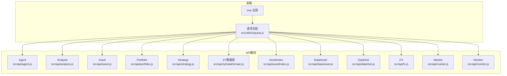
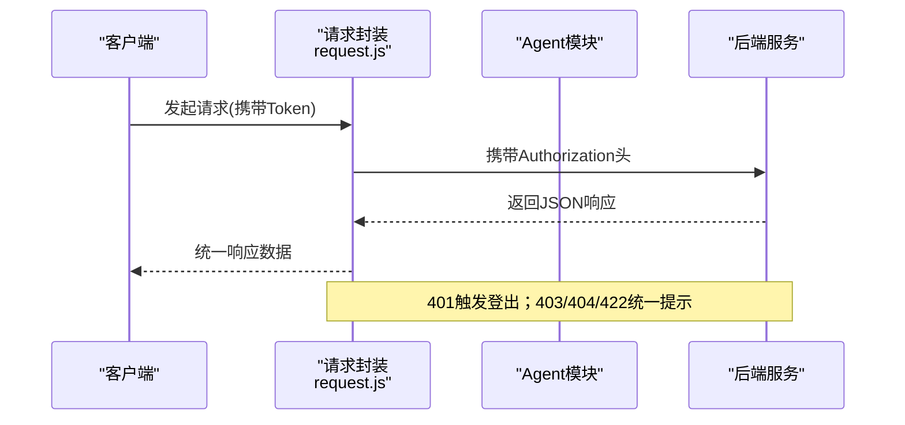
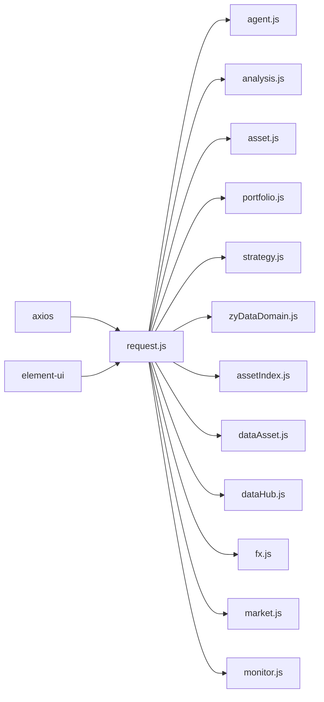

# API参考

<cite>
**本文引用的文件**
- [agent.js](file://src/api/agent.js)
- [analysis.js](file://src/api/analysis.js)
- [asset.js](file://src/api/asset.js)
- [portfolio.js](file://src/api/portfolio.js)
- [strategy.js](file://src/api/strategy.js)
- [zyDataDomain.js](file://src/api/zyDataDomain.js)
- [assetIndex.js](file://src/api/assetIndex.js)
- [dataAsset.js](file://src/api/dataAsset.js)
- [dataHub.js](file://src/api/dataHub.js)
- [fx.js](file://src/api/fx.js)
- [market.js](file://src/api/market.js)
- [monitor.js](file://src/api/monitor.js)
- [request.js](file://src/utils/request.js)
- [apiError.js](file://src/utils/apiError.js)
- [package.json](file://package.json)
</cite>

## 目录
1. [简介](#简介)
2. [项目结构](#项目结构)
3. [核心组件](#核心组件)
4. [架构总览](#架构总览)
5. [详细组件分析](#详细组件分析)
6. [依赖关系分析](#依赖关系分析)
7. [性能考虑](#性能考虑)
8. [故障排查指南](#故障排查指南)
9. [结论](#结论)
10. [附录](#附录)

## 简介
本文件为投资组合管理系统的API参考文档，覆盖Agent智能助手、Analysis数据分析、Asset资产管理、Portfolio组合管理、Strategy策略管理、ZY数据域等模块的RESTful接口定义。内容包括：
- 接口清单：HTTP方法、URL模式、请求参数、响应格式
- 参数说明：必填/可选、数据类型、取值范围
- 错误码与异常处理机制
- 认证授权、API版本、速率限制与使用规范
- 客户端集成指南与最佳实践

## 项目结构
前端通过统一的请求封装层发起API调用，各功能模块在src/api目录下按领域拆分，便于维护与扩展。

**图示来源**
- [request.js:1-100](file://src/utils/request.js#L1-L100)
- [agent.js:1-168](file://src/api/agent.js#L1-L168)
- [analysis.js:1-43](file://src/api/analysis.js#L1-L43)
- [asset.js:1-284](file://src/api/asset.js#L1-L284)
- [portfolio.js:1-72](file://src/api/portfolio.js#L1-L72)
- [strategy.js:1-295](file://src/api/strategy.js#L1-L295)
- [zyDataDomain.js:1-190](file://src/api/zyDataDomain.js#L1-L190)
- [assetIndex.js:1-29](file://src/api/assetIndex.js#L1-L29)
- [dataAsset.js:1-59](file://src/api/dataAsset.js#L1-L59)
- [dataHub.js:1-95](file://src/api/dataHub.js#L1-L95)
- [fx.js:1-57](file://src/api/fx.js#L1-L57)
- [market.js:1-112](file://src/api/market.js#L1-L112)
- [monitor.js:1-227](file://src/api/monitor.js#L1-L227)

**章节来源**
- [request.js:1-100](file://src/utils/request.js#L1-L100)
- [package.json:1-45](file://package.json#L1-L45)

## 核心组件
- 请求封装与认证
  - 统一基地址与超时配置，自动注入Authorization头
  - 全局错误处理：401登出、403拒绝、404资源不存在、422校验详情、网络/超时提示
- ZY数据域通用CRUD
  - 优先调用后端接口，失败时自动降级到本地mock，避免404导致的阻塞
- SSE流式接口
  - 市场同步、组合维护等长耗时任务采用SSE流式返回进度

**章节来源**
- [request.js:1-100](file://src/utils/request.js#L1-L100)
- [zyDataDomain.js:1-190](file://src/api/zyDataDomain.js#L1-L190)
- [market.js:1-112](file://src/api/market.js#L1-L112)

## 架构总览

**图示来源**
- [request.js:11-97](file://src/utils/request.js#L11-L97)

## 详细组件分析

### Agent 智能助手接口
- 说明
  - 支持非流式对话、流式对话（SSE）、对话历史、记忆管理、报告与分析模板管理、附件上传
  - 流式对话使用原生fetch，支持AbortSignal中断
- 认证
  - Authorization: Bearer {token}
- 超时
  - 非流式对话：默认超时；流式对话：由后端SSE控制
- 关键接口
  - 非流式对话
    - 方法: POST
    - 路径: /api/v1/agent/chat
    - 请求体: 包含消息与场景标识（可选）
    - 响应: 文本/JSON（后端定义）
  - 流式对话
    - 方法: POST
    - 路径: /api/v1/agent/chat/stream
    - 请求头: Content-Type: application/json, Authorization: Bearer {token}
    - 请求体: { message, scene? }
    - 响应: text/event-stream（SSE）
  - 对话列表
    - 方法: GET
    - 路径: /api/v1/agent/conversations
    - 查询参数: 无
    - 响应: 列表
  - 对话详情（含分页）
    - 方法: GET
    - 路径: /api/v1/agent/conversations/{id}
    - 查询参数: page, page_size
    - 响应: 对话消息列表（分页）
  - 删除对话
    - 方法: DELETE
    - 路径: /api/v1/agent/conversations/{id}
    - 响应: 成功/失败
  - 更新对话标题
    - 方法: PUT
    - 路径: /api/v1/agent/conversations/{id}/title
    - 请求体: { title }
    - 响应: 成功/失败
  - 记忆列表
    - 方法: GET
    - 路径: /api/v1/agent/memories
    - 响应: 列表
  - 删除记忆
    - 方法: DELETE
    - 路径: /api/v1/agent/memories/{id}
    - 响应: 成功/失败
  - 搜索记忆
    - 方法: POST
    - 路径: /api/v1/agent/memories/search
    - 请求体: 搜索条件
    - 响应: 结果集
  - 报告管理
    - 列表: GET /api/v1/agent/reports
    - 详情: GET /api/v1/agent/reports/{reportId}
    - 删除: DELETE /api/v1/agent/reports/{reportId}
    - 导出: GET /api/v1/agent/reports/{reportId}/export
  - 分析模板
    - 列表: GET /api/v1/agent/analysis-templates
    - 新增: POST /api/v1/agent/analysis-templates
    - 详情: GET /api/v1/agent/analysis-templates/{templateId}
    - 更新: PUT /api/v1/agent/analysis-templates/{templateId}
    - 删除: DELETE /api/v1/agent/analysis-templates/{templateId}
    - 执行: POST /api/v1/agent/analysis-templates/{templateId}/execute
  - 附件上传
    - 方法: POST
    - 路径: /api/v1/agent/upload-attachment
    - 请求体: multipart/form-data
    - 响应: 上传结果

**章节来源**
- [agent.js:1-168](file://src/api/agent.js#L1-L168)

### Analysis 数据分析接口
- 说明
  - 提供资产指标、相关性矩阵、时间序列、仪表盘数据等分析能力
- 关键接口
  - 资产指标
    - 方法: POST
    - 路径: /api/v1/analysis/asset-metrics
    - 请求体: 分析参数
    - 响应: 指标结果
  - 相关性矩阵
    - 方法: POST
    - 路径: /api/v1/analysis/correlation-matrix
    - 查询参数: method（默认pearson）
    - 请求体: 分析参数
    - 响应: 矩阵结果
  - 时间序列
    - 方法: POST
    - 路径: /api/v1/analysis/timeseries
    - 请求体: 分析参数
    - 响应: 时间序列
  - 仪表盘
    - 方法: POST
    - 路径: /api/v1/analysis/dashboard
    - 请求体: 分析参数
    - 响应: 仪表盘聚合

**章节来源**
- [analysis.js:1-43](file://src/api/analysis.js#L1-L43)

### Asset 资产管理接口
- 说明
  - 资产基础管理、K线、模板下载、Excel导入、JSON导入、批量导入、删除单条/批量行情、覆盖率缺口、多资产导入流程、进度轮询等
- 关键接口
  - 资产列表
    - 方法: GET
    - 路径: /api/v1/assets/
    - 查询参数: asset_type, is_active, code, name, skip, limit
    - 响应: 资产列表
  - 资产选项
    - 方法: GET
    - 路径: /api/v1/assets/options
    - 查询参数: asset_type?
    - 响应: 精简选项
  - 创建资产
    - 方法: POST
    - 路径: /api/v1/assets/
    - 请求体: 资产数据
    - 响应: 新建资产
  - 更新资产
    - 方法: PUT
    - 路径: /api/v1/assets/{assetId}
    - 请求体: 资产数据
    - 响应: 更新结果
  - 资产详情
    - 方法: GET
    - 路径: /api/v1/assets/{assetId}
    - 响应: 资产详情
  - 删除资产
    - 方法: DELETE
    - 路径: /api/v1/assets/{assetId}
    - 响应: 删除结果
  - K线数据
    - 方法: GET
    - 路径: /api/v1/assets/{assetCode}/kline
    - 查询参数: start_date, end_date, all_calendar_days(true/false)
    - 响应: K线序列
  - 下载资产模板
    - 方法: GET
    - 路径: /api/v1/assets/template/download
    - 响应: Excel Blob
  - Excel导入资产
    - 方法: POST
    - 路径: /api/v1/assets/import/excel
    - 请求体: multipart/form-data
    - 响应: 导入结果
  - 下载价格模板（单资产）
    - 方法: GET
    - 路径: /api/v1/assets/prices/template/download
    - 查询参数: kind（full/open/high/low/close/volume/amount/scale）
    - 响应: Excel Blob
  - 下载多资产模板
    - 方法: GET
    - 路径: /api/v1/assets/prices/template/download/multi-asset
    - 查询参数: metric（close/open/high/low/amount/volume/scale）
    - 响应: Excel Blob
  - Excel导入价格
    - 方法: POST
    - 路径: /api/v1/assets/prices/import/excel
    - 查询参数: asset_code, replace_existing, only_date?, only_missing_dates?
    - 请求体: multipart/form-data
    - 响应: 导入结果
  - JSON导入价格
    - 方法: POST
    - 路径: /api/v1/assets/prices/import
    - 请求体: { asset_code, replace_existing, only_missing_dates, prices[] }
    - 响应: 导入结果
  - 删除单条价格
    - 方法: DELETE
    - 路径: /api/v1/assets/{assetCode}/prices/{date}
    - 响应: 删除结果
  - 批量删除价格
    - 方法: DELETE
    - 路径: /api/v1/assets/{assetCode}/prices
    - 请求体: { dates[] }
    - 响应: 删除结果
  - 价格覆盖率缺口
    - 方法: GET
    - 路径: /api/v1/assets/prices/coverage-gaps
    - 查询参数: asset_code, start_date, end_date
    - 响应: 缺口日期列表
  - 多资产导入：预览
    - 方法: POST
    - 路径: /api/v1/assets/prices/import/multi-asset/preview
    - 查询参数: metric
    - 请求体: multipart/form-data
    - 响应: 冲突/预览信息
  - 多资产导入：解析
    - 方法: POST
    - 路径: /api/v1/assets/prices/import/multi-asset/parse
    - 查询参数: metric
    - 请求体: multipart/form-data
    - 响应: 资产+行情集合
  - 多资产导入：分析
    - 方法: POST
    - 路径: /api/v1/assets/prices/import/multi-asset/analyze
    - 查询参数: metric
    - 请求体: multipart/form-data
    - 响应: 匹配与分析结果
  - 多资产导入：行预览统计
    - 方法: POST
    - 路径: /api/v1/assets/prices/import/multi-asset/row-preview-stats
    - 请求体: { target_code, prices[] }
    - 响应: 统计信息
  - 多资产导入：单资产导入
    - 方法: POST
    - 路径: /api/v1/assets/prices/import/multi-asset/single
    - 请求体: 单资产导入数据
    - 响应: 导入结果
  - 价格导入进度
    - 方法: GET
    - 路径: /api/v1/assets/prices/import/progress
    - 查询参数: progress_id
    - 响应: 进度状态

**章节来源**
- [asset.js:1-284](file://src/api/asset.js#L1-L284)

### Portfolio 组合管理接口
- 说明
  - 模拟组合的增删改查、调仓记录、分析、详情等
- 关键接口
  - 组合列表
    - 方法: GET
    - 路径: /api/v1/portfolios/
    - 响应: 列表
  - 单个组合
    - 方法: GET
    - 路径: /api/v1/portfolios/{portfolioId}
    - 响应: 组合信息
  - 创建组合
    - 方法: POST
    - 路径: /api/v1/portfolios/
    - 请求体: 组合数据
    - 响应: 新建组合
  - 记录调仓
    - 方法: POST
    - 路径: /api/v1/portfolios/{portfolioId}/rebalance
    - 请求体: 调仓数据
    - 响应: 记录结果
  - 调仓记录列表
    - 方法: GET
    - 路径: /api/v1/portfolios/{portfolioId}/rebalance-records
    - 响应: 列表
  - 组合分析
    - 方法: GET
    - 路径: /api/v1/portfolios/{portfolioId}/analysis
    - 响应: 分析数据
  - 删除组合
    - 方法: DELETE
    - 路径: /api/v1/portfolios/{portfolioId}
    - 响应: 删除结果
  - 组合详情
    - 方法: GET
    - 路径: /api/v1/portfolios/{portfolioId}/details
    - 响应: 详情（含业绩与持仓）

**章节来源**
- [portfolio.js:1-72](file://src/api/portfolio.js#L1-L72)

### Strategy 策略管理接口
- 说明
  - 模型模板、策略模型、回测、实盘发布/取消、实时监控、基准等
- 关键接口
  - 模板列表
    - 方法: GET
    - 路径: /api/v1/model-templates/
    - 响应: 列表
  - 模板详情
    - 方法: GET
    - 路径: /api/v1/model-templates/{code}
    - 响应: 模板
  - 创建模板
    - 方法: POST
    - 路径: /api/v1/model-templates/
    - 请求体: 模板数据
    - 响应: 新建模板
  - 更新模板
    - 方法: PUT
    - 路径: /api/v1/model-templates/{templateId}
    - 请求体: 模板数据
    - 响应: 更新结果
  - 验证模板
    - 方法: POST
    - 路径: /api/v1/model-templates/validate
    - 请求体: 模板数据
    - 响应: 校验结果
  - 创建策略模型
    - 方法: POST
    - 路径: /api/v1/strategy-models/
    - 请求体: 模型数据
    - 响应: 新建模型
  - 策略模型列表
    - 方法: GET
    - 路径: /api/v1/strategy-models/
    - 查询参数: 过滤项（空值过滤）
    - 响应: 列表
  - 策略模型详情
    - 方法: GET
    - 路径: /api/v1/strategy-models/{modelId}
    - 响应: 模型详情
  - 运行回测
    - 方法: POST
    - 路径: /api/v1/backtests/run-by-model/{modelId}
    - 请求体: 回测参数
    - 响应: 回测结果
  - 更新回测备注
    - 方法: PATCH
    - 路径: /api/v1/strategy-models/{modelId}/backtests/{recordId}
    - 请求体: { remark }
    - 响应: 更新结果
  - 基于快照计算指标
    - 方法: POST
    - 路径: /api/v1/backtests/compute-metrics-from-snapshots
    - 请求体: { snapshots[], cutoff_date }
    - 响应: 指标结果
  - 权重上限（按代码）
    - 方法: GET
    - 路径: /api/v1/backtests/max-weights
    - 查询参数: thscodes（逗号分隔）
    - 响应: 权重上限
  - 发布模型
    - 方法: POST
    - 路径: /api/v1/strategy-models/{modelId}/publish
    - 响应: 发布结果
  - 实盘发布
    - 方法: POST
    - 路径: /api/v1/strategy-models/{modelId}/live-publish
    - 请求体: 实盘参数
    - 响应: 发布结果
  - 取消实盘发布
    - 方法: POST
    - 路径: /api/v1/strategy-models/{modelId}/live-unpublish
    - 查询参数: 取消参数
    - 响应: 取消结果
  - 实盘配置
    - 获取: GET /api/v1/strategy-models/{modelId}/live-config
    - 更新: PATCH /api/v1/strategy-models/{modelId}/live-config
  - 实盘已发布列表
    - 方法: GET
    - 路径: /api/v1/strategy-models/live/published
    - 查询参数: 过滤项
    - 响应: 列表
  - 实盘准入（监控）
    - 方法: GET
    - 路径: /api/v1/strategy-models/live/eligible-for-monitor
    - 查询参数: 过滤项
    - 响应: 列表
  - 实盘监控数据
    - 方法: GET
    - 路径: /api/v1/strategy-models/{modelId}/live-monitoring
    - 响应: 监控数据
  - 手动调仓确认/跳过
    - 方法: POST
    - 路径: /api/v1/strategy-models/{modelId}/manual-rebalance
    - 请求体: 调仓指令
    - 响应: 结果
  - 实盘变更日志
    - 方法: GET
    - 路径: /api/v1/strategy-models/{modelId}/live-change-logs
    - 查询参数: 过滤项
    - 响应: 日志
  - 删除策略模型
    - 方法: DELETE
    - 路径: /api/v1/strategy-models/{modelId}
    - 响应: 删除结果
  - 更新策略模型
    - 方法: PUT
    - 路径: /api/v1/strategy-models/{modelId}
    - 请求体: 模型数据
    - 响应: 更新结果
  - 算法计算
    - 方法: POST
    - 路径: /api/v1/algorithms/calculate
    - 请求体: 计算参数
    - 响应: 计算结果
  - 业绩基准
    - 列表: GET /api/v1/benchmarks/
    - 详情: GET /api/v1/benchmarks/{benchmarkId}
    - 按代码: GET /api/v1/benchmarks/by-code/{code}
    - 新增: POST /api/v1/benchmarks/
    - 更新: PUT /api/v1/benchmarks/{benchmarkId}
    - 删除: DELETE /api/v1/benchmarks/{benchmarkId}

**章节来源**
- [strategy.js:1-295](file://src/api/strategy.js#L1-L295)

### ZY数据域接口
- 说明
  - 通用CRUD：列表、新增、更新、删除、计数
  - 自动降级：后端404/网络错误时切换到本地mock
- 关键接口
  - 列表
    - 方法: GET
    - 路径: /api/v1/zy-data/{collection}
    - 查询参数: page, pageSize, filters_json（JSON字符串）
    - 响应: 列表
  - 新增
    - 方法: POST
    - 路径: /api/v1/zy-data/{collection}
    - 请求体: 记录数据
    - 响应: 新建结果
  - 更新
    - 方法: PUT
    - 路径: /api/v1/zy-data/{collection}/{id}
    - 请求体: 记录数据
    - 响应: 更新结果
  - 删除
    - 方法: DELETE
    - 路径: /api/v1/zy-data/{collection}/{id}
    - 响应: 删除结果
  - 计数
    - 方法: GET
    - 路径: /api/v1/zy-data/{collection}/count
    - 响应: 数量
  - 工具
    - isMockMode(): 是否处于mock模式
    - enableMock(): 强制启用mock
    - resetMockData(): 重置mock数据

**章节来源**
- [zyDataDomain.js:1-190](file://src/api/zyDataDomain.js#L1-L190)

### 大类资产指数接口
- 说明
  - 提供可选开始日期与回测运行
- 关键接口
  - 开始日期列表
    - 方法: GET
    - 路径: /api/v1/asset-index/start-dates
    - 响应: 日期列表
  - 回测运行
    - 方法: GET
    - 路径: /api/v1/asset-index/backtest
    - 查询参数: vol_threshold, start_date, end_date
    - 响应: 回测结果

**章节来源**
- [assetIndex.js:1-29](file://src/api/assetIndex.js#L1-L29)

### 数据资产管理接口
- 说明
  - 数据资产的增删改查、同步、统计刷新、种子初始化
- 关键接口
  - 列表: GET /api/v1/data-assets
  - 汇总: GET /api/v1/data-assets/summary
  - 详情: GET /api/v1/data-assets/{assetId}
  - 新增: POST /api/v1/data-assets
  - 更新: PUT /api/v1/data-assets/{assetId}
  - 同步: POST /api/v1/data-assets/{assetId}/sync
  - 刷新统计: POST /api/v1/data-assets/{assetId}/refresh-stats
  - 种子初始化: POST /api/v1/data-assets/seed

**章节来源**
- [dataAsset.js:1-59](file://src/api/dataAsset.js#L1-L59)

### 数据接入Hub接口
- 说明
  - 连接器元数据、导入、记录查询、批次、统计、字段、去重等
- 关键接口
  - 连接器列表: GET /api/v1/data-hub/connectors
  - 导入: POST /api/v1/data-hub/{connectorId}/import
  - 记录查询: POST /api/v1/data-hub/{connectorId}/records
  - 记录详情: GET /api/v1/data-hub/{connectorId}/records/{pk}
  - 批次列表: GET /api/v1/data-hub/{connectorId}/batches
  - 批次详情: GET /api/v1/data-hub/{connectorId}/batches/{batchId}
  - 统计: GET /api/v1/data-hub/{connectorId}/stats/overview
  - 字段: GET /api/v1/data-hub/{connectorId}/fields
  - 去重: GET /api/v1/data-hub/{connectorId}/distinct

**章节来源**
- [dataHub.js:1-95](file://src/api/dataHub.js#L1-L95)

### 汇率接口
- 说明
  - 汇率导入（全量/增量）、手动录入、统计、时序
- 关键接口
  - 导入: POST /api/v1/fx/import
    - 查询参数: mode（replace/incremental）
    - 请求体: file
  - 手动录入: POST /api/v1/fx/manual
    - 请求体: { date, EUR?, USD?, HKD?, CNH? }
  - 统计: GET /api/v1/fx/stats
  - 时序: GET /api/v1/fx/rates
    - 查询参数: start_date, end_date

**章节来源**
- [fx.js:1-57](file://src/api/fx.js#L1-L57)

### 市场行情接口
- 说明
  - SSE流式进度解析、当日行情同步、组合维护
- 关键接口
  - SSE解析
    - 函数: parseSSEStream(response, onMessage, onDone)
    - 作用: 解析每行data: JSON，推送进度；收到done后回调结束
  - 当日行情同步（SSE）
    - 方法: POST
    - 路径: /api/v1/market/sync-today/stream
    - 响应: SSE流
  - 组合维护（SSE）
    - 方法: POST
    - 路径: /api/v1/market/portfolio/groups/{groupId}/maintain/stream
    - 响应: SSE流

**章节来源**
- [market.js:1-112](file://src/api/market.js#L1-L112)

### 监控接口
- 说明
  - 监控状态、净值历史、事件日志、持仓、绩效、信号、运行控制、日报、主观调仓、资产分析、损益归因
- 关键接口
  - 监控状态: GET /api/v1/monitor/state
  - 净值历史: GET /api/v1/monitor/nav-history
  - 事件日志: GET /api/v1/monitor/events
  - 持仓明细: GET /api/v1/monitor/positions
  - 绩效指标: GET /api/v1/monitor/performance
  - 信号状态: GET /api/v1/monitor/signals
  - 运行监控（单日）: POST /api/v1/monitor/run
  - 初始化监控: POST /api/v1/monitor/init
  - 运行监控（范围）: POST /api/v1/monitor/run-range
  - 指定日期日报: GET /api/v1/monitor/reports/{date}
  - 日报列表: GET /api/v1/monitor/reports
  - 主观调仓指令列表: GET /api/v1/monitor/subjective
  - 添加主观调仓: POST /api/v1/monitor/subjective
  - 取消主观调仓: PUT /api/v1/monitor/subjective/{id}/cancel
  - 底层资产相关性矩阵: POST /api/v1/analysis/correlation-matrix
  - 底层资产指标: POST /api/v1/analysis/asset-metrics
  - 当日损益归因: GET /api/v1/monitor/daily-attribution

**章节来源**
- [monitor.js:1-227](file://src/api/monitor.js#L1-L227)

## 依赖关系分析
- 统一请求封装
  - axios实例：默认超时、baseURL、请求头注入
  - 响应拦截：统一错误提示与路由跳转
- 模块耦合
  - 各API模块仅依赖request.js，低耦合高内聚
- 外部依赖
  - axios、element-ui消息提示

**图示来源**
- [request.js:1-100](file://src/utils/request.js#L1-L100)
- [package.json:11-28](file://package.json#L11-L28)

**章节来源**
- [request.js:1-100](file://src/utils/request.js#L1-L100)
- [package.json:11-28](file://package.json#L11-L28)

## 性能考虑
- 超时策略
  - 默认60秒；针对回测、发布、导入等长耗时接口提供更高超时配置
- SSE流式处理
  - 避免长时间阻塞，提升用户体验
- 批量导入
  - 提供预览、解析、分析、逐条导入与进度轮询，降低单次导入压力
- 并发与节流
  - 建议客户端对高频查询进行节流与缓存

[本节为通用指导，无需具体文件分析]

## 故障排查指南
- 常见错误与处理
  - 401 未授权：清除本地token并引导重新登录
  - 403 拒绝访问：检查权限与角色
  - 404 资源不存在：确认URL与参数
  - 422 参数校验失败：根据后端返回的detail修正请求
  - 网络/超时：检查后端服务、网络与VUE_APP_BASE_URL配置
- 错误提取
  - 使用统一错误提取函数，优先取后端detail/message
- Mock兜底
  - ZY数据域在后端不可用时自动切换本地mock，确保功能可用

**章节来源**
- [request.js:36-96](file://src/utils/request.js#L36-L96)
- [apiError.js:1-18](file://src/utils/apiError.js#L1-L18)
- [zyDataDomain.js:26-46](file://src/api/zyDataDomain.js#L26-L46)

## 结论
本API参考文档系统梳理了Agent、Analysis、Asset、Portfolio、Strategy、ZY数据域等模块的接口定义与使用规范。通过统一的请求封装与错误处理机制，结合SSE流式与Mock兜底策略，为客户端提供了稳定、可扩展的集成基础。建议在生产环境中严格遵循认证、参数校验与超时策略，并结合批量导入与进度轮询提升大体量数据处理效率。

[本节为总结，无需具体文件分析]

## 附录

### 认证与授权
- 方式
  - Bearer Token
  - 自动注入Authorization头
- 登录流程
  - 前端登录成功后保存token，后续请求自动携带
- 401处理
  - 统一提示并触发登出

**章节来源**
- [request.js:12-25](file://src/utils/request.js#L12-L25)

### API版本与基地址
- 版本
  - v1：/api/v1/*
- 基地址
  - VUE_APP_BASE_URL（默认 http://127.0.0.1:8000）

**章节来源**
- [request.js:7-8](file://src/utils/request.js#L7-L8)

### 速率限制与并发
- 未在前端显式实现速率限制
- 建议客户端对高频接口进行节流与缓存
- 长耗时接口请使用SSE或进度轮询

[本节为通用指导，无需具体文件分析]

### 客户端集成最佳实践
- 统一错误处理
  - 使用统一错误提取函数与消息提示
- 超时与重试
  - 针对长耗时接口设置合理超时；必要时实现指数退避重试
- SSE处理
  - 正确解析SSE流，及时关闭连接与AbortSignal
- Mock模式
  - 在后端不可用时启用mock，确保开发与演示可用

**章节来源**
- [apiError.js:1-18](file://src/utils/apiError.js#L1-L18)
- [market.js:17-58](file://src/api/market.js#L17-L58)
- [zyDataDomain.js:54-62](file://src/api/zyDataDomain.js#L54-L62)