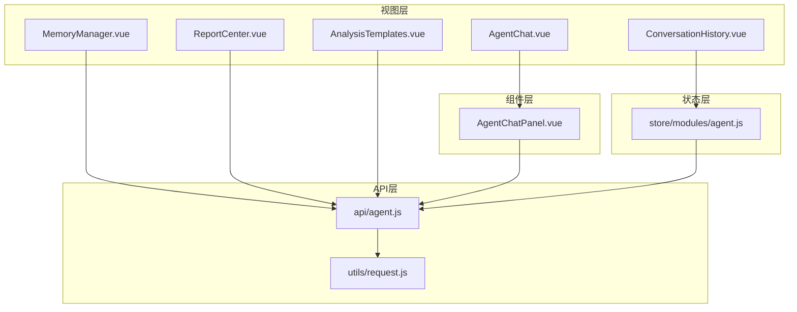
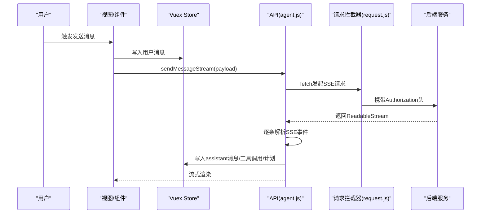
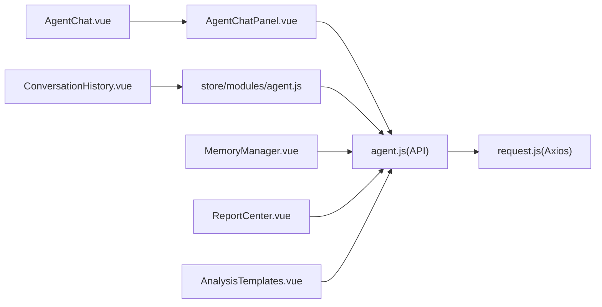

# Agent智能助手API

<cite>
**本文引用的文件**
- [agent.js](file://src/api/agent.js)
- [request.js](file://src/utils/request.js)
- [agent.js](file://src/store/modules/agent.js)
- [AgentChat.vue](file://src/views/agent/AgentChat.vue)
- [AgentChatPanel.vue](file://src/components/AgentChatPanel.vue)
- [MemoryManager.vue](file://src/views/agent/MemoryManager.vue)
- [ReportCenter.vue](file://src/views/agent/ReportCenter.vue)
- [AnalysisTemplates.vue](file://src/views/agent/AnalysisTemplates.vue)
- [ConversationHistory.vue](file://src/views/agent/ConversationHistory.vue)
</cite>

## 目录
1. [简介](#简介)
2. [项目结构](#项目结构)
3. [核心组件](#核心组件)
4. [架构总览](#架构总览)
5. [详细组件分析](#详细组件分析)
6. [依赖关系分析](#依赖关系分析)
7. [性能考量](#性能考量)
8. [故障排查指南](#故障排查指南)
9. [结论](#结论)
10. [附录](#附录)

## 简介
本文件为Agent智能助手模块的完整API文档，覆盖以下功能域：
- 对话管理：发送消息、获取对话列表、获取对话详情、删除对话、更新对话标题
- 记忆管理：获取记忆列表、删除记忆、搜索记忆
- 报告管理：获取报告列表、获取报告详情、删除报告、导出报告
- 分析模板管理：获取模板列表、创建模板、获取模板详情、更新模板、删除模板、执行模板
- 附件上传：上传对话附件
- 流式对话SSE：基于原生fetch的SSE实现，支持中止、会话归属校验、事件解析
- 认证与分页：统一通过Axios拦截器注入Token，分页参数page/page_size通用

## 项目结构
Agent智能助手前端模块主要由API层、状态管理层、视图层与组件层构成：
- API层：封装REST接口，统一请求与响应处理
- 状态层：Vuex模块管理对话、消息、流式状态与分页
- 视图层：对话历史、记忆管理、报告中心、分析模板等页面
- 组件层：聊天面板、输入框、数据表格、图表渲染等

**图表来源**
- [AgentChat.vue:1-249](file://src/views/agent/AgentChat.vue#L1-L249)
- [ConversationHistory.vue:1-349](file://src/views/agent/ConversationHistory.vue#L1-L349)
- [MemoryManager.vue:1-470](file://src/views/agent/MemoryManager.vue#L1-L470)
- [ReportCenter.vue:1-260](file://src/views/agent/ReportCenter.vue#L1-L260)
- [AnalysisTemplates.vue:1-509](file://src/views/agent/AnalysisTemplates.vue#L1-L509)
- [AgentChatPanel.vue:1-1199](file://src/components/AgentChatPanel.vue#L1-L1199)
- [agent.js:1-230](file://src/store/modules/agent.js#L1-L230)
- [agent.js:1-168](file://src/api/agent.js#L1-L168)
- [request.js:1-100](file://src/utils/request.js#L1-L100)

**章节来源**
- [AgentChat.vue:1-249](file://src/views/agent/AgentChat.vue#L1-L249)
- [AgentChatPanel.vue:1-1199](file://src/components/AgentChatPanel.vue#L1-L1199)
- [agent.js:1-230](file://src/store/modules/agent.js#L1-L230)
- [agent.js:1-168](file://src/api/agent.js#L1-L168)
- [request.js:1-100](file://src/utils/request.js#L1-L100)

## 核心组件
- API封装：统一导出REST接口函数，包括非流式对话、对话分页、记忆、报告、模板、附件上传与SSE流式对话
- 请求拦截器：自动注入Authorization Bearer Token，统一路由错误提示
- Vuex模块：管理对话列表、当前会话、消息分页、流式状态、场景映射等
- 视图与组件：页面负责筛选、分页、交互；组件负责SSE事件解析、消息渲染、工具调用进度与图表渲染

**章节来源**
- [agent.js:1-168](file://src/api/agent.js#L1-L168)
- [request.js:1-100](file://src/utils/request.js#L1-L100)
- [agent.js:1-230](file://src/store/modules/agent.js#L1-L230)

## 架构总览
Agent智能助手的前后端交互遵循REST风格，SSE用于流式对话。认证通过请求拦截器自动附加Token。

**图表来源**
- [AgentChatPanel.vue:784-937](file://src/components/AgentChatPanel.vue#L784-L937)
- [agent.js:78-112](file://src/api/agent.js#L78-L112)
- [request.js:11-25](file://src/utils/request.js#L11-L25)

## 详细组件分析

### 对话管理接口
- 发送消息（非流式）
  - 方法：POST
  - 路径：/api/v1/agent/chat
  - 请求体：JSON对象，字段包含message、conversation_id、scene、attachments、system_turn_addon等
  - 响应：后端返回消息内容与工具调用结果
  - 超时：5分钟
  - 适用场景：快速一次性回复，适合简单问答或无工具链路
  - 代码片段路径：[sendMessage:4-11](file://src/api/agent.js#L4-L11)

- 流式对话（SSE）
  - 方法：POST
  - 路径：/api/v1/agent/chat/stream
  - 请求体：JSON对象，字段与非流式相同
  - 响应：SSE流，事件类型包括text_delta、tool_start、tool_result、message_start、message_end、plan_update、error、heartbeat
  - 会话归属：组件内部通过_abortController与_ownerConversationId确保串话防护
  - 代码片段路径：[sendMessageStream:78-112](file://src/api/agent.js#L78-L112)、[handleSend:784-937](file://src/components/AgentChatPanel.vue#L784-L937)、[processSSEEvent:963-1083](file://src/components/AgentChatPanel.vue#L963-L1083)

- 获取对话列表
  - 方法：GET
  - 路径：/api/v1/agent/conversations
  - 查询参数：无固定必填项，后端返回items或conversations数组
  - 代码片段路径：[getConversations:14-20](file://src/api/agent.js#L14-L20)

- 获取对话详情（含消息历史，支持分页）
  - 方法：GET
  - 路径：/api/v1/agent/conversations/{id}
  - 查询参数：page（默认1）、page_size（默认20）
  - 响应：包含messages、total、has_more、page等
  - 代码片段路径：[getConversation:23-33](file://src/api/agent.js#L23-L33)

- 删除对话
  - 方法：DELETE
  - 路径：/api/v1/agent/conversations/{id}
  - 代码片段路径：[deleteConversation:36-41](file://src/api/agent.js#L36-L41)

- 更新对话标题
  - 方法：PUT
  - 路径：/api/v1/agent/conversations/{id}/title
  - 请求体：{ title }
  - 代码片段路径：[updateConversationTitle:44-50](file://src/api/agent.js#L44-L50)

- 分页参数
  - page：页码，默认1
  - page_size：每页数量，默认20
  - 代码片段路径：[getConversation:27-31](file://src/api/agent.js#L27-L31)、[loadConversation:129-149](file://src/store/modules/agent.js#L129-L149)

- 错误码处理
  - 401：未授权，全局提示并触发登出
  - 403：拒绝访问
  - 404：资源不存在
  - 422：参数校验失败（组件内打印细节）
  - 5xx：交由组件级捕获
  - 代码片段路径：[request拦截器:36-96](file://src/utils/request.js#L36-L96)

**章节来源**
- [agent.js:4-50](file://src/api/agent.js#L4-L50)
- [agent.js:14-33](file://src/api/agent.js#L14-L33)
- [agent.js:36-50](file://src/api/agent.js#L36-L50)
- [agent.js:78-112](file://src/api/agent.js#L78-L112)
- [agent.js:129-149](file://src/store/modules/agent.js#L129-L149)
- [request.js:36-96](file://src/utils/request.js#L36-L96)
- [AgentChatPanel.vue:784-937](file://src/components/AgentChatPanel.vue#L784-L937)
- [AgentChatPanel.vue:963-1083](file://src/components/AgentChatPanel.vue#L963-L1083)

### 记忆管理接口
- 获取记忆列表
  - 方法：GET
  - 路径：/api/v1/agent/memories
  - 查询参数：user_id（示例：default）、page、page_size、category（可选）
  - 响应：memories数组、total
  - 代码片段路径：[getMemories:53-59](file://src/api/agent.js#L53-L59)

- 删除记忆
  - 方法：DELETE
  - 路径：/api/v1/agent/memories/{id}
  - 代码片段路径：[deleteMemory:62-67](file://src/api/agent.js#L62-L67)

- 搜索记忆
  - 方法：POST
  - 路径：/api/v1/agent/memories/search
  - 请求体：{ keywords: string[], user_id }
  - 响应：memories数组
  - 代码片段路径：[searchMemories:69-76](file://src/api/agent.js#L69-L76)

- 分页参数
  - page/page_size：默认20条
  - 代码片段路径：[fetchMemories:194-206](file://src/views/agent/MemoryManager.vue#L194-L206)

- 错误码处理
  - 统一由请求拦截器处理401/403/404/422
  - 代码片段路径：[request拦截器:36-96](file://src/utils/request.js#L36-L96)

**章节来源**
- [agent.js:53-76](file://src/api/agent.js#L53-L76)
- [MemoryManager.vue:190-241](file://src/views/agent/MemoryManager.vue#L190-L241)
- [request.js:36-96](file://src/utils/request.js#L36-L96)

### 报告管理接口
- 获取报告列表
  - 方法：GET
  - 路径：/api/v1/agent/reports
  - 查询参数：page、page_size、template_type（可选）、status（可选）
  - 响应：items或reports数组、total
  - 代码片段路径：[getReports:115-117](file://src/api/agent.js#L115-L117)

- 获取报告详情
  - 方法：GET
  - 路径：/api/v1/agent/reports/{reportId}
  - 响应：content/rendered_content等
  - 代码片段路径：[getReport:119-121](file://src/api/agent.js#L119-L121)

- 删除报告
  - 方法：DELETE
  - 路径：/api/v1/agent/reports/{reportId}
  - 代码片段路径：[deleteReport:123-125](file://src/api/agent.js#L123-L125)

- 导出报告
  - 方法：GET
  - 路径：/api/v1/agent/reports/{reportId}/export
  - 响应：markdown内容
  - 代码片段路径：[exportReport:127-129](file://src/api/agent.js#L127-L129)

- 分页参数
  - page/page_size：默认20条
  - 代码片段路径：[loadReports:122-142](file://src/views/agent/ReportCenter.vue#L122-L142)

- 下载逻辑
  - 优先调用导出接口；若不可用则回退到详情接口
  - 代码片段路径：[handleDownload:151-178](file://src/views/agent/ReportCenter.vue#L151-L178)

**章节来源**
- [agent.js:115-129](file://src/api/agent.js#L115-L129)
- [ReportCenter.vue:122-178](file://src/views/agent/ReportCenter.vue#L122-L178)
- [request.js:36-96](file://src/utils/request.js#L36-L96)

### 分析模板管理接口
- 获取模板列表
  - 方法：GET
  - 路径：/api/v1/agent/analysis-templates
  - 查询参数：page、page_size、category（可选）、status（可选）
  - 响应：items或templates数组、total
  - 代码片段路径：[getAnalysisTemplates:132-134](file://src/api/agent.js#L132-L134)

- 创建模板
  - 方法：POST
  - 路径：/api/v1/agent/analysis-templates
  - 请求体：包含name/display_name/description/tags/parameters/steps/output_template
  - 代码片段路径：[createAnalysisTemplate:136-138](file://src/api/agent.js#L136-L138)

- 获取模板详情
  - 方法：GET
  - 路径：/api/v1/agent/analysis-templates/{templateId}
  - 响应：模板完整定义
  - 代码片段路径：[getAnalysisTemplate:140-142](file://src/api/agent.js#L140-L142)

- 更新模板
  - 方法：PUT
  - 路径：/api/v1/agent/analysis-templates/{templateId}
  - 请求体：模板定义
  - 代码片段路径：[updateAnalysisTemplate:144-146](file://src/api/agent.js#L144-L146)

- 删除模板
  - 方法：DELETE
  - 路径：/api/v1/agent/analysis-templates/{templateId}
  - 代码片段路径：[deleteAnalysisTemplate:148-150](file://src/api/agent.js#L148-L150)

- 执行模板
  - 方法：POST
  - 路径：/api/v1/agent/analysis-templates/{templateId}/execute
  - 请求体：{ params }
  - 响应：执行结果与渲染内容
  - 代码片段路径：[executeAnalysisTemplate:152-154](file://src/api/agent.js#L152-L154)

- 分页参数
  - page/page_size：默认20条
  - 代码片段路径：[loadTemplates:214-230](file://src/views/agent/AnalysisTemplates.vue#L214-L230)

- 执行与渲染
  - 支持参数校验、步骤执行、Markdown渲染与表格展示
  - 代码片段路径：[handleExecute:249-264](file://src/views/agent/AnalysisTemplates.vue#L249-L264)、[renderMd:384-388](file://src/views/agent/AnalysisTemplates.vue#L384-L388)

**章节来源**
- [agent.js:132-154](file://src/api/agent.js#L132-L154)
- [AnalysisTemplates.vue:214-264](file://src/views/agent/AnalysisTemplates.vue#L214-L264)
- [AnalysisTemplates.vue:384-388](file://src/views/agent/AnalysisTemplates.vue#L384-L388)
- [request.js:36-96](file://src/utils/request.js#L36-L96)

### 附件上传接口
- 上传对话附件
  - 方法：POST
  - 路径：/api/v1/agent/upload-attachment
  - 请求体：multipart/form-data，字段file
  - 响应：上传结果（ID等）
  - 超时：60秒
  - 代码片段路径：[uploadAttachment:156-167](file://src/api/agent.js#L156-L167)

- 在SSE发送时附带附件ID
  - 组件在发送payload时将attachments数组传入
  - 代码片段路径：[handleSend:784-852](file://src/components/AgentChatPanel.vue#L784-L852)

**章节来源**
- [agent.js:156-167](file://src/api/agent.js#L156-L167)
- [AgentChatPanel.vue:784-852](file://src/components/AgentChatPanel.vue#L784-L852)

### 认证机制
- 请求拦截器自动注入Authorization: Bearer Token
- 登录状态来自store.state.user.token
- 401时全局提示并触发登出
- 代码片段路径：[request拦截器:11-25](file://src/utils/request.js#L11-L25)

**章节来源**
- [request.js:11-25](file://src/utils/request.js#L11-L25)

### 流式对话SSE实现要点
- 使用原生fetch建立SSE连接，支持AbortSignal中止
- 事件解析：text_delta、tool_start、tool_result、message_start、message_end、plan_update、error、heartbeat
- 会话归属校验：_sseOwnerConversationId与_currentConversationId一致性
- 中止策略：切换会话、组件销毁、AbortError均中止流
- 代码片段路径：[sendMessageStream:78-112](file://src/api/agent.js#L78-L112)、[processSSEEvent:963-1083](file://src/components/AgentChatPanel.vue#L963-L1083)

**章节来源**
- [agent.js:78-112](file://src/api/agent.js#L78-L112)
- [AgentChatPanel.vue:963-1083](file://src/components/AgentChatPanel.vue#L963-L1083)

## 依赖关系分析
- API层依赖请求拦截器统一注入Token与错误处理
- 组件层依赖API层与Vuex模块，负责事件解析与UI渲染
- 视图层依赖组件与API层，负责筛选、分页与交互

**图表来源**
- [AgentChatPanel.vue:228-242](file://src/components/AgentChatPanel.vue#L228-L242)
- [agent.js:1-168](file://src/api/agent.js#L1-L168)
- [request.js:1-100](file://src/utils/request.js#L1-L100)
- [agent.js:1-230](file://src/store/modules/agent.js#L1-L230)
- [AgentChat.vue:55-65](file://src/views/agent/AgentChat.vue#L55-L65)
- [ConversationHistory.vue:117-124](file://src/views/agent/ConversationHistory.vue#L117-L124)
- [MemoryManager.vue:149-151](file://src/views/agent/MemoryManager.vue#L149-L151)
- [ReportCenter.vue:87-88](file://src/views/agent/ReportCenter.vue#L87-L88)
- [AnalysisTemplates.vue:169-172](file://src/views/agent/AnalysisTemplates.vue#L169-L172)

**章节来源**
- [AgentChatPanel.vue:228-242](file://src/components/AgentChatPanel.vue#L228-L242)
- [agent.js:1-168](file://src/api/agent.js#L1-L168)
- [request.js:1-100](file://src/utils/request.js#L1-L100)
- [agent.js:1-230](file://src/store/modules/agent.js#L1-L230)

## 性能考量
- SSE长连接：建议在切换会话或组件销毁时及时中止，避免资源浪费
- 分页加载：对话详情默认每页20条，记忆与报告默认每页20条，合理设置page_size提升首屏速度
- 超时控制：对话接口默认5分钟，附件上传默认60秒，根据业务场景调整
- 虚拟滚动：消息列表使用动态虚拟滚动，减少DOM节点数量
- 代码片段路径：[loadConversation:129-149](file://src/store/modules/agent.js#L129-L149)、[fetchMemories:194-206](file://src/views/agent/MemoryManager.vue#L194-L206)、[loadReports:122-142](file://src/views/agent/ReportCenter.vue#L122-L142)

**章节来源**
- [agent.js:129-149](file://src/store/modules/agent.js#L129-L149)
- [MemoryManager.vue:194-206](file://src/views/agent/MemoryManager.vue#L194-L206)
- [ReportCenter.vue:122-142](file://src/views/agent/ReportCenter.vue#L122-L142)

## 故障排查指南
- 401未授权
  - 现象：全局提示未授权并触发登出
  - 处理：重新登录，确认Token有效
  - 代码片段路径：[request拦截器:41-44](file://src/utils/request.js#L41-L44)

- 422参数校验失败
  - 现象：控制台打印校验细节
  - 处理：检查请求体字段与类型
  - 代码片段路径：[request拦截器:45-51](file://src/utils/request.js#L45-L51)

- SSE异常
  - 现象：流式渲染中断或内容丢失
  - 处理：检查_abortController与_ownerConversationId一致性；确认后端事件格式
  - 代码片段路径：[processSSEEvent:963-1083](file://src/components/AgentChatPanel.vue#L963-L1083)

- 网络超时/连接失败
  - 现象：提示超时或网络错误
  - 处理：检查后端服务、网络与VUE_APP_BASE_URL配置
  - 代码片段路径：[request拦截器:65-93](file://src/utils/request.js#L65-L93)

**章节来源**
- [request.js:41-51](file://src/utils/request.js#L41-L51)
- [request.js:65-93](file://src/utils/request.js#L65-L93)
- [AgentChatPanel.vue:963-1083](file://src/components/AgentChatPanel.vue#L963-L1083)

## 结论
Agent智能助手API以清晰的REST接口与SSE流式对话为核心，结合统一的认证与错误处理机制，提供了完整的对话、记忆、报告与模板管理能力。通过分页与虚拟滚动优化，保障了大规模数据场景下的用户体验。建议在生产环境中：
- 明确SSE事件边界与错误处理策略
- 合理设置分页大小与超时阈值
- 关注Token生命周期与401自动登出流程

## 附录
- 环境变量
  - VUE_APP_BASE_URL：后端服务基础地址
  - 代码片段路径：[sendMessageStream:82-82](file://src/api/agent.js#L82-L82)

- 最佳实践
  - SSE：始终传入AbortSignal并在组件销毁时中止
  - 分页：统一使用page/page_size，避免一次性拉取过多数据
  - 认证：依赖请求拦截器自动注入，避免手动拼接头
  - 代码片段路径：[AgentChatPanel中止流:468-487](file://src/components/AgentChatPanel.vue#L468-L487)

**章节来源**
- [agent.js:82-82](file://src/api/agent.js#L82-L82)
- [AgentChatPanel.vue:468-487](file://src/components/AgentChatPanel.vue#L468-L487)