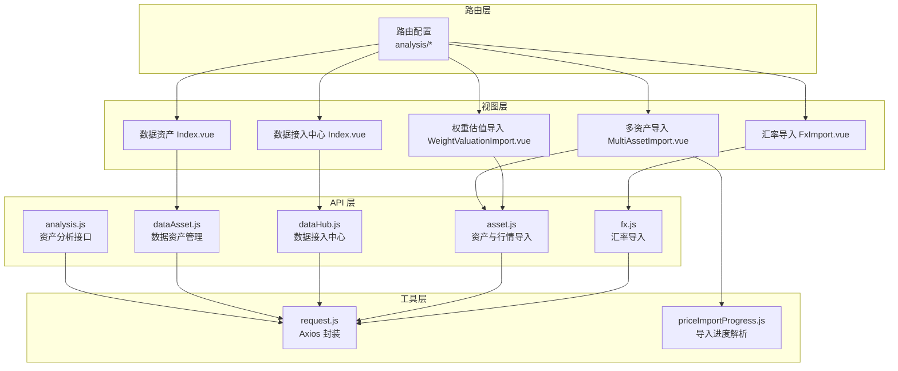
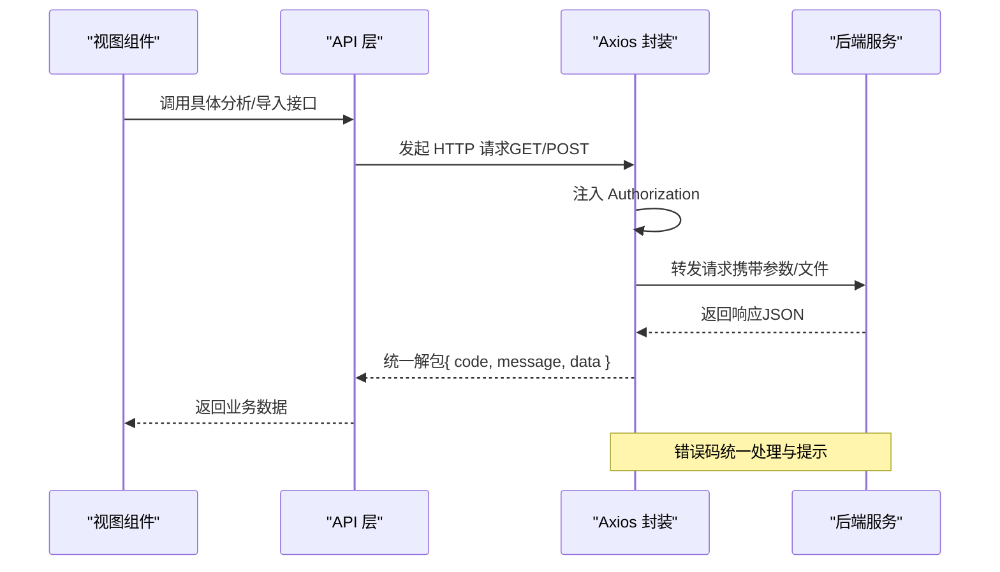
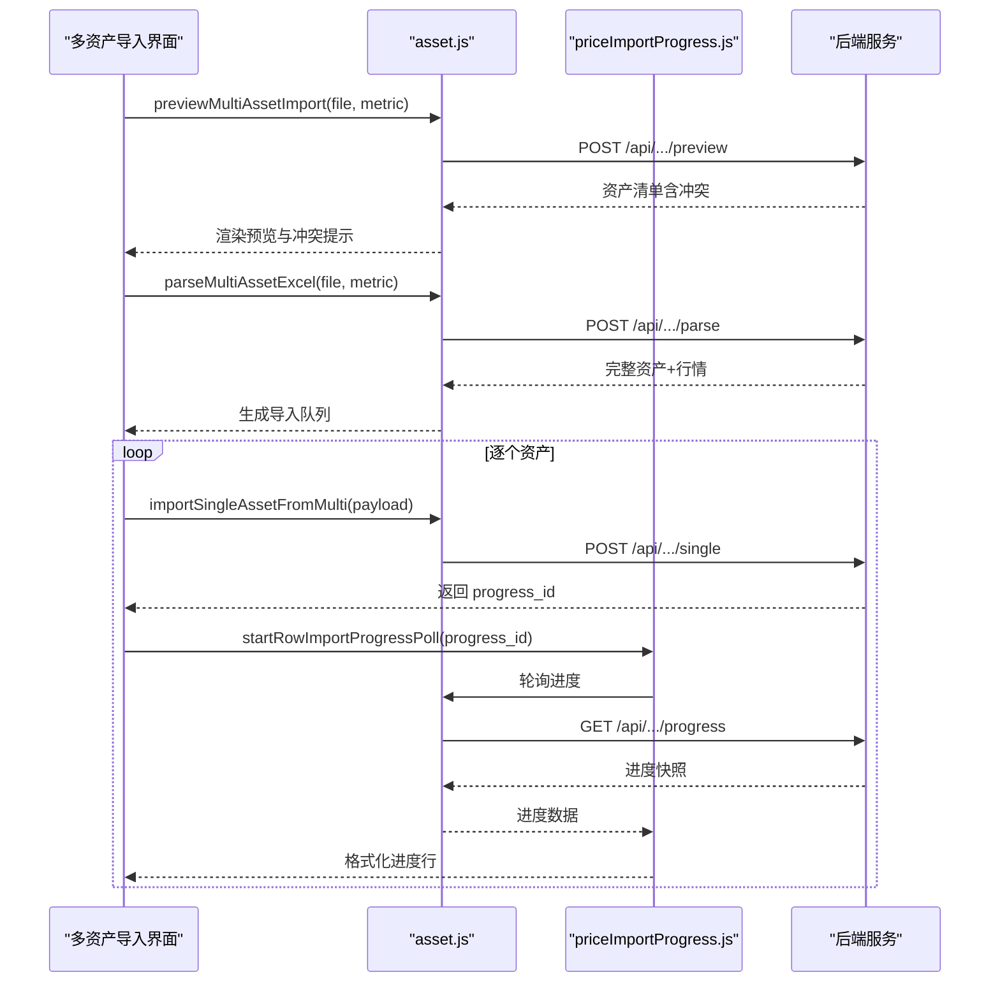
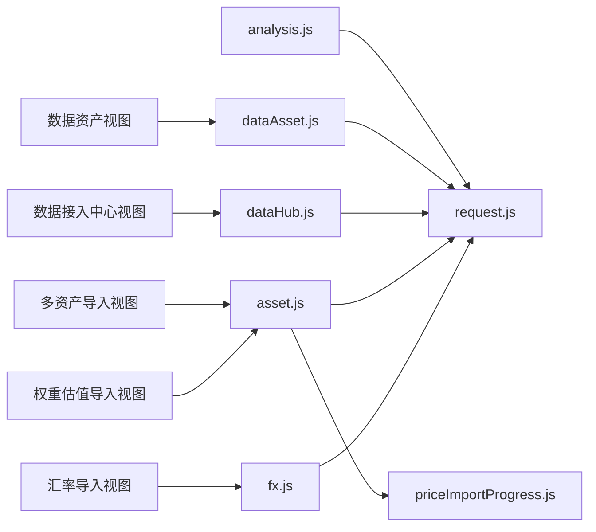

# Analysis数据分析API

<cite>
**本文档引用的文件**
- [analysis.js](file://src/api/analysis.js)
- [dataAsset.js](file://src/api/dataAsset.js)
- [dataHub.js](file://src/api/dataHub.js)
- [asset.js](file://src/api/asset.js)
- [fx.js](file://src/api/fx.js)
- [Index.vue（数据资产）](file://src/views/analysis/DataAsset/Index.vue)
- [Index.vue（数据接入中心）](file://src/views/analysis/DataHub/Index.vue)
- [MultiAssetImport.vue](file://src/views/analysis/MultiAssetImport.vue)
- [FxImport.vue](file://src/views/analysis/FxImport.vue)
- [WeightValuationImport.vue](file://src/views/analysis/WeightValuationImport.vue)
- [request.js](file://src/utils/request.js)
- [priceImportProgress.js](file://src/utils/priceImportProgress.js)
- [index.js（路由）](file://src/router/index.js)
</cite>

## 目录
1. [简介](#简介)
2. [项目结构](#项目结构)
3. [核心组件](#核心组件)
4. [架构总览](#架构总览)
5. [详细组件分析](#详细组件分析)
6. [依赖关系分析](#依赖关系分析)
7. [性能考虑](#性能考虑)
8. [故障排查指南](#故障排查指南)
9. [结论](#结论)
10. [附录](#附录)

## 简介
本文件为 Analysis 数据分析模块的全面 API 文档，覆盖以下能力：
- 数据资产分析接口：资产指标、相关性矩阵、时间序列、仪表盘
- 数据接入中心接口：连接器列表、导入、记录查询、批次管理、统计与字段
- 多资产行情导入接口：Excel 预览、解析、逐条导入、进度轮询
- 汇率导入接口：Excel 覆盖/增量导入、手动录入、统计与图表
- 权重与估值导入接口：多工作表解析、净值/回撤曲线、权重堆积图
- 主观权重导入接口：默认权重与调仓权重的交互与校验

文档面向数据分析师与开发者，提供接口定义、数据结构、参数说明、过滤与排序规则、数据验证、批量操作、文件上传处理、实时数据更新、格式转换、异常处理与性能优化建议。

## 项目结构
前端采用 Vue + Element UI + ECharts 构建，Analysis 模块通过独立的 API 层与视图层协作，路由统一管理入口。

**图表来源**
- [index.js（路由）:180-246](file://src/router/index.js#L180-L246)
- [analysis.js:1-43](file://src/api/analysis.js#L1-L43)
- [dataAsset.js:1-59](file://src/api/dataAsset.js#L1-L59)
- [dataHub.js:1-95](file://src/api/dataHub.js#L1-L95)
- [asset.js:1-284](file://src/api/asset.js#L1-L284)
- [fx.js:1-57](file://src/api/fx.js#L1-L57)
- [Index.vue（数据资产）:193-438](file://src/views/analysis/DataAsset/Index.vue#L193-L438)
- [Index.vue（数据接入中心）:95-198](file://src/views/analysis/DataHub/Index.vue#L95-L198)
- [MultiAssetImport.vue:155-371](file://src/views/analysis/MultiAssetImport.vue#L155-L371)
- [FxImport.vue:138-378](file://src/views/analysis/FxImport.vue#L138-L378)
- [WeightValuationImport.vue:135-534](file://src/views/analysis/WeightValuationImport.vue#L135-L534)
- [request.js:1-100](file://src/utils/request.js#L1-L100)
- [priceImportProgress.js:1-61](file://src/utils/priceImportProgress.js#L1-L61)

**章节来源**
- [index.js（路由）:180-246](file://src/router/index.js#L180-L246)

## 核心组件
- 资产分析接口：提供指标、相关性矩阵、时间序列、仪表盘四类分析能力，均通过 POST 提交参数。
- 数据资产管理：提供数据资产的增删改查、同步、统计刷新、从连接器初始化等。
- 数据接入中心：提供连接器元数据、导入、记录查询、批次查询、统计、字段与去重等。
- 多资产导入：支持 Excel 预览、解析、逐条导入、进度轮询与错误聚合。
- 汇率导入：支持 Excel 覆盖/增量导入、手动录入、统计与折线图。
- 权重与估值导入：支持多工作表解析、净值/回撤曲线、权重堆积图与数据明细表。
- 主观权重：默认权重与调仓权重的编辑、归一化、校验与可视化。

**章节来源**
- [analysis.js:7-42](file://src/api/analysis.js#L7-L42)
- [dataAsset.js:9-47](file://src/api/dataAsset.js#L9-L47)
- [dataHub.js:9-82](file://src/api/dataHub.js#L9-L82)
- [asset.js:214-283](file://src/api/asset.js#L214-L283)
- [fx.js:10-56](file://src/api/fx.js#L10-L56)
- [Index.vue（数据资产）:254-327](file://src/views/analysis/DataAsset/Index.vue#L254-L327)
- [Index.vue（数据接入中心）:147-196](file://src/views/analysis/DataHub/Index.vue#L147-L196)
- [MultiAssetImport.vue:242-368](file://src/views/analysis/MultiAssetImport.vue#L242-L368)
- [FxImport.vue:200-237](file://src/views/analysis/FxImport.vue#L200-L237)
- [WeightValuationImport.vue:304-342](file://src/views/analysis/WeightValuationImport.vue#L304-L342)

## 架构总览
前端通过 Axios 封装统一发起请求，自动注入 Authorization，并在响应层进行错误分类与提示。Analysis 模块的视图组件通过 API 层调用后端接口，实现数据资产、接入中心、导入与分析功能。

**图表来源**
- [request.js:11-96](file://src/utils/request.js#L11-L96)
- [analysis.js:8-42](file://src/api/analysis.js#L8-L42)
- [asset.js:214-283](file://src/api/asset.js#L214-L283)
- [fx.js:10-56](file://src/api/fx.js#L10-L56)

## 详细组件分析

### 资产分析接口
- 接口概览
  - 获取资产指标：POST /api/v1/analysis/asset-metrics
  - 获取相关性矩阵：POST /api/v1/analysis/correlation-matrix（支持 method 参数，默认 pearson）
  - 获取时间序列数据：POST /api/v1/analysis/timeseries
  - 获取仪表盘数据：POST /api/v1/analysis/dashboard
- 查询参数与过滤
  - 相关性矩阵支持 method=pearson|spearman|kendall
  - 时间序列与指标接口需根据具体业务传入资产代码、日期范围、指标类型等
- 排序规则
  - 默认按资产代码或时间升序；具体排序以后端实现为准
- 数据验证
  - 前端不进行强校验，后端返回 422 时由拦截器提示 detail
- 批量操作
  - 支持一次性提交多个资产或时间段
- 文件上传处理
  - 本模块不涉及文件上传
- 实时数据更新
  - 通过轮询或事件推送（后端支持情况以实际为准）

**章节来源**
- [analysis.js:7-42](file://src/api/analysis.js#L7-L42)

### 数据资产管理接口
- 接口概览
  - 列表：GET /api/v1/data-assets
  - 汇总：GET /api/v1/data-assets/summary
  - 详情：GET /api/v1/data-assets/{asset_id}
  - 创建：POST /api/v1/data-assets
  - 更新：PUT /api/v1/data-assets/{asset_id}
  - 同步：POST /api/v1/data-assets/{asset_id}/sync（超时 120s）
  - 刷新统计：POST /api/v1/data-assets/{asset_id}/refresh-stats
  - 从连接器初始化：POST /api/v1/data-assets/seed（超时 120s）
- 查询参数与过滤
  - 列表支持 asset_type、status、keyword、page、page_size
- 排序规则
  - 由后端实现，前端不参与排序
- 数据验证
  - 422 校验由拦截器输出 detail
- 批量操作
  - 通过“从连接器同步”触发批量初始化
- 文件上传处理
  - 本模块不涉及文件上传
- 实时数据更新
  - 同步与刷新接口触发后端异步任务，前端通过轮询或消息提示状态

**章节来源**
- [dataAsset.js:9-47](file://src/api/dataAsset.js#L9-L47)
- [Index.vue（数据资产）:254-327](file://src/views/analysis/DataAsset/Index.vue#L254-L327)

### 数据接入中心接口
- 接口概览
  - 连接器列表：GET /api/v1/data-hub/connectors（超时 60s）
  - 导入：POST /api/v1/data-hub/{connector_id}/import（超时 300s）
  - 记录查询：POST /api/v1/data-hub/{connector_id}/records（超时 60s）
  - 记录详情：GET /api/v1/data-hub/{connector_id}/records/{pk}
  - 批次列表：GET /api/v1/data-hub/{connector_id}/batches?page&page_size
  - 批次详情：GET /api/v1/data-hub/{connector_id}/batches/{batch_id}
  - 统计概览：GET /api/v1/data-hub/{connector_id}/stats/overview（超时 60s）
  - 字段定义：GET /api/v1/data-hub/{connector_id}/fields（超时 60s）
  - 去重：GET /api/v1/data-hub/{connector_id}/distinct?field&limit（超时 60s）
- 查询参数与过滤
  - 记录查询支持复杂过滤（由后端注册表驱动）
  - 批次列表支持分页
- 排序规则
  - 由后端实现，前端不参与排序
- 数据验证
  - 422 校验由拦截器输出 detail
- 批量操作
  - 导入接口支持批量写入（超时较长）
- 文件上传处理
  - 本模块不涉及文件上传
- 实时数据更新
  - 通过概览接口与批次详情刷新状态

**章节来源**
- [dataHub.js:9-82](file://src/api/dataHub.js#L9-L82)
- [Index.vue（数据接入中心）:147-196](file://src/views/analysis/DataHub/Index.vue#L147-L196)

### 多资产行情导入接口
- 功能要点
  - Excel 预览：解析冲突（名称不一致、已有行情）、生成资产清单
  - Excel 解析：返回完整资产+行情，供逐条导入
  - 逐条导入：单资产导入并返回进度 ID，支持轮询
  - 进度轮询：GET /api/v1/assets/prices/import/progress?progress_id
- 接口概览
  - 预览：POST /api/v1/assets/prices/import/multi-asset/preview（超时 600s）
  - 解析：POST /api/v1/assets/prices/import/multi-asset/parse（超时 600s）
  - 分析：POST /api/v1/assets/prices/import/multi-asset/analyze（超时 600s）
  - 单条导入：POST /api/v1/assets/prices/import/multi-asset/single（超时 600s）
  - 进度：GET /api/v1/assets/prices/import/progress
- 查询参数与过滤
  - 预览/解析/分析支持 metric 参数（如 close）
  - 单条导入支持 overwrite_name、replace_existing、progress_id、import_metric
- 排序规则
  - 预览表格支持全选、按资产代码排序
- 数据验证
  - 前端校验文件类型与数量；后端返回 422 时由拦截器输出 detail
- 批量操作
  - 支持多资产勾选后逐条导入
- 文件上传处理
  - 使用 FormData，自动设置 boundary；支持 .xlsx/.xls
- 实时数据更新
  - 轮询进度，解析后端快照并格式化展示

**图表来源**
- [asset.js:214-283](file://src/api/asset.js#L214-L283)
- [priceImportProgress.js:14-57](file://src/utils/priceImportProgress.js#L14-L57)
- [MultiAssetImport.vue:242-368](file://src/views/analysis/MultiAssetImport.vue#L242-L368)

**章节来源**
- [asset.js:214-283](file://src/api/asset.js#L214-L283)
- [priceImportProgress.js:14-57](file://src/utils/priceImportProgress.js#L14-L57)
- [MultiAssetImport.vue:242-368](file://src/views/analysis/MultiAssetImport.vue#L242-L368)

### 汇率导入接口
- 功能要点
  - Excel 导入：支持覆盖（全量删除后写入）与增量（仅填补缺失）
  - 手动录入：对人民币报价，至少填写一个大于 0 的币种列
  - 统计与图表：显示数据条数、起止日期；绘制汇率折线图
- 接口概览
  - 导入：POST /api/v1/fx/import（超时 120s）
  - 手动保存：POST /api/v1/fx/manual
  - 统计：GET /api/v1/fx/stats
  - 时序：GET /api/v1/fx/rates?start_date&end_date
- 查询参数与过滤
  - 导入支持 mode=replace|incremental
  - 时序支持日期范围
- 排序规则
  - 时序按日期升序
- 数据验证
  - 前端校验文件类型与必填项；后端返回 422 时由拦截器输出 detail
- 批量操作
  - Excel 导入为整体写入
- 文件上传处理
  - 使用 FormData，自动设置 boundary；支持 .xlsx/.xls
- 实时数据更新
  - 导入完成后刷新统计与图表

**章节来源**
- [fx.js:10-56](file://src/api/fx.js#L10-L56)
- [FxImport.vue:200-237](file://src/views/analysis/FxImport.vue#L200-L237)

### 权重与估值导入接口
- 功能要点
  - 多工作表解析：自动识别日期列与数值列，支持净值/估值与权重两类可视化
  - 净值/回撤曲线：参考回测布局，支持基准线与回撤面积
  - 权重堆积图：支持滚动缩放与百分比标注
  - 数据明细：表格展示原始数据
- 接口概览
  - Excel 解析：前端本地解析（XLSX），不涉及后端接口
  - 可视化渲染：前端基于 ECharts
- 查询参数与过滤
  - 本模块不涉及后端接口
- 排序规则
  - 日期列升序
- 数据验证
  - 日期识别与数值列筛选，自动忽略无效行
- 批量操作
  - 本模块不涉及后端批量导入
- 文件上传处理
  - 本模块不涉及后端接口
- 实时数据更新
  - 本模块不涉及后端实时更新

**章节来源**
- [WeightValuationImport.vue:196-534](file://src/views/analysis/WeightValuationImport.vue#L196-L534)

### 主观权重导入接口
- 功能要点
  - 默认权重：滑块/输入框编辑，合计建议为 100%，超过 100% 无法保存
  - 调仓权重：矩阵编辑，支持行内归一化、复制、等权填充
  - 归一化算法：精确到万分之一（百分比两位小数），确保合计为 100%
- 接口概览
  - 本模块为前端交互逻辑，不涉及后端接口
- 数据验证
  - 前端校验合计与范围；后端保存时进行二次校验
- 批量操作
  - 本模块不涉及后端批量导入
- 文件上传处理
  - 本模块不涉及后端接口
- 实时数据更新
  - 本模块不涉及后端实时更新

**章节来源**
- [SubjectiveWeightsFormPanel.vue:115-148](file://src/components/SubjectiveWeightsFormPanel.vue#L115-L148)
- [subjectiveWeights.js:10-37](file://src/utils/subjectiveWeights.js#L10-L37)

## 依赖关系分析
- 组件耦合
  - 视图组件依赖 API 层，API 层依赖 Axios 封装
  - 多资产导入依赖进度解析工具
- 外部依赖
  - Axios、Element UI、ECharts、XLSX
- 潜在循环依赖
  - 未发现循环依赖
- 接口契约
  - 统一返回 { code, message, data } 结构，错误码在拦截器中处理

**图表来源**
- [analysis.js:1-43](file://src/api/analysis.js#L1-L43)
- [dataAsset.js:1-59](file://src/api/dataAsset.js#L1-L59)
- [dataHub.js:1-95](file://src/api/dataHub.js#L1-L95)
- [asset.js:1-284](file://src/api/asset.js#L1-L284)
- [fx.js:1-57](file://src/api/fx.js#L1-L57)
- [request.js:1-100](file://src/utils/request.js#L1-L100)
- [priceImportProgress.js:1-61](file://src/utils/priceImportProgress.js#L1-L61)

**章节来源**
- [request.js:1-100](file://src/utils/request.js#L1-L100)

## 性能考虑
- 超时配置
  - 多资产导入、数据资产同步、种子初始化等长耗时操作设置了较高超时（600s/120s/300s）
- 轮询策略
  - 行情导入进度轮询间隔为 2000ms，避免频繁请求造成服务端压力
- 数据裁剪
  - K线接口支持按交易日历裁剪，必要时可传 all_calendar_days=true 获取完整序列
- 图表渲染
  - ECharts 在窗口 resize 时自动适配，避免重复初始化造成内存泄漏

**章节来源**
- [asset.js:155-156](file://src/api/asset.js#L155-L156)
- [dataAsset.js:36-46](file://src/api/dataAsset.js#L36-L46)
- [dataHub.js:20-21](file://src/api/dataHub.js#L20-L21)
- [priceImportProgress.js:60-61](file://src/utils/priceImportProgress.js#L60-L61)
- [asset.js:76-78](file://src/api/asset.js#L76-L78)
- [WeightValuationImport.vue:525-531](file://src/views/analysis/WeightValuationImport.vue#L525-L531)

## 故障排查指南
- 401 未授权
  - 检查 Authorization 头是否正确；自动跳转登录并清除状态
- 422 校验错误
  - 查看 detail 输出，定位字段与规则
- 403 拒绝访问
  - 检查权限与角色
- 404 资源不存在
  - 检查接口路径与参数
- 超时与网络错误
  - 检查后端服务是否启动、网络是否正常；长耗时接口可适当缩小数据范围
- 导入失败
  - 多资产导入：查看错误聚合与单资产进度；确认文件格式与字段
  - 汇率导入：确认覆盖/增量模式与必填币种

**章节来源**
- [request.js:36-96](file://src/utils/request.js#L36-L96)
- [MultiAssetImport.vue:343-354](file://src/views/analysis/MultiAssetImport.vue#L343-L354)
- [FxImport.vue:228-236](file://src/views/analysis/FxImport.vue#L228-L236)

## 结论
本模块提供了从数据资产、接入中心到导入与分析的完整链路，前端通过统一的 Axios 封装与错误处理机制保障了稳定性与一致性。多资产导入与进度轮询、汇率导入与图表渲染、权重与估值导入与可视化，均体现了良好的用户体验与可维护性。建议在生产环境中合理设置超时与轮询间隔，并严格遵循字段与格式规范，以获得最佳性能与可靠性。

## 附录
- 常用超时配置
  - 多资产导入：600000ms
  - 数据资产同步/种子：120000ms
  - 数据接入中心导入：300000ms
  - 其他接口：60000ms（可按需覆盖）
- 进度轮询间隔：2000ms
- 文件类型：.xlsx/.xls
- 关键参数
  - 相关性矩阵：method=pearson|spearman|kendall
  - 汇率导入：mode=replace|incremental
  - 多资产导入：metric=close 等