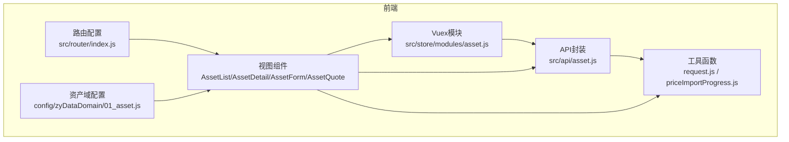
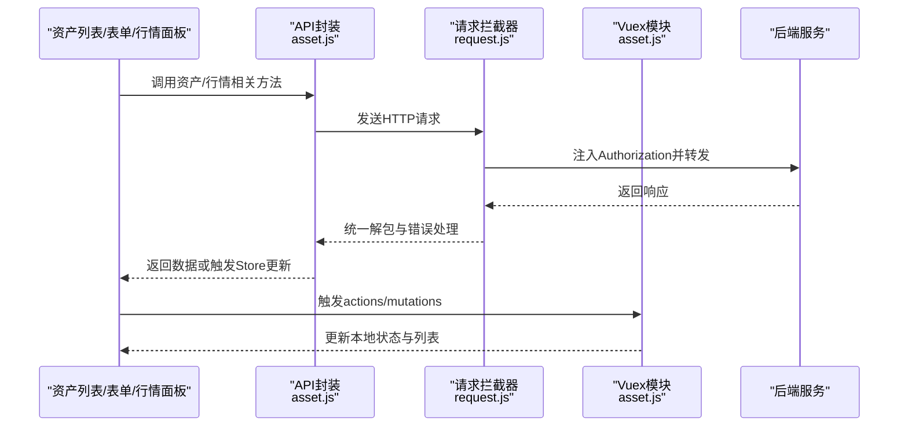
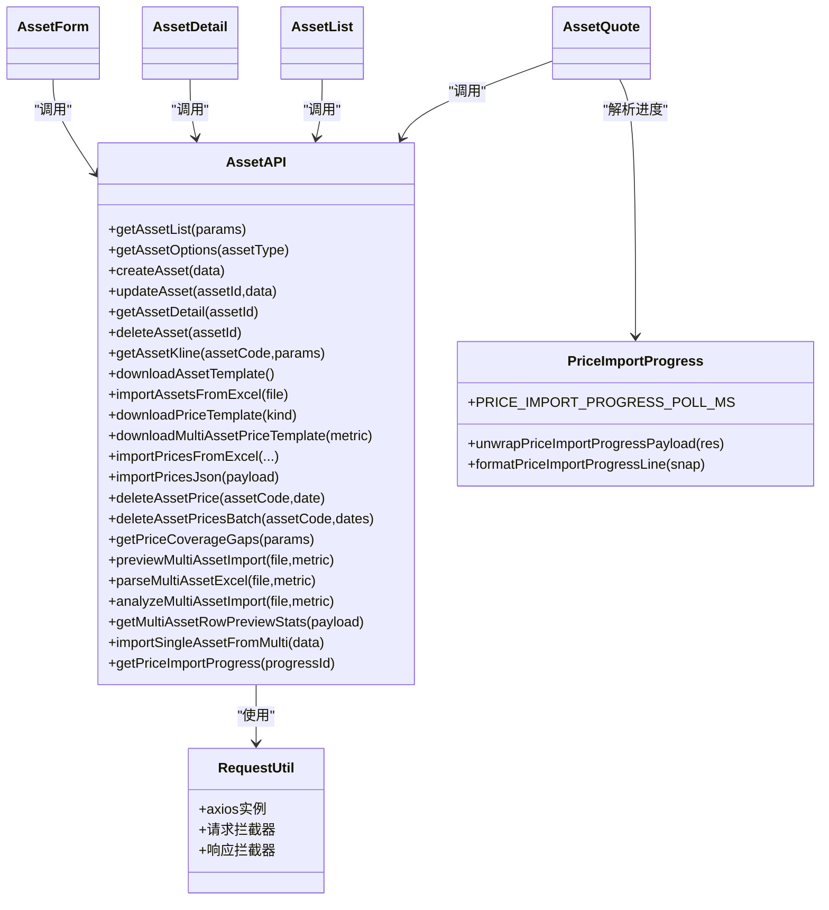
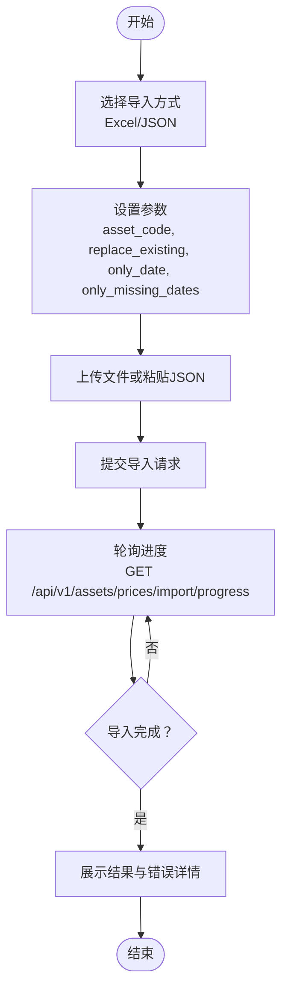

# 资产管理API

<cite>
**本文档引用的文件**
- [src/api/asset.js](file://src/api/asset.js)
- [src/store/modules/asset.js](file://src/store/modules/asset.js)
- [src/views/asset/AssetList.vue](file://src/views/asset/AssetList.vue)
- [src/views/asset/AssetDetail.vue](file://src/views/asset/AssetDetail.vue)
- [src/views/asset/AssetForm.vue](file://src/views/asset/AssetForm.vue)
- [src/views/asset/AssetQuote.vue](file://src/views/asset/AssetQuote.vue)
- [src/utils/request.js](file://src/utils/request.js)
- [src/utils/priceImportProgress.js](file://src/utils/priceImportProgress.js)
- [src/config/zyDataDomain/01_asset.js](file://src/config/zyDataDomain/01_asset.js)
- [src/router/index.js](file://src/router/index.js)
</cite>

## 目录
1. [简介](#简介)
2. [项目结构](#项目结构)
3. [核心组件](#核心组件)
4. [架构总览](#架构总览)
5. [详细组件分析](#详细组件分析)
6. [依赖关系分析](#依赖关系分析)
7. [性能考量](#性能考量)
8. [故障排查指南](#故障排查指南)
9. [结论](#结论)
10. [附录](#附录)

## 简介
本文件为资产管理模块的API集成指南，面向资产管理员与开发者，覆盖资产增删改查、详情查询、表单提交、行情导入、K线图表数据获取、批量操作、状态管理、权限控制、数据同步与错误处理等能力。文档同时提供接口定义、数据模型、流程图与最佳实践，帮助快速集成与稳定运维。

## 项目结构
资产管理功能由前端模块化组织，主要涉及API封装、状态管理、视图组件与路由配置：
- API层：统一封装HTTP请求，暴露资产与行情相关方法
- Store层：集中管理资产列表、分类、选中状态与加载状态
- 视图层：资产列表、详情、表单、行情面板等页面组件
- 工具层：请求拦截器、行情导入进度解析工具
- 配置层：资产域数据模型定义

**图表来源**
- [src/api/asset.js:1-284](file://src/api/asset.js#L1-L284)
- [src/store/modules/asset.js:1-183](file://src/store/modules/asset.js#L1-L183)
- [src/views/asset/AssetList.vue:1-346](file://src/views/asset/AssetList.vue#L1-L346)
- [src/views/asset/AssetDetail.vue:1-211](file://src/views/asset/AssetDetail.vue#L1-L211)
- [src/views/asset/AssetForm.vue:1-359](file://src/views/asset/AssetForm.vue#L1-L359)
- [src/views/asset/AssetQuote.vue:1-800](file://src/views/asset/AssetQuote.vue#L1-L800)
- [src/utils/request.js:1-100](file://src/utils/request.js#L1-L100)
- [src/utils/priceImportProgress.js:1-61](file://src/utils/priceImportProgress.js#L1-L61)
- [src/config/zyDataDomain/01_asset.js:1-137](file://src/config/zyDataDomain/01_asset.js#L1-L137)
- [src/router/index.js:1-378](file://src/router/index.js#L1-L378)

**章节来源**
- [src/api/asset.js:1-284](file://src/api/asset.js#L1-L284)
- [src/store/modules/asset.js:1-183](file://src/store/modules/asset.js#L1-L183)
- [src/views/asset/AssetList.vue:1-346](file://src/views/asset/AssetList.vue#L1-L346)
- [src/views/asset/AssetDetail.vue:1-211](file://src/views/asset/AssetDetail.vue#L1-L211)
- [src/views/asset/AssetForm.vue:1-359](file://src/views/asset/AssetForm.vue#L1-L359)
- [src/views/asset/AssetQuote.vue:1-800](file://src/views/asset/AssetQuote.vue#L1-L800)
- [src/utils/request.js:1-100](file://src/utils/request.js#L1-L100)
- [src/utils/priceImportProgress.js:1-61](file://src/utils/priceImportProgress.js#L1-L61)
- [src/config/zyDataDomain/01_asset.js:1-137](file://src/config/zyDataDomain/01_asset.js#L1-L137)
- [src/router/index.js:1-378](file://src/router/index.js#L1-L378)

## 核心组件
- API封装：提供资产列表、详情、增删改、K线、模板下载、行情导入、进度查询等方法
- Vuex模块：维护资产列表、分类、选中状态、总数与加载状态，并封装分页与兼容逻辑
- 视图组件：资产列表、详情、表单、行情面板，负责交互与数据展示
- 工具函数：请求拦截器统一处理鉴权与错误提示；行情导入进度解析工具
- 资产域配置：定义资产域数据模型字段、枚举与主键约束

**章节来源**
- [src/api/asset.js:1-284](file://src/api/asset.js#L1-L284)
- [src/store/modules/asset.js:1-183](file://src/store/modules/asset.js#L1-L183)
- [src/views/asset/AssetList.vue:1-346](file://src/views/asset/AssetList.vue#L1-L346)
- [src/views/asset/AssetDetail.vue:1-211](file://src/views/asset/AssetDetail.vue#L1-L211)
- [src/views/asset/AssetForm.vue:1-359](file://src/views/asset/AssetForm.vue#L1-L359)
- [src/views/asset/AssetQuote.vue:1-800](file://src/views/asset/AssetQuote.vue#L1-L800)
- [src/utils/request.js:1-100](file://src/utils/request.js#L1-L100)
- [src/utils/priceImportProgress.js:1-61](file://src/utils/priceImportProgress.js#L1-L61)
- [src/config/zyDataDomain/01_asset.js:1-137](file://src/config/zyDataDomain/01_asset.js#L1-L137)

## 架构总览
资产管理从前端发起HTTP请求，经请求拦截器注入鉴权信息，Store进行本地状态管理，视图组件负责渲染与交互。行情导入采用多阶段流程，支持Excel与JSON两种方式，并通过进度轮询反馈导入状态。

**图表来源**
- [src/api/asset.js:1-284](file://src/api/asset.js#L1-L284)
- [src/utils/request.js:1-100](file://src/utils/request.js#L1-L100)
- [src/store/modules/asset.js:1-183](file://src/store/modules/asset.js#L1-L183)

**章节来源**
- [src/api/asset.js:1-284](file://src/api/asset.js#L1-L284)
- [src/utils/request.js:1-100](file://src/utils/request.js#L1-L100)
- [src/store/modules/asset.js:1-183](file://src/store/modules/asset.js#L1-L183)

## 详细组件分析

### API封装（资产与行情）
- 资产管理
  - 列表查询：支持按资产类型、状态、代码、名称、分页参数过滤
  - 下拉选项：按资产类型获取精简选项
  - 新增/更新/删除：REST风格接口
  - 详情查询：按资产ID获取
- 行情管理
  - K线数据：支持按起止日期查询，可选返回完整日历序列
  - 模板下载：资产导入模板、单资产/多资产行情模板
  - 行情导入：Excel与JSON两种方式，支持替换现有、仅缺失日期、仅某日导入
  - 行情删除：单日删除与批量删除
  - 缺失日期查询：区间内相对交易日历的缺失日期
  - 多资产导入：预览、解析、分析、逐条导入、进度查询
- 方法一览（节选）
  - getAssetList(params)
  - getAssetOptions(assetType)
  - createAsset(data)
  - updateAsset(assetId, data)
  - getAssetDetail(assetId)
  - deleteAsset(assetId)
  - getAssetKline(assetCode, params)
  - downloadAssetTemplate()
  - importAssetsFromExcel(file)
  - downloadPriceTemplate(kind)
  - downloadMultiAssetPriceTemplate(metric)
  - importPricesFromExcel(assetCode, file, replaceExisting, onlyDate, onlyMissingDates)
  - importPricesJson(payload)
  - deleteAssetPrice(assetCode, date)
  - deleteAssetPricesBatch(assetCode, dates)
  - getPriceCoverageGaps(params)
  - previewMultiAssetImport(file, metric)
  - parseMultiAssetExcel(file, metric)
  - analyzeMultiAssetImport(file, metric)
  - getMultiAssetRowPreviewStats(payload)
  - importSingleAssetFromMulti(data)
  - getPriceImportProgress(progressId)

**章节来源**
- [src/api/asset.js:1-284](file://src/api/asset.js#L1-L284)

### Vuex模块（资产状态管理）
- 状态
  - 资产列表、分类、选中资产、加载状态、总数
- Mutations
  - SET_ASSET_LIST、SET_TOTAL、SET_LOADING、ADD_ASSET、UPDATE_ASSET、DELETE_ASSET、SET_SELECTED_ASSETS
- Actions
  - fetchAssetList(params)：兼容后端分页包装与数组返回
  - fetchAssetOptions(assetType)：兼容两种字段命名
  - addAsset(asset)：新增后本地追加
  - updateAsset({assetId, data})：更新后本地替换
  - deleteAsset(assetId)：删除后本地移除
- Getters
  - getAssetByCode、getAssetById、getAssetsByCategory、activeAssets

**章节来源**
- [src/store/modules/asset.js:1-183](file://src/store/modules/asset.js#L1-L183)

### 视图组件（资产列表/详情/表单/行情）

#### 资产列表（AssetList）
- 功能
  - 搜索过滤：资产代码、名称、分类
  - 分页：当前页、页大小、总数
  - 表格列：代码、名称、分类、交易所、替代标的、描述、状态、操作
  - 操作：行情、查看、编辑、删除
  - 表单弹窗：新增/编辑资产
  - 行情弹窗：查看K线与行情明细
- 关键交互
  - 下载模板、Excel批量导入资产
  - 删除资产二次确认
  - 分页变更触发列表刷新

**章节来源**
- [src/views/asset/AssetList.vue:1-346](file://src/views/asset/AssetList.vue#L1-L346)

#### 资产详情（AssetDetail）
- 功能
  - 展示资产基本信息与分类标签
  - 期货类参数：展期天数、阈值、观察窗口
  - 现货类参数：替代标的与切换日期
  - 加载中与错误状态处理
- 数据兼容
  - 兼容后端返回 { code, message, data } 与直接对象

**章节来源**
- [src/views/asset/AssetDetail.vue:1-211](file://src/views/asset/AssetDetail.vue#L1-L211)

#### 资产表单（AssetForm）
- 功能
  - 基本信息：代码、名称、分类、交易所、描述
  - 分类联动：期货类/现货类参数显隐与清空
  - 新增/编辑：编辑模式下禁用资产代码
  - 提交校验：必填字段校验
- 更新接口兼容
  - 若后端未实现更新接口，提示用户联系后端或删除重建

**章节来源**
- [src/views/asset/AssetForm.vue:1-359](file://src/views/asset/AssetForm.vue#L1-L359)

#### 资产行情（AssetQuote）
- 功能
  - 资产选择、日期范围、价格精度、Excel仅导入某日
  - 下载模板：单资产全列/单项、多资产宽表
  - Excel批量导入：单资产与多资产
  - 手动录入：收盘价必填，联动开/高/低
  - 快捷删除：单日删除与表格批量删除
  - K线图与行情明细表
  - 多资产导入：预览、解析、分析、逐条导入、进度轮询
- 进度与提示
  - 行情导入进度轮询，统一格式化展示
  - 缺失日期告警与一键应用

**章节来源**
- [src/views/asset/AssetQuote.vue:1-800](file://src/views/asset/AssetQuote.vue#L1-L800)
- [src/utils/priceImportProgress.js:1-61](file://src/utils/priceImportProgress.js#L1-L61)

### 数据模型与资产域配置
- 资产域配置文件定义了资产相关表的字段、类型、枚举与主键
- 字段示例：资产代码、名称、类型、交易所、描述、状态等
- 与前端表单字段映射：表单字段与配置字段保持一致，确保导入与展示一致性

**章节来源**
- [src/config/zyDataDomain/01_asset.js:1-137](file://src/config/zyDataDomain/01_asset.js#L1-L137)

### 权限控制与路由
- 路由守卫：登录校验与角色权限（如系统管理仅admin可见）
- 请求拦截器：自动注入Authorization头，统一处理401/403/404等错误

**章节来源**
- [src/router/index.js:1-378](file://src/router/index.js#L1-L378)
- [src/utils/request.js:1-100](file://src/utils/request.js#L1-L100)

## 依赖关系分析

**图表来源**
- [src/api/asset.js:1-284](file://src/api/asset.js#L1-L284)
- [src/utils/request.js:1-100](file://src/utils/request.js#L1-L100)
- [src/utils/priceImportProgress.js:1-61](file://src/utils/priceImportProgress.js#L1-L61)
- [src/views/asset/AssetQuote.vue:1-800](file://src/views/asset/AssetQuote.vue#L1-L800)

**章节来源**
- [src/api/asset.js:1-284](file://src/api/asset.js#L1-L284)
- [src/utils/request.js:1-100](file://src/utils/request.js#L1-L100)
- [src/utils/priceImportProgress.js:1-61](file://src/utils/priceImportProgress.js#L1-L61)
- [src/views/asset/AssetQuote.vue:1-800](file://src/views/asset/AssetQuote.vue#L1-L800)

## 性能考量
- 请求超时：默认60秒，部分行情导入接口额外延长超时时间以支持大批量数据
- 分页与缓存：列表分页减少一次性传输量；Store本地缓存提升交互流畅度
- 进度轮询：固定轮询间隔，避免频繁请求造成服务端压力
- 图表渲染：K线图按需渲染，避免不必要的重绘

[本节为通用建议，无需特定文件引用]

## 故障排查指南
- 401未授权：检查登录状态与Authorization头
- 403拒绝访问：检查用户角色与路由权限
- 404资源不存在：检查接口路径与资源ID
- 422校验错误：关注后端返回的detail字段，修正表单字段
- 网络超时/连接失败：确认后端服务运行、网络连通性与环境变量配置
- 行情导入失败：查看错误详情与进度轮询结果，定位具体日期与字段问题

**章节来源**
- [src/utils/request.js:1-100](file://src/utils/request.js#L1-L100)
- [src/views/asset/AssetQuote.vue:1-800](file://src/views/asset/AssetQuote.vue#L1-L800)

## 结论
资产管理API提供了完善的资产生命周期管理与行情导入能力，配合前端组件与工具函数，能够满足资产管理员与开发者在日常运营中的高频需求。通过统一的API封装、状态管理与错误处理机制，系统具备良好的扩展性与稳定性。

[本节为总结，无需特定文件引用]

## 附录

### API定义与参数说明

- 资产列表查询
  - 方法：GET /api/v1/assets/
  - 参数：asset_type、is_active、code、name、skip、limit
  - 返回：分页包装或数组，兼容后端格式
- 资产下拉选项
  - 方法：GET /api/v1/assets/options
  - 参数：asset_type（可选）
  - 返回：精简选项列表
- 新增资产
  - 方法：POST /api/v1/assets/
  - 参数：资产基本信息（见表单字段）
  - 返回：资产代码
- 更新资产
  - 方法：PUT /api/v1/assets/{id}
  - 参数：资产ID与更新数据
  - 返回：无（204）
- 资产详情
  - 方法：GET /api/v1/assets/{id}
  - 返回：资产对象或包装格式
- 删除资产
  - 方法：DELETE /api/v1/assets/{id}
  - 返回：无（204）
- K线数据
  - 方法：GET /api/v1/assets/{code}/kline
  - 参数：start_date、end_date、all_calendar_days（布尔）
  - 返回：K线序列
- 模板下载
  - 资产导入模板：GET /api/v1/assets/template/download
  - 单资产行情模板：GET /api/v1/assets/prices/template/download?kind={full|open|high|low|close|volume|amount|scale}
  - 多资产行情模板：GET /api/v1/assets/prices/template/download/multi-asset?metric={close|open|high|low|amount|volume|scale}
- 行情导入
  - Excel导入：POST /api/v1/assets/import/excel（FormData）
  - JSON导入：POST /api/v1/assets/prices/import（JSON）
  - 参数：asset_code、replace_existing、only_date、only_missing_dates、prices
- 行情删除
  - 单日删除：DELETE /api/v1/assets/{code}/prices/{date}
  - 批量删除：DELETE /api/v1/assets/{code}/prices（JSON：dates[]）
- 缺失日期查询
  - GET /api/v1/assets/prices/coverage-gaps?asset_code&start_date&end_date
- 多资产导入
  - 预览：POST /api/v1/assets/prices/import/multi-asset/preview
  - 解析：POST /api/v1/assets/prices/import/multi-asset/parse
  - 分析：POST /api/v1/assets/prices/import/multi-asset/analyze
  - 行级预估统计：POST /api/v1/assets/prices/import/multi-asset/row-preview-stats
  - 逐条导入：POST /api/v1/assets/prices/import/multi-asset/single
  - 进度查询：GET /api/v1/assets/prices/import/progress?progress_id

**章节来源**
- [src/api/asset.js:1-284](file://src/api/asset.js#L1-L284)

### 表单字段与校验规则
- 必填字段：资产代码、资产名称、资产分类
- 分类联动：期货类（展期天数、阈值、窗口p/q）、现货类（替代标的、切换日期）
- 输入范围：数字输入框的最小值、最大值、步长与精度
- 校验时机：表单提交时触发

**章节来源**
- [src/views/asset/AssetForm.vue:1-359](file://src/views/asset/AssetForm.vue#L1-L359)

### 行情导入流程（Excel/JSON）

**图表来源**
- [src/views/asset/AssetQuote.vue:1-800](file://src/views/asset/AssetQuote.vue#L1-L800)
- [src/utils/priceImportProgress.js:1-61](file://src/utils/priceImportProgress.js#L1-L61)