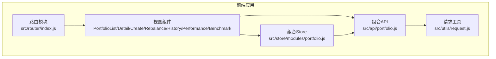
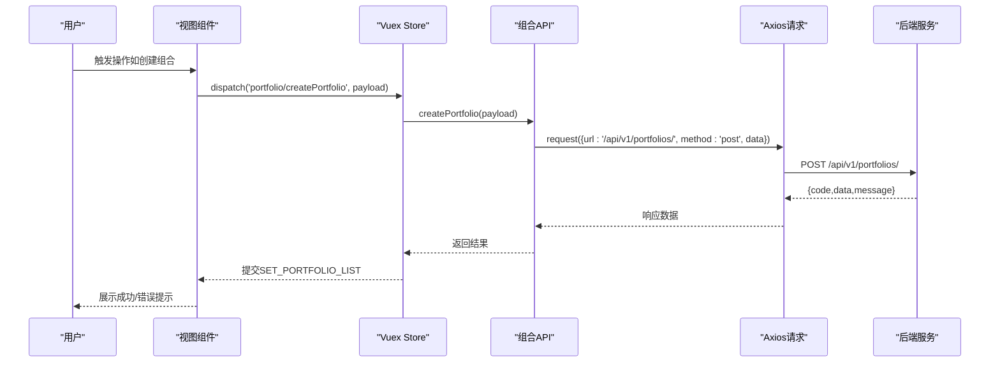
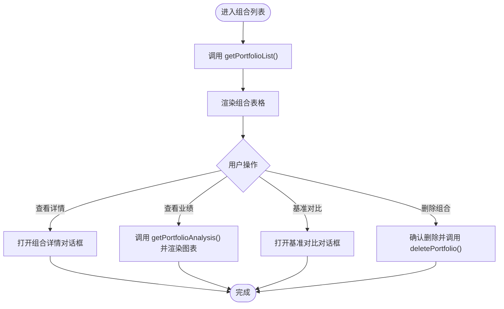
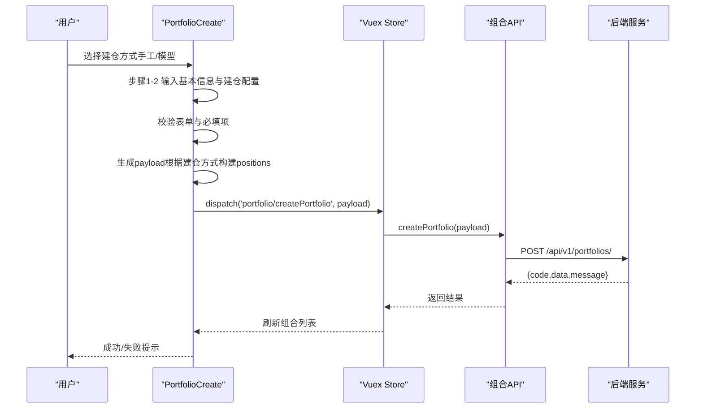
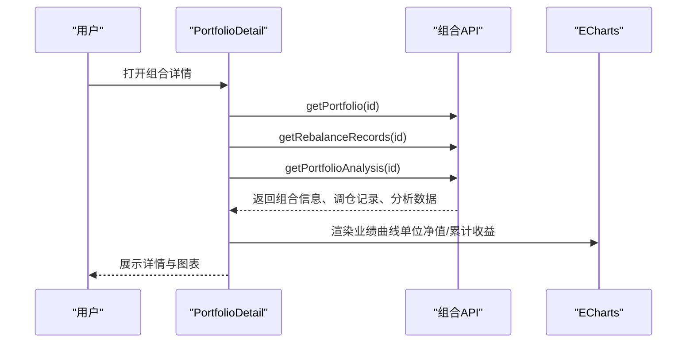
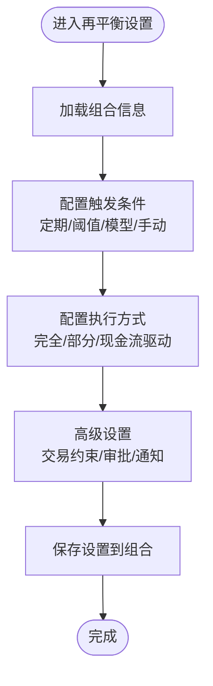
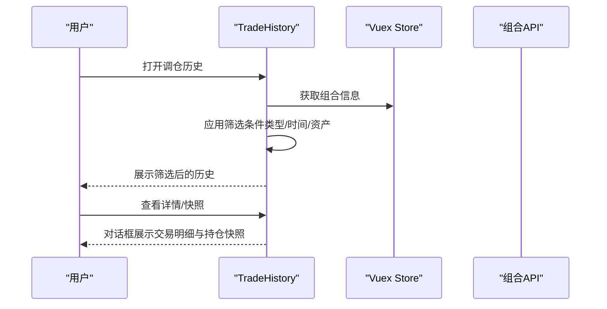
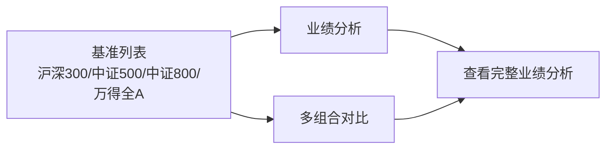
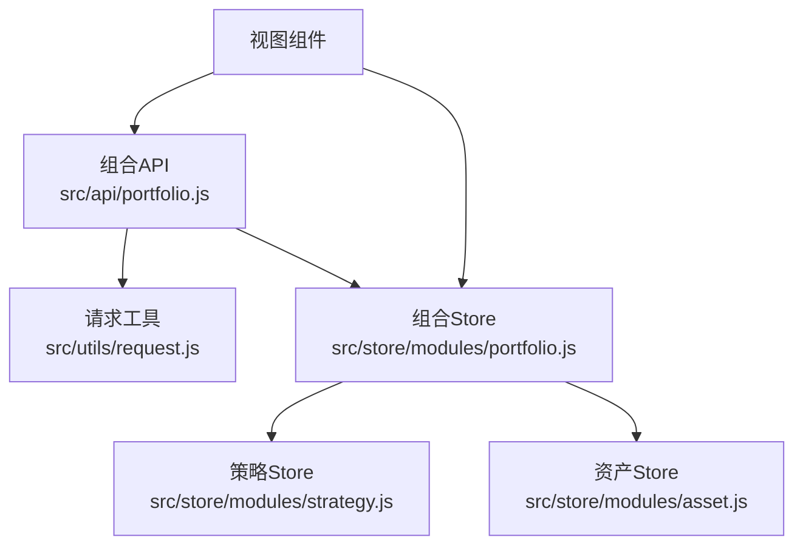

# Portfolio组合管理API

<cite>
**本文档引用的文件**
- [src/api/portfolio.js](file://src/api/portfolio.js)
- [src/store/modules/portfolio.js](file://src/store/modules/portfolio.js)
- [src/views/portfolio/PortfolioList.vue](file://src/views/portfolio/PortfolioList.vue)
- [src/views/portfolio/PortfolioDetail.vue](file://src/views/portfolio/PortfolioDetail.vue)
- [src/views/portfolio/PortfolioCreate.vue](file://src/views/portfolio/PortfolioCreate.vue)
- [src/views/portfolio/Rebalance.vue](file://src/views/portfolio/Rebalance.vue)
- [src/views/portfolio/TradeHistory.vue](file://src/views/portfolio/TradeHistory.vue)
- [src/views/portfolio/Performance.vue](file://src/views/portfolio/Performance.vue)
- [src/views/portfolio/Benchmark.vue](file://src/views/portfolio/Benchmark.vue)
- [src/utils/request.js](file://src/utils/request.js)
- [src/router/index.js](file://src/router/index.js)
- [src/store/modules/strategy.js](file://src/store/modules/strategy.js)
- [src/store/modules/asset.js](file://src/store/modules/asset.js)
</cite>

## 目录
1. [简介](#简介)
2. [项目结构](#项目结构)
3. [核心组件](#核心组件)
4. [架构总览](#架构总览)
5. [详细组件分析](#详细组件分析)
6. [依赖关系分析](#依赖关系分析)
7. [性能考量](#性能考量)
8. [故障排查指南](#故障排查指南)
9. [结论](#结论)
10. [附录](#附录)

## 简介
本文件为Portfolio组合管理模块的全面API文档，面向投资组合经理与开发者，涵盖组合列表管理、组合创建、组合详情查询、组合对比分析、组合性能展示、交易历史记录等核心功能。同时说明组合权重管理、资产分配、收益计算、风险评估等业务逻辑，并包含组合模板、基准管理、再平衡策略等高级功能的技术实现要点。文档基于前端Vue单页应用的实际代码进行梳理，提供清晰的接口定义、数据流图与最佳实践建议。

## 项目结构
Portfolio模块采用前端路由+Vuex状态管理的架构模式，核心文件组织如下：
- API层：封装HTTP请求，统一处理鉴权与错误
- 视图层：负责UI交互与数据展示
- 状态层：集中管理组合列表、当前组合、基准等全局状态
- 路由层：定义组合相关页面的导航路径

**图表来源**
- [src/router/index.js:123-179](file://src/router/index.js#L123-L179)
- [src/api/portfolio.js:1-72](file://src/api/portfolio.js#L1-L72)
- [src/store/modules/portfolio.js:1-106](file://src/store/modules/portfolio.js#L1-L106)
- [src/utils/request.js:1-100](file://src/utils/request.js#L1-L100)

**章节来源**
- [src/router/index.js:123-179](file://src/router/index.js#L123-L179)
- [src/api/portfolio.js:1-72](file://src/api/portfolio.js#L1-L72)
- [src/store/modules/portfolio.js:1-106](file://src/store/modules/portfolio.js#L1-L106)
- [src/utils/request.js:1-100](file://src/utils/request.js#L1-L100)

## 核心组件
- 组合API层：提供组合列表、详情、分析、创建、删除、调仓记录等REST接口封装
- 组合Store：维护组合列表、当前组合、基准集合，提供异步动作与计算属性
- 视图组件：组合列表、组合详情、创建向导、再平衡设置、交易历史、性能分析、基准对比
- 路由与导航：定义组合相关页面的路由与面包屑导航

关键职责划分：
- API层：统一请求与响应处理，包含鉴权头注入与错误提示
- Store层：组合状态持久化与派生计算，如活跃组合筛选、按ID获取组合
- 视图层：用户交互、数据渲染、图表绘制、对话框管理

**章节来源**
- [src/api/portfolio.js:1-72](file://src/api/portfolio.js#L1-L72)
- [src/store/modules/portfolio.js:1-106](file://src/store/modules/portfolio.js#L1-L106)
- [src/views/portfolio/PortfolioList.vue:1-372](file://src/views/portfolio/PortfolioList.vue#L1-L372)
- [src/views/portfolio/PortfolioDetail.vue:1-599](file://src/views/portfolio/PortfolioDetail.vue#L1-L599)

## 架构总览
前端通过Axios实例发送HTTP请求，统一添加Authorization头并处理401/404/422等错误。组合API通过Vuex Store进行状态管理，视图组件通过$store.dispatch与API函数交互，实现组合的增删改查与分析展示。

**图表来源**
- [src/views/portfolio/PortfolioCreate.vue:327-351](file://src/views/portfolio/PortfolioCreate.vue#L327-L351)
- [src/store/modules/portfolio.js:51-62](file://src/store/modules/portfolio.js#L51-L62)
- [src/api/portfolio.js:24-29](file://src/api/portfolio.js#L24-L29)
- [src/utils/request.js:12-32](file://src/utils/request.js#L12-L32)

**章节来源**
- [src/views/portfolio/PortfolioCreate.vue:327-351](file://src/views/portfolio/PortfolioCreate.vue#L327-L351)
- [src/store/modules/portfolio.js:51-62](file://src/store/modules/portfolio.js#L51-L62)
- [src/api/portfolio.js:24-29](file://src/api/portfolio.js#L24-L29)
- [src/utils/request.js:12-32](file://src/utils/request.js#L12-L32)

## 详细组件分析

### 组合列表管理
- 功能概述：展示组合列表，支持创建、删除、查看详情、查看业绩、基准对比等操作
- 关键接口：getPortfolioList、deletePortfolio、getPortfolioAnalysis
- 数据渲染：使用Element UI表格展示组合基础指标（当前市值、最新净值、累计/年化收益、最大回撤、夏普比率等）
- 图表集成：业绩详情对话框中渲染权益曲线

**图表来源**
- [src/views/portfolio/PortfolioList.vue:190-270](file://src/views/portfolio/PortfolioList.vue#L190-L270)
- [src/api/portfolio.js:8-13](file://src/api/portfolio.js#L8-L13)
- [src/api/portfolio.js:58-63](file://src/api/portfolio.js#L58-L63)
- [src/api/portfolio.js:49-55](file://src/api/portfolio.js#L49-L55)

**章节来源**
- [src/views/portfolio/PortfolioList.vue:1-372](file://src/views/portfolio/PortfolioList.vue#L1-L372)
- [src/api/portfolio.js:8-13](file://src/api/portfolio.js#L8-L13)
- [src/api/portfolio.js:58-63](file://src/api/portfolio.js#L58-L63)
- [src/api/portfolio.js:49-55](file://src/api/portfolio.js#L49-L55)

### 组合创建与资产分配
- 功能概述：支持手工建仓与模型关联建仓两种方式，提供分步向导与配置校验
- 关键接口：createPortfolio
- 资产分配逻辑：
  - 手工建仓：用户输入资产代码、数量、成本价格，系统据此生成positions
  - 模型关联建仓：选择策略模型，系统根据模型权重与初始资金计算目标持仓金额与数量
- 校验与提示：对必填字段与数值范围进行校验，422错误时解析后端校验详情

**图表来源**
- [src/views/portfolio/PortfolioCreate.vue:268-351](file://src/views/portfolio/PortfolioCreate.vue#L268-L351)
- [src/store/modules/portfolio.js:51-62](file://src/store/modules/portfolio.js#L51-L62)
- [src/api/portfolio.js:24-29](file://src/api/portfolio.js#L24-L29)

**章节来源**
- [src/views/portfolio/PortfolioCreate.vue:1-421](file://src/views/portfolio/PortfolioCreate.vue#L1-L421)
- [src/store/modules/portfolio.js:51-62](file://src/store/modules/portfolio.js#L51-L62)
- [src/api/portfolio.js:24-29](file://src/api/portfolio.js#L24-L29)

### 组合详情查询与性能展示
- 功能概述：展示组合基本信息、当前持仓、业绩曲线、调仓记录与快捷操作
- 关键接口：getPortfolio、getRebalanceRecords、getPortfolioAnalysis
- 性能展示：支持单位净值曲线与累计收益率曲线切换，渲染ECharts折线图
- 交互设计：支持弹窗查看完整业绩分析、基准对比、调仓历史

**图表来源**
- [src/views/portfolio/PortfolioDetail.vue:322-351](file://src/views/portfolio/PortfolioDetail.vue#L322-L351)
- [src/api/portfolio.js:16-21](file://src/api/portfolio.js#L16-L21)
- [src/api/portfolio.js:42-47](file://src/api/portfolio.js#L42-L47)
- [src/api/portfolio.js:50-55](file://src/api/portfolio.js#L50-L55)

**章节来源**
- [src/views/portfolio/PortfolioDetail.vue:1-599](file://src/views/portfolio/PortfolioDetail.vue#L1-L599)
- [src/api/portfolio.js:16-21](file://src/api/portfolio.js#L16-L21)
- [src/api/portfolio.js:42-47](file://src/api/portfolio.js#L42-L47)
- [src/api/portfolio.js:50-55](file://src/api/portfolio.js#L50-L55)

### 再平衡策略与权重管理
- 功能概述：支持定期再平衡、阈值触发再平衡、模型信号触发等多种触发条件，以及完全再平衡、部分再平衡、现金流驱动再平衡等执行方式
- 配置项：触发频率、执行方式（自动/手动）、阈值、资产范围、交易成本、最小交易金额、价格类型、调整比例、分批执行、审批流程、通知设置等
- 保存机制：将配置写入组合对象的rebalanceSettings字段并通过Store更新

**图表来源**
- [src/views/portfolio/Rebalance.vue:567-603](file://src/views/portfolio/Rebalance.vue#L567-L603)
- [src/store/modules/portfolio.js:64-78](file://src/store/modules/portfolio.js#L64-L78)

**章节来源**
- [src/views/portfolio/Rebalance.vue:1-672](file://src/views/portfolio/Rebalance.vue#L1-L672)
- [src/store/modules/portfolio.js:64-78](file://src/store/modules/portfolio.js#L64-L78)

### 交易历史记录与快照
- 功能概述：展示调仓历史时间线，支持按类型、时间范围、资产筛选；查看调仓详情与调仓前后持仓快照
- 数据结构：包含调仓类型、原因、操作人员、换手率、交易成本、总交易额、审批状态等
- 导出与下载：预留导出与下载接口占位

**图表来源**
- [src/views/portfolio/TradeHistory.vue:382-473](file://src/views/portfolio/TradeHistory.vue#L382-L473)
- [src/store/modules/portfolio.js:90-97](file://src/store/modules/portfolio.js#L90-L97)

**章节来源**
- [src/views/portfolio/TradeHistory.vue:1-615](file://src/views/portfolio/TradeHistory.vue#L1-L615)
- [src/store/modules/portfolio.js:90-97](file://src/store/modules/portfolio.js#L90-L97)

### 组合对比分析与基准管理
- 功能概述：提供多组合对比、基准对比功能入口（当前页面为占位提示）
- 基准管理：Store中内置常用基准（如沪深300、中证500、中证800、万得全A），用于后续业绩对比分析

**图表来源**
- [src/store/modules/portfolio.js:4-9](file://src/store/modules/portfolio.js#L4-L9)
- [src/views/portfolio/Performance.vue:1-27](file://src/views/portfolio/Performance.vue#L1-L27)
- [src/views/portfolio/Benchmark.vue:1-27](file://src/views/portfolio/Benchmark.vue#L1-L27)

**章节来源**
- [src/store/modules/portfolio.js:4-9](file://src/store/modules/portfolio.js#L4-L9)
- [src/views/portfolio/Performance.vue:1-27](file://src/views/portfolio/Performance.vue#L1-L27)
- [src/views/portfolio/Benchmark.vue:1-27](file://src/views/portfolio/Benchmark.vue#L1-L27)

## 依赖关系分析
- 组件耦合：视图组件通过API层与Store层解耦，便于单元测试与维护
- 外部依赖：Axios用于HTTP通信，Element UI用于UI组件，ECharts用于图表渲染
- 状态依赖：组合Store依赖策略Store与资产Store提供的策略列表与资产列表，用于模型关联建仓与资产选择

**图表来源**
- [src/api/portfolio.js:1-72](file://src/api/portfolio.js#L1-L72)
- [src/utils/request.js:1-100](file://src/utils/request.js#L1-L100)
- [src/store/modules/portfolio.js:36-36](file://src/store/modules/portfolio.js#L36-L36)
- [src/store/modules/strategy.js:1-468](file://src/store/modules/strategy.js#L1-L468)
- [src/store/modules/asset.js:1-183](file://src/store/modules/asset.js#L1-L183)

**章节来源**
- [src/api/portfolio.js:1-72](file://src/api/portfolio.js#L1-L72)
- [src/utils/request.js:1-100](file://src/utils/request.js#L1-L100)
- [src/store/modules/portfolio.js:36-36](file://src/store/modules/portfolio.js#L36-L36)
- [src/store/modules/strategy.js:1-468](file://src/store/modules/strategy.js#L1-L468)
- [src/store/modules/asset.js:1-183](file://src/store/modules/asset.js#L1-L183)

## 性能考量
- 请求超时与并发：Axios默认60秒超时，适合行情与列表类请求；建议在批量操作时适当降低并发
- 图表渲染：ECharts初始化与setOption需在$nextTick中执行，避免重复渲染；建议在组件销毁时dispose实例释放内存
- 数据缓存：Store中缓存组合列表与当前组合，减少重复请求；对分析数据可做本地缓存策略
- 分页与筛选：列表页采用分页参数，筛选条件在前端computed中处理，减少不必要的后端压力

[本节为通用指导，无需特定文件引用]

## 故障排查指南
- 401未授权：检查用户登录状态与Token有效性，确认请求头Authorization是否正确注入
- 404资源不存在：确认路由与后端接口路径一致，检查VUE_APP_BASE_URL配置
- 422参数校验失败：解析后端返回的detail字段，定位具体字段与错误信息
- 网络连接失败：检查后端服务是否启动、网络是否正常；关注超时与跨域问题
- 图表不显示：确认ECharts实例初始化与DOM节点存在，避免在beforeDestroy中提前dispose

**章节来源**
- [src/utils/request.js:34-96](file://src/utils/request.js#L34-L96)

## 结论
Portfolio组合管理模块通过清晰的API封装、完善的Store状态管理与丰富的视图组件，实现了从组合创建、权重管理、再平衡策略到交易历史与性能展示的全链路功能。建议在实际部署中结合业务需求完善基准对比与多组合对比功能，并持续优化图表渲染与数据缓存策略以提升用户体验。

[本节为总结性内容，无需特定文件引用]

## 附录

### API定义总览
- 获取组合列表
  - 方法：GET
  - 路径：/api/v1/portfolios/
  - 用途：列表页加载
- 获取单个组合
  - 方法：GET
  - 路径：/api/v1/portfolios/{portfolioId}
  - 用途：详情页加载
- 创建组合
  - 方法：POST
  - 路径：/api/v1/portfolios/
  - 用途：创建向导提交
- 记录调仓
  - 方法：POST
  - 路径：/api/v1/portfolios/{portfolioId}/rebalance
  - 用途：手动调仓或策略触发
- 获取调仓记录列表
  - 方法：GET
  - 路径：/api/v1/portfolios/{portfolioId}/rebalance-records
  - 用途：历史页加载
- 获取组合分析数据
  - 方法：GET
  - 路径：/api/v1/portfolios/{portfolioId}/analysis
  - 用途：详情页业绩曲线与指标
- 删除组合
  - 方法：DELETE
  - 路径：/api/v1/portfolios/{portfolioId}
  - 用途：列表页删除

**章节来源**
- [src/api/portfolio.js:8-71](file://src/api/portfolio.js#L8-L71)

### 关键业务逻辑
- 资产分配：手工建仓按数量与成本价计算；模型关联建仓按权重与初始资金计算目标金额
- 收益计算：基于分析数据中的净值序列与累计收益序列
- 风险评估：夏普比率、最大回撤等指标来源于分析数据
- 再平衡策略：支持多种触发条件与执行方式，配置写入组合对象

**章节来源**
- [src/views/portfolio/PortfolioCreate.vue:352-402](file://src/views/portfolio/PortfolioCreate.vue#L352-L402)
- [src/views/portfolio/PortfolioDetail.vue:402-535](file://src/views/portfolio/PortfolioDetail.vue#L402-L535)
- [src/views/portfolio/Rebalance.vue:567-603](file://src/views/portfolio/Rebalance.vue#L567-L603)