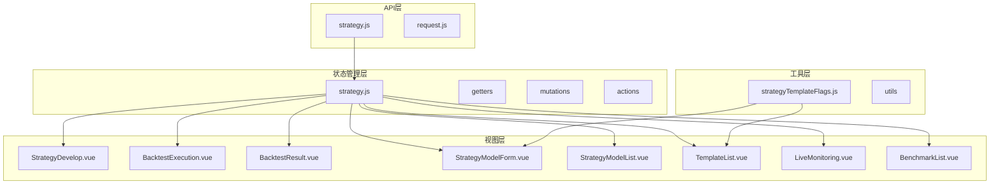
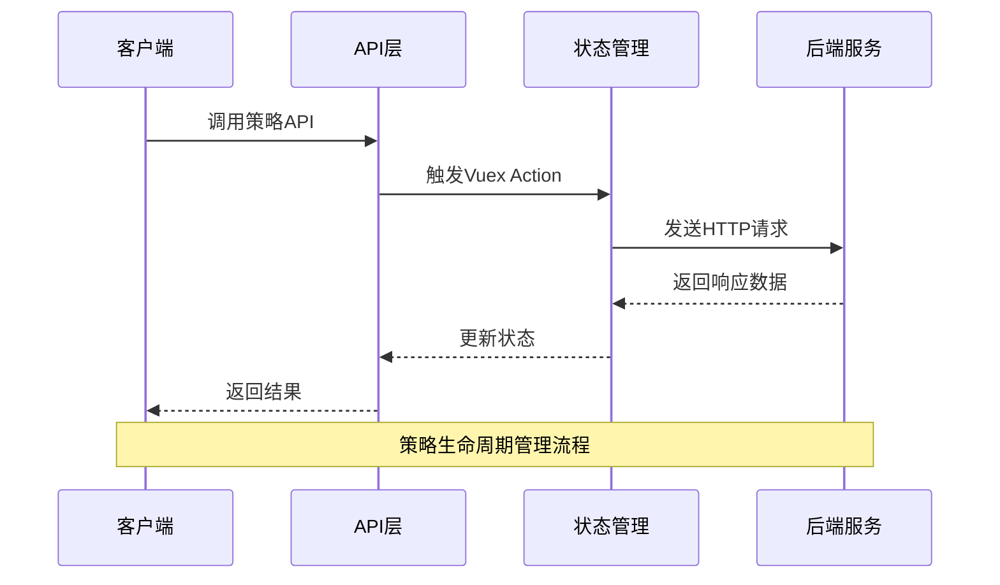
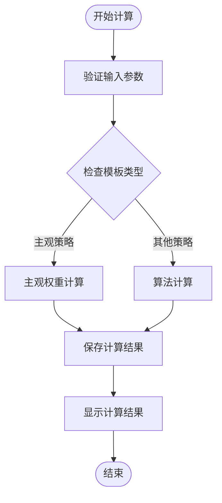
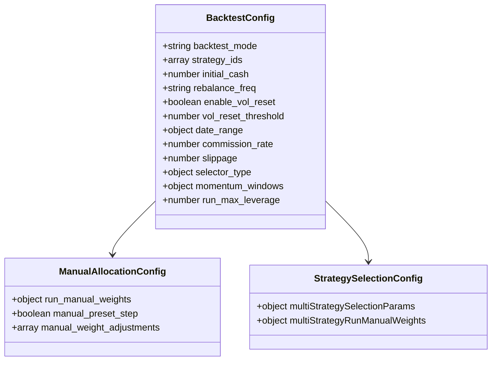
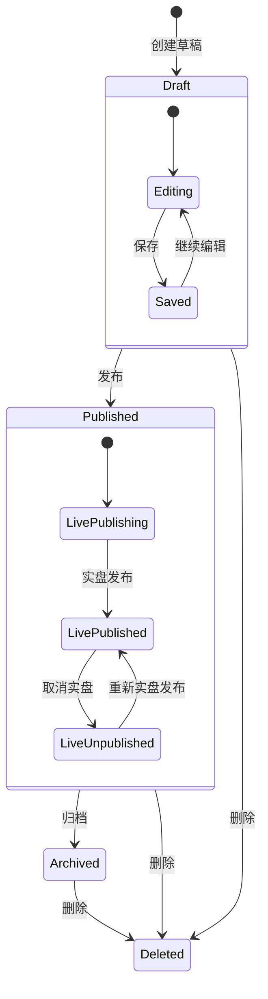
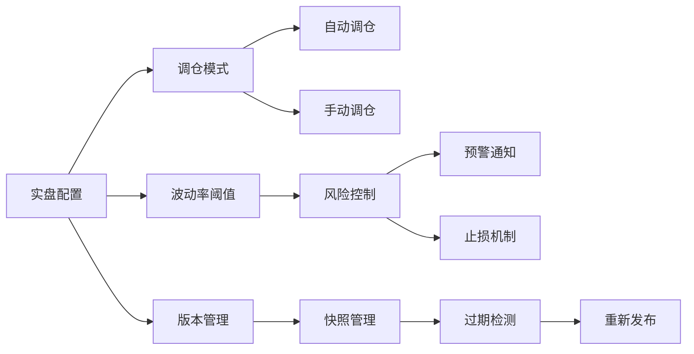
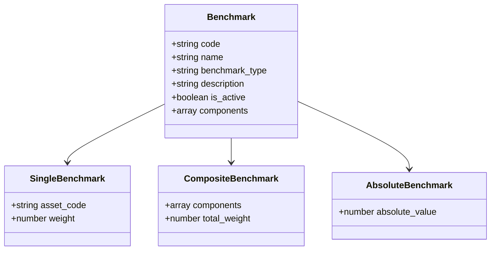
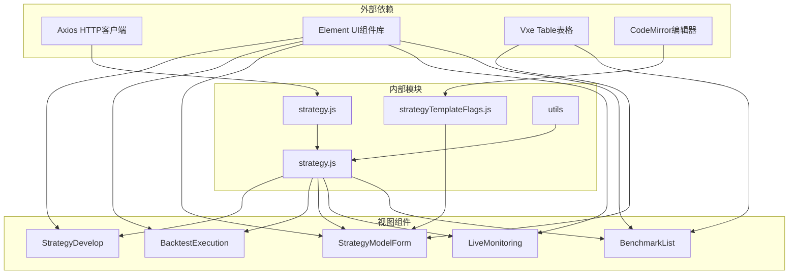

# Strategy策略管理API

<cite>
**本文档引用的文件**
- [src/api/strategy.js](file://src/api/strategy.js)
- [src/store/modules/strategy.js](file://src/store/modules/strategy.js)
- [src/utils/strategyTemplateFlags.js](file://src/utils/strategyTemplateFlags.js)
- [src/views/strategy/StrategyDevelop.vue](file://src/views/strategy/StrategyDevelop.vue)
- [src/views/strategy/BacktestExecution.vue](file://src/views/strategy/BacktestExecution.vue)
- [src/views/strategy/BacktestResult.vue](file://src/views/strategy/BacktestResult.vue)
- [src/views/strategy/StrategyModelForm.vue](file://src/views/strategy/StrategyModelForm.vue)
- [src/views/strategy/StrategyModelList.vue](file://src/views/strategy/StrategyModelList.vue)
- [src/views/strategy/TemplateList.vue](file://src/views/strategy/TemplateList.vue)
- [src/views/strategy/LiveMonitoring.vue](file://src/views/strategy/LiveMonitoring.vue)
- [src/views/strategy/BenchmarkList.vue](file://src/views/strategy/BenchmarkList.vue)
</cite>

## 目录
1. [简介](#简介)
2. [项目结构](#项目结构)
3. [核心组件](#核心组件)
4. [架构概览](#架构概览)
5. [详细组件分析](#详细组件分析)
6. [依赖关系分析](#依赖关系分析)
7. [性能考虑](#性能考虑)
8. [故障排除指南](#故障排除指南)
9. [结论](#结论)

## 简介

Strategy策略管理模块是一个完整的策略生命周期管理系统，涵盖了从策略模板库、策略开发、回测执行到结果分析的全流程。该模块提供了丰富的API接口，支持策略参数配置、回测参数设置、结果数据格式化、基准比较算法等功能。

该系统采用前后端分离架构，前端使用Vue.js框架，后端通过RESTful API提供服务。系统支持多种策略模板，包括风险预算目标波动率、主观配置、混合动量等不同类型的策略模型。

## 项目结构

Strategy模块主要包含以下核心文件：

**图表来源**
- [src/api/strategy.js:1-295](file://src/api/strategy.js#L1-L295)
- [src/store/modules/strategy.js:1-468](file://src/store/modules/strategy.js#L1-L468)

**章节来源**
- [src/api/strategy.js:1-295](file://src/api/strategy.js#L1-L295)
- [src/store/modules/strategy.js:1-468](file://src/store/modules/strategy.js#L1-L468)

## 核心组件

### API接口层

策略管理模块的API接口主要集中在`src/api/strategy.js`文件中，提供了完整的策略生命周期管理接口：

#### 策略模板库接口
- `getTemplateList()`: 获取模板列表
- `getTemplate(code)`: 获取单个模板详情
- `createTemplate(data)`: 创建模板
- `updateTemplate(templateId, data)`: 更新模板
- `validateTemplate(data)`: 验证模板有效性

#### 策略模型接口
- `createStrategyModel(data)`: 创建策略模型
- `getStrategyModelList(params)`: 获取策略模型列表
- `getStrategyModel(modelId)`: 获取单个策略模型
- `updateStrategyModel(modelId, data, axiosConfig)`: 更新策略模型
- `deleteStrategyModel(modelId)`: 删除策略模型

#### 回测执行接口
- `runBacktest(modelId, data)`: 运行回测
- `updateBacktestRemark(modelId, recordId, remark)`: 更新回测记录备注
- `computeMetricsFromSnapshots(snapshots, cutoffDate)`: 基于快照计算绩效指标

#### 实盘发布接口
- `publishModel(modelId)`: 发布模型
- `livePublishModel(modelId, data)`: 实盘发布
- `liveUnpublishModel(modelId, params)`: 取消实盘发布
- `getLivePublishedModelList(params)`: 获取实盘发布列表
- `getLiveEligibleForMonitor(params)`: 获取可监控的实盘策略

#### 实盘监控接口
- `getLiveMonitoring(modelId)`: 获取实盘监控数据
- `confirmManualRebalance(modelId, data)`: 手动调仓确认
- `getLiveChangeLogs(modelId, params)`: 获取实盘变更日志
- `getLiveConfig(modelId)`: 获取实盘配置
- `updateLiveConfig(modelId, data)`: 更新实盘配置

#### 业绩基准接口
- `getBenchmarkList()`: 获取基准列表
- `getBenchmark(benchmarkId)`: 获取单个基准
- `getBenchmarkByCode(code)`: 根据代码获取基准
- `createBenchmark(data)`: 创建基准
- `updateBenchmark(benchmarkId, data)`: 更新基准
- `deleteBenchmark(benchmarkId)`: 删除基准

**章节来源**
- [src/api/strategy.js:1-295](file://src/api/strategy.js#L1-L295)

### 状态管理层

策略状态管理通过Vuex模块实现，主要功能包括：

#### 数据状态管理
- `templateList`: 模板列表状态
- `strategyModelList`: 策略模型列表状态
- `currentTemplate`: 当前选中模板
- `currentModel`: 当前策略模型
- `loading`: 加载状态

#### 核心业务操作
- `fetchTemplateList()`: 获取模板列表
- `fetchStrategyModelList()`: 获取策略模型列表
- `calculateStrategy()`: 计算策略（策略开发页面使用）
- `saveStrategy()`: 保存策略
- `publishModel()`: 发布模型
- `livePublishModel()`: 实盘发布

**章节来源**
- [src/store/modules/strategy.js:1-468](file://src/store/modules/strategy.js#L1-L468)

## 架构概览

**图表来源**
- [src/api/strategy.js:1-295](file://src/api/strategy.js#L1-L295)
- [src/store/modules/strategy.js:1-468](file://src/store/modules/strategy.js#L1-L468)

## 详细组件分析

### 策略开发组件

策略开发组件提供了完整的策略开发环境，支持多种参数类型和实时计算功能。

#### 参数配置系统
组件支持多种参数类型：
- 数字输入框（number/slider）
- 文本输入框（string）
- 复选框（boolean）
- 下拉选择框（select）
- 字典输入框（dict）

#### 实时计算功能

**图表来源**
- [src/views/strategy/StrategyDevelop.vue:301-338](file://src/views/strategy/StrategyDevelop.vue#L301-L338)

#### 计算结果展示
计算结果显示包括：
- 预期收益率
- 预期风险
- 夏普比率
- 资产权重分布

**章节来源**
- [src/views/strategy/StrategyDevelop.vue:1-434](file://src/views/strategy/StrategyDevelop.vue#L1-L434)

### 回测执行组件

回测执行组件提供了灵活的回测配置和多策略对比功能。

#### 回测模式
- **单策略回测**: 查看单个策略的完整回测结果
- **多策略对比**: 同时运行2-5个策略，横向对比绩效指标

#### 回测参数配置

**图表来源**
- [src/views/strategy/BacktestExecution.vue:13-684](file://src/views/strategy/BacktestExecution.vue#L13-L684)

#### 主观策略特殊处理
主观策略具有独特的权重管理和调仓机制：
- 权重初始化（仅本次回测有效）
- 预设调仓日期与权重
- 步进暂停机制

**章节来源**
- [src/views/strategy/BacktestExecution.vue:1-800](file://src/views/strategy/BacktestExecution.vue#L1-L800)

### 策略模型管理

策略模型管理提供了完整的策略生命周期管理功能。

#### 策略模型表单

**图表来源**
- [src/views/strategy/StrategyModelList.vue:1-466](file://src/views/strategy/StrategyModelList.vue#L1-L466)

#### 模板类型支持
系统支持多种策略模板类型：
- 风险预算目标波动率模板
- 主观配置模板
- 混合动量模板
- 均值方差优化模板

**章节来源**
- [src/views/strategy/StrategyModelForm.vue:1-800](file://src/views/strategy/StrategyModelForm.vue#L1-L800)

### 实盘监控组件

实盘监控组件提供了实时的策略监控和风险管理功能。

#### 实盘配置管理

**图表来源**
- [src/views/strategy/LiveMonitoring.vue:240-588](file://src/views/strategy/LiveMonitoring.vue#L240-L588)

#### 手动调仓机制
实盘监控支持手动调仓操作：
- 确认本次调仓
- 跳过本次调仓
- 记录人工决策说明

**章节来源**
- [src/views/strategy/LiveMonitoring.vue:1-766](file://src/views/strategy/LiveMonitoring.vue#L1-L766)

### 业绩基准管理

业绩基准管理组件提供了灵活的基准创建和管理功能。

#### 基准类型支持
- **单一基准**: 基于单个资产表现
- **复合基准**: 多资产加权组合
- **绝对基准**: 固定收益率标准

#### 基准组件管理

**图表来源**
- [src/views/strategy/BenchmarkList.vue:1-682](file://src/views/strategy/BenchmarkList.vue#L1-L682)

**章节来源**
- [src/views/strategy/BenchmarkList.vue:1-682](file://src/views/strategy/BenchmarkList.vue#L1-L682)

## 依赖关系分析

**图表来源**
- [src/api/strategy.js:1-295](file://src/api/strategy.js#L1-L295)
- [src/store/modules/strategy.js:1-468](file://src/store/modules/strategy.js#L1-L468)
- [src/utils/strategyTemplateFlags.js:1-100](file://src/utils/strategyTemplateFlags.js#L1-L100)

### 关键依赖特性

#### 模板标志管理
系统通过`strategyTemplateFlags.js`文件管理不同模板类型的特殊行为：
- 风险预算目标波动率模板的固定参数
- 主观策略的隐藏参数和固定值
- 实盘监控的对比键过滤

#### 超时配置
不同API操作设置了合适的超时时间：
- 回测执行：5分钟超时
- 实盘发布：2分钟超时
- 实盘发布（T+1）：3分钟超时

**章节来源**
- [src/utils/strategyTemplateFlags.js:1-100](file://src/utils/strategyTemplateFlags.js#L1-L100)

## 性能考虑

### API调用优化
1. **批量操作支持**: 策略模型列表支持分页和过滤
2. **缓存策略**: 模板列表和资产选项的本地缓存
3. **超时配置**: 针对不同操作类型设置合理的超时时间

### 前端性能优化
1. **懒加载组件**: 模板表单和策略表单采用异步加载
2. **虚拟滚动**: 大数据量表格使用虚拟滚动
3. **防抖处理**: 输入框的实时搜索使用防抖机制

### 数据处理优化
1. **参数验证**: 前端参数验证减少无效请求
2. **数据格式化**: 统一的数据格式处理
3. **错误处理**: 完善的错误捕获和用户提示

## 故障排除指南

### 常见问题及解决方案

#### 回测执行失败
**问题症状**: 回测执行超时或失败
**可能原因**:
- 网络连接不稳定
- 后端服务响应缓慢
- 策略参数配置错误

**解决步骤**:
1. 检查网络连接状态
2. 验证策略参数的有效性
3. 查看后端服务日志
4. 适当调整超时设置

#### 实盘发布异常
**问题症状**: 实盘发布状态异常或数据未更新
**可能原因**:
- 数据库连接问题
- 权限不足
- 策略状态不正确

**解决步骤**:
1. 检查数据库连接状态
2. 验证用户权限
3. 确认策略状态符合发布条件
4. 查看实盘变更日志

#### 模板验证失败
**问题症状**: 模板创建或更新时验证失败
**可能原因**:
- 模板参数格式错误
- 依赖关系不满足
- 业务规则冲突

**解决步骤**:
1. 检查模板参数的格式和范围
2. 验证模板间的依赖关系
3. 确认符合业务规则要求
4. 参考模板验证错误信息

**章节来源**
- [src/store/modules/strategy.js:207-280](file://src/store/modules/strategy.js#L207-L280)

## 结论

Strategy策略管理模块提供了一个完整、灵活且高性能的策略生命周期管理解决方案。该模块具有以下特点：

### 技术优势
1. **模块化设计**: 清晰的组件划分和职责分离
2. **状态管理**: 完善的Vuex状态管理机制
3. **API设计**: RESTful风格的清晰接口定义
4. **用户体验**: 丰富的交互和可视化功能

### 功能完整性
1. **全生命周期管理**: 从模板创建到实盘监控的完整流程
2. **多策略支持**: 支持单策略和多策略对比分析
3. **灵活配置**: 丰富的参数配置和自定义选项
4. **实时监控**: 完善的实盘监控和风险管理功能

### 扩展性
1. **模板系统**: 支持自定义策略模板
2. **插件架构**: 易于扩展新的功能模块
3. **API标准化**: 标准化的接口设计便于集成

该模块为策略分析师和开发者提供了强大的工具集，能够满足复杂的策略开发、测试和部署需求。通过合理使用这些API和组件，用户可以高效地构建和管理各种类型的金融策略。