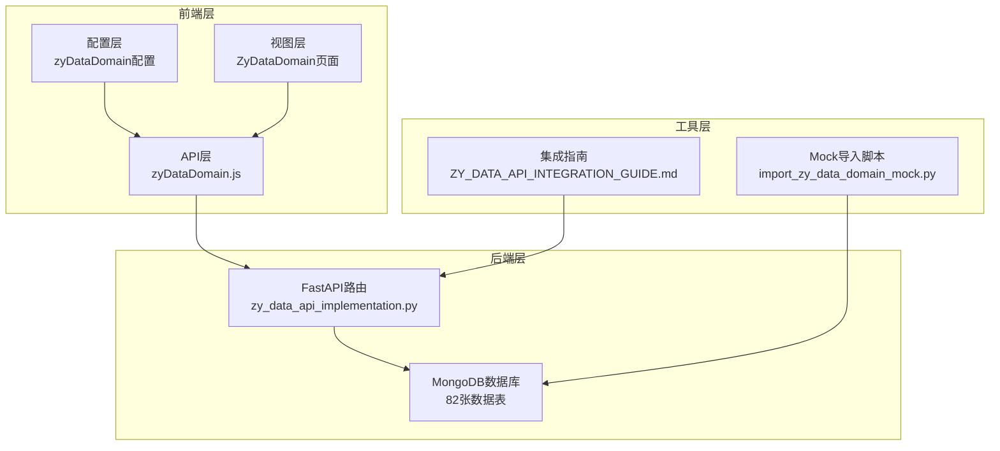
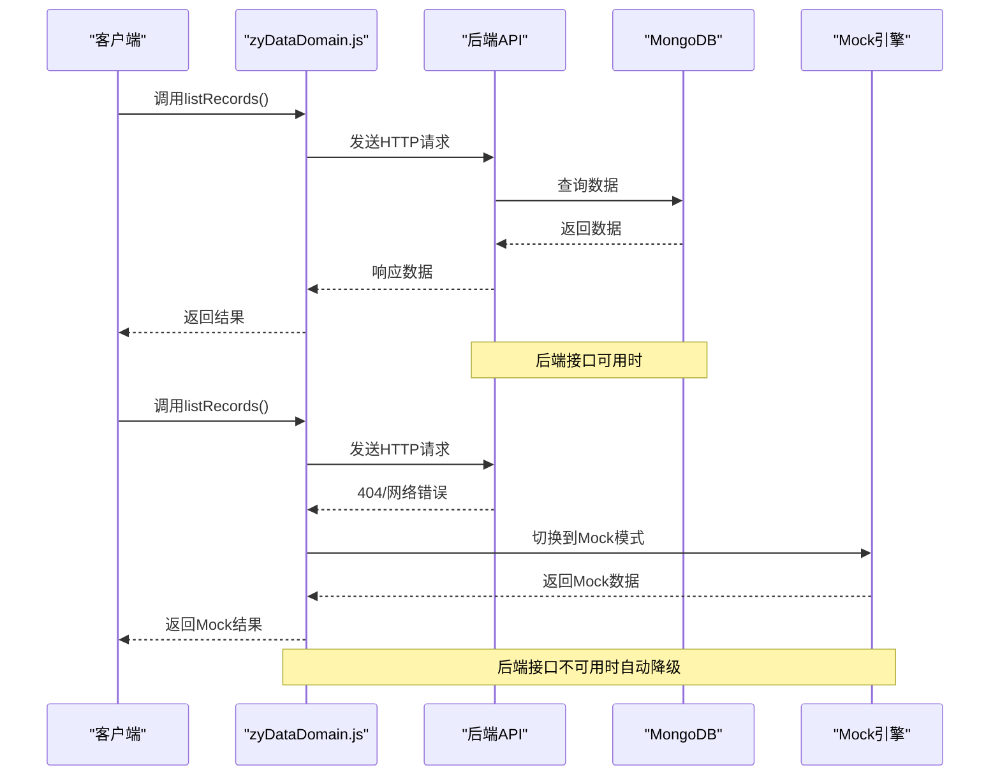
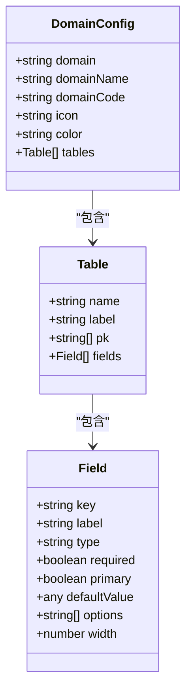
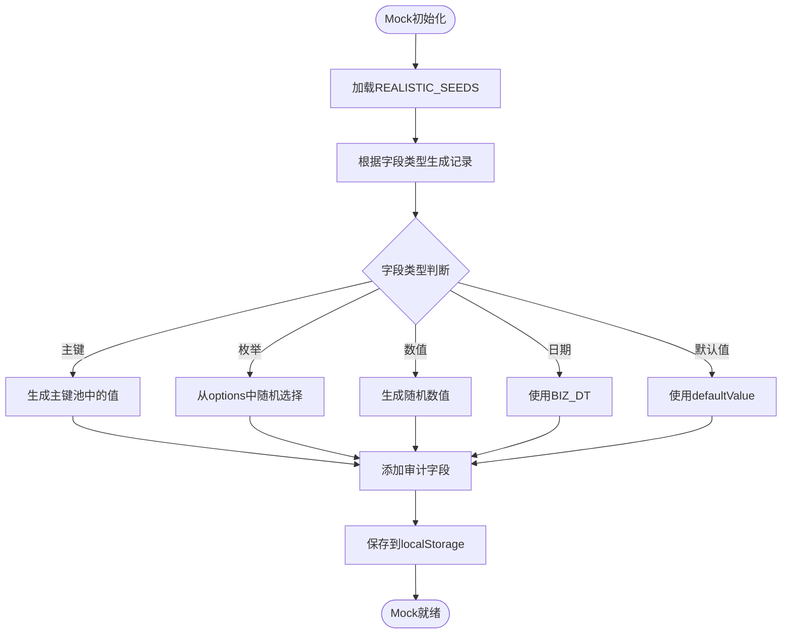
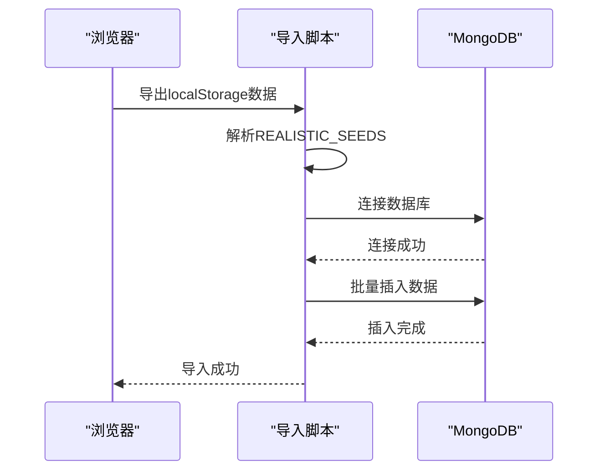
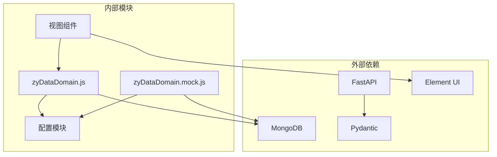

# ZY数据域API

<cite>
**本文引用的文件**
- [zyDataDomain.js](file://src/api/zyDataDomain.js)
- [zyDataDomain.mock.js](file://src/api/zyDataDomain.mock.js)
- [index.js](file://src/config/zyDataDomain/index.js)
- [keys.js](file://src/config/zyDataDomain/keys.js)
- [01_asset.js](file://src/config/zyDataDomain/01_asset.js)
- [02_subject.js](file://src/config/zyDataDomain/02_subject.js)
- [03_product.js](file://src/config/zyDataDomain/03_product.js)
- [Index.vue](file://src/views/analysis/ZyDataDomain/Index.vue)
- [RecordTable.vue](file://src/views/analysis/ZyDataDomain/RecordTable.vue)
- [import_zy_data_domain_mock.py](file://scripts/import_zy_data_domain_mock.py)
- [zy_data_api_implementation.py](file://scripts/zy_data_api_implementation.py)
- [ZY_DATA_API_INTEGRATION_GUIDE.md](file://docs/ZY_DATA_API_INTEGRATION_GUIDE.md)
- [ZY_DATA_DOMAIN_MOCK_IMPORT_GUIDE.md](file://docs/ZY_DATA_DOMAIN_MOCK_IMPORT_GUIDE.md)
- [README.md](file://mongo-seed/README.md)
</cite>

## 目录
1. [简介](#简介)
2. [项目结构](#项目结构)
3. [核心组件](#核心组件)
4. [架构概览](#架构概览)
5. [详细组件分析](#详细组件分析)
6. [依赖关系分析](#依赖关系分析)
7. [性能考虑](#性能考虑)
8. [故障排查指南](#故障排查指南)
9. [结论](#结论)
10. [附录](#附录)

## 简介

ZY数据域API是一个面向金融数据管理的完整解决方案，提供了数据域配置管理、动态表结构生成、数据导入导出、Mock数据模拟等核心功能。该系统支持9大数据域，涵盖82张数据表，包括资产域、主体域、产品域、估值域、交易域、客户域、销售域、风险域和行情域。

系统采用前后端分离架构，前端提供可视化管理界面，后端提供RESTful API接口，同时具备完善的Mock数据兜底机制，确保在后端接口未就绪时仍能正常工作。

## 项目结构



**图表来源**
- [zyDataDomain.js:1-190](file://src/api/zyDataDomain.js#L1-L190)
- [zy_data_api_implementation.py:1-334](file://scripts/zy_data_api_implementation.py#L1-L334)

**章节来源**
- [zyDataDomain.js:1-190](file://src/api/zyDataDomain.js#L1-L190)
- [index.js:1-80](file://src/config/zyDataDomain/index.js#L1-L80)
- [ZY_DATA_API_INTEGRATION_GUIDE.md:1-495](file://docs/ZY_DATA_API_INTEGRATION_GUIDE.md#L1-L495)

## 核心组件

### API层（前端）
- **zyDataDomain.js**: 提供统一的CRUD接口，支持自动降级到Mock模式
- **zyDataDomain.mock.js**: Mock数据生成和管理，支持版本控制和种子数据
- **request封装**: 统一的HTTP请求处理，支持错误拦截和重试

### 配置层
- **数据域配置**: 9大数据域的元数据定义和表结构描述
- **主键池管理**: 跨表主键池和枚举值管理
- **动态表单**: 基于配置的动态表单生成

### 视图层
- **数据域管理界面**: 提供数据表的增删改查操作
- **实时Mock模式**: 支持Mock数据的重置和管理

**章节来源**
- [zyDataDomain.js:69-178](file://src/api/zyDataDomain.js#L69-L178)
- [zyDataDomain.mock.js:1-1012](file://src/api/zyDataDomain.mock.js#L1-L1012)
- [index.js:25-79](file://src/config/zyDataDomain/index.js#L25-L79)

## 架构概览



**图表来源**
- [zyDataDomain.js:26-46](file://src/api/zyDataDomain.js#L26-L46)
- [zyDataDomain.js:69-96](file://src/api/zyDataDomain.js#L69-L96)

系统采用"后端优先，前端兜底"的设计理念，当后端接口不可用时自动切换到前端Mock模式，确保系统的高可用性。

**章节来源**
- [ZY_DATA_API_INTEGRATION_GUIDE.md:90-201](file://docs/ZY_DATA_API_INTEGRATION_GUIDE.md#L90-L201)
- [ZY_DATA_DOMAIN_MOCK_IMPORT_GUIDE.md:19-75](file://docs/ZY_DATA_DOMAIN_MOCK_IMPORT_GUIDE.md#L19-L75)

## 详细组件分析

### 数据域配置管理系统

#### 数据域定义结构
系统支持9大数据域，每个域包含多个数据表，采用统一的配置格式：



**图表来源**
- [01_asset.js:10-137](file://src/config/zyDataDomain/01_asset.js#L10-L137)
- [02_subject.js:10-59](file://src/config/zyDataDomain/02_subject.js#L10-L59)
- [03_product.js:10-136](file://src/config/zyDataDomain/03_product.js#L10-L136)

#### 主键池和枚举管理
系统维护跨表主键池，确保数据的一致性和完整性：

- **资产代码池**: AST_CD（债券、股票等）
- **产品代码池**: PORT_ID（投资组合标识）
- **主体代码池**: ISR_ID（机构、发行人标识）
- **客户代码池**: CUSTOMER_ID（客户标识）
- **枚举值**: 资产类型、产品类型、风险等级等

**章节来源**
- [keys.js:6-73](file://src/config/zyDataDomain/keys.js#L6-L73)
- [index.js:25-79](file://src/config/zyDataDomain/index.js#L25-L79)

### Mock数据模拟系统

#### Mock数据生成机制
Mock系统基于REALISTIC_SEEDS预定义的真实业务数据，支持以下特性：



**图表来源**
- [zyDataDomain.mock.js:39-69](file://src/api/zyDataDomain.mock.js#L39-L69)
- [zyDataDomain.mock.js:73-1012](file://src/api/zyDataDomain.mock.js#L73-L1012)

#### 版本控制和数据持久化
- **版本号管理**: SEED_VERSION确保Mock数据版本升级
- **localStorage存储**: 使用zy_data_domain_mock_v3键存储
- **内存缓存**: store变量提供内存中的数据缓存

**章节来源**
- [zyDataDomain.mock.js:8-33](file://src/api/zyDataDomain.mock.js#L8-L33)

### 数据导入导出系统

#### 后端API接口规范
系统提供完整的RESTful API接口：

| 接口 | 方法 | 参数 | 功能 |
|------|------|------|------|
| /api/v1/zy-data/collections | GET | 无 | 获取所有可用集合列表 |
| /api/v1/zy-data/{collection} | GET | page, pageSize, filters_json | 分页查询集合数据 |
| /api/v1/zy-data/{collection}/count | GET | 无 | 统计集合记录数 |
| /api/v1/zy-data/{collection} | POST | JSON payload | 新增记录 |
| /api/v1/zy-data/{collection}/{record_id} | PUT | JSON payload | 更新记录 |
| /api/v1/zy-data/{collection}/{record_id} | DELETE | 无 | 删除记录 |
| /api/v1/zy-data/health | GET | 无 | 健康检查 |

**章节来源**
- [ZY_DATA_API_INTEGRATION_GUIDE.md:90-201](file://docs/ZY_DATA_API_INTEGRATION_GUIDE.md#L90-L201)
- [zy_data_api_implementation.py:85-312](file://scripts/zy_data_api_implementation.py#L85-L312)

#### Mock数据导入流程


**图表来源**
- [import_zy_data_domain_mock.py:58-141](file://scripts/import_zy_data_domain_mock.py#L58-L141)

**章节来源**
- [import_zy_data_domain_mock.py:1-161](file://scripts/import_zy_data_domain_mock.py#L1-L161)

### 数据验证和批量操作

#### 数据验证机制
系统提供多层次的数据验证：

1. **前端表单验证**: 基于字段配置的实时验证
2. **后端API验证**: Pydantic模型验证
3. **MongoDB Schema验证**: JSON Schema约束

#### 批量操作支持
- **分页查询**: 支持1-100条记录的分页
- **过滤查询**: 支持复杂的JSON过滤条件
- **批量导入**: 支持从Mock数据批量导入到MongoDB

**章节来源**
- [zy_data_api_implementation.py:46-62](file://scripts/zy_data_api_implementation.py#L46-L62)
- [ZY_DATA_API_INTEGRATION_GUIDE.md:235-335](file://docs/ZY_DATA_API_INTEGRATION_GUIDE.md#L235-L335)

## 依赖关系分析



**图表来源**
- [zyDataDomain.js:17-18](file://src/api/zyDataDomain.js#L17-L18)
- [zy_data_api_implementation.py:18-23](file://scripts/zy_data_api_implementation.py#L18-L23)

系统的主要依赖关系：
- **前端**: 依赖Element UI进行界面渲染，依赖localStorage进行Mock数据存储
- **后端**: 依赖MongoDB进行数据持久化，依赖FastAPI提供RESTful接口
- **配置**: 依赖统一的配置模块管理数据域元数据

**章节来源**
- [ZY_DATA_API_INTEGRATION_GUIDE.md:203-234](file://docs/ZY_DATA_API_INTEGRATION_GUIDE.md#L203-L234)

## 性能考虑

### 数据库性能优化
1. **索引策略**: 为常用查询字段创建索引
   - 主键字段: AST_CD, PORT_ID, ISR_ID等
   - 高频过滤字段: BIZ_DT, 状态字段等

2. **查询优化**: 使用游标分页替代skip/limit
3. **缓存策略**: 对热点数据添加Redis缓存

### 前端性能优化
1. **Mock数据版本控制**: 避免重复生成相同数据
2. **内存缓存**: localStorage中的数据缓存
3. **懒加载**: 按需加载数据表配置

### 网络性能优化
1. **自动降级**: 后端不可用时自动切换到Mock模式
2. **错误重试**: 网络错误时的自动重试机制
3. **请求合并**: 批量操作时的请求合并

## 故障排查指南

### 常见问题及解决方案

#### MongoDB连接问题
**症状**: 健康检查失败，集合列表为空
**解决方案**:
1. 检查MongoDB服务状态
2. 验证连接字符串配置
3. 确认数据库权限设置

#### 集合不存在问题
**症状**: 查询特定集合返回404错误
**解决方案**:
1. 使用/collections接口查看可用集合
2. 检查集合名称拼写
3. 确认数据已正确导入

#### Mock数据不一致问题
**症状**: Mock数据显示过期数据
**解决方案**:
1. 重置Mock数据
2. 检查BIZ_DT设置
3. 验证种子数据版本

**章节来源**
- [ZY_DATA_API_INTEGRATION_GUIDE.md:420-466](file://docs/ZY_DATA_API_INTEGRATION_GUIDE.md#L420-L466)
- [ZY_DATA_DOMAIN_MOCK_IMPORT_GUIDE.md:420-466](file://docs/ZY_DATA_DOMAIN_MOCK_IMPORT_GUIDE.md#L420-L466)

### 调试工具和方法
1. **浏览器开发者工具**: 检查网络请求和响应
2. **MongoDB Shell**: 直接查询数据库状态
3. **日志分析**: 查看后端API日志输出

## 结论

ZY数据域API提供了一个完整、灵活、可扩展的数据管理解决方案。系统的核心优势包括：

1. **高可用性**: 自动降级机制确保系统稳定性
2. **灵活性**: 支持多种数据源和查询方式
3. **可扩展性**: 模块化设计便于功能扩展
4. **易用性**: 完善的文档和工具链支持

该系统适用于金融数据管理场景，特别是需要处理复杂数据域和大量数据表的企业级应用。通过合理的架构设计和完善的工具支持，能够有效提升数据管理效率和质量。

## 附录

### API使用示例

#### 基本CRUD操作
```javascript
// 查询资产信息
const assets = await listRecords('dwd_ast_info', {
  page: 1,
  pageSize: 20,
  filters: { AST_TYPE: 'BOND' }
});

// 新增产品信息
const newProduct = await createRecord('dwd_ptl_info', {
  PORT_ID: 'PORT006',
  PORT_NM: '新产品',
  PORT_TYPE: 'MIXED'
});

// 更新客户信息
await updateRecord('dwd_cust_info', 'CUS0000001', {
  PHONE: '13800001111'
});

// 删除记录
await deleteRecord('dwd_ptl_info', 'PORT006');
```

#### Mock数据管理
```javascript
// 检查当前模式
const isMock = isMockMode();

// 重置Mock数据
resetMockData();

// 强制启用Mock模式
enableMock();
```

### 配置扩展指南

#### 添加新的数据域
1. 在src/config/zyDataDomain/目录下创建新的配置文件
2. 定义数据域的基本信息和表结构
3. 在index.js中注册新的数据域
4. 更新前端视图组件以支持新域

#### 自定义字段验证
1. 在字段配置中添加验证规则
2. 在后端API中添加相应的验证逻辑
3. 更新前端表单验证规则

**章节来源**
- [ZY_DATA_API_INTEGRATION_GUIDE.md:488-495](file://docs/ZY_DATA_API_INTEGRATION_GUIDE.md#L488-L495)