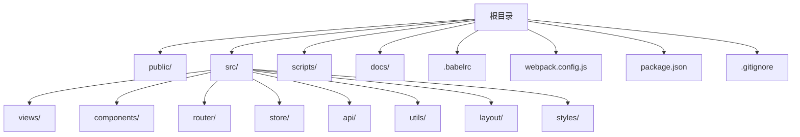
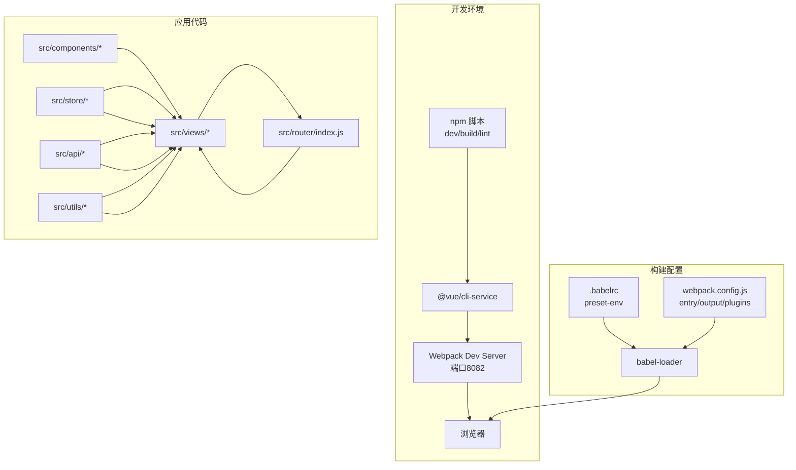
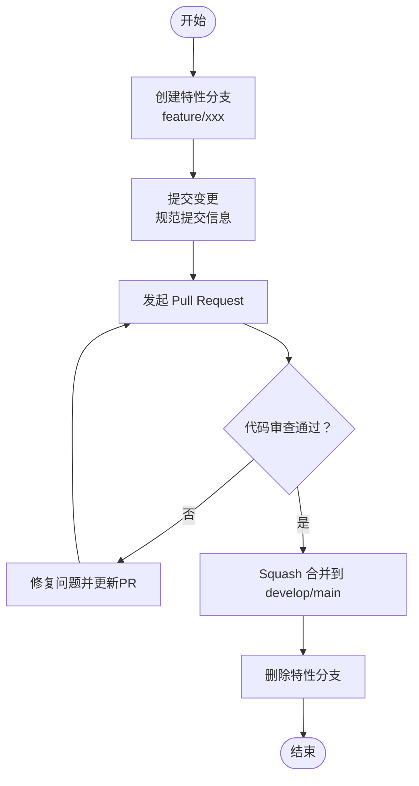
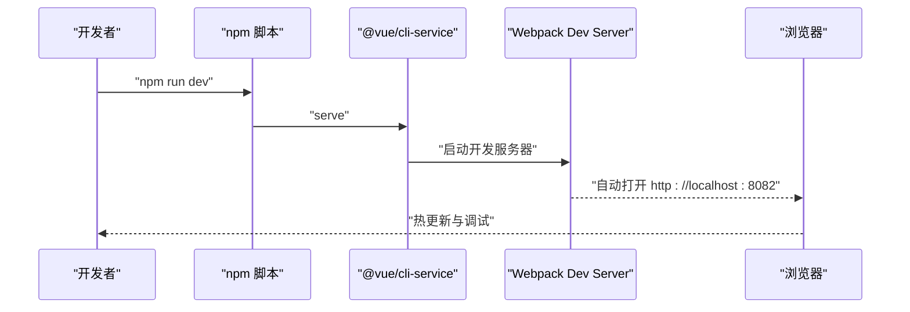
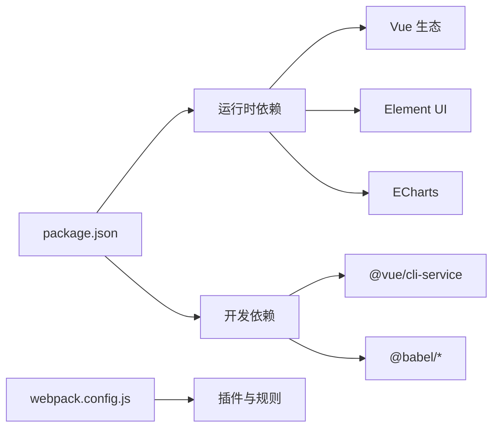

# 开发工作流程

<cite>
**本文引用的文件**
- [README.md](file://README.md)
- [README_NODE_VERSION.md](file://README_NODE_VERSION.md)
- [.gitignore](file://.gitignore)
- [.babelrc](file://.babelrc)
- [webpack.config.js](file://webpack.config.js)
- [package.json](file://package.json)
- [docs/CONVERSATION_CHANGES_FUSION_GUIDE.md](file://docs/CONVERSATION_CHANGES_FUSION_GUIDE.md)
- [CHANGELOG_0228_后变更记录.md](file://CHANGELOG_0228_后变更记录.md)
- [scripts/README_v2.md](file://scripts/README_v2.md)
</cite>

## 目录
1. [引言](#引言)
2. [项目结构](#项目结构)
3. [核心组件](#核心组件)
4. [架构总览](#架构总览)
5. [详细组件分析](#详细组件分析)
6. [依赖分析](#依赖分析)
7. [性能考虑](#性能考虑)
8. [故障排查指南](#故障排查指南)
9. [结论](#结论)
10. [附录](#附录)

## 引言
本指南面向投资组合管理系统（前端 Vue 项目）的开发团队，提供一套完整的开发工作流程规范，涵盖 Git 工作流、分支与提交规范、代码审查流程、任务分配与跟踪、日常开发操作、团队协作规范以及效率提升最佳实践。文档中的所有流程与规范均基于仓库现有文件与脚本的实际配置提炼而来，确保可落地、可执行。

## 项目结构
项目采用前端单页应用（SPA）架构，核心目录与职责如下：
- public：静态资源与 HTML 模板
- src：源代码，包含视图、组件、路由、状态管理、API 封装与工具函数
- scripts：数据导入与辅助脚本（含 ZY 数据域 Mock 数据 v2 一键生成与导入）
- docs：开发与合并指南、离线安装与集成指南
- 配置文件：.babelrc、webpack.config.js、package.json、.gitignore

**图表来源**
- [README.md:23-56](file://README.md#L23-L56)
- [webpack.config.js:1-63](file://webpack.config.js#L1-L63)

**章节来源**
- [README.md:23-56](file://README.md#L23-L56)
- [webpack.config.js:1-63](file://webpack.config.js#L1-L63)

## 核心组件
- 构建与运行
  - 开发服务器：npm run dev
  - 生产构建：npm run build
  - 代码检查：npm run lint
  - 依赖安装后钩子：postinstall（应用滚动修复与嵌套 tslib 兼容）
- 浏览器与 Node.js 版本要求
  - Node.js 版本需满足 engines 字段要求，推荐使用 16.x 或更高版本
  - 若出现 node:url 前缀相关报错，优先升级 Node.js 或按指南处理
- 开发服务器配置
  - 端口：8082
  - 自动打开浏览器
  - 热更新启用
- 资源打包
  - 输出带 contenthash，清理 dist 目录
  - 别名 @ 指向 src，Vue 运行时别名指向 vue/dist/vue.esm.js

**章节来源**
- [package.json:5-10](file://package.json#L5-L10)
- [README_NODE_VERSION.md:1-73](file://README_NODE_VERSION.md#L1-L73)
- [webpack.config.js:53-62](file://webpack.config.js#L53-L62)
- [webpack.config.js:46-52](file://webpack.config.js#L46-L52)
- [webpack.config.js:8-12](file://webpack.config.js#L8-L12)

## 架构总览
前端采用 Vue 2 + Vue Router + Vuex + Webpack 的经典组合，配合 Element UI 与 ECharts 实现数据可视化与交互体验。构建阶段通过 Babel 转译与 DefinePlugin 注入环境变量，开发阶段启用热更新与自动打开浏览器。

**图表来源**
- [package.json:5-10](file://package.json#L5-L10)
- [webpack.config.js:1-63](file://webpack.config.js#L1-L63)
- [.babelrc:1-14](file://.babelrc#L1-L14)
- [README.md:12-22](file://README.md#L12-L22)

## 详细组件分析

### Git 工作流与分支管理
- 分支命名规范
  - 特性开发：feature/xxx
  - 修复缺陷：fix/xxx
  - 研发分支：develop/xxx
  - 热修复：hotfix/xxx
  - 文档：docs/xxx
- 提交信息格式
  - 类型: 模块/文件: 描述（简要说明变更内容）
  - 示例：feat(strategy): 新增回测执行组件；fix(portfolio): 修正再平衡日期选择器禁用逻辑
- 合并策略
  - 优先使用 Squash Merge，保持主干整洁
  - 合并前确保 CI 通过、无冲突
  - 合并后删除特性分支
- 冲突解决与备份
  - 合并前导出 diff 至 docs/BACKUP_...patch
  - 合并后按“对话相关代码变更 — 备份与合并融合指南”逐项核对
  - 若补丁无法直接应用，按指南主题手动对照修改

**章节来源**
- [docs/CONVERSATION_CHANGES_FUSION_GUIDE.md:15-32](file://docs/CONVERSATION_CHANGES_FUSION_GUIDE.md#L15-L32)
- [docs/CONVERSATION_CHANGES_FUSION_GUIDE.md:36-88](file://docs/CONVERSATION_CHANGES_FUSION_GUIDE.md#L36-L88)

### 代码审查流程
- Pull Request 模板
  - 标题：类型: 模块/文件: 描述
  - 摘要：变更动机、影响范围、风险提示
  - 截图/链接：必要时附带截图或相关 Issue/设计文档链接
- 审查标准
  - 功能正确性：覆盖边界条件与异常路径
  - 代码质量：命名清晰、注释充分、复杂逻辑拆分
  - 性能与安全：避免阻塞主线程、敏感数据脱敏
  - 兼容性：遵循 .babelrc 与 browserslist 配置
- 合并条件
  - 至少一名审查者批准
  - 无未解决评论
  - 通过自动化检查（lint、构建）
  - 无冲突或冲突已解决

**章节来源**
- [docs/CONVERSATION_CHANGES_FUSION_GUIDE.md:36-88](file://docs/CONVERSATION_CHANGES_FUSION_GUIDE.md#L36-L88)
- [.babelrc:1-14](file://.babelrc#L1-L14)

### 开发任务分配与跟踪
- Issue 管理
  - 使用标签：bug、enhancement、feature、review、help wanted
  - 每个 Issue 明确验收标准与优先级
- 里程碑设置
  - 按季度/版本规划里程碑，分解为 Sprint 目标
  - 将 Issue 关联到 Milestone 与 Sprint
- 计划进度可视化
  - 可复用组件 PlanProgress.vue 展示计划与完成度（用于界面或文档）

**章节来源**
- [src/components/PlanProgress.vue:1-118](file://src/components/PlanProgress.vue#L1-L118)

### 日常开发操作指南
- 环境准备
  - 安装依赖：npm install
  - Node.js 版本满足 engines 要求，推荐 16.x
- 启动开发服务器
  - npm run dev，默认端口 8082，自动打开浏览器
- 构建与发布
  - npm run build 生成 dist，输出带 contenthash
- 代码检查
  - npm run lint 按 Vue CLI 默认规则检查
- 数据导入（Mock 数据 v2）
  - 一键导入：python scripts/generate_and_import_v2.py
  - 验证集合数量与记录总数，确保外键引用有效

**图表来源**
- [package.json:5-10](file://package.json#L5-L10)
- [webpack.config.js:53-62](file://webpack.config.js#L53-L62)

**章节来源**
- [package.json:5-10](file://package.json#L5-L10)
- [README_NODE_VERSION.md:48-66](file://README_NODE_VERSION.md#L48-L66)
- [scripts/README_v2.md:19-36](file://scripts/README_v2.md#L19-L36)

### 团队协作规范
- 沟通方式
  - 日常站会：同步进展与阻塞项
  - 异步沟通：Issue/PR 评论与标签驱动
- 问题反馈
  - Bug：附带复现步骤、期望/实际结果、环境信息
  - 功能请求：说明背景、收益、验收标准
- 知识分享
  - 定期组织代码评审与技术分享
  - 维护 docs/CONVERSATION_CHANGES_FUSION_GUIDE.md 作为合并核对清单

**章节来源**
- [docs/CONVERSATION_CHANGES_FUSION_GUIDE.md:90-97](file://docs/CONVERSATION_CHANGES_FUSION_GUIDE.md#L90-L97)

### 效率提升最佳实践与工具推荐
- 开发工具
  - VS Code：Vue/ESLint/Prettier 插件
  - Git 工具：Fork + Feature 分支 + Squash Merge
- 代码质量
  - 统一提交信息格式与 PR 模板
  - 严格遵循 .babelrc 与 browserslist，减少兼容性问题
- 自动化
  - postinstall 钩子自动应用滚动修复与 tslib 兼容
  - 一键导入脚本提升 Mock 数据生成与验证效率

**章节来源**
- [.babelrc:1-14](file://.babelrc#L1-L14)
- [package.json:9](file://package.json#L9)
- [scripts/README_v2.md:19-36](file://scripts/README_v2.md#L19-L36)

## 依赖分析
- 运行时依赖
  - Vue 2.6、Vue Router、Vuex、Axios、Element UI、ECharts、Day.js、Lodash、XLSX 等
- 开发依赖
  - @vue/cli-service、@vue/cli-plugin-*、@babel/core、@babel/preset-env
- 构建与运行
  - Webpack 5、DefinePlugin 注入环境变量、HTML 模板插件、Vue Loader

**图表来源**
- [package.json:11-38](file://package.json#L11-L38)
- [webpack.config.js:1-63](file://webpack.config.js#L1-L63)

**章节来源**
- [package.json:11-38](file://package.json#L11-L38)
- [webpack.config.js:1-63](file://webpack.config.js#L1-L63)

## 性能考虑
- 构建产物
  - 输出文件带 contenthash，利于缓存与增量更新
  - 清理 dist 目录，避免历史文件污染
- 运行时
  - Element UI 与 ECharts 按需引入，减少首屏体积
  - Vue 组件拆分与懒加载路由，降低初始包体
- 开发体验
  - 热更新与自动打开浏览器，缩短反馈周期

**章节来源**
- [webpack.config.js:8-12](file://webpack.config.js#L8-L12)
- [webpack.config.js:53-62](file://webpack.config.js#L53-L62)

## 故障排查指南
- Node.js 版本问题
  - 症状：出现 node:url 前缀相关报错
  - 处理：升级 Node.js 至 16.x 或更高版本，必要时重新安装依赖
- 构建失败
  - 检查 browserslist 与 .babelrc 配置
  - 确认 @babel/core 与 @babel/preset-env 版本兼容
- 开发服务器无法启动
  - 端口占用：修改 devServer.port 或关闭占用进程
  - 依赖损坏：删除 node_modules 与 lock 文件后重装
- 合并冲突
  - 导出补丁并按“对话相关代码变更 — 备份与合并融合指南”逐项核对
  - 若补丁冲突，按主题手动对照修改并自检

**章节来源**
- [README_NODE_VERSION.md:1-73](file://README_NODE_VERSION.md#L1-L73)
- [webpack.config.js:53-62](file://webpack.config.js#L53-L62)
- [docs/CONVERSATION_CHANGES_FUSION_GUIDE.md:15-32](file://docs/CONVERSATION_CHANGES_FUSION_GUIDE.md#L15-L32)
- [docs/CONVERSATION_CHANGES_FUSION_GUIDE.md:100-105](file://docs/CONVERSATION_CHANGES_FUSION_GUIDE.md#L100-L105)

## 结论
本指南将 Git 工作流、代码审查、任务跟踪、日常开发操作、团队协作与效率提升整合为一套可执行的流程规范，并结合项目现有配置与脚本给出落地建议。建议团队在实践中持续回顾与优化，确保流程与项目演进同步。

## 附录
- 变更记录模板与示例
  - 用于 CHANGELOG_0228_后变更记录.md 的格式化记录，便于合并与回溯
- 数据导入与验证
  - 使用 scripts/README_v2.md 的一键导入与验证脚本，确保数据域完整性

**章节来源**
- [CHANGELOG_0228_后变更记录.md:16-34](file://CHANGELOG_0228_后变更记录.md#L16-L34)
- [scripts/README_v2.md:299-324](file://scripts/README_v2.md#L299-L324)