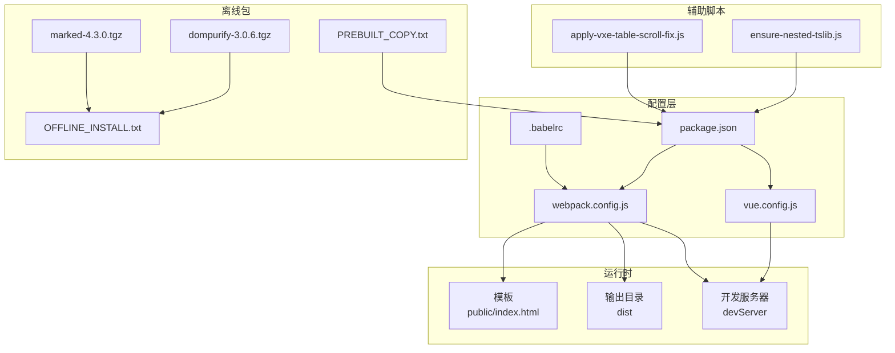
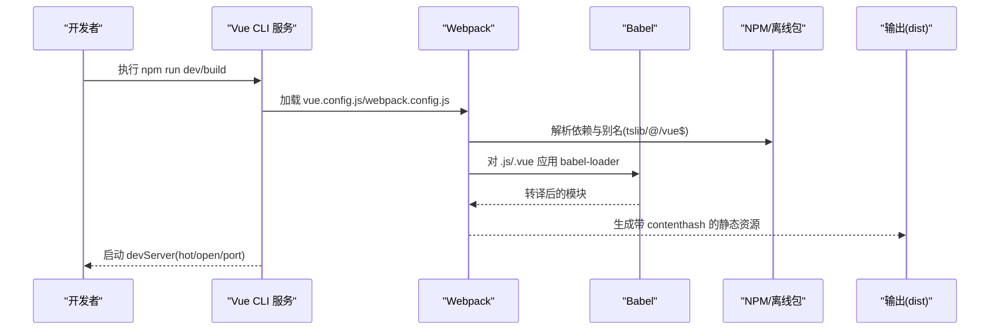
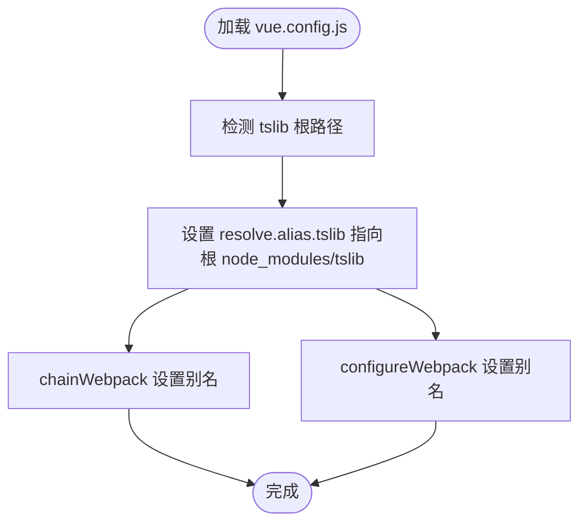
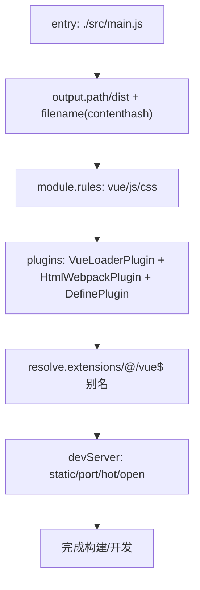
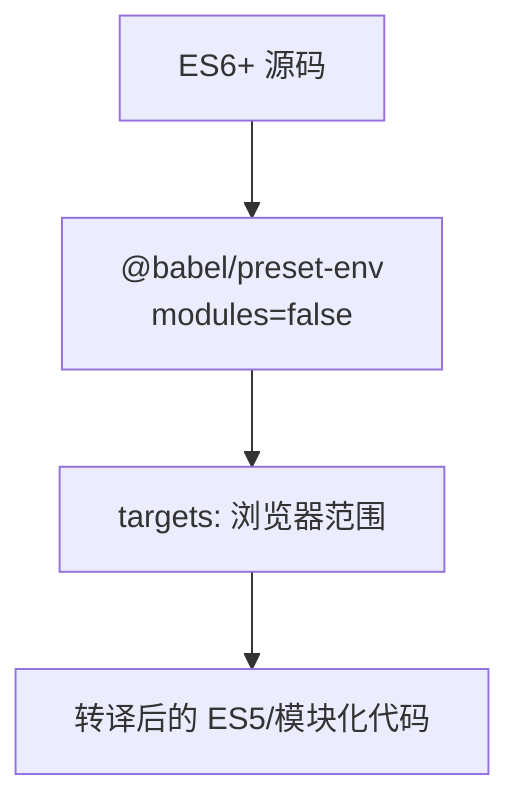
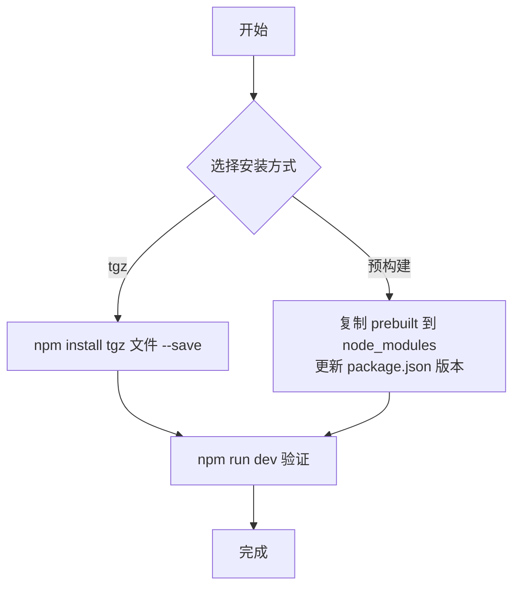
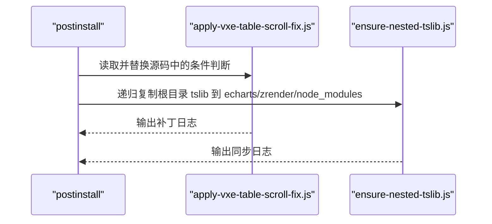
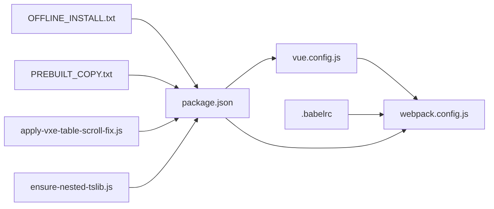

# 开发工具链

<cite>
**本文引用的文件**
- [vue.config.js](file://vue.config.js)
- [webpack.config.js](file://webpack.config.js)
- [.babelrc](file://.babelrc)
- [package.json](file://package.json)
- [public/index.html](file://public/index.html)
- [offline-npm-bundles/OFFLINE_INSTALL.txt](file://offline-npm-bundles/OFFLINE_INSTALL.txt)
- [offline-npm-bundles/PREBUILT_COPY.txt](file://offline-npm-bundles/PREBUILT_COPY.txt)
- [offline-npm-bundles/prebuilt-node_modules/marked/package.json](file://offline-npm-bundles/prebuilt-node_modules/marked/package.json)
- [offline-npm-bundles/prebuilt-node_modules/dompurify/package.json](file://offline-npm-bundles/prebuilt-node_modules/dompurify/package.json)
- [scripts/apply-vxe-table-scroll-fix.js](file://scripts/apply-vxe-table-scroll-fix.js)
- [scripts/ensure-nested-tslib.js](file://scripts/ensure-nested-tslib.js)
- [README_NODE_VERSION.md](file://README_NODE_VERSION.md)
</cite>

## 目录
1. [简介](#简介)
2. [项目结构](#项目结构)
3. [核心组件](#核心组件)
4. [架构总览](#架构总览)
5. [详细组件分析](#详细组件分析)
6. [依赖关系分析](#依赖关系分析)
7. [性能考量](#性能考量)
8. [故障排查指南](#故障排查指南)
9. [结论](#结论)
10. [附录](#附录)

## 简介
本文件系统性梳理投资组合管理系统的开发工具链与配置，重点覆盖：
- Vue CLI 配置：开发服务器、构建优化、插件配置
- Webpack 配置：模块解析、代码分割、资源处理、开发调试
- Babel 转译配置：ES6+ 语法转换、polyfill 与兼容性处理
- 离线 npm 包使用：预构建模块安装、配置与适用场景
- 开发辅助工具：热重载、源码映射、性能分析
- 构建优化技巧与生产环境配置

## 项目结构
该项目采用 Vue CLI 服务驱动的前端工程，结合自定义 Webpack 配置与 Babel 转译规则，配合离线 npm 包以满足内网部署需求。关键配置文件与脚本如下：
- Vue CLI 配置：vue.config.js（通过 chainWebpack/configureWebpack 统一别名）
- Webpack 配置：webpack.config.js（入口、输出、模块规则、插件、解析、开发服务器）
- Babel 配置：.babelrc（preset-env targets 与模块导出策略）
- 依赖与脚本：package.json（scripts、devDependencies、browserslist）
- 离线包：offline-npm-bundles（tgz 与预构建复制两种离线安装方式）
- 辅助脚本：apply-vxe-table-scroll-fix.js、ensure-nested-tslib.js（第三方库兼容性修复与 tslib 嵌套复制）

图表来源
- [vue.config.js:1-17](file://vue.config.js#L1-L17)
- [webpack.config.js:1-63](file://webpack.config.js#L1-L63)
- [.babelrc:1-14](file://.babelrc#L1-L14)
- [package.json:1-45](file://package.json#L1-L45)
- [public/index.html:1-11](file://public/index.html#L1-L11)
- [offline-npm-bundles/OFFLINE_INSTALL.txt:1-43](file://offline-npm-bundles/OFFLINE_INSTALL.txt#L1-L43)
- [offline-npm-bundles/PREBUILT_COPY.txt:33-43](file://offline-npm-bundles/PREBUILT_COPY.txt#L33-L43)
- [scripts/apply-vxe-table-scroll-fix.js:1-52](file://scripts/apply-vxe-table-scroll-fix.js#L1-L52)
- [scripts/ensure-nested-tslib.js:1-26](file://scripts/ensure-nested-tslib.js#L1-L26)

章节来源
- [vue.config.js:1-17](file://vue.config.js#L1-L17)
- [webpack.config.js:1-63](file://webpack.config.js#L1-L63)
- [.babelrc:1-14](file://.babelrc#L1-L14)
- [package.json:1-45](file://package.json#L1-L45)
- [public/index.html:1-11](file://public/index.html#L1-L11)

## 核心组件
- Vue CLI 服务与别名配置：统一通过 vue.config.js 将 tslib 指向本地 node_modules，确保嵌套依赖稳定解析。
- 自定义 Webpack：集中定义入口、输出、模块规则、插件、解析别名与开发服务器，便于扩展与优化。
- Babel 转译：基于 preset-env，目标浏览器范围明确，模块导出设为 false 以保留 ES Modules 供打包器进一步处理。
- 离线 npm 包：提供 tgz 与预构建复制两种方式，解决内网不可达或安装失败问题。
- 兼容性修复脚本：在 postinstall 阶段自动修复第三方库潜在的运行时访问问题，并同步 tslib 嵌套副本。

章节来源
- [vue.config.js:5-16](file://vue.config.js#L5-L16)
- [webpack.config.js:6-62](file://webpack.config.js#L6-L62)
- [.babelrc:1-14](file://.babelrc#L1-L14)
- [package.json:5-9](file://package.json#L5-L9)
- [scripts/apply-vxe-table-scroll-fix.js:1-52](file://scripts/apply-vxe-table-scroll-fix.js#L1-L52)
- [scripts/ensure-nested-tslib.js:1-26](file://scripts/ensure-nested-tslib.js#L1-L26)

## 架构总览
下图展示从开发到构建的关键流程与配置交互：

图表来源
- [vue.config.js:5-16](file://vue.config.js#L5-L16)
- [webpack.config.js:6-62](file://webpack.config.js#L6-L62)
- [.babelrc:1-14](file://.babelrc#L1-L14)
- [package.json:5-9](file://package.json#L5-L9)

## 详细组件分析

### Vue CLI 配置（vue.config.js）
- 目标：统一设置 tslib 别名，保证嵌套依赖（如 echarts/zrender）能正确解析到根目录 tslib。
- 实现：在 chainWebpack 与 configureWebpack 中分别设置 resolve.alias，确保两者生效。
- 影响：减少因嵌套 node_modules 导致的 ENOENT 与模块解析失败。

图表来源
- [vue.config.js:3-16](file://vue.config.js#L3-L16)

章节来源
- [vue.config.js:1-17](file://vue.config.js#L1-L17)

### Webpack 配置（webpack.config.js）
- 入口与输出
  - 入口：src/main.js
  - 输出：dist/js/[name].[contenthash:8].js，启用 clean 以清理旧产物
- 模块规则
  - .vue：vue-loader
  - .js：babel-loader，排除 node_modules
  - .css：vue-style-loader + css-loader
- 插件
  - VueLoaderPlugin：支持 .vue 单文件组件
  - HtmlWebpackPlugin：以 public/index.html 为模板生成页面
  - DefinePlugin：注入 process.env.NODE_ENV 与 BASE_URL
- 解析别名
  - vue$ 指向 vue.esm.js
  - @ 指向 src
- 开发服务器
  - static.directory 指向 public
  - compress=true、port=8082、hot=true、open=true

图表来源
- [webpack.config.js:6-62](file://webpack.config.js#L6-L62)
- [public/index.html:1-11](file://public/index.html#L1-L11)

章节来源
- [webpack.config.js:1-63](file://webpack.config.js#L1-L63)
- [public/index.html:1-11](file://public/index.html#L1-L11)

### Babel 转译配置（.babelrc）
- 预设：@babel/preset-env
- 关键点：
  - modules=false：保留 ES Modules，交由打包器做进一步处理（如 Tree Shaking、代码分割）
  - targets：浏览器范围 > 1%、last 2 versions、不支持 IE<=8
- 影响：更小的包体与更好的现代浏览器兼容性

图表来源
- [.babelrc:1-14](file://.babelrc#L1-L14)

章节来源
- [.babelrc:1-14](file://.babelrc#L1-L14)

### 离线 npm 包使用
- 场景：内网受限或 npm 安装失败时，使用预构建包快速落地依赖。
- 两种方式：
  - tgz 安装：将 marked-4.3.0.tgz 与 dompurify-3.0.6.tgz 安装到项目依赖中
  - 预构建复制：直接将预构建目录复制到 node_modules 并在 package.json 写入版本
- 验证：安装后执行 npm run dev，确认浏览器控制台不再报错

图表来源
- [offline-npm-bundles/OFFLINE_INSTALL.txt:1-43](file://offline-npm-bundles/OFFLINE_INSTALL.txt#L1-L43)
- [offline-npm-bundles/PREBUILT_COPY.txt:33-43](file://offline-npm-bundles/PREBUILT_COPY.txt#L33-L43)
- [offline-npm-bundles/prebuilt-node_modules/marked/package.json:1-94](file://offline-npm-bundles/prebuilt-node_modules/marked/package.json#L1-L94)
- [offline-npm-bundles/prebuilt-node_modules/dompurify/package.json:1-128](file://offline-npm-bundles/prebuilt-node_modules/dompurify/package.json#L1-L128)

章节来源
- [offline-npm-bundles/OFFLINE_INSTALL.txt:1-43](file://offline-npm-bundles/OFFLINE_INSTALL.txt#L1-L43)
- [offline-npm-bundles/PREBUILT_COPY.txt:33-43](file://offline-npm-bundles/PREBUILT_COPY.txt#L33-L43)
- [offline-npm-bundles/prebuilt-node_modules/marked/package.json:1-94](file://offline-npm-bundles/prebuilt-node_modules/marked/package.json#L1-L94)
- [offline-npm-bundles/prebuilt-node_modules/dompurify/package.json:1-128](file://offline-npm-bundles/prebuilt-node_modules/dompurify/package.json#L1-L128)

### 开发辅助工具与脚本
- 热重载与开发服务器：devServer.hot=true、port=8082、open=true
- 源码映射：默认由 Vue CLI/webpack 提供 SourceMap（可在 package.json scripts 中根据需要调整）
- 性能分析：可结合 webpack-bundle-analyzer（需安装）进行体积分析
- 兼容性修复：
  - apply-vxe-table-scroll-fix.js：对 vxe-table 滚动时访问 reactData 的潜在 undefined 做幂等修复
  - ensure-nested-tslib.js：在 postinstall 阶段将根目录 tslib 同步到 echarts/zrender 的嵌套 node_modules，避免 ENOENT

图表来源
- [scripts/apply-vxe-table-scroll-fix.js:1-52](file://scripts/apply-vxe-table-scroll-fix.js#L1-L52)
- [scripts/ensure-nested-tslib.js:1-26](file://scripts/ensure-nested-tslib.js#L1-L26)
- [package.json:9](file://package.json#L9)

章节来源
- [webpack.config.js:53-61](file://webpack.config.js#L53-L61)
- [scripts/apply-vxe-table-scroll-fix.js:1-52](file://scripts/apply-vxe-table-scroll-fix.js#L1-L52)
- [scripts/ensure-nested-tslib.js:1-26](file://scripts/ensure-nested-tslib.js#L1-L26)
- [package.json:9](file://package.json#L9)

### 构建优化与生产环境配置
- 代码分割与懒加载：通过路由与组件的动态导入实现按需加载
- 资源处理：CSS 与图片等资源由对应 loader 处理，输出带 contenthash 以利于缓存
- 生产环境建议：
  - 启用压缩与 Tree Shaking（由 preset-env/modules=false 与打包器共同作用）
  - 使用 CDN 引入外部依赖（如 element-ui、echarts 等）以减小包体
  - 配置长期缓存策略（contenthash + 分包命名）

章节来源
- [webpack.config.js:10](file://webpack.config.js#L10)
- [webpack.config.js:25-30](file://webpack.config.js#L25-L30)
- [.babelrc:6](file://.babelrc#L6)

## 依赖关系分析
- Vue CLI 与 Webpack：vue.config.js 与 webpack.config.js 共同决定构建行为，前者负责别名与链式配置，后者负责具体规则
- Babel 与打包器：preset-env 将 ES6+ 转为 ES5/模块化，最终由打包器进行合并与优化
- 离线包与依赖：离线 tgz 或预构建复制替代网络安装，确保内网可用性
- 兼容性脚本：postinstall 阶段自动修复第三方库与 tslib 嵌套问题

图表来源
- [vue.config.js:1-17](file://vue.config.js#L1-L17)
- [webpack.config.js:1-63](file://webpack.config.js#L1-L63)
- [.babelrc:1-14](file://.babelrc#L1-L14)
- [package.json:1-45](file://package.json#L1-L45)
- [offline-npm-bundles/OFFLINE_INSTALL.txt:1-43](file://offline-npm-bundles/OFFLINE_INSTALL.txt#L1-L43)
- [offline-npm-bundles/PREBUILT_COPY.txt:33-43](file://offline-npm-bundles/PREBUILT_COPY.txt#L33-L43)
- [scripts/apply-vxe-table-scroll-fix.js:1-52](file://scripts/apply-vxe-table-scroll-fix.js#L1-L52)
- [scripts/ensure-nested-tslib.js:1-26](file://scripts/ensure-nested-tslib.js#L1-L26)

章节来源
- [package.json:1-45](file://package.json#L1-L45)

## 性能考量
- 模块导出策略：preset-env.modules=false 有利于打包器进行 Tree Shaking 与代码分割
- 输出命名：contenthash 降低缓存失效概率
- 开发体验：devServer.hot=true、open=true 提升迭代效率
- 第三方库：对 echarts/zrender 的 tslib 嵌套复制避免重复安装与解析开销
- 离线包：减少网络依赖，提升安装稳定性与速度

章节来源
- [.babelrc:6](file://.babelrc#L6)
- [webpack.config.js:10](file://webpack.config.js#L10)
- [webpack.config.js:59](file://webpack.config.js#L59)
- [scripts/ensure-nested-tslib.js:18-25](file://scripts/ensure-nested-tslib.js#L18-L25)

## 故障排查指南
- Node 版本问题
  - 症状：出现 node:url 前缀相关错误
  - 处理：升级至 Node.js 16.x 或更高版本；必要时重新安装依赖
- tslib 嵌套缺失
  - 症状：echarts/zrender 报 ENOENT
  - 处理：确保 ensure-nested-tslib.js 在 postinstall 阶段执行，或手动复制根目录 tslib 至其 node_modules
- vxe-table 滚动异常
  - 症状：访问 reactData.visible 抛错
  - 处理：apply-vxe-table-scroll-fix.js 会在 postinstall 自动修复；如未生效，检查文件是否存在并具备写权限
- 离线安装失败
  - tgz 安装报 Maximum call stack size exceeded：删除 node_modules 与 package-lock.json 后重试，或升级 npm
  - 预构建复制：确认 package.json 中版本号与预构建包一致，执行 npm run dev 验证

章节来源
- [README_NODE_VERSION.md:1-73](file://README_NODE_VERSION.md#L1-L73)
- [scripts/ensure-nested-tslib.js:13-25](file://scripts/ensure-nested-tslib.js#L13-L25)
- [scripts/apply-vxe-table-scroll-fix.js:36-51](file://scripts/apply-vxe-table-scroll-fix.js#L36-L51)
- [offline-npm-bundles/OFFLINE_INSTALL.txt:33-42](file://offline-npm-bundles/OFFLINE_INSTALL.txt#L33-L42)
- [offline-npm-bundles/PREBUILT_COPY.txt:39-43](file://offline-npm-bundles/PREBUILT_COPY.txt#L39-L43)

## 结论
本项目通过 Vue CLI 与自定义 Webpack 的协同，结合 Babel 的现代语法转译与严格的模块导出策略，实现了高效、稳定的开发与构建流程。配合离线 npm 包与 postinstall 兼容性修复脚本，显著提升了内网部署的可靠性与可维护性。建议在生产环境中继续强化代码分割、资源压缩与缓存策略，并持续关注第三方库的兼容性修复。

## 附录
- Node.js 版本要求与升级指引参见 README_NODE_VERSION.md
- 离线安装与预构建复制操作说明参见 OFFLINE_INSTALL.txt 与 PREBUILT_COPY.txt
- 依赖与脚本定义参见 package.json

章节来源
- [README_NODE_VERSION.md:1-73](file://README_NODE_VERSION.md#L1-L73)
- [offline-npm-bundles/OFFLINE_INSTALL.txt:1-43](file://offline-npm-bundles/OFFLINE_INSTALL.txt#L1-L43)
- [offline-npm-bundles/PREBUILT_COPY.txt:33-43](file://offline-npm-bundles/PREBUILT_COPY.txt#L33-L43)
- [package.json:1-45](file://package.json#L1-L45)