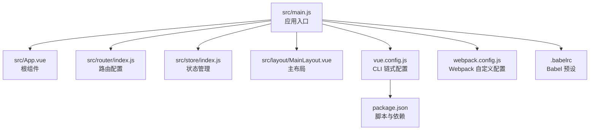
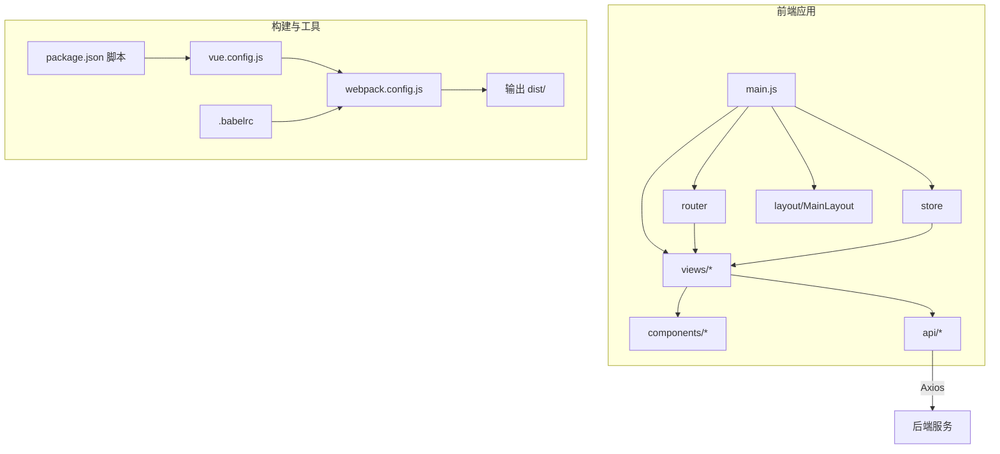
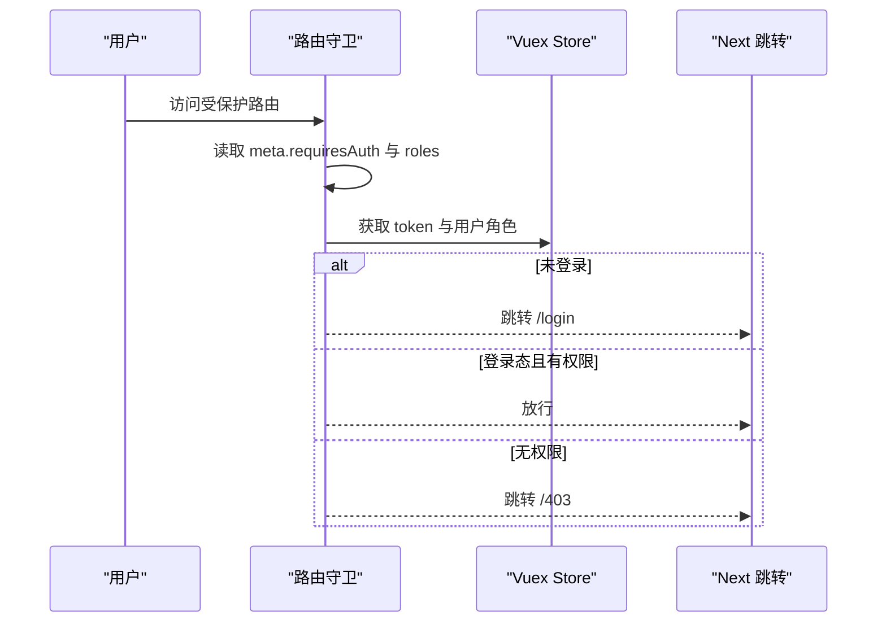
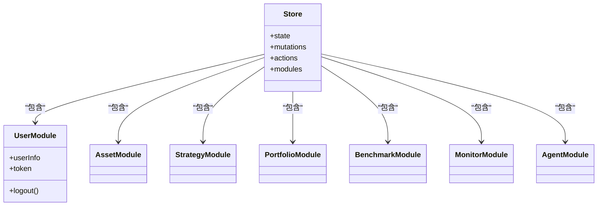
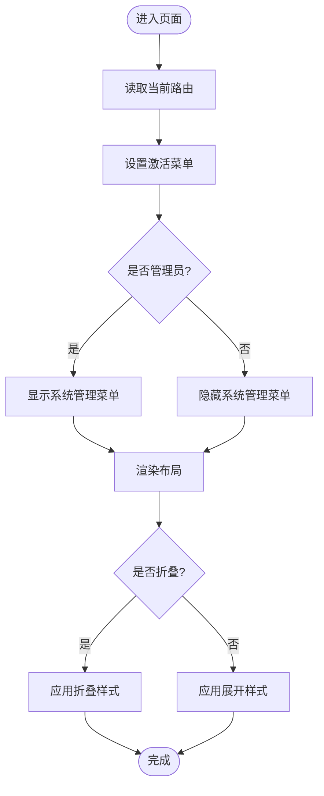
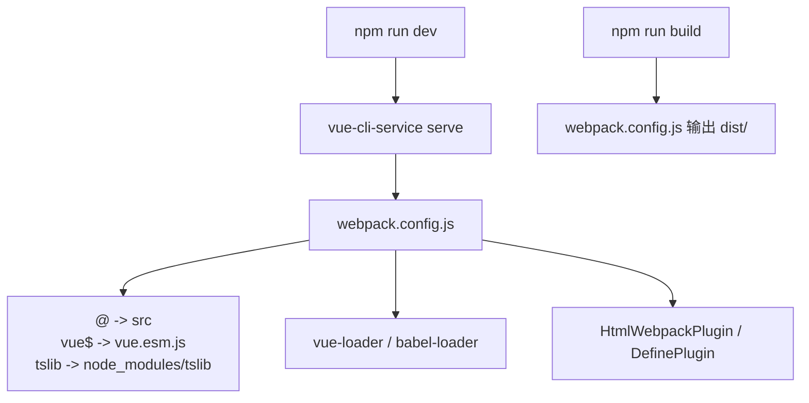
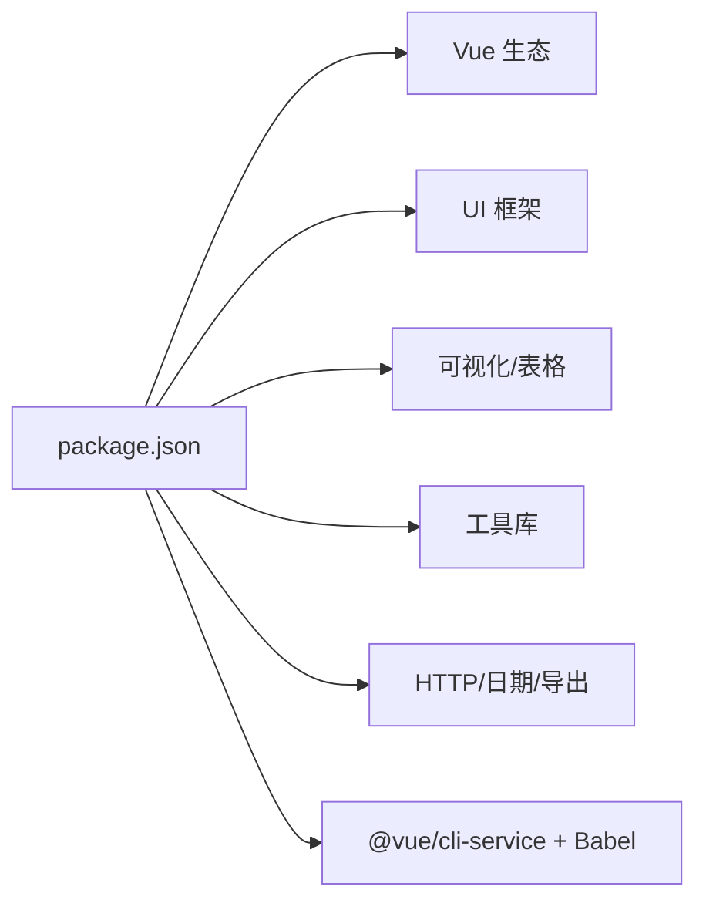

# 开发指南

<cite>
**本文引用的文件**
- [package.json](file://package.json)
- [vue.config.js](file://vue.config.js)
- [webpack.config.js](file://webpack.config.js)
- [.babelrc](file://.babelrc)
- [README_NODE_VERSION.md](file://README_NODE_VERSION.md)
- [offline-npm-bundles/OFFLINE_INSTALL.txt](file://offline-npm-bundles/OFFLINE_INSTALL.txt)
- [docs/OFFLINE_INSTALL_LINUX_WINDOWS.md](file://docs/OFFLINE_INSTALL_LINUX_WINDOWS.md)
- [scripts/README_v2.md](file://scripts/README_v2.md)
- [src/main.js](file://src/main.js)
- [src/router/index.js](file://src/router/index.js)
- [src/store/index.js](file://src/store/index.js)
- [src/App.vue](file://src/App.vue)
- [src/layout/MainLayout.vue](file://src/layout/MainLayout.vue)
- [.gitignore](file://.gitignore)
- [portfilio.code-workspace](file://portfilio.code-workspace)
</cite>

## 目录
1. [引言](#引言)
2. [项目结构](#项目结构)
3. [核心组件](#核心组件)
4. [架构总览](#架构总览)
5. [详细组件分析](#详细组件分析)
6. [依赖分析](#依赖分析)
7. [性能考虑](#性能考虑)
8. [故障排查指南](#故障排查指南)
9. [结论](#结论)
10. [附录](#附录)

## 引言
本指南面向投资组合管理系统的前端开发团队，涵盖开发环境搭建、IDE 设置、调试工具、开发规范与编码标准、工具链使用（Vue CLI、Webpack、Babel）、离线 npm 包安装、Git 工作流与分支策略、代码评审流程、单元与集成测试方法、性能优化技巧以及新成员入职指引。内容基于仓库现有配置与脚本，确保可落地、可执行。

## 项目结构
项目采用 Vue 2.6 + Vue Router + Vuex 的单页应用架构，结合 Element UI 与 vxe-table 实现丰富的数据表格与交互体验。核心入口位于 src/main.js，路由定义于 src/router/index.js，状态管理位于 src/store/index.js，布局与全局样式位于 src/layout/MainLayout.vue 与 src/App.vue。构建与打包通过 Vue CLI 与自定义 Webpack 配置协同完成，Babel 负责编译与兼容性处理。

图表来源
- [src/main.js:1-31](file://src/main.js#L1-L31)
- [src/App.vue:1-116](file://src/App.vue#L1-L116)
- [src/router/index.js:1-378](file://src/router/index.js#L1-L378)
- [src/store/index.js:1-44](file://src/store/index.js#L1-L44)
- [src/layout/MainLayout.vue:1-330](file://src/layout/MainLayout.vue#L1-L330)
- [vue.config.js:1-17](file://vue.config.js#L1-L17)
- [webpack.config.js:1-63](file://webpack.config.js#L1-L63)
- [.babelrc:1-14](file://.babelrc#L1-L14)
- [package.json:1-45](file://package.json#L1-L45)

章节来源
- [src/main.js:1-31](file://src/main.js#L1-L31)
- [src/router/index.js:1-378](file://src/router/index.js#L1-L378)
- [src/store/index.js:1-44](file://src/store/index.js#L1-L44)
- [src/App.vue:1-116](file://src/App.vue#L1-L116)
- [src/layout/MainLayout.vue:1-330](file://src/layout/MainLayout.vue#L1-L330)
- [vue.config.js:1-17](file://vue.config.js#L1-L17)
- [webpack.config.js:1-63](file://webpack.config.js#L1-L63)
- [.babelrc:1-14](file://.babelrc#L1-L14)
- [package.json:1-45](file://package.json#L1-L45)

## 核心组件
- 应用入口与插件注册：在入口文件中统一注册 Element UI、虚拟滚动、图表库与表格插件，保证全局可用性与一致性。
- 路由体系：采用 hash 模式与嵌套路由，支持权限守卫与面包屑标题动态设置，覆盖资产、策略、组合、分析、AI 助手与系统管理等模块。
- 状态管理：按功能拆分模块（user、asset、strategy、portfolio、benchmark、monitor、agent），提供通用 loading 与侧边栏折叠状态。
- 主布局：左侧菜单、顶部导航与面包屑联动，支持侧边栏折叠与用户下拉菜单，适配不同角色的可见性控制。

章节来源
- [src/main.js:1-31](file://src/main.js#L1-L31)
- [src/router/index.js:1-378](file://src/router/index.js#L1-L378)
- [src/store/index.js:1-44](file://src/store/index.js#L1-L44)
- [src/layout/MainLayout.vue:1-330](file://src/layout/MainLayout.vue#L1-L330)

## 架构总览
系统采用“入口 -> 路由 -> 视图/组件 -> API/Store”的典型前端架构。路由负责页面导航与鉴权，布局负责 UI 结构与交互，状态管理负责跨组件共享数据，API 层负责与后端交互。Webpack 与 Vue CLI 协同进行资源打包与开发服务器启动，Babel 负责语法转换与兼容。

图表来源
- [src/main.js:1-31](file://src/main.js#L1-L31)
- [src/router/index.js:1-378](file://src/router/index.js#L1-L378)
- [src/store/index.js:1-44](file://src/store/index.js#L1-L44)
- [src/layout/MainLayout.vue:1-330](file://src/layout/MainLayout.vue#L1-L330)
- [webpack.config.js:1-63](file://webpack.config.js#L1-L63)
- [vue.config.js:1-17](file://vue.config.js#L1-L17)
- [.babelrc:1-14](file://.babelrc#L1-L14)
- [package.json:5-9](file://package.json#L5-L9)

## 详细组件分析

### 路由与权限控制
- 路由模式：hash 模式，便于部署与访问。
- 权限守卫：根据 meta.requiresAuth 与 token 判断是否放行；支持 roles 白名单校验；登录态存在时禁止重复进入登录页。
- 标题与面包屑：动态设置 document.title，并根据 matched 生成面包屑路径。

图表来源
- [src/router/index.js:351-375](file://src/router/index.js#L351-L375)

章节来源
- [src/router/index.js:1-378](file://src/router/index.js#L1-L378)

### 状态管理模块
- 模块化：user、asset、strategy、portfolio、benchmark、monitor、agent 等模块按领域划分。
- 通用状态：loading、collapsed，提供 mutations 与 actions 统一更新。
- 布局联动：collapsed 与菜单折叠、loading 与全局加载指示。

图表来源
- [src/store/index.js:1-44](file://src/store/index.js#L1-L44)

章节来源
- [src/store/index.js:1-44](file://src/store/index.js#L1-L44)

### 主布局与菜单
- 侧边栏：支持折叠，根据当前路由默认展开对应菜单。
- 顶部导航：面包屑、用户下拉菜单、登出确认。
- 权限控制：仅 admin 显示系统管理菜单项。

图表来源
- [src/layout/MainLayout.vue:144-217](file://src/layout/MainLayout.vue#L144-L217)

章节来源
- [src/layout/MainLayout.vue:1-330](file://src/layout/MainLayout.vue#L1-L330)

### 构建与工具链
- Vue CLI：提供 serve/build/lint 脚本，默认使用 @vue/cli-service。
- Webpack：自定义入口、输出、loader、插件与别名，启用热更新与静态资源服务。
- Babel：preset-env 配置 targets 与模块策略，确保兼容性。
- 别名与解析：@ 指向 src，vue$ 指向开发版本，tslib 指向本地副本以避免重复依赖。

图表来源
- [package.json:5-9](file://package.json#L5-L9)
- [webpack.config.js:1-63](file://webpack.config.js#L1-L63)
- [vue.config.js:5-16](file://vue.config.js#L5-L16)
- [.babelrc:1-14](file://.babelrc#L1-14)

章节来源
- [package.json:1-45](file://package.json#L1-L45)
- [webpack.config.js:1-63](file://webpack.config.js#L1-L63)
- [vue.config.js:1-17](file://vue.config.js#L1-L17)
- [.babelrc:1-14](file://.babelrc#L1-L14)

## 依赖分析
- 运行时依赖：Vue 生态（router、vuex）、UI 框架（Element UI）、数据可视化（ECharts）、表格（vxe-table 及其 Element 插件）、虚拟滚动、Markdown 渲染与 HTML 消毒、HTTP 客户端、日期处理、lodash、Excel 导出等。
- 开发依赖：@vue/cli-service、babel 相关插件与 preset、vue-template-compiler。
- 浏览器兼容：browserslist 指定 >1%、last 2 versions、not dead。

图表来源
- [package.json:11-38](file://package.json#L11-L38)

章节来源
- [package.json:1-45](file://package.json#L1-L45)

## 性能考虑
- 代码分割与懒加载：路由级异步加载组件，减少首屏体积。
- 虚拟滚动：对大数据表格使用 vue-virtual-scroller，提升渲染性能。
- 图表与表格：按需引入样式与插件，避免全局污染。
- 构建优化：Webpack 输出文件带 contenthash，利于缓存；CLI 默认优化策略配合自定义别名与 loader。
- 网络环境：离线 npm 包安装方案可显著降低依赖安装失败率与耗时。

章节来源
- [src/router/index.js:10-120](file://src/router/index.js#L10-L120)
- [src/main.js:14-22](file://src/main.js#L14-L22)
- [webpack.config.js:10,34-44](file://webpack.config.js#L10,L34-L44)
- [docs/OFFLINE_INSTALL_LINUX_WINDOWS.md:126-184](file://docs/OFFLINE_INSTALL_LINUX_WINDOWS.md#L126-L184)

## 故障排查指南
- Node.js 版本问题
  - 现象：出现 node:url 前缀相关错误。
  - 解决：升级 Node.js 至 16.x 或更高；如无法升级，参考降级依赖或使用 polyfill 的替代方案；升级后建议删除 node_modules 与 lock 文件后重装。
- 离线 npm 包安装
  - 方案 A：整包离线（推荐）——在联网机执行 npm ci 并打包 node_modules、package.json、package-lock.json，内网解压后直接使用。
  - 方案 B：仅安装增量包（最小集）——使用仓库提供的 marked 与 dompurify tgz，必要时追加 --legacy-peer-deps。
  - 常见问题：Maximum call stack size exceeded、peer 依赖冲突、OS 不一致导致原生模块需重新安装。
- TypeScript tslib 冲突
  - 现象：tslib 重复或版本不一致导致构建异常。
  - 解决：通过 vue.config.js 与 webpack.config.js 将 tslib 指向本地副本，避免重复解析。

章节来源
- [README_NODE_VERSION.md:1-73](file://README_NODE_VERSION.md#L1-L73)
- [offline-npm-bundles/OFFLINE_INSTALL.txt:1-43](file://offline-npm-bundles/OFFLINE_INSTALL.txt#L1-L43)
- [docs/OFFLINE_INSTALL_LINUX_WINDOWS.md:126-202](file://docs/OFFLINE_INSTALL_LINUX_WINDOWS.md#L126-L202)
- [vue.config.js:3,7,11](file://vue.config.js#L3,L7,L11)
- [webpack.config.js:49,50](file://webpack.config.js#L49,L50)

## 结论
本指南提供了从环境搭建到上线运维的全流程实践建议。通过合理的工具链配置、严格的开发规范、完善的离线安装策略与性能优化手段，能够显著提升开发效率与系统稳定性。建议团队在日常协作中持续完善 Git 工作流与代码评审机制，保障代码质量与可维护性。

## 附录

### 开发环境搭建与 IDE 设置
- Node.js：优先使用 16.x 或更高版本；如使用 nvm 管理版本，确保与 .nvmrc 一致。
- IDE：推荐 VS Code，安装 Vue、ESLint、Prettier、EditorConfig 等扩展；使用 workspaces 将前后端工程统一管理。
- 工作区：portfilio.code-workspace 已配置双工程目录，便于前后端协同开发。

章节来源
- [README_NODE_VERSION.md:9-34](file://README_NODE_VERSION.md#L9-L34)
- [portfilio.code-workspace:1-10](file://portfilio.code-workspace#L1-L10)

### 调试工具使用
- 开发服务器：npm run dev 启动，端口 8082，开启热更新与自动打开浏览器。
- 控制台与网络：结合浏览器开发者工具检查路由跳转、请求与状态变化。
- Vue Devtools：建议安装 Vue Devtools 插件，辅助检查组件树与状态。

章节来源
- [webpack.config.js:53-61](file://webpack.config.js#L53-L61)
- [package.json:6](file://package.json#L6)

### 开发规范与编码标准
- 文件命名：组件与视图采用 PascalCase（如 MainLayout.vue），工具函数小驼峰（如 request.js）。
- 代码格式化：统一使用 Prettier；结合 ESLint 规则，提交前执行 npm run lint。
- 注释规范：公共 API 与复杂逻辑添加注释；组件与方法职责清晰、命名自解释。
- 目录组织：按功能域划分（views/asset、views/strategy 等），避免交叉耦合。

章节来源
- [package.json:5](file://package.json#L5)
- [.gitignore:1-10](file://.gitignore#L1-L10)

### Git 工作流与分支管理
- 分支策略：采用 feature/fix/release/hotfix 分支命名；主分支仅允许合并与打标签。
- 提交规范：使用 Conventional Commits，语义化提交信息（feat/fix/docs/chore 等）。
- 代码评审：PR 必须通过至少一名同事评审，确保无破坏性改动与测试通过。
- 合并与发布：release 分支合并主干并打 tag；hotfix 从主干切出，修复后回并主干与 release。

章节来源
- [scripts/README_v2.md:19-37](file://scripts/README_v2.md#L19-L37)

### 单元测试与集成测试
- 单元测试：针对工具函数与纯计算逻辑编写测试；使用 Jest 或 Vitest（建议在 Vue CLI 中集成 @vue/cli-plugin-unit-*）。
- 集成测试：围绕路由守卫、API 请求与状态变更编写端到端测试；建议使用 Cypress 或 Playwright。
- 覆盖率：设定阈值（如函数 80%、行 80%），持续改进。

章节来源
- [src/router/index.js:351-375](file://src/router/index.js#L351-L375)
- [src/utils/request.js](file://src/utils/request.js)

### 离线 npm 包安装实操
- 整包离线（推荐）：在联网机执行 npm ci，打包 node_modules、package.json、package-lock.json，内网解压后直接使用。
- 增量 tgz：使用仓库提供的 marked 与 dompurify tgz，执行 npm install 安装并保存到 dependencies。
- 常见问题：栈溢出时删除 node_modules 与 lock 后重试；必要时升级 npm；如遇 peer 冲突追加 --legacy-peer-deps。

章节来源
- [docs/OFFLINE_INSTALL_LINUX_WINDOWS.md:126-184](file://docs/OFFLINE_INSTALL_LINUX_WINDOWS.md#L126-L184)
- [offline-npm-bundles/OFFLINE_INSTALL.txt:14-37](file://offline-npm-bundles/OFFLINE_INSTALL.txt#L14-L37)

### 数据导入与 Mock 数据
- v2 增强版：一键生成并导入 Mock 数据，覆盖 8 大数据域、20+ 集合与 200+ 记录，支持复杂分析场景验证。
- 验证脚本：导入完成后可使用脚本验证集合数量、记录总数与外键引用有效性。

章节来源
- [scripts/README_v2.md:19-37](file://scripts/README_v2.md#L19-L37)
- [scripts/README_v2.md:299-324](file://scripts/README_v2.md#L299-L324)