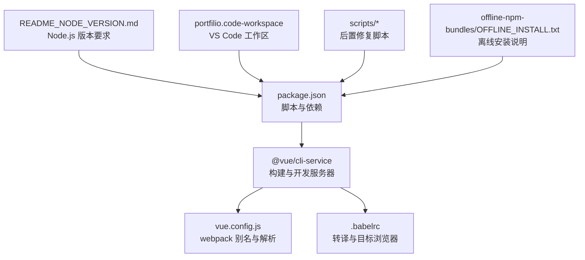
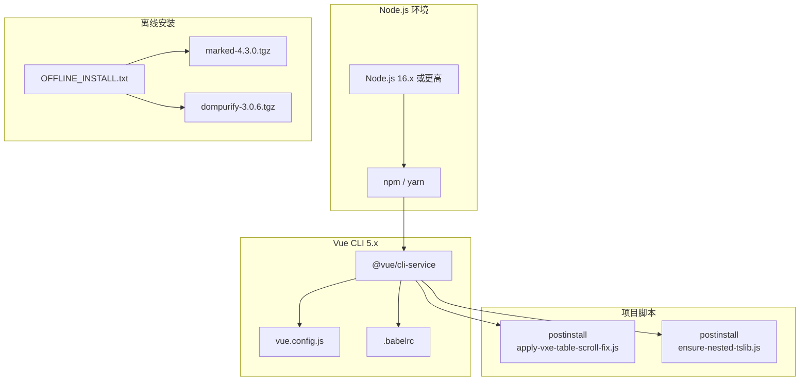
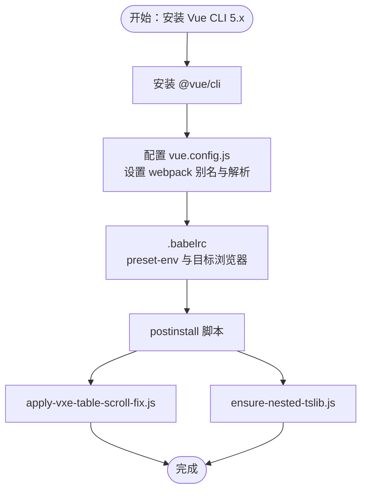
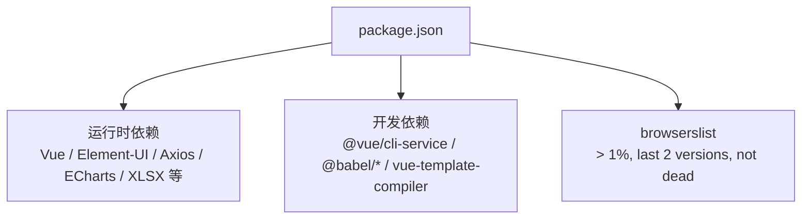

# 开发环境搭建

<cite>
**本文引用的文件**
- [package.json](file://package.json)
- [vue.config.js](file://vue.config.js)
- [.babelrc](file://.babelrc)
- [README_NODE_VERSION.md](file://README_NODE_VERSION.md)
- [portfilio.code-workspace](file://portfilio.code-workspace)
- [scripts/apply-vxe-table-scroll-fix.js](file://scripts/apply-vxe-table-scroll-fix.js)
- [scripts/ensure-nested-tslib.js](file://scripts/ensure-nested-tslib.js)
- [offline-npm-bundles/OFFLINE_INSTALL.txt](file://offline-npm-bundles/OFFLINE_INSTALL.txt)
</cite>

## 目录
1. [简介](#简介)
2. [项目结构](#项目结构)
3. [核心组件](#核心组件)
4. [架构总览](#架构总览)
5. [详细组件分析](#详细组件分析)
6. [依赖分析](#依赖分析)
7. [性能考虑](#性能考虑)
8. [故障排查指南](#故障排查指南)
9. [结论](#结论)
10. [附录](#附录)

## 简介
本指南面向投资组合管理系统的前端开发团队，提供从零搭建开发环境的完整流程，涵盖 Node.js 版本要求与安装、Vue CLI 5.x 的安装与配置、IDE 推荐设置（VS Code 插件、ESLint、Prettier）、开发服务器启动与热重载、代理与端口配置、依赖管理工具（npm 与 yarn）的使用差异、以及常见环境问题的解决方案。文档同时给出工具链的完整配置说明，帮助开发者快速、稳定地开展本地开发。

## 项目结构
本项目采用 Vue CLI 5.x 生成的前端工程，核心入口与配置如下：
- 核心依赖与脚本定义于 package.json，包含开发与生产依赖、脚本命令（dev/build/lint/postinstall）。
- 构建与打包通过 @vue/cli-service 驱动，webpack 配置通过 vue.config.js 与 chainWebpack 进行扩展。
- Babel 配置位于 .babelrc，用于转译与目标浏览器兼容。
- Node.js 版本要求与升级方案详见 README_NODE_VERSION.md。
- VS Code 工作区配置位于 portfilio.code-workspace，便于多仓库协同。
- 项目内置离线安装说明，用于内网环境快速补齐关键依赖（marked、dompurify）。

图表来源
- [package.json](file://package.json)
- [vue.config.js](file://vue.config.js)
- [.babelrc](file://.babelrc)
- [README_NODE_VERSION.md](file://README_NODE_VERSION.md)
- [portfilio.code-workspace](file://portfilio.code-workspace)
- [scripts/apply-vxe-table-scroll-fix.js](file://scripts/apply-vxe-table-scroll-fix.js)
- [scripts/ensure-nested-tslib.js](file://scripts/ensure-nested-tslib.js)
- [offline-npm-bundles/OFFLINE_INSTALL.txt](file://offline-npm-bundles/OFFLINE_INSTALL.txt)

章节来源
- [package.json](file://package.json)
- [vue.config.js](file://vue.config.js)
- [.babelrc](file://.babelrc)
- [README_NODE_VERSION.md](file://README_NODE_VERSION.md)
- [portfilio.code-workspace](file://portfilio.code-workspace)

## 核心组件
- Node.js 与包管理器
  - Node.js 版本要求：项目明确要求 Node.js ≥ 14.18.0 或 ≥ 16.0.0，以支持 node: 前缀模块语法；推荐使用 Node.js 16.x 或更高版本。
  - 包管理器：项目脚本与依赖管理以 npm 为主，同时可使用 yarn（二者在本项目中均可使用，详见“依赖管理工具”章节）。
- Vue CLI 5.x
  - 通过 @vue/cli-service 提供开发服务器、热重载、打包与 lint 能力。
  - 通过 vue.config.js 与 chainWebpack 进行 webpack 别名与解析配置。
- Babel 转译
  - .babelrc 配置 preset-env 与目标浏览器列表，确保兼容性。
- 后置修复脚本
  - scripts/apply-vxe-table-scroll-fix.js：对 vxe-table 滚动时访问 reactData 可能未初始化的问题进行幂等修复。
  - scripts/ensure-nested-tslib.js：确保 echarts/zrender 的 node_modules/tslib 嵌套存在，避免 ENOENT 报错。
- 离线安装
  - offline-npm-bundles/OFFLINE_INSTALL.txt 提供内网环境下安装 marked、dompurify 的步骤与注意事项。

章节来源
- [package.json](file://package.json)
- [vue.config.js](file://vue.config.js)
- [.babelrc](file://.babelrc)
- [scripts/apply-vxe-table-scroll-fix.js](file://scripts/apply-vxe-table-scroll-fix.js)
- [scripts/ensure-nested-tslib.js](file://scripts/ensure-nested-tslib.js)
- [offline-npm-bundles/OFFLINE_INSTALL.txt](file://offline-npm-bundles/OFFLINE_INSTALL.txt)

## 架构总览
下图展示了开发环境的关键组件与交互关系，包括 Node.js、包管理器、Vue CLI、Babel、webpack 别名解析、后置修复脚本与离线安装流程。

图表来源
- [package.json](file://package.json)
- [vue.config.js](file://vue.config.js)
- [.babelrc](file://.babelrc)
- [scripts/apply-vxe-table-scroll-fix.js](file://scripts/apply-vxe-table-scroll-fix.js)
- [scripts/ensure-nested-tslib.js](file://scripts/ensure-nested-tslib.js)
- [offline-npm-bundles/OFFLINE_INSTALL.txt](file://offline-npm-bundles/OFFLINE_INSTALL.txt)

## 详细组件分析

### Node.js 版本要求与安装
- 版本要求
  - 若遇到 “cannot find module node:url” 错误，需升级 Node.js 至 ≥ 14.18.0 或 ≥ 16.0.0。
  - 推荐使用 Node.js 16.x 或更高版本，并确保 npm ≥ 7.x。
- 升级方案
  - 方案1（推荐）：使用 nvm（Windows/macOS/Linux）安装并切换到 Node.js 16.20.0。
  - 方案2（不推荐）：降级 @babel/core 至较旧版本，可能引入其他兼容性问题。
  - 方案3（复杂，不推荐）：通过 webpack 或 babel 配置 polyfill 处理 node: 前缀，但配置复杂且不稳定。
- 重新安装依赖
  - 升级 Node.js 后，建议删除 node_modules 与 package-lock.json 并重新安装。

章节来源
- [README_NODE_VERSION.md](file://README_NODE_VERSION.md)

### Vue CLI 5.x 安装与配置
- 安装
  - 通过 npm 全局安装 @vue/cli（版本与项目保持一致）。
- 配置
  - 通过 vue.config.js 设置 webpack 别名（如 tslib），提升构建稳定性。
  - 通过 chainWebpack 与 configureWebpack 的 resolve.alias 统一指向 node_modules/tslib，避免嵌套缺失导致的 ENOENT。
- Babel 配置
  - .babelrc 使用 @babel/preset-env，目标浏览器设置为 > 1%、last 2 versions、not dead，且排除 IE ≤ 8。
- 后置修复脚本
  - postinstall 阶段自动执行 apply-vxe-table-scroll-fix.js 与 ensure-nested-tslib.js，确保第三方依赖的兼容性与稳定性。

图表来源
- [package.json](file://package.json)
- [vue.config.js](file://vue.config.js)
- [.babelrc](file://.babelrc)
- [scripts/apply-vxe-table-scroll-fix.js](file://scripts/apply-vxe-table-scroll-fix.js)
- [scripts/ensure-nested-tslib.js](file://scripts/ensure-nested-tslib.js)

章节来源
- [package.json](file://package.json)
- [vue.config.js](file://vue.config.js)
- [.babelrc](file://.babelrc)
- [scripts/apply-vxe-table-scroll-fix.js](file://scripts/apply-vxe-table-scroll-fix.js)
- [scripts/ensure-nested-tslib.js](file://scripts/ensure-nested-tslib.js)

### IDE 推荐设置（VS Code）
- 工作区配置
  - portfilio.code-workspace 提供多仓库协同的工作区设置，便于前后端联合调试。
- 插件建议
  - Vue 官方插件（如 Vetur/Volar）以获得语法高亮、模板补全与错误提示。
  - ESLint 插件：与项目 ESLint 规则联动，保证代码风格一致性。
  - Prettier 插件：与项目 Prettier 配置联动，统一格式化风格。
- 保存时自动格式化
  - 在 VS Code 设置中启用“editor.formatOnSave”，并选择 Prettier 作为默认格式化器。
- ESLint 规则
  - 项目通过 @vue/cli-service 提供 lint 脚本，建议在 VS Code 中启用 ESLint 插件并配置为“问题面板”显示。
- Prettier 格式化
  - 项目提供 Prettier 配置（与 Vue CLI 默认配置一致），建议在 VS Code 中设置 editor.defaultFormatter 为 Prettier，并开启 formatOnSave。

章节来源
- [portfilio.code-workspace](file://portfilio.code-workspace)

### 开发服务器启动与热重载
- 启动命令
  - 使用 npm run dev 启动开发服务器，基于 @vue/cli-service 提供的 serve 命令。
- 热重载
  - 开发服务器默认启用热重载（HMR），修改源码后浏览器自动刷新。
- 端口与代理
  - 项目未显式配置端口与代理，如需自定义，可在 vue.config.js 中通过 devServer 字段进行扩展（如 port、proxy、before/after 等钩子）。
- 构建与校验
  - npm run build 用于生产构建；npm run lint 用于代码质量检查。

章节来源
- [package.json](file://package.json)
- [vue.config.js](file://vue.config.js)

### 依赖管理工具（npm 与 yarn）
- npm
  - 项目脚本与依赖管理以 npm 为主，推荐使用 npm 7+ 以获得更好的依赖解析能力。
- yarn
  - 本项目同样支持 yarn，可直接使用 yarn 或 yarn install 等命令。
- 选择建议
  - 团队统一使用 npm 或 yarn，避免混用导致 lock 文件冲突。
  - 如需离线安装，可参考 offline-npm-bundles/OFFLINE_INSTALL.txt 的步骤。

章节来源
- [package.json](file://package.json)
- [offline-npm-bundles/OFFLINE_INSTALL.txt](file://offline-npm-bundles/OFFLINE_INSTALL.txt)

### 常见环境问题与解决方案
- Node.js 版本冲突
  - 现象：出现 “cannot find module node:url”。
  - 解决：升级 Node.js 至 ≥ 14.18.0 或 ≥ 16.0.0；必要时降级 @babel/core（不推荐）。
- 权限问题
  - 现象：npm/yarn 安装失败或权限不足。
  - 解决：使用管理员权限运行终端，或配置 npm/yarn 的全局目录权限。
- tslib 嵌套缺失导致 ENOENT
  - 现象：echarts/zrender 报错找不到 tslib。
  - 解决：确保 ensure-nested-tslib.js 在 postinstall 阶段执行，将 tslib 递归复制到各自 node_modules 下。
- vxe-table 滚动异常
  - 现象：滚动时访问 reactData 可能未初始化导致报错。
  - 解决：apply-vxe-table-scroll-fix.js 会在 postinstall 阶段对 es/lib 两份产物进行幂等替换。
- 内网离线安装 marked/dompurify
  - 步骤：参考 OFFLINE_INSTALL.txt，将 tgz 包安装到项目中，并在必要时使用 --legacy-peer-deps。
  - 验证：确认 node_modules 与 package.json 中出现对应依赖，重新运行 npm run dev。

章节来源
- [README_NODE_VERSION.md](file://README_NODE_VERSION.md)
- [scripts/ensure-nested-tslib.js](file://scripts/ensure-nested-tslib.js)
- [scripts/apply-vxe-table-scroll-fix.js](file://scripts/apply-vxe-table-scroll-fix.js)
- [offline-npm-bundles/OFFLINE_INSTALL.txt](file://offline-npm-bundles/OFFLINE_INSTALL.txt)

## 依赖分析
- 核心依赖
  - Vue 2.6.x、Vue Router、Vuex、Element-UI、Axios、ECharts、XLSX 等。
- 开发依赖
  - @vue/cli-service、@vue/cli-plugin-*、@babel/core、@babel/preset-env、vue-template-compiler 等。
- 浏览器兼容
  - browserslist 指定 > 1%、last 2 versions、not dead，确保现代浏览器兼容性。

图表来源
- [package.json](file://package.json)
- [.babelrc](file://.babelrc)

章节来源
- [package.json](file://package.json)
- [.babelrc](file://.babelrc)

## 性能考虑
- 构建优化
  - 使用 @vue/cli-service 默认的 webpack 配置；如需进一步优化，可在 vue.config.js 中按需扩展（如 splitChunks、压缩策略等）。
- 依赖体积
  - 通过 browserslist 与 preset-env 控制转译范围，减少不必要的 polyfill。
- 开发体验
  - 热重载与快速编译提升迭代效率；避免在开发阶段启用生产优化（如压缩）。

## 故障排查指南
- 启动失败
  - 检查 Node.js 版本是否满足要求；升级后清理 node_modules 与 lock 文件并重新安装。
- Lint 失败
  - 使用 npm run lint 修复可自动修复的问题；对不可自动修复的问题，按 ESLint 输出逐项修正。
- 依赖安装失败
  - 尝试使用 --legacy-peer-deps；若仍失败，清理缓存后重试。
- 内网安装 marked/dompurify
  - 按 OFFLINE_INSTALL.txt 步骤执行；若仍报错，检查 tgz 路径与权限。

章节来源
- [README_NODE_VERSION.md](file://README_NODE_VERSION.md)
- [package.json](file://package.json)
- [offline-npm-bundles/OFFLINE_INSTALL.txt](file://offline-npm-bundles/OFFLINE_INSTALL.txt)

## 结论
通过遵循本指南，您可以快速搭建稳定、高效的开发环境。重点在于满足 Node.js 版本要求、正确安装与配置 Vue CLI 5.x、统一 ESLint/Prettier 规则、理解并应用 postinstall 修复脚本与离线安装流程。在开发过程中，充分利用热重载与默认构建配置，结合必要的性能与兼容性优化，可显著提升开发效率与代码质量。

## 附录
- 快速检查清单
  - Node.js 版本：≥ 14.18.0 或 ≥ 16.0.0
  - 包管理器：npm 7+ 或 yarn
  - 安装依赖：npm install 或 yarn install
  - 启动开发：npm run dev
  - 代码规范：npm run lint
  - 内网安装：按 OFFLINE_INSTALL.txt 执行