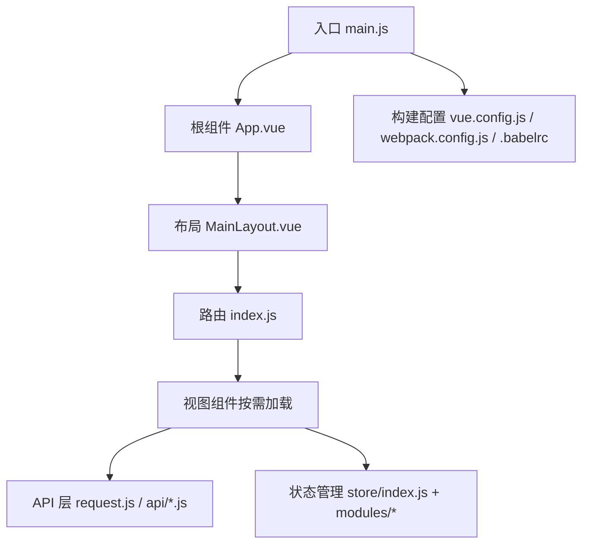
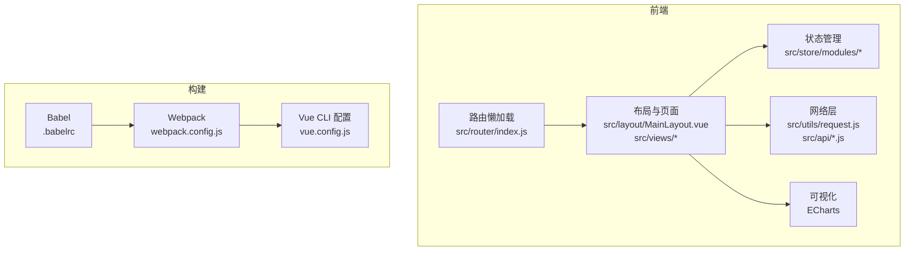
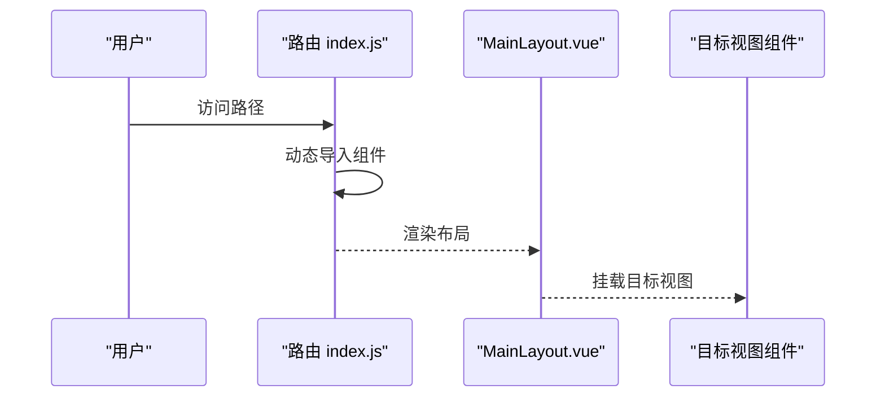
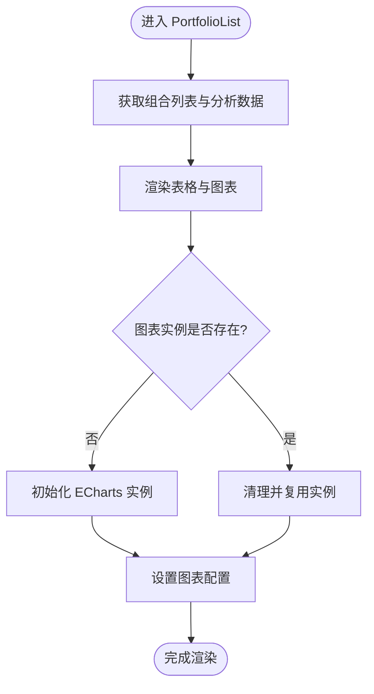
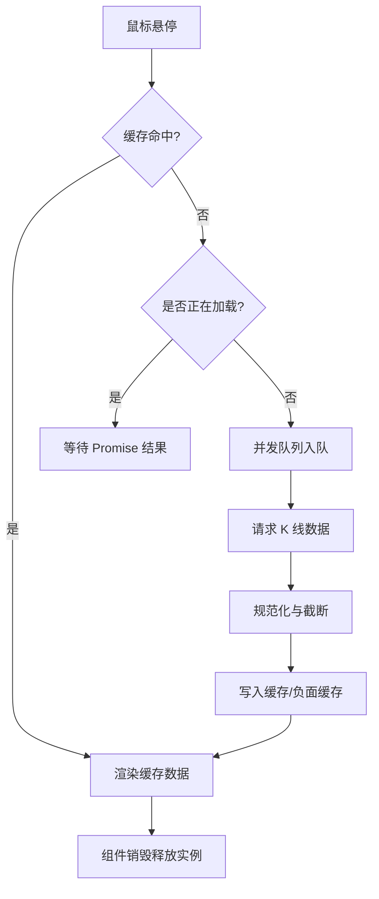
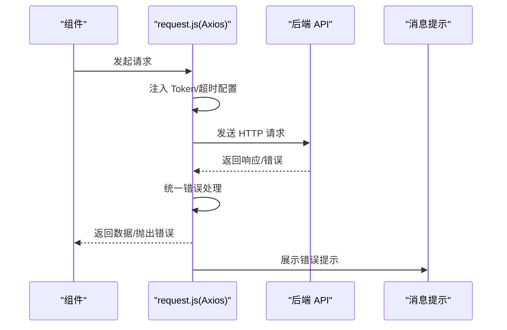
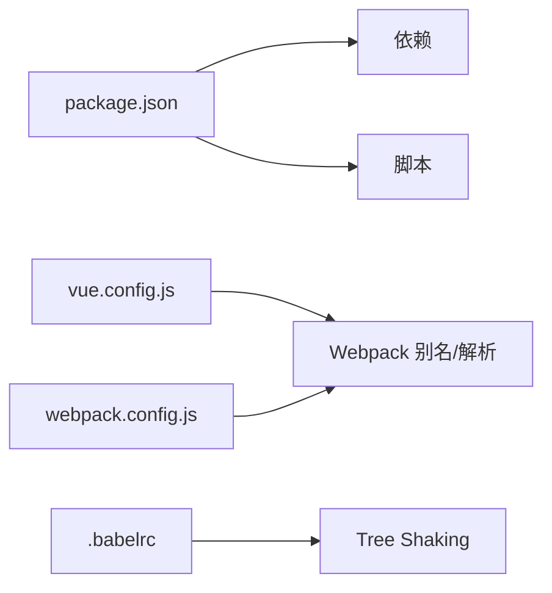

# 性能优化

<cite>
**本文引用的文件**
- [package.json](file://package.json)
- [vue.config.js](file://vue.config.js)
- [webpack.config.js](file://webpack.config.js)
- [.babelrc](file://.babelrc)
- [src/main.js](file://src/main.js)
- [src/router/index.js](file://src/router/index.js)
- [src/App.vue](file://src/App.vue)
- [src/layout/MainLayout.vue](file://src/layout/MainLayout.vue)
- [src/views/asset/AssetList.vue](file://src/views/asset/AssetList.vue)
- [src/views/portfolio/PortfolioList.vue](file://src/views/portfolio/PortfolioList.vue)
- [src/store/index.js](file://src/store/index.js)
- [src/store/modules/asset.js](file://src/store/modules/asset.js)
- [src/store/modules/portfolio.js](file://src/store/modules/portfolio.js)
- [src/utils/request.js](file://src/utils/request.js)
- [src/api/asset.js](file://src/api/asset.js)
- [src/components/AssetMiniChart.vue](file://src/components/AssetMiniChart.vue)
- [src/views/strategy/BacktestExecution.vue](file://src/views/strategy/BacktestExecution.vue)
</cite>

## 目录
1. [引言](#引言)
2. [项目结构](#项目结构)
3. [核心组件](#核心组件)
4. [架构总览](#架构总览)
5. [详细组件分析](#详细组件分析)
6. [依赖分析](#依赖分析)
7. [性能考虑](#性能考虑)
8. [故障排查指南](#故障排查指南)
9. [结论](#结论)
10. [附录](#附录)

## 引言
本指南面向投资组合管理系统，聚焦前端性能优化与最佳实践，涵盖以下主题：
- 前端性能优化策略：代码分割、懒加载、组件按需加载
- 构建优化技巧：Tree Shaking、Bundle 分析、压缩配置
- 内存与垃圾回收优化：组件销毁、事件解绑、定时器清理
- 网络性能优化：HTTP 缓存、资源压缩、CDN 配置
- 用户体验优化：首屏加载、交互响应、滚动性能
- 性能监控与分析工具：Chrome DevTools、Lighthouse 等

## 项目结构
系统采用 Vue 2 + Vue Router + Vuex 技术栈，结合 Element UI 与 ECharts 实现可视化与交互。路由采用异步组件实现按需加载，构建基于 Webpack 与 Babel。

**图表来源**
- [src/main.js:1-31](file://src/main.js#L1-L31)
- [src/App.vue:1-116](file://src/App.vue#L1-L116)
- [src/layout/MainLayout.vue:1-330](file://src/layout/MainLayout.vue#L1-L330)
- [src/router/index.js:1-378](file://src/router/index.js#L1-L378)
- [src/utils/request.js:1-100](file://src/utils/request.js#L1-L100)
- [src/api/asset.js:1-284](file://src/api/asset.js#L1-L284)
- [src/store/index.js:1-44](file://src/store/index.js#L1-L44)
- [vue.config.js:1-17](file://vue.config.js#L1-L17)
- [webpack.config.js:1-63](file://webpack.config.js#L1-L63)
- [.babelrc:1-14](file://.babelrc#L1-L14)

**章节来源**
- [src/main.js:1-31](file://src/main.js#L1-L31)
- [src/router/index.js:1-378](file://src/router/index.js#L1-L378)
- [src/App.vue:1-116](file://src/App.vue#L1-L116)
- [src/layout/MainLayout.vue:1-330](file://src/layout/MainLayout.vue#L1-L330)
- [src/store/index.js:1-44](file://src/store/index.js#L1-L44)
- [src/utils/request.js:1-100](file://src/utils/request.js#L1-L100)
- [src/api/asset.js:1-284](file://src/api/asset.js#L1-L284)
- [vue.config.js:1-17](file://vue.config.js#L1-L17)
- [webpack.config.js:1-63](file://webpack.config.js#L1-L63)
- [.babelrc:1-14](file://.babelrc#L1-L14)

## 核心组件
- 路由与懒加载：路由表中使用动态导入实现按需加载，减少首屏包体。
- 图表与可视化：Portfolio 列表页使用 ECharts 渲染权益曲线；资产迷你图组件封装缓存与并发控制。
- 状态管理：Vuex 模块化拆分，按需提交 mutations 与触发 actions。
- 网络层：Axios 封装统一拦截器，集中处理鉴权、错误与超时。

**章节来源**
- [src/router/index.js:1-378](file://src/router/index.js#L1-L378)
- [src/views/portfolio/PortfolioList.vue:1-372](file://src/views/portfolio/PortfolioList.vue#L1-L372)
- [src/components/AssetMiniChart.vue:1-493](file://src/components/AssetMiniChart.vue#L1-L493)
- [src/store/modules/asset.js:1-183](file://src/store/modules/asset.js#L1-L183)
- [src/store/modules/portfolio.js:1-106](file://src/store/modules/portfolio.js#L1-L106)
- [src/utils/request.js:1-100](file://src/utils/request.js#L1-L100)

## 架构总览
系统前端架构围绕“路由懒加载 + 组件按需 + 状态与网络层封装”展开，配合构建配置实现 Tree Shaking 与产物优化。

**图表来源**
- [src/router/index.js:1-378](file://src/router/index.js#L1-L378)
- [src/layout/MainLayout.vue:1-330](file://src/layout/MainLayout.vue#L1-L330)
- [src/store/modules/asset.js:1-183](file://src/store/modules/asset.js#L1-L183)
- [src/store/modules/portfolio.js:1-106](file://src/store/modules/portfolio.js#L1-L106)
- [src/utils/request.js:1-100](file://src/utils/request.js#L1-L100)
- [webpack.config.js:1-63](file://webpack.config.js#L1-L63)
- [.babelrc:1-14](file://.babelrc#L1-L14)
- [vue.config.js:1-17](file://vue.config.js#L1-L17)

## 详细组件分析

### 路由与懒加载
- 路由采用动态导入，实现页面级按需加载，降低首屏 JS 体积。
- 布局组件 MainLayout.vue 作为主容器，内部通过过渡动画与虚拟滚动提升切换体验。

**图表来源**
- [src/router/index.js:1-378](file://src/router/index.js#L1-L378)
- [src/layout/MainLayout.vue:1-330](file://src/layout/MainLayout.vue#L1-L330)

**章节来源**
- [src/router/index.js:1-378](file://src/router/index.js#L1-L378)
- [src/layout/MainLayout.vue:1-330](file://src/layout/MainLayout.vue#L1-L330)

### Portfolio 列表与图表渲染
- 使用 ECharts 渲染权益曲线，采用延迟初始化与 nextTick 渲染，避免 DOM 未就绪导致的异常。
- 组件销毁时释放图表实例，防止内存泄漏。

**图表来源**
- [src/views/portfolio/PortfolioList.vue:1-372](file://src/views/portfolio/PortfolioList.vue#L1-L372)

**章节来源**
- [src/views/portfolio/PortfolioList.vue:1-372](file://src/views/portfolio/PortfolioList.vue#L1-L372)

### 资产迷你图组件（缓存与并发控制）
- 模块级缓存：对 K 线数据进行正向与负面缓存，避免重复请求。
- 并发去重：同一资产并发请求去重，减少网络与渲染抖动。
- 预取并发控制：限制同时预取的资产数量，保证首屏优先。
- 组件销毁时释放图表实例，避免内存泄漏。

**图表来源**
- [src/components/AssetMiniChart.vue:1-493](file://src/components/AssetMiniChart.vue#L1-L493)

**章节来源**
- [src/components/AssetMiniChart.vue:1-493](file://src/components/AssetMiniChart.vue#L1-L493)

### 网络层与错误处理
- Axios 实例统一注入 Authorization 头，集中处理 401、403、404、超时等错误。
- 错误消息提示与引导，帮助定位后端服务与环境问题。

**图表来源**
- [src/utils/request.js:1-100](file://src/utils/request.js#L1-L100)
- [src/api/asset.js:1-284](file://src/api/asset.js#L1-L284)

**章节来源**
- [src/utils/request.js:1-100](file://src/utils/request.js#L1-L100)
- [src/api/asset.js:1-284](file://src/api/asset.js#L1-L284)

### 回测执行页面（复杂交互与性能）
- 大型表单与多策略对比场景，建议：
  - 使用虚拟滚动或分页加载表格数据
  - 控制图表渲染频率与数据采样
  - 合理拆分步骤，避免一次性渲染过多节点

**章节来源**
- [src/views/strategy/BacktestExecution.vue:1-800](file://src/views/strategy/BacktestExecution.vue#L1-L800)

## 依赖分析
- 依赖安装与脚本：通过 package.json 管理生产与开发依赖，支持 dev/build/lint/postinstall。
- 构建别名与解析：vue.config.js 与 webpack.config.js 设置别名与解析扩展，提升打包效率。
- Babel 配置：.babelrc 关闭模块转译，配合打包工具实现 Tree Shaking。

**图表来源**
- [package.json:1-45](file://package.json#L1-L45)
- [vue.config.js:1-17](file://vue.config.js#L1-L17)
- [webpack.config.js:1-63](file://webpack.config.js#L1-L63)
- [.babelrc:1-14](file://.babelrc#L1-L14)

**章节来源**
- [package.json:1-45](file://package.json#L1-L45)
- [vue.config.js:1-17](file://vue.config.js#L1-L17)
- [webpack.config.js:1-63](file://webpack.config.js#L1-L63)
- [.babelrc:1-14](file://.babelrc#L1-L14)

## 性能考虑

### 前端性能优化策略
- 代码分割与懒加载
  - 路由级懒加载：src/router/index.js 已采用动态导入，建议对大型页面进一步拆分。
  - 组件级懒加载：对重型组件（如图表、表格）按需引入。
- 组件按需加载
  - Element UI 已全局引入，建议改为按需引入以减小包体。
  - 图表库 ECharts 按需引入，避免全局注册造成体积膨胀。
- 虚拟滚动与分页
  - 大表格建议使用虚拟滚动（如 vue-virtual-scroller）与分页加载，降低 DOM 与渲染压力。
- 防抖与节流
  - 对窗口 resize、滚动、搜索等高频事件使用防抖/节流，减少无效计算。

### 构建优化技巧
- Tree Shaking
  - .babelrc 中 modules 设为 false，配合打包工具剔除未使用代码。
- Bundle 分析
  - 使用 webpack-bundle-analyzer 分析依赖构成，识别大体积模块与重复依赖。
- 压缩配置
  - 生产环境启用 JS/CSS/HTML 压缩，开启 gzip/br 压缩传输。
- 资源指纹与缓存
  - 输出文件使用 contenthash，结合 CDN 与 HTTP 缓存策略提升二次加载速度。

### 内存管理与垃圾回收
- 组件销毁
  - 图表组件在 beforeDestroy 中释放实例，避免内存泄漏。
  - 路由切换时及时清理未使用的组件实例。
- 事件解绑
  - 移除全局事件监听（如 window.resize）、定时器与订阅。
- 定时器清理
  - 使用唯一标识区分定时器，统一在组件销毁阶段清理。

### 网络性能优化
- HTTP 缓存
  - 静态资源设置强缓存，接口数据使用协商缓存（ETag/Last-Modified）。
- 资源压缩
  - 启用 gzip/br 压缩，合理拆分与合并资源。
- CDN 配置
  - 将静态资源与第三方库迁移至 CDN，缩短首字节时间。

### 用户体验优化
- 首屏加载
  - 路由懒加载 + 关键路径资源优先加载，减少阻塞。
- 交互响应
  - 使用骨架屏与占位符，提升感知速度；对长任务使用 requestIdleCallback 或分片执行。
- 滚动性能
  - 使用 transform 替代改变布局属性；避免在滚动过程中触发重排。

### 性能监控与分析工具
- Chrome DevTools
  - Performance：分析主线程占用与长任务；Memory：检测内存泄漏与 GC 行为。
  - Lighthouse：自动化评估性能、可访问性与最佳实践。
- WebPageTest / GTmetrix
  - 跨地区与设备的性能评测，辅助优化策略制定。

## 故障排查指南
- 请求超时与网络错误
  - request.js 已集中处理超时与网络错误，结合提示信息定位后端服务与环境问题。
- 图表渲染异常
  - 确保 DOM 就绪后再初始化图表；组件销毁时释放实例。
- 内存泄漏
  - 检查定时器、事件监听与第三方实例是否在 beforeDestroy 中清理。
- 首屏缓慢
  - 使用路由懒加载与资源压缩；分析 Bundle 构成，移除冗余依赖。

**章节来源**
- [src/utils/request.js:1-100](file://src/utils/request.js#L1-L100)
- [src/views/portfolio/PortfolioList.vue:350-356](file://src/views/portfolio/PortfolioList.vue#L350-L356)
- [src/components/AssetMiniChart.vue:178-183](file://src/components/AssetMiniChart.vue#L178-L183)

## 结论
通过路由懒加载、组件按需加载、构建优化与内存管理，结合网络与用户体验优化策略，可显著提升系统的首屏速度、交互流畅度与稳定性。建议持续使用性能监控工具进行迭代优化，确保在复杂业务场景下仍能保持良好性能表现。

## 附录
- 推荐实践清单
  - 使用路由懒加载与组件按需加载
  - 按需引入 UI 与图表库
  - 启用 Tree Shaking 与资源压缩
  - 使用虚拟滚动与分页
  - 在组件销毁阶段清理定时器与图表实例
  - 配置 HTTP 缓存与 CDN
  - 使用 Chrome DevTools 与 Lighthouse 持续监控