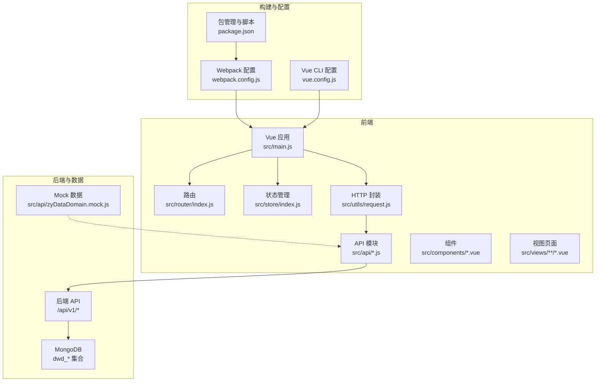
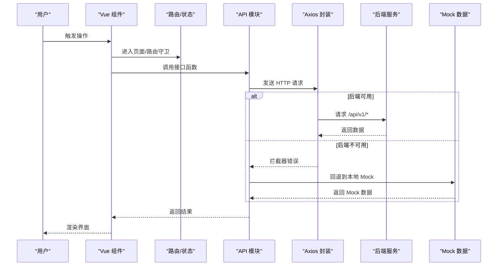
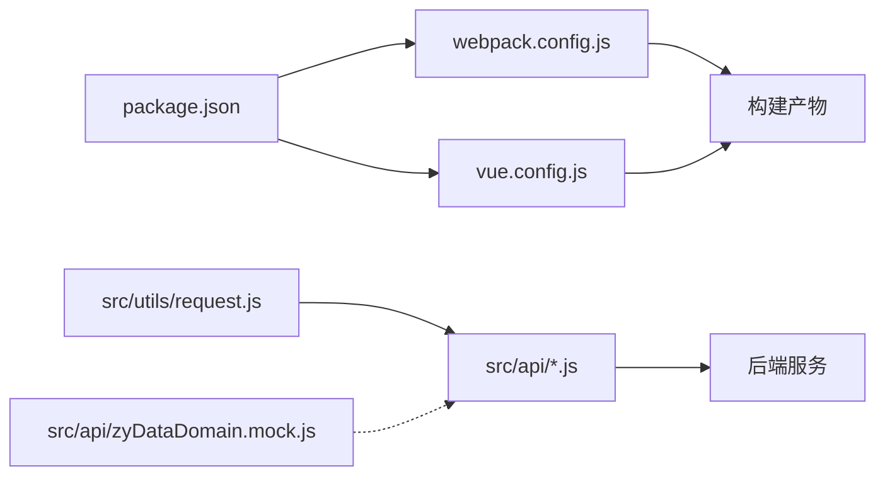

# 测试指南

<cite>
**本文引用的文件**
- [package.json](file://package.json)
- [vue.config.js](file://vue.config.js)
- [webpack.config.js](file://webpack.config.js)
- [src/utils/request.js](file://src/utils/request.js)
- [src/api/asset.js](file://src/api/asset.js)
- [src/api/zyDataDomain.mock.js](file://src/api/zyDataDomain.mock.js)
- [scripts/test_zy_data_api.py](file://scripts/test_zy_data_api.py)
- [scripts/test_mongo.py](file://scripts/test_mongo.py)
- [网络测试脚本.js](file://网络测试脚本.js)
- [docs/ZY_DATA_DOMAIN_MOCK_IMPORT_GUIDE.md](file://docs/ZY_DATA_DOMAIN_MOCK_IMPORT_GUIDE.md)
- [src/router/index.js](file://src/router/index.js)
- [src/store/index.js](file://src/store/index.js)
- [src/components/PlanProgress.vue](file://src/components/PlanProgress.vue)
- [src/views/strategy/BenchmarkList.vue](file://src/views/strategy/BenchmarkList.vue)
- [src/utils/apiError.js](file://src/utils/apiError.js)
</cite>

## 目录
1. [引言](#引言)
2. [项目结构](#项目结构)
3. [核心组件](#核心组件)
4. [架构总览](#架构总览)
5. [详细组件分析](#详细组件分析)
6. [依赖分析](#依赖分析)
7. [性能考虑](#性能考虑)
8. [故障排查指南](#故障排查指南)
9. [结论](#结论)
10. [附录](#附录)

## 引言
本测试指南面向投资组合管理系统，提供从单元测试、集成测试到端到端测试、性能与压力测试的完整策略与实操步骤。文档结合现有仓库中的网络连通性测试脚本、Python API 测试脚本、MongoDB 连接测试脚本以及前端请求封装与 Mock 数据机制，给出可落地的测试流程、覆盖率要求、自动化集成建议与最佳实践。

## 项目结构
系统前端基于 Vue 2.x，使用 Webpack 构建，Axios 作为 HTTP 客户端，Element-UI 提供组件库，Vuex 管理全局状态，Vue Router 提供路由。后端接口通过环境变量配置的基础地址进行访问，前端提供本地 Mock 数据兜底。

图表来源
- [vue.config.js:1-17](file://vue.config.js#L1-L17)
- [webpack.config.js:1-62](file://webpack.config.js#L1-L62)
- [src/utils/request.js:1-38](file://src/utils/request.js#L1-L38)
- [src/api/asset.js:1-68](file://src/api/asset.js#L1-L68)
- [src/api/zyDataDomain.mock.js:1-800](file://src/api/zyDataDomain.mock.js#L1-L800)

章节来源
- [vue.config.js:1-17](file://vue.config.js#L1-L17)
- [webpack.config.js:1-62](file://webpack.config.js#L1-L62)
- [package.json:1-45](file://package.json#L1-L45)

## 核心组件
- HTTP 请求封装与拦截器：统一设置基础地址、超时、Token 注入与错误处理，便于测试时替换或注入。
- API 模块：按领域划分的接口模块，如资产、策略、数据域等，便于针对具体模块编写单元测试。
- Mock 数据：前端 localStorage 内存 Mock，保证后端接口未就绪时的可用性与一致性。
- 路由与状态：路由守卫与全局状态，影响页面行为与接口调用时机，需在测试中模拟或注入。

章节来源
- [src/utils/request.js:1-38](file://src/utils/request.js#L1-L38)
- [src/api/asset.js:1-68](file://src/api/asset.js#L1-L68)
- [src/api/zyDataDomain.mock.js:1-800](file://src/api/zyDataDomain.mock.js#L1-L800)
- [src/router/index.js:1-53](file://src/router/index.js#L1-L53)
- [src/store/index.js](file://src/store/index.js)

## 架构总览
前端通过 Axios 发起请求，经由路由与状态管理，调用各 API 模块，最终访问后端接口；当后端接口不可用时，前端可回退到本地 Mock 数据。

图表来源
- [src/utils/request.js:1-38](file://src/utils/request.js#L1-L38)
- [src/api/asset.js:1-68](file://src/api/asset.js#L1-L68)
- [src/api/zyDataDomain.mock.js:961-985](file://src/api/zyDataDomain.mock.js#L961-L985)

## 详细组件分析

### 单元测试策略与示例
- 测试框架与配置
  - 建议引入 Jest 与 Vue Test Utils，结合 Babel 与 Vue CLI 的构建链路。
  - 在 package.json 中添加测试脚本，如 test、test:watch、test:coverage。
  - 配置 jest.config.js 或在 package.json 的 jest 字段中设置别名、转换规则与覆盖率阈值。
- 覆盖率要求
  - 语句覆盖率、分支覆盖率、函数覆盖率、行覆盖率均不低于 80%。
  - 关键路径（如错误处理、权限校验、数据转换）需达到 100%。
- 测试用例类型
  - 接口模块：验证请求参数、响应格式、错误处理。
  - 组件：验证 props、事件、插槽、计算属性与生命周期。
  - 工具函数：验证算法、边界条件与异常输入。
- Mock 与桩
  - 使用 jest.mock 对 HTTP 层进行隔离，注入假数据。
  - 对路由与状态进行轻量模拟，避免真实 DOM 与副作用。

章节来源
- [package.json:1-45](file://package.json#L1-L45)
- [vue.config.js:1-17](file://vue.config.js#L1-L17)
- [webpack.config.js:1-62](file://webpack.config.js#L1-L62)

### Vue 组件测试要点
- 组件交互：断言点击、输入、下拉选择等事件触发的副作用。
- 插槽与作用域插槽：验证默认插槽与具名插槽渲染。
- 计算属性与侦听器：验证依赖变化导致的重新渲染。
- 生命周期钩子：验证 mounted/unmounted 时的副作用（如订阅、定时器清理）。
- 示例场景：PlanProgress 组件的进度计算与徽章渲染；BenchmarkList 的格式化与刷新逻辑。

章节来源
- [src/components/PlanProgress.vue:1-41](file://src/components/PlanProgress.vue#L1-L41)
- [src/views/strategy/BenchmarkList.vue:596-682](file://src/views/strategy/BenchmarkList.vue#L596-L682)

### API 接口测试要点
- 健康检查与鉴权：验证 200/401/403 等状态码与响应结构。
- 列表与分页：验证 page/pageSize、total、records 结构与排序。
- 过滤与搜索：验证 filters 参数生效与空值处理。
- 错误处理：验证 404、5xx 与业务异常的提示文案。
- 超时与重试：验证超时时间与错误消息提取工具。

章节来源
- [src/api/asset.js:1-68](file://src/api/asset.js#L1-L68)
- [src/utils/apiError.js:1-17](file://src/utils/apiError.js#L1-L17)

### 集成测试策略与工具
- 端到端测试
  - 使用 Cypress 或 Playwright，覆盖登录、导航、数据查询、筛选、分页、导出等完整流程。
  - 通过环境变量切换后端地址，确保与真实服务一致。
- 数据库连接测试
  - 使用 Python 脚本连接 MongoDB，列出 dwd_ 前缀集合并统计条目，验证数据存在性。
- 第三方服务集成测试
  - 使用现有网络测试脚本在浏览器控制台运行，验证跨域、端口与 API 可达性。
  - 对后端健康检查与集合列表接口进行自动化 Python 测试。

章节来源
- [scripts/test_mongo.py:1-18](file://scripts/test_mongo.py#L1-L18)
- [网络测试脚本.js:1-156](file://网络测试脚本.js#L1-L156)
- [scripts/test_zy_data_api.py:1-314](file://scripts/test_zy_data_api.py#L1-L314)

### 测试数据准备与 Mock 数据使用
- Mock 数据导入 MongoDB
  - 按照 Mock 导入指南，将前端 localStorage 中的 Mock 数据导出并导入到 MongoDB，解决“智能对话无数据”的问题。
- 前端 Mock 数据
  - 当后端接口不可用时，zyDataDomain.mock.js 提供内存 Mock，保证前端功能可用。
- 测试数据隔离
  - 使用独立的测试数据库或集合前缀，避免污染生产数据。
  - 在 CI 环境中使用只读账号与受限权限。

章节来源
- [docs/ZY_DATA_DOMAIN_MOCK_IMPORT_GUIDE.md:1-50](file://docs/ZY_DATA_DOMAIN_MOCK_IMPORT_GUIDE.md#L1-L50)
- [src/api/zyDataDomain.mock.js:939-985](file://src/api/zyDataDomain.mock.js#L939-L985)

### 自动化测试流程与 CI/CD 集成
- CI 阶段
  - 安装依赖与构建：npm ci / npm run build
  - 单元测试与覆盖率：npm run test
  - 集成测试：npm run test:integration（自定义脚本）
  - 端到端测试：npm run test:e2e（自定义脚本）
- 测试报告与失败通知
  - 使用 Jest 的 JSON 报告与覆盖率汇总，上传到覆盖率平台。
  - 在 CI 中发送 Slack/邮件通知失败任务与失败用例摘要。
- 版本与依赖锁定
  - 使用 package-lock.json 与 engines.browserslist 保证环境一致性。

章节来源
- [package.json:1-45](file://package.json#L1-L45)

### 性能测试与压力测试
- 前端性能
  - 使用 Lighthouse 或 WebPageTest 检测首屏加载、交互延迟与内存占用。
  - 对大数据表格（如策略对比、资产列表）进行虚拟滚动与懒加载优化。
- 接口性能
  - 使用 Artillery 或 k6 对 /api/v1/* 接口进行并发请求，观察响应时间与错误率。
  - 针对分页、过滤、排序等复杂查询设置 SLA（如 2 秒内返回 100 条）。
- 数据库性能
  - 使用 MongoDB 自带工具与慢查询日志定位瓶颈，优化索引与聚合查询。

[本节为通用指导，无需特定文件引用]

## 依赖分析
前端依赖与构建配置决定了测试的可行性与效率。Webpack 别名与 Vue CLI 配置影响测试打包与别名解析；Axios 封装统一了错误处理与超时控制，便于在测试中注入与替换。

图表来源
- [package.json:1-45](file://package.json#L1-L45)
- [vue.config.js:1-17](file://vue.config.js#L1-L17)
- [webpack.config.js:1-62](file://webpack.config.js#L1-L62)
- [src/utils/request.js:1-38](file://src/utils/request.js#L1-L38)
- [src/api/zyDataDomain.mock.js:1-800](file://src/api/zyDataDomain.mock.js#L1-L800)

章节来源
- [package.json:1-45](file://package.json#L1-L45)
- [vue.config.js:1-17](file://vue.config.js#L1-L17)
- [webpack.config.js:1-62](file://webpack.config.js#L1-L62)

## 性能考虑
- 前端渲染性能
  - 对长列表启用虚拟滚动与分页，避免一次性渲染过多节点。
  - 合理拆分组件与异步加载，降低首屏阻塞。
- 网络性能
  - 合理设置超时时间与重试策略，避免长时间挂起。
  - 对高频请求进行缓存与去抖。
- 数据层性能
  - 在后端接口层面增加分页、过滤与索引优化，减少一次性传输大量数据。

[本节为通用指导，无需特定文件引用]

## 故障排查指南
- 网络连通性
  - 在浏览器控制台运行网络测试脚本，检查基础连接、API 调用与 CORS 配置。
- 后端可用性
  - 使用 Python 脚本测试健康检查与集合列表，确认服务与数据库状态。
- 前端 Mock 回退
  - 当后端接口不可用时，确认 Mock 数据是否已初始化，避免“无数据”现象。
- 错误信息提取
  - 使用 apiError 工具从响应中提取可读错误文案，辅助定位问题。

章节来源
- [网络测试脚本.js:1-156](file://网络测试脚本.js#L1-L156)
- [scripts/test_zy_data_api.py:22-314](file://scripts/test_zy_data_api.py#L22-L314)
- [src/api/zyDataDomain.mock.js:15-33](file://src/api/zyDataDomain.mock.js#L15-L33)
- [src/utils/apiError.js:1-17](file://src/utils/apiError.js#L1-L17)

## 结论
本测试指南提供了从单元测试到端到端测试的完整方法论，并结合现有仓库中的网络测试脚本、Python API 测试脚本与前端 Mock 机制，给出了可执行的测试策略与最佳实践。建议在 CI/CD 中集成自动化测试与覆盖率上报，持续提升系统稳定性与交付质量。

## 附录
- 测试覆盖率阈值建议
  - 语句覆盖率：≥80%
  - 分支覆盖率：≥80%
  - 函数覆盖率：≥80%
  - 行覆盖率：≥80%
- 测试环境隔离
  - 使用独立数据库与只读账号
  - 通过环境变量切换后端地址与开关
- 常用命令
  - 单元测试：npm run test
  - 监听模式：npm run test:watch
  - 生成覆盖率：npm run test:coverage
  - 集成测试：python scripts/test_zy_data_api.py
  - MongoDB 连接测试：python scripts/test_mongo.py