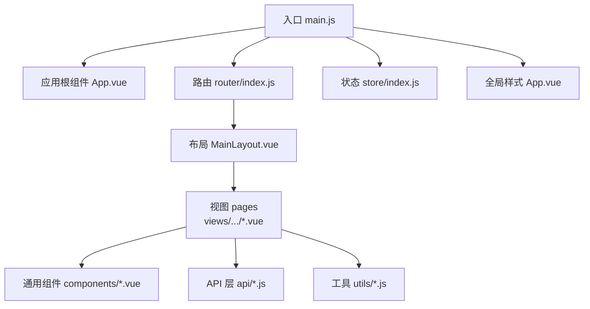
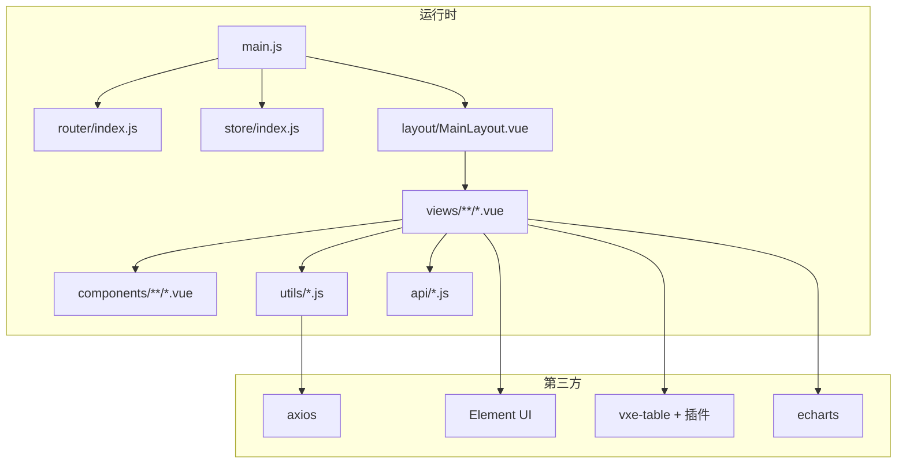
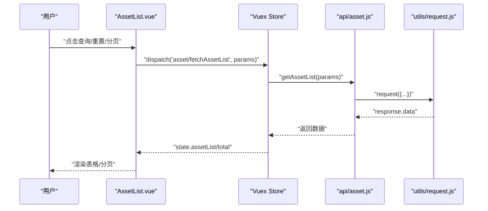
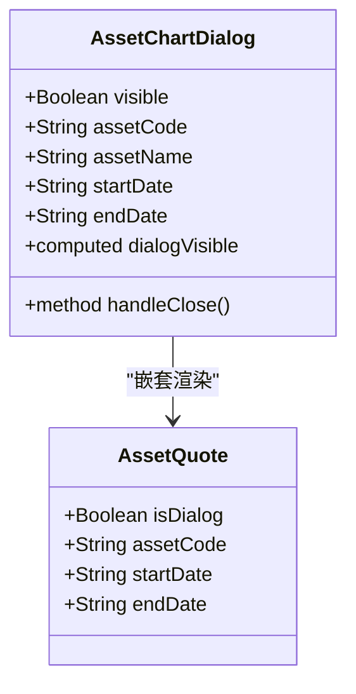
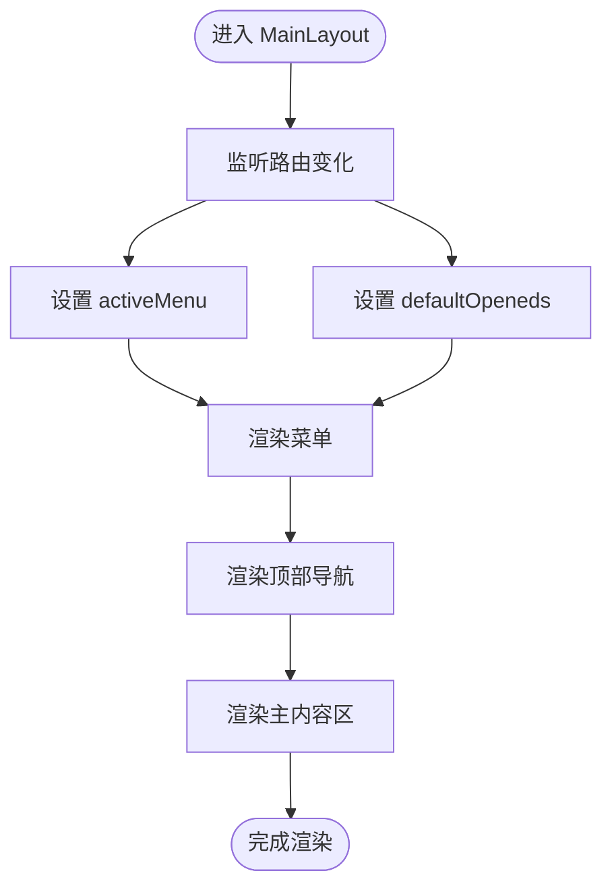
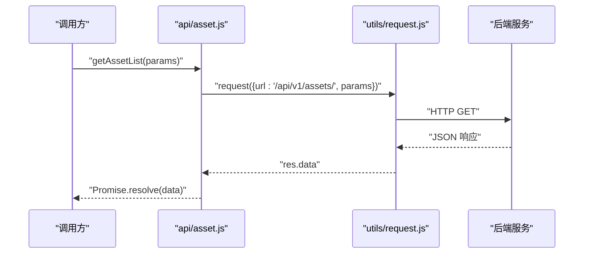
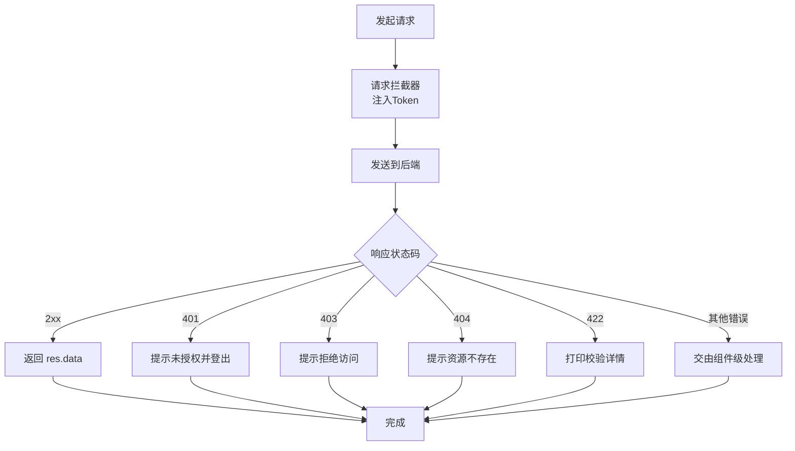
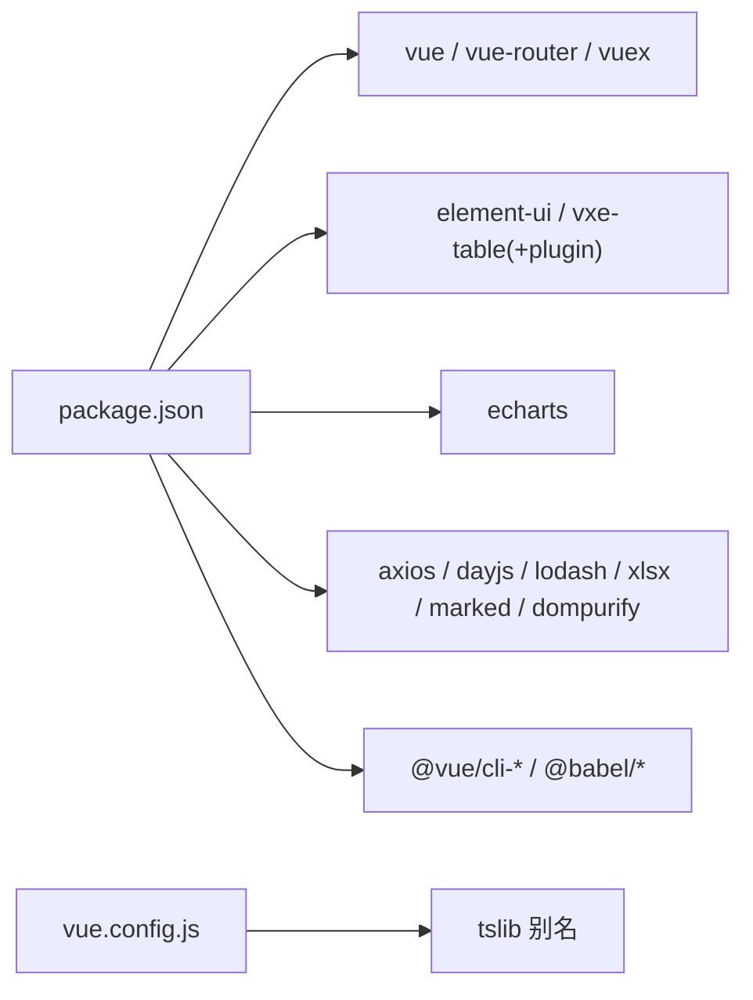

# 编码规范

<cite>
**本文引用的文件**
- [package.json](file://package.json)
- [.babelrc](file://.babelrc)
- [vue.config.js](file://vue.config.js)
- [src/main.js](file://src/main.js)
- [src/App.vue](file://src/App.vue)
- [src/router/index.js](file://src/router/index.js)
- [src/store/index.js](file://src/store/index.js)
- [src/layout/MainLayout.vue](file://src/layout/MainLayout.vue)
- [src/views/asset/AssetList.vue](file://src/views/asset/AssetList.vue)
- [src/components/AssetChartDialog.vue](file://src/components/AssetChartDialog.vue)
- [src/utils/request.js](file://src/utils/request.js)
- [src/utils/apiError.js](file://src/utils/apiError.js)
- [src/api/asset.js](file://src/api/asset.js)
</cite>

## 目录
1. [引言](#引言)
2. [项目结构](#项目结构)
3. [核心组件](#核心组件)
4. [架构总览](#架构总览)
5. [详细组件分析](#详细组件分析)
6. [依赖分析](#依赖分析)
7. [性能考虑](#性能考虑)
8. [故障排查指南](#故障排查指南)
9. [结论](#结论)
10. [附录](#附录)

## 引言
本指南面向投资组合管理系统前端团队，旨在统一 JavaScript/Vue.js 开发规范与最佳实践，涵盖变量命名、函数定义、组件结构、文件组织、代码格式化、Vue 组件开发规范、CSS/SCSS 样式编写规范、错误处理与异常捕获、以及代码质量检查工具（ESLint、Prettier）的配置与执行方式。本文所有建议均基于仓库现有实现与约定进行提炼与扩展，确保团队协作一致性与长期可维护性。

## 项目结构
项目采用 Vue CLI 生成的典型目录结构，按功能域划分 views、components、api、store、router、layout 等模块，便于职责分离与复用。

图表来源
- [src/main.js:1-31](file://src/main.js#L1-L31)
- [src/App.vue:1-116](file://src/App.vue#L1-L116)
- [src/router/index.js:1-378](file://src/router/index.js#L1-L378)
- [src/store/index.js:1-44](file://src/store/index.js#L1-L44)
- [src/layout/MainLayout.vue:1-330](file://src/layout/MainLayout.vue#L1-L330)

章节来源
- [src/main.js:1-31](file://src/main.js#L1-L31)
- [src/router/index.js:1-378](file://src/router/index.js#L1-L378)
- [src/store/index.js:1-44](file://src/store/index.js#L1-L44)
- [src/App.vue:1-116](file://src/App.vue#L1-L116)
- [src/layout/MainLayout.vue:1-330](file://src/layout/MainLayout.vue#L1-L330)

## 核心组件
- 应用入口与全局初始化：在入口文件中集中注册 UI 组件库、虚拟滚动、图表库与第三方表格插件，统一挂载到原型链以供全项目使用。
- 全局样式与主题：在根组件中集中定义全局样式、滚动条、Element UI 样式微调、数字颜色语义化类名、卡片与页面容器样式。
- 路由与权限：通过路由元信息与全局前置守卫实现标题设置、登录态校验与角色权限控制。
- 状态管理：采用模块化 Store，集中管理 loading、菜单折叠等全局状态，并通过 actions/mutations 提供统一接口。
- 布局组件：主布局负责侧边栏、面包屑、头部用户信息与内容区域过渡动画，提供可折叠侧边栏与动态面包屑。

章节来源
- [src/main.js:1-31](file://src/main.js#L1-L31)
- [src/App.vue:1-116](file://src/App.vue#L1-L116)
- [src/router/index.js:351-375](file://src/router/index.js#L351-L375)
- [src/store/index.js:13-43](file://src/store/index.js#L13-L43)
- [src/layout/MainLayout.vue:144-217](file://src/layout/MainLayout.vue#L144-L217)

## 架构总览
前端采用“入口 -> 路由 -> 布局/视图 -> 组件/工具 -> API”的分层架构，Vuex 提供全局状态，Axios 封装统一请求与错误处理，Element UI 与 vxe-table 提供交互与表格能力。

图表来源
- [src/main.js:1-31](file://src/main.js#L1-L31)
- [src/router/index.js:1-378](file://src/router/index.js#L1-L378)
- [src/store/index.js:1-44](file://src/store/index.js#L1-L44)
- [src/layout/MainLayout.vue:1-330](file://src/layout/MainLayout.vue#L1-L330)
- [src/utils/request.js:1-100](file://src/utils/request.js#L1-L100)
- [src/api/asset.js:1-284](file://src/api/asset.js#L1-L284)

## 详细组件分析

### 视图组件：资产列表（AssetList）
- 结构与职责
  - 页面容器与头部操作区：提供新增、下载模板、批量导入按钮与上传组件。
  - 查询表单：支持资产代码、名称、分类筛选。
  - 表格：使用 vxe-table 展示资产列表，包含状态标签、操作列（行情、查看、编辑、删除）。
  - 分页：底部分页控件，支持页大小与当前页切换。
  - 弹窗：资产表单弹窗、行情弹窗、详情弹窗，通过 is-dialog 与事件通信解耦。
- 数据流
  - 通过 Vuex 派发 action 获取资产列表，计算属性映射到本地状态。
  - 删除、导入、模板下载等操作通过 API 层封装并统一错误提示。
- 交互细节
  - 删除前二次确认，导入使用 Loading 提示与 finally 清理文件队列。
  - 表单成功回调后刷新列表，提升用户体验。

图表来源
- [src/views/asset/AssetList.vue:204-219](file://src/views/asset/AssetList.vue#L204-L219)
- [src/store/modules/asset.js](file://src/store/modules/asset.js)
- [src/api/asset.js:8-21](file://src/api/asset.js#L8-L21)
- [src/utils/request.js:12-32](file://src/utils/request.js#L12-L32)

章节来源
- [src/views/asset/AssetList.vue:1-346](file://src/views/asset/AssetList.vue#L1-L346)

### 通用组件：资产图表弹窗（AssetChartDialog）
- 设计要点
  - 通过 props 接收可见性、资产代码、名称与日期范围，computed 将外部 visible 与内部 v-model 解耦。
  - 内部嵌套 AssetQuote 子组件，实现“弹窗承载 + 子组件渲染”的组合模式。
  - 使用 scoped 样式与 ::deep 适配第三方组件样式。
- 事件与状态
  - 关闭时触发 update:visible，保持父组件与子组件状态一致。

图表来源
- [src/components/AssetChartDialog.vue:24-68](file://src/components/AssetChartDialog.vue#L24-L68)
- [src/views/asset/AssetQuote.vue](file://src/views/asset/AssetQuote.vue)

章节来源
- [src/components/AssetChartDialog.vue:1-78](file://src/components/AssetChartDialog.vue#L1-L78)

### 布局组件：主布局（MainLayout）
- 功能点
  - 侧边栏菜单：根据当前路由自动展开与激活菜单项，支持折叠动画与图标。
  - 面包屑：动态生成路径层级标题。
  - 顶部导航：用户下拉菜单、登出确认、角色权限判断。
  - 内容区：路由视图过渡动画，保证页面切换流畅。
- 状态与行为
  - 通过 Vuex 控制折叠状态，计算属性与 watch 监听路由变化联动菜单与面包屑。

图表来源
- [src/layout/MainLayout.vue:174-186](file://src/layout/MainLayout.vue#L174-L186)
- [src/layout/MainLayout.vue:144-217](file://src/layout/MainLayout.vue#L144-L217)

章节来源
- [src/layout/MainLayout.vue:1-330](file://src/layout/MainLayout.vue#L1-L330)

### API 层：资产管理（asset.js）
- 设计原则
  - 每个接口对应一个函数，参数对象化，必要时设置默认值与可选参数。
  - 对于大文件/长耗时请求，显式设置较长超时时间。
  - 返回 request() 调用结果，统一由请求拦截器处理。
- 典型流程
  - 列表查询、详情获取、创建/更新/删除、K线与模板下载、Excel 导入与进度轮询。

图表来源
- [src/api/asset.js:8-21](file://src/api/asset.js#L8-L21)
- [src/utils/request.js:27-32](file://src/utils/request.js#L27-L32)

章节来源
- [src/api/asset.js:1-284](file://src/api/asset.js#L1-L284)

### 工具层：请求与错误处理（request.js、apiError.js）
- 请求拦截器
  - 自动注入 Authorization 头，失败时打印错误并抛出。
- 响应拦截器
  - 统一处理 401、403、404、422 等状态码，结合业务提示与登出逻辑。
  - 对超时与网络错误进行分类提示，区分策略实时发布类接口与普通接口。
- 错误文案提取
  - 提供 getApiErrorMessage 从 axios 错误中提取后端可读文案，兼容字符串与数组形式。

图表来源
- [src/utils/request.js:11-97](file://src/utils/request.js#L11-L97)
- [src/utils/apiError.js:6-17](file://src/utils/apiError.js#L6-L17)

章节来源
- [src/utils/request.js:1-100](file://src/utils/request.js#L1-L100)
- [src/utils/apiError.js:1-18](file://src/utils/apiError.js#L1-L18)

## 依赖分析
- 运行时依赖
  - Vue 生态：vue、vue-router、vuex、vue-template-compiler。
  - UI 组件库：element-ui、vxe-table、vxe-table-plugin-element。
  - 图表：echarts。
  - 工具：axios、dayjs、lodash、xlsx、marked、dompurify。
- 开发依赖
  - @vue/cli-*、@babel/core、@babel/preset-env。
- 构建别名
  - 通过 vue.config.js 将 tslib 指向本地 node_modules，减少打包体积与版本冲突风险。

图表来源
- [package.json:11-28](file://package.json#L11-L28)
- [package.json:30-37](file://package.json#L30-L37)
- [vue.config.js:5-16](file://vue.config.js#L5-L16)

章节来源
- [package.json:1-45](file://package.json#L1-L45)
- [vue.config.js:1-17](file://vue.config.js#L1-L17)
- [.babelrc:1-14](file://.babelrc#L1-L14)

## 性能考虑
- 虚拟滚动与表格优化
  - 在大型表格场景使用虚拟滚动与分页，避免一次性渲染过多节点。
- 请求超时与并发控制
  - 对长耗时接口设置合理超时，避免阻塞 UI；对批量导入场景使用进度轮询与分批提交。
- 资源懒加载
  - 路由级异步加载组件，减少首屏体积。
- 样式作用域
  - 优先使用 scoped 样式，减少样式冲突与重绘。

## 故障排查指南
- 登录态与权限
  - 若出现频繁跳转登录，检查路由守卫中的 token 与角色判断逻辑。
- 网络与超时
  - 若出现超时提示，优先核对后端服务状态、网络连通性与 VUE_APP_BASE_URL 配置。
- 错误文案
  - 使用 apiError.js 提取后端可读错误，定位具体字段或业务规则。
- 文件上传与导入
  - 导入失败时查看响应体 detail 或 message 字段，结合组件提示进行修复。

章节来源
- [src/router/index.js:351-375](file://src/router/index.js#L351-L375)
- [src/utils/request.js:33-97](file://src/utils/request.js#L33-L97)
- [src/utils/apiError.js:6-17](file://src/utils/apiError.js#L6-L17)

## 结论
本规范以现有代码库为基础，总结了变量命名、函数定义、组件结构、文件组织、格式化、Vue 组件开发、样式编写、错误处理与质量工具使用等方面的最佳实践。建议团队在日常开发中严格遵循，持续完善文档与工具链，确保系统稳定性与可维护性。

## 附录

### JavaScript/Vue.js 编码规范（建议）
- 命名
  - 变量与函数：camelCase；常量：UPPER_SNAKE_CASE；类与组件：PascalCase。
  - 文件名：与导出组件或模块一致，单文件组件使用 PascalCase。
- 函数
  - 参数对象化，提供默认值；避免副作用；明确返回值类型。
- 组件
  - 单文件组件结构：template/script/style 顺序；props 明确类型与默认值；事件使用 kebab-case；生命周期钩子按需使用。
- 文件组织
  - 按功能域划分 views、components、api、utils、store/modules；公共组件集中管理。
- 格式化
  - 统一使用 Prettier；缩进 2 空格；行尾无多余空格；逗号与换行风格一致。
- 注释
  - 公共 API 与复杂逻辑添加注释；错误处理分支补充说明。

### Vue 组件开发规范（建议）
- 单文件组件
  - template 内容简洁；script 中声明 data/computed/methods/components；style scoped 并按功能块注释。
- Props
  - 明确类型、默认值与必填性；避免在子组件内直接修改 props。
- 事件
  - 使用 $emit 触发自定义事件；父组件通过 v-model 或 .sync 修饰符双向绑定。
- 生命周期
  - 在 created/async/await 中进行数据初始化；在 beforeDestroy 中清理定时器与订阅。

### CSS/SCSS 样式编写规范（建议）
- 类名
  - 采用 BEM 或功能语义化命名；避免过深嵌套；使用 scoped 避免污染。
- 组织
  - 按页面/组件拆分样式文件；公共样式集中管理；变量与混入统一存放。
- 响应式
  - 使用媒体查询或栅格系统；优先考虑移动端体验。

### 错误处理与异常捕获（建议）
- 统一错误处理
  - 在请求拦截器中处理 401/403/404/422；在组件中处理业务错误与用户提示。
- 异常捕获
  - 使用 try/catch 包裹异步操作；finally 中清理资源；对用户可感知的错误提供友好文案。
- 文案提取
  - 使用 apiError.js 统一从响应体提取可读错误信息。

### 代码质量检查工具（建议）
- ESLint
  - 集成 @vue/cli-plugin-eslint；规则遵循 Vue 官方风格指南；禁止 console.warn/console.error。
- Prettier
  - 集成 @vue/cli-plugin-prettier；与 ESLint 冲突时以 Prettier 为准；统一缩进与引号。
- 执行方式
  - npm run lint 或 yarn lint；在 CI 中增加 lint 步骤；提交前自动格式化。