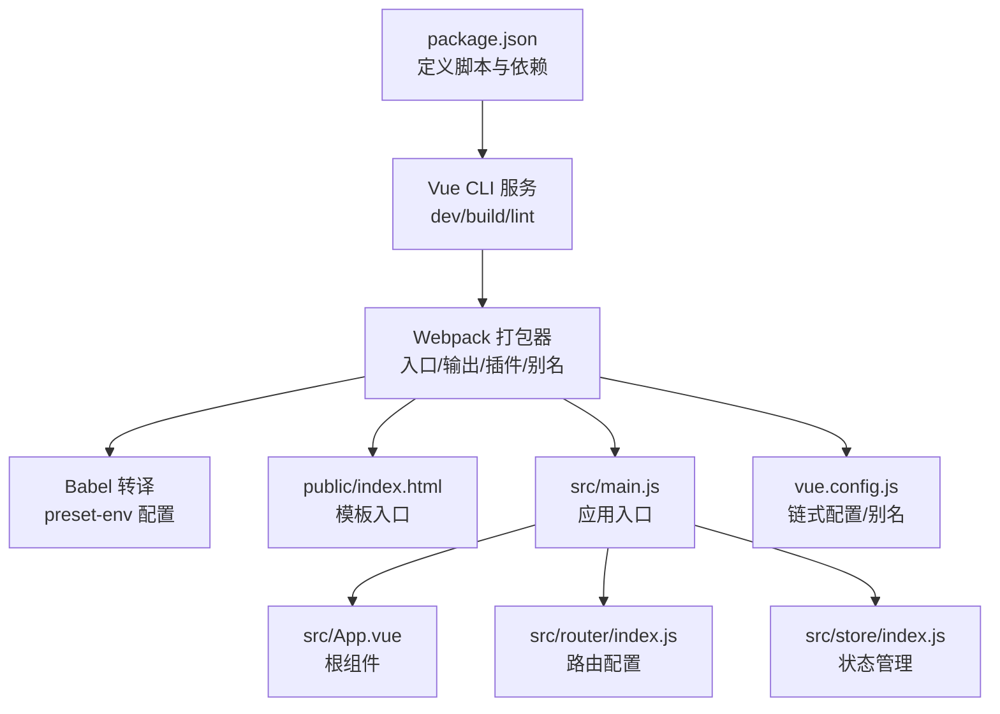
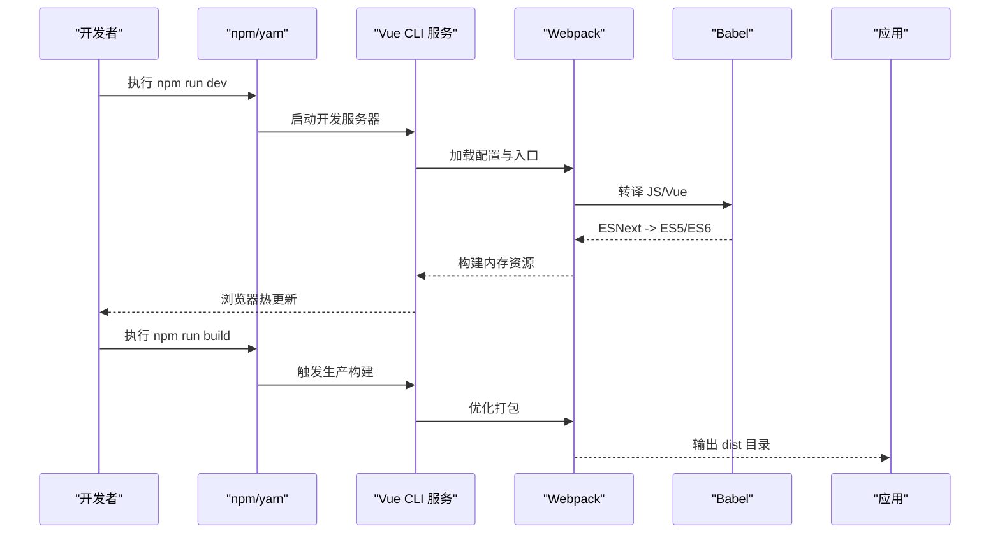
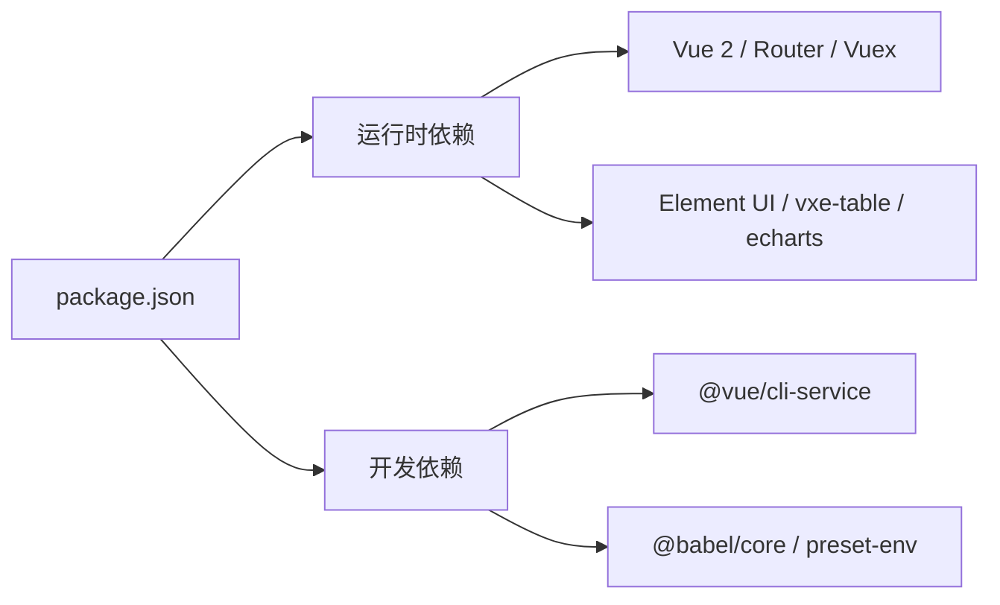

# 快速开始

<cite>
**本文引用的文件**
- [package.json](file://package.json)
- [.babelrc](file://.babelrc)
- [vue.config.js](file://vue.config.js)
- [webpack.config.js](file://webpack.config.js)
- [README_NODE_VERSION.md](file://README_NODE_VERSION.md)
- [src/main.js](file://src/main.js)
- [src/App.vue](file://src/App.vue)
- [public/index.html](file://public/index.html)
- [src/router/index.js](file://src/router/index.js)
- [src/store/index.js](file://src/store/index.js)
- [offline-npm-bundles/OFFLINE_INSTALL.txt](file://offline-npm-bundles/OFFLINE_INSTALL.txt)
</cite>

## 目录
1. [简介](#简介)
2. [项目结构](#项目结构)
3. [核心组件](#核心组件)
4. [架构总览](#架构总览)
5. [详细组件分析](#详细组件分析)
6. [依赖关系分析](#依赖关系分析)
7. [性能考虑](#性能考虑)
8. [故障排除指南](#故障排除指南)
9. [结论](#结论)
10. [附录](#附录)

## 简介
本指南面向初学者，帮助你在最短时间内完成投资组合管理系统的本地开发环境搭建与运行。内容涵盖：
- 环境要求（Node.js、npm/yarn）
- 安装步骤（克隆仓库到依赖安装）
- 开发服务器启动（dev 脚本）、生产构建（build 脚本）
- 常见开发工具配置（Babel、Webpack、Vue CLI）
- 故障排除（常见安装与启动问题）

## 项目结构
该项目基于 Vue 2 生态，采用 Vue CLI 服务进行开发与构建，配合 Webpack 进行打包，使用 Element UI 作为基础 UI 组件库，Vuex 管理全局状态，Vue Router 实现前端路由。

图表来源
- [package.json](file://package.json)
- [webpack.config.js](file://webpack.config.js)
- [vue.config.js](file://vue.config.js)
- [src/main.js](file://src/main.js)
- [public/index.html](file://public/index.html)
- [src/router/index.js](file://src/router/index.js)
- [src/store/index.js](file://src/store/index.js)

章节来源
- [package.json](file://package.json)
- [webpack.config.js](file://webpack.config.js)
- [vue.config.js](file://vue.config.js)
- [src/main.js](file://src/main.js)
- [public/index.html](file://public/index.html)
- [src/router/index.js](file://src/router/index.js)
- [src/store/index.js](file://src/store/index.js)

## 核心组件
- 应用入口与初始化：在应用入口中引入 Element UI、虚拟滚动、图表库等，并挂载根组件。
- 根组件：提供全局样式与通用布局占位。
- 路由系统：采用 hash 模式，支持权限校验与面包屑标题设置。
- 状态管理：集中管理用户、资产、策略、组合、基准、监控、代理等模块状态。
- 构建与开发：通过 Vue CLI 提供 dev 与 build 脚本，Webpack 用于打包与开发服务器配置。

章节来源
- [src/main.js](file://src/main.js)
- [src/App.vue](file://src/App.vue)
- [src/router/index.js](file://src/router/index.js)
- [src/store/index.js](file://src/store/index.js)

## 架构总览
下图展示了从开发到构建的关键流程与工具链交互。

图表来源
- [package.json](file://package.json)
- [webpack.config.js](file://webpack.config.js)
- [.babelrc](file://.babelrc)

## 详细组件分析

### 环境与版本要求
- Node.js 版本：推荐使用 16.x 或更高版本；若低于 16.0.0，可能出现 node:url 前缀相关错误。
- npm 版本：建议与 Node.js 16.x 搭配使用，确保兼容性。
- 如需离线安装依赖，可参考离线包说明。

章节来源
- [README_NODE_VERSION.md](file://README_NODE_VERSION.md)
- [offline-npm-bundles/OFFLINE_INSTALL.txt](file://offline-npm-bundles/OFFLINE_INSTALL.txt)

### 安装步骤
- 克隆仓库后，在项目根目录执行依赖安装（推荐使用 npm）。
- 若遇到 node:url 相关错误，请按版本要求升级 Node.js 并重新安装依赖。
- 对于内网环境，可使用提供的离线包进行安装。

章节来源
- [README_NODE_VERSION.md](file://README_NODE_VERSION.md)
- [offline-npm-bundles/OFFLINE_INSTALL.txt](file://offline-npm-bundles/OFFLINE_INSTALL.txt)

### 开发服务器与生产构建
- 开发服务器：执行开发脚本以启动本地开发服务器，支持热更新与自动打开浏览器。
- 生产构建：执行构建脚本生成 dist 目录，用于部署。

章节来源
- [package.json](file://package.json)
- [webpack.config.js](file://webpack.config.js)

### 开发工具配置

#### Babel 转译配置
- 使用 @babel/preset-env，目标浏览器范围为“> 1%”、“last 2 versions”，并排除 IE8 及以下。
- 该配置确保现代语法在目标环境中正确转译。

章节来源
- [.babelrc](file://.babelrc)

#### Webpack 打包配置
- 入口：src/main.js
- 输出：dist 目录，JS 文件带内容哈希，自动清理输出目录
- 模块规则：Vue 文件、JS 文件（babel-loader，排除 node_modules）、CSS 文件
- 插件：VueLoaderPlugin、HtmlWebpackPlugin、DefinePlugin 注入环境变量
- 解析：扩展名解析、别名（vue$ 指向开发版、@ 指向 src）
- 开发服务器：静态目录 public、端口 8082、热更新、自动打开浏览器

章节来源
- [webpack.config.js](file://webpack.config.js)

#### Vue CLI 服务配置
- 链式配置：通过 vue.config.js 设置别名，指向 node_modules/tslib，避免重复依赖导致的问题。
- 与 @vue/cli-service 集成，统一管理开发与构建流程。

章节来源
- [vue.config.js](file://vue.config.js)
- [package.json](file://package.json)

### 依赖关系分析
项目依赖与开发依赖通过 package.json 明确声明，构建与运行依赖如下：
- 运行时依赖：Vue 2、Element UI、Vuex、Vue Router、图表库、虚拟滚动、表格组件等
- 开发依赖：@vue/cli-service、@vue/cli-plugin-*、@babel/*、vue-template-compiler

图表来源
- [package.json](file://package.json)

章节来源
- [package.json](file://package.json)

## 性能考虑
- 使用 Vue CLI 与 Webpack 默认优化策略，生产构建会进行代码分割与压缩。
- 在开发阶段启用热更新与最小化日志，提升调试效率。
- 对于大型表格与列表，项目已集成虚拟滚动组件，有助于提升渲染性能。

## 故障排除指南

### Node.js 版本问题
- 症状：出现 node:url 相关错误
- 原因：依赖使用了 Node.js 的 node: 前缀语法
- 解决：升级 Node.js 至 16.x 或更高版本；如无法升级，可尝试降级 @babel/core，但不推荐
- 重新安装依赖：删除 node_modules 与锁文件后重新安装

章节来源
- [README_NODE_VERSION.md](file://README_NODE_VERSION.md)

### 离线安装依赖
- 症状：内网环境无法访问 npm registry
- 解决：使用提供的离线包（marked、dompurify）进行安装；若遇到 peer 依赖冲突，可追加参数；若仍失败，可手动解压到 node_modules 或改用内网私服/包管理器

章节来源
- [offline-npm-bundles/OFFLINE_INSTALL.txt](file://offline-npm-bundles/OFFLINE_INSTALL.txt)

### 开发服务器启动失败
- 端口占用：开发服务器默认端口为 8082，若被占用请调整或释放端口
- 依赖缺失：确认已执行依赖安装；若使用离线包，请检查路径是否正确
- 浏览器自动打开：如未自动打开，可在浏览器访问 http://localhost:8082

章节来源
- [webpack.config.js](file://webpack.config.js)

### 构建产物异常
- 清理缓存：删除 dist 目录后重新构建
- 检查别名与解析：确保 @ 与 vue$ 别名配置正确
- 确认生产环境变量：构建时注入的环境变量应符合预期

章节来源
- [webpack.config.js](file://webpack.config.js)
- [vue.config.js](file://vue.config.js)

## 结论
通过本指南，你可以快速完成环境准备、依赖安装与开发运行。若遇到版本或网络问题，优先参考 Node.js 版本要求与离线安装说明。生产构建与开发服务器均通过 Vue CLI 与 Webpack 配置实现，遵循默认约定即可获得良好的开发体验。

## 附录

### 快速操作清单
- 确认 Node.js 版本满足要求
- 克隆仓库并安装依赖
- 启动开发服务器
- 执行生产构建
- 如需离线安装，按离线包说明操作

章节来源
- [README_NODE_VERSION.md](file://README_NODE_VERSION.md)
- [offline-npm-bundles/OFFLINE_INSTALL.txt](file://offline-npm-bundles/OFFLINE_INSTALL.txt)
- [package.json](file://package.json)
- [webpack.config.js](file://webpack.config.js)