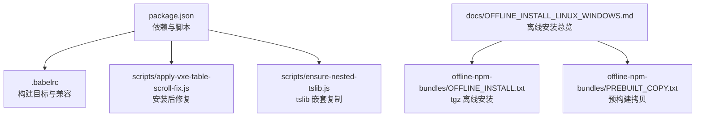
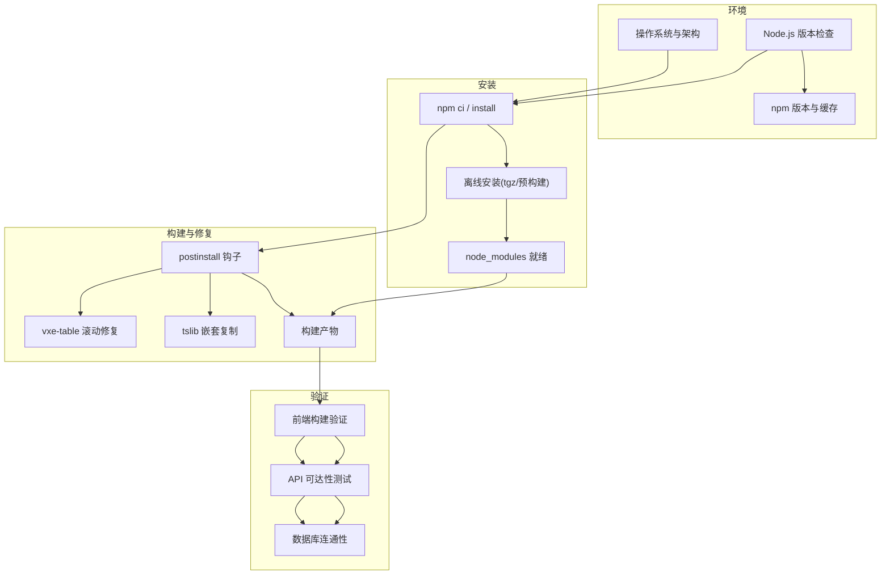
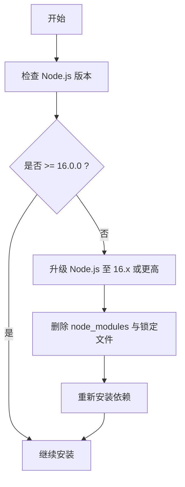
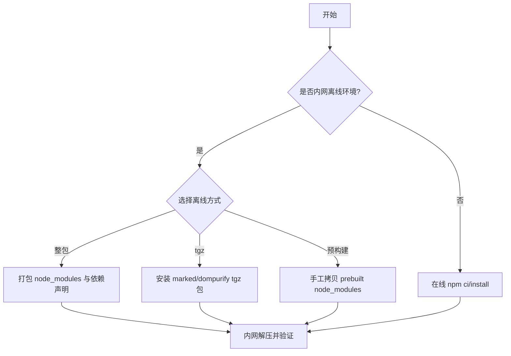
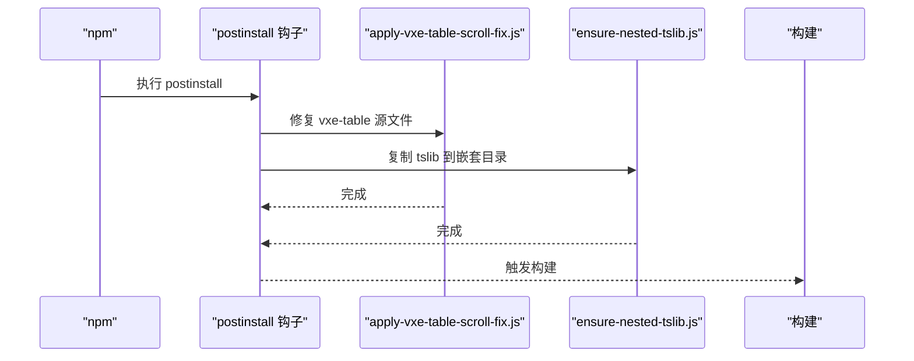
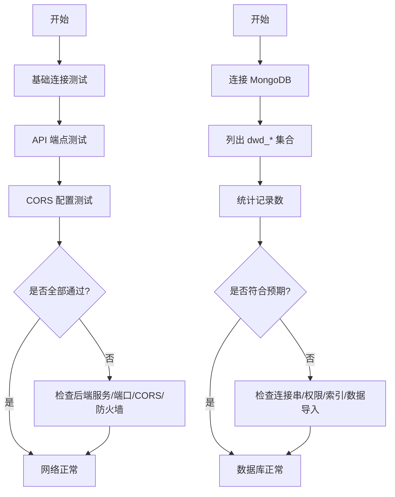
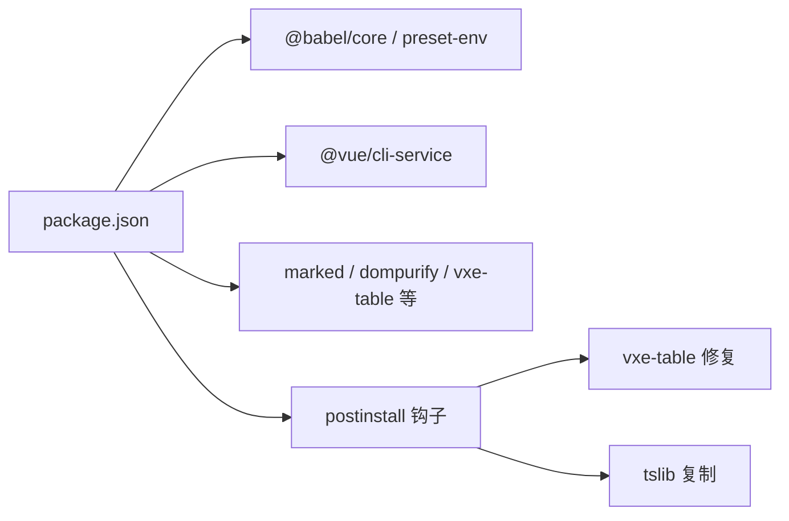

# 安装问题

<cite>
**本文引用的文件**
- [package.json](file://package.json)
- [README_NODE_VERSION.md](file://README_NODE_VERSION.md)
- [OFFLINE_INSTALL_LINUX_WINDOWS.md](file://docs/OFFLINE_INSTALL_LINUX_WINDOWS.md)
- [OFFLINE_INSTALL.txt](file://offline-npm-bundles/OFFLINE_INSTALL.txt)
- [PREBUILT_COPY.txt](file://offline-npm-bundles/PREBUILT_COPY.txt)
- [.babelrc](file://.babelrc)
- [apply-vxe-table-scroll-fix.js](file://scripts/apply-vxe-table-scroll-fix.js)
- [ensure-nested-tslib.js](file://scripts/ensure-nested-tslib.js)
- [网络测试脚本.js](file://网络测试脚本.js)
- [import_mongo_seeds.py](file://scripts/import_mongo_seeds.py)
- [test_mongo.py](file://scripts/test_mongo.py)
</cite>

## 目录
1. [简介](#简介)
2. [项目结构](#项目结构)
3. [核心组件](#核心组件)
4. [架构总览](#架构总览)
5. [详细组件分析](#详细组件分析)
6. [依赖分析](#依赖分析)
7. [性能考虑](#性能考虑)
8. [故障排除指南](#故障排除指南)
9. [结论](#结论)
10. [附录](#附录)

## 简介
本指南面向投资组合管理系统的安装与运维工程师，聚焦于安装阶段的常见问题与系统化排障流程。内容覆盖 Node.js 版本不兼容、npm 包安装失败、离线安装、依赖冲突、网络代理与镜像源、权限问题等，并提供针对 Windows 与 Linux 的差异化注意事项。同时给出安装前准备清单与验证步骤，帮助在不同环境中稳定完成安装。

## 项目结构
本项目前端基于 Vue CLI，使用 npm 管理依赖，包含离线安装支持与若干安装后自动化脚本。关键文件与职责如下：
- package.json：定义依赖、开发依赖与安装后钩子脚本
- .babelrc：Babel 预设配置，影响构建兼容性
- scripts/apply-vxe-table-scroll-fix.js：安装后修复 vxe-table 滚动相关问题
- scripts/ensure-nested-tslib.js：确保嵌套依赖的 tslib 复制到位
- docs/OFFLINE_INSTALL_LINUX_WINDOWS.md：前后端离线安装说明（Linux/Windows）
- offline-npm-bundles/OFFLINE_INSTALL.txt：离线 npm 包安装说明（tgz）
- offline-npm-bundles/PREBUILT_COPY.txt：预构建 node_modules 手工拷贝说明

**图表来源**
- [package.json:1-45](file://package.json#L1-L45)
- [.babelrc:1-14](file://.babelrc#L1-L14)
- [apply-vxe-table-scroll-fix.js:1-52](file://scripts/apply-vxe-table-scroll-fix.js#L1-L52)
- [ensure-nested-tslib.js:1-26](file://scripts/ensure-nested-tslib.js#L1-L26)
- [OFFLINE_INSTALL_LINUX_WINDOWS.md:1-212](file://docs/OFFLINE_INSTALL_LINUX_WINDOWS.md#L1-L212)
- [OFFLINE_INSTALL.txt:1-43](file://offline-npm-bundles/OFFLINE_INSTALL.txt#L1-L43)
- [PREBUILT_COPY.txt:1-44](file://offline-npm-bundles/PREBUILT_COPY.txt#L1-L44)

**章节来源**
- [package.json:1-45](file://package.json#L1-L45)
- [.babelrc:1-14](file://.babelrc#L1-L14)
- [OFFLINE_INSTALL_LINUX_WINDOWS.md:1-212](file://docs/OFFLINE_INSTALL_LINUX_WINDOWS.md#L1-L212)

## 核心组件
- 依赖与版本约束
  - 项目使用 Vue CLI 服务与 Babel 预设，依赖中包含 marked、dompurify 等前端渲染相关包，以及 vxe-table 等 UI 组件库。
  - 安装后钩子脚本会在 postinstall 阶段执行，确保 vxe-table 与 tslib 的兼容性。
- 离线安装支持
  - 提供两种离线安装方式：打包 node_modules 整包拷贝与使用 tgz 包安装；另有预构建 node_modules 手工拷贝方案。
- 环境与兼容性
  - Babel 目标浏览器配置影响构建产物兼容性；Node.js 版本需满足依赖语法要求（如 node: 前缀）。

**章节来源**
- [package.json:5-10](file://package.json#L5-L10)
- [package.json:30-38](file://package.json#L30-L38)
- [apply-vxe-table-scroll-fix.js:1-52](file://scripts/apply-vxe-table-scroll-fix.js#L1-L52)
- [ensure-nested-tslib.js:1-26](file://scripts/ensure-nested-tslib.js#L1-L26)
- [OFFLINE_INSTALL_LINUX_WINDOWS.md:126-184](file://docs/OFFLINE_INSTALL_LINUX_WINDOWS.md#L126-L184)
- [OFFLINE_INSTALL.txt:1-43](file://offline-npm-bundles/OFFLINE_INSTALL.txt#L1-L43)
- [PREBUILT_COPY.txt:1-44](file://offline-npm-bundles/PREBUILT_COPY.txt#L1-L44)

## 架构总览
安装与运行涉及以下关键环节：
- 环境准备：Node.js 版本、npm 版本、操作系统与架构一致性
- 依赖安装：在线安装或离线安装（node_modules 整包/仅新增包/tgz/预构建拷贝）
- 构建与修复：postinstall 钩子执行，确保第三方库兼容性
- 验证：前端构建、API 可达性、数据库连通性

**图表来源**
- [README_NODE_VERSION.md:1-73](file://README_NODE_VERSION.md#L1-L73)
- [OFFLINE_INSTALL_LINUX_WINDOWS.md:126-184](file://docs/OFFLINE_INSTALL_LINUX_WINDOWS.md#L126-L184)
- [OFFLINE_INSTALL.txt:14-37](file://offline-npm-bundles/OFFLINE_INSTALL.txt#L14-L37)
- [PREBUILT_COPY.txt:13-37](file://offline-npm-bundles/PREBUILT_COPY.txt#L13-L37)
- [apply-vxe-table-scroll-fix.js:1-52](file://scripts/apply-vxe-table-scroll-fix.js#L1-L52)
- [ensure-nested-tslib.js:1-26](file://scripts/ensure-nested-tslib.js#L1-L26)
- [网络测试脚本.js:1-157](file://网络测试脚本.js#L1-L157)
- [test_mongo.py:1-18](file://scripts/test_mongo.py#L1-L18)

## 详细组件分析

### 组件A：Node.js 版本与兼容性
- 问题背景
  - 某些依赖使用了 Node.js 的 node: 前缀语法，低版本 Node.js 无法识别。
- 排查要点
  - 使用命令检查当前版本，确认是否满足 >= 14.18.0 或 >= 16.0.0。
- 解决方案
  - 升级 Node.js 至 16.x 或更高版本；如无法升级，可考虑降级相关依赖（不推荐）。
- 重装建议
  - 升级后删除 node_modules 与锁定文件，重新安装。

**图表来源**
- [README_NODE_VERSION.md:48-66](file://README_NODE_VERSION.md#L48-L66)

**章节来源**
- [README_NODE_VERSION.md:1-73](file://README_NODE_VERSION.md#L1-L73)

### 组件B：npm 包安装与离线安装
- 在线安装失败排查
  - 清理缓存与锁定文件，升级 npm；检查网络代理与镜像源。
- 离线安装方案
  - 整包离线：在联网机完整安装后打包 node_modules 与依赖声明，内网解压后直接使用。
  - tgz 离线：仅安装新增包（marked、dompurify），必要时使用 --legacy-peer-deps。
  - 预构建拷贝：将预构建的 node_modules 目录直接覆盖到内网项目。
- 平台差异
  - 含原生模块的包需在目标 OS 上重新安装；纯 JS 包通常可跨平台。

**图表来源**
- [OFFLINE_INSTALL_LINUX_WINDOWS.md:126-184](file://docs/OFFLINE_INSTALL_LINUX_WINDOWS.md#L126-L184)
- [OFFLINE_INSTALL.txt:14-37](file://offline-npm-bundles/OFFLINE_INSTALL.txt#L14-L37)
- [PREBUILT_COPY.txt:13-37](file://offline-npm-bundles/PREBUILT_COPY.txt#L13-L37)

**章节来源**
- [OFFLINE_INSTALL_LINUX_WINDOWS.md:126-184](file://docs/OFFLINE_INSTALL_LINUX_WINDOWS.md#L126-L184)
- [OFFLINE_INSTALL.txt:1-43](file://offline-npm-bundles/OFFLINE_INSTALL.txt#L1-L43)
- [PREBUILT_COPY.txt:1-44](file://offline-npm-bundles/PREBUILT_COPY.txt#L1-L44)

### 组件C：安装后修复与构建兼容性
- vxe-table 滚动修复
  - postinstall 钩子会查找 vxe-table 的源文件，对访问 reactData.visible 的逻辑进行幂等修复。
- tslib 嵌套复制
  - 确保 echarts/zrender 的嵌套 node_modules 中存在 tslib，避免构建时报 ENOENT。
- Babel 目标
  - .babelrc 配置 targets，影响构建产物的浏览器兼容范围。

**图表来源**
- [package.json:9](file://package.json#L9)
- [apply-vxe-table-scroll-fix.js:1-52](file://scripts/apply-vxe-table-scroll-fix.js#L1-L52)
- [ensure-nested-tslib.js:1-26](file://scripts/ensure-nested-tslib.js#L1-L26)
- [.babelrc:7-9](file://.babelrc#L7-L9)

**章节来源**
- [package.json:9](file://package.json#L9)
- [apply-vxe-table-scroll-fix.js:1-52](file://scripts/apply-vxe-table-scroll-fix.js#L1-L52)
- [ensure-nested-tslib.js:1-26](file://scripts/ensure-nested-tslib.js#L1-L26)
- [.babelrc:1-14](file://.babelrc#L1-L14)

### 组件D：网络与数据库验证
- 网络可达性
  - 使用浏览器控制台脚本测试基础连接、API 端点与 CORS 配置，定位后端服务、端口与跨域问题。
- 数据库连通性
  - Python 脚本连接 MongoDB，列出集合并统计记录数，辅助验证种子数据导入结果。

**图表来源**
- [网络测试脚本.js:15-156](file://网络测试脚本.js#L15-L156)
- [test_mongo.py:1-18](file://scripts/test_mongo.py#L1-L18)

**章节来源**
- [网络测试脚本.js:1-157](file://网络测试脚本.js#L1-L157)
- [test_mongo.py:1-18](file://scripts/test_mongo.py#L1-L18)

## 依赖分析
- 直接依赖与开发依赖
  - 依赖中包含 marked、dompurify、vxe-table 等前端渲染与表格组件；开发依赖包含 @babel/* 与 @vue/cli-*。
- 安装后钩子
  - postinstall 钩子负责修复第三方库与补齐嵌套依赖，减少运行期错误。
- 离线依赖
  - 通过 tgz 或预构建 node_modules 实现跨环境一致性。

**图表来源**
- [package.json:11-38](file://package.json#L11-L38)
- [package.json:9](file://package.json#L9)
- [apply-vxe-table-scroll-fix.js:1-52](file://scripts/apply-vxe-table-scroll-fix.js#L1-L52)
- [ensure-nested-tslib.js:1-26](file://scripts/ensure-nested-tslib.js#L1-L26)

**章节来源**
- [package.json:1-45](file://package.json#L1-L45)

## 性能考虑
- 离线安装优先：在大规模依赖或网络受限环境下，优先采用整包离线或 tgz 预打包，减少重复解析与网络抖动。
- 构建兼容性：合理设置 Babel 目标，避免过度兼容导致包体增大；按需引入组件库，减少打包体积。
- 缓存与镜像：使用稳定镜像源与缓存策略，缩短安装时间并提升成功率。

## 故障排除指南

### 一、环境检查与准备
- Node.js 版本
  - 使用命令检查版本，确保满足依赖语法要求；如不满足，升级至推荐版本。
- npm 版本与缓存
  - 升级 npm 至稳定版本；清理缓存与锁定文件后重试。
- 操作系统与架构
  - 离线安装时，确保联网机与内网机 OS、CPU 架构一致；含原生模块的包需在目标平台安装。

**章节来源**
- [README_NODE_VERSION.md:30-66](file://README_NODE_VERSION.md#L30-L66)
- [OFFLINE_INSTALL_LINUX_WINDOWS.md:3-4](file://docs/OFFLINE_INSTALL_LINUX_WINDOWS.md#L3-L4)

### 二、常见安装错误与解决
- 错误：无法找到模块 node:url
  - 现象：构建或运行时报错，提示找不到 node: 前缀模块。
  - 解决：升级 Node.js 至 16.x 或更高版本；如无法升级，考虑降级相关依赖。
- 错误：Maximum call stack size exceeded（npm 安装栈溢出）
  - 现象：npm install 报 Maximum call stack。
  - 解决：删除 node_modules 与锁定文件后重试；升级 npm；必要时使用离线 tgz 或预构建拷贝。
- 错误：peer 依赖冲突
  - 现象：安装过程中出现 peer 依赖警告或失败。
  - 解决：使用 --legacy-peer-deps 参数；或调整依赖版本以满足约束。
- 错误：离线安装后构建失败
  - 现象：内网解压后 npm run dev 报错。
  - 解决：确认离线包与 Node 主版本一致；如含原生模块，需在目标平台重新安装；检查 postinstall 修复脚本是否执行。

**章节来源**
- [README_NODE_VERSION.md:36-47](file://README_NODE_VERSION.md#L36-L47)
- [OFFLINE_INSTALL.txt:33-37](file://offline-npm-bundles/OFFLINE_INSTALL.txt#L33-L37)
- [OFFLINE_INSTALL_LINUX_WINDOWS.md:199-201](file://docs/OFFLINE_INSTALL_LINUX_WINDOWS.md#L199-L201)

### 三、离线安装专项
- 整包离线（推荐）
  - 在联网机执行 npm ci，打包 node_modules、package.json、package-lock.json，内网解压后直接使用。
- tgz 离线
  - 仅安装 marked、dompurify 等新增包；如遇 peer 冲突，使用 --legacy-peer-deps。
- 预构建拷贝
  - 将 prebuilt-node_modules 目录整体覆盖到内网项目 node_modules；随后在 package.json 中补充依赖版本并验证。

**章节来源**
- [OFFLINE_INSTALL_LINUX_WINDOWS.md:128-154](file://docs/OFFLINE_INSTALL_LINUX_WINDOWS.md#L128-L154)
- [OFFLINE_INSTALL.txt:14-31](file://offline-npm-bundles/OFFLINE_INSTALL.txt#L14-L31)
- [PREBUILT_COPY.txt:13-37](file://offline-npm-bundles/PREBUILT_COPY.txt#L13-L37)

### 四、Windows 与 Linux 差异化注意事项
- Windows
  - 使用 PowerShell 或 CMD 执行离线安装命令；注意路径分隔符与转义；PowerShell 中使用反引号连接长命令。
  - 虚拟环境激活脚本路径不同，需按系统选择相应脚本。
- Linux
  - 使用 bash；注意权限与 umask 设置；必要时使用 sudo（谨慎）。
  - 原生模块需在目标平台重新安装，避免二进制不兼容。

**章节来源**
- [OFFLINE_INSTALL_LINUX_WINDOWS.md:56-115](file://docs/OFFLINE_INSTALL_LINUX_WINDOWS.md#L56-L115)

### 五、网络代理与镜像源
- 镜像源
  - 使用稳定镜像源（如国内镜像）提升安装速度与成功率；确保镜像源可用。
- 代理
  - 如需代理，配置 npm 代理参数；验证代理连通性；必要时临时关闭代理以排除干扰。
- 缓存
  - 清理 npm 缓存与全局缓存目录，避免陈旧包影响安装。

**章节来源**
- [OFFLINE_INSTALL.txt:33-37](file://offline-npm-bundles/OFFLINE_INSTALL.txt#L33-L37)

### 六、权限问题处理
- 文件系统权限
  - 确保项目目录与 node_modules 具有读写权限；在 Linux 上避免使用 root 用户安装，必要时修正目录权限。
- 路径与符号链接
  - 避免使用损坏的符号链接；在 Windows 上注意路径大小写与权限。

**章节来源**
- [PREBUILT_COPY.txt:39-43](file://offline-npm-bundles/PREBUILT_COPY.txt#L39-L43)

### 七、安装前准备与验证清单
- 环境
  - Node.js 版本满足要求；npm 升级至稳定版本；网络连通性良好。
- 依赖
  - 明确是否需要离线安装；准备离线包（整包/仅新增/tgz/预构建）。
- 验证
  - 安装后执行 npm run build 或 dev，确认构建通过；
  - 使用网络测试脚本验证后端 API 可达性与 CORS；
  - 使用数据库脚本验证 MongoDB 连接与集合数量。

**章节来源**
- [README_NODE_VERSION.md:30-66](file://README_NODE_VERSION.md#L30-L66)
- [OFFLINE_INSTALL_LINUX_WINDOWS.md:126-154](file://docs/OFFLINE_INSTALL_LINUX_WINDOWS.md#L126-L154)
- [网络测试脚本.js:115-156](file://网络测试脚本.js#L115-L156)
- [test_mongo.py:1-18](file://scripts/test_mongo.py#L1-L18)

## 结论
通过系统化的环境检查、离线安装策略与安装后修复机制，可以在不同操作系统与网络环境下稳定完成投资组合管理系统的安装。建议优先采用离线整包或 tgz 方案，配合清理缓存与镜像源配置，可显著降低安装失败概率。安装完成后，结合前端构建、API 可达性与数据库连通性验证，确保系统正常运行。

## 附录
- 相关文件路径参考
  - package.json：依赖与脚本定义
  - .babelrc：构建目标配置
  - scripts/apply-vxe-table-scroll-fix.js：安装后修复脚本
  - scripts/ensure-nested-tslib.js：tslib 嵌套复制脚本
  - docs/OFFLINE_INSTALL_LINUX_WINDOWS.md：离线安装总览
  - offline-npm-bundles/OFFLINE_INSTALL.txt：tgz 离线安装说明
  - offline-npm-bundles/PREBUILT_COPY.txt：预构建拷贝说明
  - 网络测试脚本.js：后端 API 可达性与 CORS 测试
  - scripts/import_mongo_seeds.py：MongoDB 种子数据导入工具
  - scripts/test_mongo.py：MongoDB 连接与集合统计脚本