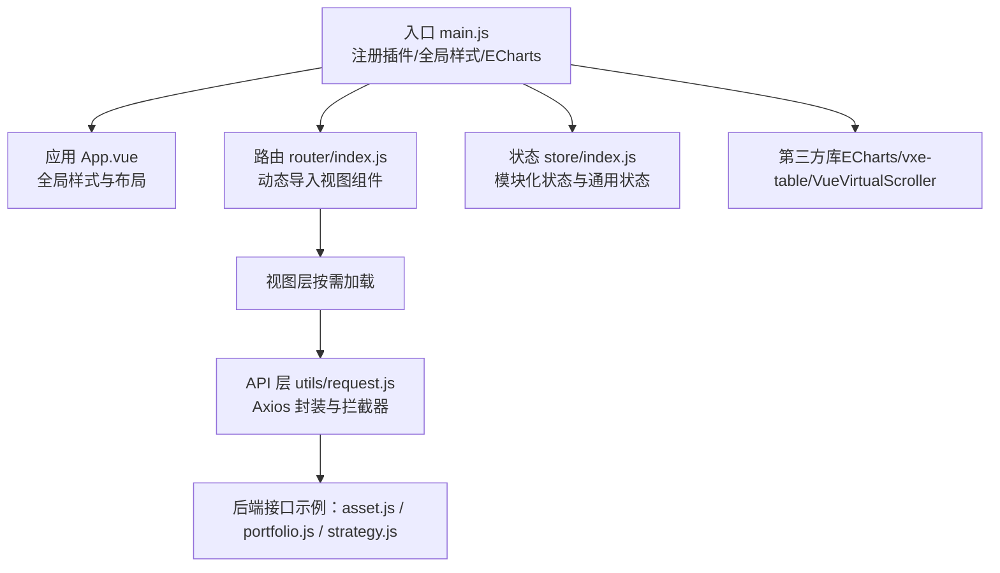
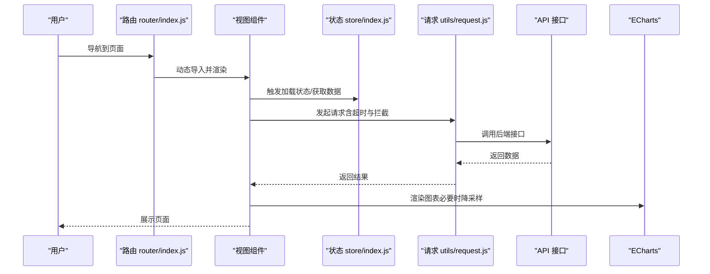
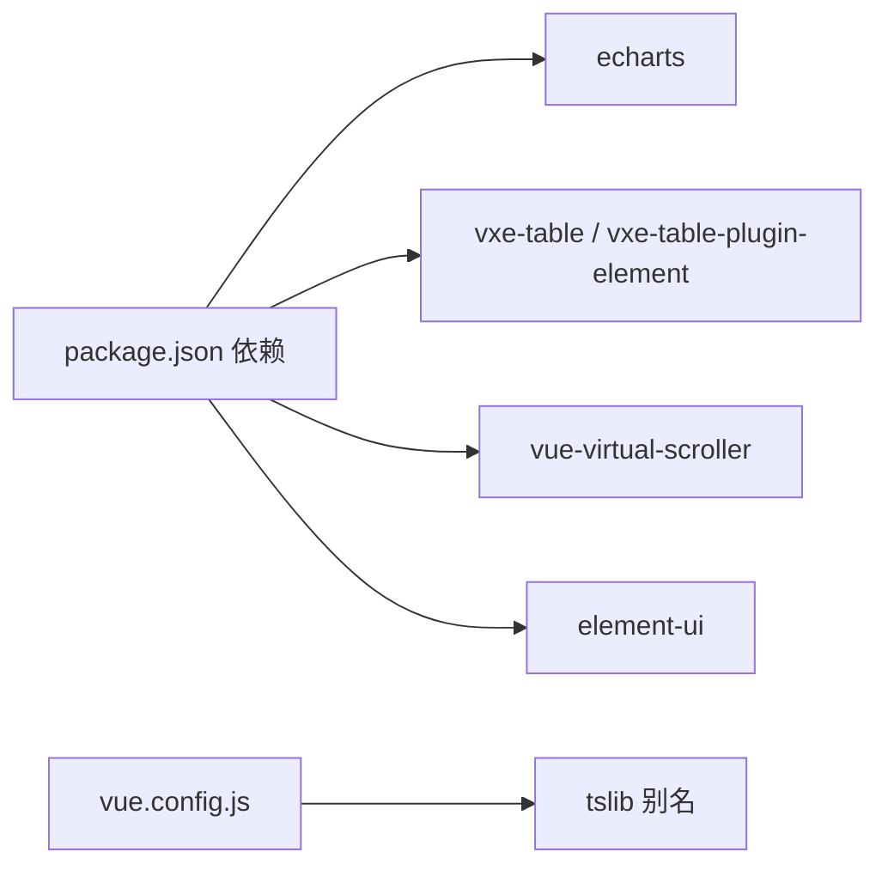
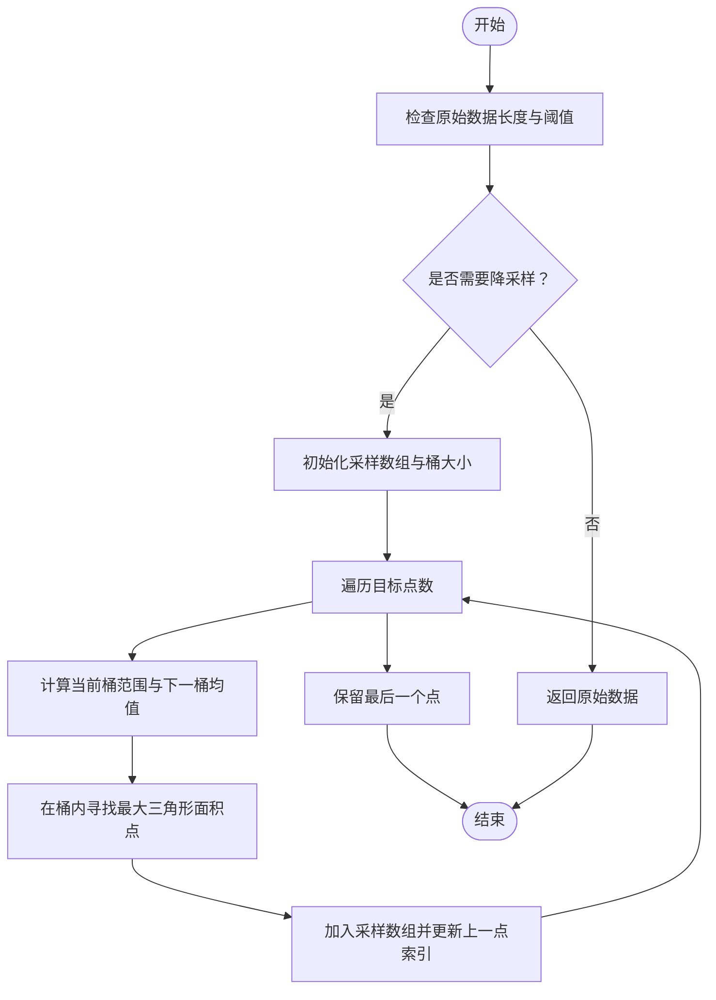
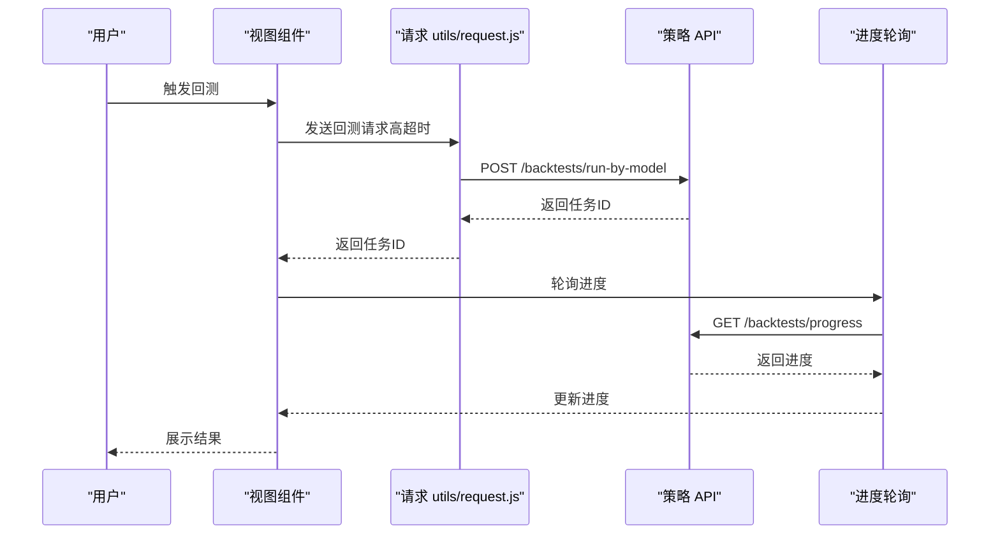

# 性能问题

<cite>
**本文引用的文件**
- [package.json](file://package.json)
- [vue.config.js](file://vue.config.js)
- [src/main.js](file://src/main.js)
- [src/App.vue](file://src/App.vue)
- [src/router/index.js](file://src/router/index.js)
- [src/store/index.js](file://src/store/index.js)
- [src/utils/request.js](file://src/utils/request.js)
- [src/utils/downsample.js](file://src/utils/downsample.js)
- [src/api/asset.js](file://src/api/asset.js)
- [src/api/portfolio.js](file://src/api/portfolio.js)
- [src/api/strategy.js](file://src/api/strategy.js)
</cite>

## 目录
1. [简介](#简介)
2. [项目结构](#项目结构)
3. [核心组件](#核心组件)
4. [架构总览](#架构总览)
5. [详细组件分析](#详细组件分析)
6. [依赖分析](#依赖分析)
7. [性能考量](#性能考量)
8. [故障排除指南](#故障排除指南)
9. [结论](#结论)
10. [附录](#附录)

## 简介
本指南聚焦于投资组合管理系统的性能问题排查与优化，围绕页面加载缓慢、图表渲染卡顿、大量数据处理超时、内存泄漏等常见问题，提供系统化的分析方法与优化路径。内容涵盖前端性能分析工具（如 Chrome DevTools）、Vue 性能监控、内存使用分析、大数据量处理优化（降采样、虚拟滚动、异步加载）、缓存与懒加载策略，并给出可落地的性能指标与优化建议。

## 项目结构
本项目采用 Vue 2 + Vuex + Vue Router 的前端架构，结合 Element UI、vxe-table、ECharts、vue-virtual-scroller 等生态组件，服务于资产、策略、组合、数据分析等多个业务模块。构建与别名配置通过 vue.config.js 控制，全局引入 ECharts 并挂载到 Vue 原型，便于各视图组件直接使用。

**图表来源**
- [src/main.js:1-31](file://src/main.js#L1-L31)
- [src/App.vue:1-116](file://src/App.vue#L1-L116)
- [src/router/index.js:1-378](file://src/router/index.js#L1-L378)
- [src/store/index.js:1-44](file://src/store/index.js#L1-L44)
- [src/utils/request.js:1-100](file://src/utils/request.js#L1-L100)
- [src/api/asset.js:1-284](file://src/api/asset.js#L1-L284)
- [src/api/portfolio.js:1-72](file://src/api/portfolio.js#L1-L72)
- [src/api/strategy.js:1-295](file://src/api/strategy.js#L1-L295)

**章节来源**
- [src/main.js:1-31](file://src/main.js#L1-L31)
- [src/App.vue:1-116](file://src/App.vue#L1-L116)
- [src/router/index.js:1-378](file://src/router/index.js#L1-L378)
- [src/store/index.js:1-44](file://src/store/index.js#L1-L44)
- [vue.config.js:1-17](file://vue.config.js#L1-L17)

## 核心组件
- 插件与全局配置
  - ECharts 注册与原型挂载，便于在组件中直接渲染图表。
  - Element UI、vxe-table、vxe-table-plugin-element、VueVirtualScroller 全局启用。
- 路由与懒加载
  - 使用动态 import 实现视图组件的按需加载，降低初始包体与首屏时间。
- 状态管理
  - 通用 loading 状态与折叠状态，可用于控制加载指示与布局切换。
- 请求封装
  - Axios 实例化、统一超时、Token 注入、错误分类处理与提示。
- 数据处理
  - 提供 LTTB 降采样算法，支持单系列与多系列数据的降采样，显著减少渲染点数。
- API 接口
  - 资产、组合、策略等模块的接口定义，部分接口针对大数据量场景设置了较长超时。

**章节来源**
- [src/main.js:1-31](file://src/main.js#L1-L31)
- [src/router/index.js:1-378](file://src/router/index.js#L1-L378)
- [src/store/index.js:1-44](file://src/store/index.js#L1-L44)
- [src/utils/request.js:1-100](file://src/utils/request.js#L1-L100)
- [src/utils/downsample.js:1-127](file://src/utils/downsample.js#L1-L127)
- [src/api/asset.js:1-284](file://src/api/asset.js#L1-L284)
- [src/api/portfolio.js:1-72](file://src/api/portfolio.js#L1-L72)
- [src/api/strategy.js:1-295](file://src/api/strategy.js#L1-L295)

## 架构总览
前端通过路由懒加载与组件拆分，配合 Axios 统一请求与错误处理，结合 ECharts 渲染与 vxe-table 展示，形成“视图-状态-请求-渲染”的闭环。大数据量场景通过降采样与分页/分批加载缓解渲染压力。

**图表来源**
- [src/router/index.js:1-378](file://src/router/index.js#L1-L378)
- [src/store/index.js:1-44](file://src/store/index.js#L1-L44)
- [src/utils/request.js:1-100](file://src/utils/request.js#L1-L100)
- [src/api/asset.js:1-284](file://src/api/asset.js#L1-L284)
- [src/api/portfolio.js:1-72](file://src/api/portfolio.js#L1-L72)
- [src/api/strategy.js:1-295](file://src/api/strategy.js#L1-L295)

## 详细组件分析

### 请求与错误处理（utils/request.js）
- 超时与重试
  - 默认 60 秒超时，针对回测、发布等耗时场景提供更高超时配置。
- 错误分类与提示
  - 401、403、404、超时、网络异常等分支处理，统一弹窗提示并引导排查。
- Token 注入
  - 自动注入 Authorization 头，保障鉴权请求一致性。
- 优化建议
  - 对高频接口增加幂等键与去重策略，避免重复请求。
  - 对超时与网络错误进行指数退避重试，提升稳定性。

**章节来源**
- [src/utils/request.js:1-100](file://src/utils/request.js#L1-L100)
- [src/api/strategy.js:85-93](file://src/api/strategy.js#L85-L93)
- [src/api/strategy.js:127-134](file://src/api/strategy.js#L127-L134)
- [src/api/strategy.js:136-144](file://src/api/strategy.js#L136-L144)
- [src/api/asset.js:129-157](file://src/api/asset.js#L129-L157)
- [src/api/asset.js:214-274](file://src/api/asset.js#L214-L274)

### 图表降采样（utils/downsample.js）
- 算法能力
  - LTTB（最大三角形三桶）降采样，保持趋势特征，显著减少点数。
  - 支持并行数组与多系列数据的降采样，兼顾日期轴与数值轴。
- 使用场景
  - K 线、净值曲线、多资产对比等高密度时序数据渲染前的预处理。
- 优化建议
  - 结合窗口大小动态调整阈值，移动端与桌面端可差异化配置。
  - 对首尾点强制保留，确保边界信息不丢失。

**章节来源**
- [src/utils/downsample.js:1-127](file://src/utils/downsample.js#L1-L127)

### 资产模块 API（src/api/asset.js）
- 关键点
  - K 线接口支持按交易日历裁剪或全日历模式，避免无效数据参与渲染。
  - 大批量行情导入接口提供较长超时，配合进度轮询实现异步处理。
- 性能要点
  - 建议前端在导入前进行数据校验与去重，减少后端压力。
  - 分批导入与断点续传策略可进一步缩短单次导入耗时。

**章节来源**
- [src/api/asset.js:70-84](file://src/api/asset.js#L70-L84)
- [src/api/asset.js:129-157](file://src/api/asset.js#L129-L157)
- [src/api/asset.js:214-274](file://src/api/asset.js#L214-L274)

### 组合模块 API（src/api/portfolio.js）
- 关键点
  - 组合详情与分析接口返回聚合数据，前端按需请求与缓存。
- 性能要点
  - 对频繁切换的时间维度与指标进行本地缓存，减少重复请求。

**章节来源**
- [src/api/portfolio.js:49-72](file://src/api/portfolio.js#L49-L72)

### 策略模块 API（src/api/strategy.js）
- 关键点
  - 回测运行、发布、实盘发布等接口针对计算与网络波动设置较高超时。
- 性能要点
  - 前端对回测任务进行进度轮询与状态管理，避免阻塞主线程。
  - 对策略列表与筛选参数进行防抖与缓存，降低请求频率。

**章节来源**
- [src/api/strategy.js:85-93](file://src/api/strategy.js#L85-L93)
- [src/api/strategy.js:127-134](file://src/api/strategy.js#L127-L134)
- [src/api/strategy.js:136-144](file://src/api/strategy.js#L136-L144)

### 路由与懒加载（src/router/index.js）
- 关键点
  - 使用动态 import 实现视图组件懒加载，降低首屏体积。
- 性能要点
  - 对大型视图组件（如回测结果、图表网格）进一步拆分子组件与按需渲染。
  - 预取关键页面的依赖，缩短二次进入的等待时间。

**章节来源**
- [src/router/index.js:1-378](file://src/router/index.js#L1-L378)

### 状态与加载指示（src/store/index.js）
- 关键点
  - 提供通用 loading 状态，可在关键流程中显示加载指示。
- 性能要点
  - 将 loading 状态与请求生命周期绑定，避免重复触发。
  - 对长时间加载流程提供取消机制与进度反馈。

**章节来源**
- [src/store/index.js:1-44](file://src/store/index.js#L1-L44)

## 依赖分析
- 第三方库
  - ECharts：高性能可视化引擎，适合大规模时序数据渲染。
  - vxe-table 与 vxe-table-plugin-element：表格渲染与交互，支持大数据量场景。
  - vue-virtual-scroller：虚拟滚动，减少 DOM 节点数量。
  - Element UI：基础 UI 组件库。
- 构建与别名
  - 通过 vue.config.js 设置 tslib 别名，减少重复打包与体积。

**图表来源**
- [package.json:11-28](file://package.json#L11-L28)
- [vue.config.js:5-16](file://vue.config.js#L5-L16)

**章节来源**
- [package.json:11-28](file://package.json#L11-L28)
- [vue.config.js:5-16](file://vue.config.js#L5-L16)

## 性能考量
- 页面加载
  - 路由懒加载与组件拆分可显著降低首屏 JS 体积；结合预取与骨架屏可进一步优化感知速度。
- 图表渲染
  - 使用降采样减少点数；对多系列数据采用共享索引均匀采样；开启 ECharts 的大数据优化选项。
- 大数据量处理
  - 分页/分批加载与进度轮询；对导入流程采用断点续传与幂等键。
- 内存管理
  - 及时销毁图表实例与事件监听；避免在组件销毁后继续更新状态；合理使用虚拟滚动。
- 缓存策略
  - 对静态配置、筛选结果、计算中间态进行本地缓存；设置合理的失效策略与版本号。

[本节为通用指导，无需具体文件分析]

## 故障排除指南

### 页面加载缓慢
- 症状
  - 首屏白屏时间长、路由切换卡顿。
- 排查步骤
  - 使用 Chrome DevTools Performance 面板记录首屏渲染过程，定位长任务与阻塞资源。
  - 检查路由懒加载是否生效，确认大型组件是否被正确拆分。
  - 关注网络面板中的资源体积与加载顺序，优先加载关键资源。
- 优化建议
  - 减少首屏 JS 体积，拆分 vendor 与业务代码；对非关键功能延迟加载。
  - 使用预取与骨架屏提升感知速度；对图片与字体资源进行压缩与缓存。

**章节来源**
- [src/router/index.js:1-378](file://src/router/index.js#L1-L378)

### 图表渲染卡顿
- 症状
  - 拖拽缩放卡顿、切换时间维度卡顿、大量数据时掉帧。
- 排查步骤
  - 使用 Performance 面板观察渲染帧率与长任务；确认是否存在主线程阻塞。
  - 检查 ECharts 实例是否复用与销毁时机是否正确。
- 优化建议
  - 对时序数据进行降采样（LTTB），减少渲染点数；对多系列数据采用均匀采样。
  - 开启 ECharts 的大数据优化配置；避免在渲染过程中频繁更新数据。
  - 对图表容器使用固定尺寸，减少布局抖动。

**章节来源**
- [src/utils/downsample.js:1-127](file://src/utils/downsample.js#L1-L127)
- [src/main.js:22](file://src/main.js#L22)

### 大量数据处理超时
- 症状
  - 导入/回测/发布等耗时操作超时或失败。
- 排查步骤
  - 查看请求拦截器中的超时配置与错误提示，确认是网络问题还是后端处理慢。
  - 对导入流程进行进度轮询与状态管理，避免阻塞 UI。
- 优化建议
  - 对批量导入采用分批与断点续传；对回测与发布设置更高的超时与重试策略。
  - 前端对请求进行去重与幂等控制，避免重复提交。

**章节来源**
- [src/utils/request.js:1-100](file://src/utils/request.js#L1-L100)
- [src/api/asset.js:129-157](file://src/api/asset.js#L129-L157)
- [src/api/asset.js:214-274](file://src/api/asset.js#L214-L274)
- [src/api/strategy.js:85-93](file://src/api/strategy.js#L85-L93)
- [src/api/strategy.js:127-134](file://src/api/strategy.js#L127-L134)
- [src/api/strategy.js:136-144](file://src/api/strategy.js#L136-L144)

### 内存泄漏
- 症状
  - 页面切换后内存不降、长时间使用后内存持续上涨。
- 排查步骤
  - 使用 Chrome DevTools Memory 面板捕获堆快照，对比不同页面间的对象存活情况。
  - 检查图表实例、事件监听器、定时器、订阅与缓存是否在组件销毁时清理。
- 优化建议
  - 在 beforeDestroy/destroyed 生命周期中销毁 ECharts 实例与解绑事件。
  - 避免闭包持有页面上下文；及时清理定时器与订阅。

**章节来源**
- [src/main.js:22](file://src/main.js#L22)

### 性能分析工具与方法
- Chrome DevTools
  - Performance：记录与分析首屏渲染、交互响应与长任务。
  - Memory：捕获堆快照，定位内存增长与泄漏。
  - Network：分析资源加载与超时原因。
- Vue 性能监控
  - 在开发环境启用 Vue DevTools，观察组件渲染次数与响应时间。
  - 对关键组件使用 v-show 与 v-if 合理控制渲染。
- 内存使用分析
  - 结合 Performance 与 Memory 面板，定位主线程阻塞与内存占用峰值。
- 大数据量优化
  - 降采样、虚拟滚动、分页/分批加载、进度轮询与缓存。
- 缓存与懒加载
  - 对静态数据与筛选结果进行本地缓存；对大型组件与资源采用懒加载。

**章节来源**
- [src/utils/downsample.js:1-127](file://src/utils/downsample.js#L1-L127)
- [src/router/index.js:1-378](file://src/router/index.js#L1-L378)

### 性能指标监控与优化建议
- 指标建议
  - 首屏时间（FCP/LCP）、交互时间（FID/CLS）、内存峰值、图表渲染帧率。
- 优化建议
  - 降采样与虚拟滚动优先；对热点数据建立缓存；对超时请求进行重试与降级。
  - 对路由与组件进行拆分与懒加载，减少不必要的初始化成本。

**章节来源**
- [src/utils/downsample.js:1-127](file://src/utils/downsample.js#L1-L127)
- [src/router/index.js:1-378](file://src/router/index.js#L1-L378)

## 结论
通过系统化的性能分析与优化策略，可有效解决页面加载缓慢、图表渲染卡顿、大量数据处理超时与内存泄漏等问题。建议以降采样、虚拟滚动、懒加载、缓存与合理的超时策略为核心手段，结合 Chrome DevTools 与 Vue DevTools 进行持续监控与迭代优化。

[本节为总结性内容，无需具体文件分析]

## 附录

### 关键流程图与时序图

#### 降采样流程（算法实现）

**图表来源**
- [src/utils/downsample.js:9-65](file://src/utils/downsample.js#L9-L65)

#### 回测执行时序（接口调用）

**图表来源**
- [src/api/strategy.js:85-93](file://src/api/strategy.js#L85-L93)
- [src/utils/request.js:1-100](file://src/utils/request.js#L1-L100)