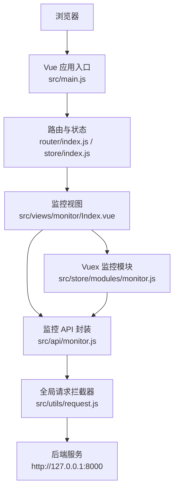
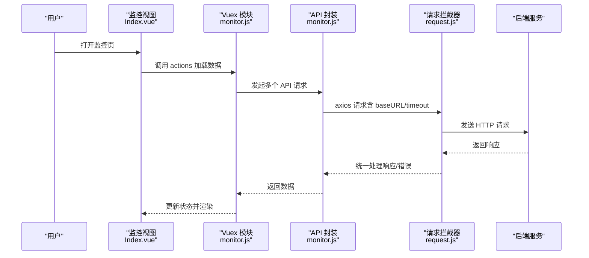
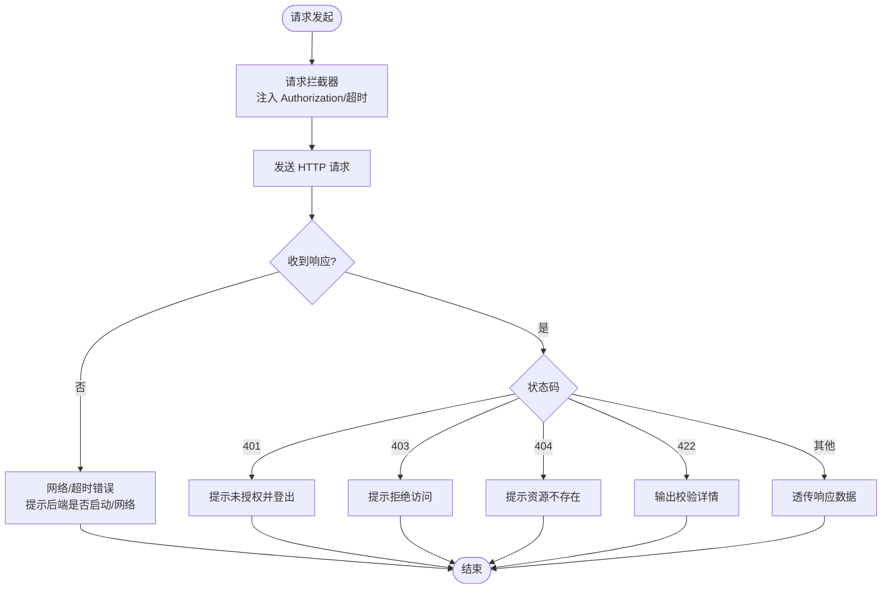
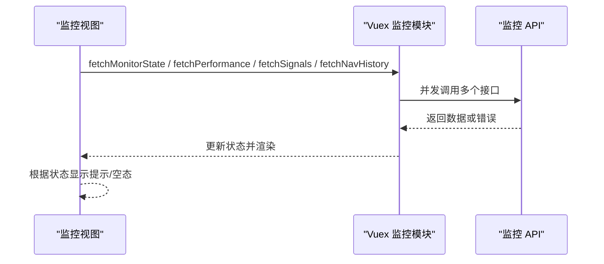
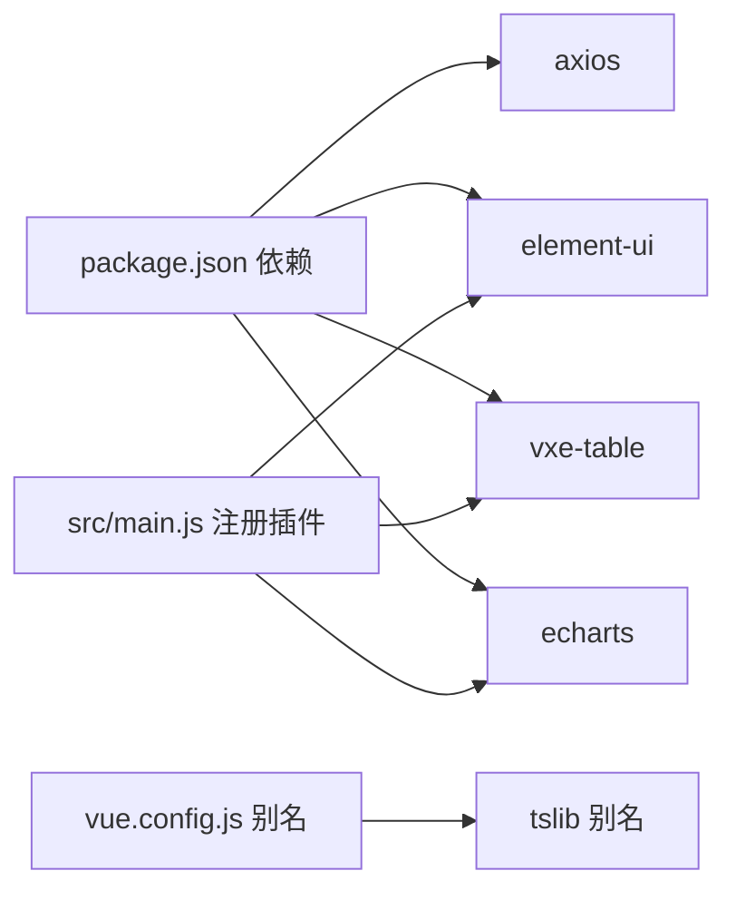

# 故障排除

<cite>
**本文引用的文件**   
- [package.json](file://package.json)
- [README_NODE_VERSION.md](file://README_NODE_VERSION.md)
- [vue.config.js](file://vue.config.js)
- [src/main.js](file://src/main.js)
- [src/utils/request.js](file://src/utils/request.js)
- [src/utils/apiError.js](file://src/utils/apiError.js)
- [src/api/monitor.js](file://src/api/monitor.js)
- [src/store/modules/monitor.js](file://src/store/modules/monitor.js)
- [src/views/monitor/Index.vue](file://src/views/monitor/Index.vue)
- [src/views/system/SystemLog.vue](file://src/views/system/SystemLog.vue)
- [scripts/test_mongo.py](file://scripts/test_mongo.py)
- [scripts/test_zy_data_api.py](file://scripts/test_zy_data_api.py)
- [scripts/import_zy_data_domain_mock.py](file://scripts/import_zy_data_domain_mock.py)
- [docs/OFFLINE_INSTALL_LINUX_WINDOWS.md](file://docs/OFFLINE_INSTALL_LINUX_WINDOWS.md)
</cite>

## 目录
1. [简介](#简介)
2. [项目结构](#项目结构)
3. [核心组件](#核心组件)
4. [架构总览](#架构总览)
5. [详细组件分析](#详细组件分析)
6. [依赖关系分析](#依赖关系分析)
7. [性能考虑](#性能考虑)
8. [故障排除指南](#故障排除指南)
9. [结论](#结论)
10. [附录](#附录)

## 简介
本指南面向投资组合管理系统的运维与技术支持人员，聚焦于系统化故障排除方法与实践。内容涵盖安装与启动问题、网络与代理、数据库连接、API 异常、监控与日志、性能瓶颈定位、以及问题分类与跟踪流程。文档结合前端请求拦截器、监控视图与 Vuex 模块、后端 API 与数据库脚本，提供可落地的诊断步骤与修复建议。

## 项目结构
前端采用 Vue 2 + Element UI + Vuex + Vue Router，构建工具为 Vue CLI。核心运行时入口在应用挂载处，请求封装位于 axios 拦截器层，监控视图通过 API 模块与 Vuex 状态管理进行数据拉取与展示。

**图表来源**
- [src/main.js:1-31](file://src/main.js#L1-L31)
- [src/views/monitor/Index.vue:1-755](file://src/views/monitor/Index.vue#L1-L755)
- [src/api/monitor.js:1-227](file://src/api/monitor.js#L1-L227)
- [src/utils/request.js:1-100](file://src/utils/request.js#L1-L100)
- [src/store/modules/monitor.js:1-416](file://src/store/modules/monitor.js#L1-L416)

**章节来源**
- [src/main.js:1-31](file://src/main.js#L1-L31)
- [vue.config.js:1-17](file://vue.config.js#L1-L17)
- [package.json:1-45](file://package.json#L1-L45)

## 核心组件
- 全局请求拦截器：负责统一设置 Authorization、超时与错误提示，并对 401/403/404/超时等场景给出明确提示。
- 监控视图与状态：提供净值、绩效、信号、事件等指标的可视化与交互，内部通过 API 模块与 Vuex 模块拉取数据。
- API 封装：集中定义监控相关接口，支持单日运行、初始化、范围运行、报告、主观调仓、资产分析等。
- Vuex 监控模块：维护监控状态、净值历史、信号、事件、报告列表等，提供异步动作与加载状态管理。
- 数据库与 API 测试脚本：提供 MongoDB 连接与集合校验、ZY 数据域 API 健康检查与功能测试。

**章节来源**
- [src/utils/request.js:1-100](file://src/utils/request.js#L1-L100)
- [src/views/monitor/Index.vue:1-755](file://src/views/monitor/Index.vue#L1-L755)
- [src/api/monitor.js:1-227](file://src/api/monitor.js#L1-L227)
- [src/store/modules/monitor.js:1-416](file://src/store/modules/monitor.js#L1-L416)
- [scripts/test_mongo.py:1-18](file://scripts/test_mongo.py#L1-L18)
- [scripts/test_zy_data_api.py:1-314](file://scripts/test_zy_data_api.py#L1-L314)

## 架构总览
前端通过 axios 拦截器统一处理请求与错误，监控视图在挂载时触发数据加载，Vuex 模块封装具体 API 调用并管理状态。后端服务提供监控与数据分析接口，默认监听本地端口。

**图表来源**
- [src/views/monitor/Index.vue:445-476](file://src/views/monitor/Index.vue#L445-L476)
- [src/store/modules/monitor.js:81-395](file://src/store/modules/monitor.js#L81-L395)
- [src/api/monitor.js:1-227](file://src/api/monitor.js#L1-L227)
- [src/utils/request.js:11-97](file://src/utils/request.js#L11-L97)

## 详细组件分析

### 组件 A：全局请求拦截器与错误处理
- 功能要点
  - 设置基础 URL 与超时，支持策略轻量接口的特殊提示。
  - 统一注入 Authorization 头。
  - 对 401/403/404/超时/网络错误进行分类提示与兜底处理。
  - 对 422 校验错误进行日志输出。
- 常见问题定位
  - 401：令牌失效或未登录，触发登出。
  - 403：权限不足，检查用户角色与资源访问策略。
  - 404：资源不存在，检查接口路径与 monitor_id 参数。
  - 超时/网络失败：检查后端是否启动、网络连通性、代理与防火墙。

**图表来源**
- [src/utils/request.js:11-97](file://src/utils/request.js#L11-L97)

**章节来源**
- [src/utils/request.js:1-100](file://src/utils/request.js#L1-L100)

### 组件 B：监控视图与状态管理
- 功能要点
  - 页面挂载时并发拉取监控状态、净值历史、绩效、信号等。
  - 对未初始化或数据缺失场景进行友好提示。
  - 支持“初始化”“运行监控”等操作，内部通过 API 封装与 Vuex 动作实现。
- 常见问题定位
  - 未初始化：页面提示“尚未建立本策略的日常监控数据”，需先执行初始化。
  - 数据加载失败：检查后端接口可用性与 monitor_id 参数。
  - 绩效参数不一致：若策略参数已变更但未重新初始化，可能导致曲线与参数不一致。

**图表来源**
- [src/views/monitor/Index.vue:445-476](file://src/views/monitor/Index.vue#L445-L476)
- [src/store/modules/monitor.js:81-395](file://src/store/modules/monitor.js#L81-L395)
- [src/api/monitor.js:1-227](file://src/api/monitor.js#L1-L227)

**章节来源**
- [src/views/monitor/Index.vue:1-755](file://src/views/monitor/Index.vue#L1-L755)
- [src/store/modules/monitor.js:1-416](file://src/store/modules/monitor.js#L1-L416)
- [src/api/monitor.js:1-227](file://src/api/monitor.js#L1-L227)

### 组件 C：API 封装与错误文案提取
- 功能要点
  - API 封装：统一 GET/POST 参数与超时设置，部分长耗时接口提升超时阈值。
  - 错误文案提取：从后端 HTTPException 或统一响应体中提取可读错误信息。
- 常见问题定位
  - 后端返回 detail 数组：取第一条 msg 作为用户提示。
  - 统一响应 message：优先使用 message 字段。
  - 无响应体：回退到 error.message。

**章节来源**
- [src/api/monitor.js:1-227](file://src/api/monitor.js#L1-L227)
- [src/utils/apiError.js:1-18](file://src/utils/apiError.js#L1-L18)

### 组件 D：数据库与 API 测试脚本
- 功能要点
  - MongoDB 连接与集合统计：快速验证本地 MongoDB 是否可用及关键集合是否存在。
  - ZY 数据域 API 健康检查与功能测试：覆盖健康检查、集合列表、资产/产品查询、过滤、分页、404 等。
  - Mock 数据导入：将前端种子数据导入 MongoDB，供后端 API 查询。
- 常见问题定位
  - MongoDB 未启动/连接失败：先用脚本验证连接与集合数量。
  - API 未启动/地址错误：脚本会提示 uvicorn 启动命令。
  - 缺失关键集合：按脚本提示先导入 Mock 数据。

**章节来源**
- [scripts/test_mongo.py:1-18](file://scripts/test_mongo.py#L1-L18)
- [scripts/test_zy_data_api.py:1-314](file://scripts/test_zy_data_api.py#L1-L314)
- [scripts/import_zy_data_domain_mock.py:1-161](file://scripts/import_zy_data_domain_mock.py#L1-L161)

## 依赖关系分析
- 构建别名与依赖修正
  - 通过 webpack 别名将 tslib 指向 node_modules/tslib，避免运行时找不到模块。
- 运行时依赖
  - axios 用于请求封装，Element UI/VXETable/ECharts 等用于界面与图表。
- 离线安装参考
  - 文档提供了后端 Python 与前端 npm 的离线安装流程与常见问题。

**图表来源**
- [package.json:11-28](file://package.json#L11-L28)
- [vue.config.js:3-16](file://vue.config.js#L3-L16)
- [src/main.js:16-20](file://src/main.js#L16-L20)

**章节来源**
- [package.json:1-45](file://package.json#L1-L45)
- [vue.config.js:1-17](file://vue.config.js#L1-L17)
- [src/main.js:1-31](file://src/main.js#L1-L31)
- [docs/OFFLINE_INSTALL_LINUX_WINDOWS.md:1-212](file://docs/OFFLINE_INSTALL_LINUX_WINDOWS.md#L1-L212)

## 性能考虑
- 前端性能
  - 请求超时设置合理，避免长时间阻塞 UI。
  - 并发加载多个监控指标，减少等待时间。
- 后端性能
  - 初始化与范围运行接口设置了较长超时，避免误判超时。
  - 建议对高频查询接口增加缓存与索引优化（见数据库诊断章节）。

**章节来源**
- [src/utils/request.js:5-9](file://src/utils/request.js#L5-L9)
- [src/api/monitor.js:106-125](file://src/api/monitor.js#L106-L125)
- [src/views/monitor/Index.vue:462-476](file://src/views/monitor/Index.vue#L462-L476)

## 故障排除指南

### 一、安装与启动问题
- 现象
  - 安装依赖时报错或运行时报“找不到模块”。
- 诊断与修复
  - 升级 Node.js 至 16.x 或更高版本，满足依赖的 node: 前缀语法要求。
  - 重新安装依赖：删除 node_modules 与 lock 文件后执行安装。
  - 如无法升级 Node.js，可考虑降级特定依赖版本（不推荐）。
  - 构建别名问题：确认 webpack 别名已将 tslib 指向 node_modules/tslib。
- 参考
  - Node.js 版本与引擎要求、降级方案、重新安装步骤。

**章节来源**
- [README_NODE_VERSION.md:1-73](file://README_NODE_VERSION.md#L1-L73)
- [vue.config.js:3-16](file://vue.config.js#L3-L16)
- [package.json:39-44](file://package.json#L39-L44)

### 二、启动失败与环境变量
- 现象
  - 前端无法连接后端，或提示超时。
- 诊断与修复
  - 检查 VUE_APP_BASE_URL 是否指向正确的后端地址（默认 127.0.0.1:8000）。
  - 确认后端服务已启动（脚本中提供 uvicorn 启动命令提示）。
  - 在策略轻量接口场景，若持续超时，检查后端与 MongoDB 连接。
- 参考
  - 请求拦截器中的提示逻辑与超时设置。

**章节来源**
- [src/utils/request.js:7-87](file://src/utils/request.js#L7-L87)
- [src/api/monitor.js:106-125](file://src/api/monitor.js#L106-L125)

### 三、网络连接问题排查
- 现象
  - 本地可访问，但跨域或代理导致请求失败。
- 诊断与修复
  - 使用脚本测试后端健康与集合列表，确认服务可达。
  - 检查代理设置与防火墙规则，确保 127.0.0.1:8000 与 MongoDB 默认端口放行。
  - DNS 解析问题：尝试使用 IP 直连或更换 DNS。
- 参考
  - API 健康检查脚本与错误提示。

**章节来源**
- [scripts/test_zy_data_api.py:22-45](file://scripts/test_zy_data_api.py#L22-L45)

### 四、数据库连接错误
- 现象
  - MongoDB 无法连接或集合为空。
- 诊断与修复
  - 使用脚本连接 MongoDB 并列出 dwd_ 开头的集合，确认存在与记录数。
  - 若缺少关键集合，先执行 Mock 数据导入脚本，再进行 API 功能测试。
  - 检查 MongoDB 服务状态与认证配置。
- 参考
  - MongoDB 连接与集合统计脚本、Mock 数据导入脚本。

**章节来源**
- [scripts/test_mongo.py:1-18](file://scripts/test_mongo.py#L1-L18)
- [scripts/import_zy_data_domain_mock.py:58-141](file://scripts/import_zy_data_domain_mock.py#L58-L141)
- [scripts/test_zy_data_api.py:47-76](file://scripts/test_zy_data_api.py#L47-L76)

### 五、API 调用异常
- 现象
  - 接口返回 401/403/404/超时/网络错误。
- 诊断与修复
  - 401：重新登录或检查令牌有效性。
  - 403：检查用户权限与资源访问策略。
  - 404：确认 monitor_id 与接口路径正确。
  - 超时/网络：检查后端是否启动、网络连通性、代理与防火墙。
  - 错误文案：使用统一错误提取函数获取后端可读提示。
- 参考
  - 请求拦截器与错误处理、错误文案提取。

**章节来源**
- [src/utils/request.js:36-97](file://src/utils/request.js#L36-L97)
- [src/utils/apiError.js:1-18](file://src/utils/apiError.js#L1-L18)

### 六、监控与日志
- 现象
  - 监控页面提示“尚未建立日常监控数据”或数据为空。
- 诊断与修复
  - 先执行“初始化”操作，再“运行监控”至最新交易日。
  - 若策略参数已变更但未重新初始化，可能导致曲线与参数不一致，需重新初始化。
  - 操作日志功能处于开发中，建议通过后端日志与前端错误提示定位问题。
- 参考
  - 监控视图与 Vuex 模块的状态管理与提示逻辑。

**章节来源**
- [src/views/monitor/Index.vue:11-29](file://src/views/monitor/Index.vue#L11-L29)
- [src/store/modules/monitor.js:87-106](file://src/store/modules/monitor.js#L87-L106)
- [src/views/system/SystemLog.vue:1-15](file://src/views/system/SystemLog.vue#L1-L15)

### 七、性能问题分析与优化
- 现象
  - 页面加载缓慢、接口响应慢、图表渲染卡顿。
- 诊断与修复
  - 前端：检查并发请求是否过多，适当合并请求或增加缓存。
  - 后端：对高频查询接口增加索引、优化聚合查询、启用分页与范围限制。
  - I/O 瓶颈：检查数据库连接池配置、慢查询日志与索引使用情况。
  - 内存与 CPU：使用浏览器开发者工具与后端性能分析工具定位热点。
- 参考
  - 监控视图的数据加载策略与 API 超时设置。

**章节来源**
- [src/views/monitor/Index.vue:462-476](file://src/views/monitor/Index.vue#L462-L476)
- [src/api/monitor.js:106-125](file://src/api/monitor.js#L106-L125)

### 八、离线环境安装与依赖问题
- 现象
  - 内网无法联网安装依赖，pip/npm 安装失败或栈溢出。
- 诊断与修复
  - 后端：在联网机下载 requirements.txt 中的 wheel 包，内网使用 --no-index 与 --find-links 安装。
  - 前端：整包打包 node_modules 并拷贝到内网解压，或仅安装新增包。
  - 注意平台与版本匹配，必要时在目标平台重新安装。
- 参考
  - 离线安装文档与常见问题。

**章节来源**
- [docs/OFFLINE_INSTALL_LINUX_WINDOWS.md:1-212](file://docs/OFFLINE_INSTALL_LINUX_WINDOWS.md#L1-L212)

## 结论
本指南提供了从前端请求拦截、监控视图与状态管理，到后端 API 与数据库脚本的全链路故障排除方法。通过统一的错误处理与提示、脚本化的健康检查与数据导入、以及离线安装流程，能够快速定位并解决安装、网络、数据库与 API 的常见问题。建议在日常运维中结合日志与性能分析工具，建立问题分类与跟踪机制，持续优化系统稳定性与用户体验。

## 附录

### A. 常见问题分类与处理流程
- 安装类
  - Node.js 版本不符：升级至 16.x+ 或降级依赖版本。
  - 依赖安装失败：离线打包 node_modules 或补齐 wheel。
- 启动类
  - 环境变量错误：检查 VUE_APP_BASE_URL 与后端端口。
  - 服务未启动：使用脚本检查健康状态并按提示启动。
- 网络类
  - 代理/防火墙：放行 127.0.0.1:8000 与 MongoDB 端口。
  - DNS 解析：使用 IP 直连或更换 DNS。
- 数据库类
  - 连接失败：使用脚本验证连接与集合。
  - 数据缺失：执行 Mock 数据导入脚本。
- API 类
  - 401/403/404：根据拦截器提示与错误文案提取函数定位。
  - 超时：检查后端负载与网络延迟。
- 监控类
  - 未初始化：先执行初始化，再运行监控。
  - 参数不一致：重新初始化以同步参数快照。

**章节来源**
- [README_NODE_VERSION.md:1-73](file://README_NODE_VERSION.md#L1-L73)
- [docs/OFFLINE_INSTALL_LINUX_WINDOWS.md:1-212](file://docs/OFFLINE_INSTALL_LINUX_WINDOWS.md#L1-L212)
- [scripts/test_mongo.py:1-18](file://scripts/test_mongo.py#L1-L18)
- [scripts/test_zy_data_api.py:1-314](file://scripts/test_zy_data_api.py#L1-L314)
- [scripts/import_zy_data_domain_mock.py:1-161](file://scripts/import_zy_data_domain_mock.py#L1-L161)
- [src/utils/request.js:36-97](file://src/utils/request.js#L36-L97)
- [src/utils/apiError.js:1-18](file://src/utils/apiError.js#L1-L18)
- [src/views/monitor/Index.vue:11-29](file://src/views/monitor/Index.vue#L11-L29)