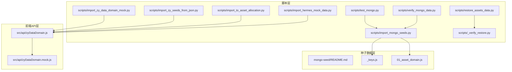
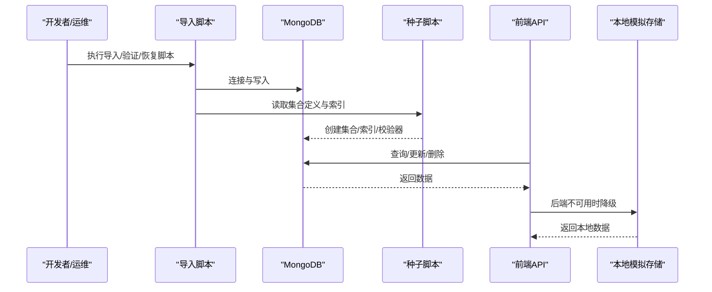
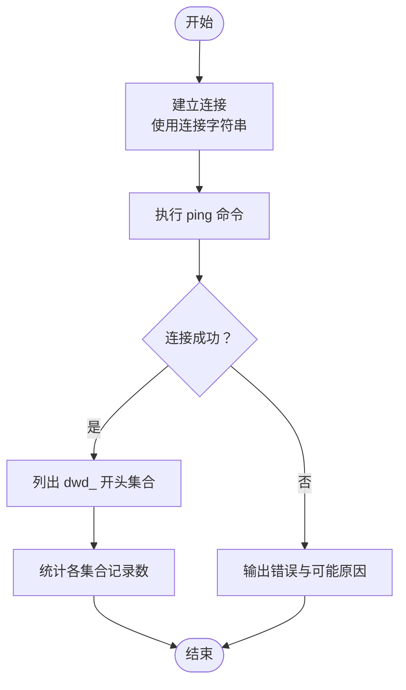
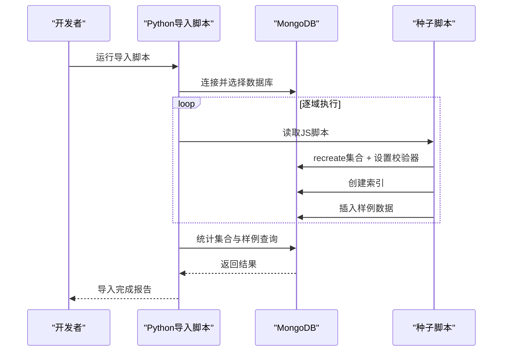
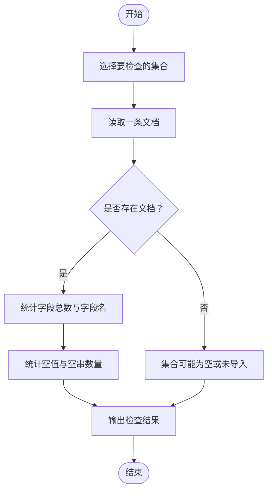
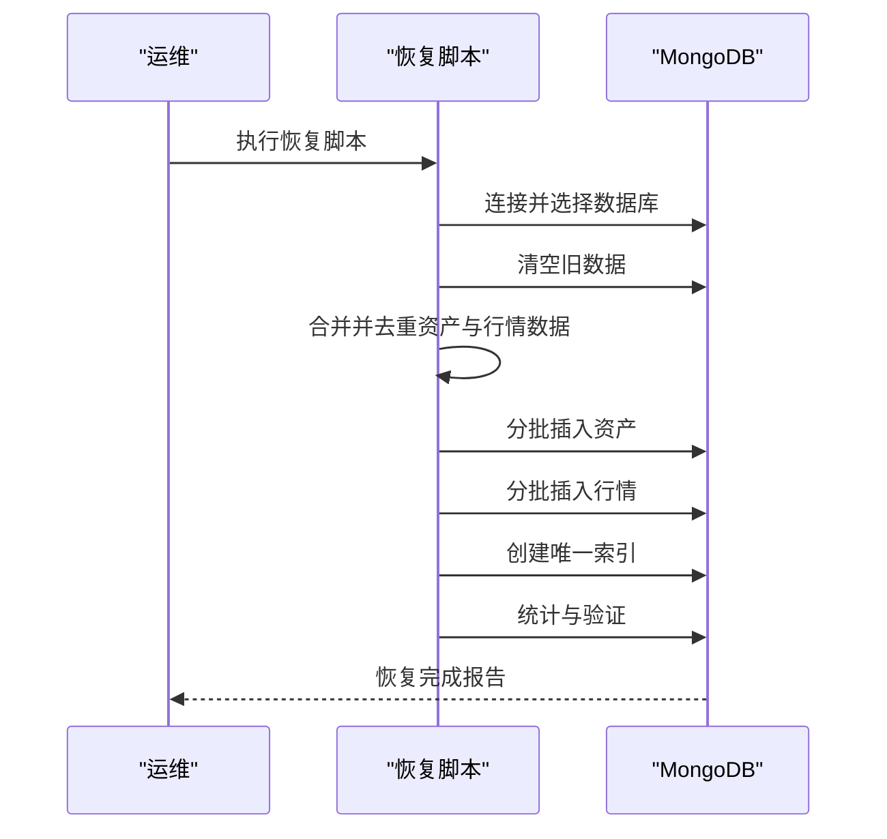
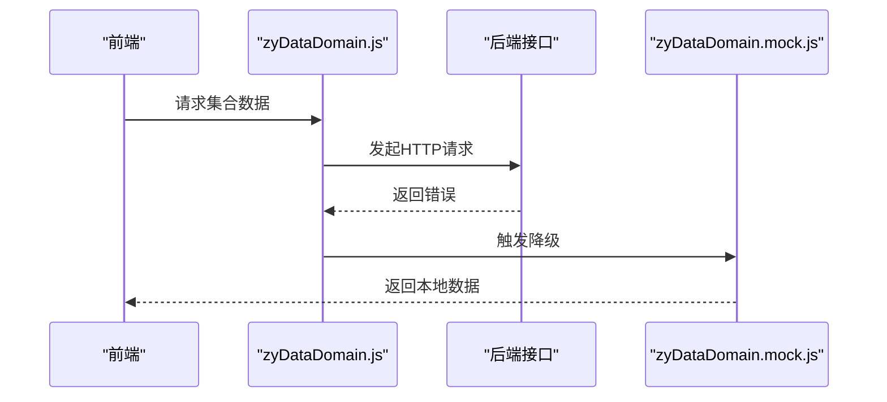
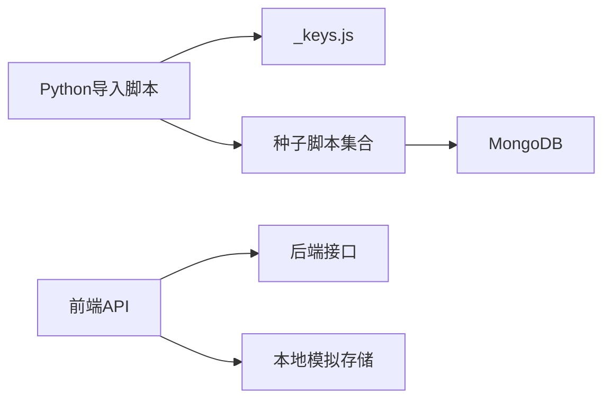

# 数据库问题

<cite>
**本文档引用的文件**
- [scripts/test_mongo.py](file://scripts/test_mongo.py)
- [scripts/verify_mongo_data.py](file://scripts/verify_mongo_data.py)
- [scripts/import_mongo_seeds.py](file://scripts/import_mongo_seeds.py)
- [mongo-seed/README.md](file://mongo-seed/README.md)
- [mongo-seed/_keys.js](file://mongo-seed/_keys.js)
- [mongo-seed/01_asset_domain.js](file://mongo-seed/01_asset_domain.js)
- [check_mongo_fields.py](file://check_mongo_fields.py)
- [scripts/restore_assets_data.py](file://scripts/restore_assets_data.py)
- [scripts/_verify_restore.py](file://scripts/_verify_restore.py)
- [scripts/import_zy_data_domain_mock.py](file://scripts/import_zy_data_domain_mock.py)
- [scripts/import_zy_seeds_from_json.py](file://scripts/import_zy_seeds_from_json.py)
- [scripts/import_to_asset_allocation.py](file://scripts/import_to_asset_allocation.py)
- [scripts/import_hermes_mock_data.py](file://scripts/import_hermes_mock_data.py)
- [src/api/zyDataDomain.js](file://src/api/zyDataDomain.js)
- [src/api/zyDataDomain.mock.js](file://src/api/zyDataDomain.mock.js)
</cite>

## 目录
1. [简介](#简介)
2. [项目结构](#项目结构)
3. [核心组件](#核心组件)
4. [架构总览](#架构总览)
5. [详细组件分析](#详细组件分析)
6. [依赖分析](#依赖分析)
7. [性能考虑](#性能考虑)
8. [故障排除指南](#故障排除指南)
9. [结论](#结论)
10. [附录](#附录)

## 简介
本指南面向投资组合管理系统的数据库管理员与工程师，聚焦MongoDB在本项目中的连接、集合与索引、数据导入与验证、性能优化与备份恢复等关键问题。文档基于仓库内的Python脚本、MongoDB种子脚本与前端API适配逻辑，提供系统化诊断方法与实操步骤，帮助快速定位并解决连接失败、集合不存在、数据格式错误、索引缺失、导入失败、查询性能差、备份恢复异常等常见问题。

## 项目结构
围绕MongoDB的关键文件分布如下：
- 脚本层：用于连接测试、数据导入、验证与恢复
- 种子数据层：定义集合结构、索引与校验器
- 前端API层：提供数据库访问接口，并具备降级到本地模拟存储的能力

**图示来源**
- [scripts/test_mongo.py:1-18](file://scripts/test_mongo.py#L1-L18)
- [scripts/verify_mongo_data.py:1-36](file://scripts/verify_mongo_data.py#L1-L36)
- [scripts/import_mongo_seeds.py:1-305](file://scripts/import_mongo_seeds.py#L1-L305)
- [mongo-seed/README.md:1-125](file://mongo-seed/README.md#L1-L125)
- [mongo-seed/_keys.js:1-161](file://mongo-seed/_keys.js#L1-L161)
- [mongo-seed/01_asset_domain.js:1-200](file://mongo-seed/01_asset_domain.js#L1-L200)
- [scripts/restore_assets_data.py:1-215](file://scripts/restore_assets_data.py#L1-L215)
- [scripts/_verify_restore.py:1-36](file://scripts/_verify_restore.py#L1-L36)
- [scripts/import_zy_data_domain_mock.py:74-111](file://scripts/import_zy_data_domain_mock.py#L74-L111)
- [scripts/import_zy_seeds_from_json.py:47-91](file://scripts/import_zy_seeds_from_json.py#L47-L91)
- [scripts/import_to_asset_allocation.py:45-87](file://scripts/import_to_asset_allocation.py#L45-L87)
- [scripts/import_hermes_mock_data.py:200-239](file://scripts/import_hermes_mock_data.py#L200-L239)
- [src/api/zyDataDomain.js:71-168](file://src/api/zyDataDomain.js#L71-L168)
- [src/api/zyDataDomain.mock.js:981-1011](file://src/api/zyDataDomain.mock.js#L981-L1011)

**章节来源**
- [scripts/test_mongo.py:1-18](file://scripts/test_mongo.py#L1-L18)
- [scripts/verify_mongo_data.py:1-36](file://scripts/verify_mongo_data.py#L1-L36)
- [scripts/import_mongo_seeds.py:1-305](file://scripts/import_mongo_seeds.py#L1-L305)
- [mongo-seed/README.md:1-125](file://mongo-seed/README.md#L1-L125)

## 核心组件
- 连接测试与验证
  - 通过连接字符串与ping命令验证MongoDB可达性与基本连通性
  - 针对不同数据库（如asset_allocation、portfilio）进行验证
- 种子数据导入
  - 以mongo-seed脚本批量创建集合、索引与校验器，并插入样例数据
  - 提供Python脚本批量导入与结果统计
- 数据一致性与字段检查
  - 针对特定集合进行字段存在性、空值与空串检查
- 备份恢复与验证
  - 从本地JSON恢复资产与行情数据，支持去重与索引重建
  - 恢复后进行统计与聚合验证
- 前端API降级机制
  - 当后端接口不可用时，自动降级到本地内存模拟存储，保障前端可用性

**章节来源**
- [scripts/test_mongo.py:1-18](file://scripts/test_mongo.py#L1-L18)
- [scripts/verify_mongo_data.py:1-36](file://scripts/verify_mongo_data.py#L1-L36)
- [scripts/import_mongo_seeds.py:185-302](file://scripts/import_mongo_seeds.py#L185-L302)
- [mongo-seed/README.md:114-125](file://mongo-seed/README.md#L114-L125)
- [check_mongo_fields.py:1-26](file://check_mongo_fields.py#L1-L26)
- [scripts/restore_assets_data.py:154-210](file://scripts/restore_assets_data.py#L154-L210)
- [scripts/_verify_restore.py:1-36](file://scripts/_verify_restore.py#L1-L36)
- [src/api/zyDataDomain.js:71-168](file://src/api/zyDataDomain.js#L71-L168)
- [src/api/zyDataDomain.mock.js:981-1011](file://src/api/zyDataDomain.mock.js#L981-L1011)

## 架构总览
下图展示了从脚本到种子数据再到前端API的整体交互路径，以及降级机制：

**图示来源**
- [scripts/import_mongo_seeds.py:185-302](file://scripts/import_mongo_seeds.py#L185-L302)
- [mongo-seed/README.md:114-125](file://mongo-seed/README.md#L114-L125)
- [src/api/zyDataDomain.js:71-168](file://src/api/zyDataDomain.js#L71-L168)
- [src/api/zyDataDomain.mock.js:981-1011](file://src/api/zyDataDomain.mock.js#L981-L1011)

## 详细组件分析

### 组件A：连接测试与验证
- 功能要点
  - 使用连接字符串连接MongoDB并执行ping命令
  - 针对指定数据库列出以“dwd_”开头的集合并统计记录数
  - 输出错误提示，辅助定位服务未启动、地址错误、端口占用等问题
- 适用场景
  - 初始化环境、部署后自检、CI/CD阶段健康检查
- 常见问题与对策
  - 服务未启动：确认MongoDB进程与端口监听
  - 地址错误：核对连接字符串与防火墙策略
  - 超时：调整serverSelectionTimeoutMS或网络延迟

**图示来源**
- [scripts/test_mongo.py:1-18](file://scripts/test_mongo.py#L1-L18)
- [scripts/verify_mongo_data.py:7-36](file://scripts/verify_mongo_data.py#L7-L36)

**章节来源**
- [scripts/test_mongo.py:1-18](file://scripts/test_mongo.py#L1-L18)
- [scripts/verify_mongo_data.py:1-36](file://scripts/verify_mongo_data.py#L1-L36)

### 组件B：种子数据导入与校验
- 功能要点
  - 读取mongo-seed目录下的JS脚本，按域顺序批量导入
  - 通过$recreate创建集合并设置$jsonSchema校验器
  - 为高频查询字段创建唯一/普通索引
  - 执行后进行集合统计与样例查询验证
- 适用场景
  - 首次初始化、多域批量导入、数据字典一致性校验
- 常见问题与对策
  - 集合不存在：确认种子脚本是否执行、是否被drop重建
  - 唯一索引冲突：导入前清理或使用upsert
  - 校验失败：核对必填字段与字段类型

**图示来源**
- [scripts/import_mongo_seeds.py:185-302](file://scripts/import_mongo_seeds.py#L185-L302)
- [mongo-seed/README.md:114-125](file://mongo-seed/README.md#L114-L125)
- [mongo-seed/_keys.js:144-155](file://mongo-seed/_keys.js#L144-L155)
- [mongo-seed/01_asset_domain.js:28-56](file://mongo-seed/01_asset_domain.js#L28-L56)

**章节来源**
- [scripts/import_mongo_seeds.py:1-305](file://scripts/import_mongo_seeds.py#L1-L305)
- [mongo-seed/README.md:1-125](file://mongo-seed/README.md#L1-L125)
- [mongo-seed/_keys.js:1-161](file://mongo-seed/_keys.js#L1-L161)
- [mongo-seed/01_asset_domain.js:1-200](file://mongo-seed/01_asset_domain.js#L1-L200)

### 组件C：字段类型与数据格式检查
- 功能要点
  - 针对指定集合读取一条文档，输出字段总数、字段名列表、空值与空串统计
- 适用场景
  - 数据导入后快速检查字段缺失、空值异常
- 常见问题与对策
  - 缺失字段：补充采集或在导入时补齐默认值
  - 空值/空串：统一归一化策略（如替换为null或移除）

**图示来源**
- [check_mongo_fields.py:1-26](file://check_mongo_fields.py#L1-L26)

**章节来源**
- [check_mongo_fields.py:1-26](file://check_mongo_fields.py#L1-L26)

### 组件D：备份恢复与一致性验证
- 功能要点
  - 从本地JSON文件合并并去重导入资产与行情数据
  - 支持分批插入与索引重建
  - 恢复后进行统计与Top N聚合验证
- 适用场景
  - 灾备演练、离线数据恢复、数据迁移验证
- 常见问题与对策
  - 文件缺失：确认JSON路径与权限
  - 去重策略：按主键或复合键去重，避免重复导入
  - 索引失败：检查字段类型与索引规范

**图示来源**
- [scripts/restore_assets_data.py:154-210](file://scripts/restore_assets_data.py#L154-L210)
- [scripts/_verify_restore.py:1-36](file://scripts/_verify_restore.py#L1-L36)

**章节来源**
- [scripts/restore_assets_data.py:1-215](file://scripts/restore_assets_data.py#L1-L215)
- [scripts/_verify_restore.py:1-36](file://scripts/_verify_restore.py#L1-L36)

### 组件E：前端API降级机制
- 功能要点
  - 当后端接口调用失败时，自动降级到本地内存模拟存储
  - 提供列表、新增、更新、删除、计数等操作
- 适用场景
  - 后端数据库不可用或网络异常时保障前端可用性
- 常见问题与对策
  - 降级触发：检查shouldFallback逻辑与错误码
  - 数据不一致：注意模拟存储仅临时使用，尽快恢复后端

**图示来源**
- [src/api/zyDataDomain.js:71-168](file://src/api/zyDataDomain.js#L71-L168)
- [src/api/zyDataDomain.mock.js:981-1011](file://src/api/zyDataDomain.mock.js#L981-L1011)

**章节来源**
- [src/api/zyDataDomain.js:71-168](file://src/api/zyDataDomain.js#L71-L168)
- [src/api/zyDataDomain.mock.js:981-1011](file://src/api/zyDataDomain.mock.js#L981-L1011)

## 依赖分析
- 脚本与种子数据
  - Python导入脚本依赖mongo-seed中的集合定义、索引与校验器
  - 种子脚本通过ZY_KEYS统一生成主键、审计字段与业务日期
- 脚本与MongoDB
  - 通过Pymongo连接、创建集合、建立索引、插入数据
- 前端API与后端/模拟
  - 后端接口失败时自动切换至本地模拟存储

**图示来源**
- [scripts/import_mongo_seeds.py:185-302](file://scripts/import_mongo_seeds.py#L185-L302)
- [mongo-seed/_keys.js:144-155](file://mongo-seed/_keys.js#L144-L155)
- [src/api/zyDataDomain.js:71-168](file://src/api/zyDataDomain.js#L71-L168)
- [src/api/zyDataDomain.mock.js:981-1011](file://src/api/zyDataDomain.mock.js#L981-L1011)

**章节来源**
- [scripts/import_mongo_seeds.py:1-305](file://scripts/import_mongo_seeds.py#L1-L305)
- [mongo-seed/_keys.js:1-161](file://mongo-seed/_keys.js#L1-L161)
- [src/api/zyDataDomain.js:71-168](file://src/api/zyDataDomain.js#L71-L168)
- [src/api/zyDataDomain.mock.js:981-1011](file://src/api/zyDataDomain.mock.js#L981-L1011)

## 性能考虑
- 索引设计
  - 主键字段（除_id外）应建立唯一索引
  - 高频过滤字段（如BIZ_DT、PORT_ID、AST_CD）建立普通索引
- 查询优化
  - 使用明确的过滤条件与投影，避免全表扫描
  - 对聚合管道进行分组、排序与限制，控制中间结果集大小
- 导入性能
  - 批量插入与分批处理，减少网络往返
  - 使用upsert避免重复写入带来的冲突与回滚
- 连接池与超时
  - 在应用侧合理配置连接池与超时时间，避免阻塞与资源泄露

[本节为通用指导，无需具体文件引用]

## 故障排除指南

### 一、数据库连接失败
- 系统化诊断步骤
  1) 连接字符串验证
     - 确认主机、端口、数据库名与认证信息
     - 使用连接测试脚本验证连通性
  2) 认证配置检查
     - 若启用认证，确认用户名密码与角色权限
     - 检查绑定IP与防火墙策略
  3) 网络连通性测试
     - 使用telnet或nc测试端口连通
     - 在容器/云环境中检查安全组与网络策略
- 常见原因与对策
  - 服务未启动：启动MongoDB并确认监听端口
  - 地址错误：修正连接字符串中的主机与端口
  - 超时：增大serverSelectionTimeoutMS或优化网络
  - 权限不足：授予数据库用户相应权限

**章节来源**
- [scripts/test_mongo.py:1-18](file://scripts/test_mongo.py#L1-L18)
- [scripts/verify_mongo_data.py:7-36](file://scripts/verify_mongo_data.py#L7-L36)

### 二、集合不存在或索引缺失
- 系统化诊断步骤
  1) 列出集合并确认命名空间
     - 使用连接测试脚本列出以“dwd_”开头的集合
  2) 检查索引
     - 通过集合元信息确认唯一索引与普通索引是否创建
  3) 校验器检查
     - 确认集合是否带有$jsonSchema校验器
- 常见原因与对策
  - 种子脚本未执行：运行导入脚本或手动执行种子脚本
  - drop重建：确认是否被重建导致历史数据丢失
  - 索引失败：检查字段类型与索引规范

**章节来源**
- [scripts/test_mongo.py:7-18](file://scripts/test_mongo.py#L7-L18)
- [scripts/import_mongo_seeds.py:224-302](file://scripts/import_mongo_seeds.py#L224-L302)
- [mongo-seed/README.md:114-125](file://mongo-seed/README.md#L114-L125)

### 三、数据格式错误与字段类型不匹配
- 系统化诊断步骤
  1) 字段检查
     - 使用字段检查脚本输出字段总数、字段名与空值统计
  2) 类型校验
     - 核对金额/比率字段使用double，日期字段采用字符串格式
  3) 样例验证
     - 通过样例查询比对关键字段是否符合预期
- 常见原因与对策
  - 缺失字段：在导入前补齐默认值或在采集端补充
  - 空值/空串：统一归一化策略，避免影响计算
  - 类型不一致：在导入时进行类型转换或在采集端规范

**章节来源**
- [check_mongo_fields.py:1-26](file://check_mongo_fields.py#L1-L26)
- [mongo-seed/README.md:114-125](file://mongo-seed/README.md#L114-L125)
- [scripts/import_mongo_seeds.py:275-296](file://scripts/import_mongo_seeds.py#L275-L296)

### 四、数据导入失败与重复写入
- 系统化诊断步骤
  1) 连接与权限
     - 确认连接成功与写入权限
  2) 唯一索引冲突
     - 捕获duplicate key错误并跳过或使用upsert
  3) 批量写入
     - 使用有序/无序批量插入，合理设置批次大小
- 常见原因与对策
  - 冲突：使用upsert或预清理
  - 超时：分批提交与重试策略
  - 权限：授予写入与索引权限

**章节来源**
- [scripts/import_mongo_seeds.py:171-183](file://scripts/import_mongo_seeds.py#L171-L183)
- [scripts/import_zy_data_domain_mock.py:105-111](file://scripts/import_zy_data_domain_mock.py#L105-L111)
- [scripts/import_zy_seeds_from_json.py:82-88](file://scripts/import_zy_seeds_from_json.py#L82-L88)
- [scripts/import_to_asset_allocation.py:82-88](file://scripts/import_to_asset_allocation.py#L82-L88)

### 五、查询性能差
- 系统化诊断步骤
  1) 索引使用
     - 使用explain分析查询计划，确认索引命中
  2) 过滤与投影
     - 明确过滤条件与投影字段，避免全表扫描
  3) 聚合优化
     - 合理使用$match、$group、$sort与$limit
- 常见原因与对策
  - 缺少索引：为高频过滤字段建立索引
  - 查询复杂：拆分查询或引入物化视图/汇总集合
  - 聚合过大：限制结果集与分页处理

[本节为通用指导，无需具体文件引用]

### 六、备份恢复流程与一致性检查
- 恢复流程
  1) 准备数据
     - 确认JSON文件存在且结构正确
  2) 清空旧数据
     - 删除目标集合中已有数据
  3) 合并与去重
     - 按主键或复合键合并并去重
  4) 分批插入
     - 分批写入并创建唯一索引
  5) 统计与验证
     - 统计集合数量与Top N聚合验证
- 常见问题与对策
  - 文件缺失：检查路径与权限
  - 去重策略：按业务主键去重，避免重复
  - 索引失败：检查字段类型与索引规范

**章节来源**
- [scripts/restore_assets_data.py:154-210](file://scripts/restore_assets_data.py#L154-L210)
- [scripts/_verify_restore.py:1-36](file://scripts/_verify_restore.py#L1-L36)

### 七、前端API降级与数据一致性
- 降级机制
  - 后端接口失败时自动切换到本地模拟存储
  - 提供列表、新增、更新、删除、计数等操作
- 注意事项
  - 降级仅用于临时应急，尽快恢复后端
  - 模拟存储不持久化，重启后数据会丢失

**章节来源**
- [src/api/zyDataDomain.js:71-168](file://src/api/zyDataDomain.js#L71-L168)
- [src/api/zyDataDomain.mock.js:981-1011](file://src/api/zyDataDomain.mock.js#L981-L1011)

## 结论
本指南基于仓库内的脚本与种子数据，提供了从连接测试、导入验证、字段检查、索引与校验器、到备份恢复与前端降级的全链路故障排除方法。建议在日常运维中结合这些脚本与流程，形成标准化的巡检与应急处置方案，确保MongoDB在投资组合管理系统中的高可用与高性能。

## 附录
- 常用命令与脚本
  - 连接测试：[scripts/test_mongo.py:1-18](file://scripts/test_mongo.py#L1-L18)
  - 数据验证：[scripts/verify_mongo_data.py:1-36](file://scripts/verify_mongo_data.py#L1-L36)
  - 种子导入：[scripts/import_mongo_seeds.py:1-305](file://scripts/import_mongo_seeds.py#L1-L305)
  - 字段检查：[check_mongo_fields.py:1-26](file://check_mongo_fields.py#L1-L26)
  - 恢复脚本：[scripts/restore_assets_data.py:1-215](file://scripts/restore_assets_data.py#L1-L215)
  - 恢复验证：[scripts/_verify_restore.py:1-36](file://scripts/_verify_restore.py#L1-L36)
  - 前端API降级：[src/api/zyDataDomain.js:71-168](file://src/api/zyDataDomain.js#L71-L168)、[src/api/zyDataDomain.mock.js:981-1011](file://src/api/zyDataDomain.mock.js#L981-L1011)