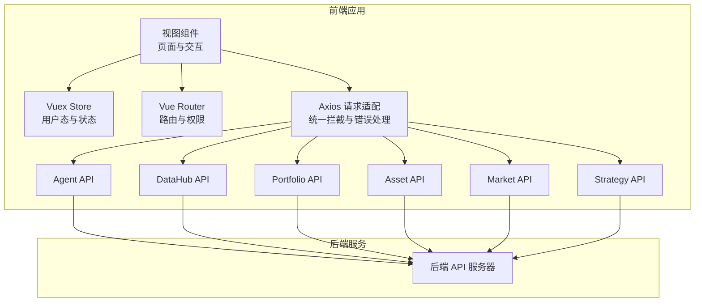
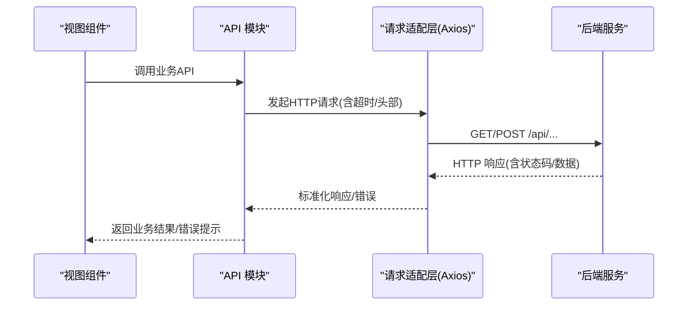
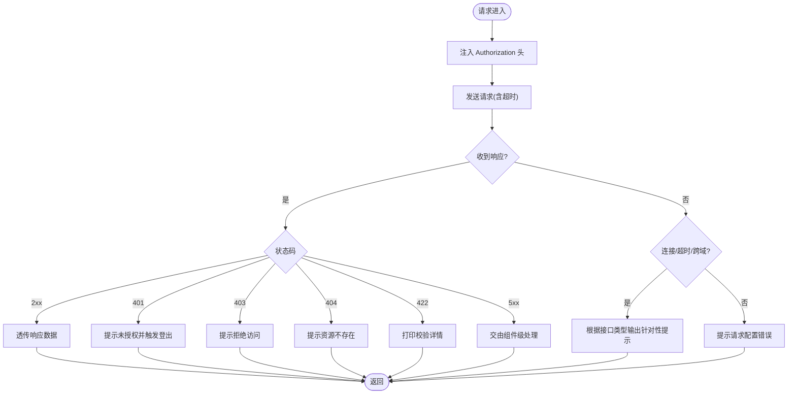
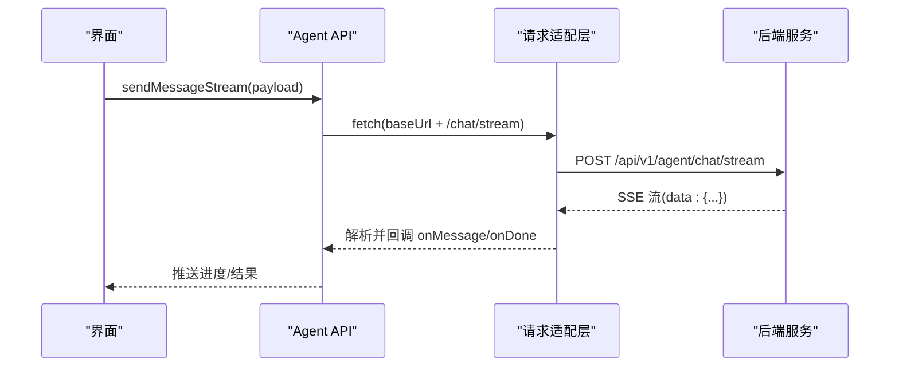
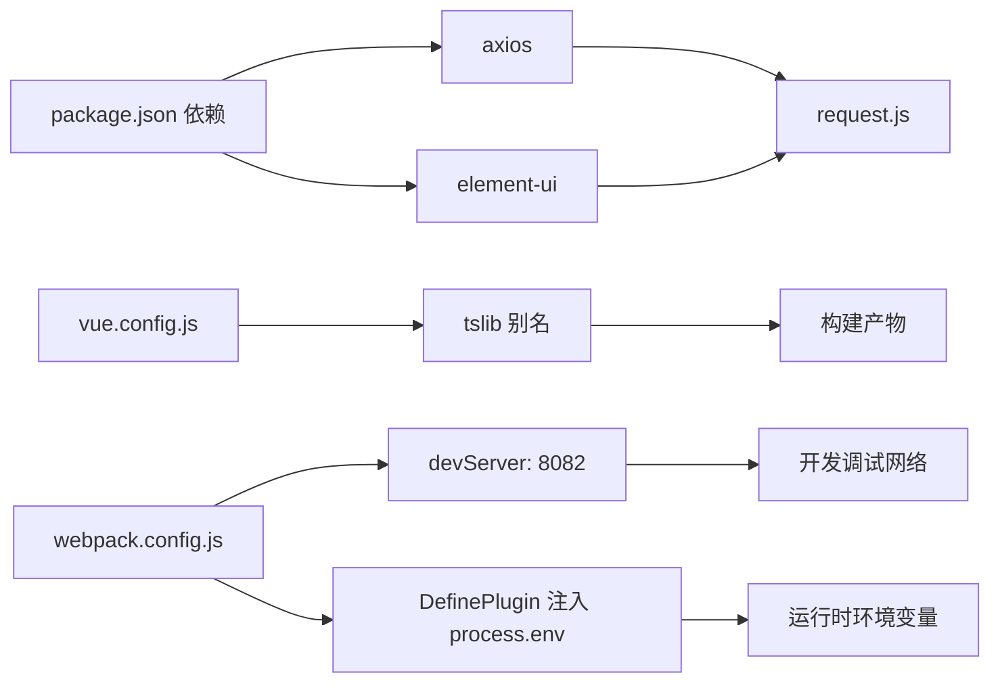
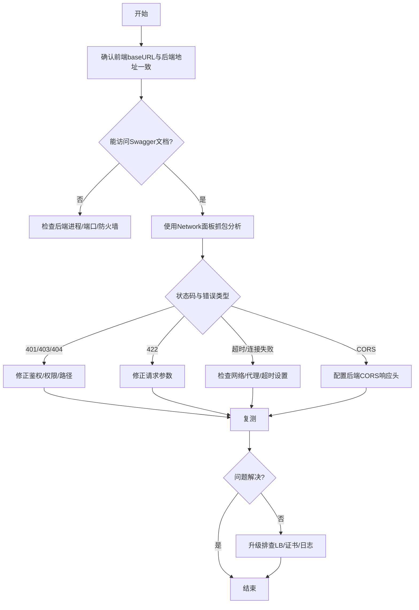

# 网络连接问题

<cite>
**本文引用的文件**
- [request.js](file://src/utils/request.js)
- [apiError.js](file://src/utils/apiError.js)
- [agent.js](file://src/api/agent.js)
- [dataHub.js](file://src/api/dataHub.js)
- [portfolio.js](file://src/api/portfolio.js)
- [asset.js](file://src/api/asset.js)
- [market.js](file://src/api/market.js)
- [strategy.js](file://src/api/strategy.js)
- [网络测试脚本.js](file://网络测试脚本.js)
- [package.json](file://package.json)
- [vue.config.js](file://vue.config.js)
- [webpack.config.js](file://webpack.config.js)
- [main.js](file://src/main.js)
- [index.js](file://src/router/index.js)
- [user.js](file://src/store/modules/user.js)
</cite>

## 目录
1. [简介](#简介)
2. [项目结构](#项目结构)
3. [核心组件](#核心组件)
4. [架构总览](#架构总览)
5. [详细组件分析](#详细组件分析)
6. [依赖分析](#依赖分析)
7. [性能考虑](#性能考虑)
8. [故障排除指南](#故障排除指南)
9. [结论](#结论)
10. [附录](#附录)

## 简介
本指南面向运维与开发人员，聚焦投资组合管理系统在企业网络环境中的常见网络问题，包括API请求失败、跨域（CORS）问题、代理配置错误、DNS解析失败、超时与连接异常、防火墙与安全策略影响、SSL/TLS与证书校验、以及负载均衡器相关问题。文档提供系统化诊断方法（curl/ping/traceroute等）、HTTP状态码解读与处理建议、网络性能监控与优化策略，并给出快速定位与解决流程，帮助保障系统稳定运行。

## 项目结构
前端基于 Vue 2 + Axios，API封装集中在统一请求适配层，各功能域通过独立API模块调用后端接口。核心网络相关文件分布如下：
- 请求适配与拦截：src/utils/request.js
- 错误文案提取：src/utils/apiError.js
- 功能域API：src/api/*.js（agent、dataHub、portfolio、asset、market、strategy）
- 网络诊断脚本：网络测试脚本.js
- 构建与运行配置：vue.config.js、webpack.config.js、package.json
- 应用入口与路由：src/main.js、src/router/index.js
- 用户态存储：src/store/modules/user.js

图表来源
- [request.js:1-100](file://src/utils/request.js#L1-L100)
- [agent.js:1-168](file://src/api/agent.js#L1-L168)
- [dataHub.js:1-95](file://src/api/dataHub.js#L1-L95)
- [portfolio.js:1-72](file://src/api/portfolio.js#L1-L72)
- [asset.js:1-284](file://src/api/asset.js#L1-L284)
- [market.js:1-112](file://src/api/market.js#L1-L112)
- [strategy.js:1-295](file://src/api/strategy.js#L1-L295)

章节来源
- [request.js:1-100](file://src/utils/request.js#L1-L100)
- [agent.js:1-168](file://src/api/agent.js#L1-L168)
- [dataHub.js:1-95](file://src/api/dataHub.js#L1-L95)
- [portfolio.js:1-72](file://src/api/portfolio.js#L1-L72)
- [asset.js:1-284](file://src/api/asset.js#L1-L284)
- [market.js:1-112](file://src/api/market.js#L1-L112)
- [strategy.js:1-295](file://src/api/strategy.js#L1-L295)
- [网络测试脚本.js:1-157](file://网络测试脚本.js#L1-L157)
- [package.json:1-45](file://package.json#L1-L45)
- [vue.config.js:1-17](file://vue.config.js#L1-L17)
- [webpack.config.js:1-62](file://webpack.config.js#L1-L62)
- [main.js:1-31](file://src/main.js#L1-L31)
- [index.js:1-53](file://src/router/index.js#L1-L53)
- [user.js:1-50](file://src/store/modules/user.js#L1-L50)

## 核心组件
- 统一请求适配层：负责基础URL、超时、鉴权头注入、全局错误处理与提示。
- 功能域API模块：按领域封装具体REST接口，部分场景使用原生fetch处理SSE。
- 网络诊断脚本：在浏览器控制台执行，覆盖基础连接、API端点、CORS与端口检查。
- 构建与运行配置：定义开发服务器端口、别名与环境变量注入，辅助定位网络问题。

章节来源
- [request.js:1-100](file://src/utils/request.js#L1-L100)
- [agent.js:1-168](file://src/api/agent.js#L1-L168)
- [market.js:1-112](file://src/api/market.js#L1-L112)
- [网络测试脚本.js:1-157](file://网络测试脚本.js#L1-L157)
- [vue.config.js:1-17](file://vue.config.js#L1-L17)
- [webpack.config.js:1-62](file://webpack.config.js#L1-L62)

## 架构总览
前端通过Axios发起HTTP请求，统一拦截器添加Authorization头并处理错误；部分实时/流式场景采用原生fetch+SSE；后端提供REST API，前端通过路由与状态管理驱动业务流程。

图表来源
- [request.js:11-97](file://src/utils/request.js#L11-L97)
- [agent.js:4-11](file://src/api/agent.js#L4-L11)
- [strategy.js:86-93](file://src/api/strategy.js#L86-L93)

## 详细组件分析

### 统一请求适配层（Axios）
- 基础配置：baseURL来自环境变量，缺省指向本地8000端口；默认超时60秒，部分长耗时接口单独放宽。
- 请求拦截：自动注入Authorization头（Bearer token）。
- 响应拦截：对4xx/5xx进行分类处理；对无响应（连接失败/超时/跨域）给出明确提示；区分策略实盘/发布类接口的超时常量。

图表来源
- [request.js:12-97](file://src/utils/request.js#L12-L97)

章节来源
- [request.js:1-100](file://src/utils/request.js#L1-L100)

### Agent API（含SSE流式对话）
- 非流式对话：使用Axios，支持较长超时（AI对话）。
- 流式对话：使用原生fetch建立SSE连接，手动解析data行，错误时返回可读文本。
- 上传附件：multipart/form-data，单独超时设置。

图表来源
- [agent.js:78-112](file://src/api/agent.js#L78-L112)
- [market.js:17-58](file://src/api/market.js#L17-L58)

章节来源
- [agent.js:1-168](file://src/api/agent.js#L1-L168)
- [market.js:1-112](file://src/api/market.js#L1-L112)

### Market API（SSE进度流）
- 提供SSE解析函数，支持“当日同步”和“组合维护”两类流式任务。
- 统一处理404（接口未提供）与连接失败场景。

章节来源
- [market.js:1-112](file://src/api/market.js#L1-L112)

### DataHub API（通用数据接入Hub）
- 提供连接器元数据、导入、查询、批次、统计、字段等接口。
- 部分接口超时较长（如导入/查询），避免误判为失败。

章节来源
- [dataHub.js:1-95](file://src/api/dataHub.js#L1-L95)

### Portfolio/Asset/Strategy API
- Portfolio：组合列表、详情、分析、调仓等。
- Asset：资产列表、详情、K线、导入模板下载、Excel/JSON导入、批量删除等。
- Strategy：模板/模型管理、回测、发布/实盘发布、监控、基准等。

章节来源
- [portfolio.js:1-72](file://src/api/portfolio.js#L1-L72)
- [asset.js:1-284](file://src/api/asset.js#L1-L284)
- [strategy.js:1-295](file://src/api/strategy.js#L1-L295)

### 错误文案提取工具
- 从axios错误对象中提取后端可读错误信息，兼容FastAPI与统一响应封装。

章节来源
- [apiError.js:1-18](file://src/utils/apiError.js#L1-L18)

## 依赖分析
- Axios：HTTP客户端，统一请求与错误处理。
- Element UI：消息提示组件，配合全局错误拦截器显示用户提示。
- 构建配置：开发服务器端口、路径别名、DefinePlugin注入环境变量，影响网络调试与代理配置。

图表来源
- [package.json:11-28](file://package.json#L11-L28)
- [vue.config.js:5-16](file://vue.config.js#L5-L16)
- [webpack.config.js:53-61](file://webpack.config.js#L53-L61)

章节来源
- [package.json:1-45](file://package.json#L1-L45)
- [vue.config.js:1-17](file://vue.config.js#L1-L17)
- [webpack.config.js:1-62](file://webpack.config.js#L1-L62)

## 性能考虑
- 超时策略：默认60秒，长耗时接口（如回测、导入、DataHub查询）单独放宽，避免误判失败。
- 流式传输：SSE用于进度/日志推送，减少长时间阻塞。
- 重试与降级：建议在业务层实现幂等与有限重试，必要时降级缓存或离线模式。
- 网络监控：结合浏览器开发者工具Network面板、后端日志与APM，观察RT、错误率与队列长度。

章节来源
- [request.js:5-9](file://src/utils/request.js#L5-L9)
- [strategy.js:86-93](file://src/api/strategy.js#L86-L93)
- [asset.js:150-156](file://src/api/asset.js#L150-L156)
- [dataHub.js:10-21](file://src/api/dataHub.js#L10-L21)
- [market.js:66-87](file://src/api/market.js#L66-L87)

## 故障排除指南

### 一、API请求失败
- 现象：接口报错、无响应、状态码异常。
- 诊断步骤：
  1) 使用浏览器Network面板确认请求URL、方法、头信息与响应状态码。
  2) 若出现401/403/404/422，依据拦截器逻辑定位业务错误或鉴权问题。
  3) 若无响应，优先检查超时与连接失败分支，区分策略实盘/发布类接口的超时常量。
- 常见原因与对策：
  - 后端未启动或端口不正确：检查后端进程与监听端口。
  - 路由未注册或路径错误：核对API前缀与路径。
  - 鉴权失败：确认Authorization头与token有效性。
  - 参数校验失败：查看422详情，修正请求体或查询参数。

章节来源
- [request.js:36-97](file://src/utils/request.js#L36-L97)
- [apiError.js:6-17](file://src/utils/apiError.js#L6-L17)

### 二、跨域（CORS）问题
- 现象：浏览器控制台出现CORS错误，预检失败或响应头缺失。
- 诊断步骤：
  1) 在浏览器Console执行网络测试脚本，自动发起OPTIONS预检并检查响应头。
  2) 核对后端CORS允许的Origin、Methods与Headers。
- 常见原因与对策：
  - 后端未配置CORS或Allow-Origin设置不当：调整后端CORS白名单。
  - 预检失败：确保后端接受OPTIONS方法并返回必需响应头。
  - 前后端域名/协议/端口不一致：统一前后端域名与端口。

章节来源
- [网络测试脚本.js:72-104](file://网络测试脚本.js#L72-L104)
- [agent.js:82-100](file://src/api/agent.js#L82-L100)

### 三、代理配置错误
- 现象：开发环境下请求被代理拦截或转发到错误地址。
- 诊断步骤：
  1) 检查开发服务器配置（默认8082端口）与代理规则。
  2) 确认baseURL与实际后端地址一致。
- 常见原因与对策：
  - 代理目标端口/路径错误：修正devServer与代理配置。
  - 环境变量未生效：检查DefinePlugin注入的process.env。

章节来源
- [webpack.config.js:53-61](file://webpack.config.js#L53-L61)
- [vue.config.js:5-16](file://vue.config.js#L5-L16)
- [request.js:6-8](file://src/utils/request.js#L6-L8)

### 四、DNS解析失败
- 现象：请求超时或“无法加载”错误。
- 诊断步骤：
  1) 在终端使用nslookup/dig解析域名。
  2) 使用curl/ping测试连通性与延迟。
- 常见原因与对策：
  - DNS不可达或污染：更换DNS服务器或使用IP直连。
  - 企业内网策略限制：联系IT开放域名访问。

章节来源
- [网络测试脚本.js:106-113](file://网络测试脚本.js#L106-L113)

### 五、防火墙与安全策略
- 现象：特定端口被阻断，或HTTPS证书校验失败。
- 诊断步骤：
  1) 使用telnet/nmap扫描端口连通性。
  2) 检查SSL证书链与有效期。
- 常见原因与对策：
  - 防火墙策略：申请放行8000/8082端口。
  - 证书问题：更新证书或配置信任链。

章节来源
- [网络测试脚本.js:106-113](file://网络测试脚本.js#L106-L113)

### 六、负载均衡器问题
- 现象：偶发超时、502/504、健康检查失败。
- 诊断步骤：
  1) 检查LB健康检查配置与后端存活。
  2) 关注会话保持与超时设置。
- 常见原因与对策：
  - 后端实例不足：扩容实例或优化资源。
  - 超时过短：适当提高LB与后端超时阈值。

章节来源
- [request.js:5-9](file://src/utils/request.js#L5-L9)
- [strategy.js:128-134](file://src/api/strategy.js#L128-L134)

### 七、HTTP状态码解读与处理
- 2xx：请求成功，透传数据。
- 401：未授权，清理本地token并提示重新登录。
- 403：拒绝访问，提示权限不足。
- 404：资源不存在，检查路径与参数。
- 422：参数校验失败，打印后端详情。
- 5xx：业务错误，交由组件级处理。

章节来源
- [request.js:36-65](file://src/utils/request.js#L36-L65)

### 八、网络诊断工具与方法
- curl：验证端点可达性与返回内容。
- ping：检测主机连通性。
- traceroute/tracert：追踪路由路径，定位丢包与延迟。
- 浏览器Network：查看请求/响应细节、CSP与安全策略。
- 网络测试脚本：一键执行基础连接、API端点、CORS与端口检查。

章节来源
- [网络测试脚本.js:15-70](file://网络测试脚本.js#L15-L70)

### 九、快速定位与解决流程

图表来源
- [request.js:12-97](file://src/utils/request.js#L12-L97)
- [网络测试脚本.js:115-152](file://网络测试脚本.js#L115-L152)

## 结论
通过统一的请求适配层、清晰的错误处理与提示、完善的SSE流式能力，以及可复用的网络诊断脚本，系统在网络连接问题上具备较强的可观测性与可诊断性。建议在企业环境中完善CORS、代理与防火墙策略，结合超时与重试机制，确保高可用与稳定性。

## 附录

### A. 常用环境变量与配置要点
- 基础URL：VUE_APP_BASE_URL（默认127.0.0.1:8000）
- 市场API基地址：VUE_APP_MARKET_API（优先于基础URL）
- 开发服务器端口：8082（webpack devServer）

章节来源
- [request.js:6-8](file://src/utils/request.js#L6-L8)
- [market.js:6-8](file://src/api/market.js#L6-L8)
- [webpack.config.js:58](file://webpack.config.js#L58)

### B. 关键API与超时参考
- Agent非流式：默认60秒，AI对话可提升至300秒。
- DataHub导入/查询：默认60秒，导入可提升至300秒。
- Strategy回测/导入：默认60秒，回测可提升至300秒。
- Strategy发布/实盘发布：默认60秒，发布可提升至120-180秒。

章节来源
- [agent.js:9](file://src/api/agent.js#L9)
- [dataHub.js:20](file://src/api/dataHub.js#L20)
- [strategy.js:91](file://src/api/strategy.js#L91)
- [strategy.js:128-143](file://src/api/strategy.js#L128-L143)