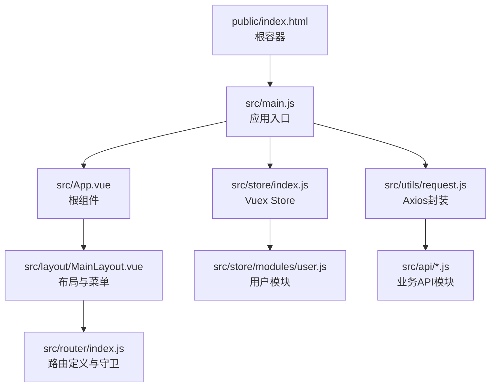
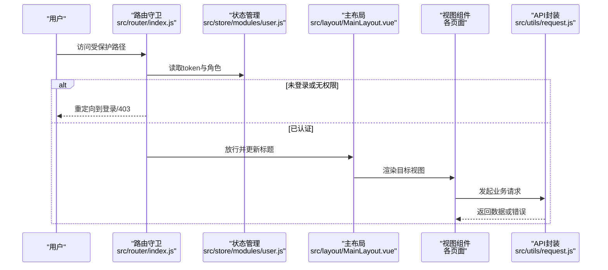
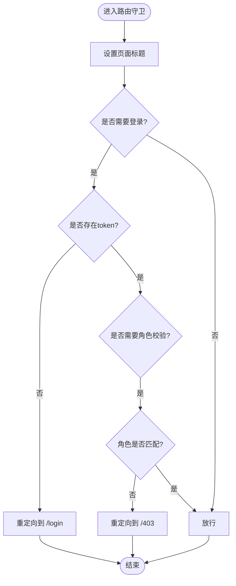
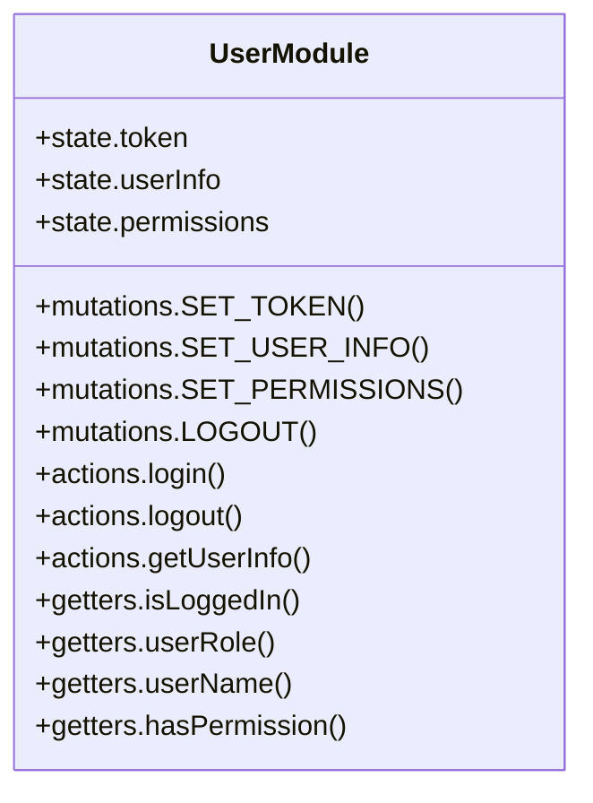
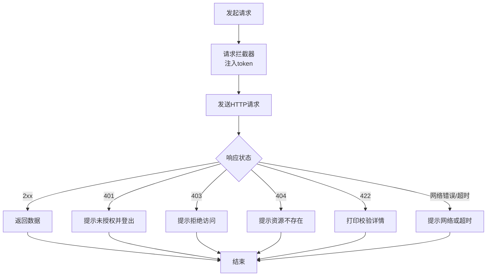
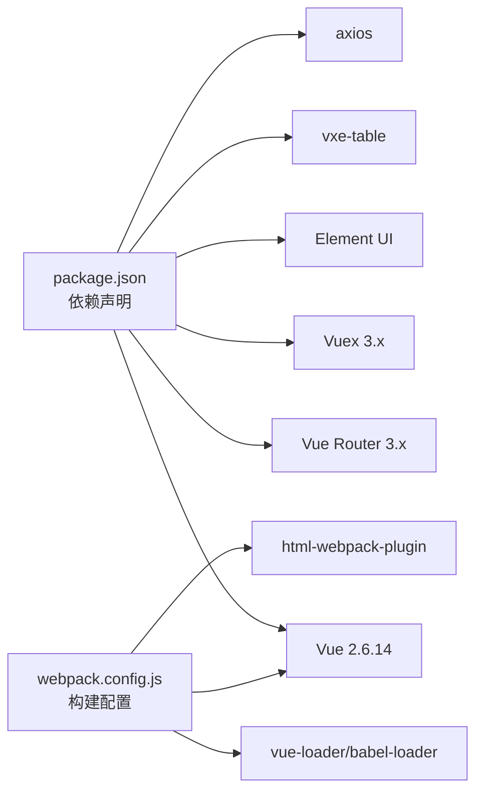

# 运行时错误

<cite>
**本文引用的文件**
- [package.json](file://package.json)
- [vue.config.js](file://vue.config.js)
- [webpack.config.js](file://webpack.config.js)
- [src/main.js](file://src/main.js)
- [public/index.html](file://public/index.html)
- [src/router/index.js](file://src/router/index.js)
- [src/store/index.js](file://src/store/index.js)
- [src/App.vue](file://src/App.vue)
- [src/layout/MainLayout.vue](file://src/layout/MainLayout.vue)
- [src/utils/request.js](file://src/utils/request.js)
- [src/utils/apiError.js](file://src/utils/apiError.js)
- [src/store/modules/user.js](file://src/store/modules/user.js)
- [src/views/404.vue](file://src/views/404.vue)
- [src/api/asset.js](file://src/api/asset.js)
- [src/api/portfolio.js](file://src/api/portfolio.js)
- [src/api/strategy.js](file://src/api/strategy.js)
</cite>

## 目录
1. [简介](#简介)
2. [项目结构](#项目结构)
3. [核心组件](#核心组件)
4. [架构总览](#架构总览)
5. [详细组件分析](#详细组件分析)
6. [依赖分析](#依赖分析)
7. [性能考虑](#性能考虑)
8. [故障排除指南](#故障排除指南)
9. [结论](#结论)
10. [附录](#附录)

## 简介
本指南面向投资组合管理系统的前端运行时错误排查，聚焦以下方面：
- 应用启动失败、路由跳转错误、状态管理异常、组件渲染问题
- 浏览器开发者工具与 Vue DevTools 使用、错误堆栈分析
- Webpack/Vite 构建与热重载问题、静态资源加载失败
- 错误代码对照表与解决方案、预防性配置与最佳实践

## 项目结构
本项目采用 Vue CLI 生成的单页应用结构，核心入口、路由、状态管理与视图分布清晰，便于定位运行时错误来源。

图表来源
- [public/index.html:1-12](file://public/index.html#L1-L12)
- [src/main.js:1-31](file://src/main.js#L1-L31)
- [src/App.vue:1-116](file://src/App.vue#L1-L116)
- [src/layout/MainLayout.vue:1-330](file://src/layout/MainLayout.vue#L1-L330)
- [src/router/index.js:1-378](file://src/router/index.js#L1-L378)
- [src/store/index.js:1-44](file://src/store/index.js#L1-L44)
- [src/store/modules/user.js:1-119](file://src/store/modules/user.js#L1-L119)
- [src/utils/request.js:1-100](file://src/utils/request.js#L1-L100)
- [src/api/asset.js:1-284](file://src/api/asset.js#L1-L284)
- [src/api/portfolio.js:1-72](file://src/api/portfolio.js#L1-L72)
- [src/api/strategy.js:1-295](file://src/api/strategy.js#L1-L295)

章节来源
- [package.json:1-45](file://package.json#L1-L45)
- [vue.config.js:1-17](file://vue.config.js#L1-L17)
- [webpack.config.js:1-63](file://webpack.config.js#L1-L63)
- [public/index.html:1-12](file://public/index.html#L1-L12)
- [src/main.js:1-31](file://src/main.js#L1-L31)

## 核心组件
- 应用入口与全局插件注册：在入口文件中统一注册 Element UI、虚拟滚动、图表与表格插件，并挂载根实例。
- 路由系统：采用 hash 模式，集中定义路由与权限守卫，处理登录态与角色校验。
- 状态管理：集中模块化管理用户、资产、策略、组合、监控与代理等模块。
- 请求封装：基于 Axios 的统一请求/响应拦截器，处理鉴权头、错误提示与超时策略。
- 视图层：主布局负责面包屑、侧边栏与页面切换动画；404 页面提供统一兜底。

章节来源
- [src/main.js:1-31](file://src/main.js#L1-L31)
- [src/router/index.js:1-378](file://src/router/index.js#L1-L378)
- [src/store/index.js:1-44](file://src/store/index.js#L1-L44)
- [src/store/modules/user.js:1-119](file://src/store/modules/user.js#L1-L119)
- [src/utils/request.js:1-100](file://src/utils/request.js#L1-L100)
- [src/App.vue:1-116](file://src/App.vue#L1-L116)
- [src/layout/MainLayout.vue:1-330](file://src/layout/MainLayout.vue#L1-L330)
- [src/views/404.vue:1-60](file://src/views/404.vue#L1-L60)

## 架构总览
应用运行时的关键交互链路如下：

图表来源
- [src/router/index.js:351-375](file://src/router/index.js#L351-L375)
- [src/store/modules/user.js:28-99](file://src/store/modules/user.js#L28-L99)
- [src/layout/MainLayout.vue:144-217](file://src/layout/MainLayout.vue#L144-L217)
- [src/utils/request.js:11-97](file://src/utils/request.js#L11-L97)

## 详细组件分析

### 路由与权限守卫
- 关键点
  - 使用 hash 模式，避免后端配置依赖。
  - 在 beforeEach 中设置页面标题、校验 requiresAuth 与角色权限。
  - 对特殊路径进行重定向与权限控制。
- 常见问题
  - 未登录访问受保护路由被重定向到登录页。
  - 角色不满足导致 403 或被重定向到 404。
  - 路由懒加载失败导致白屏或空白页。

图表来源
- [src/router/index.js:351-375](file://src/router/index.js#L351-L375)

章节来源
- [src/router/index.js:1-378](file://src/router/index.js#L1-L378)

### 状态管理与用户模块
- 关键点
  - 用户 token、userInfo、permissions 存储于本地存储并在模块内维护。
  - 提供登录、登出、获取用户信息等动作。
  - 全局 getters 提供权限判断与用户名/角色访问。
- 常见问题
  - 登录成功但未持久化 token，刷新后丢失登录态。
  - 权限判断逻辑错误导致按钮/菜单不可见或可点击。
  - 模块命名空间未启用导致 action/mutation 冲突。

图表来源
- [src/store/modules/user.js:1-119](file://src/store/modules/user.js#L1-L119)

章节来源
- [src/store/modules/user.js:1-119](file://src/store/modules/user.js#L1-L119)

### 请求封装与错误处理
- 关键点
  - 默认超时时间较长，适合行情/列表等大请求。
  - 请求拦截器注入 Authorization 头。
  - 响应拦截器处理 401/403/404 等状态码与网络错误。
  - 提供统一错误文案提取函数。
- 常见问题
  - 后端未启动或地址错误导致超时/连接失败。
  - 422 参数校验失败未显示具体字段错误。
  - 401 未授权自动触发登出，但未提示原因。

图表来源
- [src/utils/request.js:11-97](file://src/utils/request.js#L11-L97)
- [src/utils/apiError.js:1-18](file://src/utils/apiError.js#L1-L18)

章节来源
- [src/utils/request.js:1-100](file://src/utils/request.js#L1-L100)
- [src/utils/apiError.js:1-18](file://src/utils/apiError.js#L1-L18)

### 主布局与页面切换
- 关键点
  - 侧边栏根据路由动态展开/收起，面包屑与标题联动。
  - 页面切换使用过渡动画，key 绑定 $route.fullPath 保证刷新。
  - 登出流程通过确认框触发，成功后跳转登录页。
- 常见问题
  - 侧边栏高亮与当前路由不一致。
  - 面包屑缺失或标题未更新。
  - 动画导致首屏闪烁或卡顿。

章节来源
- [src/layout/MainLayout.vue:144-217](file://src/layout/MainLayout.vue#L144-L217)

### 404 页面与兜底
- 关键点
  - 统一 404 页面，提供“返回首页”按钮。
  - 路由最后一条通配符规则将未知路径重定向到 404。
- 常见问题
  - 路由未声明导致直接进入 404。
  - 404 页面未渲染或样式异常。

章节来源
- [src/views/404.vue:1-60](file://src/views/404.vue#L1-L60)
- [src/router/index.js:334-343](file://src/router/index.js#L334-L343)

## 依赖分析
- 构建与开发
  - 使用 Vue CLI 服务，支持热重载与开发服务器。
  - Webpack 配置包含 Vue Loader、Babel、HTML 模板与别名。
- 运行时依赖
  - Vue 2.6.14、Vue Router 3.x、Vuex 3.x、Element UI、vxe-table、echarts、axios 等。
- 常见耦合点
  - 路由守卫依赖 store.user 的 token 与角色。
  - 视图组件依赖 API 封装与状态管理。
  - 插件注册集中在入口文件，避免分散初始化。

图表来源
- [package.json:11-29](file://package.json#L11-L29)
- [webpack.config.js:6-45](file://webpack.config.js#L6-L45)

章节来源
- [package.json:1-45](file://package.json#L1-L45)
- [webpack.config.js:1-63](file://webpack.config.js#L1-L63)

## 性能考虑
- 路由懒加载：使用动态 import 减少首屏体积。
- 图表与表格：按需引入样式与插件，避免全量引入。
- 请求超时：对大体量数据请求适当放宽超时，避免误判。
- 组件缓存：合理使用 keep-alive 与 key 控制渲染。

## 故障排除指南

### 一、应用启动失败
- 症状
  - 页面空白、控制台报错、资源 404。
- 排查步骤
  - 检查 public/index.html 是否存在且包含 #app 容器。
  - 确认入口文件已正确挂载根实例。
  - 查看控制台是否有模块解析/语法错误。
- 常见原因
  - 缺少 #app 容器或模板未编译。
  - 插件注册顺序错误导致后续组件初始化失败。
  - 资源路径或别名配置错误。
- 解决方案
  - 确保 public/index.html 中存在 

。
  - 检查 src/main.js 中插件注册顺序与版本兼容。
  - 校验 vue.config.js 与 webpack.config.js 的别名与输出路径。

章节来源
- [public/index.html:1-12](file://public/index.html#L1-L12)
- [src/main.js:1-31](file://src/main.js#L1-L31)
- [vue.config.js:5-16](file://vue.config.js#L5-L16)
- [webpack.config.js:6-52](file://webpack.config.js#L6-L52)

### 二、路由跳转错误
- 症状
  - 访问受保护路由被重定向到登录页或 403。
  - 路由不生效、面包屑不更新、标题未变。
- 排查步骤
  - 检查路由守卫中的 requiresAuth 与角色判断。
  - 确认 store 中 token 与 userInfo 是否存在。
  - 核对路由懒加载组件是否可正确解析。
- 常见原因
  - token 为空或过期。
  - 角色不在允许列表。
  - 路由路径拼写错误或未声明。
- 解决方案
  - 登录后确保 token 写入 store 并持久化。
  - 在路由 meta 中正确配置 roles。
  - 使用通配符路由兜底 404。

章节来源
- [src/router/index.js:351-375](file://src/router/index.js#L351-L375)
- [src/store/modules/user.js:28-99](file://src/store/modules/user.js#L28-L99)
- [src/views/404.vue:1-60](file://src/views/404.vue#L1-L60)

### 三、状态管理异常
- 症状
  - 登录后页面未刷新用户信息。
  - 权限按钮不可见或可点击。
- 排查步骤
  - 检查 mutations 是否正确写入本地存储。
  - 确认 actions 是否异步获取最新用户信息。
  - 校验 getters 是否正确返回权限判断结果。
- 常见原因
  - 未调用持久化或持久化失败。
  - 未启用命名空间导致 action/mutation 冲突。
- 解决方案
  - 在登录成功后提交 SET_TOKEN/SET_USER_INFO。
  - 使用命名空间访问模块内的 state/getters/actions。

章节来源
- [src/store/modules/user.js:1-119](file://src/store/modules/user.js#L1-L119)
- [src/store/index.js:13-43](file://src/store/index.js#L13-L43)

### 四、组件渲染问题
- 症状
  - 侧边栏高亮不正确、面包屑缺失。
  - 页面切换动画导致闪烁。
- 排查步骤
  - 检查 MainLayout 中 activeMenu 与 breadcrumbs 计算属性。
  - 确认 transition key 绑定 $route.fullPath。
- 常见原因
  - 路由前缀不匹配导致高亮逻辑错误。
  - 未绑定 key 导致组件复用不刷新。
- 解决方案
  - 在菜单项与路由路径保持一致的前缀。
  - 为 router-view 设置唯一 key。

章节来源
- [src/layout/MainLayout.vue:144-217](file://src/layout/MainLayout.vue#L144-L217)

### 五、API 请求与错误处理
- 症状
  - 请求超时、连接失败、401/403/404。
  - 422 参数校验未显示具体字段。
- 排查步骤
  - 检查 baseURL 与超时配置。
  - 查看响应拦截器对不同状态码的处理。
  - 使用 getApiErrorMessage 提取后端可读文案。
- 常见原因
  - 后端未启动或地址错误。
  - 未携带 token 或 token 过期。
  - 参数缺失或格式不正确。
- 解决方案
  - 确认 VUE_APP_BASE_URL 指向正确后端。
  - 在请求前确保 token 存在。
  - 对 422 错误使用 getApiErrorMessage 展示字段级错误。

章节来源
- [src/utils/request.js:6-97](file://src/utils/request.js#L6-L97)
- [src/utils/apiError.js:6-17](file://src/utils/apiError.js#L6-L17)
- [src/api/asset.js:1-284](file://src/api/asset.js#L1-L284)
- [src/api/portfolio.js:1-72](file://src/api/portfolio.js#L1-L72)
- [src/api/strategy.js:1-295](file://src/api/strategy.js#L1-L295)

### 六、Webpack/Vite 构建与热重载
- 症状
  - 热重载失效、样式不生效、资源路径错误。
- 排查步骤
  - 检查 devServer 配置与端口占用。
  - 确认 alias 与扩展名解析。
  - 校验 HTML 模板与资源注入。
- 常见原因
  - 端口被占用或防火墙阻断。
  - 别名指向错误目录。
- 解决方案
  - 更改 devServer.port 或关闭占用进程。
  - 确保 alias 指向正确的 node_modules 或源码目录。

章节来源
- [webpack.config.js:53-61](file://webpack.config.js#L53-L61)
- [webpack.config.js:46-52](file://webpack.config.js#L46-L52)
- [vue.config.js:5-16](file://vue.config.js#L5-L16)

### 七、静态资源加载失败
- 症状
  - 图标、图片、字体 404。
- 排查步骤
  - 检查 public 目录与资源路径。
  - 确认 HtmlWebpackPlugin 与模板路径。
- 常见原因
  - 资源路径错误或未放入 public。
- 解决方案
  - 将静态资源放入 public，并使用绝对路径引用。

章节来源
- [public/index.html:1-12](file://public/index.html#L1-L12)
- [webpack.config.js:33-39](file://webpack.config.js#L33-L39)

### 八、错误代码对照表与解决方案
- 401 未授权
  - 现象：弹窗提示未授权并自动登出。
  - 处理：检查 token 是否存在、是否过期。
- 403 拒绝访问
  - 现象：弹窗提示拒绝访问。
  - 处理：检查角色权限与路由 meta.roles。
- 404 资源不存在
  - 现象：弹窗提示资源不存在。
  - 处理：检查 API 地址与后端接口。
- 422 参数校验失败
  - 现象：控制台打印校验详情。
  - 处理：使用 getApiErrorMessage 显示字段级错误。
- 网络/超时
  - 现象：提示网络错误或超时。
  - 处理：检查后端是否启动、网络是否正常、必要时延长超时。

章节来源
- [src/utils/request.js:36-93](file://src/utils/request.js#L36-L93)
- [src/utils/apiError.js:6-17](file://src/utils/apiError.js#L6-L17)

### 九、预防性配置与最佳实践
- 开发阶段
  - 使用 Vue DevTools 检查组件树、事件与状态变化。
  - 在路由守卫中增加日志输出，便于定位权限问题。
  - 对大请求设置合理超时，避免误判。
- 生产阶段
  - 严格区分 baseURL 与环境变量。
  - 对 API 错误进行统一提示与埋点。
  - 使用命名空间管理 Vuex 模块，避免冲突。

## 结论
通过以上系统化排查与最佳实践，可快速定位并解决投资组合管理系统前端运行时错误。建议在开发过程中结合 Vue DevTools 与浏览器开发者工具，配合完善的错误处理与日志记录，持续提升稳定性与可维护性。

## 附录
- 调试工具安装与使用
  - Vue DevTools：浏览器扩展，用于检查组件树、事件与状态。
  - 浏览器开发者工具：Network 面板查看请求与响应，Console 查看错误堆栈。
- 常用命令
  - 开发：npm run dev
  - 构建：npm run build
  - 代码检查：npm run lint