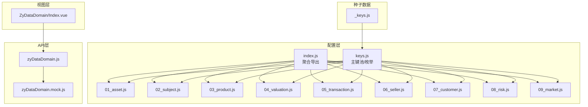
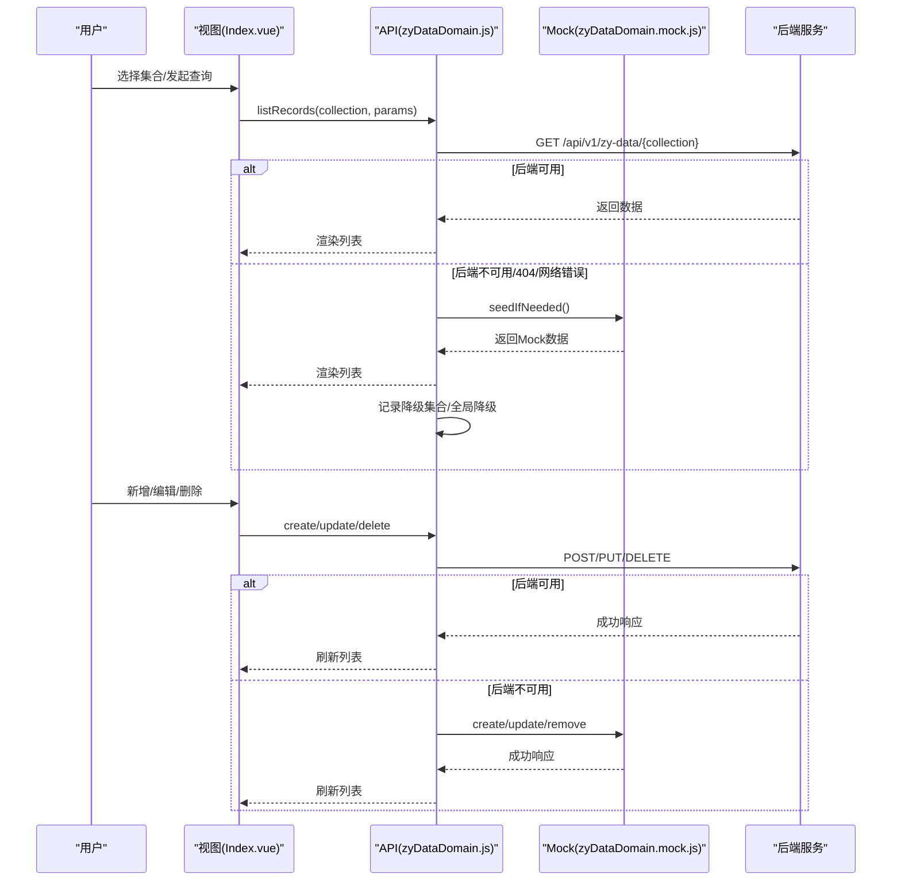
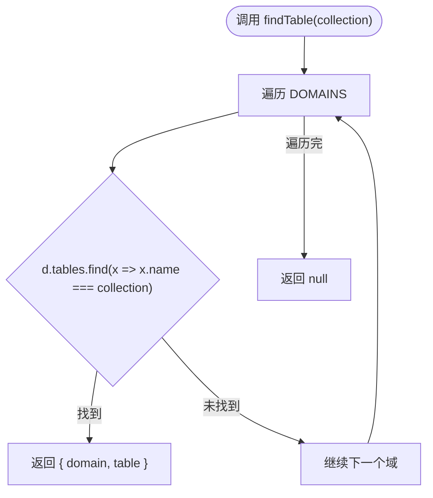
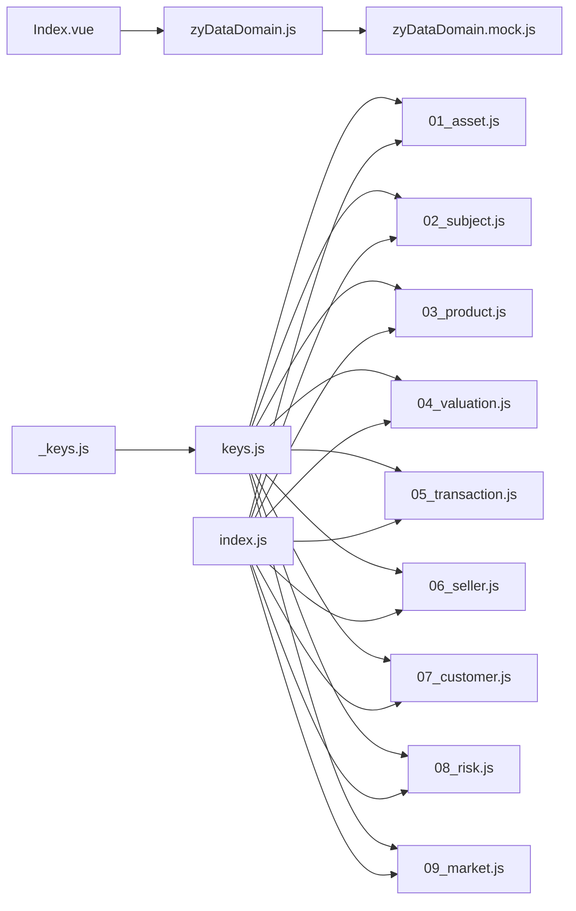

# ZY数据域配置

<cite>
**本文档引用的文件**
- [src/config/zyDataDomain/index.js](file://src/config/zyDataDomain/index.js)
- [src/config/zyDataDomain/keys.js](file://src/config/zyDataDomain/keys.js)
- [src/config/zyDataDomain/01_asset.js](file://src/config/zyDataDomain/01_asset.js)
- [src/config/zyDataDomain/02_subject.js](file://src/config/zyDataDomain/02_subject.js)
- [src/config/zyDataDomain/03_product.js](file://src/config/zyDataDomain/03_product.js)
- [src/config/zyDataDomain/04_valuation.js](file://src/config/zyDataDomain/04_valuation.js)
- [src/config/zyDataDomain/05_transaction.js](file://src/config/zyDataDomain/05_transaction.js)
- [src/config/zyDataDomain/06_seller.js](file://src/config/zyDataDomain/06_seller.js)
- [src/config/zyDataDomain/07_customer.js](file://src/config/zyDataDomain/07_customer.js)
- [src/config/zyDataDomain/08_risk.js](file://src/config/zyDataDomain/08_risk.js)
- [src/config/zyDataDomain/09_market.js](file://src/config/zyDataDomain/09_market.js)
- [src/api/zyDataDomain.js](file://src/api/zyDataDomain.js)
- [src/api/zyDataDomain.mock.js](file://src/api/zyDataDomain.mock.js)
- [src/views/analysis/ZyDataDomain/Index.vue](file://src/views/analysis/ZyDataDomain/Index.vue)
- [mongo-seed/_keys.js](file://mongo-seed/_keys.js)
</cite>

## 目录
1. [简介](#简介)
2. [项目结构](#项目结构)
3. [核心组件](#核心组件)
4. [架构总览](#架构总览)
5. [详细组件分析](#详细组件分析)
6. [依赖关系分析](#依赖关系分析)
7. [性能考虑](#性能考虑)
8. [故障排查指南](#故障排查指南)
9. [结论](#结论)
10. [附录](#附录)

## 简介
本文件为投资组合管理系统中“ZY数据域配置”功能的权威技术文档。系统通过9大数据域（资产、主体、产品、估值、交易、销售、客户、风险、行情）的统一Schema配置，实现动态表结构生成、字段映射与校验、表单渲染与CRUD集成，并提供后端接口不可用时的本地Mock兜底能力。本文档面向开发者与配置维护人员，覆盖配置文件组织、字段定义、验证规则、动态表单生成机制、加载与解析流程、优先级与继承关系、域间依赖与联动、版本管理与兼容性、错误诊断与性能优化等主题。

## 项目结构
- 配置层：位于 src/config/zyDataDomain 下，按域划分配置文件，统一入口聚合导出。
- API层：封装通用CRUD接口，内置后端不可用时的Mock兜底逻辑。
- 视图层：提供数据域管理页面，支持表选择、列表查询、分页过滤、新增/编辑/删除、Mock模式提示与重置。
- 种子数据：mongo-seed/_keys.js 提供跨域主键/枚举池，确保表间关联一致性。

**图表来源**
- [src/config/zyDataDomain/index.js:1-80](file://src/config/zyDataDomain/index.js#L1-L80)
- [src/config/zyDataDomain/keys.js:1-73](file://src/config/zyDataDomain/keys.js#L1-L73)
- [src/api/zyDataDomain.js:1-190](file://src/api/zyDataDomain.js#L1-L190)
- [src/api/zyDataDomain.mock.js:1-1012](file://src/api/zyDataDomain.mock.js#L1-L1012)
- [src/views/analysis/ZyDataDomain/Index.vue:1-290](file://src/views/analysis/ZyDataDomain/Index.vue#L1-L290)
- [mongo-seed/_keys.js:1-161](file://mongo-seed/_keys.js#L1-L161)

**章节来源**
- [src/config/zyDataDomain/index.js:1-80](file://src/config/zyDataDomain/index.js#L1-L80)
- [src/config/zyDataDomain/keys.js:1-73](file://src/config/zyDataDomain/keys.js#L1-L73)
- [src/api/zyDataDomain.js:1-190](file://src/api/zyDataDomain.js#L1-L190)
- [src/api/zyDataDomain.mock.js:1-1012](file://src/api/zyDataDomain.mock.js#L1-L1012)
- [src/views/analysis/ZyDataDomain/Index.vue:1-290](file://src/views/analysis/ZyDataDomain/Index.vue#L1-L290)
- [mongo-seed/_keys.js:1-161](file://mongo-seed/_keys.js#L1-L161)

## 核心组件
- 配置聚合器：统一导出DOMAINS、findDomain/findTable、flatTables、domainSummary等工具函数，便于视图层与API层按需使用。
- 主键池与枚举：集中定义各域主键池（如资产代码、组合ID、客户ID等）与常用枚举（类型、状态、市场等），确保跨表一致性。
- 动态Schema：每个域的配置文件以“表名-字段数组”的形式定义，字段包含key、label、type、options、width、required、primary、defaultValue等属性，驱动表单与表格渲染。
- API适配器：封装通用CRUD接口，具备后端不可用时的自动降级与全局切换能力。
- 视图容器：提供数据域管理界面，支持集合选择、分页过滤、增删改查、Mock模式提示与重置。

**章节来源**
- [src/config/zyDataDomain/index.js:1-80](file://src/config/zyDataDomain/index.js#L1-L80)
- [src/config/zyDataDomain/keys.js:1-73](file://src/config/zyDataDomain/keys.js#L1-L73)
- [src/api/zyDataDomain.js:1-190](file://src/api/zyDataDomain.js#L1-L190)
- [src/views/analysis/ZyDataDomain/Index.vue:1-290](file://src/views/analysis/ZyDataDomain/Index.vue#L1-L290)

## 架构总览
系统采用“配置驱动 + API适配 + 视图渲染”的分层架构。配置层负责Schema与主键池定义；API层负责与后端交互并提供Mock兜底；视图层负责用户交互与数据展示。域间通过主键池与枚举实现强约束的一致性，避免脏数据与不一致引用。

**图表来源**
- [src/views/analysis/ZyDataDomain/Index.vue:126-213](file://src/views/analysis/ZyDataDomain/Index.vue#L126-L213)
- [src/api/zyDataDomain.js:69-178](file://src/api/zyDataDomain.js#L69-L178)
- [src/api/zyDataDomain.mock.js:15-33](file://src/api/zyDataDomain.mock.js#L15-L33)

**章节来源**
- [src/views/analysis/ZyDataDomain/Index.vue:1-290](file://src/views/analysis/ZyDataDomain/Index.vue#L1-L290)
- [src/api/zyDataDomain.js:1-190](file://src/api/zyDataDomain.js#L1-L190)
- [src/api/zyDataDomain.mock.js:1-1012](file://src/api/zyDataDomain.mock.js#L1-L1012)

## 详细组件分析

### 配置聚合器与工具函数
- DOMAINS：聚合9个域的配置，便于全局遍历与检索。
- findDomain：按domain或domainCode查找域。
- findTable：按集合名查找表（含域引用），用于表单/表格渲染。
- flatTables：扁平化全表清单，用于全局检索与导航。
- domainSummary：域汇总信息（图标、颜色、表数量），用于左侧树/卡片展示。
- KEYS/BIZ_DT/AUDIT_FIELDS：导出主键池与审计字段，供视图与API使用。

**图表来源**
- [src/config/zyDataDomain/index.js:31-37](file://src/config/zyDataDomain/index.js#L31-L37)

**章节来源**
- [src/config/zyDataDomain/index.js:1-80](file://src/config/zyDataDomain/index.js#L1-L80)

### 主键池与枚举（keys.js）
- BIZ_DT：基准业务日期，用于默认值与数据一致性。
- 主键池：AST_CDS、PORT_IDS、ISR_IDS、CNTP_IDS、CUSTOMER_IDS、SELLER_IDS、INDEX_CDS、CURVE_IDS、RATE_CDS等。
- 枚举池：CCY、AST_TYPE、AST_SUB_TYPE、MARKET、BOND_TERM、PORT_TYPE、RISK_LVL、STATUS、TRD_TYPE、BS_DIR、TRADE_STATUS、ORD_TYPE、SETT_STATUS、RPT_TYPE、ACCT_TYPE、TENORS、FUND_TYPE、HOLDER_TYPE、CHANNEL等。
- 审计字段：etl_dt、src_sys、_id，不展示在表单，由后端注入。

**章节来源**
- [src/config/zyDataDomain/keys.js:1-73](file://src/config/zyDataDomain/keys.js#L1-L73)
- [mongo-seed/_keys.js:1-161](file://mongo-seed/_keys.js#L1-L161)

### 资产域（01_asset.js）
- 表数量：12张，覆盖基础信息、估值、收益率、现金流、质押、关联方、行权、基金经理、穿透底层、五级分类、计算规则等。
- 关键点：
  - 主键池：AST_CD；复合主键：如dwd_ast_info_ch/dwd_ast_info_zg的[AST_CD, BIZ_DT]。
  - 字段映射：如AST_TYPE/AST_SUB_TYPE对应枚举池；BIZ_DT默认值来自keys。
  - 验证规则：required、enum、number步进、date格式等。
  - 动态表单：width、options、allowCreate等驱动UI渲染与输入约束。

**章节来源**
- [src/config/zyDataDomain/01_asset.js:1-137](file://src/config/zyDataDomain/01_asset.js#L1-L137)

### 主体域（02_subject.js）
- 表数量：3张，主体基础、财务报表、交易对手。
- 关键点：ISR_ID为主键池；财务报表采用[ISR_ID, RPT_DT, RPT_TYPE]复合主键；CNTP_ID用于对手方关联。

**章节来源**
- [src/config/zyDataDomain/02_subject.js:1-59](file://src/config/zyDataDomain/02_subject.js#L1-L59)

### 产品域（03_product.js）
- 表数量：12张，基础信息、标签、账户、申赎明细、费率、经理、开放计划、资产配置、账户余额、持仓、持有人汇总、现金账户。
- 关键点：PORT_ID为主键池；多表围绕组合维度展开，强调与资产域的关联。

**章节来源**
- [src/config/zyDataDomain/03_product.js:1-136](file://src/config/zyDataDomain/03_product.js#L1-L136)

### 估值域（04_valuation.js）
- 表数量：10张，估值表、凭证、汇总、明细、通知、科目余额、科目、资产负债表、利润表、现金流量表。
- 关键点：PORT_ID为主键池；多表围绕组合与业务日期BIZ_DT形成时序数据。

**章节来源**
- [src/config/zyDataDomain/04_valuation.js:1-137](file://src/config/zyDataDomain/04_valuation.js#L1-L137)

### 交易域（05_transaction.js）
- 表数量：6张，资产维度交易、组合维度交易、估值维度交易、中证登结算、交易所结算、交易指令。
- 关键点：TRADE_ID/ORDER_ID为主键池；多表体现从指令到成交再到结算的链路。

**章节来源**
- [src/config/zyDataDomain/05_transaction.js:1-103](file://src/config/zyDataDomain/05_transaction.js#L1-L103)

### 销售域（06_seller.js）
- 表数量：1张，销售人员。
- 关键点：SELLER_ID为主键池；字段覆盖销售类型、渠道类型、状态等。

**章节来源**
- [src/config/zyDataDomain/06_seller.js:1-33](file://src/config/zyDataDomain/06_seller.js#L1-L33)

### 客户域（07_customer.js）
- 表数量：8张，基础、客户持仓、交易账户、三类渠道申请单、确认信息、分红、流水。
- 关键点：CUSTOMER_ID为主键池；多表围绕客户在不同渠道的交易行为展开。

**章节来源**
- [src/config/zyDataDomain/07_customer.js:1-121](file://src/config/zyDataDomain/07_customer.js#L1-L121)

### 风险域（08_risk.js）
- 表数量：5张，舆情、主体信用风险、信用风险敞口、授信协议、主体关联关系。
- 关键点：覆盖市场情绪、信用风险与主体关系，支撑风控限额与监控。

**章节来源**
- [src/config/zyDataDomain/08_risk.js:1-77](file://src/config/zyDataDomain/08_risk.js#L1-L77)

### 行情域（09_market.js）
- 表数量：25张，债券行情、存量、债项评级、久期凸性、预期信用损失、逐日成交、日历、日期维度、收益率曲线、曲线报价、汇率、基金主数据、资产配置、衍生指标、净值行情、份额结构、停牌、指数主数据、成分、行情、利率主数据、利率报价、评级动作、股票主数据、股票收益率。
- 关键点：覆盖债券、基金、股票、指数、利率、汇率等多资产类别的行情与衍生指标，支撑估值与风险分析。

**章节来源**
- [src/config/zyDataDomain/09_market.js:1-272](file://src/config/zyDataDomain/09_market.js#L1-L272)

### API适配器（zyDataDomain.js）
- 功能：封装list/create/update/delete/count等CRUD方法，统一请求参数与错误处理。
- 降级策略：当后端返回404/405/501或网络错误时，自动切换到Mock模式；首次list 404即全局降级。
- 工具：isMockMode/enableMock/resetMockData，用于运行时控制与调试。

**章节来源**
- [src/api/zyDataDomain.js:1-190](file://src/api/zyDataDomain.js#L1-L190)

### Mock数据引擎（zyDataDomain.mock.js）
- 存储：内存store + localStorage持久化（带版本号），避免刷新丢失。
- 种子：REALISTIC_SEEDS包含关键表的真实业务样例，与mongo-seed/_keys.js对齐。
- 生成：genValueByField/genRecord按字段类型与options/defaultValue生成合理示例数据。
- 版本：SEED_VERSION升级时自动重新播种，确保schema变更后的数据一致性。

**章节来源**
- [src/api/zyDataDomain.mock.js:1-1012](file://src/api/zyDataDomain.mock.js#L1-L1012)
- [mongo-seed/_keys.js:1-161](file://mongo-seed/_keys.js#L1-L161)

### 视图容器（ZyDataDomain/Index.vue）
- 功能：域表选择器、记录表格、表单对话框、分页过滤、Mock模式提示与重置。
- 流程：onTableChange -> findTable -> 加载列表 -> CRUD -> 刷新 -> Mock切换提示。

**章节来源**
- [src/views/analysis/ZyDataDomain/Index.vue:1-290](file://src/views/analysis/ZyDataDomain/Index.vue#L1-L290)

## 依赖关系分析
- 配置层内部：index.js聚合各域配置；keys.js为所有域提供主键池与枚举。
- 配置层对外：API层与视图层均依赖index.js提供的工具函数；keys.js被配置文件与种子数据共同引用。
- API层：依赖DOMINS与KEYS进行表结构与主键池解析；依赖Mock层在后端不可用时提供数据。
- 视图层：依赖API层进行数据交互；依赖配置层进行表单与表格渲染。
- 种子数据：mongo-seed/_keys.js与配置层keys.js保持一致，确保导入与Mock数据的主键/枚举一致性。

**图表来源**
- [src/config/zyDataDomain/index.js:1-80](file://src/config/zyDataDomain/index.js#L1-L80)
- [src/config/zyDataDomain/keys.js:1-73](file://src/config/zyDataDomain/keys.js#L1-L73)
- [src/api/zyDataDomain.js:1-190](file://src/api/zyDataDomain.js#L1-L190)
- [src/api/zyDataDomain.mock.js:1-1012](file://src/api/zyDataDomain.mock.js#L1-L1012)
- [src/views/analysis/ZyDataDomain/Index.vue:1-290](file://src/views/analysis/ZyDataDomain/Index.vue#L1-L290)
- [mongo-seed/_keys.js:1-161](file://mongo-seed/_keys.js#L1-L161)

**章节来源**
- [src/config/zyDataDomain/index.js:1-80](file://src/config/zyDataDomain/index.js#L1-L80)
- [src/config/zyDataDomain/keys.js:1-73](file://src/config/zyDataDomain/keys.js#L1-L73)
- [src/api/zyDataDomain.js:1-190](file://src/api/zyDataDomain.js#L1-L190)
- [src/api/zyDataDomain.mock.js:1-1012](file://src/api/zyDataDomain.mock.js#L1-L1012)
- [src/views/analysis/ZyDataDomain/Index.vue:1-290](file://src/views/analysis/ZyDataDomain/Index.vue#L1-L290)
- [mongo-seed/_keys.js:1-161](file://mongo-seed/_keys.js#L1-L161)

## 性能考虑
- Mock版本管理：通过SEED_VERSION与localStorage键区分版本，避免旧数据污染；升级时自动reseed。
- 查询参数：API层统一序列化filters_json，减少后端压力；分页pageSize默认20，可根据场景调整。
- 降级策略：首次list 404即全局降级，避免反复404带来的网络抖动。
- 表单渲染：字段width与options减少UI重复计算；复杂表单建议懒加载与虚拟滚动。
- 数据一致性：主键池与枚举集中管理，降低跨表join成本；批量导入时建议先导入主表再导入从表。

[本节为通用指导，无需特定文件引用]

## 故障排查指南
- 后端接口不可用：
  - 现象：出现404/405/501或网络错误，页面提示“本地 Mock 模式”。
  - 处理：API层自动切换到Mock；可通过isMockMode查看状态；必要时调用enableMock强制进入Mock。
- Mock数据异常：
  - 现象：Mock数据为空或不一致。
  - 处理：调用resetMockData重置；检查SEED_VERSION是否需要升级；确认localStorage容量与权限。
- 表单校验失败：
  - 现象：必填字段未填、枚举值不在options中、日期格式错误。
  - 处理：依据字段定义（required、options、type）修正；注意BIZ_DT默认值。
- 导入一致性问题：
  - 现象：跨表关联字段不匹配。
  - 处理：核对mongo-seed/_keys.js与配置层keys.js的主键池/枚举是否一致；确保导入顺序正确。

**章节来源**
- [src/api/zyDataDomain.js:26-51](file://src/api/zyDataDomain.js#L26-L51)
- [src/api/zyDataDomain.mock.js:8-33](file://src/api/zyDataDomain.mock.js#L8-L33)
- [src/views/analysis/ZyDataDomain/Index.vue:10-24](file://src/views/analysis/ZyDataDomain/Index.vue#L10-L24)

## 结论
ZY数据域配置系统通过“配置驱动 + API适配 + 视图渲染”的分层设计，实现了9大数据域的统一Schema管理与动态表单生成。借助主键池与枚举池，系统在保证数据一致性的同时，提供了灵活的字段映射与验证规则。API层的后端不可用兜底与Mock引擎的版本化管理，进一步提升了系统的鲁棒性与可维护性。开发者可据此快速扩展新域、新增表与字段，并通过统一的工具函数与视图容器完成配置与运维。

[本节为总结，无需特定文件引用]

## 附录

### 字段定义规范
- 必填字段：required: true
- 枚举字段：options: [...]，配合width与allowCreate
- 数值字段：number，可设置step
- 日期字段：date，默认值使用BIZ_DT
- 主键字段：primary: true，通常与options/allowCreate配合
- 默认值：defaultValue: value

**章节来源**
- [src/config/zyDataDomain/01_asset.js:17-31](file://src/config/zyDataDomain/01_asset.js#L17-L31)
- [src/config/zyDataDomain/02_subject.js:17-29](file://src/config/zyDataDomain/02_subject.js#L17-L29)
- [src/config/zyDataDomain/03_product.js:17-31](file://src/config/zyDataDomain/03_product.js#L17-L31)
- [src/config/zyDataDomain/04_valuation.js:17-29](file://src/config/zyDataDomain/04_valuation.js#L17-L29)
- [src/config/zyDataDomain/05_transaction.js:17-31](file://src/config/zyDataDomain/05_transaction.js#L17-L31)
- [src/config/zyDataDomain/06_seller.js:17-29](file://src/config/zyDataDomain/06_seller.js#L17-L29)
- [src/config/zyDataDomain/07_customer.js:30-46](file://src/config/zyDataDomain/07_customer.js#L30-L46)
- [src/config/zyDataDomain/08_risk.js:16-40](file://src/config/zyDataDomain/08_risk.js#L16-L40)
- [src/config/zyDataDomain/09_market.js:17-28](file://src/config/zyDataDomain/09_market.js#L17-L28)

### 配置修改与扩展最佳实践
- 新增域：在src/config/zyDataDomain下新增域文件，遵循现有命名与结构；在index.js中聚合导出。
- 新增表：在域文件中添加T(...)定义，字段使用f(...)声明；确保主键与复合主键设置正确。
- 新增字段：在f(...)中定义type/options/width/required等；如为枚举，同步更新keys.js中的枚举池。
- 联动与依赖：通过主键池与枚举池实现跨表引用；避免硬编码字符串。
- 版本与兼容：修改REALISTIC_SEEDS或keys.js时提升SEED_VERSION；确保导入脚本与种子数据一致。

**章节来源**
- [src/config/zyDataDomain/index.js:16-28](file://src/config/zyDataDomain/index.js#L16-L28)
- [src/config/zyDataDomain/keys.js:6-72](file://src/config/zyDataDomain/keys.js#L6-L72)
- [src/api/zyDataDomain.mock.js:8-10](file://src/api/zyDataDomain.mock.js#L8-L10)

### 配置加载与解析流程
- 运行时加载：index.js在应用启动时被引入，聚合DOMAINS与工具函数。
- 视图层使用：Index.vue通过findTable获取当前表的fields/pk等元数据，驱动表单与表格渲染。
- API层使用：zyDataDomain.js在CRUD时按集合名定位表结构，构造请求参数与处理响应。

**章节来源**
- [src/views/analysis/ZyDataDomain/Index.vue:103-125](file://src/views/analysis/ZyDataDomain/Index.vue#L103-L125)
- [src/config/zyDataDomain/index.js:25-56](file://src/config/zyDataDomain/index.js#L25-L56)
- [src/api/zyDataDomain.js:69-96](file://src/api/zyDataDomain.js#L69-L96)