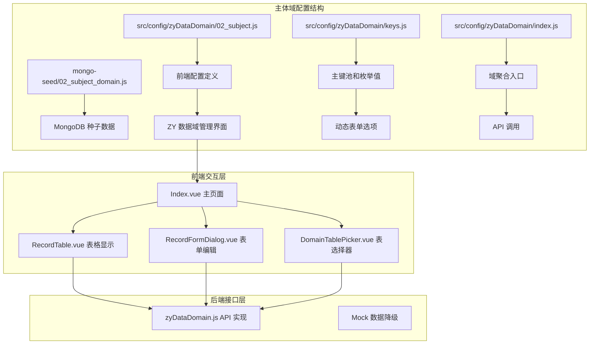
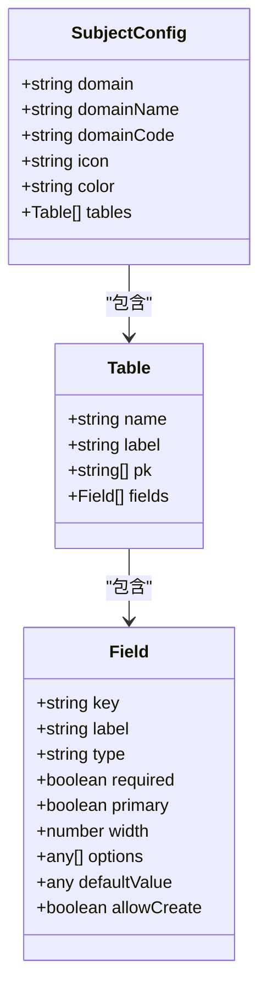
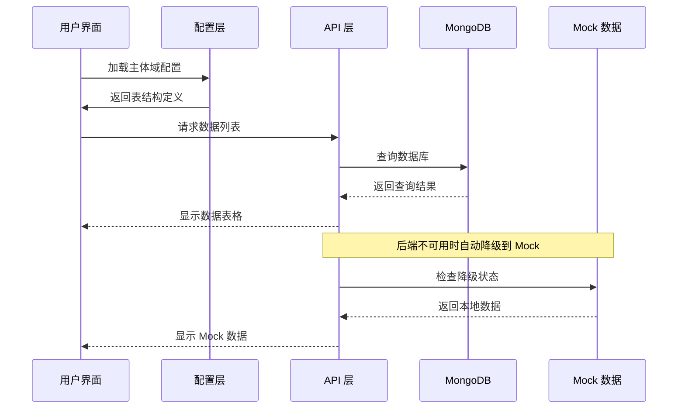
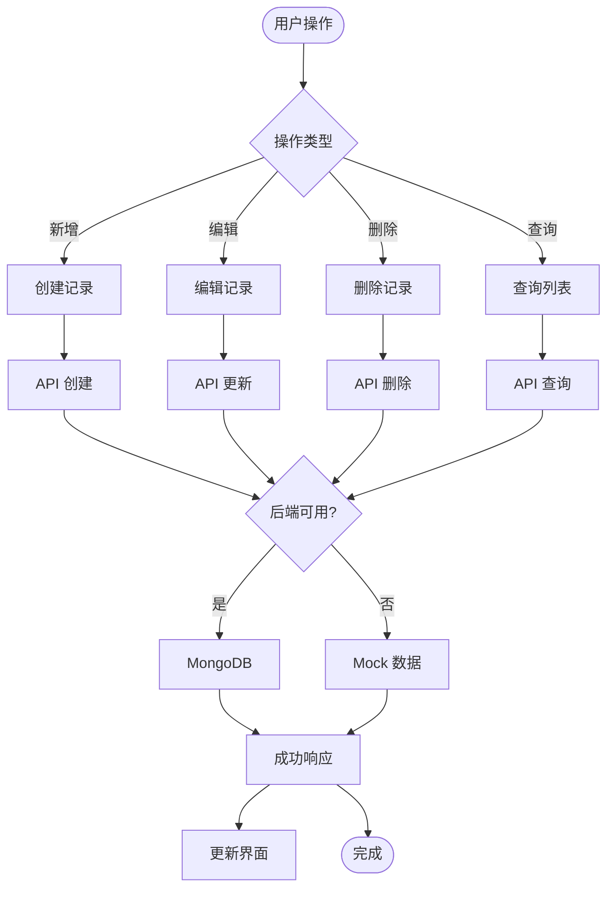
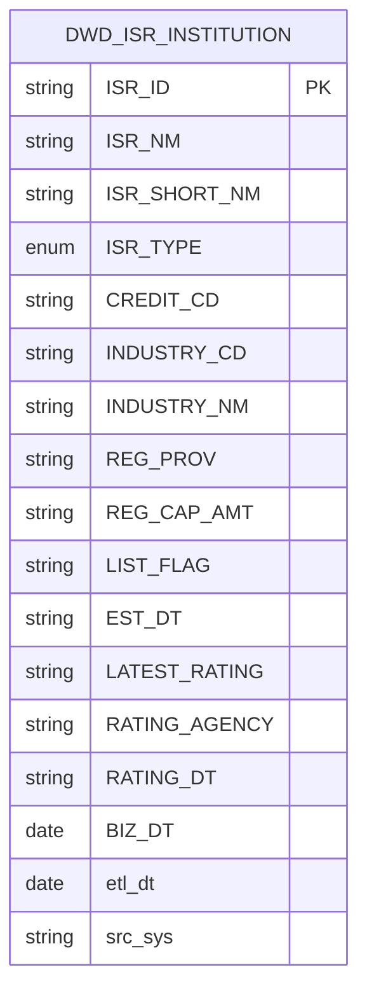
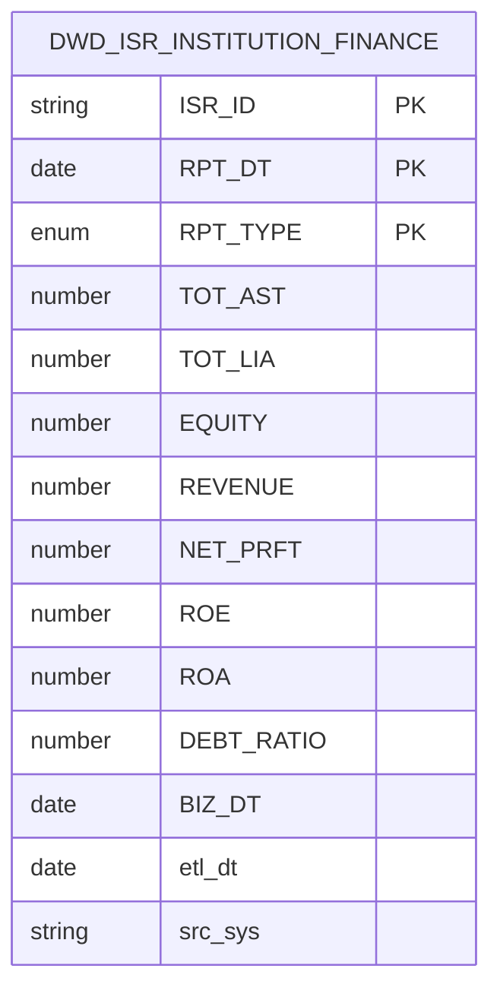
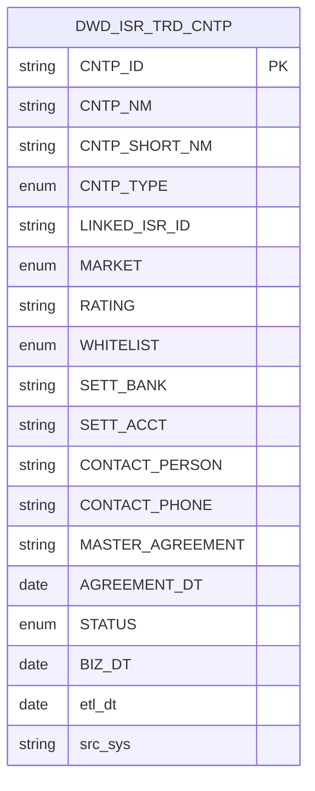
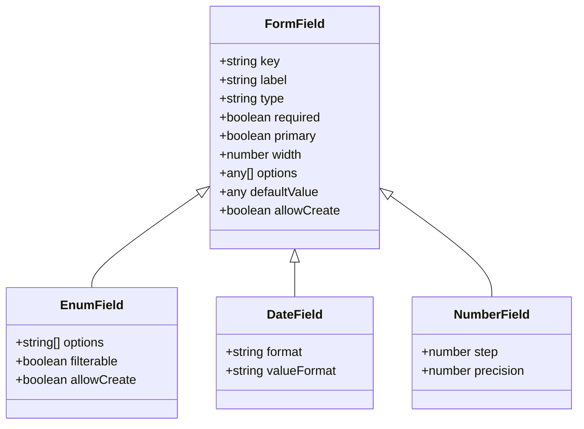
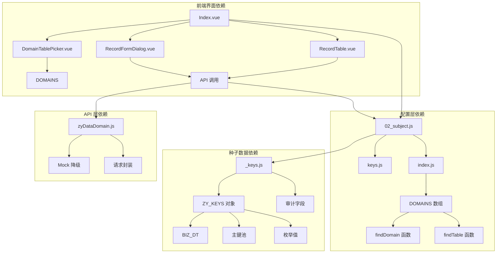

# 主体域配置

<cite>
**本文档引用的文件**
- [mongo-seed/02_subject_domain.js](file://mongo-seed/02_subject_domain.js)
- [src/config/zyDataDomain/02_subject.js](file://src/config/zyDataDomain/02_subject.js)
- [src/config/zyDataDomain/index.js](file://src/config/zyDataDomain/index.js)
- [src/config/zyDataDomain/keys.js](file://src/config/zyDataDomain/keys.js)
- [src/views/analysis/ZyDataDomain/Index.vue](file://src/views/analysis/ZyDataDomain/Index.vue)
- [src/views/analysis/ZyDataDomain/RecordFormDialog.vue](file://src/views/analysis/ZyDataDomain/RecordFormDialog.vue)
- [src/views/analysis/ZyDataDomain/RecordTable.vue](file://src/views/analysis/ZyDataDomain/RecordTable.vue)
- [src/views/analysis/ZyDataDomain/DomainTablePicker.vue](file://src/views/analysis/ZyDataDomain/DomainTablePicker.vue)
- [src/api/zyDataDomain.js](file://src/api/zyDataDomain.js)
- [docs/MongoDB_ZY数据域表结构清单.md](file://docs/MongoDB_ZY数据域表结构清单.md)
- [mongo-seed/_keys.js](file://mongo-seed/_keys.js)
</cite>

## 目录
1. [简介](#简介)
2. [项目结构](#项目结构)
3. [核心组件](#核心组件)
4. [架构概览](#架构概览)
5. [详细组件分析](#详细组件分析)
6. [依赖分析](#依赖分析)
7. [性能考虑](#性能考虑)
8. [故障排除指南](#故障排除指南)
9. [结论](#结论)
10. [附录](#附录)

## 简介
主体域是投资组合管理系统中的核心数据域之一，负责管理各类经济主体的基础信息、财务状况以及交易对手关系。该域包含三个核心表：机构信息表、主体财务报表表和交易对手表，为投资决策、风险管理和合规监控提供基础数据支撑。

主体域在投资组合管理中的应用场景包括：
- 客户管理：识别和分类各类投资者主体
- 交易对手管理：建立和维护交易对手方信息
- 监管主体管理：维护监管机构和合规主体信息
- 信用风险评估：基于主体财务状况进行风险评级
- 投资决策支持：为主机构建、产品配置提供主体信息

## 项目结构
主体域配置采用模块化设计，通过配置驱动的方式实现数据模型定义和界面渲染。

**图表来源**
- [mongo-seed/02_subject_domain.js:1-253](file://mongo-seed/02_subject_domain.js#L1-L253)
- [src/config/zyDataDomain/02_subject.js:1-59](file://src/config/zyDataDomain/02_subject.js#L1-L59)
- [src/views/analysis/ZyDataDomain/Index.vue:1-290](file://src/views/analysis/ZyDataDomain/Index.vue#L1-L290)

**章节来源**
- [mongo-seed/02_subject_domain.js:1-253](file://mongo-seed/02_subject_domain.js#L1-L253)
- [src/config/zyDataDomain/02_subject.js:1-59](file://src/config/zyDataDomain/02_subject.js#L1-L59)
- [src/config/zyDataDomain/index.js:1-80](file://src/config/zyDataDomain/index.js#L1-L80)

## 核心组件
主体域配置由多个相互协作的组件构成，每个组件都有明确的职责分工。

### 数据模型定义
主体域包含三个核心数据表，每个表都有特定的业务用途和字段约束：

1. **dwd_isr_institution** - 机构信息表
   - 主键：ISR_ID（主体ID）
   - 用途：存储各类经济主体的基础信息
   - 关键字段：主体类型、信用代码、注册信息、评级信息

2. **dwd_isr_institution_finance** - 主体财务报表表
   - 主键：(ISR_ID, RPT_DT, RPT_TYPE)
   - 用途：存储主体的财务报表数据
   - 关键字段：总资产、总负债、净利润、ROE、ROA等财务指标

3. **dwd_isr_trd_cntp** - 交易对手表
   - 主键：CNTP_ID（交易对手ID）
   - 用途：管理交易对手方信息
   - 关键字段：对手类型、市场范围、白名单状态、结算信息

### 配置结构
前端配置通过简洁的声明式语法定义表结构和字段属性：

**图表来源**
- [src/config/zyDataDomain/02_subject.js:10-59](file://src/config/zyDataDomain/02_subject.js#L10-L59)

**章节来源**
- [src/config/zyDataDomain/02_subject.js:10-59](file://src/config/zyDataDomain/02_subject.js#L10-L59)
- [mongo-seed/02_subject_domain.js:18-250](file://mongo-seed/02_subject_domain.js#L18-L250)

## 架构概览
主体域采用前后端分离的架构设计，通过配置驱动的方式实现数据模型的统一管理。

**图表来源**
- [src/views/analysis/ZyDataDomain/Index.vue:126-145](file://src/views/analysis/ZyDataDomain/Index.vue#L126-L145)
- [src/api/zyDataDomain.js:69-96](file://src/api/zyDataDomain.js#L69-L96)

### 数据流设计
主体域的数据流遵循标准的 CRUD 操作模式，支持完整的数据生命周期管理：

**图表来源**
- [src/api/zyDataDomain.js:98-158](file://src/api/zyDataDomain.js#L98-L158)
- [src/views/analysis/ZyDataDomain/Index.vue:178-201](file://src/views/analysis/ZyDataDomain/Index.vue#L178-L201)

**章节来源**
- [src/api/zyDataDomain.js:1-190](file://src/api/zyDataDomain.js#L1-L190)
- [src/views/analysis/ZyDataDomain/Index.vue:102-214](file://src/views/analysis/ZyDataDomain/Index.vue#L102-L214)

## 详细组件分析

### 机构信息表 (dwd_isr_institution)
机构信息表是主体域的核心表，存储各类经济主体的基础信息。

#### 数据模型设计

**图表来源**
- [mongo-seed/02_subject_domain.js:18-28](file://mongo-seed/02_subject_domain.js#L18-L28)

#### 字段映射规则
- **主键映射**：ISR_ID 作为唯一标识符，确保主体的唯一性
- **类型映射**：主体类型采用枚举值，支持政府机构、银行、企业等多种类型
- **信用代码**：统一社会信用代码，用于合规和监管目的
- **财务指标**：包含最新的信用评级信息和评级机构

**章节来源**
- [mongo-seed/02_subject_domain.js:30-97](file://mongo-seed/02_subject_domain.js#L30-L97)
- [src/config/zyDataDomain/02_subject.js:17-29](file://src/config/zyDataDomain/02_subject.js#L17-L29)

### 主体财务报表表 (dwd_isr_institution_finance)
财务报表表存储主体的历史财务数据，支持多期财务报表的对比分析。

#### 数据模型设计

**图表来源**
- [mongo-seed/02_subject_domain.js:101-110](file://mongo-seed/02_subject_domain.js#L101-L110)

#### 报告周期设计
财务报表支持多种报告周期：
- **年度报告**：每年发布一次，反映完整财年财务状况
- **半年度报告**：每半年发布一次，提供中期财务信息
- **季度报告**：每季度发布一次，提供最新财务数据

**章节来源**
- [mongo-seed/02_subject_domain.js:114-181](file://mongo-seed/02_subject_domain.js#L114-L181)
- [src/config/zyDataDomain/02_subject.js:31-43](file://src/config/zyDataDomain/02_subject.js#L31-L43)

### 交易对手表 (dwd_isr_trd_cntp)
交易对手表管理与主体有业务往来的交易对手方信息。

#### 数据模型设计

**图表来源**
- [mongo-seed/02_subject_domain.js:184-194](file://mongo-seed/02_subject_domain.js#L184-L194)

#### 对手类型分类
交易对手按业务性质分为以下类型：
- **证券公司**：提供经纪、承销、做市等服务
- **银行**：提供存贷款、结算、托管等服务
- **保险公司**：提供保险、资产管理等服务
- **基金公司**：提供公募、私募基金管理服务
- **其他机构**：监管机构、交易所等

**章节来源**
- [mongo-seed/02_subject_domain.js:196-250](file://mongo-seed/02_subject_domain.js#L196-L250)
- [src/config/zyDataDomain/02_subject.js:45-56](file://src/config/zyDataDomain/02_subject.js#L45-L56)

### 表单设计与验证
主体域的表单设计遵循统一的配置驱动原则，支持动态字段渲染和智能验证。

#### 表单字段配置

**图表来源**
- [src/views/analysis/ZyDataDomain/RecordFormDialog.vue:18-62](file://src/views/analysis/ZyDataDomain/RecordFormDialog.vue#L18-L62)

#### 数据验证逻辑
表单验证采用多层次的设计：
1. **必填验证**：根据字段配置自动添加必填校验
2. **类型验证**：针对不同数据类型进行格式校验
3. **业务验证**：结合业务规则进行逻辑校验
4. **唯一性验证**：对主键字段进行唯一性检查

**章节来源**
- [src/views/analysis/ZyDataDomain/RecordFormDialog.vue:101-113](file://src/views/analysis/ZyDataDomain/RecordFormDialog.vue#L101-L113)
- [src/views/analysis/ZyDataDomain/RecordTable.vue:115-145](file://src/views/analysis/ZyDataDomain/RecordTable.vue#L115-L145)

## 依赖分析
主体域配置涉及多个层次的依赖关系，从底层的数据模型到底层的界面交互。

**图表来源**
- [src/config/zyDataDomain/02_subject.js:5](file://src/config/zyDataDomain/02_subject.js#L5)
- [src/config/zyDataDomain/index.js:6-14](file://src/config/zyDataDomain/index.js#L6-L14)
- [mongo-seed/_keys.js:5](file://mongo-seed/_keys.js#L5)

### 外部依赖关系
主体域配置对外部系统的依赖主要体现在数据源和第三方服务：

1. **MongoDB 数据库**：作为主要的数据存储
2. **种子数据脚本**：提供初始数据和测试数据
3. **Mock 数据系统**：在后端不可用时提供降级支持
4. **前端框架**：Vue.js 提供界面渲染和交互

**章节来源**
- [src/config/zyDataDomain/index.js:16-19](file://src/config/zyDataDomain/index.js#L16-L19)
- [src/api/zyDataDomain.js:17-18](file://src/api/zyDataDomain.js#L17-L18)

## 性能考虑
主体域配置在设计时充分考虑了性能优化和扩展性需求。

### 查询性能优化
1. **索引策略**：为常用查询字段建立合适的索引
   - 主键字段：唯一索引确保查询效率
   - 名称字段：建立文本索引支持模糊查询
   - 业务日期：建立复合索引支持时间范围查询

2. **分页机制**：默认支持分页查询，避免大数据量加载
3. **缓存策略**：对静态配置数据进行缓存

### 渲染性能优化
1. **虚拟滚动**：大量数据时采用虚拟滚动技术
2. **懒加载**：按需加载数据和组件
3. **防抖处理**：对频繁操作进行防抖优化

## 故障排除指南
主体域配置可能遇到的各种问题及其解决方案：

### 常见问题诊断
1. **数据加载失败**
   - 检查后端服务状态
   - 验证数据库连接
   - 查看 Mock 模式状态

2. **表单验证错误**
   - 检查必填字段是否完整
   - 验证数据类型是否正确
   - 确认枚举值是否在允许范围内

3. **主键冲突**
   - 检查主键是否重复
   - 验证唯一性约束
   - 确认数据导入过程

### 调试工具
1. **控制台日志**：查看详细的错误信息
2. **网络面板**：监控 API 请求和响应
3. **数据库查询**：直接查询 MongoDB 验证数据状态

**章节来源**
- [src/views/analysis/ZyDataDomain/Index.vue:138-142](file://src/views/analysis/ZyDataDomain/Index.vue#L138-L142)
- [src/api/zyDataDomain.js:26-46](file://src/api/zyDataDomain.js#L26-L46)

## 结论
主体域配置通过模块化的架构设计和配置驱动的方法，为投资组合管理系统提供了灵活、可扩展的主体管理能力。其核心优势包括：

1. **统一的数据模型**：通过配置定义实现数据结构的一致性
2. **灵活的界面适配**：支持动态表单和智能验证
3. **完善的降级机制**：确保系统在各种环境下稳定运行
4. **清晰的业务边界**：明确区分数据模型、配置和界面层

主体域配置不仅满足当前的投资组合管理需求，还为未来的功能扩展和业务发展奠定了坚实的基础。

## 附录

### 业务规则和合规要求
主体域配置遵循严格的业务规则和合规要求：

1. **KYC（了解你的客户）**
   - 客户身份信息必须真实有效
   - 定期更新客户信息和风险等级
   - 符合监管机构的反洗钱要求

2. **反洗钱（AML）**
   - 建立可疑交易监测机制
   - 定期进行合规审查
   - 保留完整的交易记录

3. **数据完整性**
   - 确保主键的唯一性和完整性
   - 维护数据的准确性和时效性
   - 建立数据质量监控机制

### 维护指南和最佳实践
1. **主体信息更新流程**
   - 建立标准化的更新审批流程
   - 确保更新操作的可追溯性
   - 定期进行数据质量检查

2. **关系变更处理**
   - 变更前进行影响评估
   - 更新相关联的业务数据
   - 通知受影响的业务部门

3. **配置变更管理**
   - 建立配置变更审批制度
   - 测试变更对现有功能的影响
   - 及时更新相关文档

**章节来源**
- [docs/MongoDB_ZY数据域表结构清单.md:57-71](file://docs/MongoDB_ZY数据域表结构清单.md#L57-L71)
- [mongo-seed/02_subject_domain.js:18-28](file://mongo-seed/02_subject_domain.js#L18-L28)