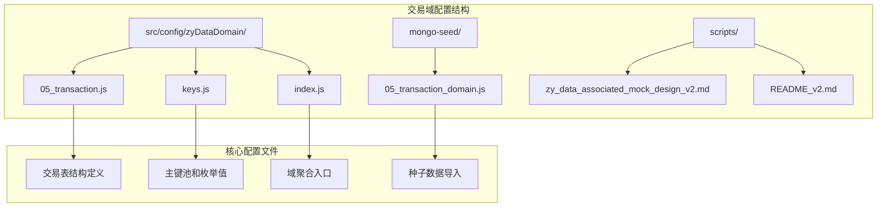
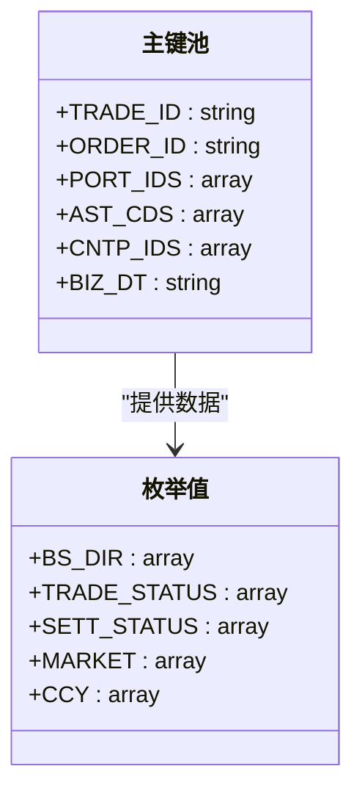
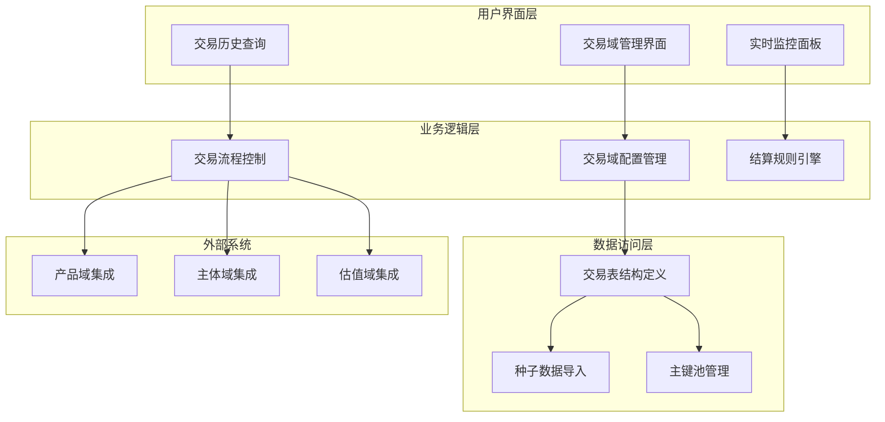
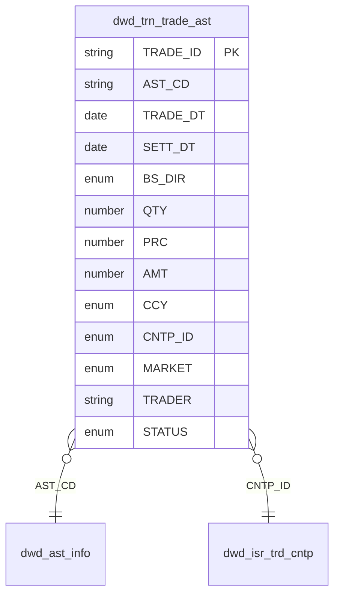
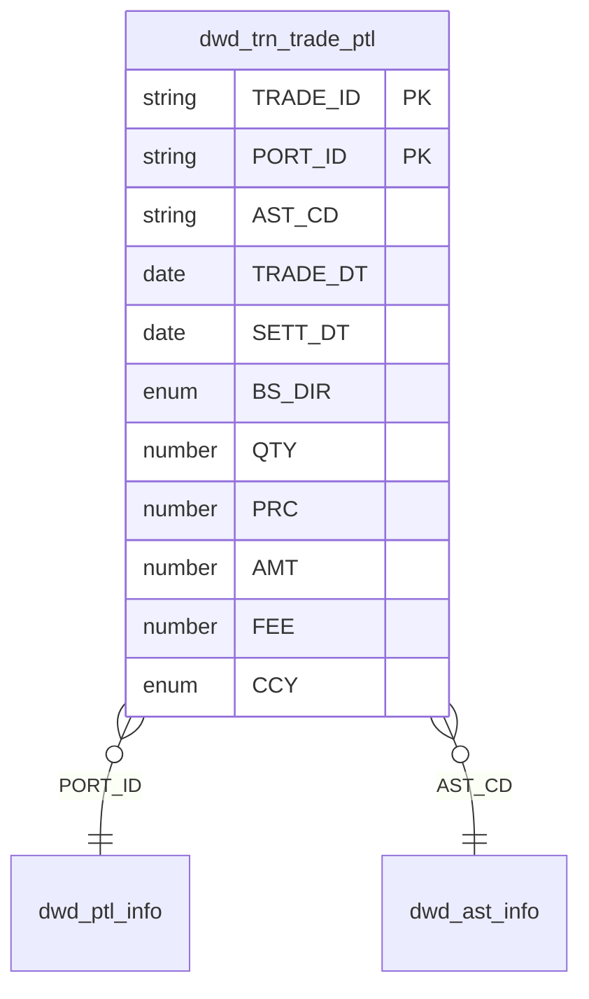
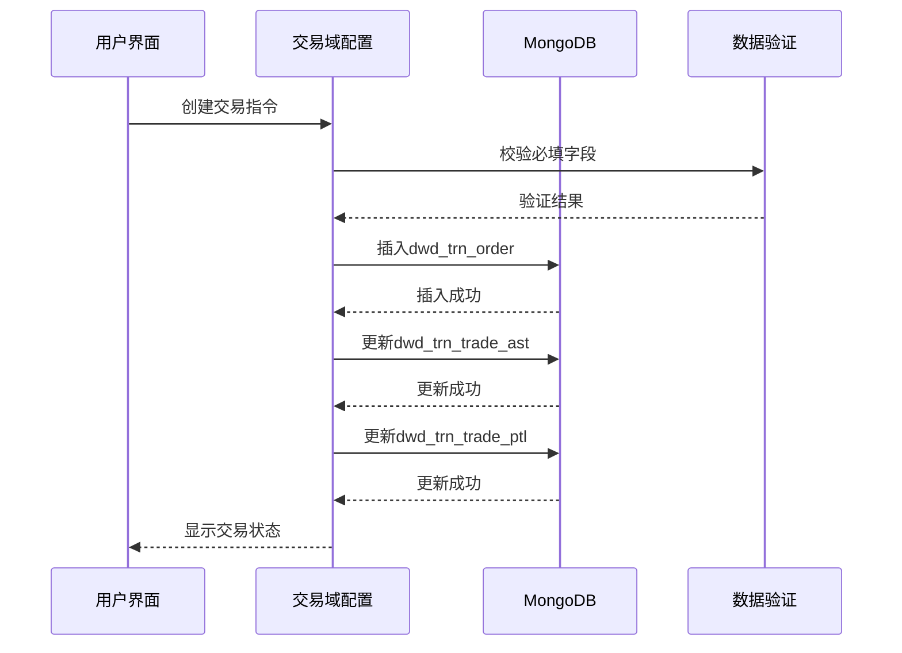
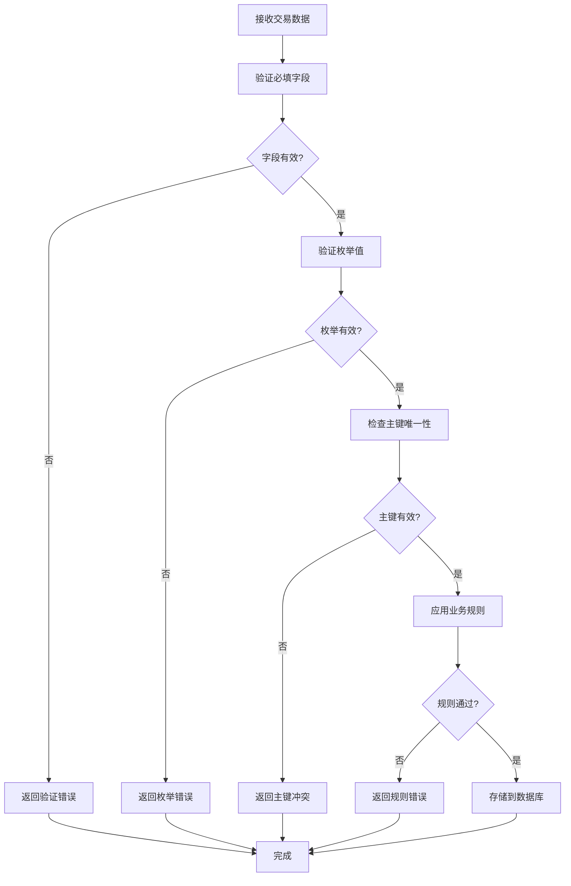
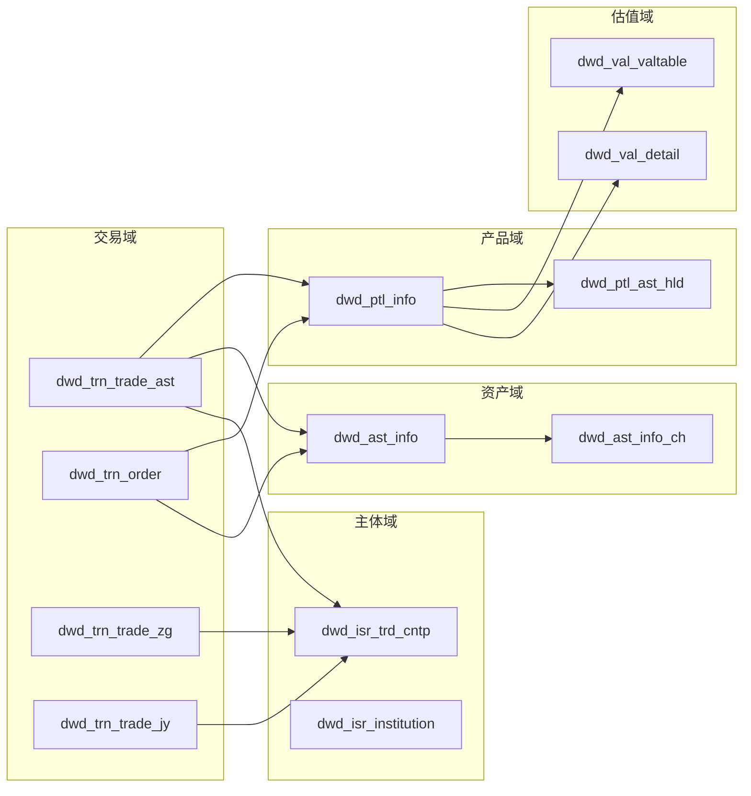
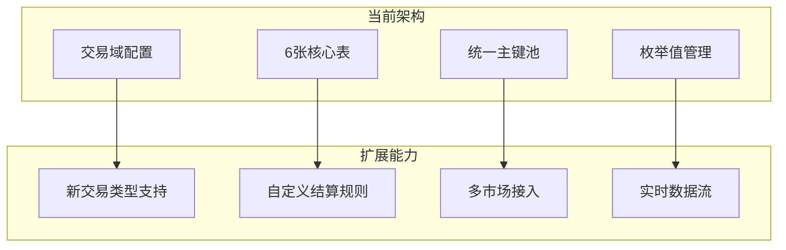

# 交易域配置

<cite>
**本文档引用的文件**
- [05_transaction.js](file://src/config/zyDataDomain/05_transaction.js)
- [05_transaction_domain.js](file://mongo-seed/05_transaction_domain.js)
- [keys.js](file://src/config/zyDataDomain/keys.js)
- [index.js](file://src/config/zyDataDomain/index.js)
- [zyDataDomain.js](file://src/api/zyDataDomain.js)
- [zyDataDomain.mock.js](file://src/api/zyDataDomain.mock.js)
- [Index.vue](file://src/views/analysis/ZyDataDomain/Index.vue)
- [RecordTable.vue](file://src/views/analysis/ZyDataDomain/RecordTable.vue)
- [RecordFormDialog.vue](file://src/views/analysis/ZyDataDomain/RecordFormDialog.vue)
- [TradeHistory.vue](file://src/views/portfolio/TradeHistory.vue)
- [zy_data_associated_mock_design_v2.md](file://scripts/zy_data_associated_mock_design_v2.md)
- [README_v2.md](file://scripts/README_v2.md)
</cite>

## 目录
1. [简介](#简介)
2. [项目结构](#项目结构)
3. [核心组件](#核心组件)
4. [架构概览](#架构概览)
5. [详细组件分析](#详细组件分析)
6. [依赖关系分析](#依赖关系分析)
7. [性能考虑](#性能考虑)
8. [故障排除指南](#故障排除指南)
9. [结论](#结论)
10. [附录](#附录)

## 简介

交易域是ZY数据域中的核心业务域之一，负责管理金融交易相关的所有数据模型和业务流程。该域包含6张核心表，涵盖从交易执行到结算完成的完整生命周期管理。

交易域的设计遵循以下核心原则：
- **完整性**：覆盖交易执行、结算、费用、指令等全流程
- **一致性**：通过主键池确保数据关联性
- **可扩展性**：支持多种交易类型和结算方式
- **实时性**：提供交易状态的实时跟踪

## 项目结构

交易域配置位于`src/config/zyDataDomain/`目录下，采用模块化设计：

**图表来源**
- [05_transaction.js:1-103](file://src/config/zyDataDomain/05_transaction.js#L1-L103)
- [keys.js:1-73](file://src/config/zyDataDomain/keys.js#L1-L73)

**章节来源**
- [05_transaction.js:1-103](file://src/config/zyDataDomain/05_transaction.js#L1-L103)
- [keys.js:1-73](file://src/config/zyDataDomain/keys.js#L1-L73)
- [index.js:1-80](file://src/config/zyDataDomain/index.js#L1-L80)

## 核心组件

### 交易域数据模型

交易域包含6张核心表，每张表都有明确的职责分工：

| 表名 | 描述 | 主键 | 关键字段 |
|------|------|------|----------|
| dwd_trn_trade_ast | 资产维度交易 | TRADE_ID | AST_CD, TRADE_DT, SETT_DT, BS_DIR, QTY, PRC, AMT |
| dwd_trn_trade_ptl | 组合维度交易 | TRADE_ID, PORT_ID | AST_CD, PORT_ID, QTY, PRC, AMT, FEE |
| dwd_trn_trade_val | 估值维度交易 | TRADE_ID, PORT_ID | NET_PRC, FULL_PRC, ACI_AMT, REAL_PNL |
| dwd_trn_trade_zg | 中证登结算 | TRADE_ID | SETT_DT, SETT_AMT, SETT_TYPE, SETT_STATUS |
| dwd_trn_trade_jy | 交易所结算 | TRADE_ID | EXCH, COMMISSION, STAMP_TAX, SETT_STATUS |
| dwd_trn_order | 交易指令 | ORDER_ID | PORT_ID, AST_CD, BS_DIR, ORD_QTY, ORD_PRC, STATUS |

### 主键池和枚举值

交易域使用统一的主键池确保数据一致性：

**图表来源**
- [keys.js:6-72](file://src/config/zyDataDomain/keys.js#L6-L72)

**章节来源**
- [keys.js:6-72](file://src/config/zyDataDomain/keys.js#L6-L72)

## 架构概览

交易域采用分层架构设计，确保业务逻辑与数据访问的分离：

**图表来源**
- [Index.vue:1-290](file://src/views/analysis/ZyDataDomain/Index.vue#L1-L290)
- [TradeHistory.vue:1-615](file://src/views/portfolio/TradeHistory.vue#L1-L615)

## 详细组件分析

### 交易表结构分析

#### 资产维度交易表 (dwd_trn_trade_ast)

该表提供最细粒度的交易记录，包含完整的交易要素：

**图表来源**
- [05_transaction.js:17-31](file://src/config/zyDataDomain/05_transaction.js#L17-L31)

#### 组合维度交易表 (dwd_trn_trade_ptl)

该表关注组合层面的交易情况：

**图表来源**
- [05_transaction.js:33-45](file://src/config/zyDataDomain/05_transaction.js#L33-L45)

### 交易流程序列图

**图表来源**
- [05_transaction.js:84-100](file://src/config/zyDataDomain/05_transaction.js#L84-L100)
- [zyDataDomain.js:69-96](file://src/api/zyDataDomain.js#L69-L96)

### 数据验证流程

**图表来源**
- [RecordFormDialog.vue:101-113](file://src/views/analysis/ZyDataDomain/RecordFormDialog.vue#L101-L113)
- [zyDataDomain.js:98-138](file://src/api/zyDataDomain.js#L98-L138)

**章节来源**
- [05_transaction.js:1-103](file://src/config/zyDataDomain/05_transaction.js#L1-L103)
- [RecordTable.vue:1-205](file://src/views/analysis/ZyDataDomain/RecordTable.vue#L1-L205)
- [RecordFormDialog.vue:1-180](file://src/views/analysis/ZyDataDomain/RecordFormDialog.vue#L1-L180)

## 依赖关系分析

### 交易域与其他域的关联

**图表来源**
- [zy_data_associated_mock_design_v2.md:64-68](file://scripts/zy_data_associated_mock_design_v2.md#L64-L68)
- [README_v2.md:86-122](file://scripts/README_v2.md#L86-L122)

### 数据一致性保证机制

交易域通过以下机制确保数据一致性：

1. **主键约束**：每张表都有明确的主键定义
2. **外键引用**：通过主键池确保跨表引用正确性
3. **枚举验证**：统一的枚举值池防止无效数据
4. **默认值机制**：关键字段提供合理的默认值

**章节来源**
- [05_transaction.js:16-101](file://src/config/zyDataDomain/05_transaction.js#L16-L101)
- [keys.js:6-72](file://src/config/zyDataDomain/keys.js#L6-L72)

## 性能考虑

### 查询优化策略

交易域的查询性能优化主要体现在以下几个方面：

1. **索引设计**：每张表都建立了合适的索引
   - dwd_trn_trade_ast: TRADE_ID唯一索引，复合索引(组合ID, 交易日)
   - dwd_trn_order: ORDER_ID唯一索引，组合索引(组合ID, 提交日期)

2. **分页查询**：默认分页大小20，支持大数据集浏览
3. **过滤器优化**：支持按主键字段快速筛选
4. **缓存机制**：Mock模式下的内存缓存

### 扩展性设计

**图表来源**
- [keys.js:6-72](file://src/config/zyDataDomain/keys.js#L6-L72)

## 故障排除指南

### 常见问题及解决方案

#### 1. 交易状态不一致

**问题现象**：交易状态显示与实际不符
**可能原因**：
- 结算状态未及时更新
- 数据同步延迟
- 网络连接问题

**解决步骤**：
1. 检查dwd_trn_trade_zg和dwd_trn_trade_jy的状态字段
2. 验证结算账户信息的准确性
3. 确认网络连接状态

#### 2. 交易重复或缺失

**问题现象**：同一笔交易出现重复记录或缺失
**可能原因**：
- 主键冲突
- 数据导入异常
- 并发写入问题

**解决步骤**：
1. 检查TRADE_ID的唯一性
2. 验证MongoDB的唯一索引
3. 查看导入日志

#### 3. 性能问题

**问题现象**：查询响应缓慢
**可能原因**：
- 缺少必要的索引
- 查询条件不当
- 数据量过大

**解决步骤**：
1. 添加适当的索引
2. 优化查询条件
3. 实施分页查询

**章节来源**
- [zyDataDomain.js:26-46](file://src/api/zyDataDomain.js#L26-L46)
- [zyDataDomain.mock.js:15-33](file://src/api/zyDataDomain.mock.js#L15-L33)

## 结论

交易域配置展现了现代金融数据管理系统的核心特点：

1. **完整性**：覆盖了从交易执行到结算的完整生命周期
2. **一致性**：通过统一的主键池和枚举值确保数据质量
3. **可扩展性**：模块化的架构设计支持未来功能扩展
4. **用户体验**：直观的界面设计和丰富的交互功能

该配置为金融交易系统的稳定运行提供了坚实的基础，同时也为未来的业务发展预留了充足的扩展空间。

## 附录

### 交易域配置最佳实践

1. **字段命名规范**：使用统一的命名约定，便于理解和维护
2. **数据验证**：在前端和后端都实施严格的数据验证
3. **错误处理**：完善的错误处理机制，确保系统稳定性
4. **性能监控**：建立性能监控体系，及时发现和解决问题

### 扩展指南

当需要添加新的交易类型时，建议遵循以下步骤：

1. 在keys.js中添加新的枚举值
2. 在05_transaction.js中定义新的表结构
3. 更新mongo-seed中的种子数据
4. 在UI层添加相应的表单控件
5. 测试新功能的完整性和性能