# 产品域配置

<cite>
**本文引用的文件**
- [mongo-seed/03_product_domain.js](file://mongo-seed/03_product_domain.js)
- [src/config/zyDataDomain/03_product.js](file://src/config/zyDataDomain/03_product.js)
- [src/config/zyDataDomain/index.js](file://src/config/zyDataDomain/index.js)
- [src/config/zyDataDomain/keys.js](file://src/config/zyDataDomain/keys.js)
- [mongo-seed/_keys.js](file://mongo-seed/_keys.js)
- [src/views/analysis/ZyDataDomain/Index.vue](file://src/views/analysis/ZyDataDomain/Index.vue)
- [src/views/analysis/ZyDataDomain/RecordFormDialog.vue](file://src/views/analysis/ZyDataDomain/RecordFormDialog.vue)
- [src/api/zyDataDomain.js](file://src/api/zyDataDomain.js)
- [src/api/zyDataDomain.mock.js](file://src/api/zyDataDomain.mock.js)
- [docs/MongoDB_ZY数据域表结构清单.md](file://docs/MongoDB_ZY数据域表结构清单.md)
</cite>

## 目录
1. [简介](#简介)
2. [项目结构](#项目结构)
3. [核心组件](#核心组件)
4. [架构概览](#架构概览)
5. [详细组件分析](#详细组件分析)
6. [依赖分析](#依赖分析)
7. [性能考虑](#性能考虑)
8. [故障排除指南](#故障排除指南)
9. [结论](#结论)
10. [附录](#附录)

## 简介

产品域配置是 ZY 数据域管理系统中的核心模块，负责管理金融产品的全生命周期数据。该系统通过标准化的产品配置框架，实现了产品基础信息、资产配置、交易管理、风险控制等多个维度的统一管理。

产品域配置包含12张核心表，涵盖产品基础信息、持仓明细、净值历史、收益率、风险指标、基准信息、费率信息、投资者结构、投资限制、交易汇总、业绩归因和合规检查等完整的产品数据体系。

## 项目结构

产品域配置的项目结构采用模块化设计，主要分为以下几个层次：

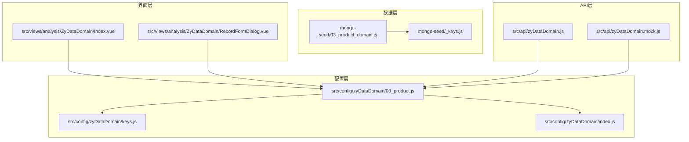

**图表来源**
- [src/config/zyDataDomain/03_product.js:1-136](file://src/config/zyDataDomain/03_product.js#L1-L136)
- [src/config/zyDataDomain/index.js:1-80](file://src/config/zyDataDomain/index.js#L1-L80)

**章节来源**
- [src/config/zyDataDomain/03_product.js:1-136](file://src/config/zyDataDomain/03_product.js#L1-L136)
- [src/config/zyDataDomain/index.js:1-80](file://src/config/zyDataDomain/index.js#L1-L80)

## 核心组件

### 产品域配置架构

产品域配置采用三层架构设计，确保了系统的可维护性和扩展性：

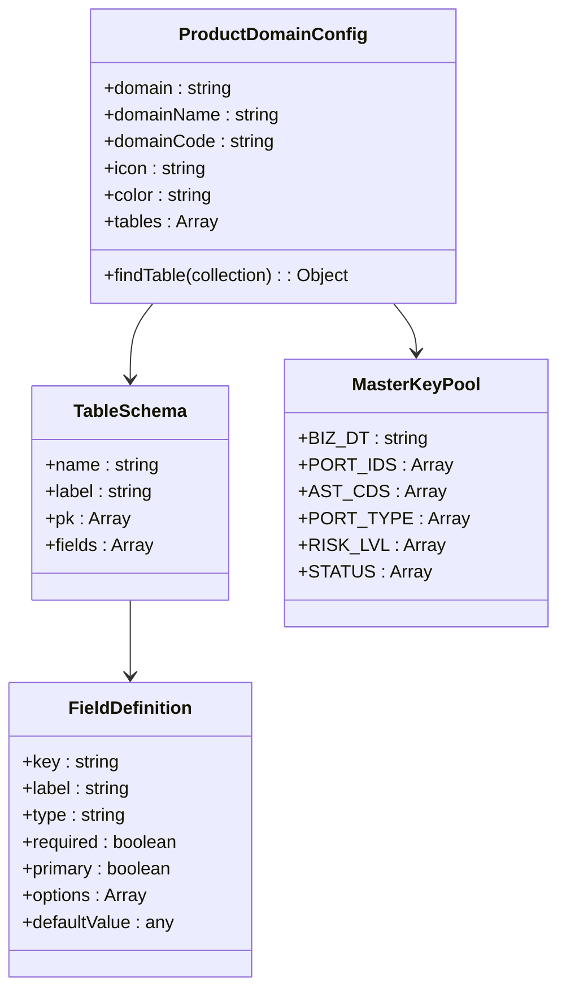

**图表来源**
- [src/config/zyDataDomain/03_product.js:10-136](file://src/config/zyDataDomain/03_product.js#L10-L136)
- [src/config/zyDataDomain/keys.js:65-73](file://src/config/zyDataDomain/keys.js#L65-L73)

### 数据模型设计

产品域配置的核心数据模型遵循以下设计原则：

1. **主键池设计**：统一的主键池确保跨表关联的一致性
2. **枚举值管理**：标准化的产品类型、风险等级、状态等枚举值
3. **字段验证**：基于业务规则的字段验证机制
4. **审计追踪**：完整的数据变更审计功能

**章节来源**
- [src/config/zyDataDomain/03_product.js:17-31](file://src/config/zyDataDomain/03_product.js#L17-L31)
- [src/config/zyDataDomain/keys.js:65-73](file://src/config/zyDataDomain/keys.js#L65-L73)

## 架构概览

产品域配置的整体架构体现了现代数据管理系统的最佳实践：

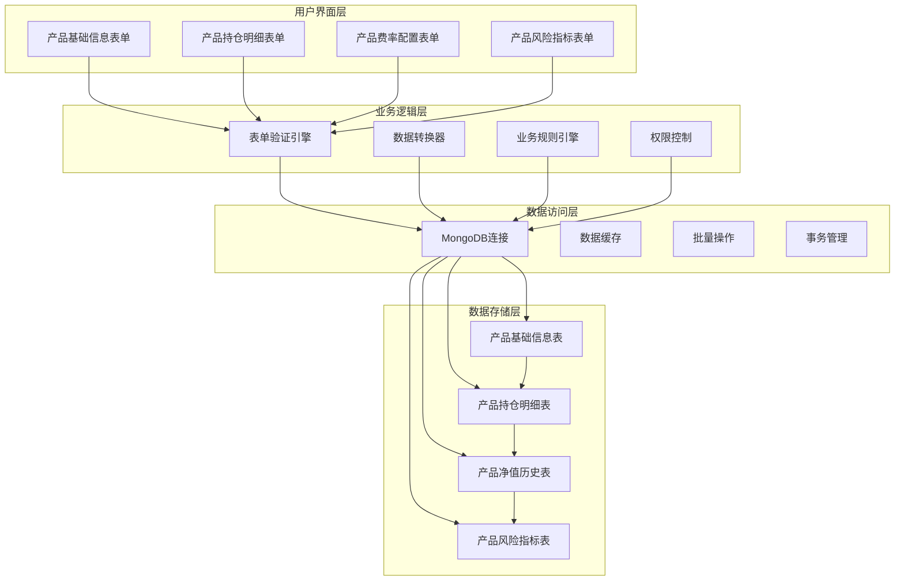

**图表来源**
- [src/views/analysis/ZyDataDomain/Index.vue:1-290](file://src/views/analysis/ZyDataDomain/Index.vue#L1-L290)
- [src/api/zyDataDomain.js:1-190](file://src/api/zyDataDomain.js#L1-L190)

## 详细组件分析

### 产品基础信息配置

产品基础信息是产品域的核心配置，包含了产品设计和管理的基础要素：

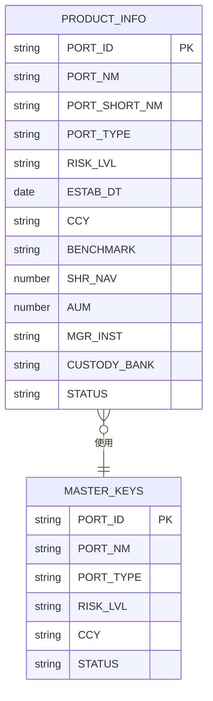

**图表来源**
- [src/config/zyDataDomain/03_product.js:17-31](file://src/config/zyDataDomain/03_product.js#L17-L31)
- [src/config/zyDataDomain/keys.js:14](file://src/config/zyDataDomain/keys.js#L14)

#### 字段验证规则

产品基础信息的字段验证遵循严格的业务规则：

| 字段名 | 类型 | 必填 | 验证规则 | 说明 |
|--------|------|------|----------|------|
| PORT_ID | string | 是 | 唯一性、存在性 | 产品唯一标识符 |
| PORT_NM | string | 是 | 长度限制、字符集 | 产品全称 |
| PORT_TYPE | enum | 是 | 枚举值校验 | 产品类型：MIXED/BOND/MMF/INDEX |
| RISK_LVL | enum | 是 | 风险等级范围 | R1-R5 |
| ESTAB_DT | date | 是 | 日期有效性 | 成立日期 |
| CCY | enum | 是 | 货币代码 | CNY/USD/EUR |
| STATUS | enum | 是 | 状态枚举 | ACTIVE/INACTIVE |

**章节来源**
- [src/config/zyDataDomain/03_product.js:17-31](file://src/config/zyDataDomain/03_product.js#L17-L31)

### 产品资产配置配置

产品资产配置定义了不同类型产品的资产分配策略：

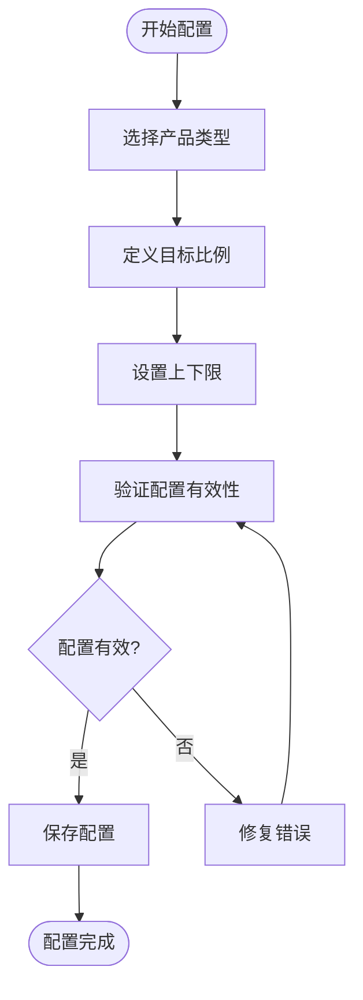

**图表来源**
- [src/config/zyDataDomain/03_product.js:83-89](file://src/config/zyDataDomain/03_product.js#L83-L89)

#### 资产类别配置

不同产品类型的资产配置策略：

| 产品类型 | 资产类别 | 目标比例 | 下限 | 上限 |
|----------|----------|----------|------|------|
| MIXED | BOND | 40% | 20% | 60% |
| MIXED | STOCK | 20% | 10% | 30% |
| MIXED | CASH | 10% | 5% | 20% |
| BOND | BOND | 60% | 40% | 80% |
| INDEX | STOCK | 95% | 85% | 100% |

**章节来源**
- [src/config/zyDataDomain/03_product.js:83-89](file://src/config/zyDataDomain/03_product.js#L83-L89)

### 产品费率配置

产品费率配置支持多种费用类型的灵活管理：

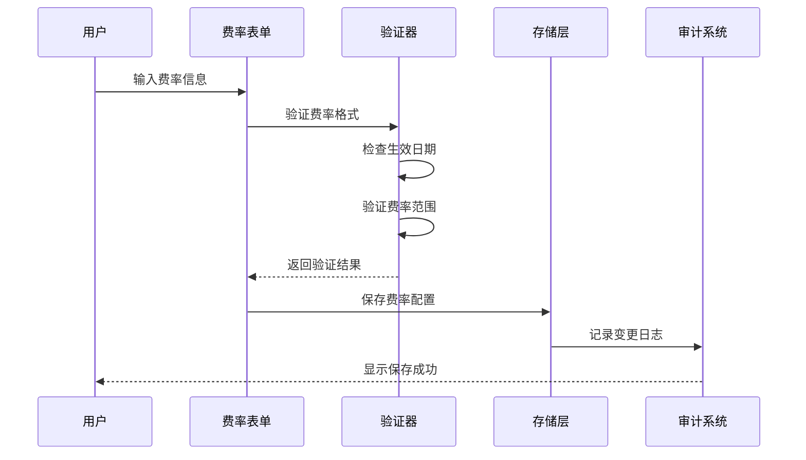

**图表来源**
- [src/views/analysis/ZyDataDomain/RecordFormDialog.vue:147-157](file://src/views/analysis/ZyDataDomain/RecordFormDialog.vue#L147-L157)

#### 费用类型定义

| 费用类型 | 说明 | 计费基数 | 生效日期要求 |
|----------|------|----------|-------------|
| MGT | 管理费 | NAV | 必填 |
| CUSTODY | 托管费 | NAV | 必填 |
| SALES | 销售费 | NAV | 可选 |
| PERF | 业绩报酬 | 超额收益 | 可选 |

**章节来源**
- [src/config/zyDataDomain/03_product.js:57-64](file://src/config/zyDataDomain/03_product.js#L57-L64)

### 产品标签配置

产品标签系统提供了灵活的产品分类和筛选机制：

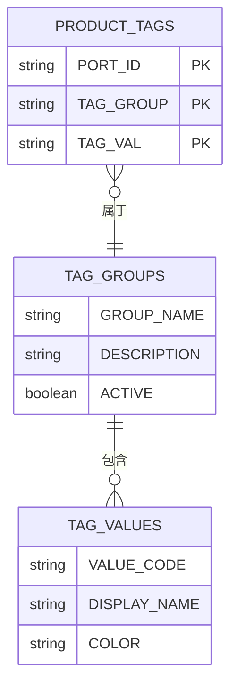

**图表来源**
- [src/config/zyDataDomain/03_product.js:33-37](file://src/config/zyDataDomain/03_product.js#L33-L37)

#### 标签组配置

| 标签组 | 用途 | 示例值 |
|--------|------|--------|
| STYLE | 产品风格 | 稳健收益型、纯债策略、指数增强型 |
| RISK_PROFILE | 风险偏好 | 保守型、稳健型、积极型 |
| ASSET_ALLOCATION | 资产配置 | 股债平衡、纯债、货币市场 |

**章节来源**
- [src/config/zyDataDomain/03_product.js:33-37](file://src/config/zyDataDomain/03_product.js#L33-L37)

## 依赖分析

### 外部依赖关系

产品域配置与系统其他模块存在密切的依赖关系：

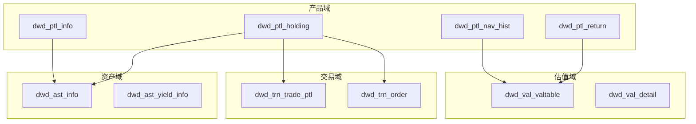

**图表来源**
- [docs/MongoDB_ZY数据域表结构清单.md:283-308](file://docs/MongoDB_ZY数据域表结构清单.md#L283-L308)

### 内部依赖关系

产品域内部各表之间存在复杂的依赖关系：

| 表名 | 主要依赖 | 依赖说明 |
|------|----------|----------|
| dwd_ptl_info | 无 | 基础信息表，无外键依赖 |
| dwd_ptl_holding | dwd_ast_info | 依赖资产基本信息 |
| dwd_ptl_nav_hist | dwd_val_valtable | 依赖估值表数据 |
| dwd_ptl_return | dwd_val_valtable | 依赖净值数据 |
| dwd_ptl_risk_indicator | dwd_val_valtable | 依赖估值和净值数据 |

**章节来源**
- [docs/MongoDB_ZY数据域表结构清单.md:283-308](file://docs/MongoDB_ZY数据域表结构清单.md#L283-L308)

## 性能考虑

### 查询优化策略

产品域配置在设计时充分考虑了性能优化：

1. **索引策略**：
   - 主键索引：确保唯一性约束
   - 复合索引：支持常用查询条件
   - 时间索引：优化历史数据查询

2. **数据分区**：
   - 按业务日期分区存储
   - 支持历史数据归档
   - 优化大数据量查询

3. **缓存机制**：
   - 常用配置缓存
   - 枚举值缓存
   - 查询结果缓存

### 批量操作优化

系统支持高效的批量数据操作：

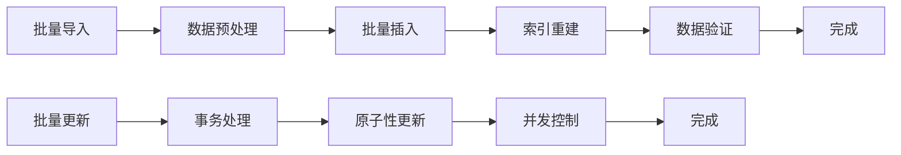

**图表来源**
- [src/api/zyDataDomain.js:69-96](file://src/api/zyDataDomain.js#L69-L96)

## 故障排除指南

### 常见问题诊断

#### 配置冲突问题

当出现配置冲突时，系统会显示具体的冲突信息：

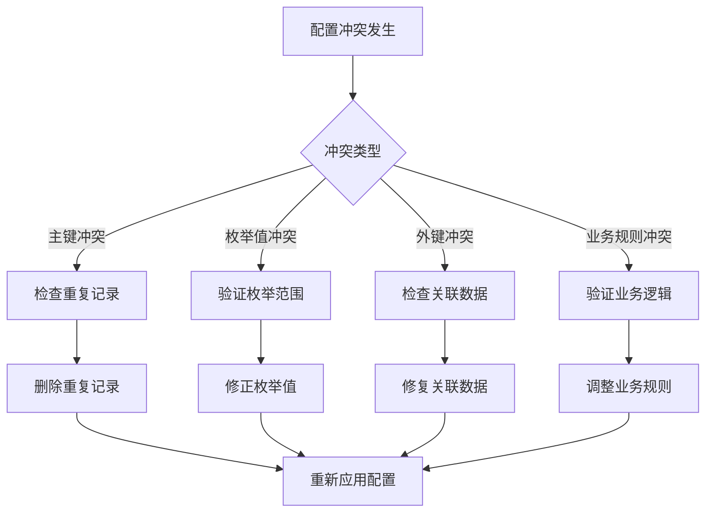

**图表来源**
- [src/views/analysis/ZyDataDomain/RecordFormDialog.vue:147-157](file://src/views/analysis/ZyDataDomain/RecordFormDialog.vue#L147-L157)

#### 数据验证错误

系统提供多层次的数据验证：

| 验证层级 | 验证内容 | 错误处理 |
|----------|----------|----------|
| 前端验证 | 字段格式、必填项 | 实时提示 |
| 后端验证 | 业务规则、数据完整性 | 详细错误信息 |
| 数据库验证 | 约束条件、唯一性 | 数据库错误反馈 |

**章节来源**
- [src/views/analysis/ZyDataDomain/RecordFormDialog.vue:101-113](file://src/views/analysis/ZyDataDomain/RecordFormDialog.vue#L101-L113)

### 系统集成问题

#### API接口问题

当后端API不可用时，系统自动切换到本地Mock模式：

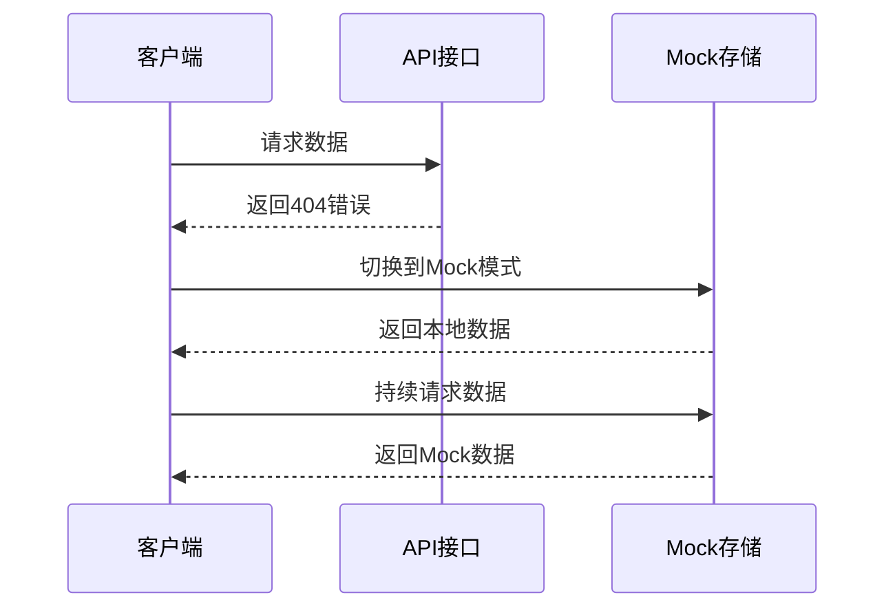

**图表来源**
- [src/api/zyDataDomain.js:26-46](file://src/api/zyDataDomain.js#L26-L46)

**章节来源**
- [src/api/zyDataDomain.js:26-46](file://src/api/zyDataDomain.js#L26-L46)

## 结论

产品域配置系统通过标准化的设计和完善的架构，为金融产品管理提供了全面的解决方案。系统的主要优势包括：

1. **标准化配置**：统一的产品配置框架，确保配置的一致性和可维护性
2. **灵活扩展**：支持新产品类型的快速添加和现有配置的灵活调整
3. **强健验证**：多层次的数据验证机制，确保数据质量和业务规则的正确执行
4. **高效性能**：优化的查询和存储策略，支持大规模数据的高效处理
5. **完整审计**：全面的数据变更审计功能，满足监管要求

该系统为产品设计、发行管理、存续期管理等各个环节提供了强有力的技术支撑，是构建现代化金融产品管理体系的重要基础设施。

## 附录

### 产品域配置扩展指南

#### 新产品类型支持

要添加新的产品类型，需要进行以下步骤：

1. **更新枚举定义**：
   ```javascript
   // 在 keys.js 中添加新的产品类型
   export const PORT_TYPE = ['MMF', 'BOND', 'EQUITY', 'MIXED', 'INDEX', 'FOF', 'NEW_TYPE'];
   ```

2. **更新配置表单**：
   ```javascript
   // 在 03_product.js 中添加新类型的支持
   f('PORT_TYPE', '产品类型', 'enum', { 
     options: K.PORT_TYPE, 
     width: 100,
     allowCreate: true  // 允许用户自定义新类型
   }),
   ```

3. **更新业务逻辑**：
   - 添加新的资产配置策略
   - 更新风险控制规则
   - 配置相应的费率结构

#### 配置项调整操作

配置项的调整遵循以下流程：

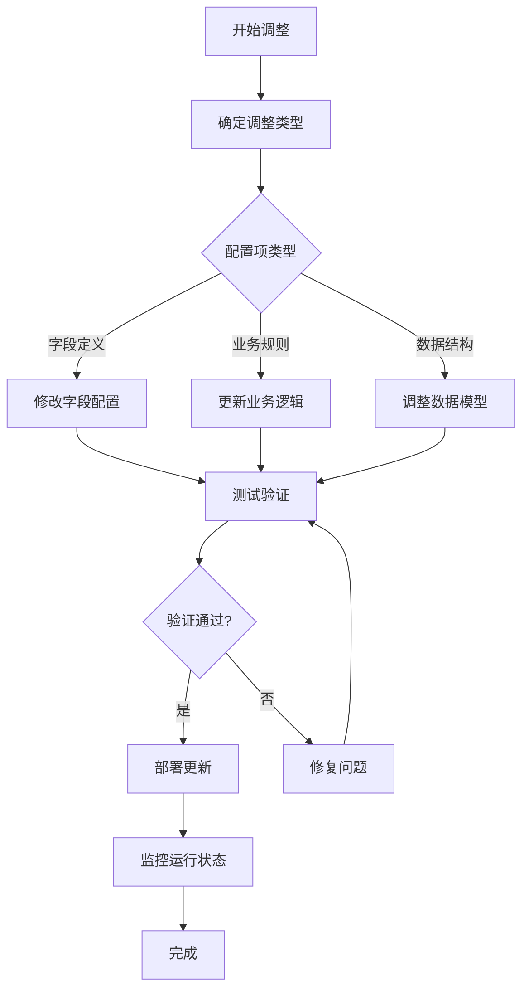

#### 系统影响评估

在进行产品域配置调整时，需要评估以下系统影响：

1. **数据迁移影响**：评估现有数据的兼容性和迁移需求
2. **业务流程影响**：分析对现有业务流程的影响程度
3. **性能影响**：评估调整对系统性能的潜在影响
4. **安全影响**：分析对系统安全性的潜在影响
5. **合规影响**：确保调整符合相关法规要求