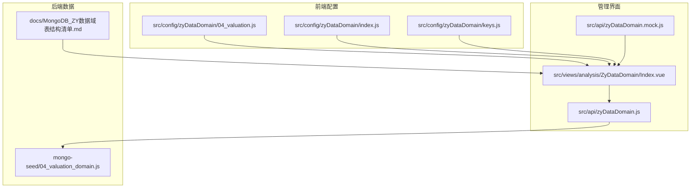
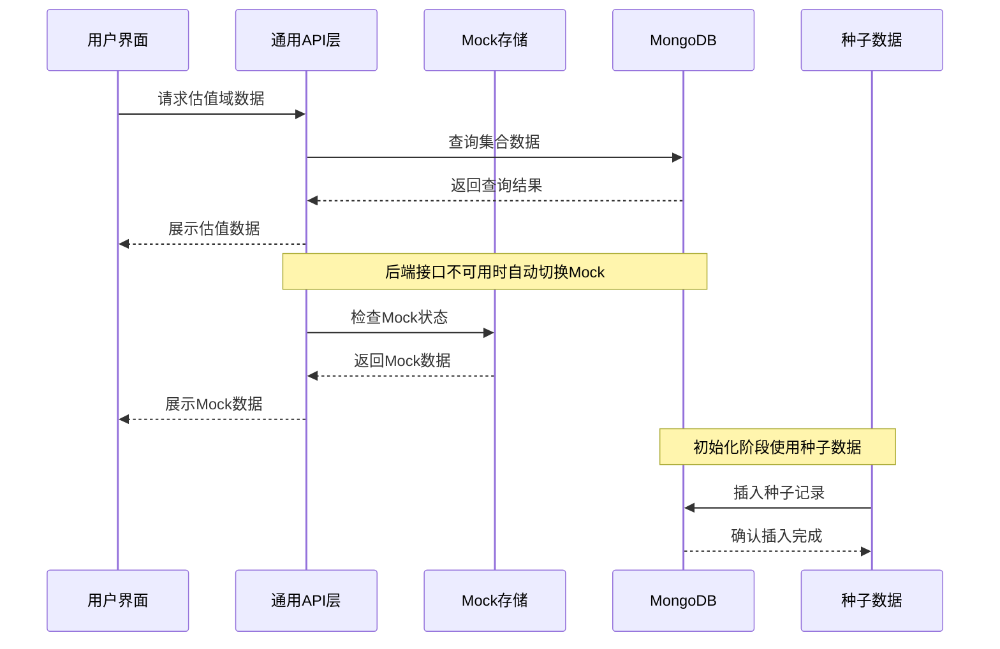
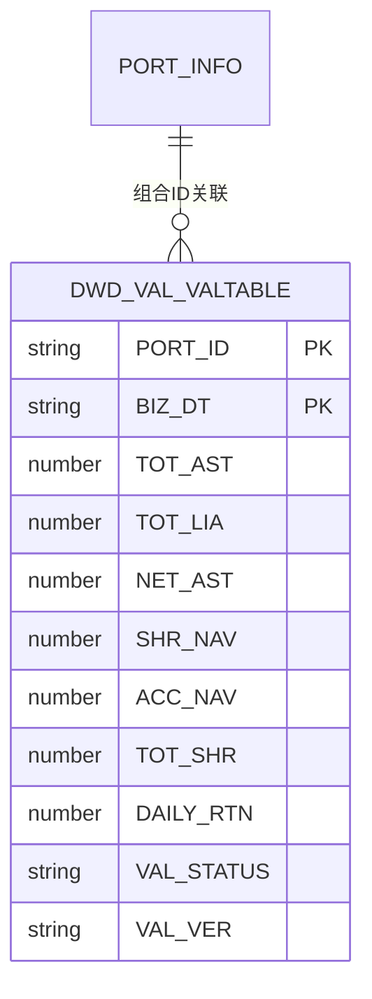
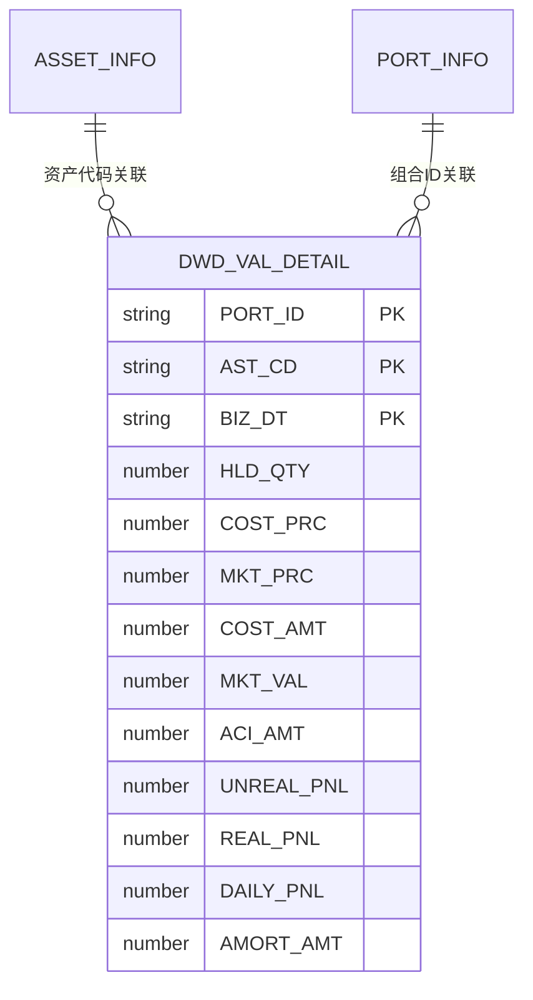
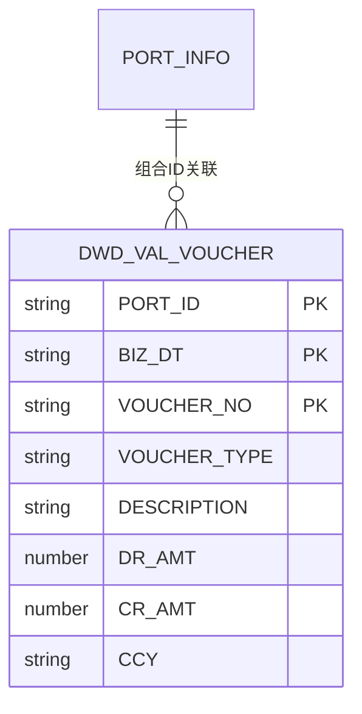
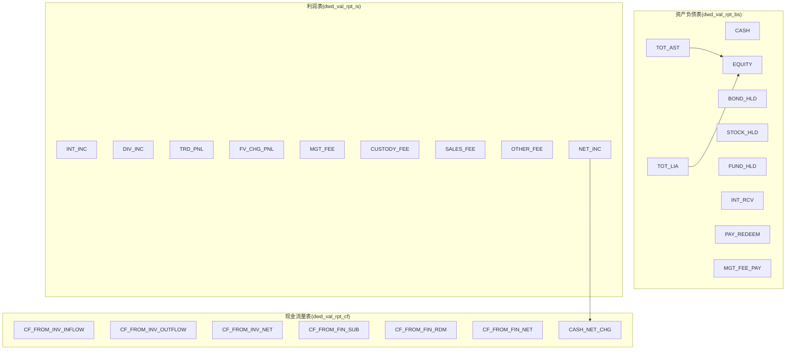
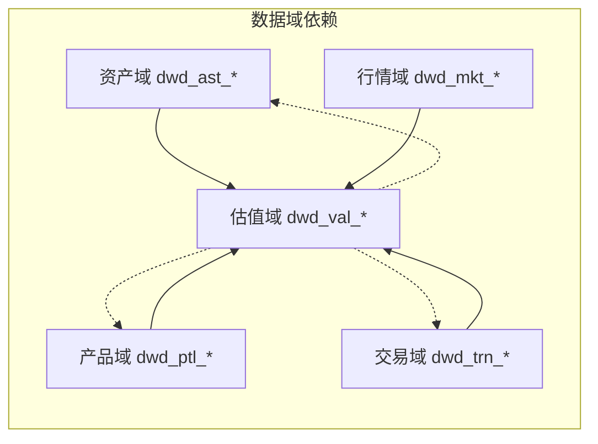

# 估值域配置

<cite>
**本文引用的文件**
- [估值域配置-前端定义](file://src/config/zyDataDomain/04_valuation.js)
- [估值域配置-后端种子数据](file://mongo-seed/04_valuation_domain.js)
- [数据域主入口](file://src/config/zyDataDomain/index.js)
- [数据域主键池与枚举](file://src/config/zyDataDomain/keys.js)
- [估值域管理页面](file://src/views/analysis/ZyDataDomain/Index.vue)
- [通用数据域API](file://src/api/zyDataDomain.js)
- [通用数据域Mock实现](file://src/api/zyDataDomain.mock.js)
- [MongoDB数据域表结构清单](file://docs/MongoDB_ZY数据域表结构清单.md)
- [数据域Mock导入脚本](file://scripts/import_zy_data_domain_mock.py)
</cite>

## 目录
1. [简介](#简介)
2. [项目结构](#项目结构)
3. [核心组件](#核心组件)
4. [架构概览](#架构概览)
5. [详细组件分析](#详细组件分析)
6. [依赖分析](#依赖分析)
7. [性能考虑](#性能考虑)
8. [故障排查指南](#故障排查指南)
9. [结论](#结论)
10. [附录](#附录)

## 简介
本文件为估值域配置的完整技术文档，涵盖估值域的数据模型、计算逻辑、表结构设计、字段定义、计算公式与验证规则。重点阐述估值域在投资组合管理中的核心作用，包括公允价值计量、损益计算、风险评估等功能配置，并介绍业务规则与会计准则要求，包括估值频率、精度要求、披露标准等配置项。最后提供估值域配置的维护指南，包括估值参数调整、计算方法更新等操作流程。

## 项目结构
估值域配置位于数据域配置体系中，采用前后端分离架构：
- 前端通过配置文件定义表结构与字段属性
- 后端通过种子脚本初始化MongoDB数据
- 管理界面提供可视化配置与维护功能
- API层负责数据交互与Mock兜底机制

**图表来源**
- [估值域配置-前端定义:1-137](file://src/config/zyDataDomain/04_valuation.js#L1-L137)
- [数据域主入口:1-80](file://src/config/zyDataDomain/index.js#L1-L80)
- [估值域管理页面:1-290](file://src/views/analysis/ZyDataDomain/Index.vue#L1-L290)
- [通用数据域API:1-190](file://src/api/zyDataDomain.js#L1-L190)
- [通用数据域Mock实现:1-800](file://src/api/zyDataDomain.mock.js#L1-L800)
- [估值域配置-后端种子数据:1-443](file://mongo-seed/04_valuation_domain.js#L1-L443)
- [MongoDB数据域表结构清单:1-379](file://docs/MongoDB_ZY数据域表结构清单.md#L1-L379)

**章节来源**
- [估值域配置-前端定义:1-137](file://src/config/zyDataDomain/04_valuation.js#L1-L137)
- [数据域主入口:1-80](file://src/config/zyDataDomain/index.js#L1-L80)
- [估值域管理页面:1-290](file://src/views/analysis/ZyDataDomain/Index.vue#L1-L290)

## 核心组件
估值域包含10张核心表，覆盖估值表头、明细、凭证、报表等全链路数据：

### 核心表清单
- **dwd_val_valtable**: 估值表（组合日估值）
- **dwd_val_detail**: 估值明细（单资产估值）
- **dwd_val_summary**: 估值汇总（资产类别汇总）
- **dwd_val_voucher**: 估值凭证（会计分录）
- **dwd_val_notice**: 估值通知（净值/分红公告）
- **dwd_val_bal**: 余额表（会计科目余额）
- **dwd_val_acc**: 会计科目（科目表）
- **dwd_val_rpt_bs**: 资产负债表
- **dwd_val_rpt_is**: 利润表
- **dwd_val_rpt_cf**: 现金流量表

### 关键字段与约束
- 主键池：PORT_ID（组合ID）、BIZ_DT（业务日期）
- 时间维度：BIZ_DT作为核心时间标识
- 业务日期：默认20250324，支持配置化
- 审计字段：etl_dt、src_sys、created_at、updated_at

**章节来源**
- [估值域配置-前端定义:16-135](file://src/config/zyDataDomain/04_valuation.js#L16-L135)
- [MongoDB数据域表结构清单:114-129](file://docs/MongoDB_ZY数据域表结构清单.md#L114-L129)

## 架构概览
估值域采用三层架构设计，确保数据一致性与可维护性：

**图表来源**
- [通用数据域API:69-96](file://src/api/zyDataDomain.js#L69-L96)
- [通用数据域Mock实现:15-33](file://src/api/zyDataDomain.mock.js#L15-L33)
- [估值域配置-后端种子数据:40-77](file://mongo-seed/04_valuation_domain.js#L40-L77)

### 数据流设计
- **查询流程**：前端请求 → API层 → MongoDB查询 → 结果返回
- **Mock兜底**：后端404/网络错误 → 自动切换localStorage存储
- **种子初始化**：首次启动时批量插入预设数据

**章节来源**
- [通用数据域API:1-190](file://src/api/zyDataDomain.js#L1-L190)
- [通用数据域Mock实现:1-800](file://src/api/zyDataDomain.mock.js#L1-L800)

## 详细组件分析

### 估值表(dwd_val_valtable)分析
估值表是估值域的核心表，记录组合的日估值结果：

**图表来源**
- [估值域配置-前端定义:17-29](file://src/config/zyDataDomain/04_valuation.js#L17-L29)

#### 字段定义与计算逻辑
- **总资产(TOT_AST)**：交易性金融资产 + 银行存款 + 应收利息
- **总负债(TOT_LIA)**：应付管理人报酬 + 应付赎回款
- **净资产(NET_AST)**：总资产 - 总负债
- **份额净值(SHR_NAV)**：净资产 / 总份额
- **累计净值(ACC_NAV)**：历史净值复权
- **日收益率(DAILY_RTN)**：当日净值变化率

#### 验证规则
- 主键组合：PORT_ID + BIZ_DT
- 状态枚举：DRAFT/CHECK/CONFIRMED
- 版本控制：VAL_VER确保数据一致性

**章节来源**
- [估值域配置-前端定义:17-29](file://src/config/zyDataDomain/04_valuation.js#L17-L29)
- [估值域配置-后端种子数据:41-77](file://mongo-seed/04_valuation_domain.js#L41-L77)

### 估值明细(dwd_val_detail)分析
估值明细记录单个资产的详细估值信息：

**图表来源**
- [估值域配置-前端定义:51-65](file://src/config/zyDataDomain/04_valuation.js#L51-L65)

#### 计算公式
- **成本金额(COST_AMT)** = 持仓数量 × 成本价
- **市值(MKT_VAL)** = 持仓数量 × 市价
- **浮动盈亏(UNREAL_PNL)** = 市值 - 成本金额
- **日盈亏(DAILY_PNL)** = 当日市值 - 前日市值

#### 数据完整性约束
- 主键组合：PORT_ID + AST_CD + BIZ_DT
- 资产代码来自主键池AST_CDS
- 业务日期必须存在且有效

**章节来源**
- [估值域配置-前端定义:51-65](file://src/config/zyDataDomain/04_valuation.js#L51-L65)
- [估值域配置-后端种子数据:79-150](file://mongo-seed/04_valuation_domain.js#L79-L150)

### 会计凭证(dwd_val_voucher)分析
会计凭证记录估值相关的会计分录：

**图表来源**
- [估值域配置-前端定义:31-40](file://src/config/zyDataDomain/04_valuation.js#L31-L40)

#### 凭证类型与会计处理
- **正常凭证(NORMAL)**：日常交易产生的分录
- **调整凭证(ADJUST)**：估值调整产生的分录
- **冲销凭证(REVERSE)**：错误凭证的冲销分录

#### 会计恒等式验证
每笔凭证必须满足：借方金额 = 贷方金额

**章节来源**
- [估值域配置-前端定义:31-40](file://src/config/zyDataDomain/04_valuation.js#L31-L40)

### 报表集成分析
估值域与三大报表的集成关系：

**图表来源**
- [估值域配置-前端定义:95-134](file://src/config/zyDataDomain/04_valuation.js#L95-L134)

**章节来源**
- [估值域配置-前端定义:95-134](file://src/config/zyDataDomain/04_valuation.js#L95-L134)

## 依赖分析

### 数据域依赖关系

**图表来源**
- [MongoDB数据域表结构清单:1-379](file://docs/MongoDB_ZY数据域表结构清单.md#L1-L379)

### 主键池与外键约束
- **PORT_ID**: 组合标识，贯穿所有估值表
- **AST_CD**: 资产标识，连接资产域与估值明细
- **BIZ_DT**: 业务日期，统一时间维度
- **VOUCHER_NO**: 凭证编号，唯一标识会计分录

**章节来源**
- [数据域主键池与枚举:6-72](file://src/config/zyDataDomain/keys.js#L6-L72)
- [MongoDB数据域表结构清单:227-238](file://docs/MongoDB_ZY数据域表结构清单.md#L227-L238)

## 性能考虑
- **索引策略**：所有含BIZ_DT的表建立时间索引，支持高效时间范围查询
- **数据分区**：按业务日期进行数据分区，优化查询性能
- **缓存机制**：前端采用localStorage缓存，减少重复请求
- **批量操作**：种子数据采用批量插入，提升初始化效率

## 故障排查指南

### 常见问题与解决方案
1. **后端接口不可用**
   - 现象：API返回404/500错误
   - 处理：自动切换到Mock模式，检查网络连接
   - 验证：确认localStorage中存在mock数据

2. **数据不一致**
   - 现象：同一组合在不同表中数据不匹配
   - 处理：检查主键约束和外键关联
   - 验证：使用聚合查询验证数据一致性

3. **时间维度错误**
   - 现象：业务日期显示异常
   - 处理：检查BIZ_DT配置和时区设置
   - 验证：核对所有表的BIZ_DT字段

**章节来源**
- [通用数据域API:26-46](file://src/api/zyDataDomain.js#L26-L46)
- [通用数据域Mock实现:15-33](file://src/api/zyDataDomain.mock.js#L15-L33)

## 结论
估值域配置提供了完整的投资组合估值解决方案，通过标准化的数据模型、严格的计算逻辑和完善的报表集成，实现了从单资产估值到组合层面的全链路覆盖。系统采用前后端分离架构，具备良好的可维护性和扩展性，能够满足不同投资产品的估值需求。

## 附录

### 配置维护流程
1. **参数调整流程**
   - 修改配置文件中的字段属性
   - 更新种子数据中的默认值
   - 验证数据迁移兼容性
   - 发布新版本并回滚测试

2. **计算方法更新**
   - 在计算规则表中添加新方法
   - 更新相关表的计算逻辑
   - 编写单元测试验证准确性
   - 文档同步更新

3. **数据导入与导出**
   - 使用种子脚本批量导入
   - 通过API接口进行增量更新
   - 支持数据备份与恢复
   - 定期数据质量检查

**章节来源**
- [数据域Mock导入脚本:1-161](file://scripts/import_zy_data_domain_mock.py#L1-L161)
- [估值域配置-后端种子数据:1-443](file://mongo-seed/04_valuation_domain.js#L1-L443)