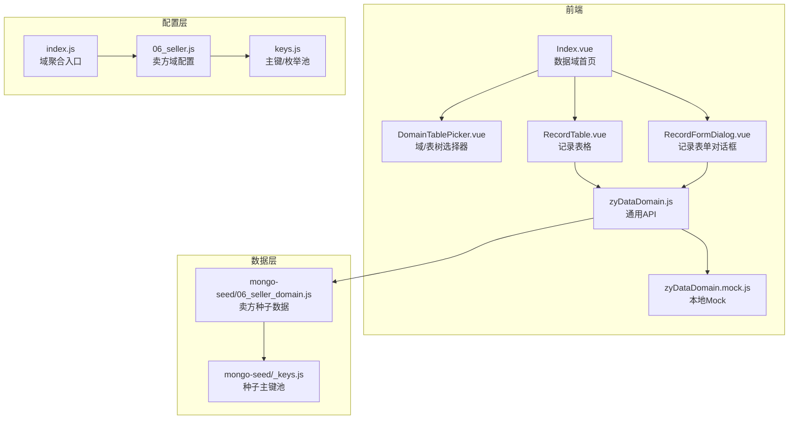
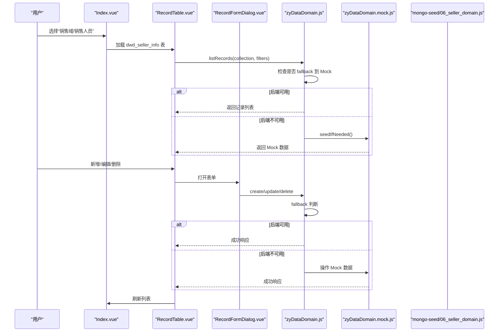
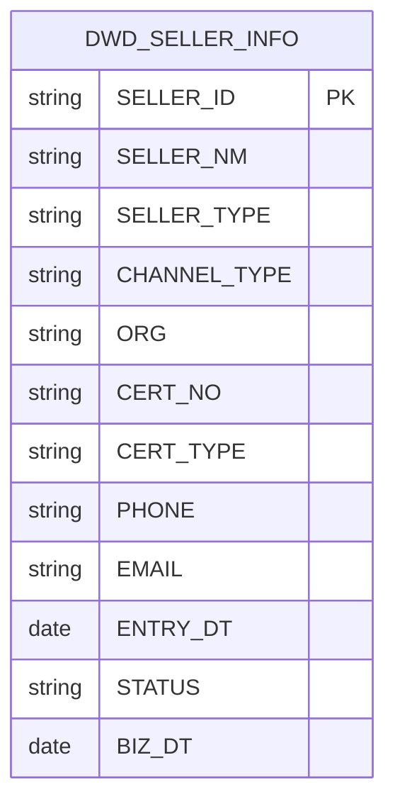
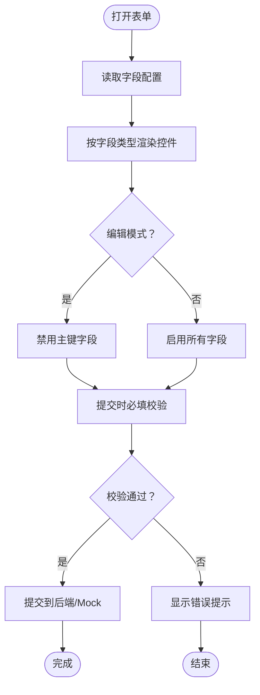
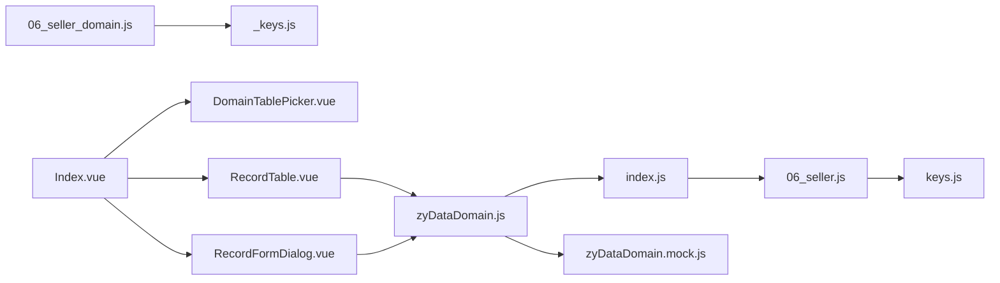

# 卖方域配置

<cite>
**本文引用的文件列表**
- [06_seller_domain.js](file://mongo-seed/06_seller_domain.js)
- [06_seller.js](file://src/config/zyDataDomain/06_seller.js)
- [keys.js](file://src/config/zyDataDomain/keys.js)
- [index.js](file://src/config/zyDataDomain/index.js)
- [_keys.js](file://mongo-seed/_keys.js)
- [zyDataDomain.js](file://src/api/zyDataDomain.js)
- [zyDataDomain.mock.js](file://src/api/zyDataDomain.mock.js)
- [Index.vue](file://src/views/analysis/ZyDataDomain/Index.vue)
- [RecordFormDialog.vue](file://src/views/analysis/ZyDataDomain/RecordFormDialog.vue)
- [RecordTable.vue](file://src/views/analysis/ZyDataDomain/RecordTable.vue)
- [DomainTablePicker.vue](file://src/views/analysis/ZyDataDomain/DomainTablePicker.vue)
</cite>

## 目录
1. [引言](#引言)
2. [项目结构](#项目结构)
3. [核心组件](#核心组件)
4. [架构总览](#架构总览)
5. [详细组件分析](#详细组件分析)
6. [依赖关系分析](#依赖关系分析)
7. [性能考量](#性能考量)
8. [故障排查指南](#故障排查指南)
9. [结论](#结论)
10. [附录](#附录)

## 引言
本文件面向“卖方域”（销售域）的配置与使用，系统性阐述其数据模型、表单设计、字段校验、业务逻辑约束、在交易流程中的角色，以及与后端接口、前端表单组件的集成方式。文档同时提供维护指南，帮助用户完成卖方信息的新增、编辑与资质变更处理等操作。

## 项目结构
卖方域位于“ZY 数据域管理”子系统中，采用“配置驱动 + 动态表单 + 通用 CRUD API”的架构：
- 配置层：通过配置文件定义域、表、字段、校验规则与默认值。
- 种子数据层：MongoDB 导入脚本提供真实示例数据，确保前后端一致性。
- 前端层：通用数据域页面负责渲染表格、表单、分页与过滤，并通过通用 API 与后端交互。
- 后端层：提供统一的 CRUD 接口；若后端不可用则自动降级到前端本地 Mock。

图表来源
- [Index.vue:1-290](file://src/views/analysis/ZyDataDomain/Index.vue#L1-L290)
- [DomainTablePicker.vue:1-148](file://src/views/analysis/ZyDataDomain/DomainTablePicker.vue#L1-L148)
- [RecordTable.vue:1-205](file://src/views/analysis/ZyDataDomain/RecordTable.vue#L1-L205)
- [RecordFormDialog.vue:1-180](file://src/views/analysis/ZyDataDomain/RecordFormDialog.vue#L1-L180)
- [zyDataDomain.js:1-190](file://src/api/zyDataDomain.js#L1-L190)
- [zyDataDomain.mock.js:1-1012](file://src/api/zyDataDomain.mock.js#L1-L1012)
- [index.js:1-80](file://src/config/zyDataDomain/index.js#L1-L80)
- [06_seller.js:1-33](file://src/config/zyDataDomain/06_seller.js#L1-L33)
- [_keys.js:1-161](file://mongo-seed/_keys.js#L1-L161)
- [06_seller_domain.js:1-29](file://mongo-seed/06_seller_domain.js#L1-L29)

章节来源
- [index.js:1-80](file://src/config/zyDataDomain/index.js#L1-L80)
- [06_seller.js:1-33](file://src/config/zyDataDomain/06_seller.js#L1-L33)
- [keys.js:1-73](file://src/config/zyDataDomain/keys.js#L1-L73)
- [_keys.js:1-161](file://mongo-seed/_keys.js#L1-L161)
- [06_seller_domain.js:1-29](file://mongo-seed/06_seller_domain.js#L1-L29)

## 核心组件
- 卖方域配置（06_seller.js）
  - 定义域标识、图标、颜色、表名、主键与字段集合。
  - 字段包含：销售ID、销售姓名、销售类型、渠道类型、所属机构、资格证书、证书类型、手机号、邮箱、入职日期、状态、业务日期等。
  - 字段属性：必填、主键、枚举、日期、默认值等。
- 配置聚合（index.js）
  - 聚合所有域配置，提供查找域、表、扁平表清单与域汇总信息的能力。
- 主键/枚举池（keys.js）
  - 提供跨域主键池（如 SELLER_IDS）与常用枚举（如 CHANNEL、STATUS、RANK 等）。
- 种子数据（mongo-seed/_keys.js 与 mongo-seed/06_seller_domain.js）
  - 提供真实业务数据示例，确保前后端一致性与演示效果。
- 通用 API（zyDataDomain.js）
  - 封装 CRUD 请求，支持后端不可用时的本地 Mock 降级。
- 通用表单组件（Index.vue、RecordTable.vue、RecordFormDialog.vue、DomainTablePicker.vue）
  - 渲染树形选择器、表格、分页、过滤与表单对话框，自动根据配置渲染字段与校验规则。

章节来源
- [06_seller.js:1-33](file://src/config/zyDataDomain/06_seller.js#L1-L33)
- [index.js:1-80](file://src/config/zyDataDomain/index.js#L1-L80)
- [keys.js:1-73](file://src/config/zyDataDomain/keys.js#L1-L73)
- [_keys.js:1-161](file://mongo-seed/_keys.js#L1-L161)
- [06_seller_domain.js:1-29](file://mongo-seed/06_seller_domain.js#L1-L29)
- [zyDataDomain.js:1-190](file://src/api/zyDataDomain.js#L1-L190)
- [Index.vue:1-290](file://src/views/analysis/ZyDataDomain/Index.vue#L1-L290)
- [RecordTable.vue:1-205](file://src/views/analysis/ZyDataDomain/RecordTable.vue#L1-L205)
- [RecordFormDialog.vue:1-180](file://src/views/analysis/ZyDataDomain/RecordFormDialog.vue#L1-L180)
- [DomainTablePicker.vue:1-148](file://src/views/analysis/ZyDataDomain/DomainTablePicker.vue#L1-L148)

## 架构总览
卖方域的运行链路由“配置 -> 组件 -> API -> 数据源”构成，支持后端接口与本地 Mock 双通道。

图表来源
- [Index.vue:102-214](file://src/views/analysis/ZyDataDomain/Index.vue#L102-L214)
- [RecordTable.vue:114-146](file://src/views/analysis/ZyDataDomain/RecordTable.vue#L114-L146)
- [RecordFormDialog.vue:147-157](file://src/views/analysis/ZyDataDomain/RecordFormDialog.vue#L147-L157)
- [zyDataDomain.js:69-158](file://src/api/zyDataDomain.js#L69-L158)
- [zyDataDomain.mock.js:1-1012](file://src/api/zyDataDomain.mock.js#L1-L1012)
- [06_seller_domain.js:16-25](file://mongo-seed/06_seller_domain.js#L16-L25)

## 详细组件分析

### 数据模型与配置结构
- 域与表
  - 域：seller（销售域）
  - 表：dwd_seller_info（销售人员）
  - 主键：SELLER_ID
- 字段清单与属性
  - 销售ID（主键，允许创建）
  - 销售姓名（必填）
  - 销售类型（枚举：INTERNAL/EXTERNAL）
  - 渠道类型（必填，枚举：DIRECT/BANK/BROKER/ONLINE）
  - 所属机构
  - 资格证书
  - 证书类型
  - 手机
  - 邮箱
  - 入职日期（日期）
  - 状态（枚举：ACTIVE/INACTIVE/PROBATION）
  - 业务日期（默认 BIZ_DT）

图表来源
- [06_seller.js:17-30](file://src/config/zyDataDomain/06_seller.js#L17-L30)

章节来源
- [06_seller.js:1-33](file://src/config/zyDataDomain/06_seller.js#L1-L33)
- [keys.js:28-57](file://src/config/zyDataDomain/keys.js#L28-L57)

### 表单设计与字段校验
- 表单渲染
  - 根据字段类型自动渲染输入框、日期选择器、数值输入、枚举下拉等。
  - 主键字段在编辑模式下禁用（不可修改）。
- 校验规则
  - 字段标记为 required 的，会在表单提交时进行必填校验。
  - 枚举字段来自配置的 options，支持远程/本地下拉。
- 默认值
  - 字段可设置 defaultValue，如 BIZ_DT 使用业务日期。
- 响应式布局
  - 长字段单列显示，普通字段双列显示，提升可读性。

图表来源
- [RecordFormDialog.vue:147-157](file://src/views/analysis/ZyDataDomain/RecordFormDialog.vue#L147-L157)
- [06_seller.js:17-30](file://src/config/zyDataDomain/06_seller.js#L17-L30)

章节来源
- [RecordFormDialog.vue:1-180](file://src/views/analysis/ZyDataDomain/RecordFormDialog.vue#L1-L180)
- [06_seller.js:17-30](file://src/config/zyDataDomain/06_seller.js#L17-L30)

### 业务逻辑与约束
- 主键唯一性
  - SELLER_ID 为主键，且在编辑模式下不可更改。
- 枚举约束
  - 销售类型、渠道类型、状态等字段仅允许配置中定义的枚举值。
- 默认值与审计字段
  - BIZ_DT 默认为配置中的业务日期；审计字段（etl_dt/src_sys）由后端注入，不在表单展示。
- 关联一致性
  - SELLER_IDS 等主键池在配置与种子数据中保持一致，确保跨域引用正确。

章节来源
- [06_seller.js:17-30](file://src/config/zyDataDomain/06_seller.js#L17-L30)
- [keys.js:6-72](file://src/config/zyDataDomain/keys.js#L6-L72)
- [zyDataDomain.mock.js:61-69](file://src/api/zyDataDomain.mock.js#L61-L69)

### 在交易流程中的作用
- 供应商/销售管理
  - 通过 dwd_seller_info 记录销售信息，便于客户归属、业绩统计与合规管理。
- 能力评估与合规监控
  - 结合渠道类型、状态、证书信息等字段，支撑销售能力评估与合规检查。
- 与客户域的关联
  - 客户表包含 SELLER_ID 字段，形成从客户到销售的关联，便于追踪销售行为与业绩。

章节来源
- [06_seller.js:17-30](file://src/config/zyDataDomain/06_seller.js#L17-L30)
- [zyDataDomain.mock.js:213-245](file://src/api/zyDataDomain.mock.js#L213-L245)

### 业务规则与监管要求
- 准入标准
  - 证书类型与证书编号字段可用于校验销售资格。
- 评级与状态
  - 状态字段（ACTIVE/INACTIVE/PROBATION）用于管理销售有效性。
- 风险管理
  - 渠道类型与销售类型可作为风控维度，结合限额与名单管理策略。

章节来源
- [06_seller.js:20-28](file://src/config/zyDataDomain/06_seller.js#L20-L28)
- [keys.js:56-57](file://src/config/zyDataDomain/keys.js#L56-L57)

### 维护指南
- 新增销售
  - 在“销售人员”表中新增记录，必填字段需满足校验规则；主键由系统生成或手动输入。
- 编辑销售
  - 修改非主键字段；主键在编辑模式下不可更改。
- 删除销售
  - 通过表格操作删除，注意删除前确认关联关系。
- 资质变更处理
  - 更新证书类型与证书编号字段；必要时同步状态字段以反映最新合规状态。
- Mock 模式
  - 当后端接口不可用时，系统自动切换到 Mock 模式；可通过“重置 Mock 数据”恢复初始种子数据。

章节来源
- [Index.vue:156-212](file://src/views/analysis/ZyDataDomain/Index.vue#L156-L212)
- [RecordTable.vue:54-61](file://src/views/analysis/ZyDataDomain/RecordTable.vue#L54-L61)
- [RecordFormDialog.vue:147-157](file://src/views/analysis/ZyDataDomain/RecordFormDialog.vue#L147-L157)
- [zyDataDomain.js:48-62](file://src/api/zyDataDomain.js#L48-L62)

## 依赖关系分析
- 配置依赖
  - 06_seller.js 依赖 keys.js 提供的枚举与默认值。
  - index.js 聚合所有域配置，供前端页面与工具函数使用。
- 数据依赖
  - 种子数据依赖 _keys.js 提供的主键池与名称映射。
  - 后端接口与前端 API 之间通过 collection 名称对齐（如 dwd_seller_info）。
- 组件依赖
  - Index.vue 依赖 DomainTablePicker、RecordTable、RecordFormDialog。
  - RecordTable 与 RecordFormDialog 依赖配置中的字段定义。

图表来源
- [06_seller.js:1-33](file://src/config/zyDataDomain/06_seller.js#L1-L33)
- [keys.js:1-73](file://src/config/zyDataDomain/keys.js#L1-L73)
- [index.js:1-80](file://src/config/zyDataDomain/index.js#L1-L80)
- [zyDataDomain.js:1-190](file://src/api/zyDataDomain.js#L1-L190)
- [zyDataDomain.mock.js:1-1012](file://src/api/zyDataDomain.mock.js#L1-L1012)
- [06_seller_domain.js:1-29](file://mongo-seed/06_seller_domain.js#L1-L29)
- [_keys.js:1-161](file://mongo-seed/_keys.js#L1-L161)
- [Index.vue:1-290](file://src/views/analysis/ZyDataDomain/Index.vue#L1-L290)
- [DomainTablePicker.vue:1-148](file://src/views/analysis/ZyDataDomain/DomainTablePicker.vue#L1-L148)
- [RecordTable.vue:1-205](file://src/views/analysis/ZyDataDomain/RecordTable.vue#L1-L205)
- [RecordFormDialog.vue:1-180](file://src/views/analysis/ZyDataDomain/RecordFormDialog.vue#L1-L180)

章节来源
- [index.js:1-80](file://src/config/zyDataDomain/index.js#L1-L80)
- [06_seller.js:1-33](file://src/config/zyDataDomain/06_seller.js#L1-L33)
- [keys.js:1-73](file://src/config/zyDataDomain/keys.js#L1-L73)
- [zyDataDomain.js:1-190](file://src/api/zyDataDomain.js#L1-L190)

## 性能考量
- 前端渲染
  - 表格分页与过滤在前端完成，建议合理设置分页大小与过滤条件，避免一次性加载过多数据。
- API 降级
  - 后端不可用时自动切换到 Mock，保障可用性；但 Mock 数据仅驻留在内存，刷新后会丢失。
- 字段宽度与布局
  - 长字段单列显示，减少横向滚动；普通字段双列显示，提升信息密度。

[本节为通用指导，不涉及具体文件分析]

## 故障排查指南
- 后端接口 404/网络错误
  - API 会自动切换到 Mock 模式；可在页面右上角查看“本地 Mock 模式”标签。
- 无法提交表单
  - 检查必填字段是否为空；确认枚举值是否在配置的 options 中。
- 主键冲突
  - 新增时若主键重复，后端会拒绝；请更换唯一标识。
- Mock 数据丢失
  - 页面提供“重置 Mock 数据”按钮，可恢复初始种子数据。

章节来源
- [zyDataDomain.js:26-46](file://src/api/zyDataDomain.js#L26-L46)
- [Index.vue:202-212](file://src/views/analysis/ZyDataDomain/Index.vue#L202-L212)
- [RecordFormDialog.vue:101-113](file://src/views/analysis/ZyDataDomain/RecordFormDialog.vue#L101-L113)

## 结论
卖方域通过“配置驱动 + 通用组件 + 通用 API”的方式，实现了销售信息的标准化管理与高效维护。其字段设计覆盖销售类型、渠道类型、状态与资质等关键要素，配合后端接口与前端表单组件，能够满足销售管理、能力评估与合规监控等业务需求。在后端不可用时，系统具备完善的 Mock 降级机制，保障日常运维与演示不受影响。

[本节为总结性内容，不涉及具体文件分析]

## 附录
- 字段类型与用途参考
  - string：文本字段（如姓名、电话、邮箱、证书编号）
  - date：日期字段（如入职日期、业务日期）
  - enum：枚举字段（如销售类型、渠道类型、状态）
  - number：数值字段（如客户数量、AUM、年度销售）
- 常用枚举参考
  - 销售类型：INTERNAL、EXTERNAL
  - 渠道类型：DIRECT、BANK、BROKER、ONLINE
  - 状态：ACTIVE、INACTIVE、PROBATION
  - 等

章节来源
- [06_seller.js:17-30](file://src/config/zyDataDomain/06_seller.js#L17-L30)
- [keys.js:46-57](file://src/config/zyDataDomain/keys.js#L46-L57)