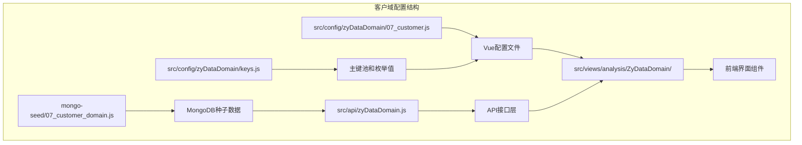
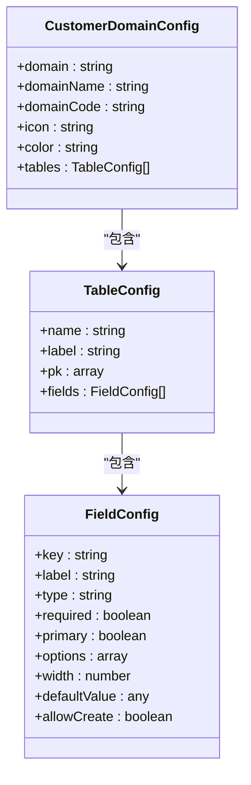
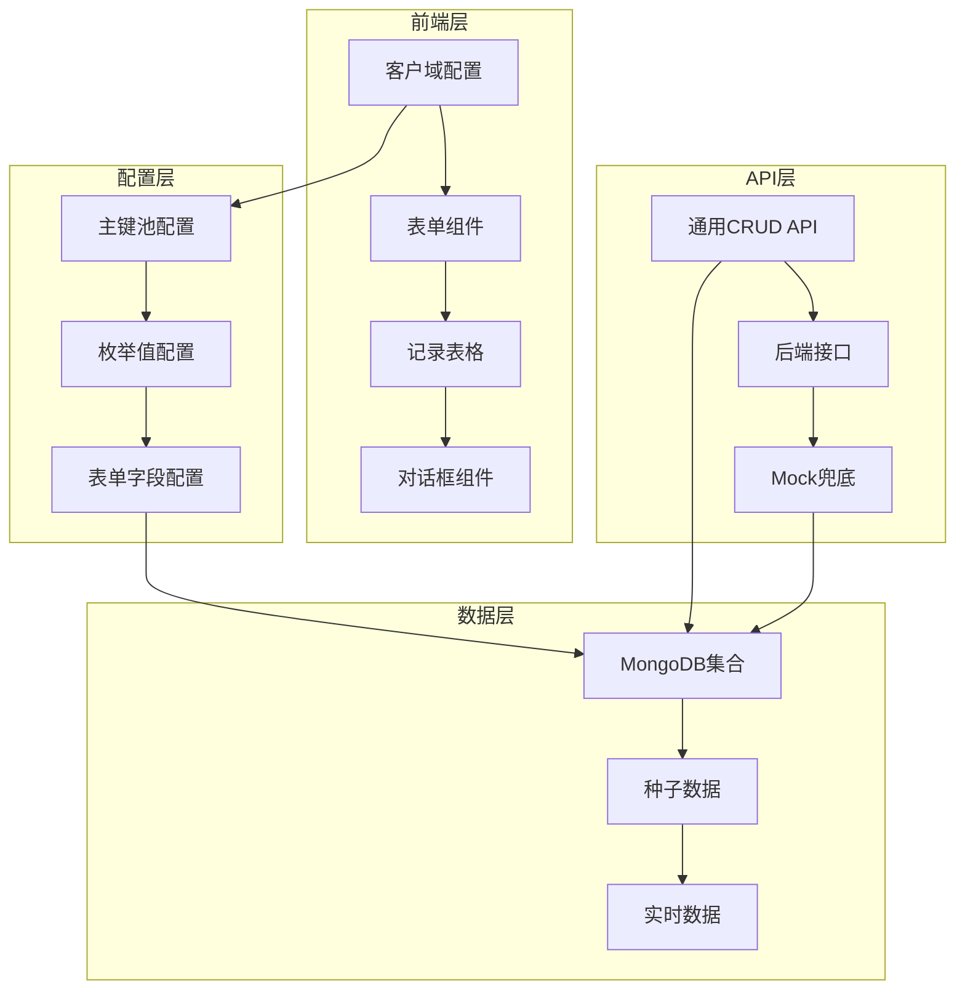
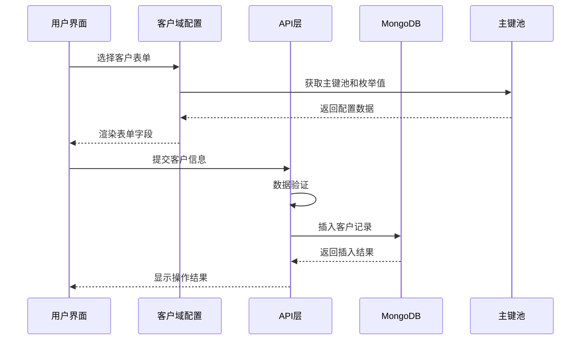
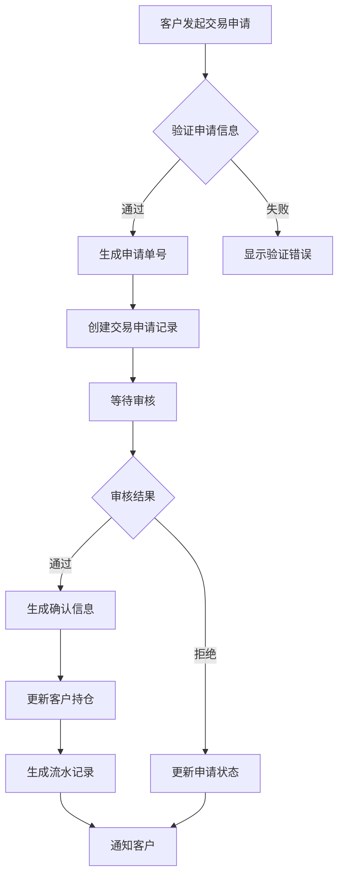
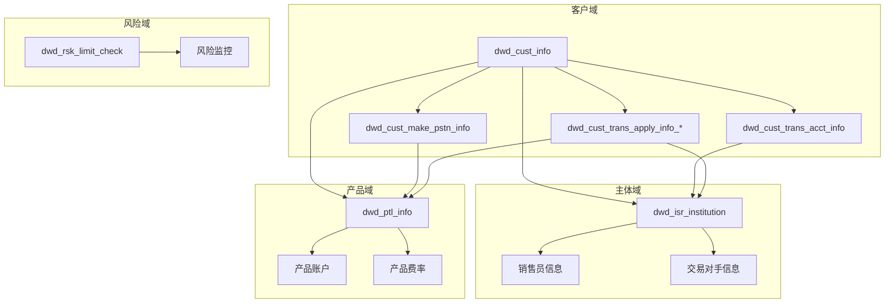

# 客户域配置

<cite>
**本文档引用的文件**
- [07_customer_domain.js](file://mongo-seed/07_customer_domain.js)
- [07_customer.js](file://src/config/zyDataDomain/07_customer.js)
- [keys.js](file://src/config/zyDataDomain/keys.js)
- [index.js](file://src/config/zyDataDomain/index.js)
- [zyDataDomain.js](file://src/api/zyDataDomain.js)
- [zyDataDomain.mock.js](file://src/api/zyDataDomain.mock.js)
- [Index.vue](file://src/views/analysis/ZyDataDomain/Index.vue)
- [RecordTable.vue](file://src/views/analysis/ZyDataDomain/RecordTable.vue)
- [RecordFormDialog.vue](file://src/views/analysis/ZyDataDomain/RecordFormDialog.vue)
- [DomainTablePicker.vue](file://src/views/analysis/ZyDataDomain/DomainTablePicker.vue)
- [_keys.js](file://mongo-seed/_keys.js)
- [02_subject.js](file://src/config/zyDataDomain/02_subject.js)
- [03_product.js](file://src/config/zyDataDomain/03_product.js)
</cite>

## 目录
1. [简介](#简介)
2. [项目结构](#项目结构)
3. [核心组件](#核心组件)
4. [架构概览](#架构概览)
5. [详细组件分析](#详细组件分析)
6. [依赖关系分析](#依赖关系分析)
7. [性能考虑](#性能考虑)
8. [故障排除指南](#故障排除指南)
9. [结论](#结论)
10. [附录](#附录)

## 简介

客户域配置是金融数据管理系统中的核心模块，负责管理客户相关信息、交易记录、风险评估和适当性匹配等关键业务数据。本文档深入解析客户域的数据结构设计、表单配置、数据验证逻辑，以及与主体域、产品域的关联关系和数据流转机制。

客户域采用标准化的数据模型设计，包含8张核心表，涵盖客户基本信息、交易账户、交易申请、确认信息、分红信息、流水记录等完整业务场景。通过统一的配置框架，实现了数据的一致性和可维护性。

## 项目结构

客户域配置采用模块化组织方式，主要包含以下核心文件：

**图表来源**
- [07_customer_domain.js:1-160](file://mongo-seed/07_customer_domain.js#L1-L160)
- [07_customer.js:1-121](file://src/config/zyDataDomain/07_customer.js#L1-L121)

**章节来源**
- [07_customer_domain.js:1-160](file://mongo-seed/07_customer_domain.js#L1-L160)
- [07_customer.js:1-121](file://src/config/zyDataDomain/07_customer.js#L1-L121)
- [keys.js:1-73](file://src/config/zyDataDomain/keys.js#L1-L73)

## 核心组件

### 数据模型设计

客户域采用标准化的数据模型设计，包含8张核心表，每张表都有明确的业务职责和数据结构：

#### 客户基础信息表 (dwd_cust_info)
- **主键**: CUSTOMER_ID
- **核心字段**: 客户ID、客户名称、客户类型、风险等级、开户渠道、销售ID等
- **业务用途**: 存储客户的基础身份信息和基本属性

#### 客户交易账户表 (dwd_cust_trans_acct_info)
- **复合主键**: CUSTOMER_ID + ACCT_NO
- **核心字段**: 账户号、账户类型、银行信息、币种、状态等
- **业务用途**: 管理客户的各类交易账户信息

#### 客户交易申请表 (dwd_cust_trans_apply_info_*)
- **主键**: APPLY_NO
- **核心字段**: 申请单号、客户ID、组合ID、交易类型、金额、份额、渠道等
- **业务用途**: 记录客户的各类交易申请信息

#### 客户确认信息表 (dwd_cust_trans_cfm_info)
- **主键**: CFM_NO
- **核心字段**: 确认号、申请单号、确认金额、确认份额、确认净值、费用等
- **业务用途**: 存储交易确认后的最终信息

**章节来源**
- [07_customer.js:30-119](file://src/config/zyDataDomain/07_customer.js#L30-L119)

### 表单配置系统

客户域采用统一的表单配置框架，支持动态表单生成和数据验证：

**图表来源**
- [07_customer.js:7-8](file://src/config/zyDataDomain/07_customer.js#L7-L8)

**章节来源**
- [07_customer.js:7-121](file://src/config/zyDataDomain/07_customer.js#L7-L121)

## 架构概览

客户域采用分层架构设计，实现了前后端分离和数据一致性保障：

**图表来源**
- [zyDataDomain.js:1-190](file://src/api/zyDataDomain.js#L1-L190)
- [zyDataDomain.mock.js:1-800](file://src/api/zyDataDomain.mock.js#L1-L800)

### 数据验证逻辑

客户域实现了多层次的数据验证机制：

1. **前端验证**: 基于字段配置的必填验证和格式验证
2. **后端验证**: 通过API接口进行数据完整性检查
3. **业务规则验证**: 基于业务规则的数据一致性检查

**章节来源**
- [RecordFormDialog.vue:101-113](file://src/views/analysis/ZyDataDomain/RecordFormDialog.vue#L101-L113)
- [zyDataDomain.js:26-46](file://src/api/zyDataDomain.js#L26-L46)

## 详细组件分析

### 客户信息管理组件

客户信息管理组件提供了完整的客户生命周期管理功能：

**图表来源**
- [Index.vue:103-125](file://src/views/analysis/ZyDataDomain/Index.vue#L103-L125)
- [zyDataDomain.js:69-96](file://src/api/zyDataDomain.js#L69-L96)

#### 字段映射机制

客户域实现了灵活的字段映射机制，支持多种数据类型的自动转换：

| 字段类型 | 输入组件 | 输出格式 | 验证规则 |
|---------|---------|---------|---------|
| 枚举/外键 | 下拉选择器 | 字符串值 | 必填验证 |
| 日期 | 日期选择器 | YYYYMMDD | 日期格式验证 |
| 数值 | 数字输入框 | 浮点数 | 范围和精度控制 |
| 字符串 | 文本输入框 | 字符串 | 长度和格式验证 |

**章节来源**
- [RecordFormDialog.vue:20-61](file://src/views/analysis/ZyDataDomain/RecordFormDialog.vue#L20-L61)

### 交易记录管理

客户域的交易记录管理涵盖了完整的交易生命周期：

**图表来源**
- [07_customer.js:106-118](file://src/config/zyDataDomain/07_customer.js#L106-L118)

**章节来源**
- [07_customer.js:73-119](file://src/config/zyDataDomain/07_customer.js#L73-L119)

### 风险评估与适当性匹配

客户域实现了完善的风险评估和适当性匹配机制：

| 评估维度 | 指标类型 | 评估标准 | 匹配结果 |
|---------|---------|---------|---------|
| 投资经验 | 年限 | 1-3年、3-5年、5-10年、10年以上 | 基于经验匹配 |
| 收入水平 | 金额范围 | 20-50万、50-100万、100-500万、机构 | 基于收入匹配 |
| 风险承受能力 | 百分比范围 | 5%-10%、10%-30%、30%-50%、50%以上 | 风险等级匹配 |
| 投资目标 | 目标类型 | 稳健、平衡、增长、激进 | 目标导向匹配 |

**章节来源**
- [07_customer.js:48-59](file://src/config/zyDataDomain/07_customer.js#L48-L59)

## 依赖关系分析

客户域与其他数据域存在紧密的关联关系：

**图表来源**
- [index.js:16-19](file://src/config/zyDataDomain/index.js#L16-L19)
- [02_subject.js:17-56](file://src/config/zyDataDomain/02_subject.js#L17-L56)
- [03_product.js:17-133](file://src/config/zyDataDomain/03_product.js#L17-L133)

### 关联关系说明

1. **客户-主体关联**: 通过销售ID关联到主体域的销售员信息
2. **客户-产品关联**: 通过组合ID关联到产品域的产品信息
3. **客户-风险关联**: 通过风险评估结果关联到风险域的监控信息

**章节来源**
- [keys.js:23-28](file://src/config/zyDataDomain/keys.js#L23-L28)
- [keys.js:14-28](file://src/config/zyDataDomain/keys.js#L14-L28)

## 性能考虑

### 数据索引优化

客户域在MongoDB中建立了合理的索引策略：

| 集合名称 | 索引字段 | 索引类型 | 用途 |
|---------|---------|---------|------|
| dwd_cust_info | CUSTOMER_ID | 唯一索引 | 主键查询 |
| dwd_cust_info | SELLER_ID | 普通索引 | 销售关联查询 |
| dwd_cust_info | CUSTOMER_TYPE, RISK_LVL | 复合索引 | 分类统计查询 |
| dwd_cust_transaction | TXN_ID | 唯一索引 | 交易号查询 |
| dwd_cust_transaction | CUSTOMER_ID, TXN_DT | 复合索引 | 客户交易历史查询 |
| dwd_cust_trans_apply_info_* | APPLY_NO | 唯一索引 | 申请单查询 |

### 查询性能优化

1. **批量查询**: 支持分页查询和过滤条件
2. **缓存机制**: 前端实现数据缓存减少重复请求
3. **懒加载**: 表单字段按需加载，提高页面响应速度

## 故障排除指南

### 常见问题及解决方案

#### 1. 数据同步问题
**症状**: 客户信息更新后其他模块显示不一致
**解决方案**: 
- 检查主键池配置是否正确
- 验证外键关联关系
- 确认数据更新事务完整性

#### 2. 表单验证错误
**症状**: 提交表单时出现验证错误
**解决方案**:
- 检查必填字段是否完整
- 验证数据类型和格式
- 确认枚举值在允许范围内

#### 3. API接口异常
**症状**: 页面加载失败或数据无法更新
**解决方案**:
- 检查后端服务状态
- 验证网络连接
- 使用Mock模式进行调试

**章节来源**
- [zyDataDomain.js:26-46](file://src/api/zyDataDomain.js#L26-L46)
- [zyDataDomain.mock.js:15-33](file://src/api/zyDataDomain.mock.js#L15-L33)

## 结论

客户域配置通过标准化的数据模型设计、完善的表单配置系统和严格的验证机制，为金融业务提供了可靠的数据支撑。其模块化的架构设计和清晰的依赖关系，确保了系统的可维护性和扩展性。

未来可以在以下方面进一步优化：
1. 增强实时数据同步机制
2. 优化大数据量下的查询性能
3. 扩展更多业务场景的支持
4. 加强数据安全和权限控制

## 附录

### 配置扩展指南

#### 添加新的客户类型
1. 在主键池配置中添加新的客户类型枚举值
2. 更新客户信息表单字段配置
3. 添加相应的业务逻辑处理

#### 自定义字段配置
1. 在表单配置中添加新的字段定义
2. 设置字段的验证规则和显示属性
3. 更新数据库表结构和索引

#### 业务规则扩展
1. 在配置文件中定义新的业务规则
2. 实现相应的验证逻辑
3. 更新用户界面的提示信息

**章节来源**
- [keys.js:65-72](file://src/config/zyDataDomain/keys.js#L65-L72)
- [07_customer.js:10-21](file://src/config/zyDataDomain/07_customer.js#L10-L21)