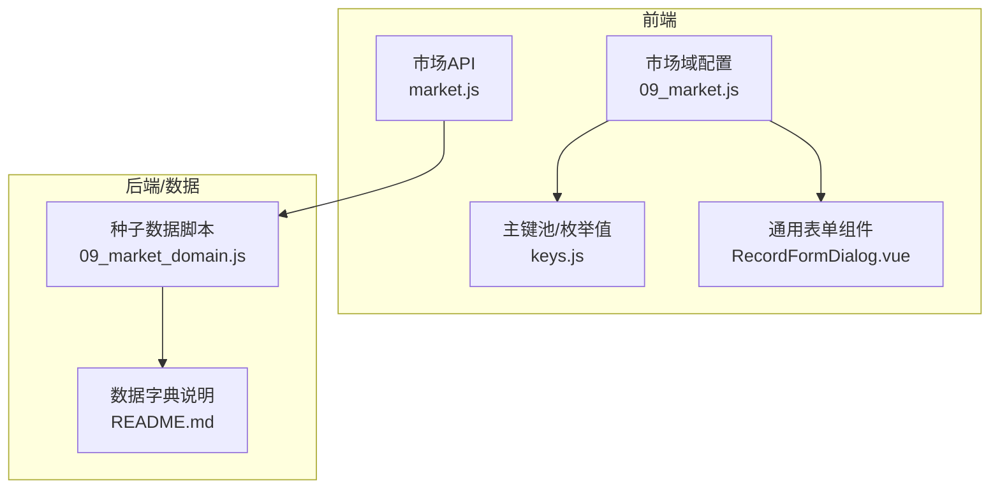
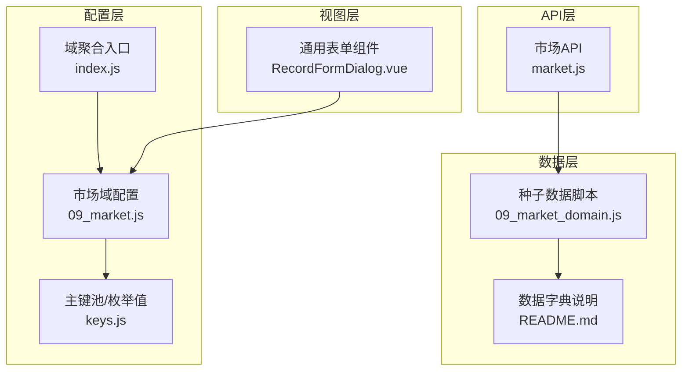
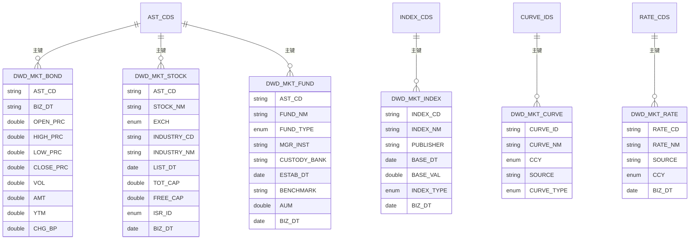
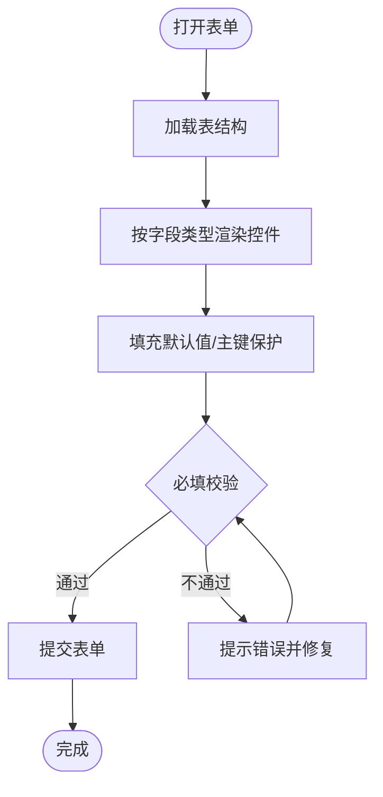
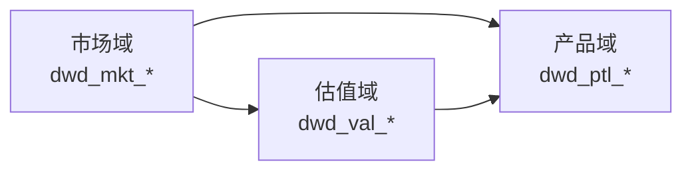
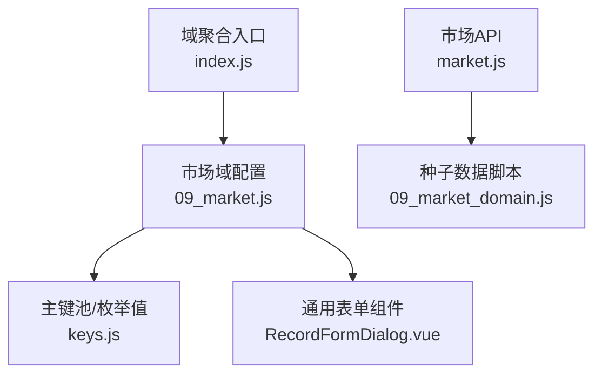

# 市场域配置

<cite>
**本文档引用的文件**
- [09_market.js](file://src/config/zyDataDomain/09_market.js)
- [keys.js](file://src/config/zyDataDomain/keys.js)
- [index.js](file://src/config/zyDataDomain/index.js)
- [RecordFormDialog.vue](file://src/views/analysis/ZyDataDomain/RecordFormDialog.vue)
- [market.js](file://src/api/market.js)
- [09_market.js](file://mongo-seed/09_market_domain.js)
- [README.md](file://mongo-seed/README.md)
- [zy_data_associated_mock_design_v2.md](file://scripts/zy_data_associated_mock_design_v2.md)
</cite>

## 目录
1. [简介](#简介)
2. [项目结构](#项目结构)
3. [核心组件](#核心组件)
4. [架构概览](#架构概览)
5. [详细组件分析](#详细组件分析)
6. [依赖分析](#依赖分析)
7. [性能考虑](#性能考虑)
8. [故障排除指南](#故障排除指南)
9. [结论](#结论)
10. [附录](#附录)

## 简介
本文件面向市场域配置的使用者与维护者，系统性阐述市场域的数据模型设计、表单配置、字段映射与数据验证规则，并说明市场域与估值域、产品域的关联关系及数据交互机制。同时提供基准管理、市场数据处理、定价参考等业务场景的配置要点与扩展指南，帮助读者理解市场域配置如何影响定价模型与估值准确性。

## 项目结构
市场域配置位于前端配置层与后端种子数据层两个层面：
- 前端配置层：通过领域配置文件定义表结构、字段类型、枚举值与默认值，配合通用表单组件实现统一的录入体验。
- 后端种子数据层：提供25张市场相关表的结构定义、索引策略与示例数据，确保数据一致性与可验证性。

**图表来源**
- [09_market.js:1-272](file://src/config/zyDataDomain/09_market.js#L1-L272)
- [keys.js:1-73](file://src/config/zyDataDomain/keys.js#L1-L73)
- [RecordFormDialog.vue:1-180](file://src/views/analysis/ZyDataDomain/RecordFormDialog.vue#L1-L180)
- [market.js:1-112](file://src/api/market.js#L1-L112)
- [09_market.js:1-200](file://mongo-seed/09_market_domain.js#L1-L200)
- [README.md:1-125](file://mongo-seed/README.md#L1-L125)

**章节来源**
- [09_market.js:1-272](file://src/config/zyDataDomain/09_market.js#L1-L272)
- [keys.js:1-73](file://src/config/zyDataDomain/keys.js#L1-L73)
- [README.md:1-125](file://mongo-seed/README.md#L1-L125)

## 核心组件
- 市场域配置对象：定义域标识、显示名称、颜色与图标，以及25张表的结构定义。
- 字段工厂函数：统一构造字段描述，包含键名、标签、类型、宽度、是否必填、是否主键、默认值、枚举选项等。
- 主键池与枚举值：提供跨表使用的资产代码、指数代码、曲线ID、利率代码、币种、评级机构等枚举集合。
- 通用表单组件：根据表结构动态渲染表单，自动应用必填校验与主键保护。
- 市场API：提供行情同步与组合维护的SSE流式接口解析能力。

**章节来源**
- [09_market.js:10-271](file://src/config/zyDataDomain/09_market.js#L10-L271)
- [keys.js:6-72](file://src/config/zyDataDomain/keys.js#L6-L72)
- [RecordFormDialog.vue:74-162](file://src/views/analysis/ZyDataDomain/RecordFormDialog.vue#L74-L162)
- [market.js:6-111](file://src/api/market.js#L6-L111)

## 架构概览
市场域配置采用“配置驱动 + 通用表单 + 种子数据”的架构：
- 配置驱动：通过09_market.js定义表结构与字段属性，统一管理字段类型、默认值与校验规则。
- 通用表单：RecordFormDialog.vue基于表结构动态生成表单，自动处理主键字段禁用、默认值填充与必填校验。
- 种子数据：mongo-seed中的09_market_domain.js定义了25张表的索引策略与示例数据，确保数据一致性与可回放。

**图表来源**
- [09_market.js:1-272](file://src/config/zyDataDomain/09_market.js#L1-L272)
- [keys.js:1-73](file://src/config/zyDataDomain/keys.js#L1-L73)
- [index.js:1-47](file://src/config/zyDataDomain/index.js#L1-L47)
- [RecordFormDialog.vue:1-180](file://src/views/analysis/ZyDataDomain/RecordFormDialog.vue#L1-L180)
- [market.js:1-112](file://src/api/market.js#L1-L112)
- [09_market.js:1-200](file://mongo-seed/09_market_domain.js#L1-L200)
- [README.md:1-125](file://mongo-seed/README.md#L1-L125)

## 详细组件分析

### 市场域数据模型设计
市场域包含25张表，覆盖债券、股票、基金、指数、利率、汇率、日历等市场要素。每张表通过主键池与枚举值实现跨表一致性：
- 主键池：AST_CD（资产代码）、INDEX_CD（指数代码）、CURVE_ID（曲线ID）、RATE_CD（利率代码）。
- 枚举值：币种、市场、期限、基金类型、持有人类型、渠道等。
- 默认值：业务日期（BIZ_DT）默认取固定值，便于回放与对账。

**图表来源**
- [09_market.js:17-269](file://src/config/zyDataDomain/09_market.js#L17-L269)
- [keys.js:8-34](file://src/config/zyDataDomain/keys.js#L8-L34)

**章节来源**
- [09_market.js:17-269](file://src/config/zyDataDomain/09_market.js#L17-L269)
- [keys.js:8-34](file://src/config/zyDataDomain/keys.js#L8-L34)

### 表单配置与字段映射
通用表单组件根据表结构动态渲染：
- 字段类型映射：enum → 下拉选择、date → 日期选择器、number → 数字输入框、string → 文本输入。
- 主键保护：主键字段在编辑模式下禁用，防止误修改。
- 默认值：优先使用字段默认值，否则按类型初始化为空或null。
- 校验规则：必填字段自动添加校验规则，触发时机为blur与change。

**图表来源**
- [RecordFormDialog.vue:97-156](file://src/views/analysis/ZyDataDomain/RecordFormDialog.vue#L97-L156)

**章节来源**
- [RecordFormDialog.vue:74-162](file://src/views/analysis/ZyDataDomain/RecordFormDialog.vue#L74-L162)

### 数据验证规则
- 必填字段：配置中声明required的字段在表单中自动校验。
- 主键保护：主键字段在编辑模式下禁用，避免破坏唯一性约束。
- 类型约束：数字、日期、枚举类型分别由对应控件进行格式与范围约束。
- 默认值策略：未提供值时按字段类型与默认值策略填充，减少空值带来的异常。

**章节来源**
- [RecordFormDialog.vue:101-113](file://src/views/analysis/ZyDataDomain/RecordFormDialog.vue#L101-L113)
- [09_market.js:18-19](file://src/config/zyDataDomain/09_market.js#L18-L19)

### 市场域与估值域、产品域的关联关系
- 与估值域：估值域以组合/产品ID与业务日期为主键，市场数据（如净值、行情）是估值计算的基础输入。两者通过业务日期与资产代码建立时间序列关联。
- 与产品域：产品净值历史、产品持仓等表与市场指数、基金净值等存在直接关联，用于产品收益归因与基准对比。

**图表来源**
- [zy_data_associated_mock_design_v2.md:28-69](file://scripts/zy_data_associated_mock_design_v2.md#L28-L69)

**章节来源**
- [zy_data_associated_mock_design_v2.md:28-69](file://scripts/zy_data_associated_mock_design_v2.md#L28-L69)

### 业务应用场景与功能配置
- 基准管理：通过指数主数据与指数行情，构建与维护各类基准；指数成分与权重配置支撑组合基准对比。
- 市场数据处理：债券、股票、基金、外汇等行情数据的采集、清洗与存储，支持日频与多周期分析。
- 定价参考：收益率曲线、利率报价、汇率等为定价模型提供关键参考；久期、凸性等指标用于风险敏感性分析。

**章节来源**
- [09_market.js:182-269](file://src/config/zyDataDomain/09_market.js#L182-L269)

### 市场域配置对定价模型与估值准确性的影响
- 数据完整性：主键与必填字段的严格配置确保数据唯一性与可追溯性，降低重复与缺失带来的偏差。
- 时间序列一致性：统一的业务日期（BIZ_DT）与索引策略保证多日数据的连续性与可回放性。
- 字段精度与类型：数值字段采用双精度存储，满足定价模型对精度的要求；日期字段采用字符串存储，便于历史回放与跨系统集成。

**章节来源**
- [README.md:114-120](file://mongo-seed/README.md#L114-L120)

## 依赖分析
- 配置聚合：index.js将各域配置聚合，提供统一查询与工具函数，市场域配置通过该入口被全局引用。
- 字段依赖：各表字段依赖keys.js中的主键池与枚举值，确保跨表一致性。
- 表单依赖：RecordFormDialog.vue依赖表结构配置，自动渲染表单并应用校验规则。
- API依赖：market.js提供SSE流式接口，用于行情同步与组合维护进度反馈。

**图表来源**
- [index.js:1-47](file://src/config/zyDataDomain/index.js#L1-L47)
- [09_market.js:1-272](file://src/config/zyDataDomain/09_market.js#L1-L272)
- [keys.js:1-73](file://src/config/zyDataDomain/keys.js#L1-L73)
- [RecordFormDialog.vue:1-180](file://src/views/analysis/ZyDataDomain/RecordFormDialog.vue#L1-L180)
- [market.js:1-112](file://src/api/market.js#L1-L112)
- [09_market.js:1-200](file://mongo-seed/09_market_domain.js#L1-L200)

**章节来源**
- [index.js:16-37](file://src/config/zyDataDomain/index.js#L16-L37)

## 性能考虑
- 索引策略：种子数据脚本为高频查询字段（如主键、业务日期、资产代码）建立索引，提升查询与写入性能。
- 数据类型：金额与比率使用双精度浮点存储，兼顾精度与性能；生产环境可根据需要调整为高精度类型。
- SSE流式处理：市场API采用SSE流式返回进度，避免长时间阻塞，提升用户体验与系统吞吐。

**章节来源**
- [09_market.js:24-25](file://mongo-seed/09_market_domain.js#L24-L25)
- [README.md:118-120](file://mongo-seed/README.md#L118-L120)
- [market.js:17-58](file://src/api/market.js#L17-L58)

## 故障排除指南
- 无法连接后端：检查后端服务端口与网络连通性，确认SSE接口可用性。
- 表单提交失败：检查必填字段是否填写、主键字段是否被错误修改、数值格式是否正确。
- 数据导入异常：核对业务日期与主键组合是否冲突，确认索引是否存在且未被破坏。

**章节来源**
- [market.js:75-86](file://src/api/market.js#L75-L86)
- [RecordFormDialog.vue:147-156](file://src/views/analysis/ZyDataDomain/RecordFormDialog.vue#L147-L156)

## 结论
市场域配置通过“配置驱动 + 通用表单 + 种子数据”的架构，实现了对债券、股票、基金、指数、利率、汇率等市场的统一建模与高效管理。严格的主键与枚举约束、完善的表单校验与SSE流式接口，确保了数据质量与用户体验。与估值域、产品域的关联关系进一步强化了市场数据在定价与估值中的基础作用。

## 附录

### 扩展指南：新增市场支持与数据源接入
- 新增表结构：在市场域配置中添加新表定义，明确主键、字段类型与默认值。
- 字段映射：在通用表单组件中自动适配新增字段类型与校验规则。
- 数据源接入：通过市场API的SSE流式接口对接外部数据源，逐步拉取并入库。
- 种子数据：在种子脚本中补充索引与示例数据，确保一致性与可验证性。

**章节来源**
- [09_market.js:10-271](file://src/config/zyDataDomain/09_market.js#L10-L271)
- [market.js:66-111](file://src/api/market.js#L66-L111)
- [09_market.js:1-200](file://mongo-seed/09_market_domain.js#L1-L200)