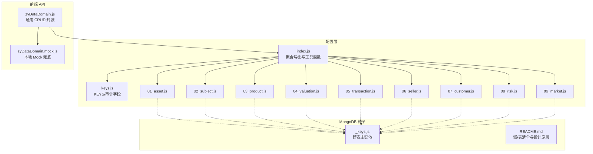
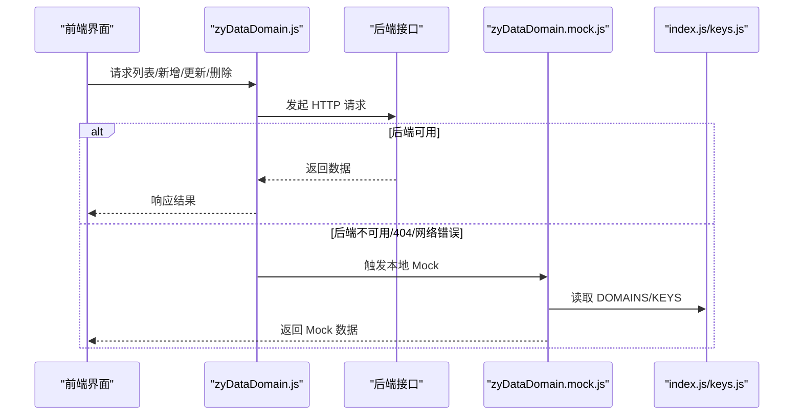
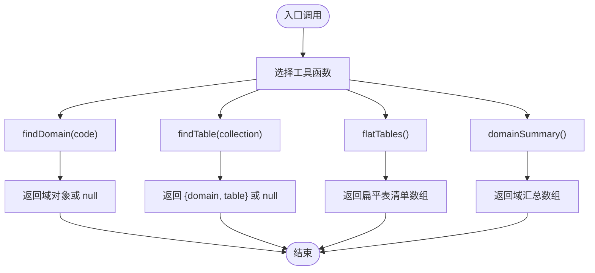
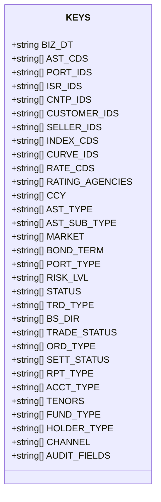
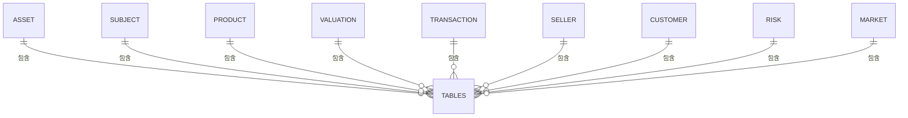
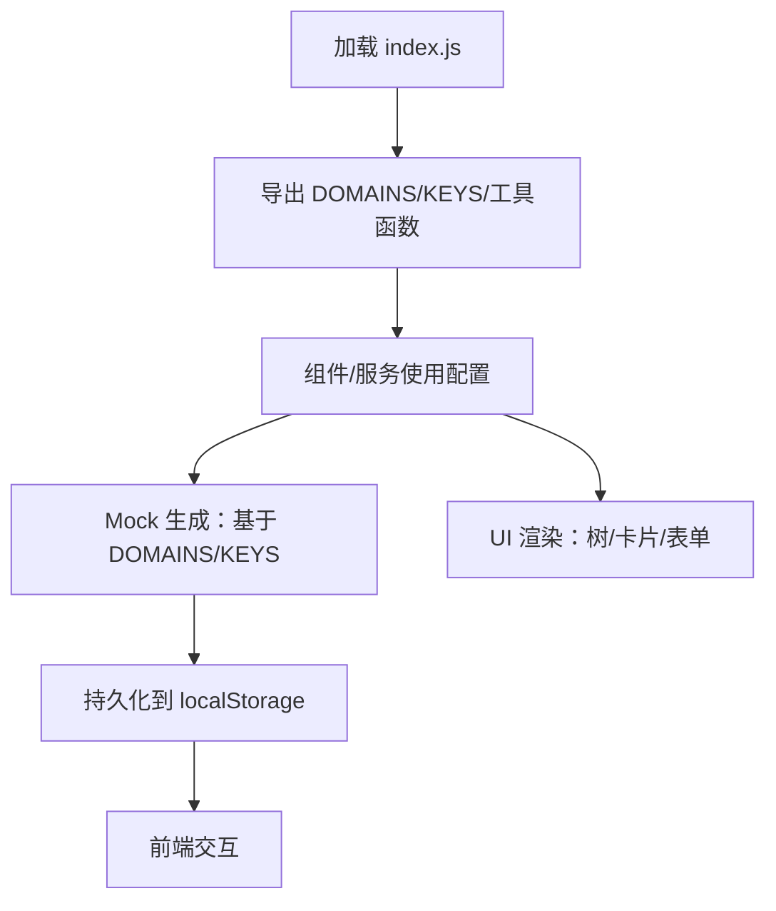
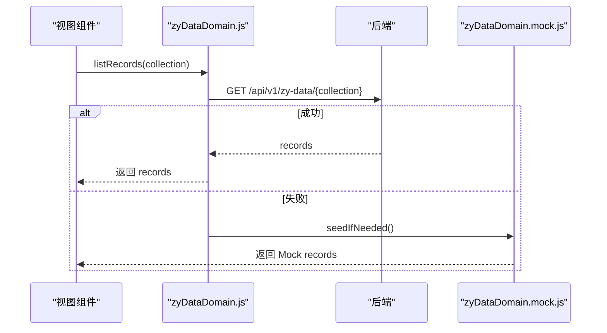
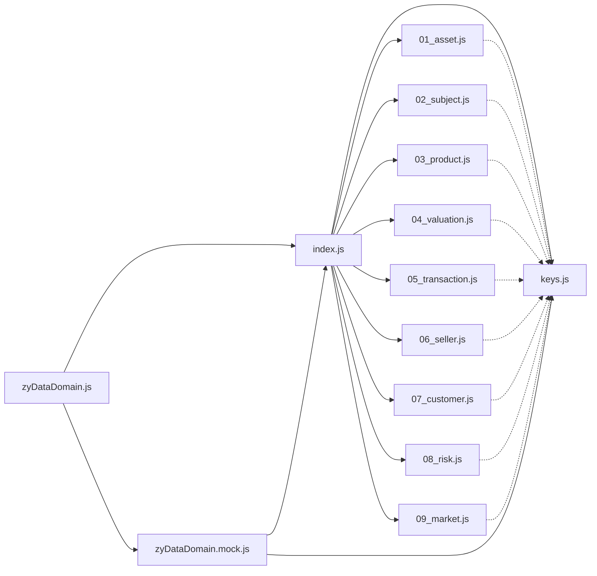

# 数据域配置总览

<cite>
**本文引用的文件**
- [index.js](file://src/config/zyDataDomain/index.js)
- [keys.js](file://src/config/zyDataDomain/keys.js)
- [01_asset.js](file://src/config/zyDataDomain/01_asset.js)
- [02_subject.js](file://src/config/zyDataDomain/02_subject.js)
- [03_product.js](file://src/config/zyDataDomain/03_product.js)
- [04_valuation.js](file://src/config/zyDataDomain/04_valuation.js)
- [05_transaction.js](file://src/config/zyDataDomain/05_transaction.js)
- [06_seller.js](file://src/config/zyDataDomain/06_seller.js)
- [07_customer.js](file://src/config/zyDataDomain/07_customer.js)
- [08_risk.js](file://src/config/zyDataDomain/08_risk.js)
- [09_market.js](file://src/config/zyDataDomain/09_market.js)
- [_keys.js](file://mongo-seed/_keys.js)
- [README.md](file://mongo-seed/README.md)
- [zyDataDomain.js](file://src/api/zyDataDomain.js)
- [zyDataDomain.mock.js](file://src/api/zyDataDomain.mock.js)
</cite>

## 目录
1. [简介](#简介)
2. [项目结构](#项目结构)
3. [核心组件](#核心组件)
4. [架构总览](#架构总览)
5. [详细组件分析](#详细组件分析)
6. [依赖分析](#依赖分析)
7. [性能考虑](#性能考虑)
8. [故障排查指南](#故障排查指南)
9. [结论](#结论)
10. [附录](#附录)

## 简介
本文件为 ZY 数据域配置系统的总体概览文档，面向开发者与数据工程师，系统性阐述 9 大数据域的整体组织结构与管理机制，解析配置系统的入口文件 index.js 的职责与工具函数，说明 KEYS 配置与审计字段的统一管理机制，梳理配置系统的加载流程与模块化设计，并给出与后端 API 及前端 Mock 的集成方式、数据流向与最佳实践。

## 项目结构
- 配置层位于 src/config/zyDataDomain，按域划分文件，统一导出聚合入口，便于按域/表检索与扁平化清单构建。
- MongoDB 种子数据位于 mongo-seed，包含各域脚本与跨表主键池定义，确保表结构、校验器与示例数据一致。
- 前端 API 层位于 src/api，提供通用 CRUD 封装，具备后端不可用时的本地 Mock 兜底能力。

**图表来源**
- [index.js:1-80](file://src/config/zyDataDomain/index.js#L1-L80)
- [keys.js:1-73](file://src/config/zyDataDomain/keys.js#L1-L73)
- [01_asset.js:1-137](file://src/config/zyDataDomain/01_asset.js#L1-L137)
- [02_subject.js:1-59](file://src/config/zyDataDomain/02_subject.js#L1-L59)
- [03_product.js:1-136](file://src/config/zyDataDomain/03_product.js#L1-L136)
- [04_valuation.js:1-137](file://src/config/zyDataDomain/04_valuation.js#L1-L137)
- [05_transaction.js:1-103](file://src/config/zyDataDomain/05_transaction.js#L1-L103)
- [06_seller.js:1-33](file://src/config/zyDataDomain/06_seller.js#L1-L33)
- [07_customer.js:1-121](file://src/config/zyDataDomain/07_customer.js#L1-L121)
- [08_risk.js:1-77](file://src/config/zyDataDomain/08_risk.js#L1-L77)
- [09_market.js:1-272](file://src/config/zyDataDomain/09_market.js#L1-L272)
- [_keys.js:1-161](file://mongo-seed/_keys.js#L1-L161)
- [README.md:1-125](file://mongo-seed/README.md#L1-L125)
- [zyDataDomain.js:1-190](file://src/api/zyDataDomain.js#L1-L190)
- [zyDataDomain.mock.js:1-800](file://src/api/zyDataDomain.mock.js#L1-L800)

**章节来源**
- [index.js:1-80](file://src/config/zyDataDomain/index.js#L1-L80)
- [README.md:1-125](file://mongo-seed/README.md#L1-L125)

## 核心组件
- 聚合入口 index.js
  - 导出 DOMAINS 数组与 KEYS、BIZ_DT、AUDIT_FIELDS 常量
  - 提供 findDomain、findTable、flatTables、domainSummary 等工具函数
- KEYS 配置 keys.js
  - 统一主键池与枚举值，支撑跨表外键一致性
  - 定义默认审计字段 AUDIT_FIELDS，供前端/后端注入
- 各域配置文件
  - 以模块化方式定义 domain、domainName、domainCode、icon、color、tables 等
  - tables 内含 name、label、pk、fields，fields 使用 f 辅助函数统一结构
- MongoDB 种子与校验
  - _keys.js 提供跨表主键池与审计字段模板
  - README.md 明确 Schema 设计原则、索引与清空重建策略

**章节来源**
- [index.js:1-80](file://src/config/zyDataDomain/index.js#L1-L80)
- [keys.js:1-73](file://src/config/zyDataDomain/keys.js#L1-L73)
- [_keys.js:1-161](file://mongo-seed/_keys.js#L1-L161)
- [README.md:114-125](file://mongo-seed/README.md#L114-L125)

## 架构总览
配置系统采用“配置即代码”的模块化设计，通过聚合入口统一暴露域与表元数据，配合 KEYS 实现主键池与枚举的统一管理。前端 API 层提供通用 CRUD 封装，当后端接口不可用时自动切换到本地 Mock，确保开发与演示体验。

**图表来源**
- [zyDataDomain.js:1-190](file://src/api/zyDataDomain.js#L1-L190)
- [zyDataDomain.mock.js:1-800](file://src/api/zyDataDomain.mock.js#L1-L800)
- [index.js:1-80](file://src/config/zyDataDomain/index.js#L1-L80)
- [keys.js:1-73](file://src/config/zyDataDomain/keys.js#L1-L73)

## 详细组件分析

### 聚合入口 index.js
- DOMAINS 聚合 9 个域模块，便于统一遍历与检索
- KEYS、BIZ_DT、AUDIT_FIELDS 直接导出，供上层组件与 API 使用
- 工具函数
  - findDomain：按 domain 或 domainCode 查找域
  - findTable：按集合名查找表（含域引用）
  - flatTables：输出扁平表清单，便于全局检索
  - domainSummary：输出域汇总信息，用于树形/卡片展示

**图表来源**
- [index.js:25-68](file://src/config/zyDataDomain/index.js#L25-L68)

**章节来源**
- [index.js:1-80](file://src/config/zyDataDomain/index.js#L1-L80)

### KEYS 配置与审计字段
- KEYS 提供跨表主键池与枚举值，确保资产、主体、产品、客户、销售等主键一致性
- AUDIT_FIELDS 默认包含 etl_dt、src_sys、_id，用于后端注入与前端展示控制
- MongoDB 种子脚本 _keys.js 同步定义主键池与审计字段模板，保证贴源一致性

**图表来源**
- [keys.js:1-73](file://src/config/zyDataDomain/keys.js#L1-L73)
- [_keys.js:5-161](file://mongo-seed/_keys.js#L5-L161)

**章节来源**
- [keys.js:1-73](file://src/config/zyDataDomain/keys.js#L1-L73)
- [_keys.js:1-161](file://mongo-seed/_keys.js#L1-L161)

### 各域配置文件（节选）
- 资产域（asset）：12 张表，主键池 AST_CD/ISR_ID
- 主体域（subject）：3 张表，主键池 ISR_ID/CNTP_ID
- 产品域（product）：12 张表，主键池 PORT_ID
- 估值域（valuation）：10 张表，主键池 PORT_ID
- 交易域（transaction）：6 张表，主键池 TRADE_ID/ORDER_ID
- 销售域（seller）：1 张表，主键池 SELLER_ID
- 客户域（customer）：8 张表，主键池 CUSTOMER_ID
- 风险域（risk）：5 张表
- 行情域（market）：25 张表，主键池 AST_CD/INDEX_CD/CURVE_ID/RATE_CD

**图表来源**
- [01_asset.js:1-137](file://src/config/zyDataDomain/01_asset.js#L1-L137)
- [02_subject.js:1-59](file://src/config/zyDataDomain/02_subject.js#L1-L59)
- [03_product.js:1-136](file://src/config/zyDataDomain/03_product.js#L1-L136)
- [04_valuation.js:1-137](file://src/config/zyDataDomain/04_valuation.js#L1-L137)
- [05_transaction.js:1-103](file://src/config/zyDataDomain/05_transaction.js#L1-L103)
- [06_seller.js:1-33](file://src/config/zyDataDomain/06_seller.js#L1-L33)
- [07_customer.js:1-121](file://src/config/zyDataDomain/07_customer.js#L1-L121)
- [08_risk.js:1-77](file://src/config/zyDataDomain/08_risk.js#L1-L77)
- [09_market.js:1-272](file://src/config/zyDataDomain/09_market.js#L1-L272)

**章节来源**
- [01_asset.js:1-137](file://src/config/zyDataDomain/01_asset.js#L1-L137)
- [02_subject.js:1-59](file://src/config/zyDataDomain/02_subject.js#L1-L59)
- [03_product.js:1-136](file://src/config/zyDataDomain/03_product.js#L1-L136)
- [04_valuation.js:1-137](file://src/config/zyDataDomain/04_valuation.js#L1-L137)
- [05_transaction.js:1-103](file://src/config/zyDataDomain/05_transaction.js#L1-L103)
- [06_seller.js:1-33](file://src/config/zyDataDomain/06_seller.js#L1-L33)
- [07_customer.js:1-121](file://src/config/zyDataDomain/07_customer.js#L1-L121)
- [08_risk.js:1-77](file://src/config/zyDataDomain/08_risk.js#L1-L77)
- [09_market.js:1-272](file://src/config/zyDataDomain/09_market.js#L1-L272)

### 配置系统加载流程与模块化设计
- 模块化：每个域独立文件，统一导出结构，便于按需引入与维护
- 聚合：index.js 统一导出 DOMAINS、KEYS、工具函数，形成单一入口
- 运行时：前端组件通过 index.js 获取域/表元数据，API 层通过 DOMAINS/KEYS 生成 Mock 数据或进行字段校验

**图表来源**
- [index.js:1-80](file://src/config/zyDataDomain/index.js#L1-L80)
- [zyDataDomain.mock.js:1-800](file://src/api/zyDataDomain.mock.js#L1-L800)

**章节来源**
- [index.js:1-80](file://src/config/zyDataDomain/index.js#L1-L80)
- [zyDataDomain.mock.js:1-800](file://src/api/zyDataDomain.mock.js#L1-L800)

### 与前端 API 的集成与数据流向
- 通用 CRUD 封装：zyDataDomain.js 提供 list/create/update/delete/count 方法
- 后端不可用兜底：当后端返回 404/网络错误时，自动切换到本地 Mock
- Mock 数据：zyDataDomain.mock.js 基于 DOMAINS/KEYS 生成真实业务样例，确保与种子数据一致

**图表来源**
- [zyDataDomain.js:1-190](file://src/api/zyDataDomain.js#L1-L190)
- [zyDataDomain.mock.js:1-800](file://src/api/zyDataDomain.mock.js#L1-L800)

**章节来源**
- [zyDataDomain.js:1-190](file://src/api/zyDataDomain.js#L1-L190)
- [zyDataDomain.mock.js:1-800](file://src/api/zyDataDomain.mock.js#L1-L800)

## 依赖分析
- 配置层依赖关系
  - index.js 依赖各域模块与 keys.js
  - 各域模块依赖 keys.js 提供的主键池与枚举
- 前端 API 依赖
  - zyDataDomain.js 依赖 DOMAINS/KEYS 进行请求封装与兜底
  - zyDataDomain.mock.js 依赖 DOMAINS/KEYS 生成 Mock 数据
- MongoDB 种子依赖
  - _keys.js 与各域脚本保持主键池与审计字段一致

**图表来源**
- [index.js:1-80](file://src/config/zyDataDomain/index.js#L1-L80)
- [keys.js:1-73](file://src/config/zyDataDomain/keys.js#L1-L73)
- [zyDataDomain.js:1-190](file://src/api/zyDataDomain.js#L1-L190)
- [zyDataDomain.mock.js:1-800](file://src/api/zyDataDomain.mock.js#L1-L800)

**章节来源**
- [index.js:1-80](file://src/config/zyDataDomain/index.js#L1-L80)
- [keys.js:1-73](file://src/config/zyDataDomain/keys.js#L1-L73)
- [zyDataDomain.js:1-190](file://src/api/zyDataDomain.js#L1-L190)
- [zyDataDomain.mock.js:1-800](file://src/api/zyDataDomain.mock.js#L1-L800)

## 性能考虑
- 工具函数复杂度
  - findDomain：线性搜索 DOMAINS，O(D)（D 为域数量，常数级）
  - findTable：双重循环遍历 DOMAINS/tables，O(D*T)（T 为平均表数量）
  - flatTables/domainSummary：遍历 DOMAINS/tables，O(D*T)
- 建议
  - 在大规模表场景下，可考虑缓存扁平表清单与域索引，避免重复构建
  - 对高频查询的域/表，可在上层组件中进行二次缓存

[本节为通用性能讨论，无需特定文件引用]

## 故障排查指南
- 后端接口 404/网络错误
  - 现象：zyDataDomain.js 捕获 404/网络错误，自动切换 Mock
  - 处理：检查后端接口可用性；若为开发期，可调用 enableMock() 强制启用 Mock
- Mock 数据未更新
  - 现象：Mock 数据版本号 SEED_VERSION 未升级导致旧数据
  - 处理：在 zyDataDomain.mock.js 中递增 SEED_VERSION 并调用 resetMockData()
- 审计字段缺失
  - 现象：新增表缺少 etl_dt/src_sys
  - 处理：在表字段中加入 AUDIT_FIELDS 或在后端注入模板

**章节来源**
- [zyDataDomain.js:22-62](file://src/api/zyDataDomain.js#L22-L62)
- [zyDataDomain.mock.js:8-33](file://src/api/zyDataDomain.mock.js#L8-L33)

## 结论
ZY 数据域配置系统通过模块化与聚合入口实现了清晰的域/表组织与统一的 KEYS 管理，结合前端 API 的通用 CRUD 封装与 Mock 兜底，提供了高可用、可扩展的数据域配置与使用体验。遵循本文的最佳实践，可在开发、测试与生产环境中保持配置一致性与数据完整性。

[本节为总结性内容，无需特定文件引用]

## 附录

### 使用场景与最佳实践
- 场景
  - 动态表单生成：基于 fields 定义与 KEYS 枚举生成下拉与校验
  - 全局检索：使用 flatTables 构建全局表清单
  - 左侧导航：使用 domainSummary 生成树形/卡片
- 最佳实践
  - 严格维护 KEYS 与种子数据一致性
  - 新增表时同步完善 AUDIT_FIELDS 注入逻辑
  - 在 Mock 数据版本更新时及时清理旧缓存
  - 对高频查询进行缓存优化，避免重复构建扁平表清单

[本节为通用指导，无需特定文件引用]