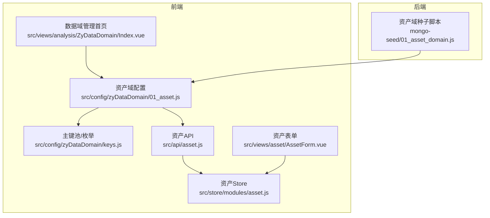
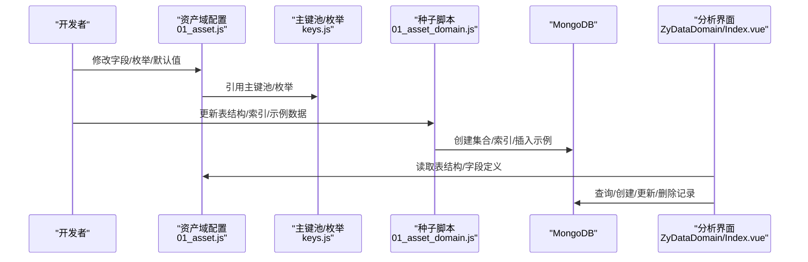
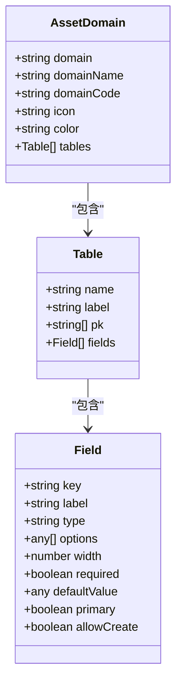
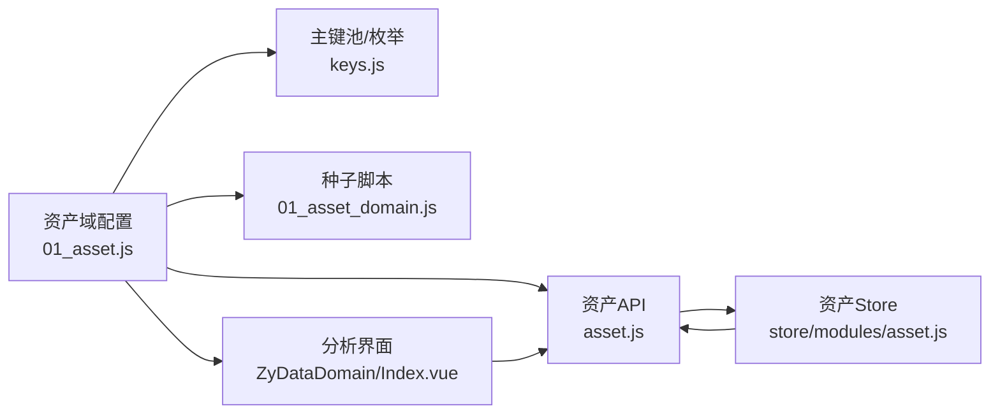

# 资产域配置

<cite>
**本文引用的文件**
- [mongo-seed/01_asset_domain.js](file://mongo-seed/01_asset_domain.js)
- [src/config/zyDataDomain/01_asset.js](file://src/config/zyDataDomain/01_asset.js)
- [src/config/zyDataDomain/keys.js](file://src/config/zyDataDomain/keys.js)
- [src/config/zyDataDomain/index.js](file://src/config/zyDataDomain/index.js)
- [src/api/asset.js](file://src/api/asset.js)
- [src/store/modules/asset.js](file://src/store/modules/asset.js)
- [src/views/asset/AssetForm.vue](file://src/views/asset/AssetForm.vue)
- [src/views/analysis/ZyDataDomain/Index.vue](file://src/views/analysis/ZyDataDomain/Index.vue)
- [docs/MongoDB_ZY数据域表结构清单.md](file://docs/MongoDB_ZY数据域表结构清单.md)
- [docs/ZY_DATA_DOMAIN_MOCK_IMPORT_GUIDE.md](file://docs/ZY_DATA_DOMAIN_MOCK_IMPORT_GUIDE.md)
</cite>

## 目录
1. [简介](#简介)
2. [项目结构](#项目结构)
3. [核心组件](#核心组件)
4. [架构总览](#架构总览)
5. [详细组件分析](#详细组件分析)
6. [依赖分析](#依赖分析)
7. [性能考虑](#性能考虑)
8. [故障排查指南](#故障排查指南)
9. [结论](#结论)
10. [附录](#附录)

## 简介
本文件面向资产域配置的全面技术文档，围绕资产域的数据模型设计、MongoDB 表结构、字段类型与约束、验证规则、与其他数据域的关联关系、业务含义与使用场景、修改与扩展方法以及在系统中的作用与影响范围进行系统化阐述。读者无需深厚的数据库背景，也能通过本文件理解资产域的配置与使用。

## 项目结构
资产域配置由“前端配置 + 后端种子数据 + 前端分析界面”三部分协同构成：
- 前端配置：定义资产域的表结构、字段元数据、枚举与校验规则
- 种子数据：MongoDB 资产域 12 张表的结构与示例数据
- 分析界面：基于资产域配置的可视化管理与数据导入工具

图表来源
- [src/config/zyDataDomain/01_asset.js:1-137](file://src/config/zyDataDomain/01_asset.js#L1-L137)
- [src/config/zyDataDomain/keys.js:1-73](file://src/config/zyDataDomain/keys.js#L1-L73)
- [src/store/modules/asset.js:1-183](file://src/store/modules/asset.js#L1-L183)
- [src/api/asset.js:1-284](file://src/api/asset.js#L1-L284)
- [src/views/asset/AssetForm.vue:1-359](file://src/views/asset/AssetForm.vue#L1-L359)
- [src/views/analysis/ZyDataDomain/Index.vue:1-290](file://src/views/analysis/ZyDataDomain/Index.vue#L1-L290)
- [mongo-seed/01_asset_domain.js:1-374](file://mongo-seed/01_asset_domain.js#L1-L374)

章节来源
- [src/config/zyDataDomain/01_asset.js:1-137](file://src/config/zyDataDomain/01_asset.js#L1-L137)
- [src/config/zyDataDomain/keys.js:1-73](file://src/config/zyDataDomain/keys.js#L1-L73)
- [mongo-seed/01_asset_domain.js:1-374](file://mongo-seed/01_asset_domain.js#L1-L374)

## 核心组件
- 资产域配置定义：集中于资产域配置文件，定义表、主键、字段、类型、枚举、宽度、默认值、是否必填等
- 主键池与枚举：统一的主键池与枚举值，确保跨表一致性
- 种子脚本：MongoDB 资产域 12 张表的结构定义与示例数据
- 前端分析界面：基于资产域配置的可视化管理与数据导入工具
- 资产API与Store：提供资产列表、选项、创建、更新、删除等能力，并与前端表单联动

章节来源
- [src/config/zyDataDomain/01_asset.js:10-136](file://src/config/zyDataDomain/01_asset.js#L10-L136)
- [src/config/zyDataDomain/keys.js:6-72](file://src/config/zyDataDomain/keys.js#L6-L72)
- [mongo-seed/01_asset_domain.js:27-374](file://mongo-seed/01_asset_domain.js#L27-L374)
- [src/views/analysis/ZyDataDomain/Index.vue:76-214](file://src/views/analysis/ZyDataDomain/Index.vue#L76-L214)
- [src/api/asset.js:7-284](file://src/api/asset.js#L7-L284)
- [src/store/modules/asset.js:3-183](file://src/store/modules/asset.js#L3-L183)

## 架构总览
资产域配置贯穿“前端配置 → 种子脚本 → MongoDB → 前端分析界面”的闭环，前端通过配置驱动表单与表格渲染，后端通过种子脚本建立结构与示例数据，分析界面提供 CRUD 与导入能力。

图表来源
- [src/config/zyDataDomain/01_asset.js:10-136](file://src/config/zyDataDomain/01_asset.js#L10-L136)
- [src/config/zyDataDomain/keys.js:6-72](file://src/config/zyDataDomain/keys.js#L6-L72)
- [mongo-seed/01_asset_domain.js:27-374](file://mongo-seed/01_asset_domain.js#L27-L374)
- [src/views/analysis/ZyDataDomain/Index.vue:103-214](file://src/views/analysis/ZyDataDomain/Index.vue#L103-L214)

## 详细组件分析

### 资产域配置文件（01_asset.js）
- 域标识：domain、domainName、domainCode、图标与颜色
- 表清单：包含 12 张表，每张表定义主键、字段数组
- 字段定义：每个字段包含 key、label、type、options、width、required、defaultValue、allowCreate 等
- 关联表：包含 dwd_ast_party、dwd_ast_exe_plan、dwd_ast_fund_manager、dwd_ast_bottom_raito、dwd_ast_fiveclass、dwd_ast_calc_rule 等扩展表

图表来源
- [src/config/zyDataDomain/01_asset.js:10-136](file://src/config/zyDataDomain/01_asset.js#L10-L136)

章节来源
- [src/config/zyDataDomain/01_asset.js:10-136](file://src/config/zyDataDomain/01_asset.js#L10-L136)

### 主键池与枚举（keys.js）
- 主键池：AST_CD、ISR_ID、PORT_ID、CNTP_ID、CUSTOMER_ID、SELLER_ID、BIZ_DT 等
- 枚举：资产类型、子类型、币种、市场、期限、 HOLDER_TYPE、通道等
- 审计字段：etl_dt、src_sys 等默认审计字段

章节来源
- [src/config/zyDataDomain/keys.js:6-72](file://src/config/zyDataDomain/keys.js#L6-L72)

### 种子脚本（01_asset_domain.js）
- 结构定义：每张表的 JSON Schema，声明必填字段、bsonType、描述
- 索引策略：主键唯一索引、复合索引、BIZ_DT 索引
- 示例数据：每张表的种子数据，覆盖典型资产与场景
- 审计字段：自动注入 etl_dt、src_sys 等审计字段

章节来源
- [mongo-seed/01_asset_domain.js:27-374](file://mongo-seed/01_asset_domain.js#L27-L374)

### 前端分析界面（ZyDataDomain/Index.vue）
- 功能：选择表 → 加载记录 → 创建/编辑/删除 → 分页/过滤
- 集成：findTable、domainSummary、BIZ_DT 等配置工具
- 交互：RecordTable、RecordFormDialog 驱动 CRUD

章节来源
- [src/views/analysis/ZyDataDomain/Index.vue:76-214](file://src/views/analysis/ZyDataDomain/Index.vue#L76-L214)
- [src/config/zyDataDomain/index.js:25-79](file://src/config/zyDataDomain/index.js#L25-L79)

### 资产API与Store（asset.js）
- API：资产列表、选项、创建、更新、删除、K线、模板下载、批量导入等
- Store：资产列表、总数、选中资产、加载状态、增删改查动作与getter

章节来源
- [src/api/asset.js:7-284](file://src/api/asset.js#L7-L284)
- [src/store/modules/asset.js:3-183](file://src/store/modules/asset.js#L3-L183)

### 资产表单（AssetForm.vue）
- 表单：资产代码、名称、分类、交易所、描述、展期信息、替代信息等
- 校验：必填校验、分类联动清空字段
- 交互：新增/编辑、提交、取消、错误提示

章节来源
- [src/views/asset/AssetForm.vue:143-359](file://src/views/asset/AssetForm.vue#L143-L359)

## 依赖分析
- 配置到种子：01_asset.js 与 mongo-seed/01_asset_domain.js 一一对应，前者定义字段与默认值，后者定义索引与示例数据
- 配置到前端：01_asset.js 与 keys.js 提供给分析界面与表单使用
- 前端到后端：分析界面通过 API 查询/写入 MongoDB；资产表单通过 Store/API 与后端交互
- 外键关联：AST_CD、ISR_ID、PORT_ID 等主键池在多域之间共享，形成跨域关联

图表来源
- [src/config/zyDataDomain/01_asset.js:10-136](file://src/config/zyDataDomain/01_asset.js#L10-L136)
- [src/config/zyDataDomain/keys.js:6-72](file://src/config/zyDataDomain/keys.js#L6-L72)
- [mongo-seed/01_asset_domain.js:27-374](file://mongo-seed/01_asset_domain.js#L27-L374)
- [src/views/analysis/ZyDataDomain/Index.vue:76-214](file://src/views/analysis/ZyDataDomain/Index.vue#L76-L214)
- [src/api/asset.js:7-284](file://src/api/asset.js#L7-L284)
- [src/store/modules/asset.js:3-183](file://src/store/modules/asset.js#L3-L183)

章节来源
- [src/config/zyDataDomain/index.js:25-79](file://src/config/zyDataDomain/index.js#L25-L79)
- [docs/MongoDB_ZY数据域表结构清单.md:283-308](file://docs/MongoDB_ZY数据域表结构清单.md#L283-L308)

## 性能考虑
- 索引策略：每张表的主键与常用查询字段建立唯一/复合索引，提升查询效率
- 分页与过滤：分析界面支持分页与过滤，避免一次性加载过多数据
- 导入批处理：批量导入行情数据时设置较长超时，保证大数据量导入稳定性
- Mock 数据导入：通过脚本将 Mock 数据导入 MongoDB，减少前端本地存储带来的查询隔离问题

章节来源
- [mongo-seed/01_asset_domain.js:27-374](file://mongo-seed/01_asset_domain.js#L27-L374)
- [src/views/analysis/ZyDataDomain/Index.vue:126-155](file://src/views/analysis/ZyDataDomain/Index.vue#L126-L155)
- [src/api/asset.js:131-157](file://src/api/asset.js#L131-L157)
- [docs/ZY_DATA_DOMAIN_MOCK_IMPORT_GUIDE.md:44-75](file://docs/ZY_DATA_DOMAIN_MOCK_IMPORT_GUIDE.md#L44-L75)

## 故障排查指南
- 表单提交失败：检查后端是否实现更新接口，若 404 则提示联系后端或删除旧资产后重建
- Mock 数据无数据：确认已将 Mock 数据导入 MongoDB，或启用后端查询 API
- 字段校验错误：核对字段 required、type、options 与实际输入是否一致
- 导入异常：检查文件格式、日期范围、是否仅导入缺失日期等参数

章节来源
- [src/views/asset/AssetForm.vue:312-329](file://src/views/asset/AssetForm.vue#L312-L329)
- [docs/ZY_DATA_DOMAIN_MOCK_IMPORT_GUIDE.md:177-224](file://docs/ZY_DATA_DOMAIN_MOCK_IMPORT_GUIDE.md#L177-L224)
- [src/api/asset.js:131-157](file://src/api/asset.js#L131-L157)

## 结论
资产域配置通过“前端配置 + 种子脚本 + 分析界面”的方式，实现了资产域数据模型的标准化与可维护性。其核心在于：
- 以配置驱动表单与表格渲染，降低硬编码耦合
- 通过主键池与枚举确保跨域一致性
- 通过种子脚本与索引策略保障数据结构与查询性能
- 通过分析界面与 API 提供完善的 CRUD 与导入能力

## 附录

### 资产域表结构与字段说明（摘要）
- dwd_ast_info：资产基础信息，主键 AST_CD，包含资产类型、子类型、币种、上市/到期日、票面利率、发行规模、市场、期限等
- dwd_ast_info_ch / dwd_ast_info_zg：估值信息，主键 AST_CD+BIZ_DT，包含估值净价/全价、收益率、久期、凸性、评级机构、估值来源
- dwd_ast_yield_info：收益率信息，主键 AST_CD+BIZ_DT，包含到期/行权收益率、日/周/月/年化收益、结算价
- dwd_ast_cf_plan：现金流计划，主键 AST_CD+CF_DT+CF_TYPE，包含现金流类型、金额、币种
- dwd_ast_pledge：质押状态，主键 AST_CD+BIZ_DT，包含是否质押、质押比例、标准券折算、质押债券、备注
- dwd_ast_party：资产关联方，主键 AST_CD+PARTY_ID，包含关联方角色、名称
- dwd_ast_exe_plan：资产行权计划，主键 AST_CD+EXE_DT，包含行权类型、价格、备注
- dwd_ast_fund_manager：资产基金经理，主键 AST_CD+MANAGER_ID，包含经理姓名、起止日期、是否共管
- dwd_ast_bottom_raito：资产穿透底层，主键 AST_CD+BTM_AST_CD，包含底层资产占比与名称
- dwd_ast_fiveclass：资产五级分类，主键 AST_CD+BIZ_DT，包含分类等级、原因、是否调整、上次等级
- dwd_ast_calc_rule：资产计算规则，主键 AST_TYPE+RULE_CD，包含规则名称、公式、生效日

章节来源
- [docs/MongoDB_ZY数据域表结构清单.md:9-25](file://docs/MongoDB_ZY数据域表结构清单.md#L9-L25)
- [src/config/zyDataDomain/01_asset.js:16-136](file://src/config/zyDataDomain/01_asset.js#L16-L136)

### 资产域与其他数据域的关联关系
- dwd_ast_info.AST_CD → dwd_ast_info_ch.AST_CD、dwd_ast_yield_info.AST_CD、dwd_ptl_holding.AST_CD、dwd_trn_trade_ast.AST_CD
- dwd_isr_institution.ISR_ID → dwd_ast_info.ISR_ID、dwd_ptl_info.MGR_INST
- dwd_ptl_info.PORT_ID → dwd_ptl_holding.PORT_ID、dwd_ptl_nav_hist.PORT_ID、dwd_cust_transaction.PORT_ID

章节来源
- [docs/MongoDB_ZY数据域表结构清单.md:283-308](file://docs/MongoDB_ZY数据域表结构清单.md#L283-L308)

### 资产域配置的业务含义与使用场景
- 资产分类：通过 AST_TYPE/AST_SUB_TYPE 定义债券、股票、基金、ABS 等类型及其子类
- 定价机制：通过估值表（中债/中证）与收益率表提供定价与收益评估依据
- 风险特征：通过五级分类、评级、条款、质押状态等反映资产风险状况
- 业务日期：BIZ_DT 作为业务日期，贯穿各表，确保数据时序一致性

章节来源
- [src/config/zyDataDomain/01_asset.js:17-136](file://src/config/zyDataDomain/01_asset.js#L17-L136)
- [src/config/zyDataDomain/keys.js:6-72](file://src/config/zyDataDomain/keys.js#L6-L72)

### 资产域配置的修改指南与扩展方法
- 新增字段：在对应表的 fields 中添加 Field 定义，设置类型、枚举、宽度、必填、默认值等
- 修改验证规则：调整字段的 required、options、width 等属性
- 新增表：在 tables 中添加新的 Table 定义，设置 name、label、pk、fields
- 扩展枚举：在 keys.js 中增加枚举值，确保前后端一致
- 种子脚本同步：如涉及索引或示例数据，同步更新 mongo-seed/01_asset_domain.js

章节来源
- [src/config/zyDataDomain/01_asset.js:10-136](file://src/config/zyDataDomain/01_asset.js#L10-L136)
- [src/config/zyDataDomain/keys.js:6-72](file://src/config/zyDataDomain/keys.js#L6-L72)
- [mongo-seed/01_asset_domain.js:27-374](file://mongo-seed/01_asset_domain.js#L27-L374)

### 资产域配置在系统中的作用与影响范围
- 前端：驱动表单渲染、表格展示、校验与交互
- 后端：通过种子脚本建立结构与示例数据，支撑分析与导入
- 跨域：通过主键池与枚举，确保与主体域、产品域、交易域等的关联一致性
- 影响范围：资产基础信息、估值、收益、现金流、质押、评级、条款、持有人、事件等全链路数据

章节来源
- [src/views/analysis/ZyDataDomain/Index.vue:76-214](file://src/views/analysis/ZyDataDomain/Index.vue#L76-L214)
- [src/config/zyDataDomain/index.js:25-79](file://src/config/zyDataDomain/index.js#L25-L79)
- [docs/MongoDB_ZY数据域表结构清单.md:283-308](file://docs/MongoDB_ZY数据域表结构清单.md#L283-L308)