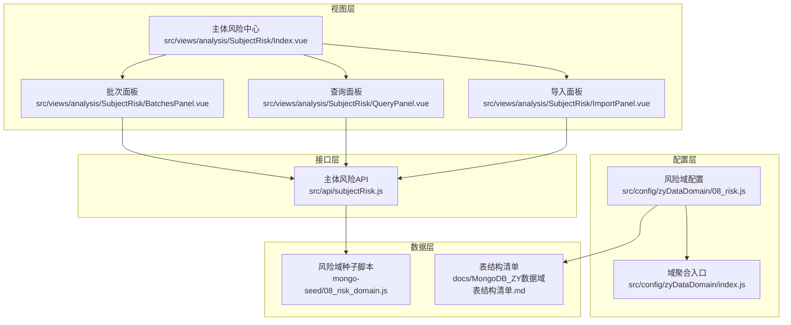
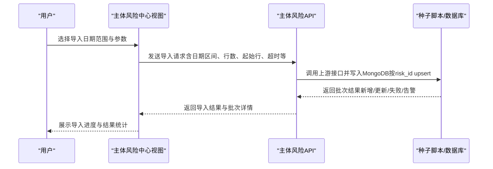
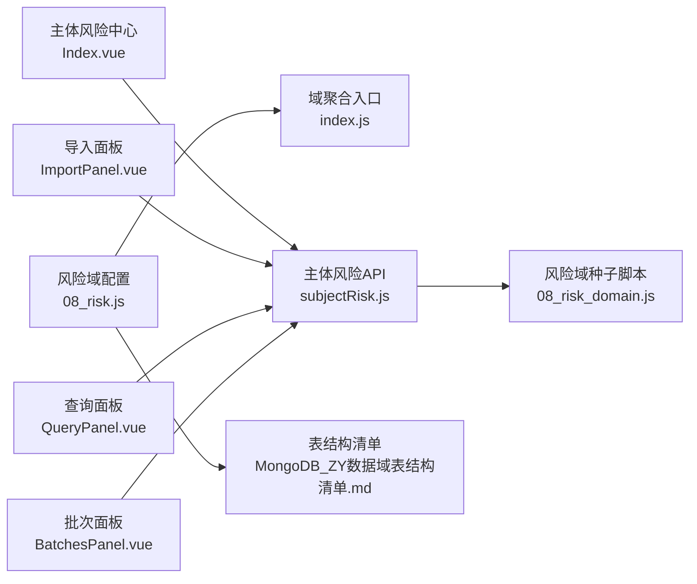

# 风险域配置

<cite>
**本文引用的文件**
- [mongo-seed/08_risk_domain.js](file://mongo-seed/08_risk_domain.js)
- [src/config/zyDataDomain/08_risk.js](file://src/config/zyDataDomain/08_risk.js)
- [src/views/analysis/SubjectRisk/Index.vue](file://src/views/analysis/SubjectRisk/Index.vue)
- [src/views/analysis/SubjectRisk/ImportPanel.vue](file://src/views/analysis/SubjectRisk/ImportPanel.vue)
- [src/views/analysis/SubjectRisk/QueryPanel.vue](file://src/views/analysis/SubjectRisk/QueryPanel.vue)
- [src/views/analysis/SubjectRisk/BatchesPanel.vue](file://src/views/analysis/SubjectRisk/BatchesPanel.vue)
- [src/api/subjectRisk.js](file://src/api/subjectRisk.js)
- [src/config/zyDataDomain/index.js](file://src/config/zyDataDomain/index.js)
- [docs/MongoDB_ZY数据域表结构清单.md](file://docs/MongoDB_ZY数据域表结构清单.md)
</cite>

## 目录
1. [简介](#简介)
2. [项目结构](#项目结构)
3. [核心组件](#核心组件)
4. [架构总览](#架构总览)
5. [详细组件分析](#详细组件分析)
6. [依赖分析](#依赖分析)
7. [性能考虑](#性能考虑)
8. [故障排查指南](#故障排查指南)
9. [结论](#结论)
10. [附录](#附录)

## 简介
本文件面向“风险域配置”的全生命周期管理，覆盖数据模型、风险度量体系、表单设计与验证、在投资组合管理中的作用、业务规则与监管要求，以及维护与更新流程。风险域在本系统中包含两类核心能力：
- 主体观点风险（Subject Risk）：通过上游数据导入、查询、批次管理与统计分析，支撑风险识别与监控。
- 传统风控指标（VaR、限额检查、预警、信用评级变动与观察名单等）：通过种子数据与配置化的表结构，支撑限额控制、压力测试与监管报告。

## 项目结构
风险域相关代码主要分布在以下模块：
- 配置层：风险域表结构定义与域聚合入口
- 视图层：主体观点风险的导入、查询、批次管理界面
- 接口层：主体观点风险的 API 封装
- 数据层：风险域种子脚本与表结构说明文档

**图表来源**
- [src/config/zyDataDomain/08_risk.js:1-77](file://src/config/zyDataDomain/08_risk.js#L1-L77)
- [src/config/zyDataDomain/index.js:1-80](file://src/config/zyDataDomain/index.js#L1-L80)
- [src/views/analysis/SubjectRisk/Index.vue:1-242](file://src/views/analysis/SubjectRisk/Index.vue#L1-L242)
- [src/views/analysis/SubjectRisk/ImportPanel.vue:1-551](file://src/views/analysis/SubjectRisk/ImportPanel.vue#L1-L551)
- [src/views/analysis/SubjectRisk/QueryPanel.vue:1-780](file://src/views/analysis/SubjectRisk/QueryPanel.vue#L1-L780)
- [src/views/analysis/SubjectRisk/BatchesPanel.vue:1-607](file://src/views/analysis/SubjectRisk/BatchesPanel.vue#L1-L607)
- [src/api/subjectRisk.js:1-94](file://src/api/subjectRisk.js#L1-L94)
- [mongo-seed/08_risk_domain.js:1-112](file://mongo-seed/08_risk_domain.js#L1-L112)
- [docs/MongoDB_ZY数据域表结构清单.md:188-201](file://docs/MongoDB_ZY数据域表结构清单.md#L188-L201)

**章节来源**
- [src/config/zyDataDomain/08_risk.js:1-77](file://src/config/zyDataDomain/08_risk.js#L1-L77)
- [src/config/zyDataDomain/index.js:1-80](file://src/config/zyDataDomain/index.js#L1-L80)
- [src/views/analysis/SubjectRisk/Index.vue:1-242](file://src/views/analysis/SubjectRisk/Index.vue#L1-L242)
- [src/views/analysis/SubjectRisk/ImportPanel.vue:1-551](file://src/views/analysis/SubjectRisk/ImportPanel.vue#L1-L551)
- [src/views/analysis/SubjectRisk/QueryPanel.vue:1-780](file://src/views/analysis/SubjectRisk/QueryPanel.vue#L1-L780)
- [src/views/analysis/SubjectRisk/BatchesPanel.vue:1-607](file://src/views/analysis/SubjectRisk/BatchesPanel.vue#L1-L607)
- [src/api/subjectRisk.js:1-94](file://src/api/subjectRisk.js#L1-L94)
- [mongo-seed/08_risk_domain.js:1-112](file://mongo-seed/08_risk_domain.js#L1-L112)
- [docs/MongoDB_ZY数据域表结构清单.md:188-201](file://docs/MongoDB_ZY数据域表结构清单.md#L188-L201)

## 核心组件
- 风险域配置定义：定义了风险域的表结构、字段、主键、枚举与宽度等元数据，用于前端表单渲染与校验。
- 主体观点风险中心：提供导入、查询、批次管理与统计概览的统一入口。
- 主体观点风险 API：封装导入、查询、批次、统计等接口，支持上游数据拉取与本地批处理。
- 风险域种子脚本：初始化风险域相关集合与索引，提供示例数据，便于演示与测试。

**章节来源**
- [src/config/zyDataDomain/08_risk.js:9-76](file://src/config/zyDataDomain/08_risk.js#L9-L76)
- [src/views/analysis/SubjectRisk/Index.vue:1-242](file://src/views/analysis/SubjectRisk/Index.vue#L1-L242)
- [src/api/subjectRisk.js:1-94](file://src/api/subjectRisk.js#L1-L94)
- [mongo-seed/08_risk_domain.js:1-112](file://mongo-seed/08_risk_domain.js#L1-L112)

## 架构总览
风险域配置采用“配置驱动 + 视图 + API + 数据”的分层架构：
- 配置驱动：通过风险域配置文件定义表结构与字段元数据，统一前端表单渲染与校验。
- 视图层：提供导入、查询、批次管理与统计概览，支持多维筛选与导出。
- 接口层：封装主体风险相关 API，支持上游数据导入、分页查询、批次历史与统计。
- 数据层：通过种子脚本初始化集合与索引，提供示例数据，支撑演示与回归测试。

**图表来源**
- [src/views/analysis/SubjectRisk/ImportPanel.vue:364-450](file://src/views/analysis/SubjectRisk/ImportPanel.vue#L364-L450)
- [src/api/subjectRisk.js:9-16](file://src/api/subjectRisk.js#L9-L16)
- [mongo-seed/08_risk_domain.js:1-112](file://mongo-seed/08_risk_domain.js#L1-L112)

## 详细组件分析

### 风险域数据模型与风险度量体系
- 风险域包含两类关键数据集：
  - 主体观点风险：通过上游接口导入，包含风险等级、主体信息、规则分类、信号描述、批次信息等。
  - 传统风控指标：通过种子脚本初始化，包含限额检查、预警、VaR、信用评级变动与观察名单等。

- 风险度量与阈值：
  - 限额检查：针对单一资产集中度、组合杠杆率、权益资产比例等设定阈值，实时比对当前值与阈值，状态分为正常、警告、违规。
  - 预警：基于限额超限、久期超限、流动性不足、交易对手集中度、跟踪误差等触发，分级（高、中、低）并记录处理状态。
  - VaR：按历史模拟或参数法计算，给出置信度、持有期、VaR金额与百分比、预期短缺等指标。
  - 信用评级：记录主体内外部评级、违约概率、违约损失率、违约风险敞口、预期损失、观察标识与上次评级日等。
  - 信用风险敞口：记录组合对资产的敞口金额、评级、久期、预期损失金额、VaR 99%、限额状态等。
  - 授信协议：记录对手方协议类型、生效/失效日、额度、已用/剩余额度、风险等级与业务日期等。
  - 主体关联关系：记录源主体与目标主体的关系类型、持股比例、备注与业务日期等。

- 风险域表结构与索引（节选）：
  - dwd_rsk_limit_check：限额检查，主键包含组合ID、规则编码、业务日期，支持按组合与日期查询。
  - dwd_rsk_alert：预警记录，主键为预警ID，支持按组合与触发日期、预警级别与处理状态查询。
  - dwd_rsk_var：VaR计算，主键为组合ID与计算日期，支持按组合与日期唯一约束。
  - dwd_crdt_rating_change：评级变动，主键为变更ID，支持按主体与变更日期、机构查询。
  - dwd_crdt_watchlist：观察名单，主键为观察ID，支持按主体、风险等级与状态查询。

**章节来源**
- [mongo-seed/08_risk_domain.js:15-112](file://mongo-seed/08_risk_domain.js#L15-L112)
- [docs/MongoDB_ZY数据域表结构清单.md:188-201](file://docs/MongoDB_ZY数据域表结构清单.md#L188-L201)
- [src/config/zyDataDomain/08_risk.js:16-74](file://src/config/zyDataDomain/08_risk.js#L16-L74)

### 风险域表单设计与字段定义
- 风险域配置文件定义了各表的字段、类型、是否必填、主键、枚举值与宽度等元数据，用于前端表单渲染与校验。
- 关键字段示例：
  - dwd_rsk_sentiment：舆情ID、目标类型（ISR/AST/PORT）、发布日期/时间、信息源、标题、情绪类型（正向/负向/中性）、情绪分值、摘要。
  - dwd_rsk_credit：主体ID、业务日期、内部评级、外部评级、1年违约概率、违约损失率、违约风险敞口、预期损失、观察标识、上次评级日。
  - dwd_rsk_credit_position：组合ID、资产代码、业务日期、敞口金额、评级、久期、预期损失金额、VaR 99%、限额状态。
  - dwd_crdt_agme_info：协议号、对手ID、协议类型（NAFMII/ISDA/Interbank/Other）、生效/失效日、额度、已用/剩余额度、风险等级、业务日期。
  - dwd_rsk_main_rela_rela_info：源主体ID、目标主体ID、关系类型（同行/政策关联/承销商/商业/母公司/子公司）、持股比例、备注、业务日期。

**章节来源**
- [src/config/zyDataDomain/08_risk.js:16-74](file://src/config/zyDataDomain/08_risk.js#L16-L74)

### 风险域表单验证规则
- 配置文件中通过字段定义的 required、options、width 等属性，为前端表单提供基础校验与展示规则。
- 在主体风险中心的导入面板中，日期区间、最大行数、起始行等参数具备必填校验与默认值，确保导入流程可控。

**章节来源**
- [src/config/zyDataDomain/08_risk.js:16-74](file://src/config/zyDataDomain/08_risk.js#L16-L74)
- [src/views/analysis/SubjectRisk/ImportPanel.vue:288-294](file://src/views/analysis/SubjectRisk/ImportPanel.vue#L288-L294)

### 投资组合管理中的核心作用
- 风险识别：通过主体观点风险的导入与查询，识别潜在风险信号，结合规则分类与信号描述辅助判断。
- 量化评估：通过 VaR 计算与信用风险敞口、违约概率、损失率等指标，量化组合风险暴露。
- 监控预警：通过限额检查与预警记录，实时监控组合是否接近或突破阈值，分级响应与处理状态追踪。

**章节来源**
- [mongo-seed/08_risk_domain.js:62-75](file://mongo-seed/08_risk_domain.js#L62-L75)
- [src/views/analysis/SubjectRisk/QueryPanel.vue:1-780](file://src/views/analysis/SubjectRisk/QueryPanel.vue#L1-L780)

### 业务规则与监管要求
- 风险分类：主体观点风险按风险等级（红/橙/黄/蓝/绿）与规则分类（大类/中类/小类）进行归类，便于监管与内控。
- 压力测试：风险域包含压力测试表（dwd_rsk_stress_test），支持情景分析与压力情景下的风险评估。
- 资本充足率：可通过信用风险敞口、违约概率、损失率等指标间接评估资本充足状况，配合监管报表（dwd_rsk_report）输出。

**章节来源**
- [docs/MongoDB_ZY数据域表结构清单.md:188-201](file://docs/MongoDB_ZY数据域表结构清单.md#L188-L201)
- [src/config/zyDataDomain/08_risk.js:67-74](file://src/config/zyDataDomain/08_risk.js#L67-L74)

### 风险域配置维护指南
- 风险参数调整：
  - 限额检查阈值：在 dwd_rsk_limit_check 中调整 THRESHOLD 与 CURRENT_VALUE，并根据 BREACH_REASON 进行说明。
  - 预警级别与处理状态：在 dwd_rsk_alert 中调整 ALERT_LVL 与 HANDLE_STATUS，并记录处理意见。
  - VaR 方法与参数：在 dwd_rsk_var 中调整 METHOD、CONFIDENCE、HORIZON_DAYS 等参数。
- 模型更新：
  - 信用风险模型：在 dwd_rsk_credit 中更新 PD_1Y、LGD、EAD、EXPECTED_LOSS 等指标。
  - 信用风险敞口模型：在 dwd_rsk_credit_position 中更新 EXPOSURE、DURATION、EL_AMT、VAR_99 等。
- 授信与关联关系：
  - 授信协议：在 dwd_crdt_agme_info 中更新额度、已用/剩余额度、风险等级。
  - 主体关联关系：在 dwd_rsk_main_rela_rela_info 中更新关系类型与持股比例。

**章节来源**
- [mongo-seed/08_risk_domain.js:21-112](file://mongo-seed/08_risk_domain.js#L21-L112)
- [src/config/zyDataDomain/08_risk.js:29-74](file://src/config/zyDataDomain/08_risk.js#L29-L74)

## 依赖分析
- 风险域配置文件依赖域聚合入口，通过 findTable/findDomain 提供表与域的定位能力。
- 主体风险中心视图依赖 API 层，实现导入、查询、批次管理与统计。
- 种子脚本负责初始化集合与索引，提供示例数据，支撑演示与回归测试。

**图表来源**
- [src/config/zyDataDomain/08_risk.js:1-77](file://src/config/zyDataDomain/08_risk.js#L1-L77)
- [src/config/zyDataDomain/index.js:25-37](file://src/config/zyDataDomain/index.js#L25-L37)
- [src/views/analysis/SubjectRisk/Index.vue:82-86](file://src/views/analysis/SubjectRisk/Index.vue#L82-L86)
- [src/api/subjectRisk.js:1-94](file://src/api/subjectRisk.js#L1-L94)
- [mongo-seed/08_risk_domain.js:1-112](file://mongo-seed/08_risk_domain.js#L1-L112)
- [docs/MongoDB_ZY数据域表结构清单.md:188-201](file://docs/MongoDB_ZY数据域表结构清单.md#L188-L201)

**章节来源**
- [src/config/zyDataDomain/index.js:25-37](file://src/config/zyDataDomain/index.js#L25-L37)
- [src/views/analysis/SubjectRisk/Index.vue:82-86](file://src/views/analysis/SubjectRisk/Index.vue#L82-L86)
- [src/api/subjectRisk.js:1-94](file://src/api/subjectRisk.js#L1-L94)

## 性能考虑
- 导入性能：导入面板支持批量参数（最大行数、起始行、超时），建议根据上游接口性能与网络状况合理设置。
- 查询性能：查询面板支持分页、多维筛选与导出，建议在高频查询字段建立索引（如业务日期、风险等级、主体ID等）。
- 统计性能：统计概览与图表渲染建议在数据量较大时采用分页与缓存策略，避免一次性加载过多数据。

[本节为通用指导，无需特定文件引用]

## 故障排查指南
- 导入失败：
  - 检查日期区间是否正确、最大行数与起始行是否合理、上游 URL 是否可访问。
  - 查看批次详情中的错误信息与样例失败，定位具体问题。
- 查询异常：
  - 确认筛选条件是否正确，尝试重置筛选并缩小范围。
  - 检查网络与权限，确认 API 可达性。
- 统计不更新：
  - 刷新概览或重新加载页面，确认上游数据是否已更新。

**章节来源**
- [src/views/analysis/SubjectRisk/ImportPanel.vue:364-450](file://src/views/analysis/SubjectRisk/ImportPanel.vue#L364-L450)
- [src/views/analysis/SubjectRisk/QueryPanel.vue:525-542](file://src/views/analysis/SubjectRisk/QueryPanel.vue#L525-L542)
- [src/views/analysis/SubjectRisk/BatchesPanel.vue:415-431](file://src/views/analysis/SubjectRisk/BatchesPanel.vue#L415-L431)

## 结论
风险域配置通过“配置驱动 + 视图 + API + 数据”的架构，实现了从数据模型到业务应用的完整闭环。主体观点风险中心提供了完善的导入、查询、批次管理与统计功能，满足风险识别、量化评估与监控预警的需求；传统风控指标与信用风险模型则支撑限额控制、压力测试与监管报告。通过合理的参数调整与模型更新流程，可有效提升风险域的准确性与可维护性。

[本节为总结性内容，无需特定文件引用]

## 附录
- 风险域表结构与索引参考：见“表结构清单”文档。
- 风险域种子脚本：见“风险域种子脚本”文件，包含集合初始化、索引创建与示例数据插入。

**章节来源**
- [docs/MongoDB_ZY数据域表结构清单.md:188-201](file://docs/MongoDB_ZY数据域表结构清单.md#L188-L201)
- [mongo-seed/08_risk_domain.js:1-112](file://mongo-seed/08_risk_domain.js#L1-L112)