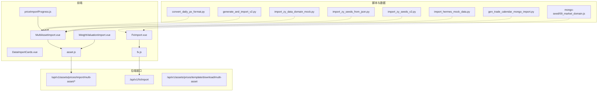
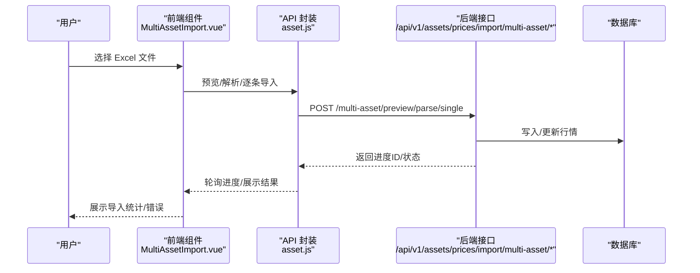
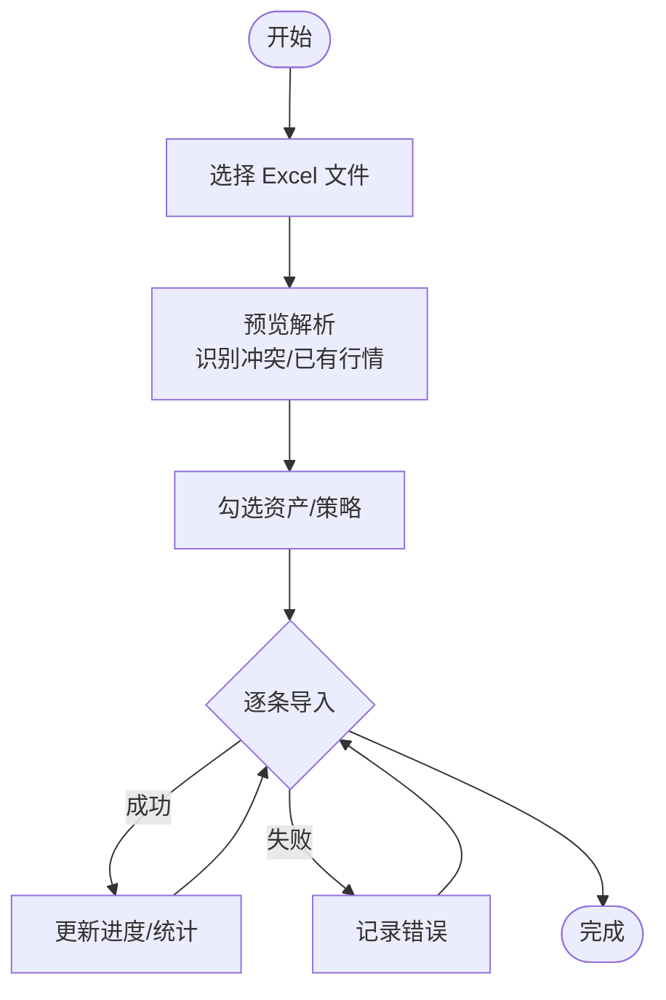
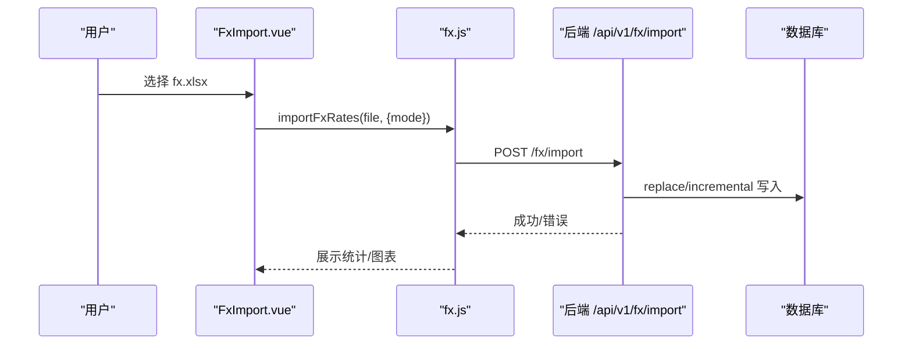
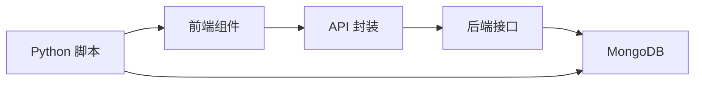

# 数据导入导出

<cite>
**本文引用的文件**
- [MultiAssetImport.vue](file://src/views/analysis/MultiAssetImport.vue)
- [FxImport.vue](file://src/views/analysis/FxImport.vue)
- [WeightValuationImport.vue](file://src/views/analysis/WeightValuationImport.vue)
- [DataImportCards.vue](file://src/components/DataImportCards.vue)
- [priceImportProgress.js](file://src/utils/priceImportProgress.js)
- [asset.js](file://src/api/asset.js)
- [fx.js](file://src/api/fx.js)
- [convert_daily_px_format.py](file://scripts/convert_daily_px_format.py)
- [generate_and_import_v2.py](file://scripts/generate_and_import_v2.py)
- [import_zy_data_domain_mock.py](file://scripts/import_zy_data_domain_mock.py)
- [import_zy_seeds_from_json.py](file://scripts/import_zy_seeds_from_json.py)
- [import_zy_seeds_v2.py](file://scripts/import_zy_seeds_v2.py)
- [import_hermes_mock_data.py](file://scripts/import_hermes_mock_data.py)
- [gen_trade_calendar_mongo_import.py](file://scripts/gen_trade_calendar_mongo_import.py)
- [09_market_domain.js](file://mongo-seed/09_market_domain.js)
- [README_v2.md](file://scripts/README_v2.md)
- [IMPORT_GUIDE.md](file://scripts/IMPORT_GUIDE.md)
</cite>

## 目录
1. [简介](#简介)
2. [项目结构](#项目结构)
3. [核心组件](#核心组件)
4. [架构总览](#架构总览)
5. [详细组件分析](#详细组件分析)
6. [依赖分析](#依赖分析)
7. [性能考虑](#性能考虑)
8. [故障排除指南](#故障排除指南)
9. [结论](#结论)
10. [附录](#附录)

## 简介
本文件面向投资组合管理系统中的“数据导入导出”能力，系统性梳理前端导入界面、后端接口、Python 脚本与 MongoDB 的协同流程，覆盖多资产行情、汇率、权重与估值、交易日历等主题。文档重点说明：
- 支持的文件格式与解析规则
- 批量导入机制与进度追踪
- 数据预处理、清洗与冲突处理
- 导出模板与筛选选项
- 数据格式转换工具（行情、日期）
- 数据验证、错误处理与修复
- 性能优化与大文件策略
- 一致性检查、重复处理与冲突解决
- 用户操作指南与排障方法

## 项目结构
围绕数据导入导出的关键目录与文件：
- 前端视图与组件：多资产行情导入、汇率导入、权重与估值导入、通用导入卡片
- 前端 API：资产与汇率导入接口封装
- 工具脚本：行情格式转换、批量导入、Mock 数据导入、交易日历生成
- MongoDB 种子数据与集合初始化

**图表来源**
- [MultiAssetImport.vue:1-383](file://src/views/analysis/MultiAssetImport.vue#L1-L383)
- [FxImport.vue:1-446](file://src/views/analysis/FxImport.vue#L1-L446)
- [WeightValuationImport.vue:1-547](file://src/views/analysis/WeightValuationImport.vue#L1-L547)
- [priceImportProgress.js:1-61](file://src/utils/priceImportProgress.js#L1-L61)
- [asset.js:214-283](file://src/api/asset.js#L214-L283)
- [fx.js:10-56](file://src/api/fx.js#L10-L56)
- [convert_daily_px_format.py:1-160](file://scripts/convert_daily_px_format.py#L1-L160)
- [generate_and_import_v2.py:1-510](file://scripts/generate_and_import_v2.py#L1-L510)
- [import_zy_data_domain_mock.py:1-161](file://scripts/import_zy_data_domain_mock.py#L1-L161)
- [import_zy_seeds_from_json.py:88-125](file://scripts/import_zy_seeds_from_json.py#L88-L125)
- [import_zy_seeds_v2.py:206-243](file://scripts/import_zy_seeds_v2.py#L206-L243)
- [import_hermes_mock_data.py:237-302](file://scripts/import_hermes_mock_data.py#L237-L302)
- [gen_trade_calendar_mongo_import.py:245-278](file://scripts/gen_trade_calendar_mongo_import.py#L245-L278)
- [09_market_domain.js:406-416](file://mongo-seed/09_market_domain.js#L406-L416)

**章节来源**
- [MultiAssetImport.vue:1-383](file://src/views/analysis/MultiAssetImport.vue#L1-L383)
- [FxImport.vue:1-446](file://src/views/analysis/FxImport.vue#L1-L446)
- [WeightValuationImport.vue:1-547](file://src/views/analysis/WeightValuationImport.vue#L1-L547)
- [asset.js:214-283](file://src/api/asset.js#L214-L283)
- [fx.js:10-56](file://src/api/fx.js#L10-L56)

## 核心组件
- 多资产行情导入（Excel）
  - 支持「大类资产底层数据」Excel，按工作表逐资产导入，支持名称冲突与已有行情覆盖策略
  - 前端解析预览、逐条导入、进度轮询与错误收集
- 汇率导入（Excel）
  - 支持覆盖与增量两种模式，按日更新对人民币汇率
- 权重与估值导入（Excel）
  - 自动识别日期列与数值列，支持净值/估值曲线与权重堆积图可视化
- 通用导入卡片
  - 校验结果、数据预览、导入统计与模板列表展示
- 进度工具
  - 解析后端进度快照、格式化进度行、轮询间隔控制

**章节来源**
- [MultiAssetImport.vue:1-383](file://src/views/analysis/MultiAssetImport.vue#L1-L383)
- [FxImport.vue:1-446](file://src/views/analysis/FxImport.vue#L1-L446)
- [WeightValuationImport.vue:1-547](file://src/views/analysis/WeightValuationImport.vue#L1-L547)
- [DataImportCards.vue:1-267](file://src/components/DataImportCards.vue#L1-L267)
- [priceImportProgress.js:1-61](file://src/utils/priceImportProgress.js#L1-L61)

## 架构总览
前端通过 API 封装调用后端导入接口，后端解析文件、清洗与校验、写入数据库，并提供进度轮询；Python 脚本负责批量生成与导入 Mock 数据、格式转换与交易日历生成。

**图表来源**
- [MultiAssetImport.vue:242-368](file://src/views/analysis/MultiAssetImport.vue#L242-L368)
- [asset.js:214-274](file://src/api/asset.js#L214-L274)
- [priceImportProgress.js:14-57](file://src/utils/priceImportProgress.js#L14-L57)

## 详细组件分析

### 多资产行情导入（Excel）
- 支持格式与解析
  - 支持「大类资产底层数据」Excel，工作表第3行资产名称、第4行资产代码、第5行起为日期与价格
  - 预览阶段识别名称冲突与已有行情，允许全局/逐条覆盖策略
- 批量导入流程
  - 预览 → 选择资产 → 逐条导入（单资产导入接口，便于进度展示）
  - 导入过程中轮询进度，最终汇总统计与错误列表
- 冲突与覆盖策略
  - 名称冲突：可选择覆盖或不覆盖
  - 已有行情：可选择仅新增或全覆盖
- 错误处理
  - 导入失败记录到错误列表，支持查看与二次处理

**图表来源**
- [MultiAssetImport.vue:242-368](file://src/views/analysis/MultiAssetImport.vue#L242-L368)
- [asset.js:214-274](file://src/api/asset.js#L214-L274)

**章节来源**
- [MultiAssetImport.vue:1-383](file://src/views/analysis/MultiAssetImport.vue#L1-L383)
- [asset.js:214-274](file://src/api/asset.js#L214-L274)
- [priceImportProgress.js:14-57](file://src/utils/priceImportProgress.js#L14-L57)

### 汇率导入（Excel）
- 支持格式
  - 第一列为日期，后续列为对人民币汇率（EUR/USD/HKD/CNH）
- 导入模式
  - 覆盖：清空库内全部汇率后写入文件
  - 增量：仅填补缺失日期与已有日期中的空列，不覆盖已有数值
- 手动录入
  - 仅更新填写列，其余列保留库中原值

**图表来源**
- [FxImport.vue:200-237](file://src/views/analysis/FxImport.vue#L200-L237)
- [fx.js:10-20](file://src/api/fx.js#L10-L20)

**章节来源**
- [FxImport.vue:1-446](file://src/views/analysis/FxImport.vue#L1-L446)
- [fx.js:10-56](file://src/api/fx.js#L10-L56)

### 权重与估值导入（Excel）
- 自动解析
  - 识别日期列与数值列，支持净值/估值曲线与权重堆积图
- 可视化
  - 净值曲线与回撤图、权重堆积图，支持缩放与滚动
- 数据预览
  - 展示样本行与列，便于核对

**章节来源**
- [WeightValuationImport.vue:1-547](file://src/views/analysis/WeightValuationImport.vue#L1-L547)

### 通用导入卡片与进度工具
- 导入卡片
  - 校验结果、数据预览、导入统计、模板列表
- 进度工具
  - 解析后端进度快照、格式化进度行、统一轮询间隔

**章节来源**
- [DataImportCards.vue:1-267](file://src/components/DataImportCards.vue#L1-L267)
- [priceImportProgress.js:1-61](file://src/utils/priceImportProgress.js#L1-L61)

### Python 批量导入与格式转换
- 行情格式转换
  - 将日常行情 Excel 转换为「大类资产底层数据上传版本」，按资产名称匹配系统代码
- Mock 数据批量导入
  - 自动生成 v2 关联 Mock 数据并导入 MongoDB，支持 upsert 与审计字段
  - 导入 ZY 数据域 Mock 数据，支持从 JS 文件提取或 JSON 文件导入
  - 从 JSON 导入种子数据，支持字段清洗与去重
  - 导入 Hermes Mock 数据，按集合拆分与字段映射转换
- 交易日历生成
  - 生成 NDJSON/Array/Plain 三种格式，推荐使用 mongoimport upsert 模式导入

**章节来源**
- [convert_daily_px_format.py:1-160](file://scripts/convert_daily_px_format.py#L1-L160)
- [generate_and_import_v2.py:1-510](file://scripts/generate_and_import_v2.py#L1-L510)
- [import_zy_data_domain_mock.py:1-161](file://scripts/import_zy_data_domain_mock.py#L1-L161)
- [import_zy_seeds_from_json.py:88-125](file://scripts/import_zy_seeds_from_json.py#L88-L125)
- [import_zy_seeds_v2.py:206-243](file://scripts/import_zy_seeds_v2.py#L206-L243)
- [import_hermes_mock_data.py:237-302](file://scripts/import_hermes_mock_data.py#L237-L302)
- [gen_trade_calendar_mongo_import.py:245-278](file://scripts/gen_trade_calendar_mongo_import.py#L245-L278)

## 依赖分析
- 前端依赖
  - MultiAssetImport.vue 依赖 asset.js 的多资产导入接口与进度工具
  - FxImport.vue 依赖 fx.js 的汇率导入接口
  - WeightValuationImport.vue 依赖本地解析与 ECharts 可视化
- 后端接口
  - 多资产导入：/api/v1/assets/prices/import/multi-asset/*
  - 汇率导入：/api/v1/fx/import
  - 模板下载：/api/v1/assets/prices/template/download/multi-asset
- 脚本依赖
  - MongoDB 连接、Pandas/Xlsx/OpenPyXL、ECharts（前端）

**图表来源**
- [asset.js:214-283](file://src/api/asset.js#L214-L283)
- [fx.js:10-56](file://src/api/fx.js#L10-L56)
- [generate_and_import_v2.py:1-510](file://scripts/generate_and_import_v2.py#L1-L510)

**章节来源**
- [asset.js:214-283](file://src/api/asset.js#L214-L283)
- [fx.js:10-56](file://src/api/fx.js#L10-L56)

## 性能考虑
- 前端
  - 大文件解析采用分步预览与逐条导入，避免一次性渲染大量数据
  - 进度轮询间隔固定，避免频繁请求造成服务端压力
- 后端
  - 批量导入接口设置较长超时，适配多年日频行情
  - 推荐使用 mongoimport upsert 模式导入交易日历等结构化数据
- 脚本
  - 批量导入使用 upsert 与批量写入，减少重复导入成本
  - 交易日历生成提供 NDJSON/Array/Plain 三种格式，按需选择

**章节来源**
- [MultiAssetImport.vue:242-368](file://src/views/analysis/MultiAssetImport.vue#L242-L368)
- [asset.js:129-157](file://src/api/asset.js#L129-L157)
- [gen_trade_calendar_mongo_import.py:245-278](file://scripts/gen_trade_calendar_mongo_import.py#L245-L278)
- [generate_and_import_v2.py:466-510](file://scripts/generate_and_import_v2.py#L466-L510)

## 故障排除指南
- 前端常见问题
  - 文件格式不符：确保使用支持的 Excel 格式与正确的列结构
  - 预览失败：检查文件是否损坏或列头是否符合预期
  - 进度拉取失败：检查网络与登录态，确认轮询未被中断
- 后端常见问题
  - 导入超时：适当调整超时参数或分批导入
  - 冲突处理：根据提示选择覆盖策略或仅新增
- 脚本常见问题
  - MongoDB 连接失败：检查服务状态、端口占用与认证
  - 数据不一致：使用验证脚本核对集合数量、记录总数与外键引用
  - 交易日历导入：优先使用 mongoimport upsert 模式，按 trade_date 去重

**章节来源**
- [MultiAssetImport.vue:242-368](file://src/views/analysis/MultiAssetImport.vue#L242-L368)
- [FxImport.vue:200-237](file://src/views/analysis/FxImport.vue#L200-L237)
- [README_v2.md:206-234](file://scripts/README_v2.md#L206-L234)
- [IMPORT_GUIDE.md:206-234](file://scripts/IMPORT_GUIDE.md#L206-L234)

## 结论
系统提供了从 Excel 到数据库的完整导入链路，涵盖多资产行情、汇率、权重与估值等多种场景。前端通过预览与进度轮询提升用户体验，后端与脚本层面提供批量导入、格式转换与一致性保障。建议在生产环境优先采用 mongoimport upsert 与模板化导入，配合严格的校验与错误处理，确保大规模数据的稳定性与可追溯性。

## 附录

### 支持的文件格式与模板
- 多资产行情（Excel）
  - 模板下载：/api/v1/assets/prices/template/download/multi-asset
  - 解析规则：第3行资产名称、第4行资产代码、第5行起为日期与价格
- 汇率（Excel）
  - 模板下载：/api/v1/assets/prices/template/download
  - 解析规则：第一列为日期，后续列为对人民币汇率
- 权重与估值（Excel）
  - 自动识别日期列与数值列，支持净值/估值曲线与权重堆积图

**章节来源**
- [asset.js:118-127](file://src/api/asset.js#L118-L127)
- [asset.js:86-93](file://src/api/asset.js#L86-L93)
- [WeightValuationImport.vue:13-20](file://src/views/analysis/WeightValuationImport.vue#L13-L20)

### 数据验证与一致性检查
- 验证脚本
  - 生成 v2 数据后进行集合数量、记录总数与外键引用的验证
  - 导入 ZY 数据域 Mock 数据后统计各集合记录数
- 一致性检查
  - 交易日历导入使用 upsert，按 trade_date 去重
  - MongoDB 集合初始化脚本确保日历数据生成与插入

**章节来源**
- [README_v2.md:299-324](file://scripts/README_v2.md#L299-L324)
- [IMPORT_GUIDE.md:171-202](file://scripts/IMPORT_GUIDE.md#L171-L202)
- [gen_trade_calendar_mongo_import.py:245-278](file://scripts/gen_trade_calendar_mongo_import.py#L245-L278)
- [09_market_domain.js:406-416](file://mongo-seed/09_market_domain.js#L406-L416)

### 数据格式转换工具
- 行情数据格式转换
  - 将日常行情 Excel 转换为「大类资产底层数据上传版本」，按资产名称匹配系统代码
- 日期格式标准化
  - Excel 日期解析支持多种格式，统一转换为 YYYY-MM-DD
- 交易日历生成
  - 生成 NDJSON/Array/Plain 三种格式，推荐 mongoimport upsert 模式导入

**章节来源**
- [convert_daily_px_format.py:1-160](file://scripts/convert_daily_px_format.py#L1-L160)
- [WeightValuationImport.vue:255-298](file://src/views/analysis/WeightValuationImport.vue#L255-L298)
- [gen_trade_calendar_mongo_import.py:245-278](file://scripts/gen_trade_calendar_mongo_import.py#L245-L278)

### 操作指南与最佳实践
- 多资产行情导入
  - 使用模板文件，确保列头规范；预览后再导入；逐条导入便于进度掌控
- 汇率导入
  - 覆盖模式适合全新建库；增量模式适合补录缺失数据
- Mock 数据导入
  - 优先使用批量导入脚本，结合 upsert 与审计字段，保证幂等性
- 交易日历导入
  - 使用 mongoimport upsert，按 trade_date 去重，避免重复

**章节来源**
- [README_v2.md:19-36](file://scripts/README_v2.md#L19-L36)
- [IMPORT_GUIDE.md:21-62](file://scripts/IMPORT_GUIDE.md#L21-L62)
- [gen_trade_calendar_mongo_import.py:266-278](file://scripts/gen_trade_calendar_mongo_import.py#L266-L278)