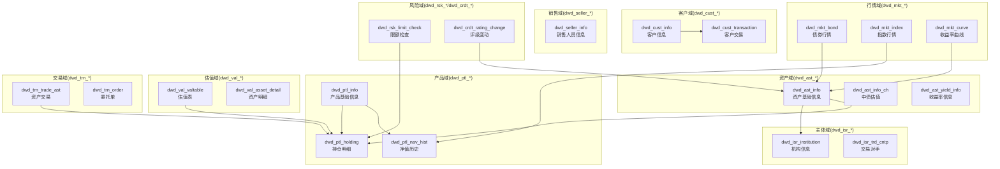
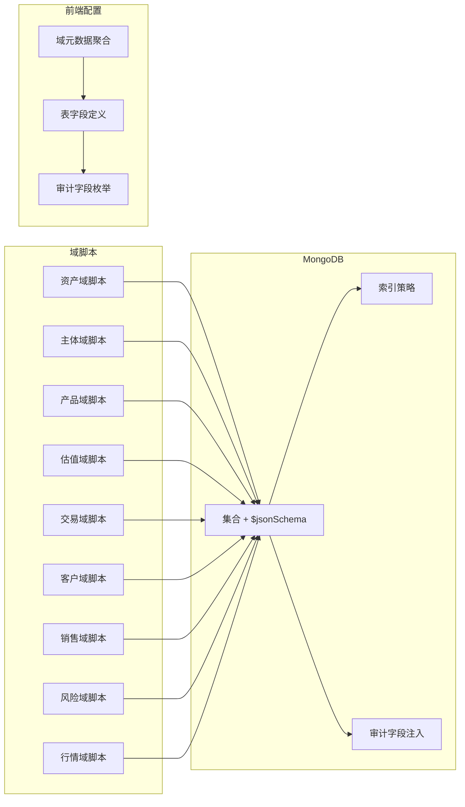
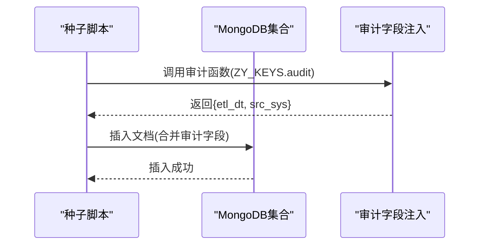
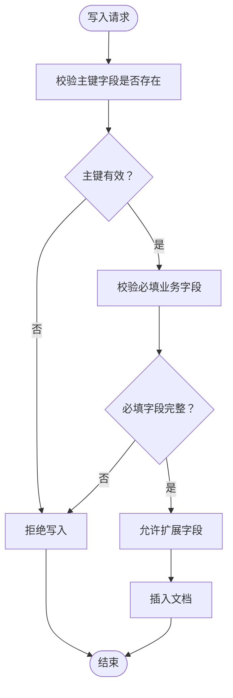
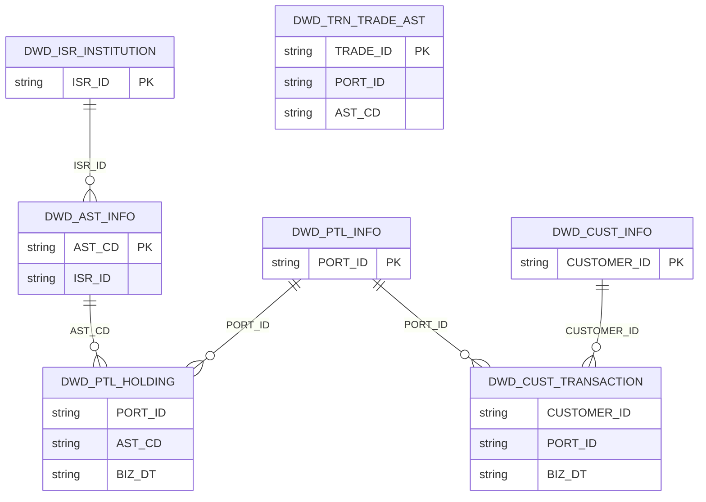
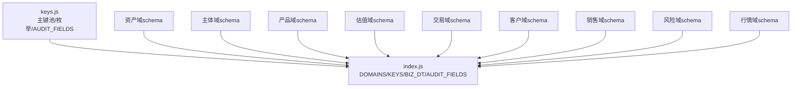

# Schema设计原则

<cite>
**本文档引用的文件**
- [_keys.js](file://mongo-seed/_keys.js)
- [01_asset_domain.js](file://mongo-seed/01_asset_domain.js)
- [02_subject_domain.js](file://mongo-seed/02_subject_domain.js)
- [03_product_domain.js](file://mongo-seed/03_product_domain.js)
- [04_valuation_domain.js](file://mongo-seed/04_valuation_domain.js)
- [05_transaction_domain.js](file://mongo-seed/05_transaction_domain.js)
- [06_seller_domain.js](file://mongo-seed/06_seller_domain.js)
- [07_customer_domain.js](file://mongo-seed/07_customer_domain.js)
- [08_risk_domain.js](file://mongo-seed/08_risk_domain.js)
- [09_market_domain.js](file://mongo-seed/09_market_domain.js)
- [README.md](file://mongo-seed/README.md)
- [MongoDB_ZY数据域表结构清单.md](file://docs/MongoDB_ZY数据域表结构清单.md)
- [keys.js](file://src/config/zyDataDomain/keys.js)
- [index.js](file://src/config/zyDataDomain/index.js)
</cite>

## 目录
1. [简介](#简介)
2. [项目结构](#项目结构)
3. [核心组件](#核心组件)
4. [架构总览](#架构总览)
5. [详细组件分析](#详细组件分析)
6. [依赖分析](#依赖分析)
7. [性能考虑](#性能考虑)
8. [故障排查指南](#故障排查指南)
9. [结论](#结论)
10. [附录](#附录)

## 简介
本文件系统性阐述MongoDB投资组合管理系统的Schema设计原则与最佳实践，围绕统一审计字段、业务日期存储格式、金额与比率字段类型选择、JSON Schema验证策略、索引设计原则、主键外键约定、数据一致性保障与生产部署建议展开。内容基于mongo-seed种子脚本与相关文档，结合前端配置模块，形成从数据模型到生产落地的完整指南。

## 项目结构
系统采用“多域多表”的集合组织方式，按业务域划分（资产、主体、产品、估值、交易、客户、销售、风险、行情），每域通过独立脚本初始化，统一注入审计字段与索引策略，并以$jsonSchema进行宽松校验，确保贴源数据的灵活性与一致性。

图示来源
- [01_asset_domain.js:1-374](file://mongo-seed/01_asset_domain.js#L1-L374)
- [02_subject_domain.js:1-253](file://mongo-seed/02_subject_domain.js#L1-L253)
- [03_product_domain.js:1-543](file://mongo-seed/03_product_domain.js#L1-L543)
- [04_valuation_domain.js:1-443](file://mongo-seed/04_valuation_domain.js#L1-L443)
- [05_transaction_domain.js:1-165](file://mongo-seed/05_transaction_domain.js#L1-L165)
- [07_customer_domain.js:1-160](file://mongo-seed/07_customer_domain.js#L1-L160)
- [08_risk_domain.js:1-112](file://mongo-seed/08_risk_domain.js#L1-L112)
- [09_market_domain.js:1-417](file://mongo-seed/09_market_domain.js#L1-L417)

章节来源
- [README.md:114-125](file://mongo-seed/README.md#L114-L125)
- [MongoDB_ZY数据域表结构清单.md:1-379](file://docs/MongoDB_ZY数据域表结构清单.md#L1-L379)

## 核心组件
- 审计字段池：统一注入etl_dt（ETL日期）、src_sys（来源系统），确保数据来源与版本可追溯。
- 业务日期字段：统一使用字符串yyyyMMdd格式存储，便于历史回放与数据调试。
- 金额与比率字段：采用double（64位浮点）满足大多数金融计算精度；生产如需更高精度可切换decimal128。
- JSON Schema验证：仅约束主键与必填业务字段，其他字段允许扩展，避免误拒贴源数据。
- 索引策略：主键字段显式建立唯一索引；高频过滤字段（BIZ_DT、PORT_ID、AST_CD）建立普通索引。
- 主键外键约定：AST_CD、PORT_ID、ISR_ID、CNTP_ID、CUSTOMER_ID、SELLER_ID等跨表统一引用。
- 数据一致性：通过$onInsert注入审计字段、唯一索引与宽松校验共同保障。

章节来源
- [README.md:114-125](file://mongo-seed/README.md#L114-L125)
- [_keys.js:152-161](file://mongo-seed/_keys.js#L152-L161)
- [keys.js:63-63](file://src/config/zyDataDomain/keys.js#L63-L63)

## 架构总览
系统通过“域脚本 + JSON Schema + 索引 + 审计字段”实现Schema一致性与可维护性。前端配置模块提供域与表的元数据聚合，便于UI侧的统一展示与查询。

图示来源
- [index.js:1-80](file://src/config/zyDataDomain/index.js#L1-L80)
- [keys.js:1-73](file://src/config/zyDataDomain/keys.js#L1-L73)
- [README.md:114-125](file://mongo-seed/README.md#L114-L125)

## 详细组件分析

### 统一审计字段设计
- 审计字段：etl_dt（ETL日期）、src_sys（来源系统）、created_at、updated_at（由后端注入）。
- 注入方式：通过工具函数在插入时统一注入，确保所有快照型表具备一致的审计元信息。
- 作用：便于数据溯源、版本追踪与问题定位。

图示来源
- [_keys.js:152-161](file://mongo-seed/_keys.js#L152-L161)
- [01_asset_domain.js:54-56](file://mongo-seed/01_asset_domain.js#L54-L56)
- [03_product_domain.js:94-96](file://mongo-seed/03_product_domain.js#L94-L96)

章节来源
- [_keys.js:152-161](file://mongo-seed/_keys.js#L152-L161)
- [MongoDB_ZY数据域表结构清单.md:312-323](file://docs/MongoDB_ZY数据域表结构清单.md#L312-L323)

### 业务日期字段统一存储格式
- 存储格式：字符串yyyyMMdd，便于历史回放与跨系统对齐。
- 适用范围：所有快照型表（如dwd_ast_info_ch、dwd_ptl_nav_hist、dwd_mkt_bond等）。
- 优势：简化日期比较、避免时区与解析差异，利于批量回放与调试。

章节来源
- [README.md:117-117](file://mongo-seed/README.md#L117-L117)
- [01_asset_domain.js:63-68](file://mongo-seed/01_asset_domain.js#L63-L68)
- [03_product_domain.js:169-176](file://mongo-seed/03_product_domain.js#L169-L176)
- [09_market_domain.js:24-46](file://mongo-seed/09_market_domain.js#L24-L46)

### 金额与比率字段类型选择
- 类型选择：double（64位浮点）满足绝大多数金融计算精度；如需更高精度，可切换decimal128。
- 适用场景：金额、比率、收益率、久期、VaR等数值型字段。
- 生产建议：根据具体业务精度需求与计算引擎支持，评估是否启用decimal128以避免累积误差。

章节来源
- [README.md:118-118](file://mongo-seed/README.md#L118-L118)

### JSON Schema验证机制
- 策略：仅约束主键与必填业务字段，其他字段允许扩展，避免误拒贴源数据。
- 优势：兼顾严格性与灵活性，支持快速迭代与贴源数据导入。
- 实施：通过db.createCollection(..., { validator: { $jsonSchema: {...} } })在集合层面启用。

图示来源
- [README.md:119-119](file://mongo-seed/README.md#L119-L119)
- [01_asset_domain.js:28-37](file://mongo-seed/01_asset_domain.js#L28-L37)

章节来源
- [README.md:119-119](file://mongo-seed/README.md#L119-L119)
- [01_asset_domain.js:28-37](file://mongo-seed/01_asset_domain.js#L28-L37)

### 索引设计原则
- 主键字段：除系统自增_id外，显式建立唯一索引（如AST_CD、PORT_ID、CUSTOMER_ID等）。
- 高频过滤字段：BIZ_DT、PORT_ID、AST_CD等建立普通索引，提升查询性能。
- 通用策略：所有含BIZ_DT的表统一建立索引，便于按业务日期快速过滤。

章节来源
- [README.md:120-120](file://mongo-seed/README.md#L120-L120)
- [MongoDB_ZY数据域表结构清单.md:257-279](file://docs/MongoDB_ZY数据域表结构清单.md#L257-L279)

### 主键外键约定与跨表引用
- 主键池：AST_CD、PORT_ID、ISR_ID、CNTP_ID、CUSTOMER_ID、SELLER_ID、INDEX_CD、BIZ_DT等。
- 引用关系：通过主键池在多域之间建立稳定引用，确保跨表关联一致性。
- 关系示意：

图示来源
- [MongoDB_ZY数据域表结构清单.md:283-308](file://docs/MongoDB_ZY数据域表结构清单.md#L283-L308)

章节来源
- [MongoDB_ZY数据域表结构清单.md:227-237](file://docs/MongoDB_ZY数据域表结构清单.md#L227-L237)
- [MongoDB_ZY数据域表结构清单.md:283-308](file://docs/MongoDB_ZY数据域表结构清单.md#L283-L308)

### 数据一致性保障机制
- 写入一致性：通过$onInsert注入审计字段，确保所有记录具备etl_dt与src_sys。
- 结构一致性：$jsonSchema约束主键与必填字段，避免脏数据进入。
- 关系一致性：主键池统一定义，跨表引用保持一致，减少错配风险。

章节来源
- [_keys.js:152-161](file://mongo-seed/_keys.js#L152-L161)
- [01_asset_domain.js:28-37](file://mongo-seed/01_asset_domain.js#L28-L37)

### 生产环境部署最佳实践
- 清空与重建：脚本默认先drop再重建，支持安全反复执行。
- 数据导入：提供mongosh与Python两种导入方式，便于CI/CD集成。
- 验证查询：提供常用查询样例，便于快速验证数据导入结果。

章节来源
- [README.md:122-125](file://mongo-seed/README.md#L122-L125)
- [MongoDB_ZY数据域表结构清单.md:327-371](file://docs/MongoDB_ZY数据域表结构清单.md#L327-L371)

## 依赖分析
前端配置模块聚合各域元数据，提供域与表的统一查询接口，支撑UI侧的数据域导航与表单渲染。

图示来源
- [keys.js:1-73](file://src/config/zyDataDomain/keys.js#L1-L73)
- [index.js:1-80](file://src/config/zyDataDomain/index.js#L1-L80)

章节来源
- [index.js:16-79](file://src/config/zyDataDomain/index.js#L16-L79)
- [keys.js:63-63](file://src/config/zyDataDomain/keys.js#L63-L63)

## 性能考虑
- 索引策略：针对高频过滤字段建立索引，减少扫描成本；避免过度索引导致写入性能下降。
- 字段类型：double满足多数金融计算精度；对极端精度需求可考虑decimal128，但需评估计算与存储成本。
- 数据格式：yyyyMMdd字符串便于比较与回放，避免ISODate解析开销。
- 验证策略：宽松校验降低误拒概率，提高贴源导入效率。

## 故障排查指南
- 审计字段缺失：检查写入流程是否调用审计注入函数，确认etl_dt与src_sys是否正确注入。
- 主键冲突：检查唯一索引与主键池，确保跨表引用一致。
- 查询性能差：确认高频过滤字段是否建立索引，必要时补充索引。
- 数据导入失败：参考导入方式与验证查询，逐域排查。

章节来源
- [_keys.js:152-161](file://mongo-seed/_keys.js#L152-L161)
- [README.md:122-125](file://mongo-seed/README.md#L122-L125)
- [MongoDB_ZY数据域表结构清单.md:354-371](file://docs/MongoDB_ZY数据域表结构清单.md#L354-L371)

## 结论
本Schema设计以“统一审计字段、统一业务日期格式、宽松JSON Schema、明确索引策略、主键外键约定”为核心，既保证了数据一致性与可维护性，又兼顾了贴源数据的灵活性与生产性能。配合前端配置模块与完善的导入/验证流程，可高效支撑投资组合管理系统的数据驱动与业务演进。

## 附录
- 域与表清单：参见MongoDB_ZY数据域表结构清单。
- 导入与验证：参见mongo-seed/README与ZY_DATA_VALIDATION_REPORT。
- 前端配置：参见src/config/zyDataDomain。

章节来源
- [MongoDB_ZY数据域表结构清单.md:1-379](file://docs/MongoDB_ZY数据域表结构清单.md#L1-L379)
- [README.md:1-125](file://mongo-seed/README.md#L1-L125)
- [MongoDB_ZY数据域表结构清单.md:327-371](file://docs/MongoDB_ZY数据域表结构清单.md#L327-L371)