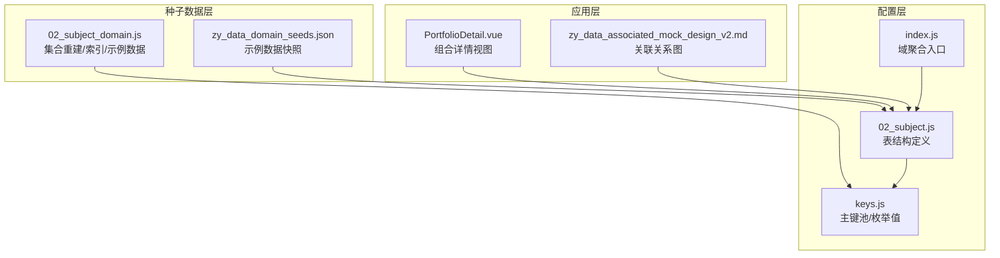
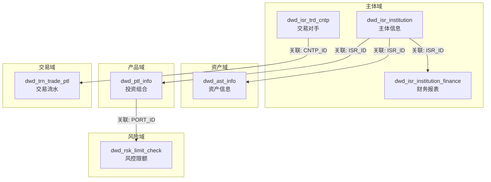
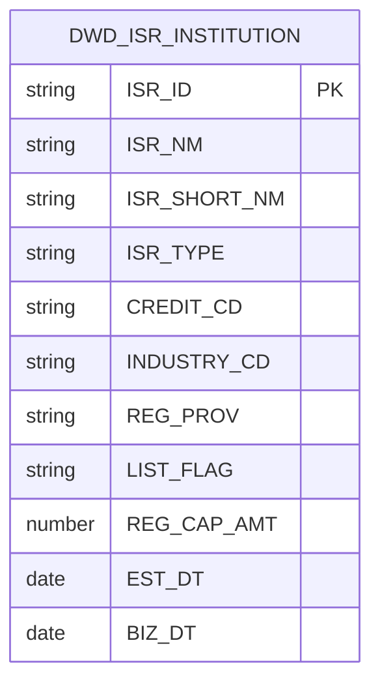
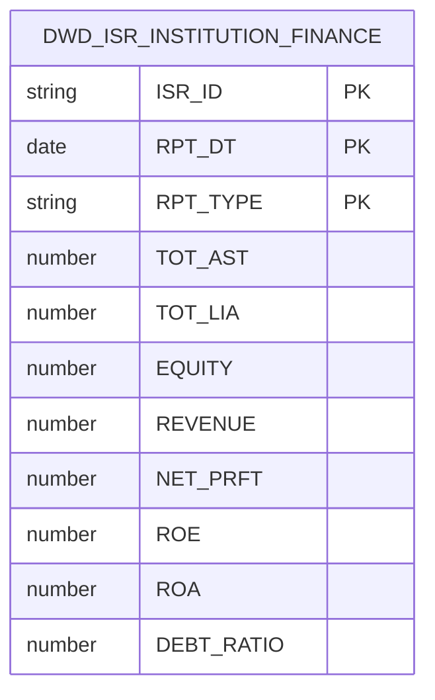
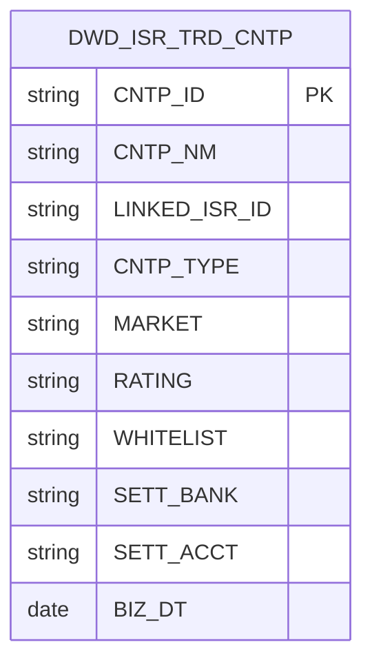
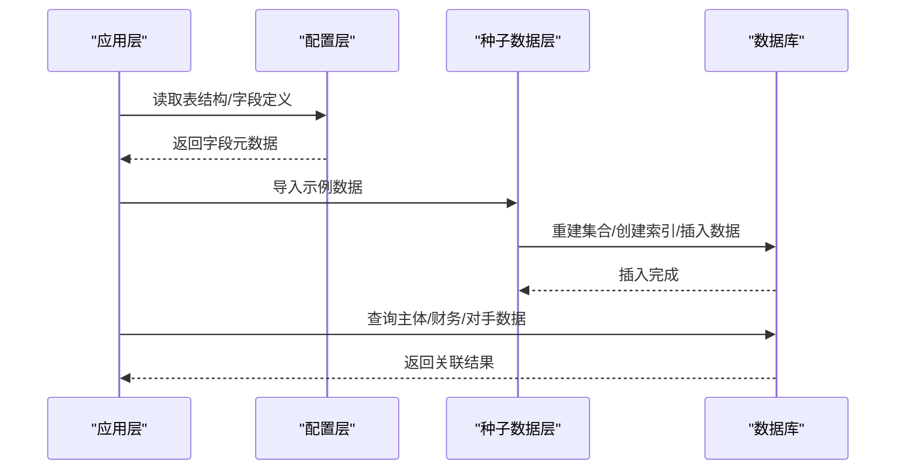
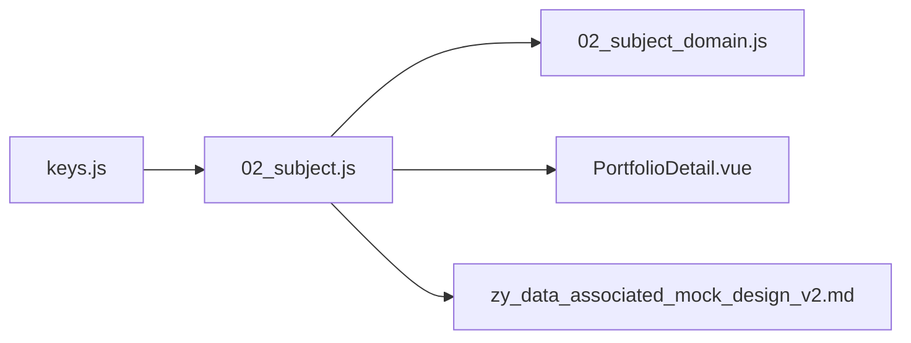
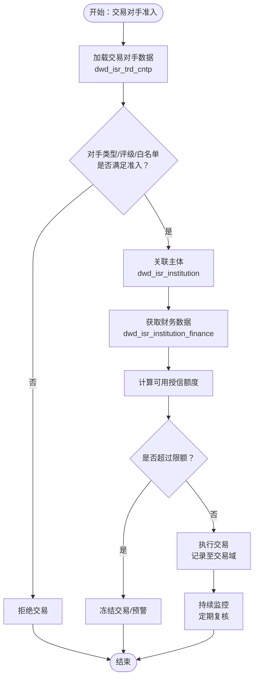

# 主体域数据模型

<cite>
**本文档引用的文件**
- [02_subject.js](file://src/config/zyDataDomain/02_subject.js)
- [02_subject_domain.js](file://mongo-seed/02_subject_domain.js)
- [keys.js](file://src/config/zyDataDomain/keys.js)
- [index.js](file://src/config/zyDataDomain/index.js)
- [zy_data_domain_seeds.json](file://scripts/zy_data_domain_seeds.json)
- [zy_data_associated_mock_design_v2.md](file://scripts/zy_data_associated_mock_design_v2.md)
- [PortfolioDetail.vue](file://src/views/portfolio/PortfolioDetail.vue)
</cite>

## 目录
1. [简介](#简介)
2. [项目结构](#项目结构)
3. [核心组件](#核心组件)
4. [架构总览](#架构总览)
5. [详细组件分析](#详细组件分析)
6. [依赖关系分析](#依赖关系分析)
7. [性能考虑](#性能考虑)
8. [故障排除指南](#故障排除指南)
9. [结论](#结论)
10. [附录](#附录)

## 简介
主体域是金融机构和交易对手管理的核心数据域，负责维护“发行人主体”、“交易对手方”以及“主体财务报表”三大类数据。该域通过标准化的主键池（ISR_ID、CNTP_ID）与资产域、产品域、交易域、风险域形成跨域关联，支撑投资组合管理、交易对手风险管理、财务分析与监管报送等关键业务场景。

## 项目结构
主体域相关代码主要分布在以下位置：
- 配置层：定义表结构、字段属性、主键约束与枚举值来源
- 种子数据层：MongoDB 集合重建、索引创建与示例数据导入
- 应用层：前端页面与API对接，展示主体风险与组合管理能力

**图表来源**
- [02_subject.js:1-59](file://src/config/zyDataDomain/02_subject.js#L1-L59)
- [keys.js:1-73](file://src/config/zyDataDomain/keys.js#L1-L73)
- [index.js:1-80](file://src/config/zyDataDomain/index.js#L1-L80)
- [02_subject_domain.js:1-253](file://mongo-seed/02_subject_domain.js#L1-L253)
- [zy_data_domain_seeds.json:1-52](file://scripts/zy_data_domain_seeds.json#L1-L52)
- [zy_data_associated_mock_design_v2.md:28-69](file://scripts/zy_data_associated_mock_design_v2.md#L28-L69)
- [PortfolioDetail.vue:1-599](file://src/views/portfolio/PortfolioDetail.vue#L1-L599)

**章节来源**
- [02_subject.js:1-59](file://src/config/zyDataDomain/02_subject.js#L1-L59)
- [keys.js:1-73](file://src/config/zyDataDomain/keys.js#L1-L73)
- [index.js:1-80](file://src/config/zyDataDomain/index.js#L1-L80)
- [02_subject_domain.js:1-253](file://mongo-seed/02_subject_domain.js#L1-L253)
- [zy_data_domain_seeds.json:1-52](file://scripts/zy_data_domain_seeds.json#L1-L52)
- [zy_data_associated_mock_design_v2.md:28-69](file://scripts/zy_data_associated_mock_design_v2.md#L28-L69)
- [PortfolioDetail.vue:1-599](file://src/views/portfolio/PortfolioDetail.vue#L1-L599)

## 核心组件
主体域包含三张核心表：
- dwd_isr_institution：发行人主体信息
- dwd_isr_institution_finance：主体财务报表
- dwd_isr_trd_cntp：交易对手方

每张表均定义了主键、必填字段、字段类型与枚举值来源，并在种子数据中给出索引与示例数据。

**章节来源**
- [02_subject.js:17-56](file://src/config/zyDataDomain/02_subject.js#L17-L56)
- [02_subject_domain.js:18-194](file://mongo-seed/02_subject_domain.js#L18-L194)

## 架构总览
主体域通过主键池与其它域建立跨域关联，支撑从“主体识别”到“财务分析”再到“交易对手风控”的完整闭环。

**图表来源**
- [zy_data_associated_mock_design_v2.md:28-69](file://scripts/zy_data_associated_mock_design_v2.md#L28-L69)
- [02_subject.js:17-56](file://src/config/zyDataDomain/02_subject.js#L17-L56)

## 详细组件分析

### dwd_isr_institution 发行人主体表
- 主键：ISR_ID（字符串，唯一）
- 关键字段：
  - 主体ID：ISR_ID（主键，必填）
  - 主体名称：ISR_NM（必填）
  - 主体简称：ISR_SHORT_NM
  - 主体类型：ISR_TYPE（枚举：SOVEREIGN/POLICY_BANK/COMMERCIAL_BANK/CORPORATE/SECURITIES）
  - 统一社会信用代码：CREDIT_CD
  - 行业代码：INDUSTRY_CD
  - 注册省份：REG_PROV
  - 是否上市：LIST_FLAG（枚举：Y/N）
  - 注册资本：REG_CAP_AMT（数值）
  - 成立日期：EST_DT（日期）
  - 业务日期：BIZ_DT（默认值来自主键池）
- 索引：
  - ISR_ID 唯一索引
  - ISR_NM 普通索引
- 示例数据：包含主权、政策性银行、商业银行、上市公司、保险公司等多类型主体，覆盖真实财务体量与评级信息。

**图表来源**
- [02_subject.js:17-29](file://src/config/zyDataDomain/02_subject.js#L17-L29)
- [02_subject_domain.js:18-98](file://mongo-seed/02_subject_domain.js#L18-L98)

**章节来源**
- [02_subject.js:17-29](file://src/config/zyDataDomain/02_subject.js#L17-L29)
- [02_subject_domain.js:18-98](file://mongo-seed/02_subject_domain.js#L18-L98)
- [keys.js:16-19](file://src/config/zyDataDomain/keys.js#L16-L19)

### dwd_isr_institution_finance 主体财务报表
- 复合主键：ISR_ID + RPT_DT + RPT_TYPE
- 关键字段：
  - 主体ID：ISR_ID（主键，枚举自ISR_IDS）
  - 报告期：RPT_DT（日期）
  - 报告类型：RPT_TYPE（枚举：ANNUAL/SEMI/Q1/Q3）
  - 资产负债相关：TOT_AST（总资产）、TOT_LIA（总负债）、EQUITY（所有者权益）
  - 利润表相关：REVENUE（营业收入）、NET_PRFT（净利润）
  - 财务指标：ROE（净资产收益率）、ROA（总资产报酬率）、DEBT_RATIO（资产负债率）
- 索引：ISR_ID+RPT_DT+RPT_TYPE 唯一索引
- 示例数据：每主体覆盖多个报告期（如2023年报、2024中报），数值量级参考公开年报规模，便于财务分析与趋势对比。

**图表来源**
- [02_subject.js:31-43](file://src/config/zyDataDomain/02_subject.js#L31-L43)
- [02_subject_domain.js:101-181](file://mongo-seed/02_subject_domain.js#L101-L181)

**章节来源**
- [02_subject.js:31-43](file://src/config/zyDataDomain/02_subject.js#L31-L43)
- [02_subject_domain.js:101-181](file://mongo-seed/02_subject_domain.js#L101-L181)
- [keys.js](file://src/config/zyDataDomain/keys.js#L52)

### dwd_isr_trd_cntp 交易对手方
- 主键：CNTP_ID（字符串，唯一）
- 关键字段：
  - 交易对手ID：CNTP_ID（主键，必填）
  - 交易对手名称：CNTP_NM（必填）
  - 关联主体ID：LINKED_ISR_ID（可选，枚举自ISR_IDS）
  - 对手类型：CNTP_TYPE（枚举：BANK/BROKER/FUND/INSURANCE/OTHER）
  - 市场：MARKET（枚举，如 IB/SH/SZ）
  - 评级：RATING
  - 白名单：WHITELIST（枚举：Y/N）
  - 结算行：SETT_BANK
  - 结算账户：SETT_ACCT
  - 业务日期：BIZ_DT（默认值来自主键池）
- 索引：
  - CNTP_ID 唯一索引
  - CNTP_NM 普通索引
- 示例数据：包含券商、银行、交易商协会等不同类型的交易对手，涵盖评级、白名单、结算信息等风控要素。

**图表来源**
- [02_subject.js:45-56](file://src/config/zyDataDomain/02_subject.js#L45-L56)
- [02_subject_domain.js:184-250](file://mongo-seed/02_subject_domain.js#L184-L250)

**章节来源**
- [02_subject.js:45-56](file://src/config/zyDataDomain/02_subject.js#L45-L56)
- [02_subject_domain.js:184-250](file://mongo-seed/02_subject_domain.js#L184-L250)
- [keys.js](file://src/config/zyDataDomain/keys.js#L21)

### 表间关联关系与主键约束
- dwd_isr_institution 与 dwd_ast_info：通过 ISR_ID 关联，标识资产的发行主体
- dwd_isr_institution 与 dwd_ptl_info：通过 ISR_ID 关联，标识组合管理机构
- dwd_isr_institution 与 dwd_isr_institution_finance：通过 ISR_ID 关联，按报告期聚合财务数据
- dwd_isr_trd_cntp 与 dwd_trn_trade_ptl：通过 CNTP_ID 关联，记录交易对手维度的交易行为
- 主键池：
  - ISR_IDS：主体ID集合，用于枚举与外键提示
  - CNTP_IDS：交易对手ID集合
- 索引约束：
  - dwd_isr_institution：ISR_ID 唯一索引，ISR_NM 可检索
  - dwd_isr_institution_finance：复合唯一索引（ISR_ID,RPT_DT,RPT_TYPE）
  - dwd_isr_trd_cntp：CNTP_ID 唯一索引，CNTP_NM 可检索

**图表来源**
- [02_subject.js:1-59](file://src/config/zyDataDomain/02_subject.js#L1-L59)
- [02_subject_domain.js:1-253](file://mongo-seed/02_subject_domain.js#L1-L253)
- [index.js:1-80](file://src/config/zyDataDomain/index.js#L1-L80)

**章节来源**
- [02_subject.js:1-59](file://src/config/zyDataDomain/02_subject.js#L1-L59)
- [02_subject_domain.js:1-253](file://mongo-seed/02_subject_domain.js#L1-L253)
- [index.js:1-80](file://src/config/zyDataDomain/index.js#L1-L80)

## 依赖关系分析
- 主键池与枚举值：
  - ISR_IDS、CNTP_IDS、MARKET、RPT_TYPE 等来源于 keys.js，确保前端表单与后端校验一致性
- 跨域依赖：
  - 主体域与资产域、产品域、交易域、风险域存在显式关联，支撑从主体识别到交易执行再到风控监控的全链路
- 前端集成：
  - PortfolioDetail.vue 展示组合相关信息，体现主体域在投资组合管理中的作用

**图表来源**
- [keys.js:1-73](file://src/config/zyDataDomain/keys.js#L1-L73)
- [02_subject.js:1-59](file://src/config/zyDataDomain/02_subject.js#L1-L59)
- [02_subject_domain.js:1-253](file://mongo-seed/02_subject_domain.js#L1-L253)
- [PortfolioDetail.vue:1-599](file://src/views/portfolio/PortfolioDetail.vue#L1-L599)
- [zy_data_associated_mock_design_v2.md:28-69](file://scripts/zy_data_associated_mock_design_v2.md#L28-L69)

**章节来源**
- [keys.js:1-73](file://src/config/zyDataDomain/keys.js#L1-L73)
- [02_subject.js:1-59](file://src/config/zyDataDomain/02_subject.js#L1-L59)
- [02_subject_domain.js:1-253](file://mongo-seed/02_subject_domain.js#L1-L253)
- [PortfolioDetail.vue:1-599](file://src/views/portfolio/PortfolioDetail.vue#L1-L599)
- [zy_data_associated_mock_design_v2.md:28-69](file://scripts/zy_data_associated_mock_design_v2.md#L28-L69)

## 性能考虑
- 索引策略：
  - 主键唯一索引确保写入与查询稳定性
  - 常用过滤字段（如 ISR_NM、CNTP_NM）建立普通索引，提升检索效率
- 复合主键设计：
  - 财务表采用 ISR_ID+RPT_DT+RPT_TYPE 的复合主键，避免重复报告期数据，保证财务时序分析准确性
- 数据量控制：
  - 通过业务日期 BIZ_DT 控制增量更新范围，减少全量扫描
- 前端渲染：
  - 组合详情页对财务与交易数据进行分页与懒加载，优化首屏性能

[本节为通用建议，不直接分析具体文件]

## 故障排除指南
- 字段缺失或类型不符：
  - 检查配置层字段定义与种子数据是否一致
  - 确认 keys.js 中的枚举值与前端表单选项匹配
- 主键冲突：
  - 财务表需严格遵循复合主键规则，避免重复报告期数据
  - 交易对手与主体表需确保 CNTP_ID、ISR_ID 的唯一性
- 查询性能问题：
  - 确认索引已创建且未被删除
  - 使用业务日期 BIZ_DT 进行范围过滤，避免全表扫描
- 前端显示异常：
  - 检查 PortfolioDetail.vue 中的数据加载逻辑与错误处理
  - 确保 API 返回字段与前端期望一致

**章节来源**
- [02_subject.js:1-59](file://src/config/zyDataDomain/02_subject.js#L1-L59)
- [02_subject_domain.js:1-253](file://mongo-seed/02_subject_domain.js#L1-L253)
- [keys.js:1-73](file://src/config/zyDataDomain/keys.js#L1-L73)
- [PortfolioDetail.vue:322-351](file://src/views/portfolio/PortfolioDetail.vue#L322-L351)

## 结论
主体域通过清晰的表结构、主键约束与跨域关联，构建了从“主体识别”到“财务分析”再到“交易对手风控”的完整数据基座。结合前端组合管理与风控限额检查，能够有效支撑金融机构在投资决策、风险控制与合规管理方面的核心需求。

[本节为总结性内容，不直接分析具体文件]

## 附录

### 实际业务案例：交易对手风险管理
- 场景目标：基于主体域数据实现交易对手准入、限额控制与实时监控
- 关键步骤：
  1) 准入与评级：通过 dwd_isr_trd_cntp 的 CNTP_TYPE、RATING、WHITELIST 字段，筛选符合准入条件的交易对手
  2) 授信额度与占用：结合 LINKED_ISR_ID 关联主体财务数据，评估主体偿债能力，确定交易对手可用授信额度
  3) 限额控制：在交易域中记录交易金额与对手方占用，结合产品域的风控限额表进行实时校验
  4) 监控与预警：通过主体域的业务日期与交易对手状态，定期复核对手方资质与风险变化
- 关联路径：
  - dwd_isr_trd_cntp → dwd_trn_trade_ptl（交易对手维度）
  - dwd_isr_institution → dwd_isr_institution_finance（主体财务维度）
  - dwd_ptl_info → dwd_rsk_limit_check（产品与风控维度）

**图表来源**
- [02_subject.js:45-56](file://src/config/zyDataDomain/02_subject.js#L45-L56)
- [02_subject_domain.js:184-250](file://mongo-seed/02_subject_domain.js#L184-L250)
- [zy_data_associated_mock_design_v2.md:28-69](file://scripts/zy_data_associated_mock_design_v2.md#L28-L69)