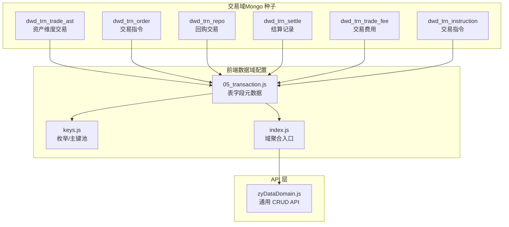
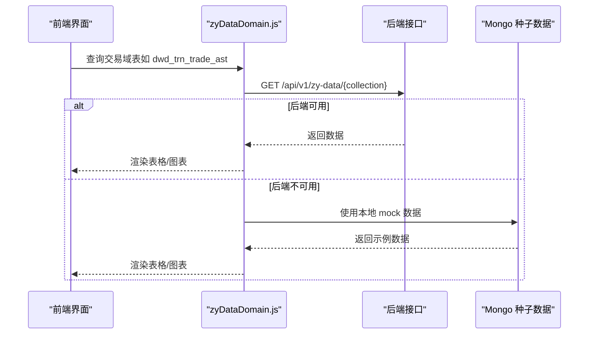
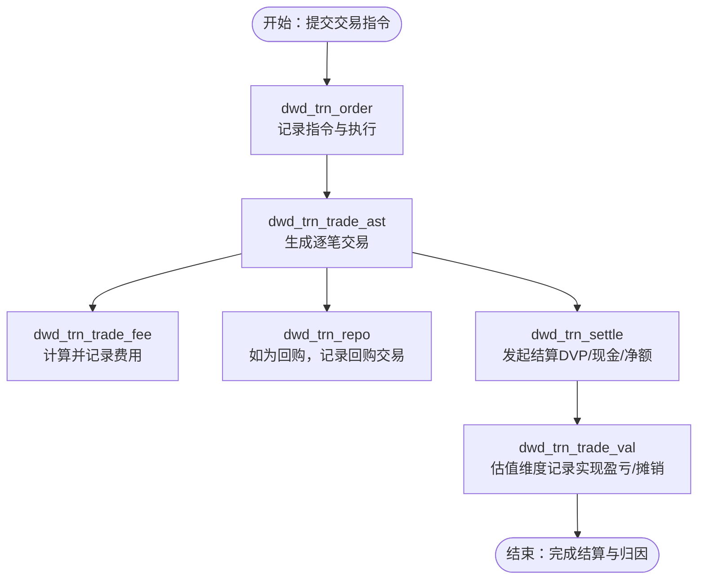
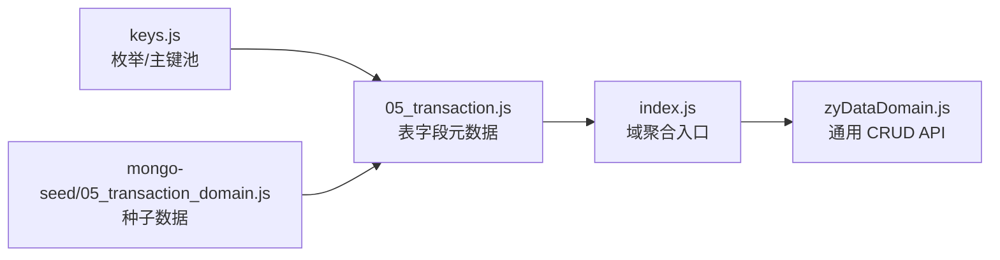

# 交易域数据模型

<cite>
**本文档引用的文件**
- [mongo-seed/05_transaction_domain.js](file://mongo-seed/05_transaction_domain.js)
- [src/config/zyDataDomain/05_transaction.js](file://src/config/zyDataDomain/05_transaction.js)
- [src/config/zyDataDomain/index.js](file://src/config/zyDataDomain/index.js)
- [src/config/zyDataDomain/keys.js](file://src/config/zyDataDomain/keys.js)
- [src/api/zyDataDomain.js](file://src/api/zyDataDomain.js)
- [scripts/zy_data_associated_mock_design_v2.md](file://scripts/zy_data_associated_mock_design_v2.md)
</cite>

## 目录
1. [引言](#引言)
2. [项目结构](#项目结构)
3. [核心组件](#核心组件)
4. [架构总览](#架构总览)
5. [详细组件分析](#详细组件分析)
6. [依赖分析](#依赖分析)
7. [性能考虑](#性能考虑)
8. [故障排查指南](#故障排查指南)
9. [结论](#结论)
10. [附录](#附录)

## 引言
本文件系统性梳理交易域数据模型，聚焦交易执行与结算管理的核心数据域设计。围绕资产交易、产品交易、估值交易、结算与费用等关键表，解释字段结构、索引策略、业务含义与数据流转，并阐明与资产域、产品域、估值域的关联关系。同时给出交易流程的全链路数据追踪说明、合规与风控字段设计思路，以及与外部交易系统的数据交换格式建议。

## 项目结构
交易域相关代码主要分布在以下模块：
- Mongo 种子数据：定义交易域6张核心表的结构、索引与示例数据
- 前端数据域配置：定义各表字段元数据、枚举、默认值与校验规则
- 数据域聚合入口：提供按域/表查询、扁平化表清单等能力
- 通用 CRUD API：封装后端接口与本地 mock 的回退逻辑
- 关联设计文档：补充交易域与其他域的关联关系与典型场景

图表来源
- [mongo-seed/05_transaction_domain.js:1-165](file://mongo-seed/05_transaction_domain.js#L1-L165)
- [src/config/zyDataDomain/05_transaction.js:1-103](file://src/config/zyDataDomain/05_transaction.js#L1-L103)
- [src/config/zyDataDomain/index.js:1-80](file://src/config/zyDataDomain/index.js#L1-L80)
- [src/config/zyDataDomain/keys.js:1-73](file://src/config/zyDataDomain/keys.js#L1-L73)
- [src/api/zyDataDomain.js:1-190](file://src/api/zyDataDomain.js#L1-L190)

章节来源
- [mongo-seed/05_transaction_domain.js:1-165](file://mongo-seed/05_transaction_domain.js#L1-L165)
- [src/config/zyDataDomain/05_transaction.js:1-103](file://src/config/zyDataDomain/05_transaction.js#L1-L103)
- [src/config/zyDataDomain/index.js:1-80](file://src/config/zyDataDomain/index.js#L1-L80)
- [src/config/zyDataDomain/keys.js:1-73](file://src/config/zyDataDomain/keys.js#L1-L73)
- [src/api/zyDataDomain.js:1-190](file://src/api/zyDataDomain.js#L1-L190)

## 核心组件
- dwd_trn_trade_ast（资产维度交易）：记录每笔交易的资产侧明细，包含交易流水号、资产代码、交易方向、数量、价格、金额、结算日、对手方、交易员、状态等
- dwd_trn_order（交易指令）：记录委托指令的提交、执行与状态变化，包含指令ID、组合ID、资产代码、买卖方向、指令数量/价格、成交均价、状态等
- dwd_trn_repo（回购交易）：记录质押式/买断式回购的交易要素，包含回购ID、起止日期、利率、金额、券种、对手方、状态等
- dwd_trn_settle（结算记录）：记录结算层面的DVP/现金/净额等结算方式与账户信息，包含结算ID、交易ID、结算日、结算金额/数量、结算方式、账户、状态等
- dwd_trn_trade_fee（交易费用）：记录各类费用（如经纪商费、托管费等），包含费用ID、交易ID、费用类型、费率、金额、日期等
- dwd_trn_instruction（交易指令）：记录投资决策层的指令，包含指令ID、组合ID、目标金额/收益率、紧急度、原因、状态等

章节来源
- [mongo-seed/05_transaction_domain.js:15-165](file://mongo-seed/05_transaction_domain.js#L15-L165)
- [src/config/zyDataDomain/05_transaction.js:17-100](file://src/config/zyDataDomain/05_transaction.js#L17-L100)

## 架构总览
交易域通过“资产维度”“产品维度”“估值维度”“结算维度”“指令维度”等视角组织数据，既满足底层资产交易的细粒度记录，又支持上层产品组合、估值与结算的汇总分析。前端通过数据域配置与通用 API 实现对交易域表的查询、新增、更新与删除。

图表来源
- [src/api/zyDataDomain.js:69-96](file://src/api/zyDataDomain.js#L69-L96)
- [mongo-seed/05_transaction_domain.js:21-46](file://mongo-seed/05_transaction_domain.js#L21-L46)

章节来源
- [src/api/zyDataDomain.js:1-190](file://src/api/zyDataDomain.js#L1-L190)
- [src/config/zyDataDomain/index.js:25-37](file://src/config/zyDataDomain/index.js#L25-L37)

## 详细组件分析

### dwd_trn_trade_ast（资产维度交易）
- 主键：TRADE_ID
- 核心字段
  - 交易标识：TRADE_ID
  - 资产标识：AST_CD、AST_NM
  - 交易要素：TRADE_DT、SETT_DT、TRADE_DIR（买卖方向）、TRADE_TYPE（直投/回购/买断式）、TRADE_PRC（价格）、TRADE_YIELD（收益率）、FACE_AMT（面额）、SETT_AMT（结算金额）、ACCRUED_INT（应计利息）
  - 对手与市场：CNTP_ID、CNTP_NM、MARKET
  - 人员与状态：TRADER、STATUS
- 索引策略
  - 唯一索引：TRADE_ID
  - 复合索引：PORT_ID+TRADE_DT、AST_CD+TRADE_DT
- 业务意义
  - 记录资产层面的逐笔交易，支撑资产估值、现金流与风险评估
  - 支持按组合、按资产维度的交易明细查询与汇总

章节来源
- [mongo-seed/05_transaction_domain.js:15-46](file://mongo-seed/05_transaction_domain.js#L15-L46)
- [src/config/zyDataDomain/05_transaction.js:17-31](file://src/config/zyDataDomain/05_transaction.js#L17-L31)

### dwd_trn_order（交易指令）
- 主键：ORDER_ID
- 核心字段
  - 指令标识：ORDER_ID
  - 组合与资产：PORT_ID、AST_CD
  - 提交与执行：SUBMIT_DT、SUBMIT_TM、ORDER_DIR（买卖方向）、ORDER_PRC、ORDER_QTY、FILLED_QTY、AVG_PRC
  - 状态与来源：STATUS（NEW/PARTIAL/FILLED/CANCELLED/REJECTED）、ORDER_SRC（MANUAL/ALGO/API）、TRADER
  - 关联：LINK_TRADE_ID（关联交易）
- 索引策略
  - 唯一索引：ORDER_ID
  - 复合索引：PORT_ID+ORDER_DT
- 业务意义
  - 记录指令提交、执行与状态变化，支撑交易执行监控与绩效归因

章节来源
- [mongo-seed/05_transaction_domain.js:49-73](file://mongo-seed/05_transaction_domain.js#L49-L73)
- [src/config/zyDataDomain/05_transaction.js:84-100](file://src/config/zyDataDomain/05_transaction.js#L84-L100)

### dwd_trn_repo（回购交易）
- 主键：REPO_ID
- 核心字段
  - 回购标识：REPO_ID
  - 交易要素：REPO_TYPE（直投/买断式）、REPO_DIR（Lend/Borrow）、START_DT、END_DT、REPO_RATE、REPO_AMT
  - 质押券与对手：COLLATERAL_CD、CNTP_ID、CNTP_NM
  - 状态：STATUS（ACTIVE/MATURED）
- 索引策略
  - 唯一索引：REPO_ID
  - 复合索引：PORT_ID+START_DT
- 业务意义
  - 记录回购交易的全生命周期，支撑流动性管理与风险限额监控

章节来源
- [mongo-seed/05_transaction_domain.js:75-94](file://mongo-seed/05_transaction_domain.js#L75-L94)

### dwd_trn_settle（结算记录）
- 主键：SETTLE_ID
- 核心字段
  - 结算标识：SETTLE_ID
  - 关联：TRADE_ID
  - 结算要素：SETTLE_DT、SETTLE_TYPE（DVP/NETTING/CASH）、SETT_AMT、SETT_QTY
  - 资金与债券账户：CASH_ACCT、BOND_ACCT
  - 方向与状态：CASH_DIR、BOND_DIR、STATUS
- 索引策略
  - 唯一索引：SETTLE_ID
  - 复合索引：TRADE_ID
- 业务意义
  - 记录结算层面的DVP/现金/净额等处理结果，支撑资金与券款交收核对

章节来源
- [mongo-seed/05_transaction_domain.js:96-120](file://mongo-seed/05_transaction_domain.js#L96-L120)

### dwd_trn_trade_fee（交易费用）
- 主键：FEE_ID
- 核心字段
  - 费用标识：FEE_ID
  - 关联：TRADE_ID
  - 费用要素：FEE_TYPE（BROKER/CUSTODY等）、FEE_RATE、FEE_AMT、FEE_DT
- 索引策略
  - 唯一索引：FEE_ID
  - 复合索引：TRADE_ID
- 业务意义
  - 记录各类交易费用的计算与归集，支撑成本核算与组合损益归因

章节来源
- [mongo-seed/05_transaction_domain.js:122-143](file://mongo-seed/05_transaction_domain.js#L122-L143)

### dwd_trn_instruction（交易指令）
- 主键：INSTR_ID
- 核心字段
  - 指令标识：INSTR_ID
  - 组合与资产：PORT_ID、AST_CD
  - 目标与策略：TARGET_AMT、TARGET_YIELD、URGENCY（NORMAL/HIGH/LOW）、REASON
  - 执行：PM、STATUS（EXECUTED）
- 索引策略
  - 唯一索引：INSTR_ID
  - 复合索引：PORT_ID+INSTR_DT
- 业务意义
  - 记录投资决策层的指令，支撑策略执行与合规审查

章节来源
- [mongo-seed/05_transaction_domain.js:145-162](file://mongo-seed/05_transaction_domain.js#L145-L162)

### 交易域与其他数据域的关联关系
- 与资产域
  - 通过 AST_CD 关联资产基础信息与估值信息，支撑交易与估值联动
- 与产品域
  - 通过 PORT_ID 关联投资组合，支撑产品维度的交易汇总与归因
- 与估值域
  - 通过 VAL_STATUS、NET_PRC/FULL_PRC/ACI_AMT 等字段，支撑估值维度交易的实现盈亏与摊销归因
- 与主体域/对手方
  - 通过 CNTP_ID 关联交易对手信息，支撑对手集中度与限额管理

章节来源
- [scripts/zy_data_associated_mock_design_v2.md:282-324](file://scripts/zy_data_associated_mock_design_v2.md#L282-L324)
- [src/config/zyDataDomain/05_transaction.js:62-82](file://src/config/zyDataDomain/05_transaction.js#L62-L82)

### 交易流程的完整数据追踪（从下单到结算）

图表来源
- [mongo-seed/05_transaction_domain.js:21-162](file://mongo-seed/05_transaction_domain.js#L21-L162)
- [src/config/zyDataDomain/05_transaction.js:17-82](file://src/config/zyDataDomain/05_transaction.js#L17-L82)

章节来源
- [mongo-seed/05_transaction_domain.js:21-162](file://mongo-seed/05_transaction_domain.js#L21-L162)
- [src/config/zyDataDomain/05_transaction.js:17-82](file://src/config/zyDataDomain/05_transaction.js#L17-L82)

### 合规检查机制与风控字段设计
- 合规字段建议
  - 指令来源：ORDER_SRC（MANUAL/ALGO/API），便于审计与策略合规
  - 状态字段：STATUS（NEW/PARTIAL/FILLED/CANCELLED/REJECTED），支撑交易执行合规
  - 对手集中度：CNTP_ID、CNTP_NM、TRADE_LIMIT、CURRENT_EXPOSURE（参考关联设计文档中的交易对手字段）
  - 限额与风控：TARGET_AMT/TARGET_YIELD、URGENCY、PM_APPROVER（指令审批）
- 风控实现思路
  - 在 dwd_trn_instruction 中设置目标金额/收益率与紧急度，结合 dwd_isr_trd_cntp 的对手限额进行实时校验
  - 在 dwd_trn_order 中记录 FILLED_QTY/AVG_PRC，支撑执行偏离与滑点监控

章节来源
- [src/config/zyDataDomain/05_transaction.js:84-100](file://src/config/zyDataDomain/05_transaction.js#L84-L100)
- [scripts/zy_data_associated_mock_design_v2.md:313-324](file://scripts/zy_data_associated_mock_design_v2.md#L313-L324)

### 与外部交易系统的数据交换格式
- 交换建议
  - 采用标准字段映射：交易ID（TRADE_ID）、资产代码（AST_CD）、交易方向（BS_DIR）、数量（QTY）、价格（PRC）、金额（AMT）、结算日（SETT_DT）、对手（CNTP_ID）、状态（STATUS）
  - 传输协议：REST/HTTP 或消息队列（Kafka/RabbitMQ），按表粒度推送或批量导入
  - 校验与幂等：基于主键（TRADE_ID/ORDER_ID）去重与一致性校验
- 与前端集成
  - 通过通用 CRUD API（zyDataDomain.js）对接后端接口，若后端不可用则自动回退到本地 mock

章节来源
- [src/api/zyDataDomain.js:1-190](file://src/api/zyDataDomain.js#L1-L190)
- [src/config/zyDataDomain/05_transaction.js:17-100](file://src/config/zyDataDomain/05_transaction.js#L17-L100)

## 依赖分析
- 前端域聚合
  - 交易域 schema 由 index.js 聚合，提供 findDomain/findTable/flatTables/domainSummary 等工具方法
- 枚举与主键池
  - keys.js 提供业务日期、资产代码、组合ID、对手ID、币种、买卖方向、状态、结算状态等枚举，确保前后端一致性
- API 层
  - 通用 CRUD API 封装请求与回退逻辑，屏蔽后端可用性差异

图表来源
- [src/config/zyDataDomain/keys.js:1-73](file://src/config/zyDataDomain/keys.js#L1-L73)
- [src/config/zyDataDomain/05_transaction.js:1-103](file://src/config/zyDataDomain/05_transaction.js#L1-L103)
- [src/config/zyDataDomain/index.js:1-80](file://src/config/zyDataDomain/index.js#L1-L80)
- [src/api/zyDataDomain.js:1-190](file://src/api/zyDataDomain.js#L1-L190)
- [mongo-seed/05_transaction_domain.js:1-165](file://mongo-seed/05_transaction_domain.js#L1-L165)

章节来源
- [src/config/zyDataDomain/index.js:1-80](file://src/config/zyDataDomain/index.js#L1-L80)
- [src/config/zyDataDomain/keys.js:1-73](file://src/config/zyDataDomain/keys.js#L1-L73)

## 性能考虑
- 索引策略
  - 交易表普遍建立唯一主键索引，复合索引覆盖常见查询维度（如 PORT_ID+TRADE_DT、AST_CD+TRADE_DT、TRADE_ID）
- 查询优化
  - 建议在前端分页与过滤时，尽量使用已建索引字段，减少全表扫描
- 数据规模
  - 交易域数据量随业务增长而增加，建议定期清理历史数据与归档旧交易，保持索引效率

## 故障排查指南
- 后端接口不可用
  - API 层会根据 HTTP 状态码（404/405/501）或网络错误自动切换到本地 mock，确保前端功能可用
- 字段不一致
  - 检查 keys.js 中的枚举与默认值是否与后端一致，避免表单校验失败
- 数据缺失
  - 确认种子数据是否正确导入，或手动触发本地 mock 初始化

章节来源
- [src/api/zyDataDomain.js:26-46](file://src/api/zyDataDomain.js#L26-L46)
- [src/config/zyDataDomain/keys.js:6-63](file://src/config/zyDataDomain/keys.js#L6-L63)

## 结论
交易域通过“资产维度”“产品维度”“估值维度”“结算维度”“指令维度”的多视角数据模型，全面覆盖交易执行与结算管理的关键环节。配合完善的索引策略、枚举与主键池、以及与资产域、产品域、估值域的关联设计，能够支撑从下单到结算的全流程数据追踪与合规风控。前端通过通用 CRUD API 与本地 mock 回退机制，保障了系统的可用性与一致性。

## 附录
- 交易域表清单与字段概览
  - dwd_trn_trade_ast：资产维度交易明细
  - dwd_trn_order：交易指令与执行
  - dwd_trn_repo：回购交易
  - dwd_trn_settle：结算记录
  - dwd_trn_trade_fee：交易费用
  - dwd_trn_instruction：投资指令

章节来源
- [src/config/zyDataDomain/05_transaction.js:17-100](file://src/config/zyDataDomain/05_transaction.js#L17-L100)