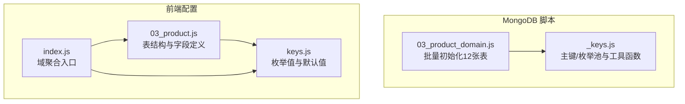
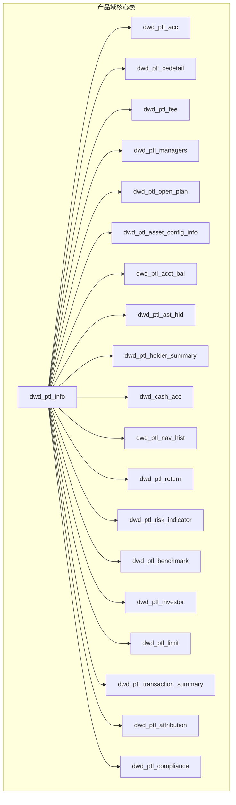
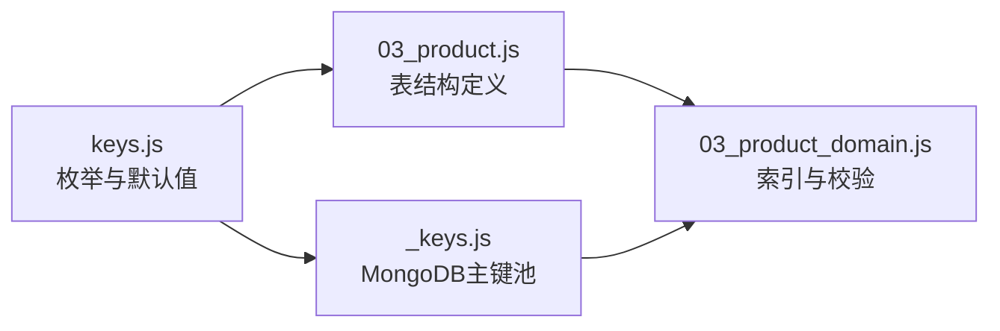
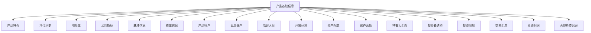

# 产品域数据模型

<cite>
**本文档引用的文件**
- [03_product_domain.js](file://mongo-seed/03_product_domain.js)
- [03_product.js](file://src/config/zyDataDomain/03_product.js)
- [keys.js](file://src/config/zyDataDomain/keys.js)
- [_keys.js](file://mongo-seed/_keys.js)
- [index.js](file://src/config/zyDataDomain/index.js)
- [zy_data_domain_seeds.json](file://scripts/zy_data_domain_seeds.json)
- [zy_data_associated_mock_design_v2.md](file://scripts/zy_data_associated_mock_design_v2.md)
</cite>

## 目录
1. [引言](#引言)
2. [项目结构](#项目结构)
3. [核心组件](#核心组件)
4. [架构总览](#架构总览)
5. [详细组件分析](#详细组件分析)
6. [依赖分析](#依赖分析)
7. [性能考虑](#性能考虑)
8. [故障排查指南](#故障排查指南)
9. [结论](#结论)
10. [附录](#附录)

## 引言
本文件面向产品域数据模型，聚焦于12张核心表的完整架构设计与实现细节，覆盖产品基础信息、财务费率、运营计划、持仓与账户、投资者结构、合规风控等关键领域。文档同时提供表间复杂关联关系图、主键/外键约束说明，并结合产品全生命周期管理的实际应用示例，帮助读者快速理解与落地使用。

## 项目结构
产品域数据模型由两部分构成：
- 种子数据与索引定义：通过MongoDB脚本批量初始化12张表，定义主键、索引与校验规则。
- 前端配置与枚举：通过配置文件定义表结构、字段类型、枚举值与默认值，确保前后端一致性。

图表来源
- [03_product_domain.js:1-543](file://mongo-seed/03_product_domain.js#L1-L543)
- [03_product.js:1-136](file://src/config/zyDataDomain/03_product.js#L1-L136)
- [keys.js:1-73](file://src/config/zyDataDomain/keys.js#L1-L73)
- [_keys.js:1-161](file://mongo-seed/_keys.js#L1-L161)
- [index.js:1-47](file://src/config/zyDataDomain/index.js#L1-L47)

章节来源
- [03_product_domain.js:1-543](file://mongo-seed/03_product_domain.js#L1-L543)
- [03_product.js:1-136](file://src/config/zyDataDomain/03_product.js#L1-L136)
- [keys.js:1-73](file://src/config/zyDataDomain/keys.js#L1-L73)
- [_keys.js:1-161](file://mongo-seed/_keys.js#L1-L161)
- [index.js:1-47](file://src/config/zyDataDomain/index.js#L1-L47)

## 核心组件
- 产品基础信息表 dwd_ptl_info：定义产品主键、名称、类型、风险等级、成立日、币种、基准、净值、规模、管理人、托管行、状态等核心字段。
- 产品账户表 dwd_ptl_acc：定义产品账户主键（组合ID+账户号），账户类型、名称、开户行、币种等。
- 产品费用明细表 dwd_ptl_cedetail：定义申赎事件（SUB/RDM/DIV）的交易明细，含金额、币种、摘要等。
- 产品费率表 dwd_ptl_fee：定义费率类型、生效日、失效日、计费基数等。
- 产品管理人员表 dwd_ptl_managers：定义经理ID、姓名、角色、任职起止时间等。
- 产品开放计划表 dwd_ptl_open_plan：定义开放日、开放类型、关闭日、额度等。
- 产品资产配置表 dwd_ptl_asset_config_info：定义资产类别、目标比例、上下限等。
- 产品账户余额表 dwd_ptl_acct_bal：定义余额类型（总额/可用/冻结）、金额、币种等。
- 产品持仓表 dwd_ptl_ast_hld：定义资产代码、数量、成本/市价、市值、应计利息、权重、账户号等。
- 产品持有人汇总表 dwd_ptl_holder_summary：定义持有人类型、人数、总份额/金额、占比等。
- 现金账户表 dwd_cash_acc：定义账户号、业务日期、币种、余额、可用余额、冻结余额、银行、利率等。
- 产品净值历史表 dwd_ptl_nav_hist：定义份额净值、累计净值、日收益、净值状态等。
- 产品收益率表 dwd_ptl_return：定义日/周/Month/Year收益、基准收益、超额收益等。
- 产品风险指标表 dwd_ptl_risk_indicator：定义波动率、最大回撤、夏普比率、跟踪误差、信息比率、贝塔、VAR、卡玛比率等。
- 产品基准信息表 dwd_ptl_benchmark：定义基准名称、成分、日收益、YTD/1Y收益等。
- 产品投资者结构表 dwd_ptl_investor：定义投资者类型（机构/个人）、持有人数量、持有份额/金额、占比、Top10占比等。
- 产品投资限制表 dwd_ptl_limit：定义限制类型、描述、阈值、当前值、状态、检查日期等。
- 产品交易汇总表 dwd_ptl_transaction_summary：定义买入/卖出次数与金额、净额、换手率、总费用等。
- 产品业绩归因表 dwd_ptl_attribution：定义归因因子（如利率、信用、选券、交易）、贡献度、权重等。
- 产品合规检查记录表 dwd_ptl_compliance：定义检查项、描述、结果、违规说明、处理动作、级别等。

章节来源
- [03_product_domain.js:31-96](file://mongo-seed/03_product_domain.js#L31-L96)
- [03_product_domain.js:98-166](file://mongo-seed/03_product_domain.js#L98-L166)
- [03_product_domain.js:168-221](file://mongo-seed/03_product_domain.js#L168-L221)
- [03_product_domain.js:223-261](file://mongo-seed/03_product_domain.js#L223-L261)
- [03_product_domain.js:263-286](file://mongo-seed/03_product_domain.js#L263-L286)
- [03_product_domain.js:288-355](file://mongo-seed/03_product_domain.js#L288-L355)
- [03_product_domain.js:357-376](file://mongo-seed/03_product_domain.js#L357-L376)
- [03_product_domain.js:378-419](file://mongo-seed/03_product_domain.js#L378-L419)
- [03_product_domain.js:421-455](file://mongo-seed/03_product_domain.js#L421-L455)
- [03_product_domain.js:457-476](file://mongo-seed/03_product_domain.js#L457-L476)
- [03_product_domain.js:478-508](file://mongo-seed/03_product_domain.js#L478-L508)
- [03_product_domain.js:510-540](file://mongo-seed/03_product_domain.js#L510-L540)

## 架构总览
产品域围绕“组合ID(PORT_ID)”形成主键池，所有表通过该主键实现跨表关联。前端配置与MongoDB脚本保持一致的主键/枚举池，确保数据一致性与可维护性。

图表来源
- [03_product_domain.js:31-96](file://mongo-seed/03_product_domain.js#L31-L96)
- [03_product_domain.js:98-166](file://mongo-seed/03_product_domain.js#L98-L166)
- [03_product_domain.js:168-221](file://mongo-seed/03_product_domain.js#L168-L221)
- [03_product_domain.js:223-261](file://mongo-seed/03_product_domain.js#L223-L261)
- [03_product_domain.js:263-286](file://mongo-seed/03_product_domain.js#L263-L286)
- [03_product_domain.js:288-355](file://mongo-seed/03_product_domain.js#L288-L355)
- [03_product_domain.js:357-376](file://mongo-seed/03_product_domain.js#L357-L376)
- [03_product_domain.js:378-419](file://mongo-seed/03_product_domain.js#L378-L419)
- [03_product_domain.js:421-455](file://mongo-seed/03_product_domain.js#L421-L455)
- [03_product_domain.js:457-476](file://mongo-seed/03_product_domain.js#L457-L476)
- [03_product_domain.js:478-508](file://mongo-seed/03_product_domain.js#L478-L508)
- [03_product_domain.js:510-540](file://mongo-seed/03_product_domain.js#L510-L540)

## 详细组件分析

### dwd_ptl_info 产品基础信息表
- 主键：PORT_ID（唯一索引）
- 核心字段：产品名称、简称、类型、风险等级、成立日、币种、业绩基准、份额净值、累计净值、管理规模、管理人、托管行、状态等
- 设计要点：以PORT_ID为核心主键，配合业务日期形成复合主键池，便于与其他表关联；通过JSON Schema限定必填字段与类型，确保数据质量。

章节来源
- [03_product_domain.js:31-96](file://mongo-seed/03_product_domain.js#L31-L96)
- [03_product.js:17-31](file://src/config/zyDataDomain/03_product.js#L17-L31)
- [keys.js:44-46](file://src/config/zyDataDomain/keys.js#L44-L46)

### dwd_ptl_acc 产品账户表
- 主键：(PORT_ID, ACCT_NO)
- 字段：账户类型、账户名称、开户行、币种
- 设计要点：账户号与组合ID共同构成主键，确保账户唯一性；账户类型枚举与币种枚举来自公共池，保证一致性。

章节来源
- [03_product.js:39-46](file://src/config/zyDataDomain/03_product.js#L39-L46)
- [keys.js:53-38](file://src/config/zyDataDomain/keys.js#L53-L38)

### dwd_ptl_cedetail 产品申赎明细表
- 主键：(PORT_ID, TRADE_DT, CE_TYPE)
- 字段：事件类型（SUB/RDM/DIV）、金额、币种、摘要
- 设计要点：以组合ID+交易日期+事件类型构成复合主键，确保每笔申赎明细唯一；事件类型枚举限定为标准类型。

章节来源
- [03_product.js:48-55](file://src/config/zyDataDomain/03_product.js#L48-L55)
- [keys.js:47-48](file://src/config/zyDataDomain/keys.js#L47-L48)

### dwd_ptl_fee 产品费率表
- 主键：(PORT_ID, FEE_TYPE)
- 字段：费率、计费基数、生效日、失效日
- 设计要点：以组合ID+费用类型构成主键，便于按费用类型查询与管理；生效/失效日期用于费率变更追踪。

章节来源
- [03_product.js:57-64](file://src/config/zyDataDomain/03_product.js#L57-L64)
- [keys.js:47-48](file://src/config/zyDataDomain/keys.js#L47-L48)

### dwd_ptl_managers 产品管理人员表
- 主键：(PORT_ID, MANAGER_ID)
- 字段：经理姓名、角色（主/副/助理）、任职起止时间
- 设计要点：组合ID+经理ID构成主键，角色枚举限定职责范围；起止时间用于人员变更追踪。

章节来源
- [03_product.js:66-73](file://src/config/zyDataDomain/03_product.js#L66-L73)
- [keys.js:47-72](file://src/config/zyDataDomain/keys.js#L47-L72)

### dwd_ptl_open_plan 产品开放计划表
- 主键：(PORT_ID, OPEN_DT)
- 字段：开放类型（申购/赎回/两者）、关闭日、额度
- 设计要点：以组合ID+开放日期构成主键，开放类型枚举限定业务范围；额度用于限额控制。

章节来源
- [03_product.js:75-81](file://src/config/zyDataDomain/03_product.js#L75-L81)
- [keys.js:47-72](file://src/config/zyDataDomain/keys.js#L47-L72)

### dwd_ptl_asset_config_info 产品资产配置表
- 主键：(PORT_ID, AST_CLASS)
- 字段：目标比例、下限、上限
- 设计要点：以组合ID+资产类别构成主键，资产类别枚举限定配置范围；上下限用于风控与合规。

章节来源
- [03_product.js:83-89](file://src/config/zyDataDomain/03_product.js#L83-L89)
- [keys.js:53-72](file://src/config/zyDataDomain/keys.js#L53-L72)

### dwd_ptl_acct_bal 产品账户余额表
- 主键：(PORT_ID, BIZ_DT, BAL_TYPE)
- 字段：余额类型（总额/可用/冻结）、金额、币种
- 设计要点：以组合ID+业务日期+余额类型构成复合主键，确保每日不同余额类型的唯一性。

章节来源
- [03_product.js:91-97](file://src/config/zyDataDomain/03_product.js#L91-L97)
- [keys.js:53-38](file://src/config/zyDataDomain/keys.js#L53-L38)

### dwd_ptl_ast_hld 产品持仓表
- 主键：(PORT_ID, AST_CD, BIZ_DT)
- 字段：持仓数量、成本价/市价、成本金额、市值、应计利息、权重、账户号
- 设计要点：以组合ID+资产代码+业务日期构成复合主键，确保每日持仓唯一；权重与账户号便于归因与资金追踪。

章节来源
- [03_product.js:99-111](file://src/config/zyDataDomain/03_product.js#L99-L111)
- [keys.js:53-38](file://src/config/zyDataDomain/keys.js#L53-L38)

### dwd_ptl_holder_summary 产品持有人汇总表
- 主键：(PORT_ID, BIZ_DT, HOLDER_TYPE)
- 字段：持有人类型、人数、总份额/金额、占比
- 设计要点：以组合ID+业务日期+持有人类型构成复合主键，便于按类型统计与分析。

章节来源
- [03_product.js:113-121](file://src/config/zyDataDomain/03_product.js#L113-L121)
- [keys.js:56-57](file://src/config/zyDataDomain/keys.js#L56-L57)

### dwd_cash_acc 现金账户表
- 主键：(PORT_ID, ACCT_NO, BIZ_DT)
- 字段：币种、余额、可用余额、冻结余额、银行、利率
- 设计要点：以组合ID+账户号+业务日期构成复合主键，确保每日现金账户唯一；银行与利率字段便于资金管理与计息。

章节来源
- [03_product.js:123-133](file://src/config/zyDataDomain/03_product.js#L123-L133)
- [keys.js:38-53](file://src/config/zyDataDomain/keys.js#L38-L53)

### 其他财务与运营相关表
- dwd_ptl_nav_hist：净值历史，字段包括份额净值、累计净值、日收益、净值状态等。
- dwd_ptl_return：收益率，字段包括日/周/Month/Year收益、基准收益、超额收益等。
- dwd_ptl_risk_indicator：风险指标，字段包括波动率、最大回撤、夏普比率、跟踪误差、信息比率、贝塔、VAR、卡玛比率等。
- dwd_ptl_benchmark：基准信息，字段包括基准名称、成分、日收益、YTD/1Y收益等。
- dwd_ptl_investor：投资者结构，字段包括投资者类型、持有人数量、持有份额/金额、占比、Top10占比等。
- dwd_ptl_limit：投资限制，字段包括限制类型、描述、阈值、当前值、状态、检查日期等。
- dwd_ptl_transaction_summary：交易汇总，字段包括买入/卖出次数与金额、净额、换手率、总费用等。
- dwd_ptl_attribution：业绩归因，字段包括归因因子（如利率、信用、选券、交易）、贡献度、权重等。
- dwd_ptl_compliance：合规检查记录，字段包括检查项、描述、结果、违规说明、处理动作、级别等。

章节来源
- [03_product_domain.js:168-221](file://mongo-seed/03_product_domain.js#L168-L221)
- [03_product_domain.js:223-261](file://mongo-seed/03_product_domain.js#L223-L261)
- [03_product_domain.js:263-286](file://mongo-seed/03_product_domain.js#L263-L286)
- [03_product_domain.js:288-355](file://mongo-seed/03_product_domain.js#L288-L355)
- [03_product_domain.js:378-419](file://mongo-seed/03_product_domain.js#L378-L419)
- [03_product_domain.js:421-455](file://mongo-seed/03_product_domain.js#L421-L455)
- [03_product_domain.js:457-476](file://mongo-seed/03_product_domain.js#L457-L476)
- [03_product_domain.js:478-508](file://mongo-seed/03_product_domain.js#L478-L508)
- [03_product_domain.js:510-540](file://mongo-seed/03_product_domain.js#L510-L540)

## 依赖分析
- 主键池与枚举：前端配置与MongoDB脚本共享主键池与枚举值，确保跨表一致性。
- 关联关系：所有表以PORT_ID为主键池，形成以组合为核心的关联网络；部分表通过资产代码、账户号等形成跨域关联。
- 外键约束：MongoDB为每张表设置唯一索引，确保主键唯一性；前端配置提供枚举约束，减少脏数据。

图表来源
- [keys.js:1-73](file://src/config/zyDataDomain/keys.js#L1-L73)
- [_keys.js:1-161](file://mongo-seed/_keys.js#L1-L161)
- [03_product.js:1-136](file://src/config/zyDataDomain/03_product.js#L1-L136)
- [03_product_domain.js:1-543](file://mongo-seed/03_product_domain.js#L1-L543)

章节来源
- [keys.js:1-73](file://src/config/zyDataDomain/keys.js#L1-L73)
- [_keys.js:1-161](file://mongo-seed/_keys.js#L1-L161)
- [03_product.js:1-136](file://src/config/zyDataDomain/03_product.js#L1-L136)
- [03_product_domain.js:1-543](file://mongo-seed/03_product_domain.js#L1-L543)

## 性能考虑
- 索引设计：每张表均设置唯一索引，确保主键查询高效；复合主键用于高频查询场景（如按组合+日期查询）。
- 数据量控制：前端配置提供默认值与枚举约束，减少无效数据；批量导入脚本按业务日期分批插入，降低写入压力。
- 查询优化：建议在高频查询字段上建立二级索引（如按产品类型、状态、币种等），并结合分页与投影查询，避免全表扫描。

## 故障排查指南
- 数据一致性问题：核对前端配置与MongoDB脚本的主键池与枚举值是否一致；检查唯一索引是否正确创建。
- 字段缺失或类型不符：根据JSON Schema校验规则，确认必填字段与类型；前端配置中枚举值是否覆盖所有取值。
- 关联查询异常：确认外键字段（如PORT_ID、AST_CD、ACCT_NO）是否正确；检查复合主键顺序与业务日期是否匹配。
- 导入失败：查看批量导入脚本的错误日志，确认业务日期、资产代码映射、审计字段是否正确填充。

章节来源
- [03_product_domain.js:31-96](file://mongo-seed/03_product_domain.js#L31-L96)
- [03_product_domain.js:98-166](file://mongo-seed/03_product_domain.js#L98-L166)
- [03_product_domain.js:168-221](file://mongo-seed/03_product_domain.js#L168-L221)
- [03_product_domain.js:223-261](file://mongo-seed/03_product_domain.js#L223-L261)
- [03_product_domain.js:263-286](file://mongo-seed/03_product_domain.js#L263-L286)
- [03_product_domain.js:288-355](file://mongo-seed/03_product_domain.js#L288-L355)
- [03_product_domain.js:357-376](file://mongo-seed/03_product_domain.js#L357-L376)
- [03_product_domain.js:378-419](file://mongo-seed/03_product_domain.js#L378-L419)
- [03_product_domain.js:421-455](file://mongo-seed/03_product_domain.js#L421-L455)
- [03_product_domain.js:457-476](file://mongo-seed/03_product_domain.js#L457-L476)
- [03_product_domain.js:478-508](file://mongo-seed/03_product_domain.js#L478-L508)
- [03_product_domain.js:510-540](file://mongo-seed/03_product_domain.js#L510-L540)

## 结论
产品域数据模型以组合ID为核心主键池，围绕产品生命周期的关键环节（基础信息、财务费率、运营计划、持仓与账户、投资者结构、合规风控）建立了完整的12张表体系。通过前端配置与MongoDB脚本的协同，确保了数据一致性与可维护性；通过合理的索引与枚举约束，提升了查询效率与数据质量。结合产品全生命周期管理的实际应用示例，可有效支撑产品运营、风控与投研分析。

## 附录
- 产品全生命周期管理示例
  - 成立阶段：创建产品基础信息、设定资产配置目标、建立账户与费率体系。
  - 运营阶段：每日更新净值、持仓、账户余额、交易汇总与风险指标；按开放计划执行申赎；监控投资限制与合规检查。
  - 终止阶段：清理账户与持仓，结算费用与收益，归档历史数据。

- 关联关系图谱（概念示意）

[本图为概念示意，不对应具体源码文件，故无图表来源]