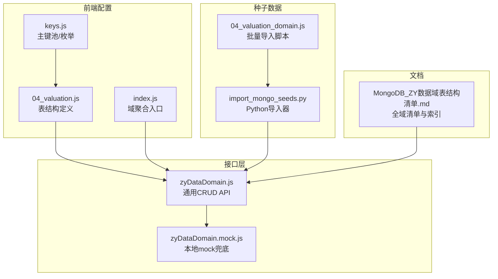
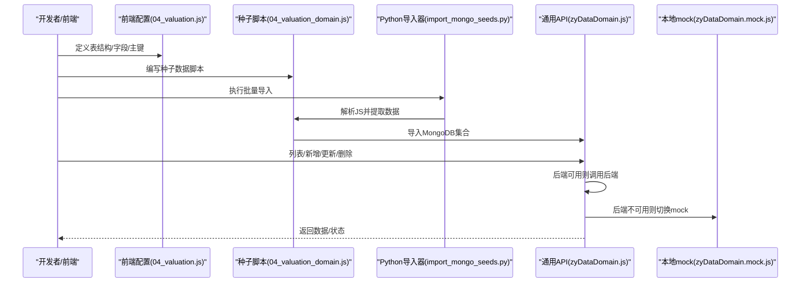
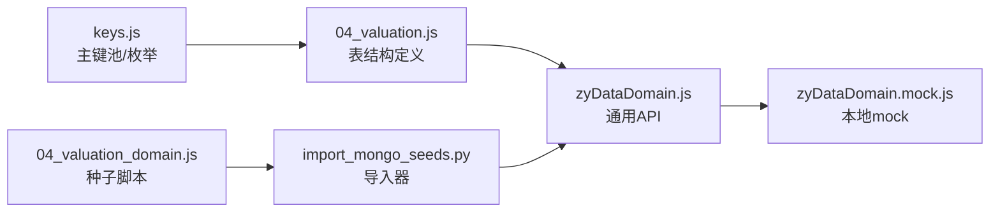
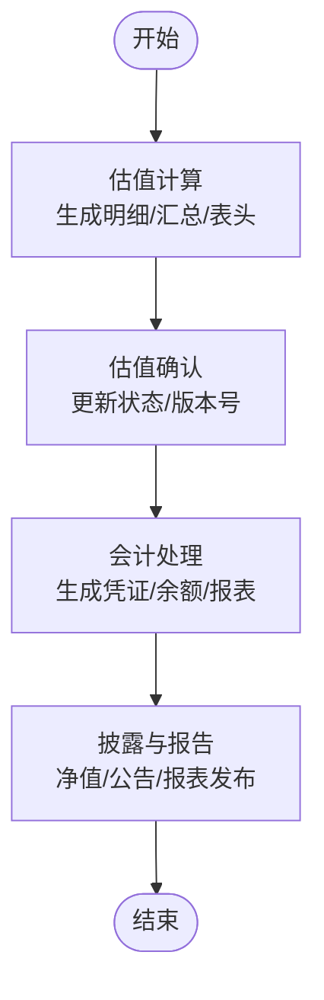

# 估值域数据模型

<cite>
**本文引用的文件**
- [mongo-seed/04_valuation_domain.js](file://mongo-seed/04_valuation_domain.js)
- [src/config/zyDataDomain/04_valuation.js](file://src/config/zyDataDomain/04_valuation.js)
- [src/config/zyDataDomain/index.js](file://src/config/zyDataDomain/index.js)
- [src/config/zyDataDomain/keys.js](file://src/config/zyDataDomain/keys.js)
- [src/api/zyDataDomain.js](file://src/api/zyDataDomain.js)
- [src/api/zyDataDomain.mock.js](file://src/api/zyDataDomain.mock.js)
- [docs/MongoDB_ZY数据域表结构清单.md](file://docs/MongoDB_ZY数据域表结构清单.md)
- [scripts/import_mongo_seeds.py](file://scripts/import_mongo_seeds.py)
</cite>

## 目录
1. [简介](#简介)
2. [项目结构](#项目结构)
3. [核心组件](#核心组件)
4. [架构总览](#架构总览)
5. [详细组件分析](#详细组件分析)
6. [依赖关系分析](#依赖关系分析)
7. [性能考虑](#性能考虑)
8. [故障排查指南](#故障排查指南)
9. [结论](#结论)
10. [附录](#附录)

## 简介
本文件系统化梳理“估值域”作为金融资产价值管理与会计核算的核心数据域设计，覆盖估值域10张核心表的字段结构、业务含义、主键与索引策略、数据质量与一致性保障、以及与外部系统的集成方式。重点围绕以下主题展开：
- 估值表、凭证、汇总、明细、通知、余额、科目、资产负债表、利润表、现金流量表等表的字段定义与业务逻辑
- 估值流程的数据流转：从估值计算、确认到披露的全链路
- 估值准确性保障机制与异常处理流程
- 与外部估值系统的接口设计思路与落地方案

## 项目结构
估值域数据模型由“前端配置 + 种子数据 + 后端接口 + 文档清单”四部分协同构成：
- 前端配置层：定义表结构、字段属性、主键与默认值，用于界面渲染与校验
- 种子数据层：通过 mongo-seed 脚本批量导入真实业务数据，确保开发与演示环境的一致性
- 接口层：提供通用 CRUD API，并具备后端不可用时的本地 mock 兜底能力
- 文档层：提供全域表结构清单、索引策略、验证查询等运维与开发参考

图表来源
- [src/config/zyDataDomain/04_valuation.js:1-137](file://src/config/zyDataDomain/04_valuation.js#L1-L137)
- [src/config/zyDataDomain/keys.js:1-73](file://src/config/zyDataDomain/keys.js#L1-L73)
- [src/config/zyDataDomain/index.js:1-80](file://src/config/zyDataDomain/index.js#L1-L80)
- [mongo-seed/04_valuation_domain.js:1-443](file://mongo-seed/04_valuation_domain.js#L1-L443)
- [scripts/import_mongo_seeds.py:1-200](file://scripts/import_mongo_seeds.py#L1-L200)
- [src/api/zyDataDomain.js:1-190](file://src/api/zyDataDomain.js#L1-L190)
- [src/api/zyDataDomain.mock.js:1-800](file://src/api/zyDataDomain.mock.js#L1-L800)
- [docs/MongoDB_ZY数据域表结构清单.md:1-379](file://docs/MongoDB_ZY数据域表结构清单.md#L1-L379)

章节来源
- [src/config/zyDataDomain/04_valuation.js:1-137](file://src/config/zyDataDomain/04_valuation.js#L1-L137)
- [src/config/zyDataDomain/keys.js:1-73](file://src/config/zyDataDomain/keys.js#L1-L73)
- [src/config/zyDataDomain/index.js:1-80](file://src/config/zyDataDomain/index.js#L1-L80)
- [mongo-seed/04_valuation_domain.js:1-443](file://mongo-seed/04_valuation_domain.js#L1-L443)
- [scripts/import_mongo_seeds.py:1-200](file://scripts/import_mongo_seeds.py#L1-L200)
- [src/api/zyDataDomain.js:1-190](file://src/api/zyDataDomain.js#L1-L190)
- [src/api/zyDataDomain.mock.js:1-800](file://src/api/zyDataDomain.mock.js#L1-L800)
- [docs/MongoDB_ZY数据域表结构清单.md:1-379](file://docs/MongoDB_ZY数据域表结构清单.md#L1-L379)

## 核心组件
- 估值域表清单与主键策略
  - 估值表 dwd_val_valtable：组合维度的净值与资产规模表
  - 估值凭证 dwd_val_voucher：会计分录载体
  - 估值汇总 dwd_val_summary：资产类别维度汇总
  - 估值明细 dwd_val_detail：单资产维度明细
  - 估值通知 dwd_val_notice：净值/分红/事件公告
  - 余额表 dwd_val_bal：会计科目余额
  - 科目表 dwd_val_acc：会计科目体系
  - 资产负债表 dwd_val_rpt_bs：静态报表
  - 利润表 dwd_val_rpt_is：静态报表
  - 现金流量表 dwd_val_rpt_cf：静态报表
- 主键池与枚举
  - 主键池：PORT_ID、AST_CD、BIZ_DT 等
  - 枚举：估值状态、凭证类型、资产类别、通知类型、币种等
- 审计字段
  - etl_dt、src_sys、created_at、updated_at 等统一审计字段

章节来源
- [src/config/zyDataDomain/04_valuation.js:10-137](file://src/config/zyDataDomain/04_valuation.js#L10-L137)
- [src/config/zyDataDomain/keys.js:6-72](file://src/config/zyDataDomain/keys.js#L6-L72)
- [docs/MongoDB_ZY数据域表结构清单.md:114-129](file://docs/MongoDB_ZY数据域表结构清单.md#L114-L129)

## 架构总览
估值域数据模型遵循“前端配置驱动 + 种子数据导入 + 接口统一 + 文档支撑”的整体架构。前端通过配置文件定义表结构与字段约束，后端通过通用 API 提供 CRUD 能力，并在后端不可用时自动切换到本地 mock，确保开发体验与数据一致性。

图表来源
- [src/config/zyDataDomain/04_valuation.js:1-137](file://src/config/zyDataDomain/04_valuation.js#L1-L137)
- [mongo-seed/04_valuation_domain.js:1-443](file://mongo-seed/04_valuation_domain.js#L1-L443)
- [scripts/import_mongo_seeds.py:1-200](file://scripts/import_mongo_seeds.py#L1-L200)
- [src/api/zyDataDomain.js:1-190](file://src/api/zyDataDomain.js#L1-L190)
- [src/api/zyDataDomain.mock.js:1-800](file://src/api/zyDataDomain.mock.js#L1-L800)

## 详细组件分析

### 估值表 dwd_val_valtable
- 主键：PORT_ID + BIZ_DT
- 关键字段
  - 总资产、总负债、净资产、份额净值、累计净值、总份额、日收益率、估值状态、版本号
- 业务含义
  - 反映单个组合在特定业务日期的净值与资产规模，是估值域的“表头”
- 数据质量
  - 通过唯一复合索引保证同一组合在同一天仅有一条记录
  - 估值状态支持草稿/复核/确认流程

章节来源
- [src/config/zyDataDomain/04_valuation.js:17-29](file://src/config/zyDataDomain/04_valuation.js#L17-L29)
- [mongo-seed/04_valuation_domain.js:41-77](file://mongo-seed/04_valuation_domain.js#L41-L77)
- [docs/MongoDB_ZY数据域表结构清单.md:118-118](file://docs/MongoDB_ZY数据域表结构清单.md#L118-L118)

### 估值凭证 dwd_val_voucher
- 主键：PORT_ID + BIZ_DT + VOUCHER_NO
- 关键字段
  - 凭证号、凭证类型（正常/调整/反向）、描述、借方金额、贷方金额、币种
- 业务含义
  - 记录估值相关的会计分录，支持调整与反向凭证以修正错误
- 数据质量
  - 唯一索引确保凭证号在组合+日期下唯一

章节来源
- [src/config/zyDataDomain/04_valuation.js:31-40](file://src/config/zyDataDomain/04_valuation.js#L31-L40)
- [src/api/zyDataDomain.mock.js:506-512](file://src/api/zyDataDomain.mock.js#L506-L512)

### 估值汇总 dwd_val_summary
- 主键：PORT_ID + BIZ_DT + AST_CLASS
- 关键字段
  - 资产类别（股票/债券/现金/基金/其他）、市值、权重、应计利息
- 业务含义
  - 按资产类别汇总组合的资产分布情况，便于风控与配置分析

章节来源
- [src/config/zyDataDomain/04_valuation.js:42-49](file://src/config/zyDataDomain/04_valuation.js#L42-L49)
- [src/api/zyDataDomain.mock.js:514-520](file://src/api/zyDataDomain.mock.js#L514-L520)

### 估值明细 dwd_val_detail
- 主键：PORT_ID + AST_CD + BIZ_DT
- 关键字段
  - 持仓数量、成本价/市价、成本金额、市值、应计利息、浮动盈亏、实现盈亏、日盈亏、摊销金额
- 业务含义
  - 记录单个资产的估值明细，支持浮盈浮亏与日收益追踪

章节来源
- [src/config/zyDataDomain/04_valuation.js:51-65](file://src/config/zyDataDomain/04_valuation.js#L51-L65)
- [src/api/zyDataDomain.mock.js:522-528](file://src/api/zyDataDomain.mock.js#L522-L528)

### 估值通知 dwd_val_notice
- 主键：PORT_ID + BIZ_DT + NOTICE_TYPE
- 关键字段
  - 通知类型（净值/分红/事件）、标题、内容、发布日期
- 业务含义
  - 用于对外披露净值公告、分红公告与重大事件通知

章节来源
- [src/config/zyDataDomain/04_valuation.js:67-74](file://src/config/zyDataDomain/04_valuation.js#L67-L74)
- [src/api/zyDataDomain.mock.js:530-534](file://src/api/zyDataDomain.mock.js#L530-L534)

### 余额表 dwd_val_bal
- 主键：PORT_ID + BIZ_DT + ACC_CD
- 关键字段
  - 科目代码/名称、借方余额、贷方余额、余额、币种
- 业务含义
  - 记录会计科目的余额，支撑资产负债表与报表编制

章节来源
- [src/config/zyDataDomain/04_valuation.js:76-85](file://src/config/zyDataDomain/04_valuation.js#L76-L85)
- [src/api/zyDataDomain.mock.js:536-542](file://src/api/zyDataDomain.mock.js#L536-L542)

### 科目表 dwd_val_acc
- 主键：ACC_CD
- 关键字段
  - 科目名称、上级科目、科目层级、余额方向（借/贷）
- 业务含义
  - 定义会计科目体系，支撑余额表与报表映射

章节来源
- [src/config/zyDataDomain/04_valuation.js:87-93](file://src/config/zyDataDomain/04_valuation.js#L87-L93)
- [src/api/zyDataDomain.mock.js:544-550](file://src/api/zyDataDomain.mock.js#L544-L550)

### 财务报表相关表
- 资产负债表 dwd_val_rpt_bs
  - 字段：现金、债券/股票/基金持仓、应收利息、资产总计、应付赎回款、应付管理费、负债总计、所有者权益
- 利润表 dwd_val_rpt_is
  - 字段：利息收入、股息收入、交易盈亏、公允价值变动损益、管理费、托管费、销售费、其他费用、净收益
- 现金流量表 dwd_val_rpt_cf
  - 字段：投资活动流入/流出/净额、筹资活动流入/流出/净额、现金净变动

章节来源
- [src/config/zyDataDomain/04_valuation.js:95-134](file://src/config/zyDataDomain/04_valuation.js#L95-L134)
- [src/api/zyDataDomain.mock.js:552-574](file://src/api/zyDataDomain.mock.js#L552-L574)

### 估值域表结构与索引策略
- 主键与索引
  - 估值表：复合主键(PORT_ID, BIZ_DT)，并建立唯一索引
  - 凭证：复合主键(PORT_ID, BIZ_DT, VOUCHER_NO)，并建立唯一索引
  - 明细/汇总/通知/余额：均建立复合主键并设置唯一索引
- 审计字段
  - 所有表包含 etl_dt、src_sys、created_at、updated_at 等审计字段，确保数据来源与变更轨迹可追溯

章节来源
- [mongo-seed/04_valuation_domain.js:41-49](file://mongo-seed/04_valuation_domain.js#L41-L49)
- [mongo-seed/04_valuation_domain.js:162-162](file://mongo-seed/04_valuation_domain.js#L162-L162)
- [mongo-seed/04_valuation_domain.js:234-234](file://mongo-seed/04_valuation_domain.js#L234-L234)
- [docs/MongoDB_ZY数据域表结构清单.md:312-323](file://docs/MongoDB_ZY数据域表结构清单.md#L312-L323)

## 依赖关系分析
- 前端配置依赖主键池与枚举
  - 估值域配置依赖 keys.js 中的 PORT_IDS、AST_CDS、CCY 等主键池与枚举
- 种子数据依赖前端配置
  - 种子脚本通过 ZY_KEYS 引用主键池与审计字段，确保数据与配置一致
- 接口层依赖前端配置
  - 通用 API 通过 zyDataDomain 聚合域信息，实现按集合的统一 CRUD

图表来源
- [src/config/zyDataDomain/keys.js:6-72](file://src/config/zyDataDomain/keys.js#L6-L72)
- [src/config/zyDataDomain/04_valuation.js:1-137](file://src/config/zyDataDomain/04_valuation.js#L1-L137)
- [src/config/zyDataDomain/index.js:1-80](file://src/config/zyDataDomain/index.js#L1-L80)
- [mongo-seed/04_valuation_domain.js:1-443](file://mongo-seed/04_valuation_domain.js#L1-L443)
- [scripts/import_mongo_seeds.py:1-200](file://scripts/import_mongo_seeds.py#L1-L200)
- [src/api/zyDataDomain.js:1-190](file://src/api/zyDataDomain.js#L1-L190)
- [src/api/zyDataDomain.mock.js:1-800](file://src/api/zyDataDomain.mock.js#L1-L800)

章节来源
- [src/config/zyDataDomain/keys.js:6-72](file://src/config/zyDataDomain/keys.js#L6-L72)
- [src/config/zyDataDomain/04_valuation.js:1-137](file://src/config/zyDataDomain/04_valuation.js#L1-L137)
- [src/config/zyDataDomain/index.js:1-80](file://src/config/zyDataDomain/index.js#L1-L80)
- [mongo-seed/04_valuation_domain.js:1-443](file://mongo-seed/04_valuation_domain.js#L1-L443)
- [scripts/import_mongo_seeds.py:1-200](file://scripts/import_mongo_seeds.py#L1-L200)
- [src/api/zyDataDomain.js:1-190](file://src/api/zyDataDomain.js#L1-L190)
- [src/api/zyDataDomain.mock.js:1-800](file://src/api/zyDataDomain.mock.js#L1-L800)

## 性能考虑
- 索引策略
  - 在高频查询字段（如 PORT_ID、BIZ_DT、AST_CD）上建立复合索引，提升查询效率
  - 对唯一性约束字段（如凭证号、明细主键）建立唯一索引，避免重复数据
- 数据规模
  - 估值域包含10张表，每张表记录数在5~30条之间，整体规模较小，适合内存缓存与快速查询
- 导入性能
  - Python导入器支持批量插入与错误处理，避免重复导入导致的唯一索引冲突

章节来源
- [docs/MongoDB_ZY数据域表结构清单.md:257-279](file://docs/MongoDB_ZY数据域表结构清单.md#L257-L279)
- [scripts/import_mongo_seeds.py:134-183](file://scripts/import_mongo_seeds.py#L134-L183)

## 故障排查指南
- 后端接口不可用
  - 通用 API 在遇到 404/405/501 或网络错误时，自动切换到本地 mock，确保前端功能不受影响
  - 可通过 isMockMode() 判断当前是否处于 mock 模式
- 数据不一致
  - 检查唯一索引冲突：若出现重复键错误，需清理重复数据或调整主键
  - 核对审计字段：确认 etl_dt、src_sys 是否正确注入
- 开发期调试
  - 可通过 enableMock() 强制启用 mock 模式，resetMockData() 重置 mock 数据

章节来源
- [src/api/zyDataDomain.js:22-51](file://src/api/zyDataDomain.js#L22-L51)
- [src/api/zyDataDomain.js:69-96](file://src/api/zyDataDomain.js#L69-L96)
- [src/api/zyDataDomain.js:119-138](file://src/api/zyDataDomain.js#L119-L138)
- [src/api/zyDataDomain.js:140-158](file://src/api/zyDataDomain.js#L140-L158)
- [src/api/zyDataDomain.js:160-178](file://src/api/zyDataDomain.js#L160-L178)
- [src/api/zyDataDomain.js:180-190](file://src/api/zyDataDomain.js#L180-L190)

## 结论
估值域数据模型以“前端配置 + 种子数据 + 通用接口 + 文档支撑”为核心，构建了从估值计算、确认到披露的完整数据闭环。通过主键池与枚举统一字段约束，通过唯一索引与审计字段保障数据一致性，通过通用 API 与本地 mock 提升开发与运维效率。建议在生产环境中结合风控与合规要求，进一步完善数据校验与异常处理流程。

## 附录
- 估值流程数据流转（概念图）

- 外部估值系统接口设计建议
  - 采用标准 REST 接口，支持批量导入与增量同步
  - 通过凭证号/业务日期/组合标识进行幂等控制
  - 提供数据校验与异常回滚机制，确保与内部系统一致性