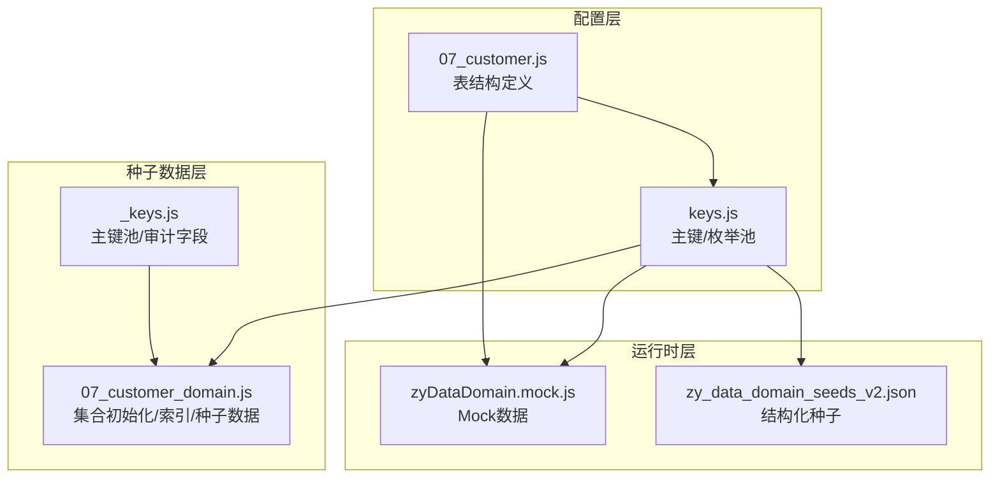
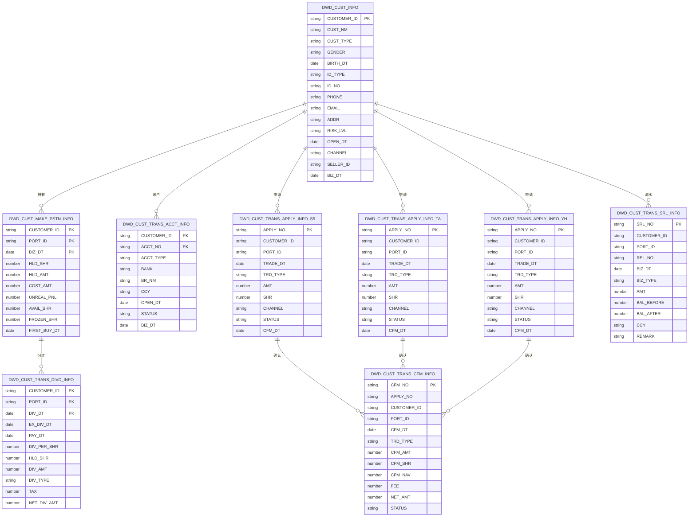
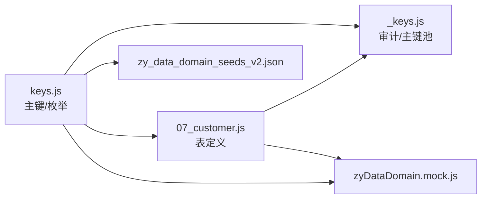
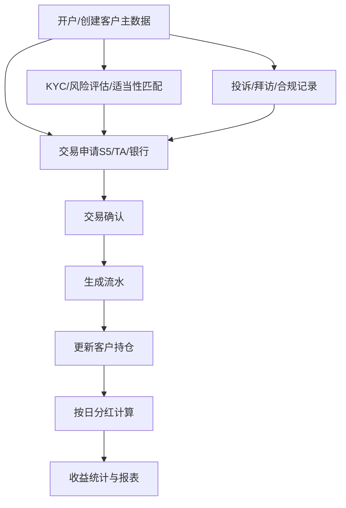

# 客户域数据模型

<cite>
**本文引用的文件**   
- [07_customer.js](file://src/config/zyDataDomain/07_customer.js)
- [07_customer_domain.js](file://mongo-seed/07_customer_domain.js)
- [_keys.js](file://mongo-seed/_keys.js)
- [keys.js](file://src/config/zyDataDomain/keys.js)
- [zyDataDomain.mock.js](file://src/api/zyDataDomain.mock.js)
- [zy_data_domain_seeds_v2.json](file://scripts/zy_data_domain_seeds_v2.json)
- [field_mapping_diff.json](file://scripts/field_mapping_diff.json)
</cite>

## 目录
1. [引言](#引言)
2. [项目结构](#项目结构)
3. [核心组件](#核心组件)
4. [架构概览](#架构概览)
5. [详细组件分析](#详细组件分析)
6. [依赖分析](#依赖分析)
7. [性能考虑](#性能考虑)
8. [故障排查指南](#故障排查指南)
9. [结论](#结论)
10. [附录](#附录)

## 引言
本文件面向客户域数据模型，系统化梳理客户关系管理与客户服务的核心数据域设计。围绕客户生命周期（从开户到销户）、交易与后续处理、风险与合规、以及隐私与监管报送等方面，提供字段结构、表间关系、数据流与集成规范说明，帮助技术与业务人员快速理解与落地。

## 项目结构
客户域数据模型由“配置层 + 种子数据层 + 运行时模拟/导入”构成：
- 配置层：定义各表的字段、主键、枚举与默认值，确保表单与校验一致性
- 种子数据层：通过 MongoDB 脚本初始化客户域8张核心表，并注入审计字段
- 运行时层：提供 mock 数据与导入脚本，支撑前端展示与测试

图示来源
- [07_customer.js:1-121](file://src/config/zyDataDomain/07_customer.js#L1-L121)
- [keys.js:1-73](file://src/config/zyDataDomain/keys.js#L1-L73)
- [_keys.js:1-161](file://mongo-seed/_keys.js#L1-L161)
- [07_customer_domain.js:1-160](file://mongo-seed/07_customer_domain.js#L1-L160)
- [zyDataDomain.mock.js:178-209](file://src/api/zyDataDomain.mock.js#L178-L209)
- [zy_data_domain_seeds_v2.json:406-525](file://scripts/zy_data_domain_seeds_v2.json#L406-L525)

章节来源
- [07_customer.js:1-121](file://src/config/zyDataDomain/07_customer.js#L1-L121)
- [keys.js:1-73](file://src/config/zyDataDomain/keys.js#L1-L73)
- [_keys.js:1-161](file://mongo-seed/_keys.js#L1-L161)
- [07_customer_domain.js:1-160](file://mongo-seed/07_customer_domain.js#L1-L160)
- [zyDataDomain.mock.js:178-209](file://src/api/zyDataDomain.mock.js#L178-L209)
- [zy_data_domain_seeds_v2.json:406-525](file://scripts/zy_data_domain_seeds_v2.json#L406-L525)

## 核心组件
- 客户域主键池与枚举：统一的 CUSTOMER_IDS、PORT_IDS、SELLER_IDS、RISK_LVL、TRD_TYPE、ACCT_TYPE、STATUS 等，确保跨表一致性
- 审计字段：etl_dt、src_sys、_id，由种子脚本自动注入，保障数据来源与时间戳可追溯
- 表结构：以 dwd_cust_info 为核心，扩展客户交易、收益、风险评估、投诉、拜访、KYC、适当性匹配等表

章节来源
- [keys.js:23-26](file://src/config/zyDataDomain/keys.js#L23-L26)
- [keys.js:45-57](file://src/config/zyDataDomain/keys.js#L45-L57)
- [_keys.js:67-89](file://mongo-seed/_keys.js#L67-L89)
- [_keys.js:152-155](file://mongo-seed/_keys.js#L152-L155)

## 架构概览
客户域数据模型围绕“客户主数据 + 交易链路 + 后续处理 + 合规风控”的闭环展开，核心表如下：

图示来源
- [07_customer.js:30-118](file://src/config/zyDataDomain/07_customer.js#L30-L118)

章节来源
- [07_customer.js:30-118](file://src/config/zyDataDomain/07_customer.js#L30-L118)

## 详细组件分析

### dwd_cust_info 客户基础信息表
- 主键：CUSTOMER_ID
- 关键字段：客户名称、客户类型、性别、出生日期、证件类型、证件号码、手机号、邮箱、地址、风险等级、开户日期、开户渠道、销售ID、业务日期
- 设计要点：
  - 个人/机构双类型支持，证件类型覆盖身份证、统一社会信用代码、护照等
  - 风险等级与销售归属便于后续适当性与客户经理管理
  - 业务日期用于快照与时效控制

章节来源
- [07_customer.js:30-46](file://src/config/zyDataDomain/07_customer.js#L30-L46)
- [zyDataDomain.mock.js:182-209](file://src/api/zyDataDomain.mock.js#L182-L209)
- [zy_data_domain_seeds_v2.json:406-525](file://scripts/zy_data_domain_seeds_v2.json#L406-L525)

### dwd_cust_make_pstn_info 客户持仓表
- 主键：CUSTOMER_ID + PORT_ID + BIZ_DT
- 字段：持仓份额、持仓金额、成本金额、浮动盈亏、可用份额、冻结份额、首次申购日
- 设计要点：
  - 以“客户-组合-业务日”复合主键实现日频快照
  - 支持可用/冻结份额的精细化管理

章节来源
- [07_customer.js:48-59](file://src/config/zyDataDomain/07_customer.js#L48-L59)
- [field_mapping_diff.json:1896-1950](file://scripts/field_mapping_diff.json#L1896-L1950)

### dwd_cust_trans_acct_info 交易账户信息表
- 主键：CUSTOMER_ID + ACCT_NO
- 字段：账户类型、银行、开户行支行、币种、开户日、状态、业务日期
- 设计要点：
  - 支持多账户并存，便于资金结算与对账
  - 状态字段便于账户生命周期管理

章节来源
- [07_customer.js:61-71](file://src/config/zyDataDomain/07_customer.js#L61-L71)
- [zy_data_domain_seeds_v2.json:2670-2717](file://scripts/zy_data_domain_seeds_v2.json#L2670-L2717)

### dwd_cust_trans_apply_info_* 申请信息表（S5/TA/银行）
- 主键：APPLY_NO
- 字段：客户ID、组合ID、交易日、交易类型、金额、份额、渠道（S5/TA/YH）、状态、确认日
- 设计要点：
  - 三套申请表对应不同渠道，便于渠道侧数据归集与对账
  - 交易类型与金额/份额字段统一，便于后续确认与流水生成

章节来源
- [07_customer.js:73-75](file://src/config/zyDataDomain/07_customer.js#L73-L75)
- [07_customer.js:10-21](file://src/config/zyDataDomain/07_customer.js#L10-L21)

### dwd_cust_trans_cfm_info 交易确认信息表
- 主键：CFM_NO
- 字段：申请单号、客户ID、组合ID、确认日、交易类型、确认金额、确认份额、确认净值、费用、净额、状态
- 设计要点：
  - 将申请与确认解耦，支持异步处理与状态追踪
  - 净额与费用字段便于财务核算

章节来源
- [07_customer.js:77-90](file://src/config/zyDataDomain/07_customer.js#L77-L90)

### dwd_cust_trans_divd_info 分红信息表
- 主键：CUSTOMER_ID + PORT_ID + DIV_DT
- 字段：除权日、派息日、每份分红、持仓份额、分红金额、分红方式（现金/再投资）、税额、税后金额
- 设计要点：
  - 以权益登记日为主键，确保按日快照
  - 分红方式影响资金流动与税务处理

章节来源
- [07_customer.js:92-104](file://src/config/zyDataDomain/07_customer.js#L92-L104)

### dwd_cust_trans_srl_info 流水信息表
- 主键：SRL_NO
- 字段：关联单号、业务类型、金额、变动前后余额、币种、备注
- 设计要点：
  - 以流水号唯一标识，便于与各类业务单据关联
  - 余额字段支持实时结余核对

章节来源
- [07_customer.js:106-118](file://src/config/zyDataDomain/07_customer.js#L106-L118)

### 其他客户域表（种子脚本）
- dwd_cust_transaction：交易记录（TXN_ID 主键），涵盖申购、赎回、转换等
- dwd_cust_return：客户收益（CUSTOMER_ID 唯一键），包含总收益、年化收益、持有天数等
- dwd_cust_risk_assess：风险评估（CUSTOMER_ID + ASSESS_DT 唯一键），包含评估得分、有效期等
- dwd_cust_complaint：投诉记录（COMPLAINT_ID 主键），包含类型、描述、处理人、结果、状态
- dwd_cust_visit：客户拜访（VISIT_ID 主键），包含拜访类型、目的、结果、下一步动作
- dwd_cust_kyc：KYC信息（CUSTOMER_ID 唯一键），包含职业、年收入、净资产、资金来源等
- dwd_cust_suitability：适当性匹配（CUSTOMER_ID + PORT_ID 唯一键），包含匹配结果与备注

章节来源
- [07_customer_domain.js:16-159](file://mongo-seed/07_customer_domain.js#L16-L159)

## 依赖分析
- 主键池与枚举：CUSTOMER_IDS、PORT_IDS、SELLER_IDS、RISK_LVL、TRD_TYPE、ACCT_TYPE、STATUS 等由 keys.js 提供，确保跨表一致性
- 审计字段：etl_dt、src_sys 由 _keys.js 的 audit 工具注入，统一数据来源与抽取时间
- 表间依赖：
  - dwd_cust_info 是核心主数据，被多个交易与后续处理表引用
  - 申请表（S5/TA/YH）通过 APPLY_NO 与确认表关联
  - 持仓表与分红表通过 CUSTOMER_ID + PORT_ID + BIZ_DT/DIV_DT 关联

图示来源
- [keys.js:23-26](file://src/config/zyDataDomain/keys.js#L23-L26)
- [keys.js:45-57](file://src/config/zyDataDomain/keys.js#L45-L57)
- [_keys.js:67-89](file://mongo-seed/_keys.js#L67-L89)
- [_keys.js:152-155](file://mongo-seed/_keys.js#L152-L155)
- [07_customer.js:30-118](file://src/config/zyDataDomain/07_customer.js#L30-L118)
- [zyDataDomain.mock.js:178-209](file://src/api/zyDataDomain.mock.js#L178-L209)
- [zy_data_domain_seeds_v2.json:406-525](file://scripts/zy_data_domain_seeds_v2.json#L406-L525)

章节来源
- [keys.js:1-73](file://src/config/zyDataDomain/keys.js#L1-L73)
- [_keys.js:1-161](file://mongo-seed/_keys.js#L1-L161)
- [07_customer.js:1-121](file://src/config/zyDataDomain/07_customer.js#L1-L121)

## 性能考虑
- 索引设计
  - dwd_cust_info：按 CUSTOMER_ID（唯一）、SELLER_ID、(CUSTOMER_TYPE, RISK_LVL) 建立索引，支持主键查询与风险画像筛选
  - dwd_cust_transaction：按 TXN_ID（唯一）、CUSTOMER_ID+TXN_DT 建立索引，支持交易明细与客户维度查询
  - dwd_cust_return：按 CUSTOMER_ID（唯一）建立索引，支持收益快照查询
  - dwd_cust_risk_assess：按 CUSTOMER_ID+ASSESS_DT（唯一）建立索引，支持最新评估查询
  - dwd_cust_complaint/visit：按主键与客户维度建立索引，支持工单与拜访查询
  - dwd_cust_kyc/suitability：按 CUSTOMER_ID（唯一）或 (CUSTOMER_ID, PORT_ID) 唯一键建立索引，支持KYC与适当性查询
- 日频快照
  - dwd_cust_make_pstn_info、dwd_cust_trans_divd_info 采用“客户-组合-业务日”或“客户-组合-权益登记日”复合主键，避免重复与冲突
- 审计字段
  - etl_dt、src_sys 统一注入，便于分区与回溯

章节来源
- [07_customer_domain.js:18-20](file://mongo-seed/07_customer_domain.js#L18-L20)
- [07_customer_domain.js:37-39](file://mongo-seed/07_customer_domain.js#L37-L39)
- [07_customer_domain.js:63](file://mongo-seed/07_customer_domain.js#L63)
- [07_customer_domain.js:80](file://mongo-seed/07_customer_domain.js#L80)
- [07_customer_domain.js:97-98](file://mongo-seed/07_customer_domain.js#L97-L98)
- [07_customer_domain.js:111-112](file://mongo-seed/07_customer_domain.js#L111-L112)
- [07_customer_domain.js:127](file://mongo-seed/07_customer_domain.js#L127)
- [07_customer_domain.js:144](file://mongo-seed/07_customer_domain.js#L144)
- [_keys.js:152-155](file://mongo-seed/_keys.js#L152-L155)

## 故障排查指南
- 字段不一致
  - 若发现配置字段与模拟/种子数据不一致，参考字段映射差异文件，定位可能的字段重命名或新增
  - 示例：dwd_cust_info 中字段映射与 mock 存在差异，需以配置为准进行对齐
- 主键冲突
  - dwd_cust_info、dwd_cust_return、dwd_cust_kyc、dwd_cust_suitability 等表使用唯一键，插入失败多因重复 CUSTOMER_ID 或 (CUSTOMER_ID, PORT_ID)
- 审计字段缺失
  - 确认种子脚本是否调用 audit 注入 etl_dt、src_sys；若手工导入，需补齐
- 渠道/状态枚举不匹配
  - 申请表渠道枚举包含 S5/TA/YH；状态枚举包含 CONFIRMED/PENDING/CANCELLED；请按枚举值填写

章节来源
- [field_mapping_diff.json:1836-1895](file://scripts/field_mapping_diff.json#L1836-L1895)
- [07_customer.js:18-21](file://src/config/zyDataDomain/07_customer.js#L18-L21)
- [07_customer.js:73-75](file://src/config/zyDataDomain/07_customer.js#L73-L75)
- [_keys.js:152-155](file://mongo-seed/_keys.js#L152-L155)

## 结论
客户域数据模型以 dwd_cust_info 为核心，围绕交易申请、确认、分红、流水等环节形成完整闭环，并通过唯一键与复合主键实现日频快照与高效查询。配合统一的主键池、枚举与审计字段，既满足业务灵活性，又保障数据一致性与可追溯性。建议在生产环境严格遵循主键/枚举约束与索引策略，确保性能与稳定性。

## 附录

### 客户全生命周期数据流程（概念示意）

[此图为概念流程，不直接映射具体源码文件]