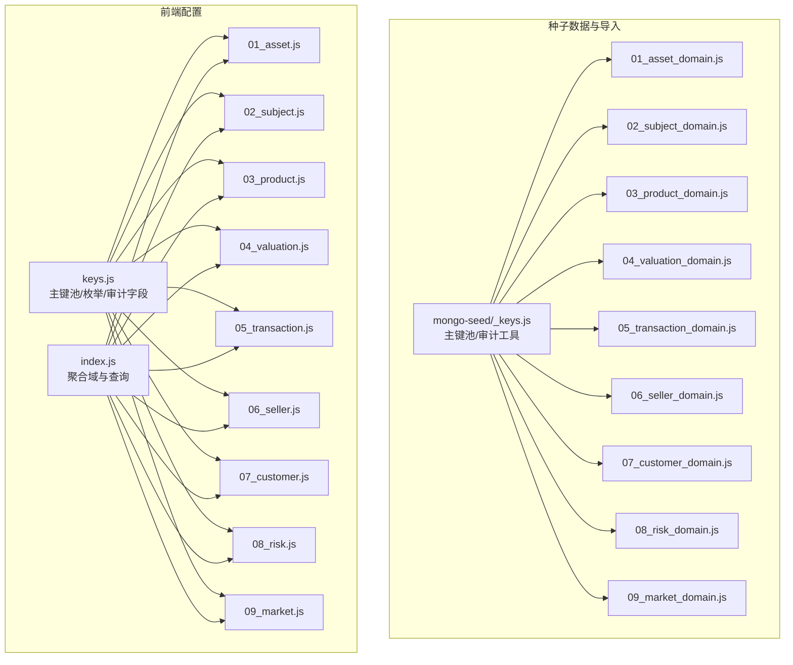
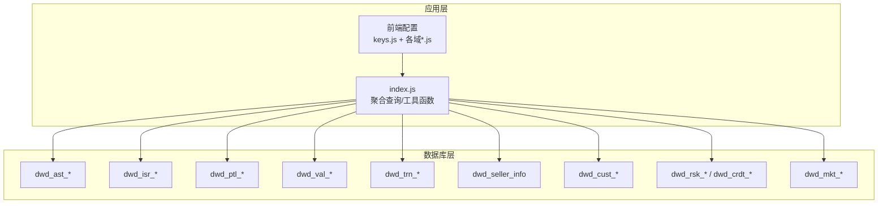
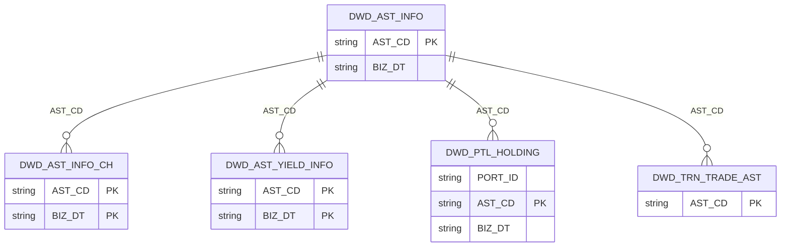
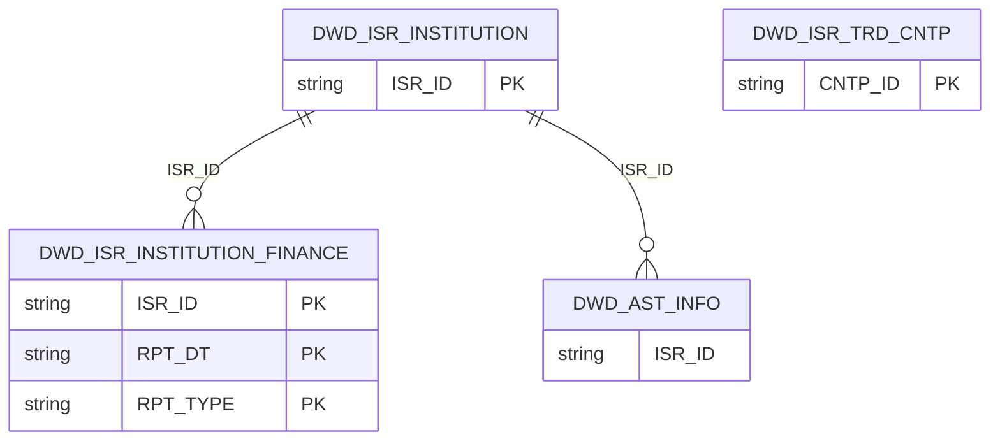
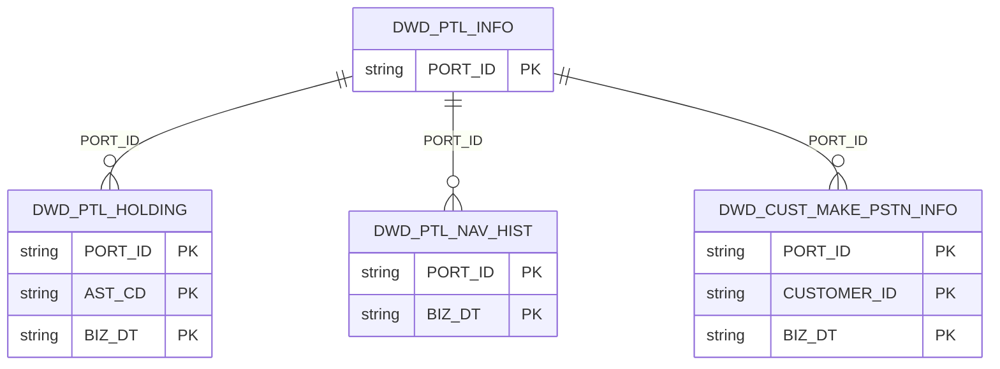
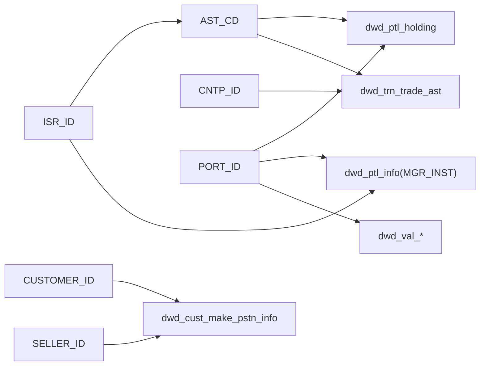

# 数据库设计

<cite>
**本文引用的文件**
- [mongo-seed/README.md](file://mongo-seed/README.md)
- [mongo-seed/_keys.js](file://mongo-seed/_keys.js)
- [mongo-seed/01_asset_domain.js](file://mongo-seed/01_asset_domain.js)
- [mongo-seed/02_subject_domain.js](file://mongo-seed/02_subject_domain.js)
- [mongo-seed/03_product_domain.js](file://mongo-seed/03_product_domain.js)
- [docs/MongoDB_ZY数据域表结构清单.md](file://docs/MongoDB_ZY数据域表结构清单.md)
- [src/config/zyDataDomain/index.js](file://src/config/zyDataDomain/index.js)
- [src/config/zyDataDomain/keys.js](file://src/config/zyDataDomain/keys.js)
- [src/config/zyDataDomain/01_asset.js](file://src/config/zyDataDomain/01_asset.js)
- [src/config/zyDataDomain/02_subject.js](file://src/config/zyDataDomain/02_subject.js)
- [src/config/zyDataDomain/03_product.js](file://src/config/zyDataDomain/03_product.js)
- [src/config/zyDataDomain/04_valuation.js](file://src/config/zyDataDomain/04_valuation.js)
- [src/config/zyDataDomain/05_transaction.js](file://src/config/zyDataDomain/05_transaction.js)
- [src/config/zyDataDomain/06_seller.js](file://src/config/zyDataDomain/06_seller.js)
- [src/config/zyDataDomain/07_customer.js](file://src/config/zyDataDomain/07_customer.js)
- [src/config/zyDataDomain/08_risk.js](file://src/config/zyDataDomain/08_risk.js)
- [src/config/zyDataDomain/09_market.js](file://src/config/zyDataDomain/09_market.js)
</cite>

## 目录
1. [简介](#简介)
2. [项目结构](#项目结构)
3. [核心组件](#核心组件)
4. [架构总览](#架构总览)
5. [详细组件分析](#详细组件分析)
6. [依赖分析](#依赖分析)
7. [性能考量](#性能考量)
8. [故障排查指南](#故障排查指南)
9. [结论](#结论)
10. [附录](#附录)

## 简介
本文件面向投资组合管理系统，系统采用 MongoDB 作为核心数据库，围绕 9 大数据域（资产域、主体域、产品域、估值域、交易域、销售域、客户域、风险域、行情域）进行整体架构设计与落地。设计遵循“贴源风格”的 JSON Schema 校验、统一审计字段、业务日期字符串化、金额字段精度策略，并通过主键池与跨表外键引用实现弱耦合的一致性。同时提供索引策略与查询优化建议，帮助开发者高效构建与维护数据域。

## 项目结构
- 数据域定义与前端配置分离：
  - 后端/种子数据侧：mongo-seed 下的各域脚本负责 Collection 建立、$jsonSchema 校验器、索引与样例数据导入。
  - 前端/配置侧：src/config/zyDataDomain 下的 index.js 与各域配置文件提供表结构元数据、字段类型与枚举、主键与外键提示等。
- 关键文件职责：
  - mongo-seed/_keys.js：跨表主键池与审计字段工具，确保外键一致性与数据一致性。
  - 各域 js 文件：定义 Collection、$jsonSchema、索引与样例数据。
  - 前端 keys.js 与各域配置：与种子数据保持一致的主键池与枚举，用于动态表单与外键提示。

图表来源
- [mongo-seed/_keys.js:1-161](file://mongo-seed/_keys.js#L1-161)
- [src/config/zyDataDomain/index.js:1-80](file://src/config/zyDataDomain/index.js#L1-80)
- [src/config/zyDataDomain/keys.js:1-73](file://src/config/zyDataDomain/keys.js#L1-73)

章节来源
- [mongo-seed/README.md:1-125](file://mongo-seed/README.md#L1-125)
- [docs/MongoDB_ZY数据域表结构清单.md:1-379](file://docs/MongoDB_ZY数据域表结构清单.md#L1-379)

## 核心组件
- 主键池与审计字段
  - 主键池：AST_CD、PORT_ID、ISR_ID、CNTP_ID、CUSTOMER_ID、SELLER_ID、BIZ_DT 等，确保跨表引用一致性。
  - 审计字段：etl_dt、src_sys 等，统一注入到每条记录，便于追踪与回放。
- JSON Schema 校验
  - 采用宽松校验：仅约束主键与必填业务字段，允许扩展字段，避免误拒贴源数据。
- 索引策略
  - 主键字段（除 _id）显式唯一索引；高频过滤字段（BIZ_DT、PORT_ID、AST_CD）建立普通索引。
- 数据模型设计原则
  - 业务日期统一以字符串 yyyymmdd 存储，利于回放与历史追溯。
  - 金额/比率使用 double；生产环境如需更高精度可改为 decimal128。
  - 产品域、估值域等快照型表统一 BIZ_DT，支持多日历史回溯。

章节来源
- [mongo-seed/README.md:114-121](file://mongo-seed/README.md#L114-121)
- [mongo-seed/_keys.js:152-155](file://mongo-seed/_keys.js#L152-155)
- [docs/MongoDB_ZY数据域表结构清单.md:257-279](file://docs/MongoDB_ZY数据域表结构清单.md#L257-279)

## 架构总览
系统采用“种子数据 + 前端配置”双轨设计：
- 种子数据负责数据库层面的结构、校验与样例数据，确保可重复导入与一致性。
- 前端配置负责表结构元数据、字段类型与枚举，支撑动态表单与外键提示。

图表来源
- [src/config/zyDataDomain/index.js:16-79](file://src/config/zyDataDomain/index.js#L16-79)
- [src/config/zyDataDomain/keys.js:6-72](file://src/config/zyDataDomain/keys.js#L6-72)

## 详细组件分析

### 资产域（dwd_ast_*）
- 表结构概览
  - dwd_ast_info：资产基础信息（主键：AST_CD）
  - dwd_ast_info_ch / dwd_ast_info_zg：中债/中证估值（主键：AST_CD + BIZ_DT）
  - dwd_ast_yield_info：收益率（主键：AST_CD + BIZ_DT）
  - dwd_ast_cf_plan：现金流计划（主键：AST_CD + CF_DT）
  - dwd_ast_pledge：质押状态（主键：AST_CD + BIZ_DT）
  - 其余表涵盖关联方、行权计划、基金经理、穿透底层、五级分类、计算规则等
- 主键与外键
  - dwd_ast_info.AST_CD 作为资产域主键，被 dwd_ast_info_ch、dwd_ast_yield_info、产品域与交易域广泛引用
- 索引策略
  - dwd_ast_info.AST_CD 唯一索引
  - dwd_ast_info_ch、dwd_ast_yield_info、dwd_ast_pledge 等按 AST_CD + BIZ_DT 建唯一索引
- JSON Schema
  - 严格约束主键与必填字段，其余字段允许扩展

图表来源
- [mongo-seed/01_asset_domain.js:28-38](file://mongo-seed/01_asset_domain.js#L28-L38)
- [mongo-seed/01_asset_domain.js:59-68](file://mongo-seed/01_asset_domain.js#L59-L68)
- [mongo-seed/01_asset_domain.js:125-130](file://mongo-seed/01_asset_domain.js#L125-L130)
- [src/config/zyDataDomain/01_asset.js:17-31](file://src/config/zyDataDomain/01_asset.js#L17-L31)

章节来源
- [mongo-seed/01_asset_domain.js:1-200](file://mongo-seed/01_asset_domain.js#L1-L200)
- [src/config/zyDataDomain/01_asset.js:1-137](file://src/config/zyDataDomain/01_asset.js#L1-L137)
- [docs/MongoDB_ZY数据域表结构清单.md:9-47](file://docs/MongoDB_ZY数据域表结构清单.md#L9-L47)

### 主体域（dwd_isr_*）
- 表结构概览
  - dwd_isr_institution：机构信息（主键：ISR_ID）
  - dwd_isr_institution_finance：机构财务（主键：ISR_ID + RPT_DT + RPT_TYPE）
  - dwd_isr_trd_cntp：交易对手（主键：CNTP_ID）
- 主键与外键
  - dwd_isr_institution.ISR_ID 被 dwd_ast_info.MGR_INST 等引用
  - dwd_isr_trd_cntp.CNTP_ID 被交易域引用
- 索引策略
  - dwd_isr_institution.ISR_ID 唯一索引；支持按名称查询的普通索引
  - dwd_isr_institution_finance 按 ISR_ID + RPT_DT + RPT_TYPE 建唯一索引
- JSON Schema
  - 严格约束主键与必填字段，其余字段允许扩展

图表来源
- [mongo-seed/02_subject_domain.js:18-28](file://mongo-seed/02_subject_domain.js#L18-L28)
- [mongo-seed/02_subject_domain.js:101-110](file://mongo-seed/02_subject_domain.js#L101-L110)
- [src/config/zyDataDomain/02_subject.js:17-29](file://src/config/zyDataDomain/02_subject.js#L17-L29)

章节来源
- [mongo-seed/02_subject_domain.js:1-200](file://mongo-seed/02_subject_domain.js#L1-L200)
- [src/config/zyDataDomain/02_subject.js:1-59](file://src/config/zyDataDomain/02_subject.js#L1-L59)
- [docs/MongoDB_ZY数据域表结构清单.md:49-73](file://docs/MongoDB_ZY数据域表结构清单.md#L49-L73)

### 产品域（dwd_ptl_*）
- 表结构概览
  - dwd_ptl_info：产品基础信息（主键：PORT_ID）
  - dwd_ptl_holding：产品持仓（主键：PORT_ID + AST_CD + BIZ_DT）
  - dwd_ptl_nav_hist：净值历史（主键：PORT_ID + BIZ_DT）
  - dwd_ptl_fee：费率信息（主键：PORT_ID + FEE_TYPE）
  - 其余表涵盖账户、申赎、开放计划、资产配置、持有人汇总、现金账户等
- 主键与外键
  - dwd_ptl_info.PORT_ID 被 dwd_ptl_holding、dwd_ptl_nav_hist、客户域等引用
- 索引策略
  - dwd_ptl_info.PORT_ID 唯一索引
  - dwd_ptl_holding、dwd_ptl_nav_hist 等按 PORT_ID + BIZ_DT 建唯一索引
- JSON Schema
  - 严格约束主键与必填字段，其余字段允许扩展

图表来源
- [mongo-seed/03_product_domain.js:32-41](file://mongo-seed/03_product_domain.js#L32-L41)
- [mongo-seed/03_product_domain.js:99-108](file://mongo-seed/03_product_domain.js#L99-L108)
- [mongo-seed/03_product_domain.js:169-177](file://mongo-seed/03_product_domain.js#L169-L177)
- [src/config/zyDataDomain/03_product.js:17-31](file://src/config/zyDataDomain/03_product.js#L17-L31)

章节来源
- [mongo-seed/03_product_domain.js:1-200](file://mongo-seed/03_product_domain.js#L1-L200)
- [src/config/zyDataDomain/03_product.js:1-136](file://src/config/zyDataDomain/03_product.js#L1-L136)
- [docs/MongoDB_ZY数据域表结构清单.md:75-111](file://docs/MongoDB_ZY数据域表结构清单.md#L75-L111)

### 估值域（dwd_val_*）
- 表结构概览
  - dwd_val_valtable：估值表（主键：PORT_ID + BIZ_DT）
  - dwd_val_detail：估值明细（主键：PORT_ID + AST_CD + BIZ_DT）
  - dwd_val_summary：估值汇总（主键：PORT_ID + AST_CLASS + BIZ_DT）
  - dwd_val_acc / dwd_val_bal：会计科目与余额
  - 财务报表：资产负债表、利润表、现金流量表
- 主键与外键
  - 以 PORT_ID + BIZ_DT 为主键，与产品域强关联
- 索引策略
  - 按 PORT_ID + BIZ_DT 建唯一索引
- JSON Schema
  - 严格约束主键与必填字段，其余字段允许扩展

章节来源
- [src/config/zyDataDomain/04_valuation.js:1-137](file://src/config/zyDataDomain/04_valuation.js#L1-L137)
- [docs/MongoDB_ZY数据域表结构清单.md:114-129](file://docs/MongoDB_ZY数据域表结构清单.md#L114-L129)

### 交易域（dwd_trn_*）
- 表结构概览
  - dwd_trn_trade_ast：资产维度交易（主键：TRADE_ID）
  - dwd_trn_trade_ptl：组合维度交易（主键：TRADE_ID + PORT_ID）
  - dwd_trn_order：委托订单（主键：ORDER_ID）
  - 其余表涵盖结算、费用、估值维度等
- 主键与外键
  - 以 TRADE_ID、ORDER_ID 为主键，与资产域、产品域、主体域等多表关联
- 索引策略
  - 按主键建立唯一索引；按 PORT_ID、AST_CD、BIZ_DT 建普通索引
- JSON Schema
  - 严格约束主键与必填字段，其余字段允许扩展

章节来源
- [src/config/zyDataDomain/05_transaction.js:1-103](file://src/config/zyDataDomain/05_transaction.js#L1-L103)
- [docs/MongoDB_ZY数据域表结构清单.md:131-143](file://docs/MongoDB_ZY数据域表结构清单.md#L131-L143)

### 销售域（dwd_seller_info）
- 表结构概览
  - dwd_seller_info：销售人员（主键：SELLER_ID）
- 主键与外键
  - 与客户域的 SELLER_ID 关联
- 索引策略
  - SELLER_ID 唯一索引
- JSON Schema
  - 严格约束主键与必填字段，其余字段允许扩展

章节来源
- [src/config/zyDataDomain/06_seller.js:1-33](file://src/config/zyDataDomain/06_seller.js#L1-L33)
- [docs/MongoDB_ZY数据域表结构清单.md:180-187](file://docs/MongoDB_ZY数据域表结构清单.md#L180-L187)

### 客户域（dwd_cust_*）
- 表结构概览
  - dwd_cust_info：客户基础（主键：CUSTOMER_ID）
  - dwd_cust_make_pstn_info：客户持仓（主键：CUSTOMER_ID + PORT_ID + BIZ_DT）
  - 交易相关：申请单、确认信息、分红、流水等
- 主键与外键
  - CUSTOMER_ID 与产品域、销售域等关联
- 索引策略
  - CUSTOMER_ID 唯一索引；按 PORT_ID、BIZ_DT 建普通索引
- JSON Schema
  - 严格约束主键与必填字段，其余字段允许扩展

章节来源
- [src/config/zyDataDomain/07_customer.js:1-121](file://src/config/zyDataDomain/07_customer.js#L1-L121)
- [docs/MongoDB_ZY数据域表结构清单.md:145-178](file://docs/MongoDB_ZY数据域表结构清单.md#L145-L178)

### 风险域（dwd_rsk_* / dwd_crdt_*）
- 表结构概览
  - dwd_rsk_credit_position：信用风险敞口（主键：PORT_ID + AST_CD + BIZ_DT）
  - dwd_crdt_agme_info：授信协议（主键：AGME_NO）
  - 其余表涵盖舆情、主体信用、关联关系等
- 主键与外键
  - 以 PORT_ID、AST_CD、ISR_ID 等为主键，与产品域、资产域、主体域关联
- 索引策略
  - 按主键建立唯一索引；按 BIZ_DT、PORT_ID、AST_CD 建普通索引
- JSON Schema
  - 严格约束主键与必填字段，其余字段允许扩展

章节来源
- [src/config/zyDataDomain/08_risk.js:1-77](file://src/config/zyDataDomain/08_risk.js#L1-L77)
- [docs/MongoDB_ZY数据域表结构清单.md:188-200](file://docs/MongoDB_ZY数据域表结构清单.md#L188-L200)

### 行情域（dwd_mkt_*）
- 表结构概览
  - 债券：行情、存量、评级、久期凸性、ECL、逐日成交
  - 基金：主数据、资产配置、衍生指标、净值行情、份额结构、停牌
  - 指数：主数据、成分、行情
  - 利率：主数据、报价
  - 汇率、日历、日期维度等
- 主键与外键
  - 以 AST_CD、INDEX_CD、CURVE_ID、RATE_CD 等为主键，与资产域、指数域等关联
- 索引策略
  - 按主键建立唯一索引；按 BIZ_DT、AST_CD、INDEX_CD 建普通索引
- JSON Schema
  - 严格约束主键与必填字段，其余字段允许扩展

章节来源
- [src/config/zyDataDomain/09_market.js:1-272](file://src/config/zyDataDomain/09_market.js#L1-L272)
- [docs/MongoDB_ZY数据域表结构清单.md:202-225](file://docs/MongoDB_ZY数据域表结构清单.md#L202-L225)

## 依赖分析
- 前后端一致性
  - 前端 keys.js 与 mongo-seed/_keys.js 的主键池与枚举保持一致，确保动态表单与外键提示准确。
- 外键关系
  - 资产域（AST_CD）是跨域通用主键，被产品域、交易域、估值域等广泛引用。
  - 产品域（PORT_ID）是产品维度的通用主键，被产品域内部多表与客户域引用。
  - 主体域（ISR_ID）与交易对手（CNTP_ID）分别被资产域与交易域引用。
  - 客户域（CUSTOMER_ID）与销售域（SELLER_ID）相互关联。
- 可视化外键关系

图表来源
- [docs/MongoDB_ZY数据域表结构清单.md:283-308](file://docs/MongoDB_ZY数据域表结构清单.md#L283-L308)

章节来源
- [docs/MongoDB_ZY数据域表结构清单.md:283-308](file://docs/MongoDB_ZY数据域表结构清单.md#L283-L308)

## 性能考量
- 索引策略
  - 主键字段（除 _id）显式唯一索引，确保高并发写入与查询稳定性。
  - 高频过滤字段（BIZ_DT、PORT_ID、AST_CD）建立普通索引，提升快照查询效率。
- 查询优化建议
  - 快照型查询优先使用 BIZ_DT + 主键组合过滤。
  - 聚合与报表场景建议按天/按产品维度预聚合，减少在线复杂聚合。
  - 对于大字段（如财务报表、估值明细）建议分表或分集合存储，按需加载。
- 数据类型与精度
  - 金额/比率使用 double；若对精度要求极高，可在生产环境切换为 decimal128。
  - 业务日期统一字符串 yyyymmdd，便于回放与历史追溯。

章节来源
- [mongo-seed/README.md:118-121](file://mongo-seed/README.md#L118-121)
- [docs/MongoDB_ZY数据域表结构清单.md:257-279](file://docs/MongoDB_ZY数据域表结构清单.md#L257-L279)

## 故障排查指南
- 常见问题
  - 外键缺失：检查 mongo-seed/_keys.js 中主键池与前端 keys.js 是否一致。
  - 校验失败：确认 JSON Schema 是否仅约束主键与必填业务字段，其余字段允许扩展。
  - 索引缺失：核对 BIZ_DT、PORT_ID、AST_CD 等高频字段是否建立索引。
- 排查步骤
  - 使用验证查询检查集合数量与样例数据是否导入成功。
  - 检查审计字段 etl_dt、src_sys 是否正确注入。
  - 对关键查询执行 explain，确认索引命中情况。

章节来源
- [mongo-seed/README.md:327-371](file://mongo-seed/README.md#L327-L371)
- [mongo-seed/_keys.js:152-155](file://mongo-seed/_keys.js#L152-155)

## 结论
本设计以“贴源风格 + 轻约束校验 + 统一审计字段 + 明确索引策略”为核心，结合跨域主键池与前端配置，形成可导入、可扩展、可维护的数据库架构。开发者可基于此框架快速扩展数据域、完善字段与索引，并通过统一的审计与业务日期规范保障数据一致性与可追溯性。

## 附录
- 数据域与表清单（节选）
  - 资产域：12 张表
  - 主体域：3 张表
  - 产品域：12 张表
  - 估值域：10 张表
  - 交易域：6 张表
  - 销售域：1 张表
  - 客户域：8 张表
  - 风险域：5 张表
  - 行情域：25 张表
- 索引策略（示例）
  - dwd_ast_info.AST_CD 唯一索引
  - dwd_ptl_info.PORT_ID 唯一索引
  - 所有含 BIZ_DT 的表建立普通索引
  - 所有含 etl_dt 的表建立普通索引

章节来源
- [docs/MongoDB_ZY数据域表结构清单.md:241-280](file://docs/MongoDB_ZY数据域表结构清单.md#L241-L280)