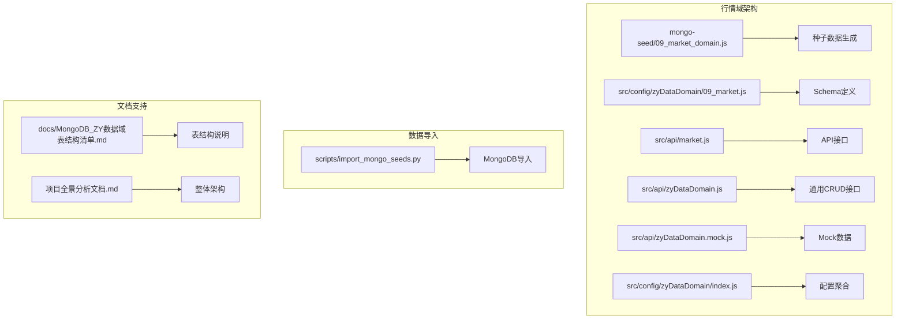
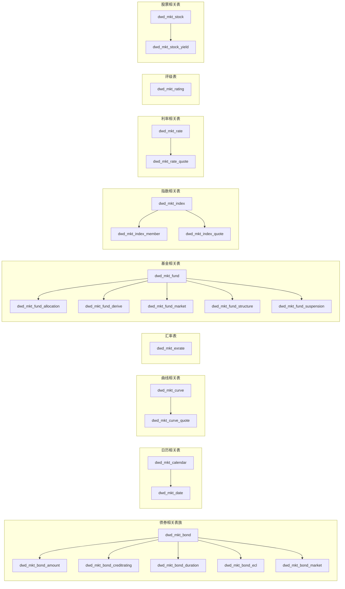
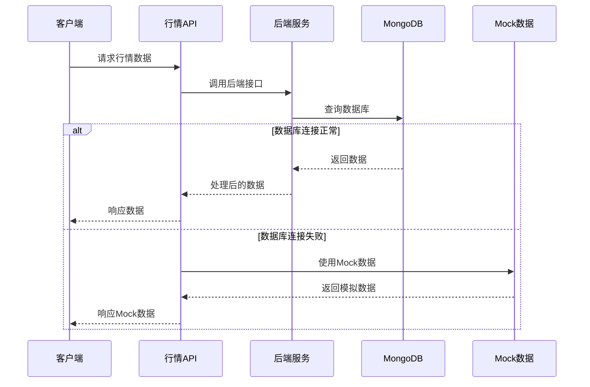
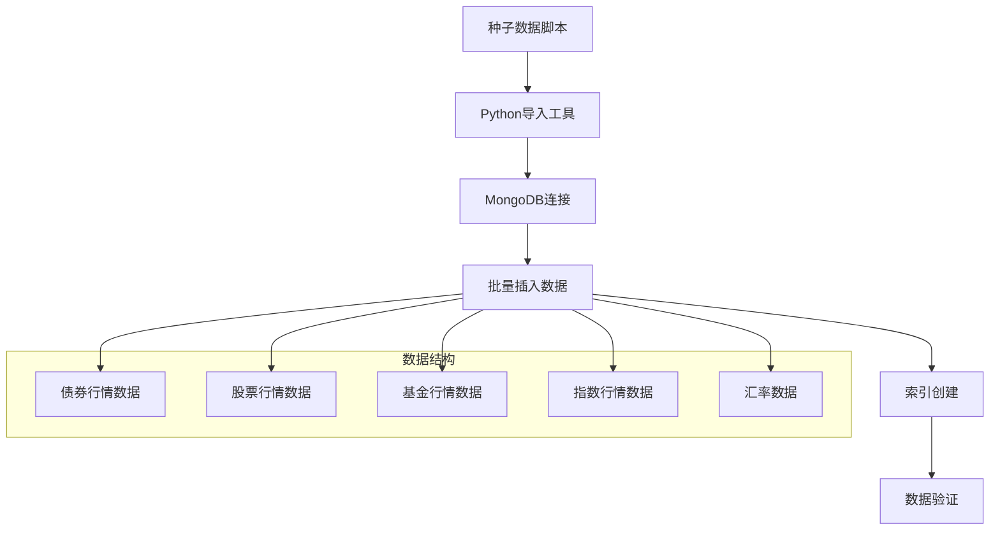
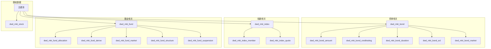
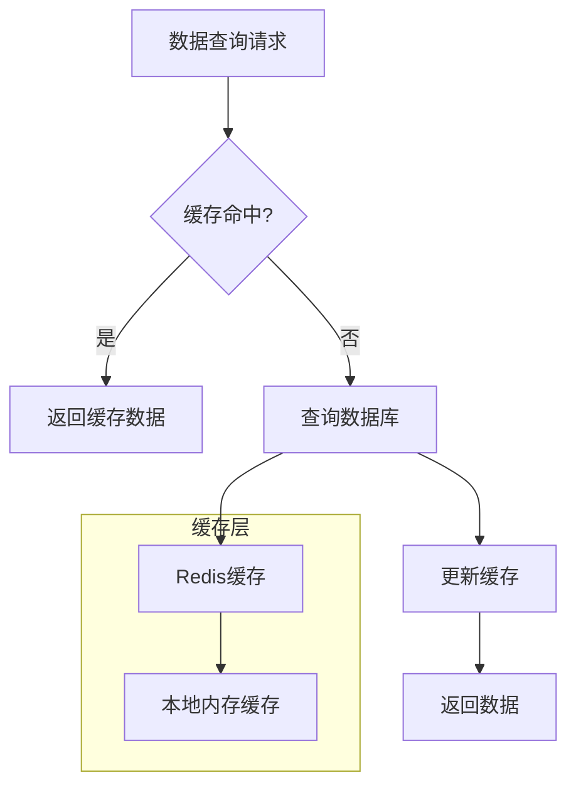
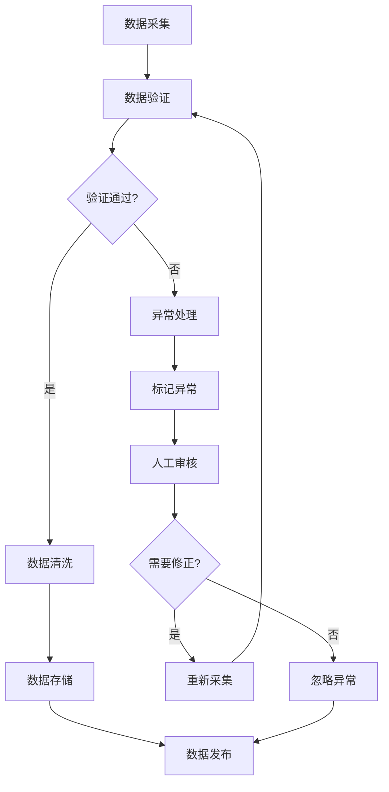
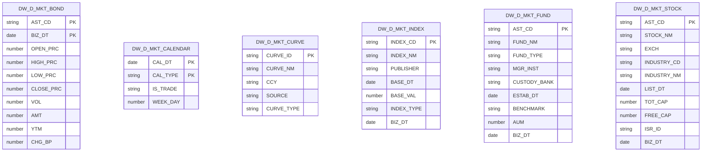

# 行情域数据模型

<cite>
**本文档引用的文件**
- [09_market_domain.js](file://mongo-seed/09_market_domain.js)
- [09_market.js](file://src/config/zyDataDomain/09_market.js)
- [market.js](file://src/api/market.js)
- [zyDataDomain.js](file://src/api/zyDataDomain.js)
- [zyDataDomain.mock.js](file://src/api/zyDataDomain.mock.js)
- [index.js](file://src/config/zyDataDomain/index.js)
- [import_mongo_seeds.py](file://scripts/import_mongo_seeds.py)
- [MongoDB_ZY数据域表结构清单.md](file://docs/MongoDB_ZY数据域表结构清单.md)
- [项目全景分析文档.md](file://项目全景分析文档.md)
</cite>

## 目录
1. [简介](#简介)
2. [项目结构](#项目结构)
3. [核心组件](#核心组件)
4. [架构概览](#架构概览)
5. [详细组件分析](#详细组件分析)
6. [依赖分析](#依赖分析)
7. [性能考虑](#性能考虑)
8. [故障排除指南](#故障排除指南)
9. [结论](#结论)
10. [附录](#附录)

## 简介

行情域是本项目的核心数据域之一，负责管理市场数据和行情信息。该域包含25张表的庞大体系，涵盖债券、股票、基金、指数、利率、汇率等多个金融市场的数据。

行情域的设计遵循以下原则：
- **统一的数据模型**：所有表都遵循统一的主键约定和字段命名规范
- **完整的数据生命周期**：从基础行情数据到衍生指标的全链路覆盖
- **灵活的扩展性**：支持新增市场类型和数据类型的扩展
- **严格的数据质量控制**：内置数据校验和异常处理机制

## 项目结构

行情域的项目结构采用模块化设计，主要由以下几个部分组成：



**图表来源**
- [09_market_domain.js:1-417](file://mongo-seed/09_market_domain.js#L1-L417)
- [09_market.js:1-272](file://src/config/zyDataDomain/09_market.js#L1-L272)

**章节来源**
- [09_market_domain.js:1-417](file://mongo-seed/09_market_domain.js#L1-L417)
- [09_market.js:1-272](file://src/config/zyDataDomain/09_market.js#L1-L272)
- [index.js:1-80](file://src/config/zyDataDomain/index.js#L1-L80)

## 核心组件

### 主键池和约束

行情域建立了完善的主键池，确保数据的一致性和完整性：

| 主键类型 | 说明 | 示例值 |
|---------|------|--------|
| AST_CD | 资产代码 | 019601.IB, 600036.SH, 510300.SH |
| INDEX_CD | 指数代码 | 000300.SH, 399001.SZ |
| CURVE_ID | 收益率曲线ID | CGB, CDB, AAA_MTN |
| RATE_CD | 利率代码 | DR001, DR007, SHIBOR_3M |
| BIZ_DT | 业务日期 | 20250324 |

### 数据表族分类

行情域的数据表按照业务类型分为多个表族：



**图表来源**
- [09_market.js:16-272](file://src/config/zyDataDomain/09_market.js#L16-L272)

**章节来源**
- [09_market.js:16-272](file://src/config/zyDataDomain/09_market.js#L16-L272)

## 架构概览

### 数据流架构



**图表来源**
- [market.js:66-112](file://src/api/market.js#L66-L112)
- [zyDataDomain.js:69-190](file://src/api/zyDataDomain.js#L69-L190)

### 数据导入架构



**图表来源**
- [import_mongo_seeds.py:134-184](file://scripts/import_mongo_seeds.py#L134-L184)

**章节来源**
- [market.js:66-112](file://src/api/market.js#L66-L112)
- [zyDataDomain.js:69-190](file://src/api/zyDataDomain.js#L69-L190)
- [import_mongo_seeds.py:134-184](file://scripts/import_mongo_seeds.py#L134-L184)

## 详细组件分析

### 债券相关表族

#### dwd_mkt_bond - 债券行情表

债券行情表是债券市场的核心数据表，包含每日的基础行情数据：

| 字段名 | 类型 | 说明 | 约束 |
|--------|------|------|------|
| AST_CD | string | 资产代码 | 主键之一，必填 |
| BIZ_DT | date | 业务日期 | 主键之一，必填，默认当前日期 |
| OPEN_PRC | number | 开盘价 | 数值类型 |
| HIGH_PRC | number | 最高价 | 数值类型 |
| LOW_PRC | number | 最低价 | 数值类型 |
| CLOSE_PRC | number | 收盘价 | 数值类型 |
| VOL | number | 成交量 | 数值类型 |
| AMT | number | 成交额 | 数值类型 |
| YTM | number | 到期收益率 | 数值类型 |
| CHG_BP | number | 涨跌BP | 数值类型 |

#### dwd_mkt_bond_amount - 债券存量表

债券存量表记录债券的发行和存量信息：

| 字段名 | 类型 | 说明 | 约束 |
|--------|------|------|------|
| AST_CD | string | 资产代码 | 主键之一，必填 |
| BIZ_DT | date | 业务日期 | 主键之一，必填，默认当前日期 |
| ISSUE_AMT | number | 发行规模 | 数值类型 |
| OUTSTANDING_AMT | number | 存量规模 | 数值类型 |
| REPAID_AMT | number | 已偿还 | 数值类型 |

#### dwd_mkt_bond_creditrating - 债项评级表

记录债券的评级信息：

| 字段名 | 类型 | 说明 | 约束 |
|--------|------|------|------|
| AST_CD | string | 资产代码 | 主键之一，必填 |
| RATING_DT | date | 评级日 | 主键之一，必填 |
| AGENCY | string | 评级机构 | 主键之一，必填 |
| BOND_RATING | string | 债项评级 | 字符串类型 |
| ISSUER_RATING | string | 发行人评级 | 字符串类型 |
| OUTLOOK | string | 展望 | 枚举类型 |

**章节来源**
- [09_market.js:17-78](file://src/config/zyDataDomain/09_market.js#L17-L78)

### 日历相关表

#### dwd_mkt_calendar - 交易日历表

交易日历表管理不同市场的交易日信息：

| 字段名 | 类型 | 说明 | 约束 |
|--------|------|------|------|
| CAL_DT | date | 日期 | 主键之一，必填 |
| CAL_TYPE | string | 日历类型 | 主键之一，必填，枚举：IB/SSE/SZSE |
| IS_TRADE | string | 是否交易日 | 枚举：Y/N |
| WEEK_DAY | number | 星期 | 数值类型 |

#### dwd_mkt_date - 日期维度表

日期维度表提供日期的维度信息：

| 字段名 | 类型 | 说明 | 约束 |
|--------|------|------|------|
| DT | date | 日期 | 主键，必填 |
| YEAR | string | 年 | 字符串类型 |
| QUARTER | string | 季度 | 字符串类型 |
| MONTH | string | 月 | 字符串类型 |
| DAY | string | 日 | 字符串类型 |
| WEEK_OF_YEAR | number | 周 | 数值类型 |
| IS_MONTH_END | string | 月末 | 枚举：Y/N |
| IS_QUARTER_END | string | 季末 | 枚举：Y/N |
| IS_YEAR_END | string | 年末 | 枚举：Y/N |

**章节来源**
- [09_market.js:80-97](file://src/config/zyDataDomain/09_market.js#L80-L97)

### 曲线相关表

#### dwd_mkt_curve - 收益率曲线主数据表

收益率曲线主数据表定义各种收益率曲线的基本信息：

| 字段名 | 类型 | 说明 | 约束 |
|--------|------|------|------|
| CURVE_ID | string | 曲线ID | 主键，必填 |
| CURVE_NM | string | 曲线名称 | 必填 |
| CCY | string | 币种 | 枚举类型 |
| SOURCE | string | 数据源 | 字符串类型 |
| CURVE_TYPE | string | 曲线类型 | 枚举类型：TREASURY/POLICY/CREDIT/NCD/IRS |

#### dwd_mkt_curve_quote - 曲线节点报价表

曲线节点报价表记录各曲线在不同时期的收益率：

| 字段名 | 类型 | 说明 | 约束 |
|--------|------|------|------|
| CURVE_ID | string | 曲线ID | 主键之一，必填 |
| BIZ_DT | date | 业务日期 | 主键之一，必填，默认当前日期 |
| TENOR | string | 期限 | 主键之一，必填，枚举类型 |
| YIELD | number | 收益率 | 数值类型 |
| CHG_BP | number | 变动BP | 数值类型 |

**章节来源**
- [09_market.js:99-113](file://src/config/zyDataDomain/09_market.js#L99-L113)

### 汇率表

#### dwd_mkt_exrate - 汇率表

汇率表记录外汇市场的汇率信息：

| 字段名 | 类型 | 说明 | 约束 |
|--------|------|------|------|
| CCY_PAIR | string | 币种对 | 主键之一，必填 |
| BIZ_DT | date | 业务日期 | 主键之一，必填，默认当前日期 |
| MID | number | 中间价 | 数值类型 |
| BID | number | 买入价 | 数值类型 |
| ASK | number | 卖出价 | 数值类型 |
| SRC | string | 来源 | 字符串类型 |

**章节来源**
- [09_market.js:115-122](file://src/config/zyDataDomain/09_market.js#L115-L122)

### 基金相关表族

#### dwd_mkt_fund - 基金主数据表

基金主数据表记录基金的基本信息：

| 字段名 | 类型 | 说明 | 约束 |
|--------|------|------|------|
| AST_CD | string | 资产代码 | 主键，必填 |
| FUND_NM | string | 基金名称 | 必填 |
| FUND_TYPE | string | 基金类型 | 枚举类型 |
| MGR_INST | string | 管理人 | 字符串类型 |
| CUSTODY_BANK | string | 托管行 | 字符串类型 |
| ESTAB_DT | date | 成立日 | 日期类型 |
| BENCHMARK | string | 业绩基准 | 字符串类型 |
| AUM | number | 管理规模 | 数值类型 |
| BIZ_DT | date | 业务日期 | 日期类型，默认当前日期 |

#### dwd_mkt_fund_market - 基金行情表

基金行情表记录基金的净值和交易数据：

| 字段名 | 类型 | 说明 | 约束 |
|--------|------|------|------|
| AST_CD | string | 资产代码 | 主键之一，必填 |
| BIZ_DT | date | 业务日期 | 主键之一，必填，默认当前日期 |
| UNIT_NAV | number | 单位净值 | 数值类型 |
| ACC_NAV | number | 累计净值 | 数值类型 |
| DAILY_RTN | number | 日收益率 | 数值类型 |
| VOL | number | 成交量 | 数值类型 |
| AMT | number | 成交额 | 数值类型 |

**章节来源**
- [09_market.js:124-164](file://src/config/zyDataDomain/09_market.js#L124-L164)

### 指数相关表

#### dwd_mkt_index - 指数主数据表

指数主数据表记录指数的基本信息：

| 字段名 | 类型 | 说明 | 约束 |
|--------|------|------|------|
| INDEX_CD | string | 指数代码 | 主键，必填 |
| INDEX_NM | string | 指数名称 | 必填 |
| PUBLISHER | string | 发布机构 | 字符串类型 |
| BASE_DT | date | 基期 | 日期类型 |
| BASE_VAL | number | 基期值 | 数值类型 |
| INDEX_TYPE | string | 指数类型 | 枚举类型：EQUITY/BOND/COMMODITY |
| BIZ_DT | date | 业务日期 | 日期类型，默认当前日期 |

#### dwd_mkt_index_quote - 指数行情表

指数行情表记录指数的每日行情数据：

| 字段名 | 类型 | 说明 | 约束 |
|--------|------|------|------|
| INDEX_CD | string | 指数代码 | 主键之一，必填 |
| BIZ_DT | date | 业务日期 | 主键之一，必填，默认当前日期 |
| OPEN_VAL | number | 开盘值 | 数值类型 |
| HIGH_VAL | number | 最高值 | 数值类型 |
| LOW_VAL | number | 最低值 | 数值类型 |
| CLOSE_VAL | number | 收盘值 | 数值类型 |
| VOL | number | 成交量 | 数值类型 |
| AMT | number | 成交额 | 数值类型 |
| DAILY_RTN | number | 日收益率 | 数值类型 |
| YTD_RTN | number | 年初至今 | 数值类型 |

**章节来源**
- [09_market.js:182-212](file://src/config/zyDataDomain/09_market.js#L182-L212)

### 利率相关表

#### dwd_mkt_rate - 利率主数据表

利率主数据表记录各种利率的基本信息：

| 字段名 | 类型 | 说明 | 约束 |
|--------|------|------|------|
| RATE_CD | string | 利率代码 | 主键，必填 |
| RATE_NM | string | 利率名称 | 必填 |
| SOURCE | string | 来源 | 字符串类型 |
| CCY | string | 币种 | 枚举类型 |
| BIZ_DT | date | 业务日期 | 日期类型，默认当前日期 |

#### dwd_mkt_rate_quote - 利率报价表

利率报价表记录各利率的每日报价：

| 字段名 | 类型 | 说明 | 约束 |
|--------|------|------|------|
| RATE_CD | string | 利率代码 | 主键之一，必填 |
| BIZ_DT | date | 业务日期 | 主键之一，必填，默认当前日期 |
| RATE_VAL | number | 利率值 | 数值类型 |
| CHG_BP | number | 变动BP | 数值类型 |

**章节来源**
- [09_market.js:214-227](file://src/config/zyDataDomain/09_market.js#L214-L227)

### 评级表

#### dwd_mkt_rating - 评级动作表

评级动作表记录主体的评级变化：

| 字段名 | 类型 | 说明 | 约束 |
|--------|------|------|------|
| ISR_ID | string | 主体ID | 主键之一，必填 |
| RATING_DT | date | 评级日 | 主键之一，必填 |
| AGENCY | string | 评级机构 | 主键之一，必填 |
| RATING | string | 当前评级 | 字符串类型 |
| PREV_RATING | string | 上次评级 | 字符串类型 |
| ACTION | string | 动作 | 枚举类型：UPGRADE/DOWNGRADE/AFFIRM/WATCH |
| OUTLOOK | string | 展望 | 枚举类型：POSITIVE/STABLE/NEGATIVE |
| BIZ_DT | date | 业务日期 | 日期类型，默认当前日期 |

**章节来源**
- [09_market.js:229-238](file://src/config/zyDataDomain/09_market.js#L229-L238)

### 股票相关表

#### dwd_mkt_stock - 股票主数据表

股票主数据表记录股票的基本信息：

| 字段名 | 类型 | 说明 | 约束 |
|--------|------|------|------|
| AST_CD | string | 资产代码 | 主键，必填 |
| STOCK_NM | string | 股票名称 | 必填 |
| EXCH | string | 交易所 | 枚举类型：SSE/SZSE |
| INDUSTRY_CD | string | 行业代码 | 字符串类型 |
| INDUSTRY_NM | string | 行业名称 | 字符串类型 |
| LIST_DT | date | 上市日 | 日期类型 |
| TOT_CAP | number | 总市值 | 数值类型 |
| FREE_CAP | number | 流通市值 | 数值类型 |
| ISR_ID | string | 关联主体 | 枚举类型 |
| BIZ_DT | date | 业务日期 | 日期类型，默认当前日期 |

#### dwd_mkt_stock_yield - 股票收益率表

股票收益率表记录股票的多维度收益率数据：

| 字段名 | 类型 | 说明 | 约束 |
|--------|------|------|------|
| AST_CD | string | 资产代码 | 主键之一，必填 |
| BIZ_DT | date | 业务日期 | 主键之一，必填，默认当前日期 |
| OPEN_PRC | number | 开盘价 | 数值类型 |
| HIGH_PRC | number | 最高价 | 数值类型 |
| LOW_PRC | number | 最低价 | 数值类型 |
| CLOSE_PRC | number | 收盘价 | 数值类型 |
| VOL | number | 成交量 | 数值类型 |
| AMT | number | 成交额 | 数值类型 |
| DAILY_RTN | number | 日收益率 | 数值类型 |
| WEEK_RTN | number | 周收益率 | 数值类型 |
| MONTH_RTN | number | 月收益率 | 数值类型 |
| YTD_RTN | number | 年初至今 | 数值类型 |
| TURNOVER | number | 换手率 | 数值类型 |
| PE_TTM | number | PE-TTM | 数值类型 |
| PB_LF | number | PB-LF | 数值类型 |

**章节来源**
- [09_market.js:240-269](file://src/config/zyDataDomain/09_market.js#L240-L269)

## 依赖分析

### 数据依赖关系



**图表来源**
- [09_market.js:16-272](file://src/config/zyDataDomain/09_market.js#L16-L272)

### 外部依赖

行情域对外部系统的依赖主要包括：

1. **MongoDB数据库**：作为主要的数据存储
2. **后端API服务**：提供数据查询和维护接口
3. **数据供应商**：提供实时市场数据
4. **前端应用**：展示和交互市场数据

**章节来源**
- [09_market_domain.js:1-417](file://mongo-seed/09_market_domain.js#L1-L417)
- [MongoDB_ZY数据域表结构清单.md:202-226](file://docs/MongoDB_ZY数据域表结构清单.md#L202-L226)

## 性能考虑

### 索引策略

行情域采用了多层次的索引策略来优化查询性能：

```javascript
// 主要索引策略
db.dwd_mkt_bond.createIndex({ AST_CD: 1, BIZ_DT: 1 }, { unique: true })
db.dwd_mkt_index.createIndex({ INDEX_CD: 1, BIZ_DT: 1 }, { unique: true })
db.dwd_mkt_calendar.createIndex({ CAL_DT: 1, MARKET: 1 }, { unique: true })
db.dwd_mkt_curve_quote.createIndex({ CURVE_ID: 1, BIZ_DT: 1, TENOR: 1 }, { unique: true })
```

### 数据分区策略

对于大规模数据，建议采用以下分区策略：

1. **时间分区**：按业务日期分区存储
2. **类型分区**：按资产类型分区存储
3. **市场分区**：按交易市场分区存储

### 缓存策略



## 故障排除指南

### 常见问题及解决方案

#### 1. 数据导入失败

**问题描述**：种子数据导入过程中出现重复键错误

**解决方案**：
- 检查现有数据是否已存在
- 清理重复数据后重新导入
- 使用批量插入的忽略选项

#### 2. API接口不可用

**问题描述**：前端无法连接到后端API

**解决方案**：
- 检查后端服务是否启动
- 验证网络连接和防火墙设置
- 检查CORS配置

#### 3. 数据质量异常

**问题描述**：查询到的数据存在异常值

**解决方案**：
- 检查数据源的准确性
- 实施数据验证规则
- 建立数据质量监控

**章节来源**
- [import_mongo_seeds.py:177-183](file://scripts/import_mongo_seeds.py#L177-L183)
- [market.js:75-87](file://src/api/market.js#L75-L87)

### 数据质量控制流程



## 结论

行情域数据模型设计完整、结构清晰，能够有效支撑金融市场的数据管理需求。通过合理的表结构设计、完善的索引策略和严格的质量控制机制，确保了数据的准确性、完整性和一致性。

该数据模型的主要优势包括：
- **完整的业务覆盖**：涵盖债券、股票、基金、指数、利率、汇率等全市场数据
- **灵活的扩展性**：支持新增市场类型和数据类型的扩展
- **严格的数据质量**：内置数据校验和异常处理机制
- **高效的查询性能**：合理的索引策略和缓存机制

未来可以进一步优化的方向包括：
- 增强实时数据处理能力
- 完善数据质量监控机制
- 优化大数据量下的查询性能
- 加强与其他系统的集成能力

## 附录

### 数据模型图



**图表来源**
- [09_market.js:17-269](file://src/config/zyDataDomain/09_market.js#L17-L269)

### 参考文档

- [MongoDB种子数据导入工具](file://scripts/import_mongo_seeds.py)
- [行情域表结构清单](file://docs/MongoDB_ZY数据域表结构清单.md)
- [项目全景分析文档](file://项目全景分析文档.md)