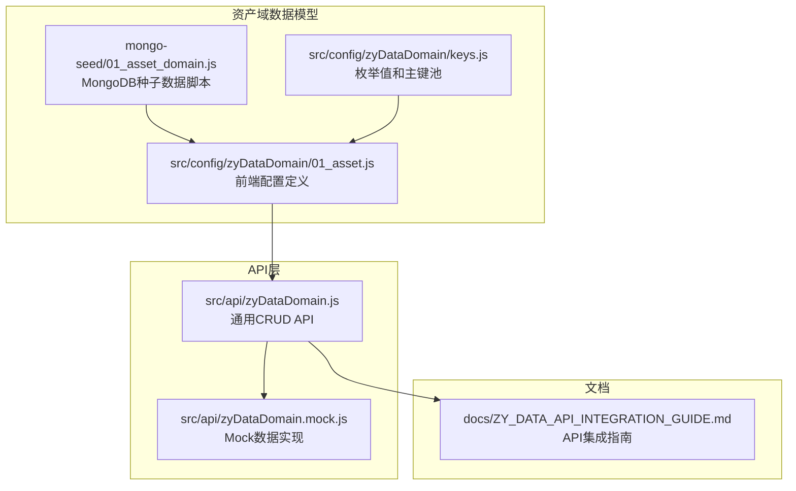
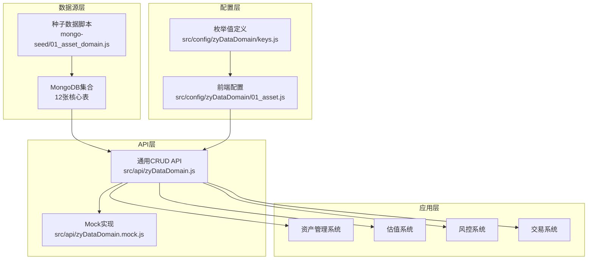
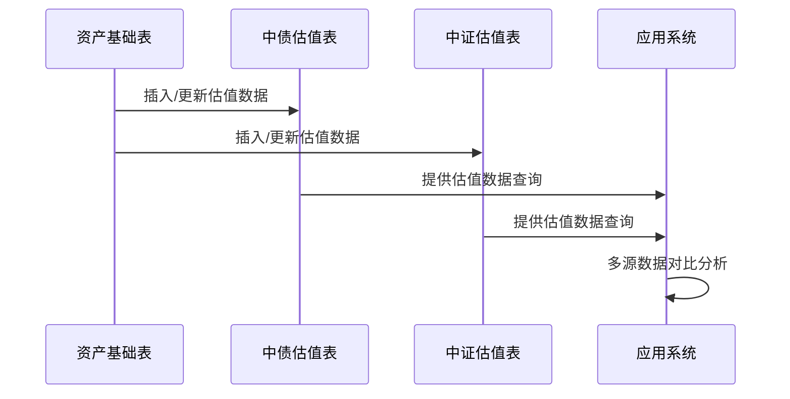
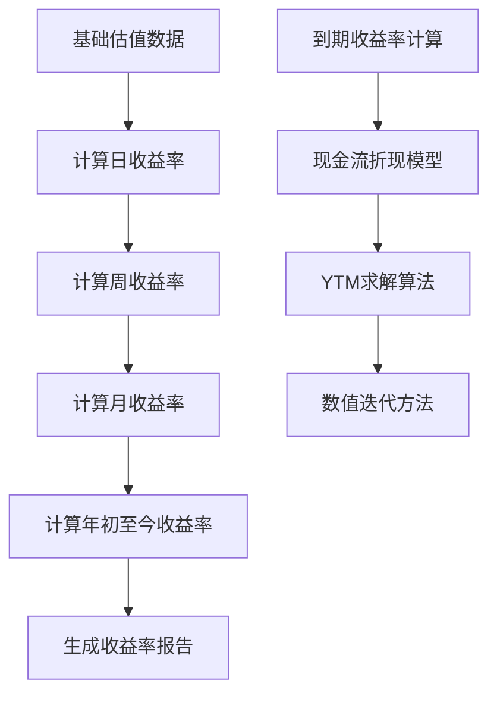
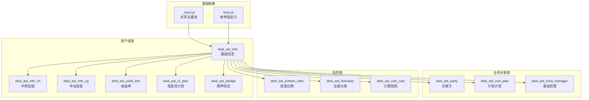

# 资产域数据模型

<cite>
**本文引用的文件**
- [mongo-seed/01_asset_domain.js](file://mongo-seed/01_asset_domain.js)
- [src/config/zyDataDomain/01_asset.js](file://src/config/zyDataDomain/01_asset.js)
- [src/config/zyDataDomain/keys.js](file://src/config/zyDataDomain/keys.js)
- [src/api/zyDataDomain.js](file://src/api/zyDataDomain.js)
- [src/api/zyDataDomain.mock.js](file://src/api/zyDataDomain.mock.js)
- [docs/ZY_DATA_API_INTEGRATION_GUIDE.md](file://docs/ZY_DATA_API_INTEGRATION_GUIDE.md)
</cite>

## 目录
1. [简介](#简介)
2. [项目结构](#项目结构)
3. [核心组件](#核心组件)
4. [架构概览](#架构概览)
5. [详细组件分析](#详细组件分析)
6. [依赖分析](#依赖分析)
7. [性能考虑](#性能考虑)
8. [故障排除指南](#故障排除指南)
9. [结论](#结论)

## 简介

资产域是9大数据域之首，承担着金融资产全生命周期管理的核心职责。本文档详细阐述资产域12张核心表的完整设计，包括数据模型、字段定义、表间关系以及业务应用场景。

资产域数据模型采用MongoDB文档数据库设计，以AST_CD（资产代码）为主键，构建了覆盖债券、股票、基金、ABS等各类金融资产的统一数据框架。该模型不仅支持基础资产信息管理，还涵盖了估值、现金流、质押、评级、交易等多个维度的专业金融数据。

## 项目结构

资产域数据模型主要分布在以下目录结构中：



**图表来源**
- [mongo-seed/01_asset_domain.js:1-374](file://mongo-seed/01_asset_domain.js#L1-L374)
- [src/config/zyDataDomain/01_asset.js:1-137](file://src/config/zyDataDomain/01_asset.js#L1-L137)

**章节来源**
- [mongo-seed/01_asset_domain.js:1-374](file://mongo-seed/01_asset_domain.js#L1-L374)
- [src/config/zyDataDomain/01_asset.js:1-137](file://src/config/zyDataDomain/01_asset.js#L1-L137)

## 核心组件

资产域包含12张核心表，每张表都有明确的业务职责和数据结构：

### 主键设计原则
- **AST_CD主键**：所有资产相关表均以AST_CD（资产代码）作为主键或复合主键的一部分
- **业务日期**：多数表包含BIZ_DT（业务日期）字段，支持时间序列数据管理
- **唯一性约束**：通过MongoDB索引确保数据完整性

### 核心表清单
1. **dwd_ast_info** - 资产基础信息
2. **dwd_ast_info_ch** - 中债估值信息  
3. **dwd_ast_info_zg** - 中证估值信息
4. **dwd_ast_yield_info** - 资产收益率
5. **dwd_ast_cf_plan** - 资产现金流计划
6. **dwd_ast_pledge** - 资产质押状态
7. **dwd_ast_flow_trade** - 交易流水
8. **dwd_ast_rating** - 信用评级
9. **dwd_ast_guarantor** - 担保信息
10. **dwd_ast_clause** - 债券条款
11. **dwd_ast_holder** - 持有人信息
12. **dwd_ast_event** - 资产事件

**章节来源**
- [mongo-seed/01_asset_domain.js:27-374](file://mongo-seed/01_asset_domain.js#L27-L374)
- [src/config/zyDataDomain/01_asset.js:16-137](file://src/config/zyDataDomain/01_asset.js#L16-L137)

## 架构概览

资产域数据模型采用分层架构设计，确保数据的一致性和可扩展性：



**图表来源**
- [mongo-seed/01_asset_domain.js:1-374](file://mongo-seed/01_asset_domain.js#L1-L374)
- [src/config/zyDataDomain/01_asset.js:1-137](file://src/config/zyDataDomain/01_asset.js#L1-L137)
- [src/api/zyDataDomain.js:1-190](file://src/api/zyDataDomain.js#L1-L190)

## 详细组件分析

### dwd_ast_info 资产基础信息表

dwd_ast_info是资产域的核心基础表，定义了所有金融资产的基本属性：

#### 字段结构分析

| 字段名 | 类型 | 必填 | 描述 | 示例值 |
|--------|------|------|------|--------|
| AST_CD | string | 是 | 资产代码（主键） | 019601.IB |
| AST_NM | string | 是 | 资产名称 | 25国债03 |
| AST_TYPE | enum | 是 | 资产类型 | BOND/STOCK/FUND/ABS/NCD/CASH |
| AST_SUB_TYPE | enum | 否 | 资产子类型 | CGB/POLICY/MTN/ENTERPRISE/ETF/A_SHARE |
| ISR_ID | enum | 否 | 发行人ID | ISR000001 |
| CCY | enum | 否 | 币种 | CNY/USD/EUR |
| LIST_DT | date | 否 | 上市日期 | 20250115 |
| MATURITY_DT | date | 否 | 到期日期 | 20350115 |
| COUPON_RATE | number | 否 | 票面利率 | 0.0195 |
| ISSUE_AMT | number | 否 | 发行规模 | 50000000000 |
| MARKET | enum | 否 | 交易市场 | 银行间/上交所/深交所 |
| BOND_TERM | enum | 否 | 债券期限 | 3M/6M/1Y/3Y/5Y/10Y/30Y |

#### 数据扩展机制

资产基础信息表支持多种数据扩展方式：

1. **估值扩展**：通过dwd_ast_info_ch和dwd_ast_info_zg表提供中债和中证估值数据
2. **现金流扩展**：通过dwd_ast_cf_plan表记录未来现金流计划
3. **质押扩展**：通过dwd_ast_pledge表记录质押状态信息

**章节来源**
- [mongo-seed/01_asset_domain.js:27-56](file://mongo-seed/01_asset_domain.js#L27-L56)
- [src/config/zyDataDomain/01_asset.js:17-31](file://src/config/zyDataDomain/01_asset.js#L17-L31)

### dwd_ast_info_ch 中债估值表

dwd_ast_info_ch提供中债估值中心的估值数据，支持资产定价和风险管理：

#### 字段定义

| 字段名 | 类型 | 必填 | 描述 | 用途 |
|--------|------|------|------|------|
| AST_CD | string | 是 | 资产代码 | 主键 |
| BIZ_DT | string | 是 | 业务日期 | 主键 |
| VAL_NET_PRC | double | 是 | 净价估值 | 估值基础 |
| VAL_FULL_PRC | double | 否 | 全价估值 | 交易参考 |
| VAL_YIELD | double | 否 | 估值收益率 | 收益率分析 |
| DURATION | double | 否 | 久期 | 风险度量 |
| CONVEXITY | double | 否 | 凸性 | 风险度量 |
| RATING_AGENCY | enum | 否 | 评级机构 | 数据来源标识 |
| VAL_SRC | string | 否 | 估值来源 | 数据来源标识 |

#### 估值数据扩展流程



**图表来源**
- [mongo-seed/01_asset_domain.js:58-91](file://mongo-seed/01_asset_domain.js#L58-L91)
- [src/config/zyDataDomain/01_asset.js:33-43](file://src/config/zyDataDomain/01_asset.js#L33-L43)

**章节来源**
- [mongo-seed/01_asset_domain.js:58-91](file://mongo-seed/01_asset_domain.js#L58-L91)
- [src/config/zyDataDomain/01_asset.js:33-43](file://src/config/zyDataDomain/01_asset.js#L33-L43)

### dwd_ast_yield_info 收益率表

dwd_ast_yield_info记录资产的收益率相关信息，支持投资决策和绩效分析：

#### 收益率字段定义

| 字段名 | 类型 | 描述 | 计算逻辑 |
|--------|------|------|----------|
| YTM | number | 到期收益率 | 债券持有至到期的内部收益率 |
| YIELD_EX | number | 行权收益率 | 考虑提前行权的收益率 |
| DAILY_RTN | number | 日收益率 | 日度收益变动 |
| WEEK_RTN | number | 周收益率 | 周度收益变动 |
| MONTH_RTN | number | 月收益率 | 月度收益变动 |
| YTD_RTN | number | 年初至今 | 年初至今累计收益 |
| SETTLE_PRC | number | 结算价格 | 交易结算价格 |

#### 收益率计算流程



**图表来源**
- [mongo-seed/01_asset_domain.js:124-148](file://mongo-seed/01_asset_domain.js#L124-L148)
- [src/config/zyDataDomain/01_asset.js:57-67](file://src/config/zyDataDomain/01_asset.js#L57-L67)

**章节来源**
- [mongo-seed/01_asset_domain.js:124-148](file://mongo-seed/01_asset_domain.js#L124-L148)
- [src/config/zyDataDomain/01_asset.js:57-67](file://src/config/zyDataDomain/01_asset.js#L57-L67)

### dwd_ast_cf_plan 现金流计划表

dwd_ast_cf_plan记录资产的未来现金流计划，支持现金流管理和流动性分析：

#### 现金流类型定义

| 类型代码 | 类型名称 | 描述 | 示例 |
|----------|----------|------|------|
| INTEREST | 利息现金流 | 固定或浮动利息支付 | 2026年付息9.75亿元 |
| PRINCIPAL | 本金现金流 | 债券到期还本 | 到期还本付息 |
| BOTH | 本息现金流 | 利息和本金同时支付 | 期末还本付息 |

#### 现金流计划示例

```mermaid
ganttDiagram
title 资产现金流计划示例
dateFormat YYYYMMDD
axisFormat %Y-%m-%d
20260115 : 019601.IB, 9.75亿
20270115 : 019601.IB, 9.75亿
20350115 : 019601.IB, 509.75亿
20251012 : 230210.IB, 7.74亿
20261012 : 230210.IB, 7.74亿
20331012 : 230210.IB, 307.74亿
```

**图表来源**
- [mongo-seed/01_asset_domain.js:150-183](file://mongo-seed/01_asset_domain.js#L150-L183)
- [src/config/zyDataDomain/01_asset.js:69-75](file://src/config/zyDataDomain/01_asset.js#L69-L75)

**章节来源**
- [mongo-seed/01_asset_domain.js:150-183](file://mongo-seed/01_asset_domain.js#L150-L183)
- [src/config/zyDataDomain/01_asset.js:69-75](file://src/config/zyDataDomain/01_asset.js#L69-L75)

### 专业金融表设计

#### dwd_ast_pledge 质押状态表

记录资产的质押状态信息，支持质押管理和风险控制：

| 字段名 | 类型 | 描述 | 用途 |
|--------|------|------|------|
| PLEDGE_FLAG | enum | 是否质押 | 质押状态判断 |
| PLEDGE_RATIO | number | 质押比例 | 风险评估指标 |
| PLEDGE_STD_BOND | number | 标准券折算 | 质押品折算 |
| PLEDGE_BOND_CD | string | 质押债券 | 质押品标识 |
| PLEDGE_INST | string | 质押机构 | 质押登记机构 |
| PLEDGE_NOTE | string | 备注 | 质押说明 |

#### dwd_ast_flow_trade 交易流水表

记录资产的交易流水信息，支持交易追踪和对账：

| 字段名 | 类型 | 描述 | 用途 |
|--------|------|------|------|
| TRADE_ID | string | 交易ID | 交易唯一标识 |
| TRADE_DT | string | 交易日期 | 交易时间戳 |
| TRADE_DIR | enum | 交易方向 | BUY/SELL |
| TRADE_AMT | number | 交易金额 | 交易规模 |
| TRADE_PRC | number | 交易价格 | 交易价格 |
| TRADE_QTY | number | 交易数量 | 交易数量 |
| CNTP_ID | string | 交易对手 | 交易对手标识 |
| PORT_ID | string | 投资组合 | 组合归属 |
| SETT_DT | string | 结算日期 | 结算时间 |

**章节来源**
- [mongo-seed/01_asset_domain.js:185-240](file://mongo-seed/01_asset_domain.js#L185-L240)
- [src/config/zyDataDomain/01_asset.js:77-85](file://src/config/zyDataDomain/01_asset.js#L77-L85)

### 业务关联表设计

#### dwd_ast_party 关联方表

记录资产相关的关联方信息：

| 字段名 | 类型 | 描述 | 角色类型 |
|--------|------|------|----------|
| PARTY_ROLE | enum | 关联方角色 | ISSUER/GUARANTOR/TRUSTEE/CUSTODIAN/UNDERWRITER |
| PARTY_ID | string | 关联方ID | 关联方唯一标识 |
| PARTY_NM | string | 关联方名称 | 关联方名称 |
| BIZ_DT | string | 业务日期 | 数据时效性 |

#### dwd_ast_exe_plan 行权计划表

记录资产的行权计划信息：

| 字段名 | 类型 | 描述 | 示例 |
|--------|------|------|------|
| EXE_TYPE | enum | 行权类型 | CALL/PUT/EXTENSION |
| EXE_DT | string | 行权日期 | 行权时间点 |
| EXE_PRC | number | 行权价格 | 行权价格 |
| NOTE | string | 备注 | 行权说明 |

#### dwd_ast_fund_manager 基金经理表

记录资产的基金经理信息：

| 字段名 | 类型 | 描述 | 用途 |
|--------|------|------|------|
| MANAGER_ID | string | 经理ID | 经理唯一标识 |
| MANAGER_NM | string | 经理姓名 | 经理姓名 |
| START_DT | string | 任职起始 | 任职开始日期 |
| END_DT | string | 任职结束 | 任职结束日期 |
| SHR_FLAG | enum | 是否共管 | 共同管理标识 |

**章节来源**
- [src/config/zyDataDomain/01_asset.js:87-110](file://src/config/zyDataDomain/01_asset.js#L87-L110)

### 风控相关表设计

#### dwd_ast_bottom_raito 穿透底层表

记录资产的底层穿透比例信息：

| 字段名 | 类型 | 描述 | 用途 |
|--------|------|------|------|
| BTM_AST_CD | string | 底层资产代码 | 底层资产标识 |
| RATIO | number | 占比 | 资产穿透比例 |
| BTM_NM | string | 底层资产名称 | 底层资产名称 |
| BTM_AST_TYPE | string | 底层资产类型 | 底层资产类别 |
| BOTTOM_AMT | number | 底层资产金额 | 底层资产规模 |

#### dwd_ast_fiveclass 五级分类表

记录资产的五级分类信息：

| 分类等级 | 描述 | 风险特征 |
|----------|------|----------|
| NORMAL | 正常 | 无违约风险 |
| WATCH | 关注 | 风险因素增加 |
| SUBSTANDARD | 次级 | 已出现违约迹象 |
| DOUBTFUL | 可疑 | 预计损失较大 |
| LOSS | 损失 | 预计损失严重 |

#### dwd_ast_calc_rule 计算规则表

记录资产的计算规则信息：

| 规则代码 | 规则名称 | 计算公式 | 生效日期 |
|----------|----------|----------|----------|
| VAL_BOND_NET | 债券估值方法 | PV = Σ CFi/(1+r)^ti | 20250101 |
| VAL_FUND_NAV | ETF估值方法 | NAV = Σ(Qi*Pi)/TotalShares | 20250101 |
| ACCR_INT_LINEAR | 应计利息计提 | AI = FaceValue*CouponRate*DaysAccrued/DaysInYear | 20250115 |
| AMORT_EIR | 溢折价摊销 | EIR Method: CarryAmt = PV(future CFs at EIR) | 20240801 |

**章节来源**
- [src/config/zyDataDomain/01_asset.js:112-134](file://src/config/zyDataDomain/01_asset.js#L112-L134)

## 依赖分析

资产域数据模型的依赖关系呈现清晰的层次结构：



**图表来源**
- [mongo-seed/01_asset_domain.js:20-374](file://mongo-seed/01_asset_domain.js#L20-L374)
- [src/config/zyDataDomain/keys.js:1-73](file://src/config/zyDataDomain/keys.js#L1-L73)

### 主键外键约束说明

资产域数据模型采用MongoDB文档数据库设计，通过以下方式保证数据完整性：

1. **主键约束**：
   - dwd_ast_info：AST_CD（唯一）
   - dwd_ast_info_ch：AST_CD + BIZ_DT（复合唯一）
   - dwd_ast_yield_info：AST_CD + BIZ_DT（复合唯一）

2. **索引设计**：
   - 资产代码索引：支持快速资产查询
   - 业务日期索引：支持时间序列数据检索
   - 复合索引：优化常见查询模式

3. **数据一致性**：
   - 通过种子数据脚本确保初始数据完整性
   - 前端配置定义确保字段约束一致性
   - API层提供数据校验和转换

**章节来源**
- [mongo-seed/01_asset_domain.js:38-357](file://mongo-seed/01_asset_domain.js#L38-L357)
- [src/config/zyDataDomain/keys.js:65-72](file://src/config/zyDataDomain/keys.js#L65-L72)

## 性能考虑

### 查询性能优化

1. **索引策略**：
   - 资产代码索引：支持单资产查询
   - 时间序列索引：支持历史数据查询
   - 复合索引：优化多条件查询

2. **数据分区**：
   - 按业务日期分区存储
   - 按资产类型分类存储
   - 按市场区域划分

3. **缓存策略**：
   - 前端Mock数据缓存
   - API响应缓存
   - 频繁查询结果缓存

### 存储优化

1. **文档结构优化**：
   - 合理的数据类型选择
   - 避免嵌套过深的文档结构
   - 使用数组存储相关数据

2. **压缩策略**：
   - 启用MongoDB压缩
   - 历史数据归档
   - 不常用字段延迟加载

## 故障排除指南

### 常见问题及解决方案

1. **数据导入失败**
   - 检查MongoDB连接配置
   - 验证种子数据脚本语法
   - 确认集合权限设置

2. **API接口异常**
   - 检查后端服务状态
   - 验证前端配置正确性
   - 查看Mock数据是否启用

3. **数据一致性问题**
   - 校验主键约束
   - 检查索引完整性
   - 验证数据类型匹配

### 调试工具

1. **MongoDB Shell命令**：
   ```javascript
   // 查看集合状态
   db.collection.stats()
   
   // 检查索引
   db.collection.getIndexes()
   
   // 查询数据
   db.collection.find({AST_CD: "019601.IB"})
   ```

2. **前端调试**：
   - 检查API请求响应
   - 验证Mock数据加载
   - 监控数据流变化

**章节来源**
- [docs/ZY_DATA_API_INTEGRATION_GUIDE.md:67-407](file://docs/ZY_DATA_API_INTEGRATION_GUIDE.md#L67-L407)

## 结论

资产域数据模型通过12张核心表构建了完整的金融资产管理体系，实现了从基础信息到专业金融数据的全方位覆盖。该模型具有以下特点：

1. **完整性**：涵盖债券、股票、基金、ABS等各类金融资产
2. **扩展性**：支持多源估值、现金流预测、风险评估等功能
3. **一致性**：通过统一的主键设计和约束机制保证数据质量
4. **可维护性**：清晰的表结构和字段定义便于系统维护

该数据模型为金融机构提供了坚实的数据基础，支持投资决策、风险管理和合规监管等核心业务需求。通过合理的索引设计和缓存策略，能够满足大规模数据查询和实时分析的需求。