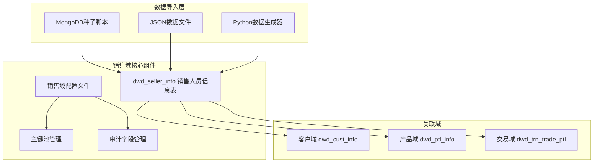
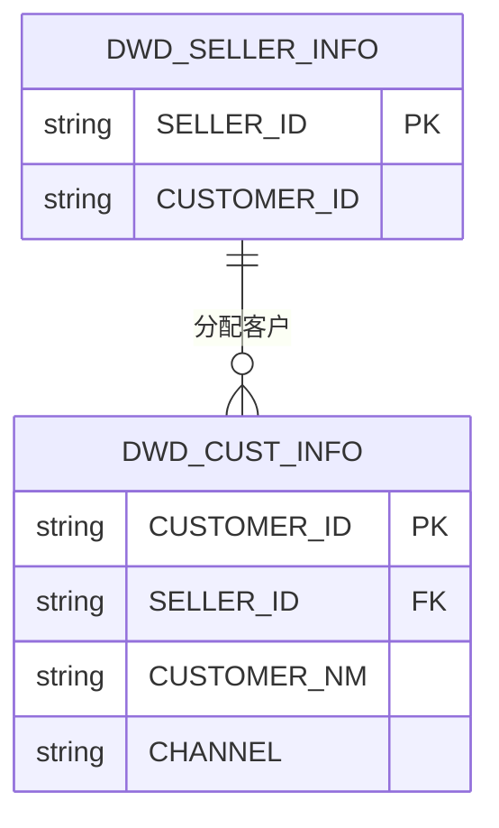
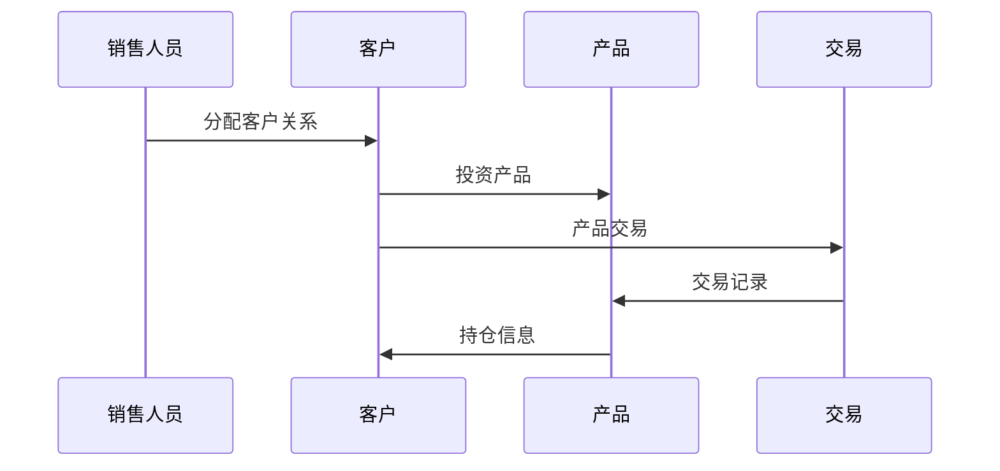
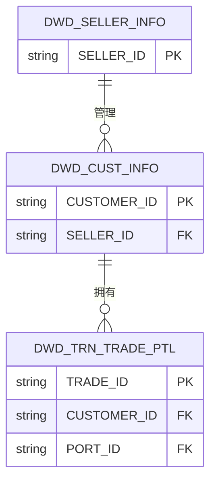
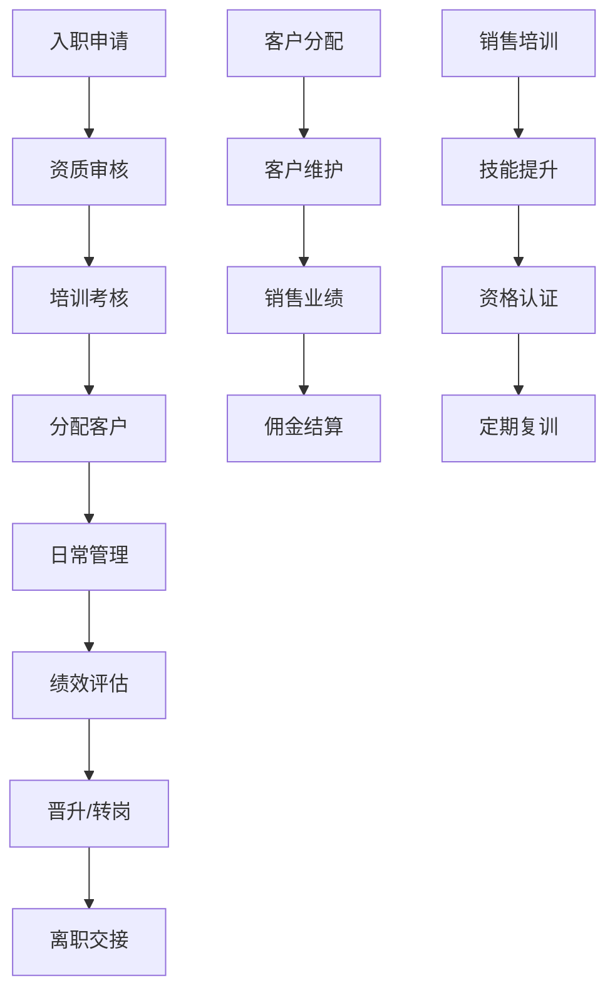
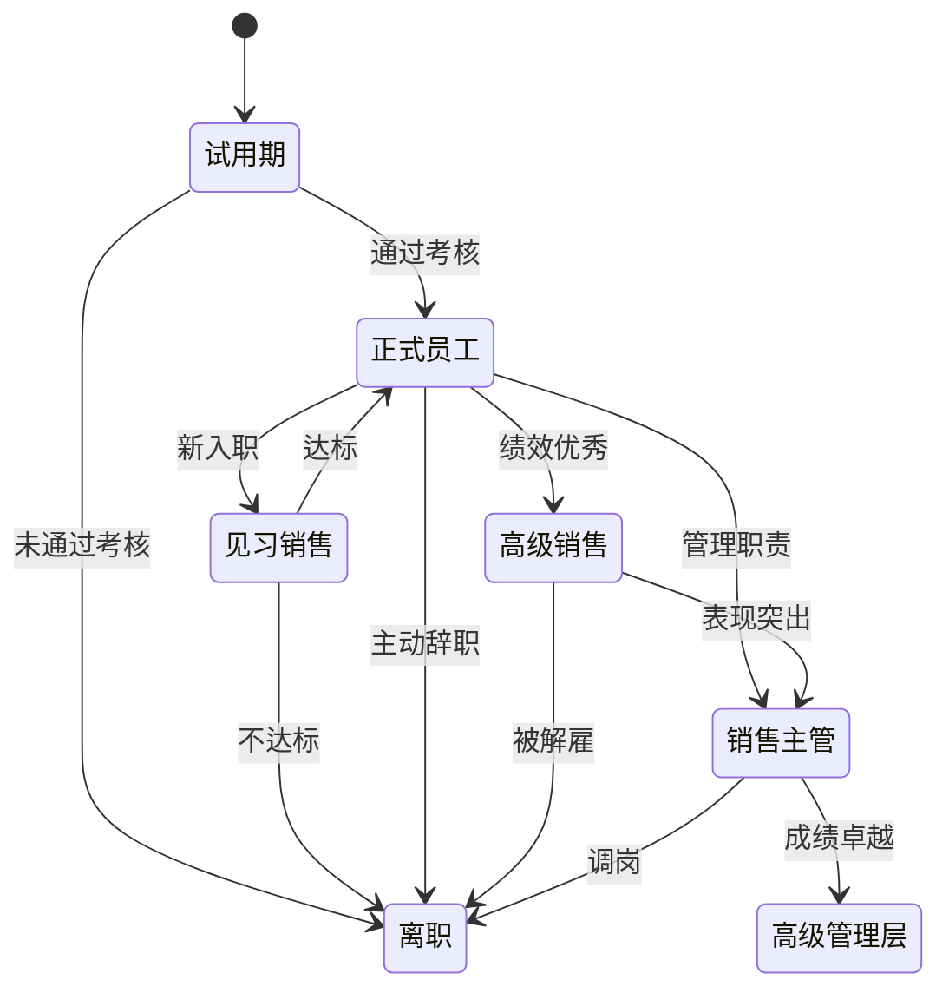
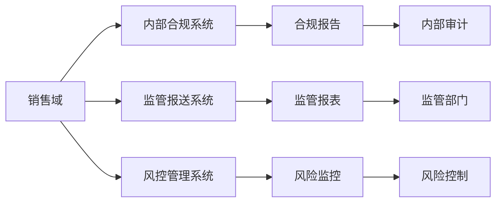
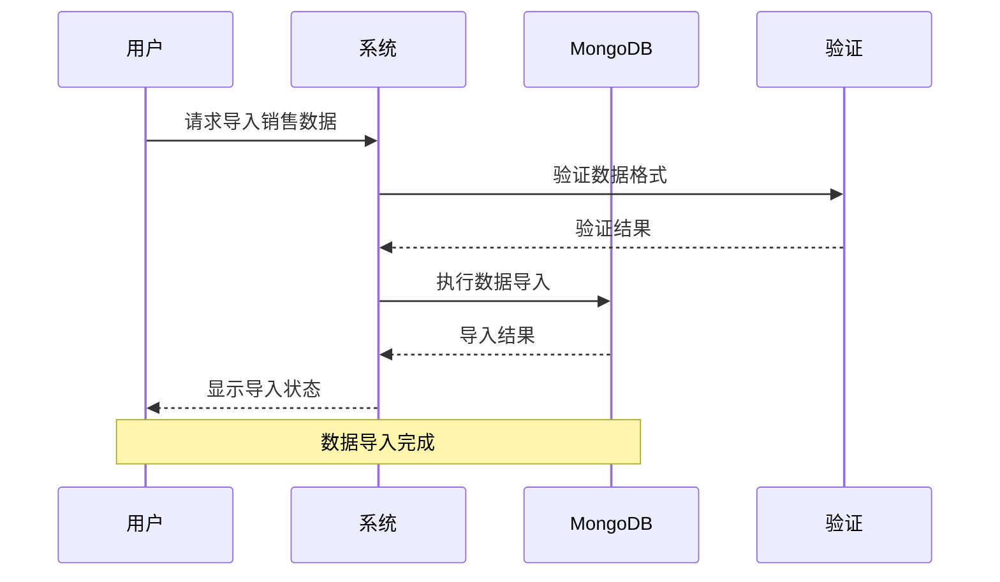
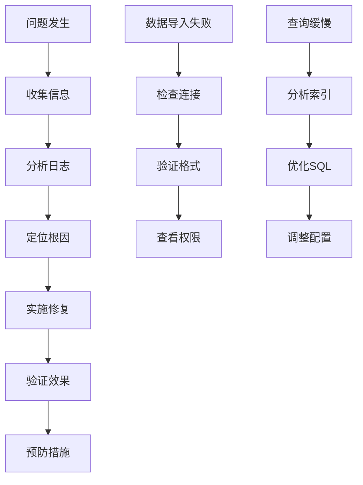

# 销售域数据模型

<cite>
**本文档引用的文件**
- [06_seller_domain.js](file://mongo-seed/06_seller_domain.js)
- [06_seller.js](file://src/config/zyDataDomain/06_seller.js)
- [keys.js](file://src/config/zyDataDomain/keys.js)
- [_keys.js](file://mongo-seed/_keys.js)
- [zy_data_domain_seeds_v2.json](file://scripts/zy_data_domain_seeds_v2.json)
- [zy_data_domain_seeds.json](file://scripts/zy_data_domain_seeds.json)
- [07_customer_domain.js](file://mongo-seed/07_customer_domain.js)
- [07_customer.js](file://src/config/zyDataDomain/07_customer.js)
- [03_product_domain.js](file://mongo-seed/03_product_domain.js)
- [03_product.js](file://src/config/zyDataDomain/03_product.js)
- [zy_data_associated_mock_design_v2.md](file://scripts/zy_data_associated_mock_design_v2.md)
- [generate_and_import_v2.py](file://scripts/generate_and_import_v2.py)
- [zyDataDomain.mock.js](file://src/api/zyDataDomain.mock.js)
</cite>

## 目录
1. [项目概述](#项目概述)
2. [销售域架构设计](#销售域架构设计)
3. [核心数据表结构](#核心数据表结构)
4. [销售域字段详解](#销售域字段详解)
5. [销售域关联关系](#销售域关联关系)
6. [销售流程数据管理](#销售流程数据管理)
7. [合规检查机制](#合规检查机制)
8. [数据导入与初始化](#数据导入与初始化)
9. [性能优化建议](#性能优化建议)
10. [故障排除指南](#故障排除指南)

## 项目概述

销售域是ZY数据平台中的核心业务域之一，专门负责管理销售人员和销售渠道相关的数据。该域采用MongoDB数据库存储，通过标准化的数据模型支持销售业务的全生命周期管理。

销售域主要包含以下核心功能：
- 销售人员信息管理
- 销售渠道管理
- 客户分配管理
- 销售业绩追踪
- 绩效考核管理
- 合规检查监控

## 销售域架构设计

**图表来源**
- [06_seller_domain.js:1-29](file://mongo-seed/06_seller_domain.js#L1-L29)
- [06_seller.js:1-33](file://src/config/zyDataDomain/06_seller.js#L1-L33)
- [keys.js:1-73](file://src/config/zyDataDomain/keys.js#L1-L73)

## 核心数据表结构

### dwd_seller_info 销售人员信息表

销售域的核心表dwd_seller_info采用MongoDB文档存储，包含以下关键特性：

**主键设计**
- 主键：SELLER_ID（唯一标识销售人员）
- 唯一索引：SELLER_ID
- 复合索引：REGION + RANK（用于区域和级别查询）

**表结构概览**
| 字段类别 | 字段名称 | 数据类型 | 描述 | 约束条件 |
|---------|----------|----------|------|----------|
| 基础信息 | SELLER_ID | String | 销售人员ID | 主键，必填 |
| 基础信息 | SELLER_NM | String | 销售人员姓名 | 必填 |
| 基础信息 | SELLER_TYPE | Enum | 销售类型 | INTERNAL/EXTERNAL |
| 基础信息 | CHANNEL_TYPE | Enum | 渠道类型 | DIRECT/BANK/BROKER/ONLINE |
| 基础信息 | ORG | String | 所属机构 | 可选 |
| 基础信息 | CERT_NO | String | 资格证书 | 可选 |
| 基础信息 | CERT_TYPE | String | 证书类型 | 可选 |
| 联系信息 | PHONE | String | 手机号码 | 可选 |
| 联系信息 | EMAIL | String | 邮箱地址 | 可选 |
| 基础信息 | ENTRY_DT | Date | 入职日期 | 可选 |
| 状态管理 | STATUS | Enum | 状态 | ACTIVE/INACTIVE/PROBATION |
| 业务日期 | BIZ_DT | Date | 业务日期 | 默认值 |

**图表来源**
- [06_seller_domain.js:11-25](file://mongo-seed/06_seller_domain.js#L11-L25)
- [06_seller.js:16-31](file://src/config/zyDataDomain/06_seller.js#L16-L31)

## 销售域字段详解

### 基础信息字段

**SELLER_ID（销售ID）**
- 类型：String
- 约束：主键，唯一
- 用途：唯一标识每个销售人员
- 示例：SEL00001, SEL00002

**SELLER_NM（销售姓名）**
- 类型：String
- 约束：必填
- 用途：存储销售人员的完整姓名

**SELLER_TYPE（销售类型）**
- 类型：Enum
- 取值：INTERNAL（内部销售）、EXTERNAL（外部销售）
- 用途：区分销售团队性质

**CHANNEL_TYPE（渠道类型）**
- 类型：Enum
- 取值：DIRECT（直销）、BANK（银行）、BROKER（券商）、ONLINE（线上）
- 用途：标识销售服务渠道

### 组织管理字段

**ORG（所属机构）**
- 类型：String
- 用途：记录销售人员所属的具体部门或机构

**DEPT（部门）**
- 类型：String
- 用途：销售人员所在的具体部门
- 示例：机构销售一部、零售财富部

**TITLE（职位）**
- 类型：String
- 用途：销售人员的职位头衔
- 示例：高级客户经理、销售总监

**REGION（区域）**
- 类型：String
- 用途：销售人员负责的地理区域
- 示例：华东、华北、华南

**RANK（级别）**
- 类型：Enum
- 取值：SENIOR（高级）、DIRECTOR（总监级）、JUNIOR（初级）
- 用途：标识销售人员的职级水平

### 资质管理字段

**CERT_NO（资格证书）**
- 类型：String
- 用途：存储销售人员的专业资格证书编号

**CERT_TYPE（证书类型）**
- 类型：String
- 用途：证书的具体类型描述

### 联系信息字段

**PHONE（手机号码）**
- 类型：String
- 用途：销售人员的工作联系方式

**EMAIL（邮箱地址）**
- 类型：String
- 用途：销售人员的电子邮箱

### 状态管理字段

**STATUS（状态）**
- 类型：Enum
- 取值：ACTIVE（在职）、INACTIVE（离职）、PROBATION（试用期）
- 用途：管理员工状态

**ENTRY_DT（入职日期）**
- 类型：Date
- 用途：记录员工的入职时间

### 业务日期字段

**BIZ_DT（业务日期）**
- 类型：Date
- 用途：数据业务日期，默认值来自全局配置

**图表来源**
- [06_seller.js:17-29](file://src/config/zyDataDomain/06_seller.js#L17-L29)
- [keys.js:6-72](file://src/config/zyDataDomain/keys.js#L6-L72)

## 销售域关联关系

### 与客户域的关联

销售域与客户域通过SELLER_ID建立一对一关联关系：

**关联特点**：
- 一个销售人员可以管理多个客户
- 一个客户只能对应一个销售人员
- 通过SELLER_ID实现双向关联

**图表来源**
- [07_customer_domain.js:22-30](file://mongo-seed/07_customer_domain.js#L22-L30)
- [07_customer.js:30-46](file://src/config/zyDataDomain/07_customer.js#L30-L46)

### 与产品域的关联

销售域通过客户域间接关联到产品域：

### 与交易域的关联

销售域通过客户域与交易域建立关联：

**图表来源**
- [03_product_domain.js:28-96](file://mongo-seed/03_product_domain.js#L28-L96)
- [zy_data_domain_seeds_v2.json:527-654](file://scripts/zy_data_domain_seeds_v2.json#L527-L654)

## 销售流程数据管理

### 销售人员管理流程

### 绩效管理流程

## 合规检查机制

### 内部合规检查

销售域建立了多层次的合规检查机制：

**1. 基础信息完整性检查**
- 必填字段验证（SELLER_NM、PHONE等）
- 证书有效性检查
- 资质过期预警

**2. 客户分配合规检查**
- 客户集中度限制
- 风险匹配检查
- 适当性评估

**3. 交易行为监控**
- 大额交易预警
- 异常交易模式识别
- 反洗钱监控

### 外部合规接口

## 数据导入与初始化

### MongoDB种子数据导入

销售域支持多种数据导入方式：

**1. 种子脚本导入**
- 使用MongoDB shell执行种子脚本
- 自动创建集合和索引
- 批量插入测试数据

**2. JSON文件导入**
- 结构化JSON数据格式
- 支持批量数据导入
- 数据验证和清洗

**3. Python数据生成器**
- 动态生成模拟数据
- 支持复杂关联关系
- 可配置数据规模

### 数据初始化流程

**图表来源**
- [06_seller_domain.js:16-25](file://mongo-seed/06_seller_domain.js#L16-L25)
- [zy_data_domain_seeds_v2.json:527-654](file://scripts/zy_data_domain_seeds_v2.json#L527-L654)

## 性能优化建议

### 索引优化策略

**1. 查询性能优化**
- 为常用查询字段建立复合索引
- 优化热点数据访问路径
- 实施分片策略处理大数据量

**2. 存储优化**
- 合理的数据类型选择
- 压缩存储策略
- 定期清理历史数据

**3. 缓存策略**
- 热点数据缓存
- 查询结果缓存
- 配置数据缓存

### 监控指标

- 数据导入性能
- 查询响应时间
- 存储空间使用率
- 并发访问量

## 故障排除指南

### 常见问题诊断

**1. 数据导入失败**
- 检查MongoDB连接状态
- 验证数据格式正确性
- 查看索引创建状态

**2. 查询性能问题**
- 分析查询执行计划
- 检查索引使用情况
- 优化查询条件

**3. 数据一致性问题**
- 验证外键约束
- 检查数据完整性
- 实施数据校验规则

### 排错步骤

### 数据备份与恢复

- 定期备份关键数据
- 测试数据恢复流程
- 建立灾难恢复预案

**章节来源**
- [06_seller_domain.js:1-29](file://mongo-seed/06_seller_domain.js#L1-L29)
- [06_seller.js:1-33](file://src/config/zyDataDomain/06_seller.js#L1-L33)
- [keys.js:1-73](file://src/config/zyDataDomain/keys.js#L1-L73)
- [_keys.js:1-161](file://mongo-seed/_keys.js#L1-L161)
- [zy_data_domain_seeds_v2.json:527-654](file://scripts/zy_data_domain_seeds_v2.json#L527-L654)
- [zy_data_domain_seeds.json:1-52](file://scripts/zy_data_domain_seeds.json#L1-L52)
- [07_customer_domain.js:1-160](file://mongo-seed/07_customer_domain.js#L1-L160)
- [07_customer.js:1-121](file://src/config/zyDataDomain/07_customer.js#L1-L121)
- [03_product_domain.js:1-543](file://mongo-seed/03_product_domain.js#L1-L543)
- [03_product.js:1-136](file://src/config/zyDataDomain/03_product.js#L1-L136)
- [zy_data_associated_mock_design_v2.md:259-324](file://scripts/zy_data_associated_mock_design_v2.md#L259-L324)
- [generate_and_import_v2.py:381-401](file://scripts/generate_and_import_v2.py#L381-L401)
- [zyDataDomain.mock.js:213-240](file://src/api/zyDataDomain.mock.js#L213-L240)