# 风险域数据模型

<cite>
**本文引用的文件**   
- [08_risk_domain.js](file://mongo-seed/08_risk_domain.js)
- [08_risk.js](file://src/config/zyDataDomain/08_risk.js)
- [keys.js](file://src/config/zyDataDomain/keys.js)
- [index.js](file://src/config/zyDataDomain/index.js)
- [zyDataDomain.mock.js](file://src/api/zyDataDomain.mock.js)
- [field_mapping_diff.json](file://scripts/field_mapping_diff.json)
- [generate_and_import_v2.py](file://scripts/generate_and_import_v2.py)
- [MonitorCenter.vue](file://src/views/monitor/MonitorCenter.vue)
- [subjectRisk.js](file://src/api/subjectRisk.js)
- [Index.vue](file://src/views/analysis/SubjectRisk/Index.vue)
</cite>

## 目录
1. [引言](#引言)
2. [项目结构](#项目结构)
3. [核心组件](#核心组件)
4. [架构总览](#架构总览)
5. [详细组件分析](#详细组件分析)
6. [依赖分析](#依赖分析)
7. [性能考虑](#性能考虑)
8. [故障排查指南](#故障排查指南)
9. [结论](#结论)
10. [附录](#附录)

## 引言
本文件系统化梳理风险域数据模型，聚焦以下目标：
- 解释风险域作为风险管理核心数据域的设计理念与表结构
- 详解 dwd_rsk_sentiment 市场情绪表字段（情绪指数、分析时间、影响因子等）
- 阐述 dwd_rsk_credit 信用风险表、dwd_rsk_credit_position 信用风险敞口表等信用风险管理相关表
- 说明 dwd_crdt_agme_info 信用协议信息表、dwd_crdt_main_rela_rela_info 主要关联关系表等信用业务相关表
- 描述风险域与资产域、产品域、客户域的关联关系
- 提供风险监控的完整数据流程（从风险识别到处置）
- 给出风险计算公式设计、阈值设置机制与风控系统对接方案

## 项目结构
风险域数据模型由“配置定义 + 种子数据 + 前端展示 + 接口对接”构成：
- 配置定义：src/config/zyDataDomain/08_risk.js 定义表结构与字段元数据
- 种子数据：mongo-seed/08_risk_domain.js 提供示例数据与索引
- 前端展示：src/views/analysis/SubjectRisk/Index.vue 展示主体观点风险数据
- 接口对接：src/api/subjectRisk.js 提供导入、查询、统计等接口
- 关键键值池：src/config/zyDataDomain/keys.js 提供枚举与主键池
- 元数据聚合：src/config/zyDataDomain/index.js 聚合所有域的表定义

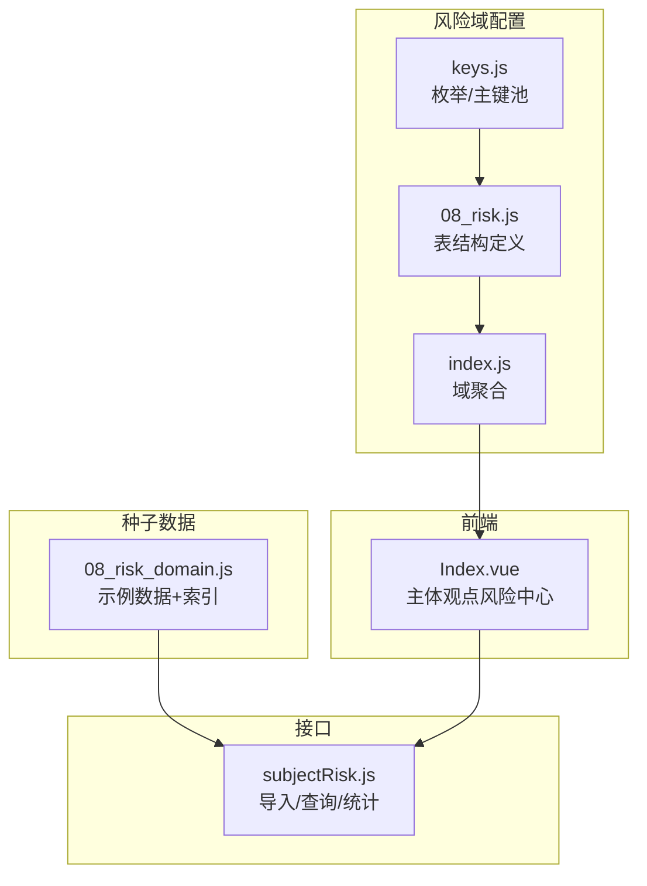

**图示来源**
- [08_risk.js:1-77](file://src/config/zyDataDomain/08_risk.js#L1-L77)
- [keys.js:1-73](file://src/config/zyDataDomain/keys.js#L1-L73)
- [index.js:1-80](file://src/config/zyDataDomain/index.js#L1-L80)
- [08_risk_domain.js:1-112](file://mongo-seed/08_risk_domain.js#L1-L112)
- [Index.vue:1-242](file://src/views/analysis/SubjectRisk/Index.vue#L1-L242)
- [subjectRisk.js:1-94](file://src/api/subjectRisk.js#L1-L94)

**章节来源**
- [08_risk.js:1-77](file://src/config/zyDataDomain/08_risk.js#L1-L77)
- [keys.js:1-73](file://src/config/zyDataDomain/keys.js#L1-L73)
- [index.js:1-80](file://src/config/zyDataDomain/index.js#L1-L80)
- [08_risk_domain.js:1-112](file://mongo-seed/08_risk_domain.js#L1-L112)
- [Index.vue:1-242](file://src/views/analysis/SubjectRisk/Index.vue#L1-L242)
- [subjectRisk.js:1-94](file://src/api/subjectRisk.js#L1-L94)

## 核心组件
- dwd_rsk_sentiment 市场情绪表：记录舆情事件、目标对象、情绪类型与强度、摘要等，支撑情绪驱动的风险识别
- dwd_rsk_credit 主体信用风险表：记录主体内部/外部评级、违约概率、损失率、风险敞口、预期损失、观察标识、上次评级日等
- dwd_rsk_credit_position 信用风险敞口表：记录组合-资产维度的敞口金额、评级、久期、预期损失金额、VaR 99%、限额状态
- dwd_crdt_agme_info 信用协议信息表：记录协议号、对手方、协议类型、生效/失效日、额度、使用/剩余、风险等级、业务日期
- dwd_crdt_main_rela_rela_info 主体关联关系表：记录主体间的关系类型（如母公司、子公司、业务关联等）、持股比例、备注、业务日期

上述表均在风险域配置中定义，并在种子数据中提供索引与示例数据。

**章节来源**
- [08_risk.js:16-74](file://src/config/zyDataDomain/08_risk.js#L16-L74)
- [08_risk_domain.js:15-112](file://mongo-seed/08_risk_domain.js#L15-L112)

## 架构总览
风险域数据模型围绕“信用风险 + 市场情绪 + 风控规则与指标”展开，与资产域（资产质量）、产品域（投资组合风险）、客户域（客户信用）形成跨域联动。

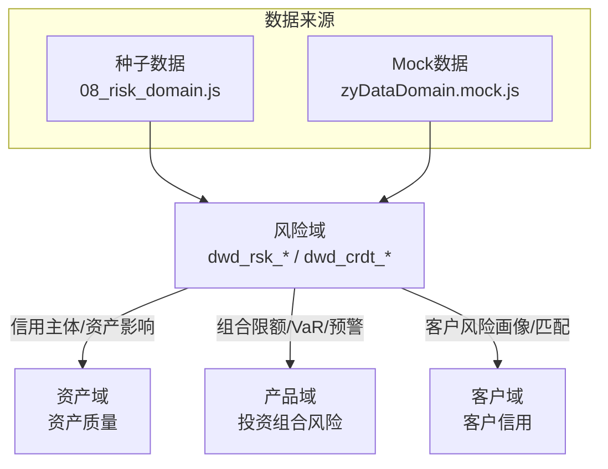

**图示来源**
- [08_risk.js:16-74](file://src/config/zyDataDomain/08_risk.js#L16-L74)
- [08_risk_domain.js:15-112](file://mongo-seed/08_risk_domain.js#L15-L112)
- [zyDataDomain.mock.js:677-680](file://src/api/zyDataDomain.mock.js#L677-L680)

## 详细组件分析

### dwd_rsk_sentiment 市场情绪表
- 设计要点
  - 主键：SENT_ID
  - 目标对象：TARGET_TYPE（ISR/AST/PORT）、TARGET_CD
  - 时间：PUB_DT、PUB_TM
  - 信息源：SOURCE、标题：TITLE、摘要：SUMMARY
  - 情绪：SENT_TYPE（POSITIVE/NEGATIVE/NEUTRAL）、SCORE（数值型情绪分值）
- 用途
  - 支撑情绪驱动的信用风险识别与预警
  - 可与 dwd_crdt_rating_change、dwd_crdt_watchlist 关联，追踪主体评级变动与观察名单
- 示例字段映射参考
  - 前端 mock 中包含 SENT_ID、TARGET_TYPE、TARGET_CD、PUB_DT、PUB_TM、SOURCE、TITLE、SENT_TYPE、SCORE、SUMMARY

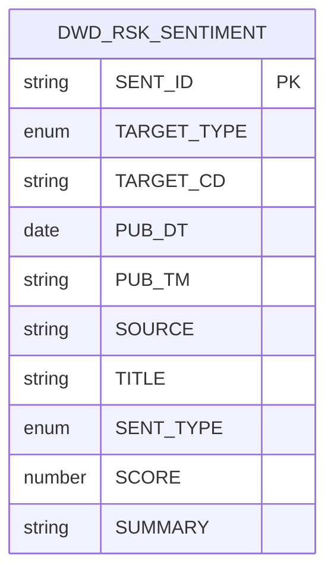

**图示来源**
- [08_risk.js:16-27](file://src/config/zyDataDomain/08_risk.js#L16-L27)
- [zyDataDomain.mock.js:677-680](file://src/api/zyDataDomain.mock.js#L677-L680)

**章节来源**
- [08_risk.js:16-27](file://src/config/zyDataDomain/08_risk.js#L16-L27)
- [zyDataDomain.mock.js:677-680](file://src/api/zyDataDomain.mock.js#L677-L680)

### dwd_rsk_credit 主体信用风险表
- 设计要点
  - 复合主键：ISR_ID、BIZ_DT
  - 内部/外部评级：INTERNAL_RATING、EXT_RATING
  - 风险度量：PD_1Y（1年违约概率）、LGD（违约损失率）、EAD（违约风险敞口）
  - 风险指标：EXPECTED_LOSS（预期损失）、WATCH_FLAG（观察标识）、LAST_RATING_DT（上次评级日）
- 用途
  - 作为主体层面的信用风险底稿，支持预期损失计量与观察名单管理
- 与 dwd_crdt_rating_change 的关联
  - 通过 ISR_ID 与评级变动表建立关联，追踪评级变动对风险指标的影响

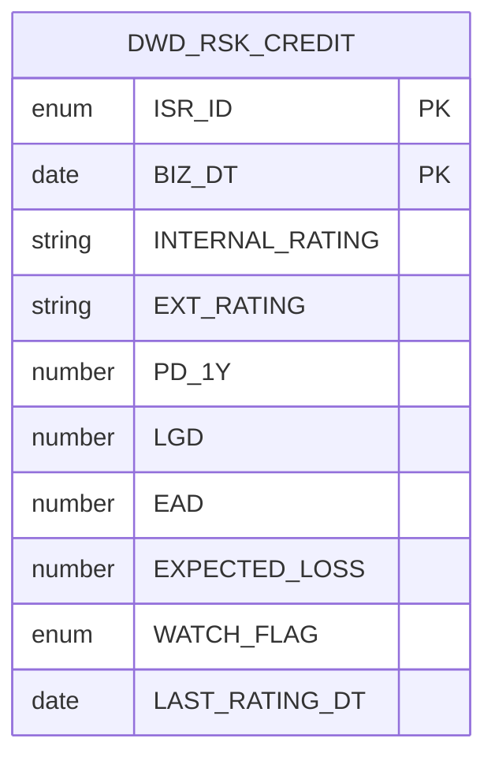

**图示来源**
- [08_risk.js:29-40](file://src/config/zyDataDomain/08_risk.js#L29-L40)

**章节来源**
- [08_risk.js:29-40](file://src/config/zyDataDomain/08_risk.js#L29-L40)

### dwd_rsk_credit_position 信用风险敞口表
- 设计要点
  - 复合主键：PORT_ID、AST_CD、BIZ_DT
  - 敞口：EXPOSURE（金额）、RATING（评级）、DURATION（久期）
  - 风险指标：EL_AMT（预期损失金额）、VAR_99（VaR 99%）、LIMIT_FLAG（限额状态：NORMAL/WARN/BREACH）
- 用途
  - 记录组合-资产维度的信用风险敞口与限额状态，支撑限额检查与压力测试
- 与 dwd_rsk_var 的关联
  - 通过 PORT_ID 与组合层面的 VaR 表关联，统一风险限额与压力指标

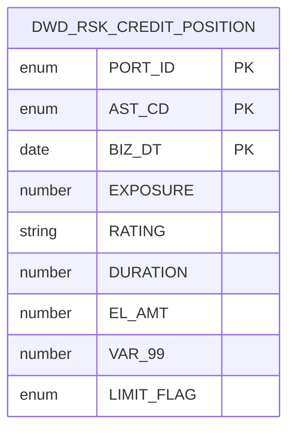

**图示来源**
- [08_risk.js:42-52](file://src/config/zyDataDomain/08_risk.js#L42-L52)

**章节来源**
- [08_risk.js:42-52](file://src/config/zyDataDomain/08_risk.js#L42-L52)

### dwd_crdt_agme_info 信用协议信息表
- 设计要点
  - 主键：AGME_NO
  - 对手：CNTP_ID
  - 协议：AGME_TYPE（NAFMII/ISDA/INTERBANK/OTHER）
  - 时间：EFF_DT、EXP_DT
  - 额度：LIMIT_AMT、USED_AMT、REMAIN_AMT
  - 风险等级：RISK_LVL（LOW/MID/HIGH）、业务日期：BIZ_DT
- 用途
  - 记录交易对手的授信协议与可用额度，支撑集中度与对手方风险限额

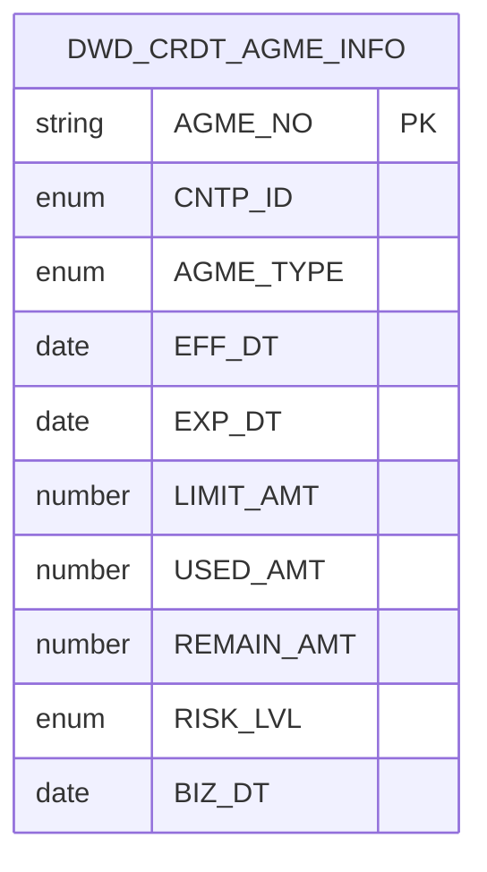

**图示来源**
- [08_risk.js:54-65](file://src/config/zyDataDomain/08_risk.js#L54-L65)

**章节来源**
- [08_risk.js:54-65](file://src/config/zyDataDomain/08_risk.js#L54-L65)

### dwd_crdt_main_rela_rela_info 主体关联关系表
- 设计要点
  - 复合主键：SRC_ISR_ID、TGT_ISR_ID、REL_TYPE
  - 关系：REL_TYPE（CMRC_PEER/POLICY_PEER/UNDERWRITER/BUSINESS/PARENT/SUBSIDIARY）
  - 比例：SHARE_RATIO（持股比例）、REMARK（备注）、业务日期：BIZ_DT
- 用途
  - 记录主体间的关联关系，支撑穿透风险与合并报表口径下的风险集中度评估

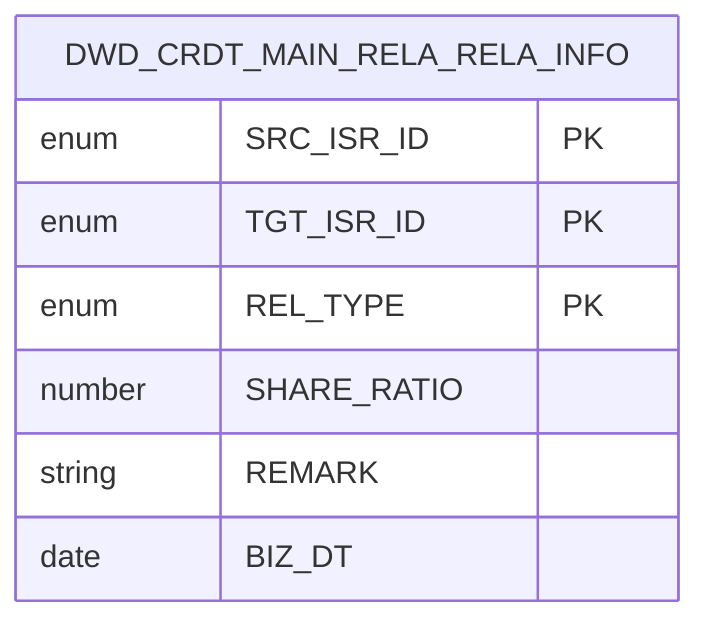

**图示来源**
- [08_risk.js:67-74](file://src/config/zyDataDomain/08_risk.js#L67-L74)

**章节来源**
- [08_risk.js:67-74](file://src/config/zyDataDomain/08_risk.js#L67-L74)

### 风险域与其他数据域的关联关系
- 与资产域（资产质量）
  - 关联点：dwd_rsk_sentiment 与 dwd_crdt_rating_change 可影响资产质量分类与减值评估
  - 关联方式：通过 TARGET_CD（资产代码）或 ISR_ID（主体ID）进行关联
- 与产品域（投资组合风险）
  - 关联点：dwd_rsk_credit_position 与 dwd_rsk_var（VaR/预期损失）共同决定组合风险限额与压力指标
  - 关联方式：通过 PORT_ID 进行组合维度关联
- 与客户域（客户信用）
  - 关联点：主体信用风险与客户风险画像匹配，支撑客户风险等级与产品风险等级的匹配
  - 关联方式：通过 ISR_ID 与客户域的主体维度关联

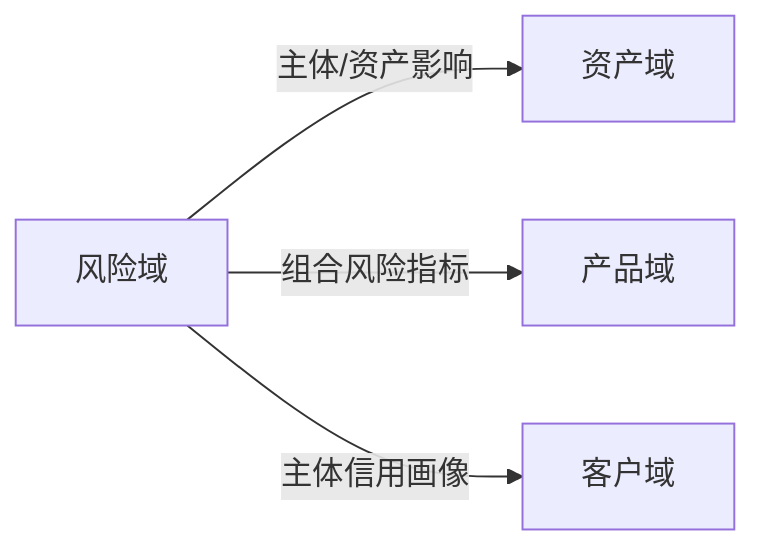

[本图为概念性示意，不直接映射具体源码文件]

## 依赖分析
- 风险域配置依赖键值池（keys.js）提供枚举与主键池，确保字段取值一致性
- 前端通过 zyDataDomain/index.js 聚合域定义，实现统一的表结构查询与展示
- 种子数据与 Mock 数据为风险域提供示例与测试基础

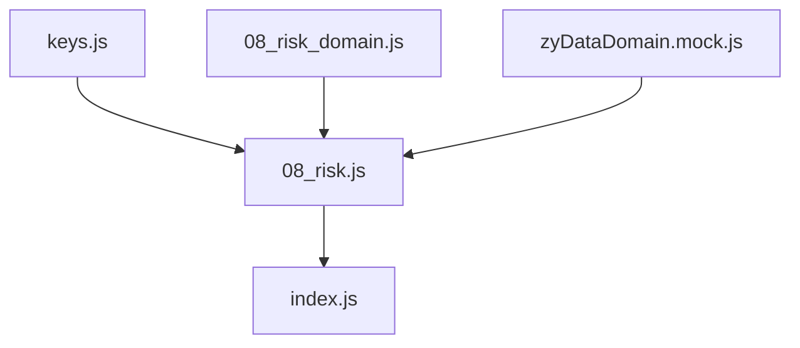

**图示来源**
- [keys.js:1-73](file://src/config/zyDataDomain/keys.js#L1-L73)
- [08_risk.js:1-77](file://src/config/zyDataDomain/08_risk.js#L1-L77)
- [index.js:1-80](file://src/config/zyDataDomain/index.js#L1-L80)
- [08_risk_domain.js:1-112](file://mongo-seed/08_risk_domain.js#L1-L112)
- [zyDataDomain.mock.js:677-680](file://src/api/zyDataDomain.mock.js#L677-L680)

**章节来源**
- [keys.js:1-73](file://src/config/zyDataDomain/keys.js#L1-L73)
- [08_risk.js:1-77](file://src/config/zyDataDomain/08_risk.js#L1-L77)
- [index.js:1-80](file://src/config/zyDataDomain/index.js#L1-L80)
- [08_risk_domain.js:1-112](file://mongo-seed/08_risk_domain.js#L1-L112)
- [zyDataDomain.mock.js:677-680](file://src/api/zyDataDomain.mock.js#L677-L680)

## 性能考虑
- 索引设计
  - dwd_rsk_limit_check：CHECK_ID 唯一索引；PORT_ID+CHECK_DT、STATUS 辅助索引，支撑限额检查与状态查询
  - dwd_rsk_alert：ALERT_ID 唯一索引；PORT_ID+TRIGGER_DT、ALERT_LVL+HANDLE_STATUS 辅助索引，支撑预警触发与处理状态查询
  - dwd_rsk_var：PORT_ID+CALC_DT 唯一索引，保证组合层面 VaR 计算结果唯一
  - dwd_crdt_rating_change：CHANGE_ID 唯一索引；ISR_ID+CHANGE_DT，支撑主体评级变动追踪
  - dwd_crdt_watchlist：WATCH_ID 唯一索引；ISR_ID、WATCH_LVL+STATUS，支撑观察名单管理
- 查询优化
  - 使用复合主键与常用过滤字段建立索引，减少全表扫描
  - 对高频查询（如组合限额状态、预警级别分布）建立二级索引
- 数据量控制
  - 业务日期（BIZ_DT）作为分区键，结合唯一索引避免重复写入
  - 对历史数据定期归档，控制活跃表大小

**章节来源**
- [08_risk_domain.js:17-109](file://mongo-seed/08_risk_domain.js#L17-L109)

## 故障排查指南
- 导入与查询
  - 使用 subjectRisk.js 提供的导入、查询、统计接口，定位上游数据异常或字段不匹配问题
  - 通过 getSubjectRiskFields 与 getSubjectRiskDistinct 获取字段元数据与枚举值，辅助诊断
- 字段映射差异
  - field_mapping_diff.json 显示 dwd_rsk_sentiment 与 dwd_rsk_credit 的字段映射差异，重点关注 VALID_DATE 与 DATA_DT 到 BIZ_DT 的映射、以及缺失字段（如 OBJECT_ID、GRADE_TYPE 等）
- 前端展示
  - SubjectRisk 中心页面支持刷新、批次查询与导入，若数据未更新，检查接口请求与后端数据导入状态

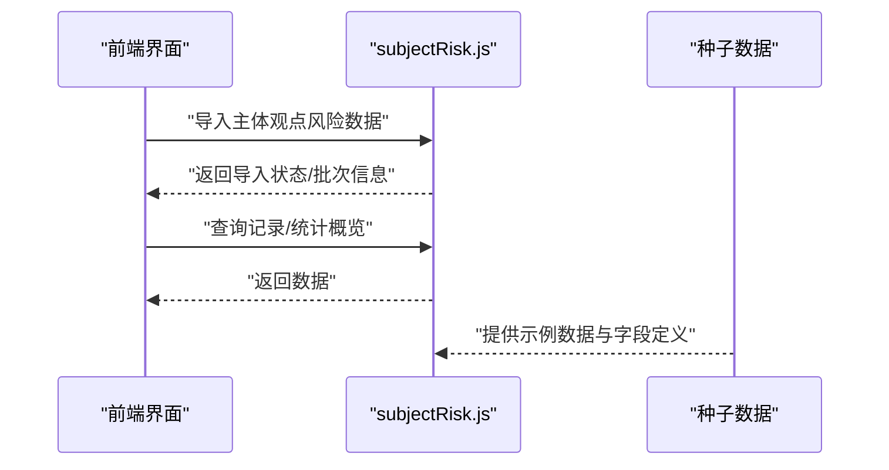

**图示来源**
- [subjectRisk.js:9-93](file://src/api/subjectRisk.js#L9-L93)
- [Index.vue:111-158](file://src/views/analysis/SubjectRisk/Index.vue#L111-L158)
- [08_risk_domain.js:15-112](file://mongo-seed/08_risk_domain.js#L15-L112)

**章节来源**
- [subjectRisk.js:9-93](file://src/api/subjectRisk.js#L9-L93)
- [Index.vue:111-158](file://src/views/analysis/SubjectRisk/Index.vue#L111-L158)
- [field_mapping_diff.json:5183-5182](file://scripts/field_mapping_diff.json#L5183-L5182)

## 结论
风险域数据模型以“信用风险 + 市场情绪 + 风控规则与指标”为核心，通过清晰的表结构与索引设计，支撑限额检查、风险预警、VaR 计算与信用主体管理。结合资产域、产品域、客户域的跨域联动，形成从风险识别到处置的闭环数据流程。建议在实际落地中强化字段映射校验、完善阈值与规则引擎对接，并持续优化索引与查询路径以提升性能。

## 附录

### 风险监控数据流程（从识别到处置）
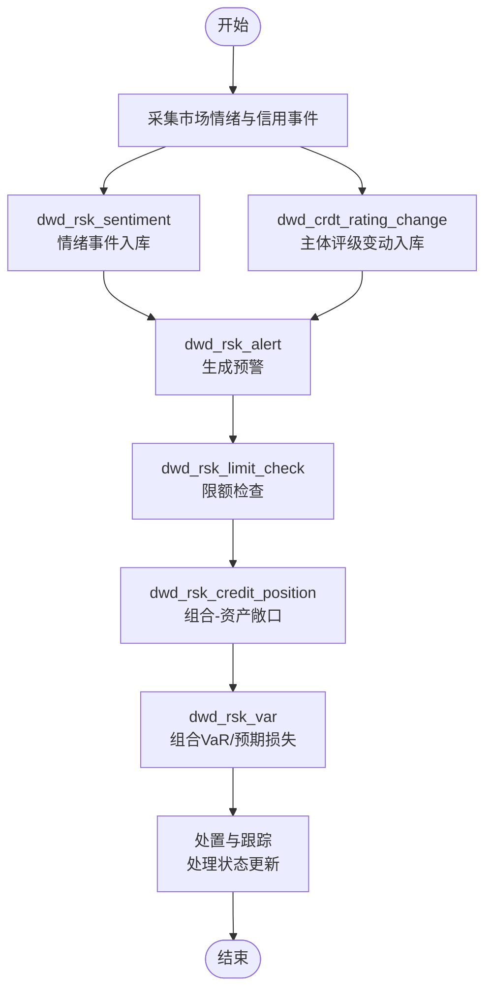

**图示来源**
- [08_risk_domain.js:15-112](file://mongo-seed/08_risk_domain.js#L15-L112)

### 风险计算公式与阈值设计（示例）
- 预期损失（EL）：EL = PD × LGD × EAD
- VaR（组合）：基于历史模拟/参数法计算，置信度与持有期可配置
- 限额阈值：根据监管或内部风控规则设定（如单一债券集中度、发行人集中度、杠杆率等），当 CURRENT_VALUE 超过 THRESHOLD 时触发预警/告警

**章节来源**
- [08_risk_domain.js:21-36](file://mongo-seed/08_risk_domain.js#L21-L36)
- [08_risk_domain.js:66-75](file://mongo-seed/08_risk_domain.js#L66-L75)
- [08_risk.js:29-40](file://src/config/zyDataDomain/08_risk.js#L29-L40)
- [08_risk.js:42-52](file://src/config/zyDataDomain/08_risk.js#L42-L52)

### 与风控系统的数据对接方案
- 接口对接
  - 使用 subjectRisk.js 的导入/查询/统计接口，实现与风控系统的数据互通
- 字段映射
  - 参考 field_mapping_diff.json，确保 dwd_rsk_sentiment 与 dwd_rsk_credit 的字段映射正确（如 VALID_DATE→LAST_RATING_DT、DATA_DT→BIZ_DT）
- 批次管理
  - 通过导入批次与统计概览，实现风控系统对风险数据的批量同步与状态跟踪

**章节来源**
- [subjectRisk.js:9-93](file://src/api/subjectRisk.js#L9-L93)
- [field_mapping_diff.json:5177-5182](file://scripts/field_mapping_diff.json#L5177-L5182)