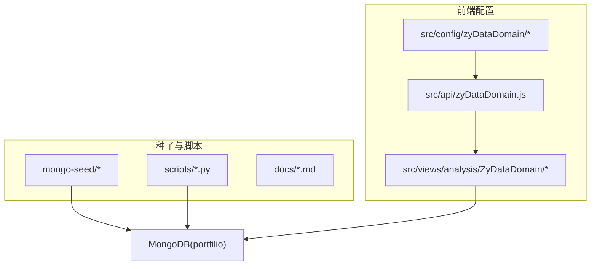
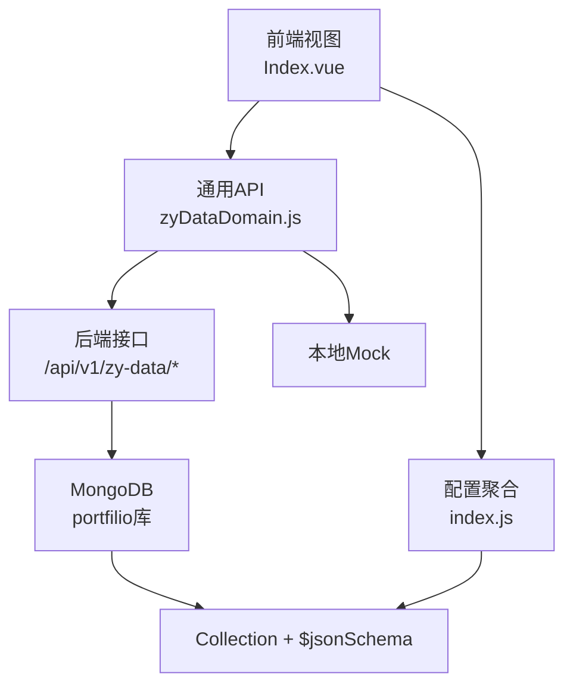
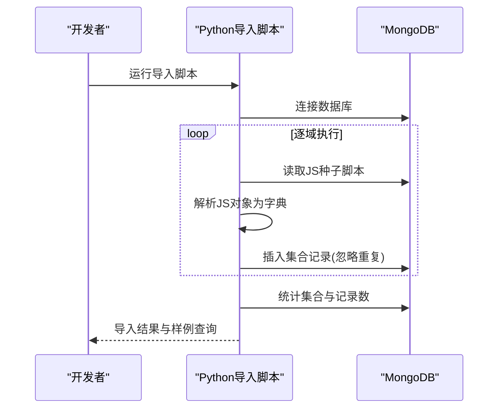
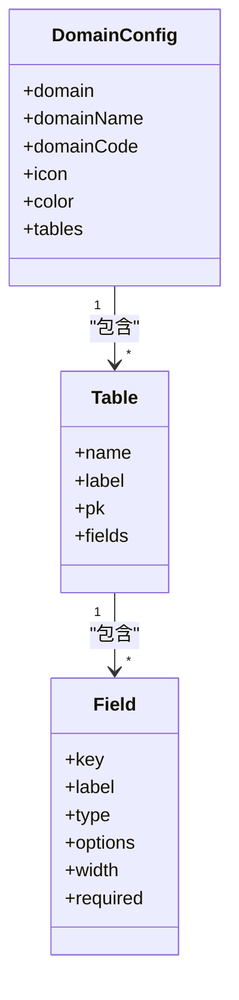
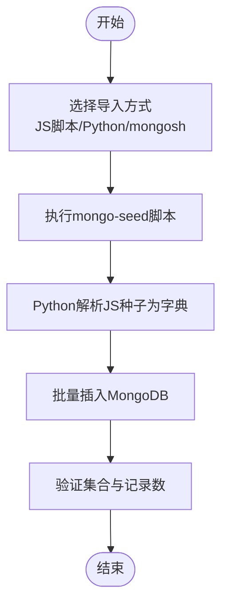
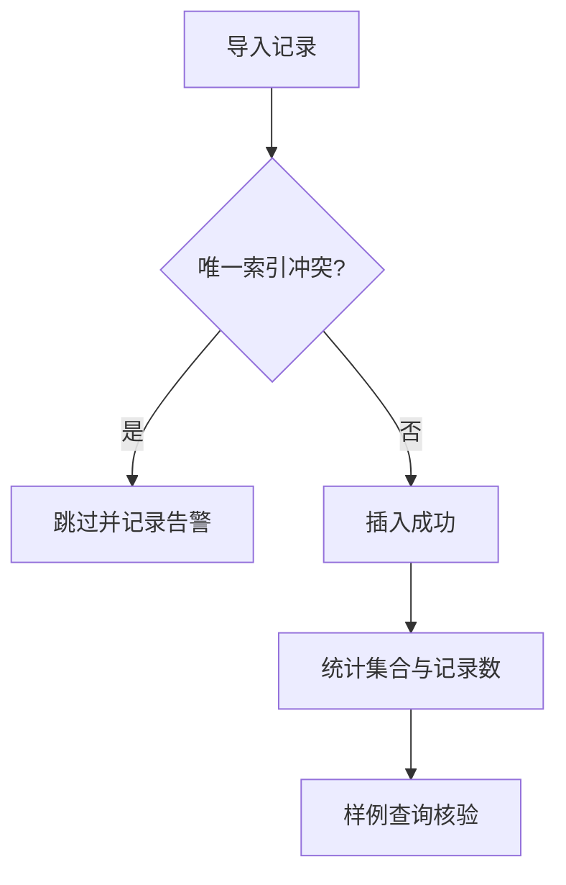
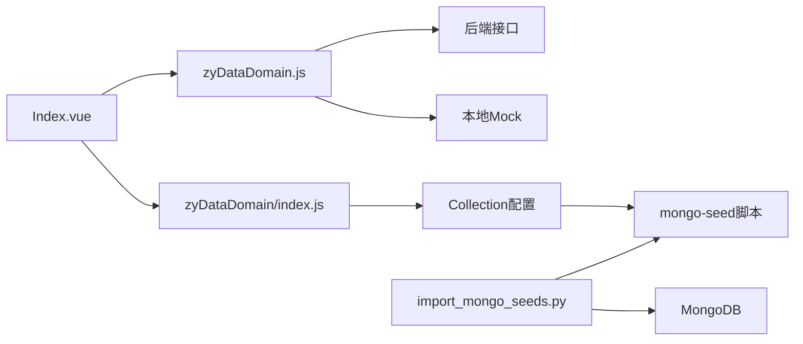

# 数据管理

<cite>
**本文引用的文件**
- [mongo-seed/README.md](file://mongo-seed/README.md)
- [mongo-seed/_keys.js](file://mongo-seed/_keys.js)
- [scripts/import_mongo_seeds.py](file://scripts/import_mongo_seeds.py)
- [scripts/generate_import_json.py](file://scripts/generate_import_json.py)
- [scripts/IMPORT_GUIDE.md](file://scripts/IMPORT_GUIDE.md)
- [scripts/verify_mongo_data.py](file://scripts/verify_mongo_data.py)
- [docs/MongoDB_ZY数据域表结构清单.md](file://docs/MongoDB_ZY数据域表结构清单.md)
- [src/config/zyDataDomain/index.js](file://src/config/zyDataDomain/index.js)
- [src/config/zyDataDomain/01_asset.js](file://src/config/zyDataDomain/01_asset.js)
- [src/config/zyDataDomain/02_subject.js](file://src/config/zyDataDomain/02_subject.js)
- [src/config/zyDataDomain/03_product.js](file://src/config/zyDataDomain/03_product.js)
- [src/config/zyDataDomain/04_valuation.js](file://src/config/zyDataDomain/04_valuation.js)
- [src/config/zyDataDomain/05_transaction.js](file://src/config/zyDataDomain/05_transaction.js)
- [src/api/zyDataDomain.js](file://src/api/zyDataDomain.js)
- [src/views/analysis/ZyDataDomain/Index.vue](file://src/views/analysis/ZyDataDomain/Index.vue)
- [scripts/zy_data_domain_seeds.json](file://scripts/zy_data_domain_seeds.json)
</cite>

## 目录
1. [简介](#简介)
2. [项目结构](#项目结构)
3. [核心组件](#核心组件)
4. [架构总览](#架构总览)
5. [详细组件分析](#详细组件分析)
6. [依赖分析](#依赖分析)
7. [性能考量](#性能考量)
8. [故障排查指南](#故障排查指南)
9. [结论](#结论)
10. [附录](#附录)

## 简介
本文件面向投资组合管理系统中的数据管理功能，系统基于 MongoDB 构建，采用“数据域”划分与“动态表结构配置”的设计理念，覆盖资产域、主体域、产品域、估值域、交易域、销售域、客户域、风险域、行情域等9大域，共计82张表。文档重点阐述：
- 数据模型与Schema设计原则
- 种子数据导入机制与批量执行流程
- 动态表结构生成与前端可视化管理
- 数据导入导出与文件格式支持
- 数据验证、完整性检查与错误处理策略
- 备份恢复与一致性保障
- 数据安全与访问控制、隐私保护

## 项目结构
围绕数据管理的关键目录与文件如下：
- mongo-seed：MongoDB种子数据与Schema生成脚本，包含9个域的JS脚本及主键池定义
- scripts：Python导入工具、Excel到JSON转换脚本、导入说明与验证脚本
- docs：数据域表结构清单与集成指南
- src/config/zyDataDomain：前端动态表结构配置与聚合入口
- src/api/zyDataDomain：前端通用CRUD API与Mock兜底逻辑
- src/views/analysis/ZyDataDomain：数据域管理页面与表格操作

图表来源
- [mongo-seed/README.md:1-125](file://mongo-seed/README.md#L1-L125)
- [scripts/import_mongo_seeds.py:1-305](file://scripts/import_mongo_seeds.py#L1-L305)
- [src/config/zyDataDomain/index.js:1-80](file://src/config/zyDataDomain/index.js#L1-L80)
- [src/api/zyDataDomain.js:1-190](file://src/api/zyDataDomain.js#L1-L190)

章节来源
- [mongo-seed/README.md:1-125](file://mongo-seed/README.md#L1-L125)
- [scripts/IMPORT_GUIDE.md:1-261](file://scripts/IMPORT_GUIDE.md#L1-L261)
- [docs/MongoDB_ZY数据域表结构清单.md:1-379](file://docs/MongoDB_ZY数据域表结构清单.md#L1-L379)

## 核心组件
- 种子数据与Schema生成：通过mongo-seed下的域脚本生成Collection、$jsonSchema校验器与测试数据，并提供一键执行入口
- Python导入工具：批量解析JS种子脚本，提取集合与记录，写入MongoDB，具备唯一索引冲突跳过与统计验证
- 动态表结构配置：前端以模块化方式定义各域的表结构、字段类型、主键与枚举选项，统一聚合供UI使用
- 通用CRUD API：封装后端接口调用，遇404/网络错误自动降级至本地Mock，支持分页、过滤、计数与CRUD
- 数据域管理界面：提供域树选择、表格展示、表单编辑、分页与过滤、Mock重置等功能

章节来源
- [scripts/import_mongo_seeds.py:185-305](file://scripts/import_mongo_seeds.py#L185-L305)
- [src/config/zyDataDomain/index.js:25-80](file://src/config/zyDataDomain/index.js#L25-L80)
- [src/api/zyDataDomain.js:69-190](file://src/api/zyDataDomain.js#L69-L190)
- [src/views/analysis/ZyDataDomain/Index.vue:62-290](file://src/views/analysis/ZyDataDomain/Index.vue#L62-L290)

## 架构总览
系统采用“前端配置驱动 + 后端接口 + MongoDB存储”的三层架构。前端通过zyDataDomain配置与API模块，动态渲染各域表单与表格；后端接口负责数据持久化与查询；MongoDB承载82张表，遵循统一审计字段与索引策略。

图表来源
- [src/views/analysis/ZyDataDomain/Index.vue:62-290](file://src/views/analysis/ZyDataDomain/Index.vue#L62-L290)
- [src/config/zyDataDomain/index.js:1-80](file://src/config/zyDataDomain/index.js#L1-L80)
- [src/api/zyDataDomain.js:1-190](file://src/api/zyDataDomain.js#L1-L190)

## 详细组件分析

### 数据域Schema与主键池
- 主键池：统一维护AST_CD、PORT_ID、ISR_ID、CNTP_ID、CUSTOMER_ID、SELLER_ID、INDEX_CD、BIZ_DT等跨表主键/外键，确保关联一致性
- Schema设计原则：统一审计字段、业务日期字符串存储、金额/比率使用double、Collection级$jsonSchema宽松校验、高频字段建立索引
- 表清单与索引：涵盖资产、主体、产品、估值、交易、销售、客户、风险、行情等域，提供主键唯一索引与BIZ_DT等过滤字段索引

章节来源
- [mongo-seed/_keys.js:1-161](file://mongo-seed/_keys.js#L1-L161)
- [mongo-seed/README.md:114-125](file://mongo-seed/README.md#L114-L125)
- [docs/MongoDB_ZY数据域表结构清单.md:257-280](file://docs/MongoDB_ZY数据域表结构清单.md#L257-L280)

### 种子数据导入机制
- 批量执行：Python脚本按域顺序加载mongo-seed/*.js，解析JS变量定义为Python字典，插入MongoDB集合
- 冲突处理：遇到唯一索引冲突跳过，避免重复导入；支持统计各域集合数量与记录数
- 验证查询：提供样例查询与集合统计，便于导入后快速核验

图表来源
- [scripts/import_mongo_seeds.py:134-183](file://scripts/import_mongo_seeds.py#L134-L183)
- [scripts/import_mongo_seeds.py:208-223](file://scripts/import_mongo_seeds.py#L208-L223)
- [scripts/import_mongo_seeds.py:225-299](file://scripts/import_mongo_seeds.py#L225-L299)

章节来源
- [scripts/import_mongo_seeds.py:185-305](file://scripts/import_mongo_seeds.py#L185-L305)

### 动态表结构生成与前端管理
- 配置聚合：index.js聚合9个域配置，提供按域/表查找、扁平表清单、域汇总信息等工具函数
- 域配置示例：资产域、主体域、产品域、估值域、交易域分别定义表名、主键、字段与枚举选项
- 前端页面：Index.vue根据配置渲染域树与表格，支持分页、过滤、CRUD与Mock重置

图表来源
- [src/config/zyDataDomain/index.js:16-80](file://src/config/zyDataDomain/index.js#L16-L80)
- [src/config/zyDataDomain/01_asset.js:10-137](file://src/config/zyDataDomain/01_asset.js#L10-L137)
- [src/config/zyDataDomain/02_subject.js:10-59](file://src/config/zyDataDomain/02_subject.js#L10-L59)
- [src/config/zyDataDomain/03_product.js:10-136](file://src/config/zyDataDomain/03_product.js#L10-L136)
- [src/config/zyDataDomain/04_valuation.js:10-137](file://src/config/zyDataDomain/04_valuation.js#L10-L137)
- [src/config/zyDataDomain/05_transaction.js:10-103](file://src/config/zyDataDomain/05_transaction.js#L10-L103)

章节来源
- [src/config/zyDataDomain/index.js:1-80](file://src/config/zyDataDomain/index.js#L1-L80)
- [src/config/zyDataDomain/01_asset.js:1-137](file://src/config/zyDataDomain/01_asset.js#L1-L137)
- [src/config/zyDataDomain/02_subject.js:1-59](file://src/config/zyDataDomain/02_subject.js#L1-L59)
- [src/config/zyDataDomain/03_product.js:1-136](file://src/config/zyDataDomain/03_product.js#L1-L136)
- [src/config/zyDataDomain/04_valuation.js:1-137](file://src/config/zyDataDomain/04_valuation.js#L1-L137)
- [src/config/zyDataDomain/05_transaction.js:1-103](file://src/config/zyDataDomain/05_transaction.js#L1-L103)

### 数据导入导出与文件格式
- 导入：支持mongo-seed JS脚本、Python批量导入、mongosh一次性执行
- 导出：提供Excel到JSON转换脚本，输出assets与asset_prices两个集合的JSON文件，便于mongoimport导入
- 关联Mock数据：提供完整关联Mock数据生成与验证脚本，支持手动/自动导入与验证

图表来源
- [mongo-seed/README.md:27-51](file://mongo-seed/README.md#L27-L51)
- [scripts/import_mongo_seeds.py:134-183](file://scripts/import_mongo_seeds.py#L134-L183)
- [scripts/generate_import_json.py:132-160](file://scripts/generate_import_json.py#L132-L160)

章节来源
- [mongo-seed/README.md:1-125](file://mongo-seed/README.md#L1-L125)
- [scripts/IMPORT_GUIDE.md:21-83](file://scripts/IMPORT_GUIDE.md#L21-L83)
- [scripts/generate_import_json.py:1-160](file://scripts/generate_import_json.py#L1-L160)

### 数据验证、完整性检查与错误处理
- 验证脚本：统计dwd_开头集合数量与记录总数，定位异常
- 错误处理：导入脚本捕获唯一索引冲突并跳过；前端API在后端不可用时自动降级至Mock
- 完整性检查：通过主键池与外键引用关系，确保跨表一致性

图表来源
- [scripts/import_mongo_seeds.py:177-183](file://scripts/import_mongo_seeds.py#L177-L183)
- [scripts/verify_mongo_data.py:16-26](file://scripts/verify_mongo_data.py#L16-L26)

章节来源
- [scripts/verify_mongo_data.py:1-36](file://scripts/verify_mongo_data.py#L1-L36)
- [src/api/zyDataDomain.js:26-46](file://src/api/zyDataDomain.js#L26-L46)

### 备份恢复与一致性保障
- 清空重建：种子脚本默认drop集合后重建，支持反复执行
- 业务日期锚定：统一BIZ_DT=20250324，便于历史回溯与快照一致性
- 审计字段：统一etl_dt、src_sys、created_at、updated_at，便于追踪与恢复

章节来源
- [mongo-seed/README.md:122-125](file://mongo-seed/README.md#L122-L125)
- [mongo-seed/_keys.js:6-10](file://mongo-seed/_keys.js#L6-L10)
- [docs/MongoDB_ZY数据域表结构清单.md:312-323](file://docs/MongoDB_ZY数据域表结构清单.md#L312-L323)

### 数据安全与访问控制
- 前端Mock兜底：当后端接口不可用时自动切换，避免阻断开发体验
- 权限与网络：建议在后端接口层实现鉴权与授权，前端仅进行UI层面的降级提示
- 数据最小暴露：前端仅渲染必要字段，后端接口按需返回，避免敏感字段泄露

章节来源
- [src/api/zyDataDomain.js:26-57](file://src/api/zyDataDomain.js#L26-L57)

## 依赖分析
- 前端配置依赖：Index.vue依赖zyDataDomain配置聚合，调用API模块进行CRUD
- API依赖：zyDataDomain.js依赖后端接口契约，同时内置Mock兜底
- 数据依赖：mongo-seed脚本依赖主键池与Schema定义，Python导入脚本依赖Pymongo

图表来源
- [src/views/analysis/ZyDataDomain/Index.vue:74-101](file://src/views/analysis/ZyDataDomain/Index.vue#L74-L101)
- [src/config/zyDataDomain/index.js:16-28](file://src/config/zyDataDomain/index.js#L16-L28)
- [src/api/zyDataDomain.js:17-46](file://src/api/zyDataDomain.js#L17-L46)
- [scripts/import_mongo_seeds.py:22-34](file://scripts/import_mongo_seeds.py#L22-L34)

章节来源
- [src/views/analysis/ZyDataDomain/Index.vue:62-290](file://src/views/analysis/ZyDataDomain/Index.vue#L62-L290)
- [src/config/zyDataDomain/index.js:1-80](file://src/config/zyDataDomain/index.js#L1-L80)
- [src/api/zyDataDomain.js:1-190](file://src/api/zyDataDomain.js#L1-L190)
- [scripts/import_mongo_seeds.py:1-305](file://scripts/import_mongo_seeds.py#L1-L305)

## 性能考量
- 索引策略：为主键字段显式建立唯一索引，高频过滤字段（BIZ_DT、PORT_ID、AST_CD）建立普通索引，提升查询效率
- 字段类型：金额/比率使用double，生产环境可按需改为decimal128以提高精度
- 批量导入：Python脚本使用insert_many并禁用有序模式，减少往返次数
- 查询优化：前端分页与过滤参数通过后端接口传递，避免一次性拉取全部数据

章节来源
- [docs/MongoDB_ZY数据域表结构清单.md:257-280](file://docs/MongoDB_ZY数据域表结构清单.md#L257-L280)
- [scripts/import_mongo_seeds.py:170-176](file://scripts/import_mongo_seeds.py#L170-L176)
- [src/api/zyDataDomain.js:75-87](file://src/api/zyDataDomain.js#L75-L87)

## 故障排查指南
- MongoDB连接失败：检查服务状态、端口占用与连接地址
- 权限不足：以管理员权限运行或配置认证
- 端口冲突：修改连接地址或释放端口
- 导入失败：查看唯一索引冲突与异常堆栈，确认重复数据与字段类型
- 验证失败：运行verify_mongo_data.py检查集合数量与记录总数

章节来源
- [scripts/IMPORT_GUIDE.md:206-234](file://scripts/IMPORT_GUIDE.md#L206-L234)
- [scripts/verify_mongo_data.py:30-36](file://scripts/verify_mongo_data.py#L30-L36)

## 结论
本系统通过“数据域划分 + 动态表结构 + 种子数据 + 前后端协同”的方式，实现了投资组合管理所需的多域数据模型与高效管理。前端以配置驱动表结构，后端提供统一CRUD接口，配合Python导入工具与验证脚本，形成完整的数据生命周期闭环。建议在后端接口层完善鉴权与审计，确保数据安全与合规。

## 附录
- 数据域表结构清单与索引策略参见文档
- 前端域配置示例：资产域、主体域、产品域、估值域、交易域
- 种子数据与导入脚本路径：mongo-seed与scripts目录

章节来源
- [docs/MongoDB_ZY数据域表结构清单.md:1-379](file://docs/MongoDB_ZY数据域表结构清单.md#L1-L379)
- [src/config/zyDataDomain/01_asset.js:1-137](file://src/config/zyDataDomain/01_asset.js#L1-L137)
- [src/config/zyDataDomain/02_subject.js:1-59](file://src/config/zyDataDomain/02_subject.js#L1-L59)
- [src/config/zyDataDomain/03_product.js:1-136](file://src/config/zyDataDomain/03_product.js#L1-L136)
- [src/config/zyDataDomain/04_valuation.js:1-137](file://src/config/zyDataDomain/04_valuation.js#L1-L137)
- [src/config/zyDataDomain/05_transaction.js:1-103](file://src/config/zyDataDomain/05_transaction.js#L1-L103)