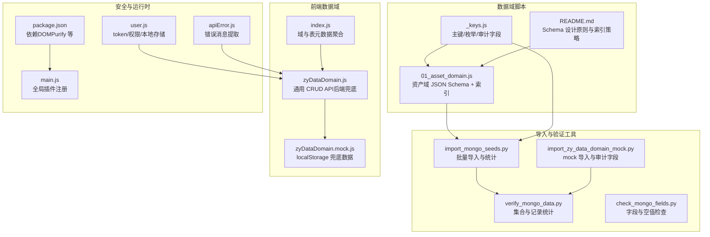
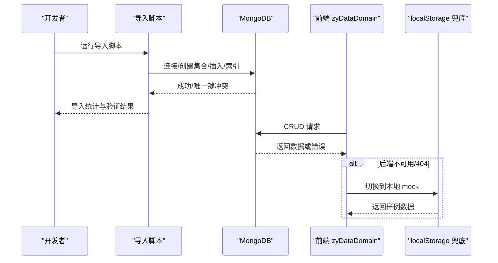
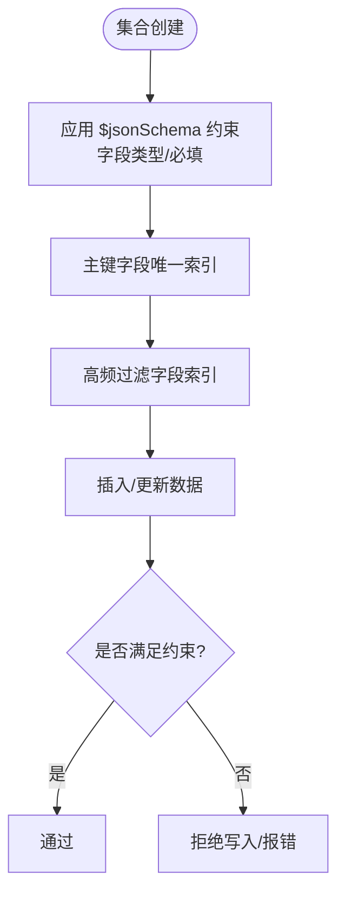
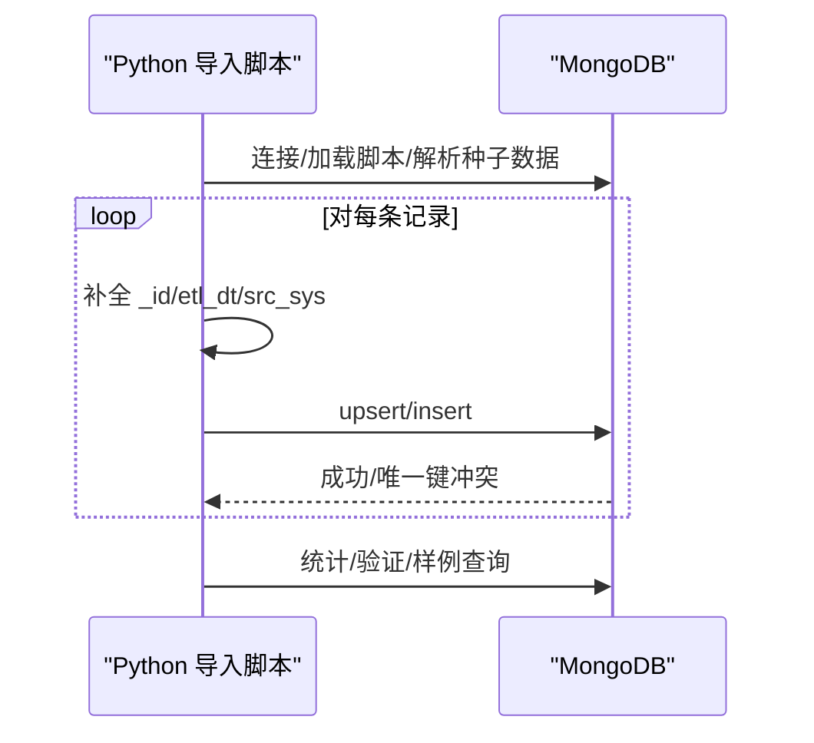
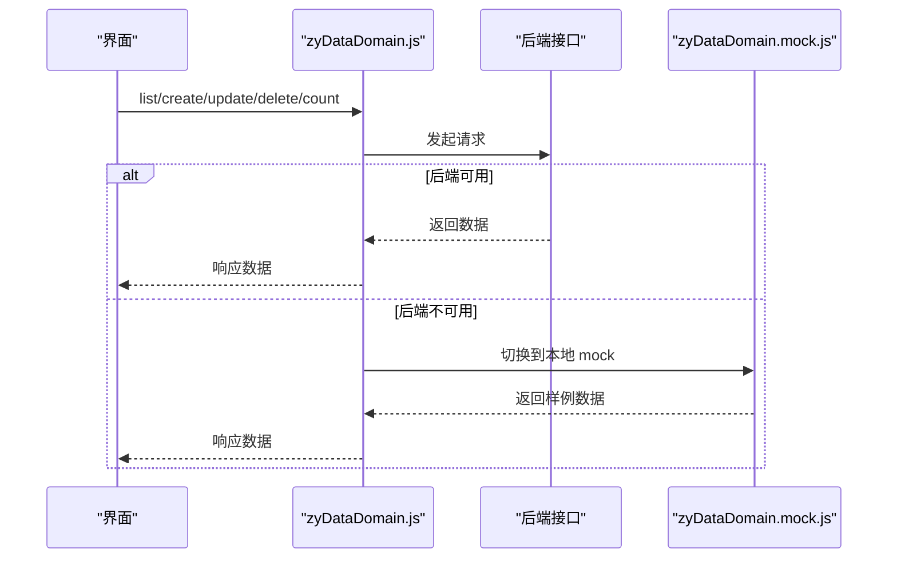
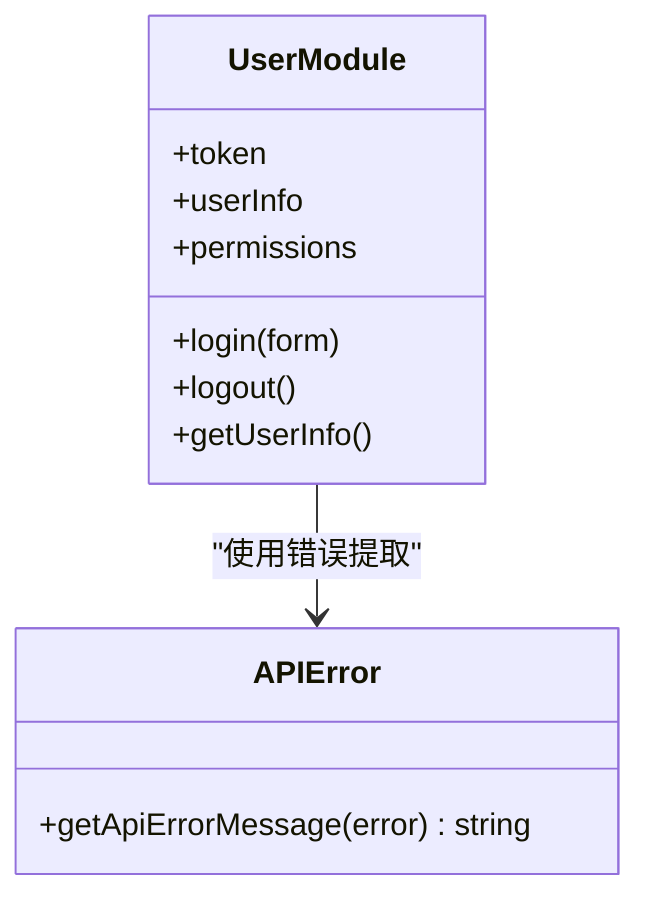
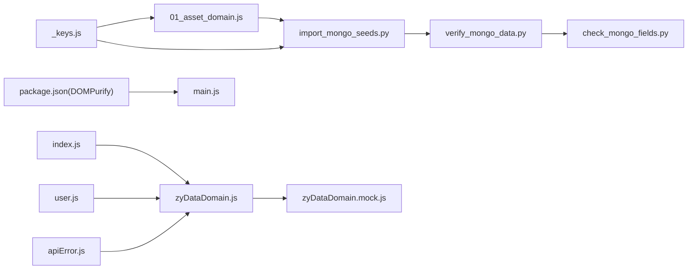

# 数据验证与安全

<cite>
**本文引用的文件**
- [README.md](file://mongo-seed/README.md)
- [01_asset_domain.js](file://mongo-seed/01_asset_domain.js)
- [_keys.js](file://mongo-seed/_keys.js)
- [import_mongo_seeds.py](file://scripts/import_mongo_seeds.py)
- [import_zy_data_domain_mock.py](file://scripts/import_zy_data_domain_mock.py)
- [import_to_asset_allocation.py](file://scripts/import_to_asset_allocation.py)
- [verify_mongo_data.py](file://scripts/verify_mongo_data.py)
- [check_mongo_fields.py](file://check_mongo_fields.py)
- [index.js](file://src/config/zyDataDomain/index.js)
- [zyDataDomain.js](file://src/api/zyDataDomain.js)
- [zyDataDomain.mock.js](file://src/api/zyDataDomain.mock.js)
- [user.js](file://src/store/modules/user.js)
- [apiError.js](file://src/utils/apiError.js)
- [package.json](file://package.json)
- [main.js](file://src/main.js)
</cite>

## 目录
1. [简介](#简介)
2. [项目结构](#项目结构)
3. [核心组件](#核心组件)
4. [架构总览](#架构总览)
5. [详细组件分析](#详细组件分析)
6. [依赖关系分析](#依赖关系分析)
7. [性能考量](#性能考量)
8. [故障排查指南](#故障排查指南)
9. [结论](#结论)
10. [附录](#附录)

## 简介
本文件聚焦投资组合管理系统在数据验证与安全方面的设计与实现，覆盖以下方面：
- 数据验证机制：字段类型验证、业务规则验证、数据完整性检查
- MongoDB JSON Schema 验证器使用、模式约束与错误处理
- 数据安全：访问控制、数据加密、隐私保护
- 数据一致性：事务处理与并发控制策略
- 数据备份与恢复、灾难恢复预案
- 数据质量监控与异常检测
- 数据审计日志、操作追踪与合规要求
- 开发者实现指南与最佳实践

## 项目结构
围绕数据域与验证，系统由“数据域脚本 + 导入工具 + 前端数据域配置与API + 用户态与安全”构成。

**图表来源**
- [README.md:114-121](file://mongo-seed/README.md#L114-L121)
- [01_asset_domain.js:28-38](file://mongo-seed/01_asset_domain.js#L28-L38)
- [_keys.js:152-155](file://mongo-seed/_keys.js#L152-L155)
- [import_mongo_seeds.py:185-302](file://scripts/import_mongo_seeds.py#L185-L302)
- [import_zy_data_domain_mock.py:74-111](file://scripts/import_zy_data_domain_mock.py#L74-L111)
- [verify_mongo_data.py:1-36](file://scripts/verify_mongo_data.py#L1-L36)
- [check_mongo_fields.py:1-26](file://check_mongo_fields.py#L1-L26)
- [index.js:1-80](file://src/config/zyDataDomain/index.js#L1-L80)
- [zyDataDomain.js:1-190](file://src/api/zyDataDomain.js#L1-L190)
- [zyDataDomain.mock.js:1-800](file://src/api/zyDataDomain.mock.js#L1-L800)
- [user.js:1-93](file://src/store/modules/user.js#L1-L93)
- [apiError.js:1-18](file://src/utils/apiError.js#L1-L18)
- [package.json:1-45](file://package.json#L1-L45)
- [main.js:1-31](file://src/main.js#L1-L31)

**章节来源**
- [README.md:1-125](file://mongo-seed/README.md#L1-L125)
- [01_asset_domain.js:1-200](file://mongo-seed/01_asset_domain.js#L1-L200)
- [import_mongo_seeds.py:1-305](file://scripts/import_mongo_seeds.py#L1-L305)
- [zyDataDomain.js:1-190](file://src/api/zyDataDomain.js#L1-L190)

## 核心组件
- 数据域脚本与JSON Schema：通过集合创建时的 $jsonSchema 实现字段类型与必填约束，配合唯一/普通索引保障主键与高频过滤字段的完整性与性能。
- 导入与验证工具：批量导入、重复规避、唯一索引冲突处理、数据完整性验证与字段检查。
- 前端数据域配置与API：统一的 CRUD 接口契约与后端不可用时的本地 mock 兜底，确保用户体验与数据可用性。
- 用户态与安全：token/权限管理、本地存储、错误消息提取与安全依赖（DOMPurify）。

**章节来源**
- [README.md:114-121](file://mongo-seed/README.md#L114-L121)
- [01_asset_domain.js:28-38](file://mongo-seed/01_asset_domain.js#L28-L38)
- [import_mongo_seeds.py:170-183](file://scripts/import_mongo_seeds.py#L170-L183)
- [zyDataDomain.js:9-16](file://src/api/zyDataDomain.js#L9-L16)
- [zyDataDomain.mock.js:1-800](file://src/api/zyDataDomain.mock.js#L1-L800)
- [user.js:1-93](file://src/store/modules/user.js#L1-L93)
- [apiError.js:1-18](file://src/utils/apiError.js#L1-L18)
- [package.json:15-15](file://package.json#L15-L15)

## 架构总览
系统采用“数据域脚本 + 导入工具 + 前端数据域API”的三层架构：
- 数据域层：通过 _keys.js 提供主键池与审计字段，各域脚本定义 $jsonSchema 与索引。
- 工具层：Python 导入脚本负责连接数据库、清理记录、upsert/insert、唯一键冲突处理与统计验证。
- 前端层：统一的 zyDataDomain API 抽象，后端不可用时自动切换到 localStorage 兜底 mock 数据。

**图表来源**
- [import_mongo_seeds.py:185-302](file://scripts/import_mongo_seeds.py#L185-L302)
- [zyDataDomain.js:26-46](file://src/api/zyDataDomain.js#L26-L46)
- [zyDataDomain.mock.js:12-33](file://src/api/zyDataDomain.mock.js#L12-L33)

**章节来源**
- [import_mongo_seeds.py:185-302](file://scripts/import_mongo_seeds.py#L185-L302)
- [zyDataDomain.js:1-190](file://src/api/zyDataDomain.js#L1-L190)
- [zyDataDomain.mock.js:1-800](file://src/api/zyDataDomain.mock.js#L1-L800)

## 详细组件分析

### 数据域脚本与JSON Schema
- 主键与审计字段：统一在 _keys.js 中定义 BIZ_DT、ETL_DT、SRC_SYS，并提供 audit 辅助函数注入到各集合。
- 字段类型与必填：以资产域为例，dwd_ast_info 的 $jsonSchema 约束主键 AST_CD、名称 AST_NM、类型 AST_TYPE、业务日期 BIZ_DT 等字段类型与必填。
- 索引策略：主键字段（除 _id）建立唯一索引；高频过滤字段（如 BIZ_DT、PORT_ID、AST_CD）建立普通索引，提升查询性能与唯一性约束。

**图表来源**
- [01_asset_domain.js:28-38](file://mongo-seed/01_asset_domain.js#L28-L38)
- [README.md:114-121](file://mongo-seed/README.md#L114-L121)
- [_keys.js:152-155](file://mongo-seed/_keys.js#L152-L155)

**章节来源**
- [01_asset_domain.js:28-38](file://mongo-seed/01_asset_domain.js#L28-L38)
- [README.md:114-121](file://mongo-seed/README.md#L114-L121)
- [_keys.js:152-155](file://mongo-seed/_keys.js#L152-L155)

### 导入与验证工具
- 连接与导入：导入脚本连接 MongoDB，按域顺序执行脚本，解析 JS 中的种子数据，插入集合。
- 清理与审计：为每条记录补全 _id、etl_dt、src_sys 等审计字段，避免重复使用 upsert。
- 唯一键冲突处理：捕获唯一索引冲突并跳过，不影响整体导入流程。
- 验证与统计：导入完成后统计集合数量、记录总数，并进行样例查询与字段检查。

**图表来源**
- [import_mongo_seeds.py:134-183](file://scripts/import_mongo_seeds.py#L134-L183)
- [import_zy_data_domain_mock.py:91-111](file://scripts/import_zy_data_domain_mock.py#L91-L111)
- [import_to_asset_allocation.py:64-87](file://scripts/import_to_asset_allocation.py#L64-L87)

**章节来源**
- [import_mongo_seeds.py:134-183](file://scripts/import_mongo_seeds.py#L134-L183)
- [import_zy_data_domain_mock.py:74-111](file://scripts/import_zy_data_domain_mock.py#L74-L111)
- [import_to_asset_allocation.py:45-87](file://scripts/import_to_asset_allocation.py#L45-L87)

### 前端数据域API与mock兜底
- 通用CRUD接口契约：GET/POST/PUT/DELETE，支持分页、过滤、计数。
- 后端不可用兜底：当后端返回 404/网络错误时，自动切换到 localStorage 兜底 mock 数据，避免页面白屏。
- mock 数据：基于 schema 主键池与枚举生成真实样例，确保开发与演示阶段的数据一致性。

**图表来源**
- [zyDataDomain.js:69-178](file://src/api/zyDataDomain.js#L69-L178)
- [zyDataDomain.mock.js:1-800](file://src/api/zyDataDomain.mock.js#L1-L800)

**章节来源**
- [zyDataDomain.js:1-190](file://src/api/zyDataDomain.js#L1-L190)
- [zyDataDomain.mock.js:1-800](file://src/api/zyDataDomain.mock.js#L1-L800)

### 用户态与安全
- 认证与权限：用户模块维护 token、用户信息与权限列表，支持登录、登出与权限持久化到本地存储。
- 错误消息提取：统一从后端响应中提取可读错误信息，便于前端提示与日志记录。
- 安全依赖：引入 DOMPurify 用于富文本/HTML净化，降低XSS风险。

**图表来源**
- [user.js:1-93](file://src/store/modules/user.js#L1-L93)
- [apiError.js:1-18](file://src/utils/apiError.js#L1-L18)

**章节来源**
- [user.js:1-93](file://src/store/modules/user.js#L1-L93)
- [apiError.js:1-18](file://src/utils/apiError.js#L1-L18)
- [package.json:15-15](file://package.json#L15-L15)

## 依赖关系分析
- 数据域脚本依赖 _keys.js 提供的主键池与审计字段模板。
- 导入脚本依赖 pymongo 与正则解析 JS 种子数据，再写入 MongoDB。
- 前端 zyDataDomain 依赖 axios 与本地 mock，结合 Vuex 状态管理。
- 安全依赖 DOMPurify，全局注册于 main.js。

**图表来源**
- [_keys.js:1-161](file://mongo-seed/_keys.js#L1-L161)
- [01_asset_domain.js:1-200](file://mongo-seed/01_asset_domain.js#L1-L200)
- [import_mongo_seeds.py:1-305](file://scripts/import_mongo_seeds.py#L1-L305)
- [verify_mongo_data.py:1-36](file://scripts/verify_mongo_data.py#L1-L36)
- [check_mongo_fields.py:1-26](file://check_mongo_fields.py#L1-L26)
- [index.js:1-80](file://src/config/zyDataDomain/index.js#L1-L80)
- [zyDataDomain.js:1-190](file://src/api/zyDataDomain.js#L1-L190)
- [zyDataDomain.mock.js:1-800](file://src/api/zyDataDomain.mock.js#L1-L800)
- [user.js:1-93](file://src/store/modules/user.js#L1-L93)
- [apiError.js:1-18](file://src/utils/apiError.js#L1-L18)
- [package.json:15-15](file://package.json#L15-L15)
- [main.js:1-31](file://src/main.js#L1-L31)

**章节来源**
- [index.js:1-80](file://src/config/zyDataDomain/index.js#L1-L80)
- [zyDataDomain.js:1-190](file://src/api/zyDataDomain.js#L1-L190)
- [zyDataDomain.mock.js:1-800](file://src/api/zyDataDomain.mock.js#L1-L800)
- [user.js:1-93](file://src/store/modules/user.js#L1-L93)
- [apiError.js:1-18](file://src/utils/apiError.js#L1-L18)
- [package.json:1-45](file://package.json#L1-L45)
- [main.js:1-31](file://src/main.js#L1-L31)

## 性能考量
- 索引策略：主键唯一索引与高频过滤字段普通索引，显著提升查询与去重效率。
- 批量写入：导入脚本使用 insert_many/bulk_write，减少网络往返与锁竞争。
- 兜底策略：后端不可用时的 mock 兜底避免长时间等待，提升用户体验。
- 前端虚拟滚动与表格优化：通过 vxe-table 与虚拟滚动组件优化大数据集渲染性能。

[本节为通用指导，无需特定文件引用]

## 故障排查指南
- MongoDB 连接失败：检查服务状态、连接地址与端口，参考验证脚本的错误提示。
- 唯一键冲突：导入脚本已捕获并跳过，确认业务逻辑是否允许重复数据。
- 字段缺失或类型不符：检查 $jsonSchema 约束与导入脚本的字段补全逻辑。
- 前端接口 404：zyDataDomain 自动切换到 mock，确认后端接口是否实现完整契约。
- 错误消息提取：使用 apiError 工具从后端响应中提取可读错误信息。

**章节来源**
- [verify_mongo_data.py:30-36](file://scripts/verify_mongo_data.py#L30-L36)
- [import_mongo_seeds.py:177-182](file://scripts/import_mongo_seeds.py#L177-L182)
- [zyDataDomain.js:26-46](file://src/api/zyDataDomain.js#L26-L46)
- [apiError.js:1-18](file://src/utils/apiError.js#L1-L18)

## 结论
本系统通过“数据域脚本 + JSON Schema + 导入工具 + 前端API与mock”的组合，实现了：
- 明确的字段类型与业务规则约束
- 高效的索引与批量写入策略
- 后端不可用时的稳定兜底
- 用户态认证与安全依赖的引入
在此基础上，建议进一步完善后端事务与并发控制、数据加密与隐私保护、审计日志与合规追踪，以满足更严格的企业级数据治理需求。

[本节为总结，无需特定文件引用]

## 附录

### 数据验证与安全实现指南与最佳实践
- 字段类型与必填约束
  - 在集合创建时使用 $jsonSchema 约束字段类型与必填项，避免脏数据进入系统。
  - 参考：[01_asset_domain.js:28-38](file://mongo-seed/01_asset_domain.js#L28-L38)、[README.md:114-121](file://mongo-seed/README.md#L114-L121)
- 审计字段与主键池
  - 统一注入 etl_dt、src_sys 等审计字段，确保可追溯性。
  - 参考：[_keys.js:152-155](file://mongo-seed/_keys.js#L152-L155)
- 导入与重复规避
  - 导入脚本为每条记录补全 _id 并使用 upsert，避免重复与唯一键冲突。
  - 参考：[import_mongo_seeds.py:170-183](file://scripts/import_mongo_seeds.py#L170-L183)、[import_zy_data_domain_mock.py:91-111](file://scripts/import_zy_data_domain_mock.py#L91-L111)
- 前端API契约与兜底
  - 统一 CRUD 接口契约，后端不可用时自动切换到本地 mock，保证可用性。
  - 参考：[zyDataDomain.js:9-16](file://src/api/zyDataDomain.js#L9-L16)、[zyDataDomain.mock.js:1-800](file://src/api/zyDataDomain.mock.js#L1-L800)
- 用户态与错误处理
  - 使用 token/权限管理与本地存储，统一错误消息提取，降低前端复杂度。
  - 参考：[user.js:1-93](file://src/store/modules/user.js#L1-L93)、[apiError.js:1-18](file://src/utils/apiError.js#L1-L18)
- 安全与依赖
  - 引入 DOMPurify 进行HTML净化，全局注册于 main.js。
  - 参考：[package.json:15-15](file://package.json#L15-L15)、[main.js:1-31](file://src/main.js#L1-L31)