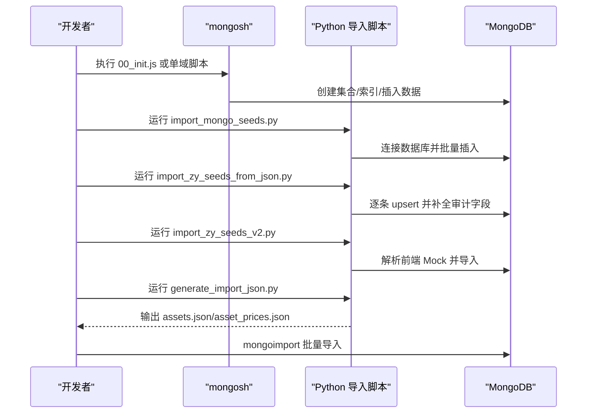
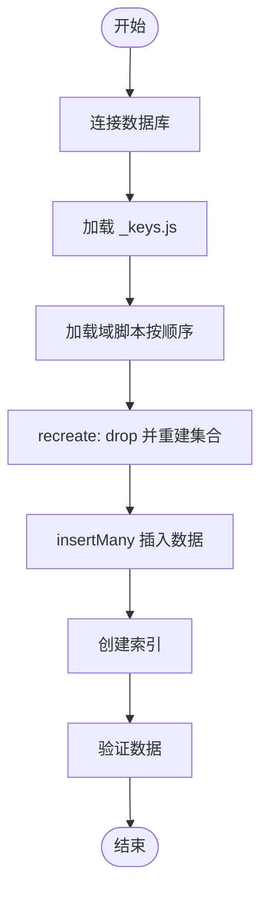
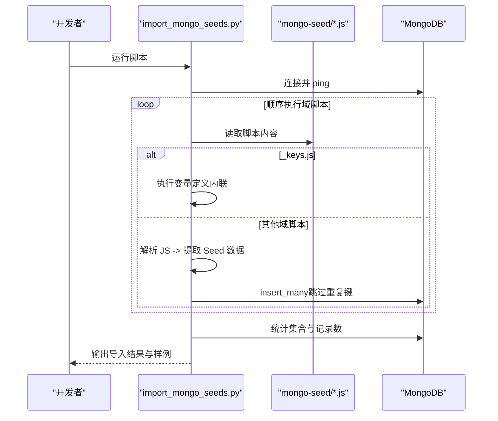
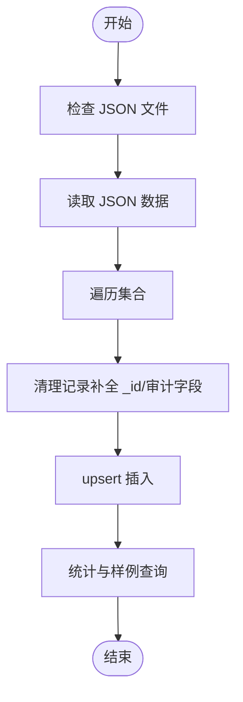
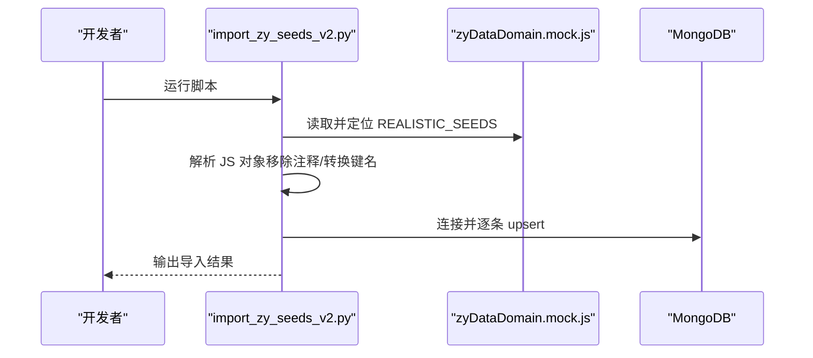
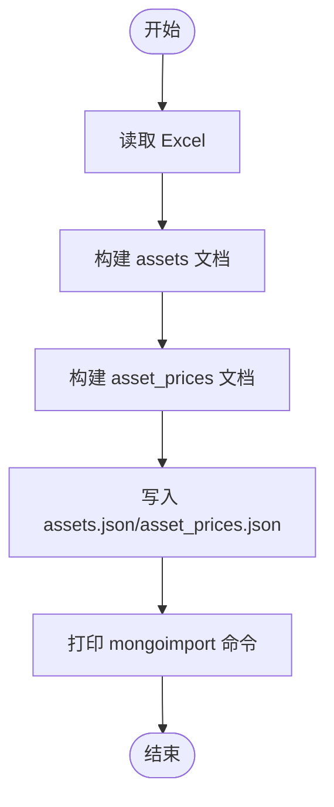
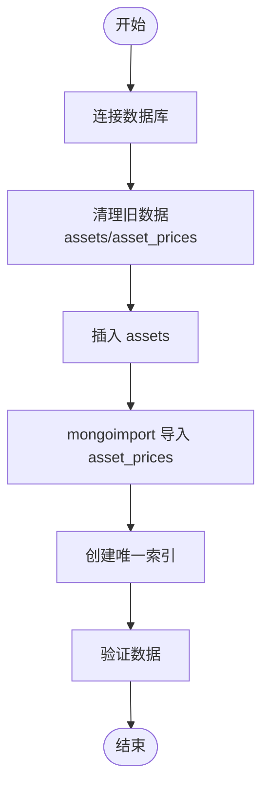
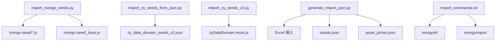

# 导入流程

<cite>
**本文档引用的文件**
- [mongo-seed/README.md](file://mongo-seed/README.md)
- [mongo-seed/_keys.js](file://mongo-seed/_keys.js)
- [mongo-seed/01_asset_domain.js](file://mongo-seed/01_asset_domain.js)
- [scripts/import_mongo_seeds.py](file://scripts/import_mongo_seeds.py)
- [scripts/import_zy_seeds_from_json.py](file://scripts/import_zy_seeds_from_json.py)
- [scripts/import_zy_seeds_v2.py](file://scripts/import_zy_seeds_v2.py)
- [scripts/import_commands.txt](file://scripts/import_commands.txt)
- [scripts/IMPORT_GUIDE.md](file://scripts/IMPORT_GUIDE.md)
- [scripts/generate_import_json.py](file://scripts/generate_import_json.py)
- [scripts/assets.json](file://scripts/assets.json)
- [scripts/zy_data_domain_seeds_v2.json](file://scripts/zy_data_domain_seeds_v2.json)
- [scripts/simple_import.py](file://scripts/simple_import.py)
</cite>

## 目录
1. [简介](#简介)
2. [项目结构](#项目结构)
3. [核心组件](#核心组件)
4. [架构概览](#架构概览)
5. [详细组件分析](#详细组件分析)
6. [依赖分析](#依赖分析)
7. [性能考虑](#性能考虑)
8. [故障排查指南](#故障排查指南)
9. [结论](#结论)
10. [附录](#附录)

## 简介
本文件面向投资组合管理系统，系统性梳理种子数据导入流程，覆盖以下方面：
- MongoDB 命令行导入方式：一键执行脚本与单域导入步骤
- Python 脚本导入机制：import_mongo_seeds.py、import_zy_seeds_from_json.py、import_zy_seeds_v2.py 的功能、参数与执行流程
- JSON 格式数据导入：支持的数据格式转换与批量导入策略
- 导入命令组织与管理：import_commands.txt 的命令模板与批量执行方案
- 错误处理与重试机制：导入过程中的容错与恢复策略
- 并发控制与事务管理：导入过程中的并发与事务注意事项
- 性能优化与最佳实践：针对大数据量导入的优化建议

## 项目结构
种子数据导入涉及两类主要路径：
- mongo-seed：包含按域划分的 JS 脚本，用于 mongosh 一键导入或单域导入
- scripts：包含多种 Python 导入脚本与辅助工具，支持从 JSON 或前端 Mock 数据导入

```mermaid
graph TB
subgraph "mongo-seed"
A["_keys.js<br/>跨表主键池与工具函数"]
B["01_asset_domain.js<br/>资产域脚本"]
C["02_subject_domain.js<br/>主体域脚本"]
D["03_product_domain.js<br/>产品域脚本"]
E["04_valuation_domain.js<br/>估值域脚本"]
F["05_transaction_domain.js<br/>交易域脚本"]
G["06_seller_domain.js<br/>销售域脚本"]
H["07_customer_domain.js<br/>客户域脚本"]
I["08_risk_domain.js<br/>风险域脚本"]
J["09_market_domain.js<br/>行情域脚本"]
K["README.md<br/>导入说明与数据域清单"]
end
subgraph "scripts"
L["import_mongo_seeds.py<br/>批量执行 mongo-seed/*.js"]
M["import_zy_seeds_from_json.py<br/>从 JSON 导入"]
N["import_zy_seeds_v2.py<br/>从前端 Mock 导入"]
O["generate_import_json.py<br/>Excel→JSON 生成器"]
P["assets.json<br/>示例资产 JSON"]
Q["zy_data_domain_seeds_v2.json<br/>ZY 数据域 JSON"]
R["import_commands.txt<br/>命令模板与批量执行"]
S["IMPORT_GUIDE.md<br/>关联 Mock 数据导入说明"]
T["simple_import.py<br/>最小导入示例"]
end
A --> B
A --> C
A --> D
A --> E
A --> F
A --> G
A --> H
A --> I
A --> J
L --> A
L --> B
L --> C
L --> D
L --> E
L --> F
L --> G
L --> H
L --> I
L --> J
M --> Q
N --> Q
O --> P
```

图表来源
- [mongo-seed/README.md:1-125](file://mongo-seed/README.md#L1-L125)
- [mongo-seed/_keys.js:1-161](file://mongo-seed/_keys.js#L1-L161)
- [mongo-seed/01_asset_domain.js:1-200](file://mongo-seed/01_asset_domain.js#L1-L200)
- [scripts/import_mongo_seeds.py:1-305](file://scripts/import_mongo_seeds.py#L1-L305)
- [scripts/import_zy_seeds_from_json.py:1-175](file://scripts/import_zy_seeds_from_json.py#L1-L175)
- [scripts/import_zy_seeds_v2.py:1-200](file://scripts/import_zy_seeds_v2.py#L1-L200)
- [scripts/generate_import_json.py:1-160](file://scripts/generate_import_json.py#L1-L160)
- [scripts/import_commands.txt:1-60](file://scripts/import_commands.txt#L1-L60)
- [scripts/IMPORT_GUIDE.md:1-261](file://scripts/IMPORT_GUIDE.md#L1-L261)
- [scripts/simple_import.py:1-46](file://scripts/simple_import.py#L1-L46)

章节来源
- [mongo-seed/README.md:1-125](file://mongo-seed/README.md#L1-L125)
- [scripts/IMPORT_GUIDE.md:1-261](file://scripts/IMPORT_GUIDE.md#L1-L261)

## 核心组件
- 一键导入脚本（mongosh）
  - 通过 mongo-seed/README.md 中的说明，使用 mongosh 一键加载 00_init.js，按域顺序执行所有种子脚本，并在执行前 drop 并重建集合，确保可重复导入。
- 单域导入
  - 可单独执行某个域脚本，例如 mongo-seed/01_asset_domain.js，适合调试或增量导入。
- Python 批量导入工具
  - import_mongo_seeds.py：扫描 mongo-seed 目录，按顺序执行各域脚本，解析 JS 中的 Seed 数据并批量插入 MongoDB。
  - import_zy_seeds_from_json.py：从 zy_data_domain_seeds_v2.json 导入，逐条 upsert，自动补全审计字段。
  - import_zy_seeds_v2.py：从前端 Mock 文件 zyDataDomain.mock.js 中提取 REALISTIC_SEEDS，解析 JS 对象后导入。
- JSON 生成与导入
  - generate_import_json.py：从 Excel 生成 assets.json 与 asset_prices.json，供 mongoimport 批量导入。
  - assets.json：示例资产数据，采用 Extended JSON 的 $date 格式，便于 mongoimport 自动转换为 ISODate。
- 命令模板与批量执行
  - import_commands.txt：提供大类资产底层数据导入的命令模板，包含 mongosh 连接、清理、插入、索引与验证等步骤，支持在 mongosh 中逐步执行或在命令行中执行 mongoimport。

章节来源
- [mongo-seed/README.md:27-51](file://mongo-seed/README.md#L27-L51)
- [scripts/import_mongo_seeds.py:18-34](file://scripts/import_mongo_seeds.py#L18-L34)
- [scripts/import_zy_seeds_from_json.py:13-17](file://scripts/import_zy_seeds_from_json.py#L13-L17)
- [scripts/import_zy_seeds_v2.py:17-22](file://scripts/import_zy_seeds_v2.py#L17-L22)
- [scripts/generate_import_json.py:14-16](file://scripts/generate_import_json.py#L14-L16)
- [scripts/import_commands.txt:1-60](file://scripts/import_commands.txt#L1-L60)

## 架构概览
下图展示从数据准备到导入完成的关键流程与组件交互：

图表来源
- [mongo-seed/README.md:27-51](file://mongo-seed/README.md#L27-L51)
- [scripts/import_mongo_seeds.py:185-302](file://scripts/import_mongo_seeds.py#L185-L302)
- [scripts/import_zy_seeds_from_json.py:23-172](file://scripts/import_zy_seeds_from_json.py#L23-L172)
- [scripts/import_zy_seeds_v2.py:167-200](file://scripts/import_zy_seeds_v2.py#L167-L200)
- [scripts/generate_import_json.py:132-157](file://scripts/generate_import_json.py#L132-L157)

## 详细组件分析

### 组件 A：mongosh 一键导入与单域导入
- 一键导入
  - 使用 mongosh 连接数据库并加载 00_init.js，按域顺序执行所有种子脚本，内置 drop 并重建集合，确保幂等导入。
- 单域导入
  - 可单独执行某域脚本，如资产域脚本，便于定位问题与增量导入。
- 主键池与工具
  - _keys.js 提供跨表主键池（如 AST_CD、PORT_ID、ISR_ID 等）与工具函数（如 recreate、audit、shiftDate），确保跨表一致性与审计字段统一。

图表来源
- [mongo-seed/README.md:27-51](file://mongo-seed/README.md#L27-L51)
- [mongo-seed/_keys.js:144-155](file://mongo-seed/_keys.js#L144-L155)
- [mongo-seed/01_asset_domain.js:27-56](file://mongo-seed/01_asset_domain.js#L27-L56)

章节来源
- [mongo-seed/README.md:27-51](file://mongo-seed/README.md#L27-L51)
- [mongo-seed/_keys.js:1-161](file://mongo-seed/_keys.js#L1-L161)
- [mongo-seed/01_asset_domain.js:1-200](file://mongo-seed/01_asset_domain.js#L1-L200)

### 组件 B：Python 批量导入工具（import_mongo_seeds.py）
- 功能概述
  - 扫描 mongo-seed 目录，按预设顺序执行各域脚本；解析 JS 中的 Seed 数据结构，批量插入 MongoDB；对唯一索引冲突进行跳过处理；最后统计各域集合数量并输出样例查询结果。
- 关键流程
  - 连接 MongoDB 并 ping 成功
  - 顺序执行脚本：_keys.js → 各域脚本
  - 解析 JS：移除注释、解析变量定义、提取 Seed 数组
  - 批量插入：insert_many（ordered=False），跳过重复键冲突
  - 结果统计与样例查询
- 参数与配置
  - MONGO_URI、DB_NAME、SEEDS_DIR
  - SEED_SCRIPTS：域脚本执行顺序与描述

图表来源
- [scripts/import_mongo_seeds.py:185-302](file://scripts/import_mongo_seeds.py#L185-L302)

章节来源
- [scripts/import_mongo_seeds.py:1-305](file://scripts/import_mongo_seeds.py#L1-L305)

### 组件 C：从 JSON 导入（import_zy_seeds_from_json.py）
- 功能概述
  - 从 zy_data_domain_seeds_v2.json 读取数据，逐条 upsert，自动补全审计字段（etl_dt、src_sys），并统计各域集合数量与样例数据。
- 关键流程
  - 检查 JSON 文件是否存在
  - 读取 JSON 并遍历集合
  - 清理记录：确保每条记录有 _id，补全 etl_dt/src_sys
  - 使用 upsert 避免重复插入
  - 统计与样例查询
- 参数与配置
  - MONGO_URI、DB_NAME、JSON_FILE

图表来源
- [scripts/import_zy_seeds_from_json.py:23-172](file://scripts/import_zy_seeds_from_json.py#L23-L172)

章节来源
- [scripts/import_zy_seeds_from_json.py:1-175](file://scripts/import_zy_seeds_from_json.py#L1-L175)

### 组件 D：从前端 Mock 导入（import_zy_seeds_v2.py）
- 功能概述
  - 从 src/api/zyDataDomain.mock.js 中提取 REALISTIC_SEEDS，解析 JS 对象（移除注释、转换键名、去尾逗号等），逐条导入 MongoDB。
- 关键流程
  - 读取前端 Mock 文件
  - 定位 REALISTIC_SEEDS 对象并解析
  - 转换 JS 对象为 Python 可解析格式
  - 连接 MongoDB 并逐条 upsert
- 参数与配置
  - MONGO_URI、DB_NAME、MOCK_FILE、BIZ_DT

图表来源
- [scripts/import_zy_seeds_v2.py:28-166](file://scripts/import_zy_seeds_v2.py#L28-L166)

章节来源
- [scripts/import_zy_seeds_v2.py:1-200](file://scripts/import_zy_seeds_v2.py#L1-L200)

### 组件 E：JSON 生成与批量导入（generate_import_json.py）
- 功能概述
  - 从 Excel 生成 assets.json 与 asset_prices.json，支持 mongoimport 批量导入；assets.json 使用 Extended JSON 的 $date 格式，便于 mongoimport 自动转换为 ISODate。
- 关键流程
  - 读取 Excel，提取资产元数据与历史价格行
  - 构建 assets 文档列表（含 created_at/updated_at）
  - 构建 asset_prices 文档列表（OHLCVA 字段）
  - 输出 JSON 文件并打印 mongoimport 命令
- 参数与配置
  - EXCEL_PATH、OUTPUT_DIR

图表来源
- [scripts/generate_import_json.py:49-157](file://scripts/generate_import_json.py#L49-L157)

章节来源
- [scripts/generate_import_json.py:1-160](file://scripts/generate_import_json.py#L1-L160)
- [scripts/assets.json:1-200](file://scripts/assets.json#L1-L200)

### 组件 F：命令模板与批量执行（import_commands.txt）
- 功能概述
  - 提供大类资产底层数据导入的命令模板，包含 mongosh 连接、清理旧数据、插入 assets、mongoimport 导入 asset_prices、创建索引与验证等步骤。
- 使用建议
  - 在 mongosh 中逐步执行清理与插入步骤
  - 在命令行中执行 mongoimport 导入大量价格数据
  - 最后在 mongosh 中创建唯一索引并验证数据

图表来源
- [scripts/import_commands.txt:7-60](file://scripts/import_commands.txt#L7-L60)

章节来源
- [scripts/import_commands.txt:1-60](file://scripts/import_commands.txt#L1-L60)

### 组件 G：关联 Mock 数据导入说明（IMPORT_GUIDE.md）
- 功能概述
  - 说明如何生成与导入关联 Mock 数据，包含生成脚本、设计文档、辅助脚本与验证方法。
- 使用建议
  - 直接运行 generate_and_import_associated_mock.py
  - 在 Python 交互环境中执行脚本
  - 通过 verify_mongo_data.py 验证导入结果

章节来源
- [scripts/IMPORT_GUIDE.md:1-261](file://scripts/IMPORT_GUIDE.md#L1-L261)

### 组件 H：最小导入示例（simple_import.py）
- 功能概述
  - 展示最小化的导入流程：连接 MongoDB、删除集合、批量插入示例数据、输出导入结果。
- 使用建议
  - 作为自定义导入脚本的参考模板

章节来源
- [scripts/simple_import.py:1-46](file://scripts/simple_import.py#L1-L46)

## 依赖分析
- 组件耦合关系
  - import_mongo_seeds.py 依赖 mongo-seed 目录下的域脚本与 _keys.js
  - import_zy_seeds_from_json.py 依赖 zy_data_domain_seeds_v2.json
  - import_zy_seeds_v2.py 依赖前端 Mock 文件 zyDataDomain.mock.js
  - generate_import_json.py 依赖 Excel 输入与 openpyxl
  - import_commands.txt 为外部命令模板，依赖 mongosh 与 mongoimport
- 外部依赖
  - MongoDB：pymongo、mongoimport、mongosh
  - Python：json、re、openpyxl（仅 generate_import_json.py）

图表来源
- [scripts/import_mongo_seeds.py:18-34](file://scripts/import_mongo_seeds.py#L18-L34)
- [scripts/import_zy_seeds_from_json.py:13-17](file://scripts/import_zy_seeds_from_json.py#L13-L17)
- [scripts/import_zy_seeds_v2.py:17-22](file://scripts/import_zy_seeds_v2.py#L17-L22)
- [scripts/generate_import_json.py:14-16](file://scripts/generate_import_json.py#L14-L16)
- [scripts/import_commands.txt:7-60](file://scripts/import_commands.txt#L7-L60)

章节来源
- [scripts/import_mongo_seeds.py:1-305](file://scripts/import_mongo_seeds.py#L1-L305)
- [scripts/import_zy_seeds_from_json.py:1-175](file://scripts/import_zy_seeds_from_json.py#L1-L175)
- [scripts/import_zy_seeds_v2.py:1-200](file://scripts/import_zy_seeds_v2.py#L1-L200)
- [scripts/generate_import_json.py:1-160](file://scripts/generate_import_json.py#L1-L160)
- [scripts/import_commands.txt:1-60](file://scripts/import_commands.txt#L1-L60)

## 性能考虑
- 批量插入策略
  - import_mongo_seeds.py 使用 insert_many（ordered=False），提升批量插入性能并避免单条失败阻塞后续插入。
  - import_zy_seeds_from_json.py 使用 upsert，避免重复键冲突导致的插入失败。
- 索引与唯一约束
  - 域脚本中为关键字段创建唯一索引，确保数据一致性；import_commands.txt 中也提供索引创建步骤。
- 大数据量导入
  - generate_import_json.py 生成的 assets.json/asset_prices.json 可通过 mongoimport 批量导入，适合大规模数据。
- 并发控制与事务管理
  - 当前导入脚本未使用事务；若需要强一致，可在应用层引入事务（如在应用侧封装导入流程），但需注意 MongoDB 事务的限制与性能影响。
- 日志与监控
  - 建议在导入过程中记录进度与错误日志，便于问题定位与重试。

[本节为通用指导，无需特定文件来源]

## 故障排查指南
- MongoDB 连接失败
  - 检查 MongoDB 服务状态与端口占用情况，必要时调整连接地址。
- 权限不足
  - 以管理员权限运行 PowerShell 或 Python，确保对数据库的写入权限。
- 端口冲突
  - 检查 27017 端口占用，修改连接地址或释放端口。
- 唯一索引冲突
  - import_mongo_seeds.py 会跳过重复键冲突；import_zy_seeds_from_json.py 使用 upsert；import_zy_seeds_v2.py 逐条 upsert。
- 数据格式问题
  - generate_import_json.py 使用 Extended JSON 的 $date 格式，确保 mongoimport 能正确转换为 ISODate。
- 命令模板执行问题
  - import_commands.txt 提供了完整的命令模板，建议在 mongosh 中逐步执行清理与插入步骤，最后在命令行执行 mongoimport。

章节来源
- [scripts/IMPORT_GUIDE.md:206-234](file://scripts/IMPORT_GUIDE.md#L206-L234)
- [scripts/import_zy_seeds_from_json.py:82-96](file://scripts/import_zy_seeds_from_json.py#L82-L96)
- [scripts/import_mongo_seeds.py:171-183](file://scripts/import_mongo_seeds.py#L171-L183)
- [scripts/generate_import_json.py:73-99](file://scripts/generate_import_json.py#L73-L99)
- [scripts/import_commands.txt:7-60](file://scripts/import_commands.txt#L7-L60)

## 结论
本文件系统性梳理了投资组合管理系统的种子数据导入流程，涵盖 mongosh 一键导入、单域导入、Python 脚本导入、JSON 生成与批量导入、命令模板与批量执行、错误处理与重试机制、并发控制与事务管理以及性能优化建议。通过合理选择导入方式与遵循最佳实践，可高效、稳定地完成大规模种子数据导入任务。

[本节为总结，无需特定文件来源]

## 附录
- 数据域与表清单
  - mongo-seed/README.md 提供了 9 大数据域与 80+ 张表的清单，便于理解导入范围与数据结构。
- 样例数据
  - scripts/assets.json 与 scripts/zy_data_domain_seeds_v2.json 提供了示例数据，可用于快速验证导入流程。

章节来源
- [mongo-seed/README.md:67-125](file://mongo-seed/README.md#L67-L125)
- [scripts/assets.json:1-200](file://scripts/assets.json#L1-L200)
- [scripts/zy_data_domain_seeds_v2.json:1-200](file://scripts/zy_data_domain_seeds_v2.json#L1-L200)