# 数据生成机制

<cite>
**本文档引用的文件**
- [_keys.js](file://mongo-seed/_keys.js)
- [README.md](file://mongo-seed/README.md)
- [import_mongo_seeds.py](file://scripts/import_mongo_seeds.py)
- [generate_and_import_v2.py](file://scripts/generate_and_import_v2.py)
- [extract_zy_mock_seeds.js](file://scripts/extract_zy_mock_seeds.js)
- [01_asset_domain.js](file://mongo-seed/01_asset_domain.js)
- [02_subject_domain.js](file://mongo-seed/02_subject_domain.js)
- [03_product_domain.js](file://mongo-seed/03_product_domain.js)
- [04_valuation_domain.js](file://mongo-seed/04_valuation_domain.js)
- [05_transaction_domain.js](file://mongo-seed/05_transaction_domain.js)
- [06_seller_domain.js](file://mongo-seed/06_seller_domain.js)
- [07_customer_domain.js](file://mongo-seed/07_customer_domain.js)
- [08_risk_domain.js](file://mongo-seed/08_risk_domain.js)
- [09_market_domain.js](file://mongo-seed/09_market_domain.js)
- [index.js](file://src/config/zyDataDomain/index.js)
</cite>

## 目录
1. [简介](#简介)
2. [项目结构](#项目结构)
3. [核心组件](#核心组件)
4. [架构概览](#架构概览)
5. [详细组件分析](#详细组件分析)
6. [依赖分析](#依赖分析)
7. [性能考虑](#性能考虑)
8. [故障排除指南](#故障排除指南)
9. [结论](#结论)
10. [附录](#附录)

## 简介

投资组合管理系统采用MongoDB作为数据存储，通过种子数据生成机制为9大数据域提供完整的测试数据。该机制基于统一的业务日期锚定（BIZ_DT=20250324）和跨表主键池，确保数据的一致性和关联完整性。

系统包含以下核心特性：
- 统一的业务日期锚定机制
- 跨表主键池设计保证外键一致性
- 9大数据域的完整数据字典
- JSON Schema验证器实现
- 历史数据回溯策略
- 多种数据生成工具

## 项目结构

项目采用模块化设计，主要分为以下几个部分：

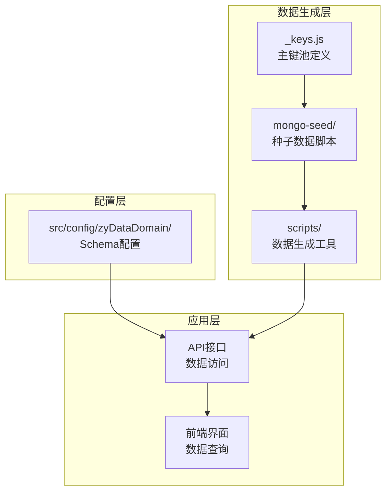

**图表来源**
- [_keys.js:1-161](file://mongo-seed/_keys.js#L1-L161)
- [README.md:1-125](file://mongo-seed/README.md#L1-L125)

**章节来源**
- [README.md:1-125](file://mongo-seed/README.md#L1-L125)

## 核心组件

### 主键池系统（_keys.js）

主键池是整个数据生成机制的核心，提供了跨表使用的统一标识符池：

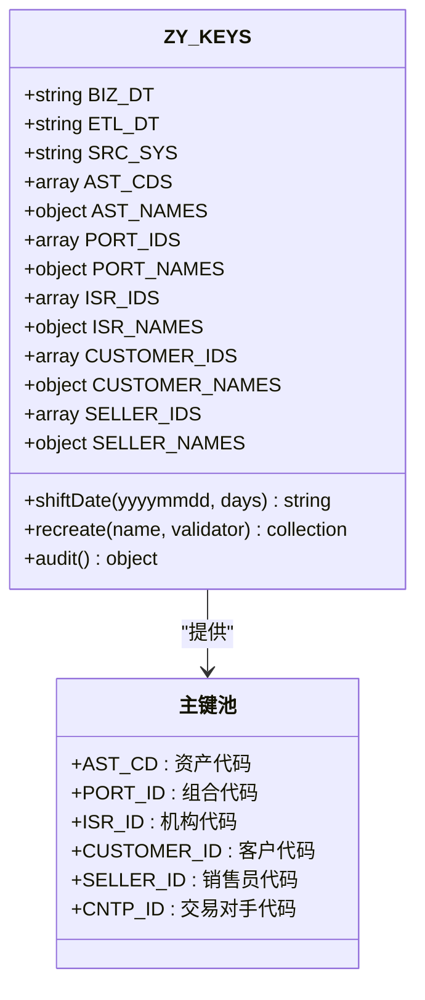

**图表来源**
- [_keys.js:5-161](file://mongo-seed/_keys.js#L5-L161)

主键池包含以下关键元素：

1. **业务日期锚定**：BIZ_DT=20250324，作为所有快照型数据的统一基准
2. **资产代码池**：12个真实的证券代码，涵盖国债、股票、基金、ABS等多种资产类型
3. **组合代码池**：5个投资组合标识符，代表不同的产品类型
4. **机构代码池**：8个真实机构，包括财政部、政策性银行、商业银行等
5. **客户代码池**：7个客户标识符，涵盖个人和机构投资者
6. **销售人员池**：6个销售员标识符
7. **指数代码池**：5个真实指数代码
8. **收益率曲线池**：5种收益率曲线标识符

**章节来源**
- [_keys.js:1-161](file://mongo-seed/_keys.js#L1-L161)

### 数据生成工具

系统提供了多种数据生成工具，满足不同场景的需求：

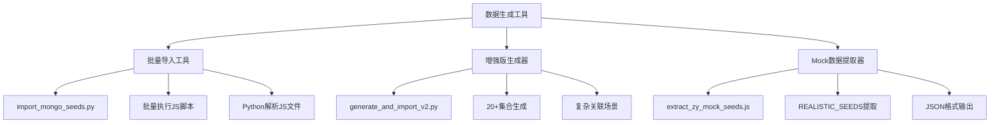

**图表来源**
- [import_mongo_seeds.py:1-305](file://scripts/import_mongo_seeds.py#L1-L305)
- [generate_and_import_v2.py:1-510](file://scripts/generate_and_import_v2.py#L1-L510)
- [extract_zy_mock_seeds.js:1-127](file://scripts/extract_zy_mock_seeds.js#L1-L127)

**章节来源**
- [import_mongo_seeds.py:1-305](file://scripts/import_mongo_seeds.py#L1-L305)
- [generate_and_import_v2.py:1-510](file://scripts/generate_and_import_v2.py#L1-L510)
- [extract_zy_mock_seeds.js:1-127](file://scripts/extract_zy_mock_seeds.js#L1-L127)

## 架构概览

系统采用分层架构设计，确保数据生成的灵活性和可维护性：

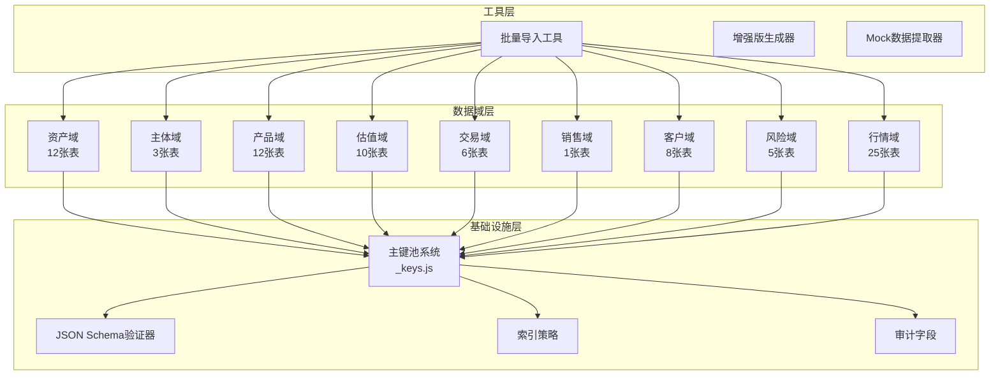

**图表来源**
- [README.md:67-113](file://mongo-seed/README.md#L67-L113)
- [_keys.js:1-161](file://mongo-seed/_keys.js#L1-L161)

## 详细组件分析

### 资产域（dwd_ast_*）

资产域是系统的核心数据域之一，包含12张表，涵盖资产的全生命周期管理：

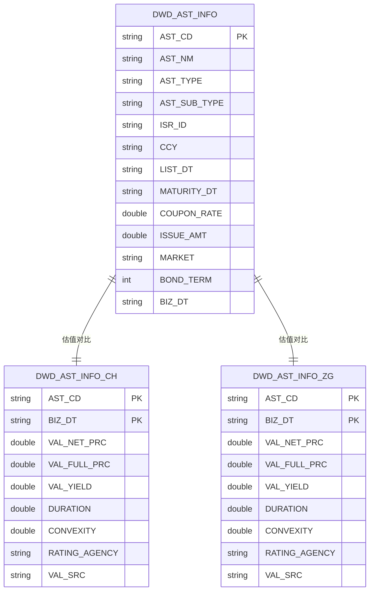

**图表来源**
- [01_asset_domain.js:27-122](file://mongo-seed/01_asset_domain.js#L27-L122)

资产域的数据生成策略：

1. **资产基础信息**：包含12个真实资产，涵盖国债、股票、基金、ABS等不同类型
2. **估值信息**：提供中债和中证两家机构的估值数据，便于对比分析
3. **现金流计划**：为债券资产生成未来现金流计划
4. **质押状态**：记录资产的质押情况和相关限制

**章节来源**
- [01_asset_domain.js:1-200](file://mongo-seed/01_asset_domain.js#L1-L200)

### 主体域（dwd_isr_*）

主体域管理与投资相关的各类机构信息：

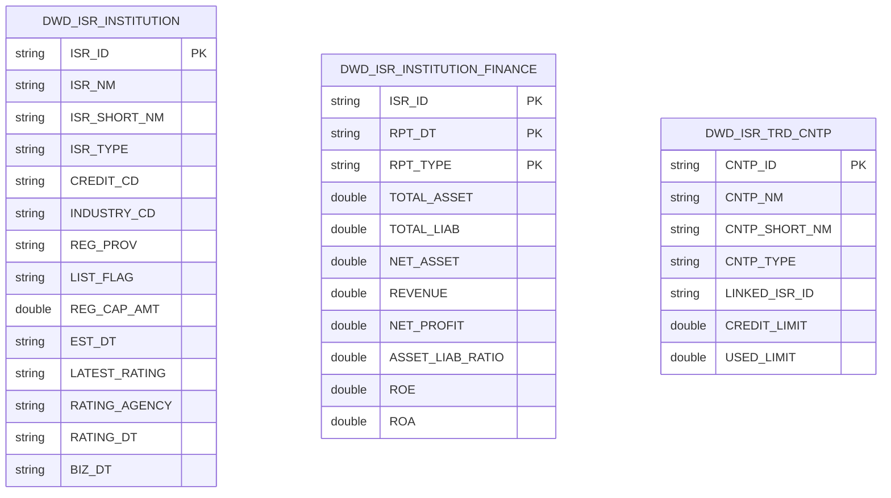

**图表来源**
- [02_subject_domain.js:17-194](file://mongo-seed/02_subject_domain.js#L17-L194)

**章节来源**
- [02_subject_domain.js:1-200](file://mongo-seed/02_subject_domain.js#L1-L200)

### 产品域（dwd_ptl_*）

产品域负责管理各种投资产品和组合信息：

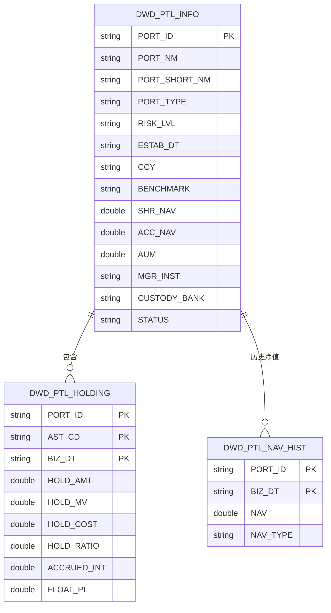

**图表来源**
- [03_product_domain.js:31-166](file://mongo-seed/03_product_domain.js#L31-L166)

**章节来源**
- [03_product_domain.js:1-200](file://mongo-seed/03_product_domain.js#L1-L200)

### 估值域（dwd_val_*）

估值域提供投资组合的全面估值信息：

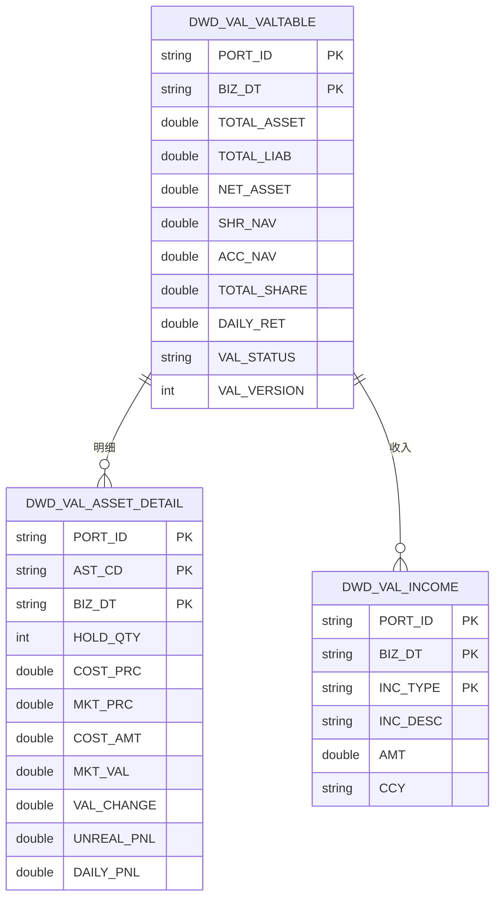

**图表来源**
- [04_valuation_domain.js:40-150](file://mongo-seed/04_valuation_domain.js#L40-L150)

**章节来源**
- [04_valuation_domain.js:1-200](file://mongo-seed/04_valuation_domain.js#L1-L200)

### 交易域（dwd_trn_*）

交易域记录所有投资交易活动：

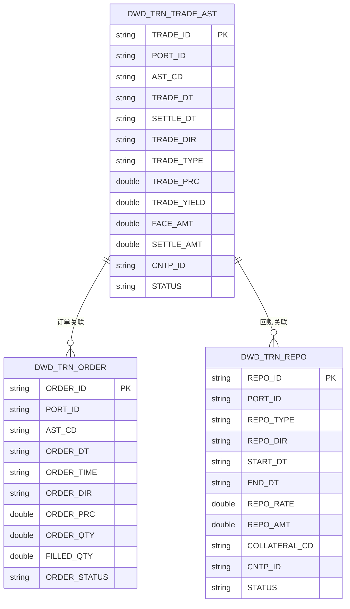

**图表来源**
- [05_transaction_domain.js:15-162](file://mongo-seed/05_transaction_domain.js#L15-L162)

**章节来源**
- [05_transaction_domain.js:1-165](file://mongo-seed/05_transaction_domain.js#L1-L165)

### 销售域（dwd_seller_info）

销售域管理销售人员信息：

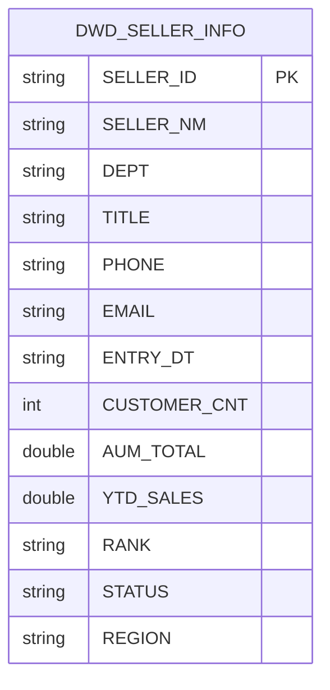

**图表来源**
- [06_seller_domain.js:11-26](file://mongo-seed/06_seller_domain.js#L11-L26)

**章节来源**
- [06_seller_domain.js:1-29](file://mongo-seed/06_seller_domain.js#L1-L29)

### 客户域（dwd_cust_*）

客户域管理客户相关信息：

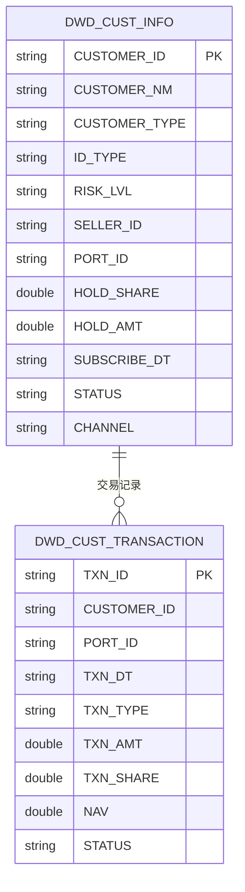

**图表来源**
- [07_customer_domain.js:16-59](file://mongo-seed/07_customer_domain.js#L16-L59)

**章节来源**
- [07_customer_domain.js:1-160](file://mongo-seed/07_customer_domain.js#L1-L160)

### 风险域（dwd_rsk_*）

风险域提供风险管理相关数据：

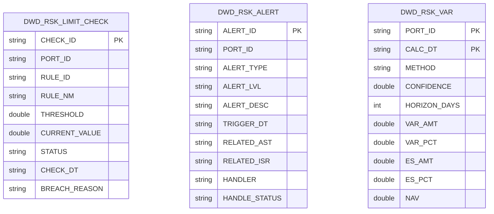

**图表来源**
- [08_risk_domain.js:15-109](file://mongo-seed/08_risk_domain.js#L15-L109)

**章节来源**
- [08_risk_domain.js:1-112](file://mongo-seed/08_risk_domain.js#L1-L112)

### 行情域（dwd_mkt_*）

行情域提供市场行情数据：

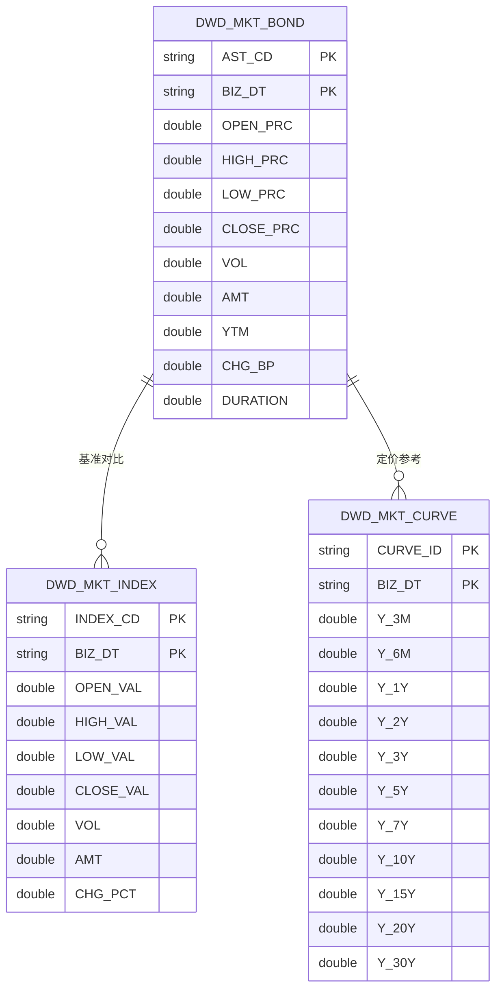

**图表来源**
- [09_market_domain.js:23-147](file://mongo-seed/09_market_domain.js#L23-L147)

**章节来源**
- [09_market_domain.js:1-200](file://mongo-seed/09_market_domain.js#L1-L200)

## 依赖分析

系统采用松耦合设计，各组件之间的依赖关系清晰：

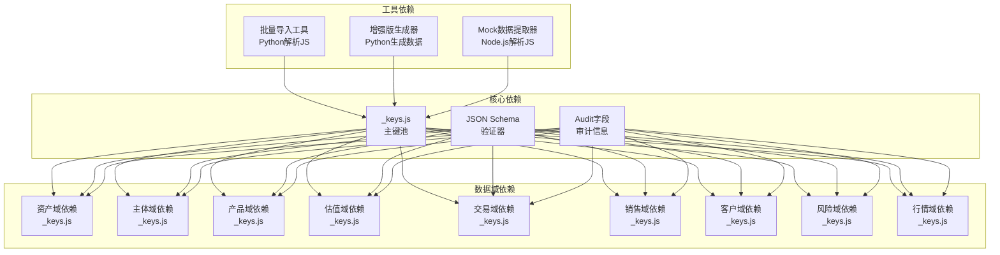

**图表来源**
- [_keys.js:1-161](file://mongo-seed/_keys.js#L1-L161)
- [README.md:114-121](file://mongo-seed/README.md#L114-L121)

**章节来源**
- [_keys.js:1-161](file://mongo-seed/_keys.js#L1-L161)
- [README.md:114-121](file://mongo-seed/README.md#L114-L121)

## 性能考虑

系统在设计时充分考虑了性能优化：

### 索引策略
- 主键字段建立唯一索引，确保数据完整性
- 高频查询字段（BIZ_DT、PORT_ID、AST_CD）建立普通索引
- 复合索引用于常用查询模式

### 数据类型优化
- 金额和比率字段使用double类型，平衡精度和性能
- 业务日期使用字符串格式（yyyyMMdd），便于历史回溯
- 字符串字段根据实际需求设置合理的长度

### 批量操作优化
- 使用批量插入减少网络往返
- Python工具支持重复导入和数据去重
- JS脚本支持增量更新和全量重建

## 故障排除指南

### 常见问题及解决方案

1. **主键冲突**
   - 症状：导入时报主键重复错误
   - 解决：使用批量导入工具的去重功能，或手动清理重复数据

2. **外键不一致**
   - 症状：关联查询返回空结果
   - 解决：检查主键池中的标识符是否正确使用，确保跨表一致性

3. **Schema验证失败**
   - 症状：插入数据时报JSON Schema验证错误
   - 解决：检查必填字段是否完整，数据类型是否正确

4. **性能问题**
   - 症状：导入速度慢或查询响应时间长
   - 解决：检查索引配置，优化查询条件，考虑分批导入

**章节来源**
- [import_mongo_seeds.py:174-182](file://scripts/import_mongo_seeds.py#L174-L182)

## 结论

投资组合管理系统的数据生成机制通过统一的主键池设计、完善的JSON Schema验证和灵活的数据生成工具，为9大数据域提供了高质量的测试数据。该机制具有以下优势：

1. **一致性保证**：通过主键池确保跨表数据的关联一致性
2. **可扩展性**：模块化的架构设计便于添加新的数据域
3. **易维护性**：统一的Schema设计和工具链简化了数据管理
4. **灵活性**：支持多种数据生成场景和导入方式

该机制为系统的开发、测试和演示提供了坚实的基础，能够满足不同层次的业务需求。

## 附录

### 数据字典设计原则

1. **统一审计字段**：所有表都包含etl_dt和src_sys字段
2. **业务日期规范**：统一使用字符串格式的yyyyMMdd
3. **字段类型定义**：根据业务需求选择合适的数据类型
4. **索引策略**：基于查询模式设计合理的索引组合
5. **扩展性考虑**：允许额外字段的存在，避免误拒贴源数据

### 时间锚定机制

系统采用BIZ_DT=20250324作为业务日期锚定，支持历史数据回溯：
- 快照型数据统一使用该日期
- 时间序列数据包含多个交易日
- 支持向前和向后的时间维度扩展

### 版本管理策略

1. **Schema版本控制**：通过$version字段管理Schema变更
2. **数据版本追踪**：记录etl_dt和src_sys信息
3. **兼容性保证**：新版本Schema向下兼容旧数据
4. **迁移工具**：提供数据迁移和转换工具