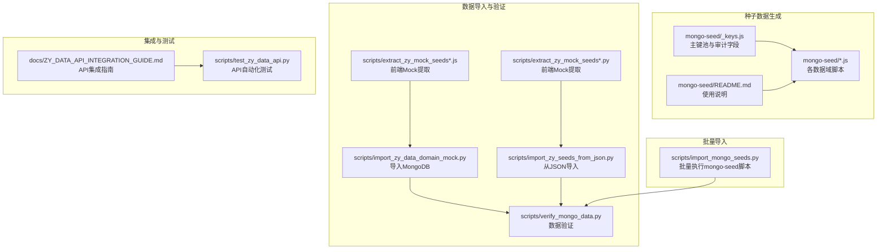
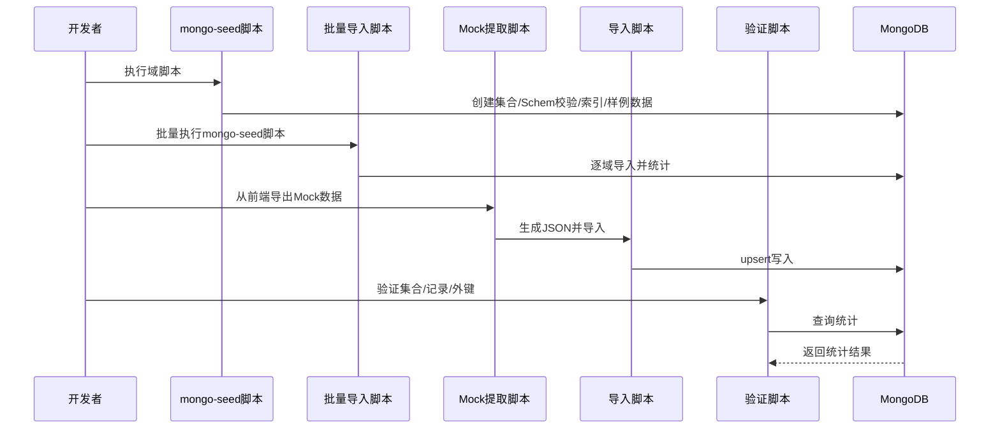
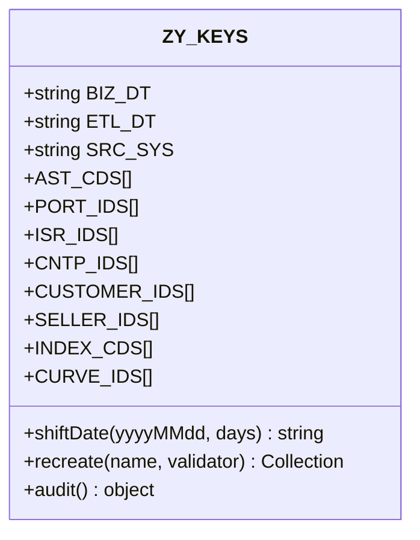
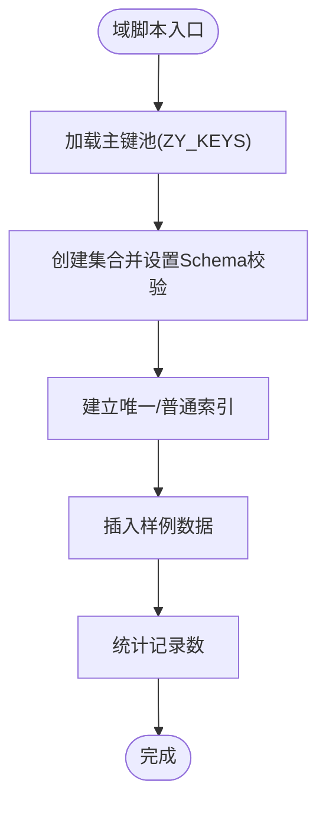
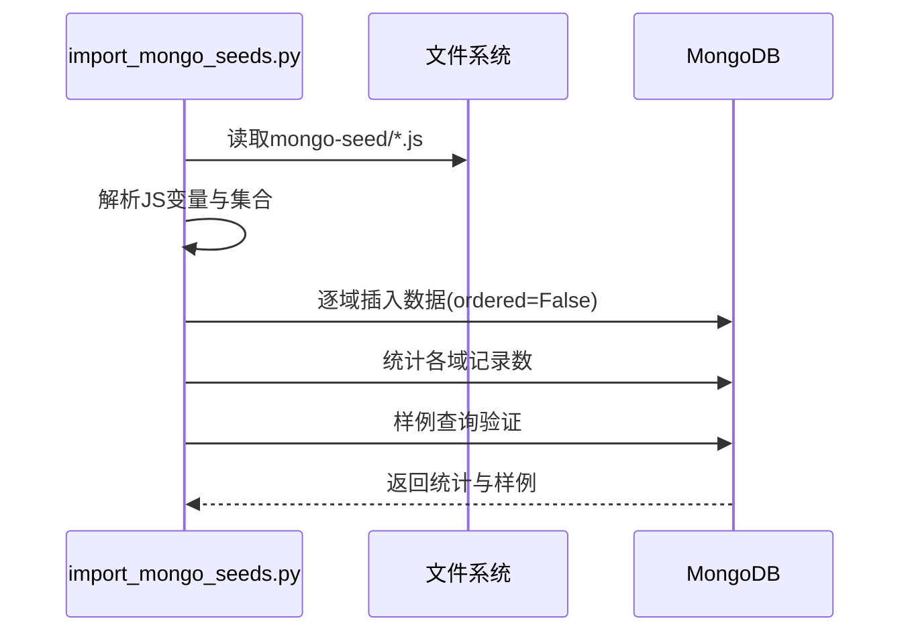
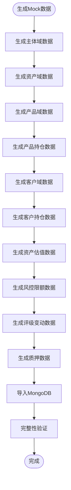
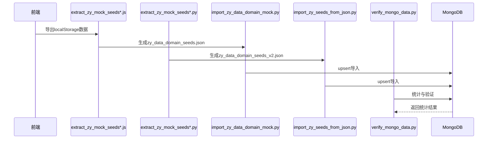
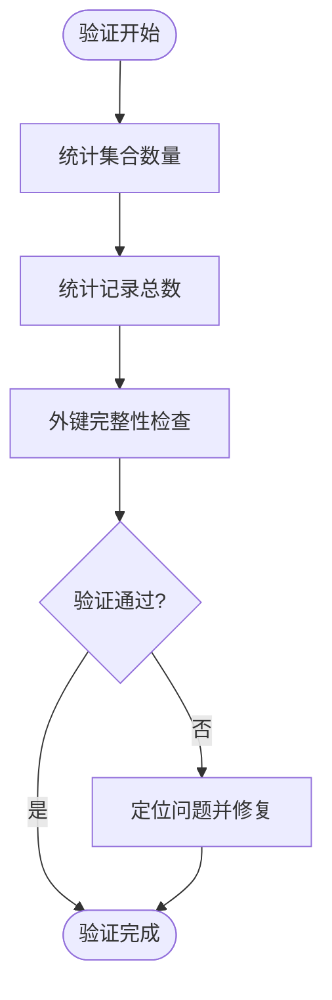
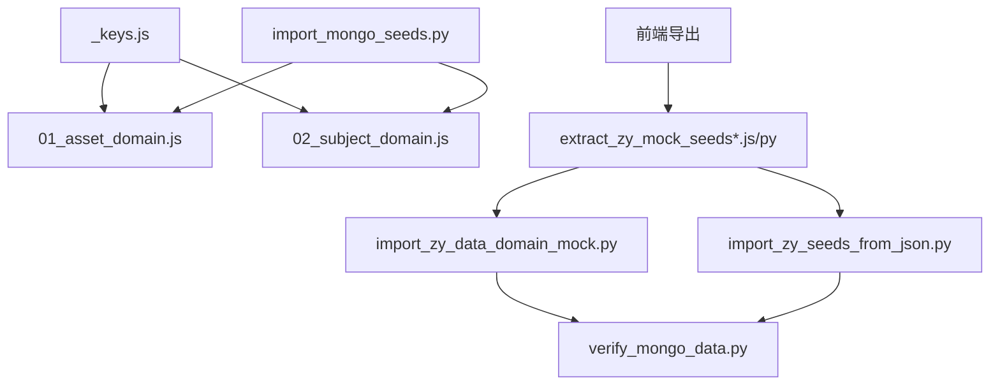

# 种子数据管理

<cite>
**本文档引用的文件**
- [mongo-seed/README.md](file://mongo-seed/README.md)
- [mongo-seed/_keys.js](file://mongo-seed/_keys.js)
- [mongo-seed/01_asset_domain.js](file://mongo-seed/01_asset_domain.js)
- [mongo-seed/02_subject_domain.js](file://mongo-seed/02_subject_domain.js)
- [scripts/import_mongo_seeds.py](file://scripts/import_mongo_seeds.py)
- [scripts/IMPORT_GUIDE.md](file://scripts/IMPORT_GUIDE.md)
- [scripts/generate_and_import_associated_mock.py](file://scripts/generate_and_import_associated_mock.py)
- [scripts/verify_mongo_data.py](file://scripts/verify_mongo_data.py)
- [scripts/extract_zy_mock_seeds.js](file://scripts/extract_zy_mock_seeds.js)
- [scripts/extract_zy_mock_seeds_v2.js](file://scripts/extract_zy_mock_seeds_v2.js)
- [scripts/extract_zy_mock_seeds_v2.py](file://scripts/extract_zy_mock_seeds_v2.py)
- [scripts/import_zy_data_domain_mock.py](file://scripts/import_zy_data_domain_mock.py)
- [scripts/import_zy_seeds_from_json.py](file://scripts/import_zy_seeds_from_json.py)
- [scripts/zy_data_domain_seeds.json](file://scripts/zy_data_domain_seeds.json)
- [docs/OFFLINE_INSTALL_LINUX_WINDOWS.md](file://docs/OFFLINE_INSTALL_LINUX_WINDOWS.md)
- [docs/ZY_DATA_API_INTEGRATION_GUIDE.md](file://docs/ZY_DATA_API_INTEGRATION_GUIDE.md)
</cite>

## 目录
1. [简介](#简介)
2. [项目结构](#项目结构)
3. [核心组件](#核心组件)
4. [架构概览](#架构概览)
5. [详细组件分析](#详细组件分析)
6. [依赖分析](#依赖分析)
7. [性能考虑](#性能考虑)
8. [故障排查指南](#故障排查指南)
9. [结论](#结论)
10. [附录](#附录)

## 简介
本文件系统性阐述投资组合管理系统中的种子数据管理功能，涵盖种子数据生成机制、导入流程、数据迁移与同步策略、验证机制、Mock 数据生成与管理、数据备份与恢复方案以及离线环境部署指南。目标是帮助开发者与运维人员高效地维护与使用种子数据，确保数据一致性与可追溯性。

## 项目结构
种子数据管理涉及两大核心区域：
- mongo-seed：基于 MongoDB Shell 的原生脚本，按数据域生成集合、Schema 校验与样例数据，并提供主键池与统一审计字段。
- scripts：Python/Node 工具链，负责从前端导出的 Mock 数据提取、清洗、导入与验证，以及与后端 API 的集成测试。

**图表来源**
- [mongo-seed/README.md:1-125](file://mongo-seed/README.md#L1-L125)
- [mongo-seed/_keys.js:1-161](file://mongo-seed/_keys.js#L1-L161)
- [scripts/import_mongo_seeds.py:1-305](file://scripts/import_mongo_seeds.py#L1-L305)
- [scripts/extract_zy_mock_seeds.js:1-127](file://scripts/extract_zy_mock_seeds.js#L1-L127)
- [scripts/extract_zy_mock_seeds_v2.js:1-237](file://scripts/extract_zy_mock_seeds_v2.js#L1-L237)
- [scripts/extract_zy_mock_seeds_v2.py:1-175](file://scripts/extract_zy_mock_seeds_v2.py#L1-L175)
- [scripts/import_zy_data_domain_mock.py:1-161](file://scripts/import_zy_data_domain_mock.py#L1-L161)
- [scripts/import_zy_seeds_from_json.py:1-175](file://scripts/import_zy_seeds_from_json.py#L1-L175)
- [scripts/verify_mongo_data.py:1-36](file://scripts/verify_mongo_data.py#L1-L36)
- [docs/ZY_DATA_API_INTEGRATION_GUIDE.md:1-495](file://docs/ZY_DATA_API_INTEGRATION_GUIDE.md#L1-L495)

**章节来源**
- [mongo-seed/README.md:1-125](file://mongo-seed/README.md#L1-L125)
- [scripts/IMPORT_GUIDE.md:1-261](file://scripts/IMPORT_GUIDE.md#L1-L261)

## 核心组件
- 主键池与审计字段：提供跨表主键/外键一致性保障与统一审计字段，确保数据域间引用关系稳定。
- 数据域脚本：按域组织的 MongoDB Shell 脚本，每个域脚本负责创建集合、定义 Schema 校验、建立索引并插入样例数据。
- 批量导入工具：Python 脚本批量执行 mongo-seed 脚本，支持断点续导与结果统计。
- Mock 数据提取与导入：从前端导出的 Mock 数据转换为 JSON，再导入 MongoDB，支持 upsert 避免重复。
- 验证工具：对导入结果进行集合数量、记录数与外键引用完整性验证。
- 离线部署：提供前后端离线依赖安装说明，支持内网无外网环境部署。

**章节来源**
- [mongo-seed/_keys.js:1-161](file://mongo-seed/_keys.js#L1-L161)
- [mongo-seed/01_asset_domain.js:1-374](file://mongo-seed/01_asset_domain.js#L1-L374)
- [mongo-seed/02_subject_domain.js:1-253](file://mongo-seed/02_subject_domain.js#L1-L253)
- [scripts/import_mongo_seeds.py:1-305](file://scripts/import_mongo_seeds.py#L1-L305)
- [scripts/generate_and_import_associated_mock.py:1-496](file://scripts/generate_and_import_associated_mock.py#L1-L496)
- [scripts/verify_mongo_data.py:1-36](file://scripts/verify_mongo_data.py#L1-L36)
- [docs/OFFLINE_INSTALL_LINUX_WINDOWS.md:1-212](file://docs/OFFLINE_INSTALL_LINUX_WINDOWS.md#L1-L212)

## 架构概览
种子数据管理采用“脚本驱动 + 工具链 + 验证闭环”的架构，既支持快速导入 mongo-seed 的原生脚本，也支持从前端导出的 Mock 数据进行灵活导入与验证。

**图表来源**
- [mongo-seed/README.md:27-51](file://mongo-seed/README.md#L27-L51)
- [scripts/import_mongo_seeds.py:185-305](file://scripts/import_mongo_seeds.py#L185-L305)
- [scripts/extract_zy_mock_seeds_v2.js:1-237](file://scripts/extract_zy_mock_seeds_v2.js#L1-L237)
- [scripts/import_zy_seeds_from_json.py:23-175](file://scripts/import_zy_seeds_from_json.py#L23-L175)
- [scripts/verify_mongo_data.py:1-36](file://scripts/verify_mongo_data.py#L1-L36)

## 详细组件分析

### 主键池与审计字段（ZY_KEYS）
- 统一主键池：包含资产代码、组合ID、机构ID、交易对手ID、客户ID、销售人员ID、指数代码、曲线ID等，确保跨表引用一致性。
- 审计字段：统一注入 etl_dt、src_sys，便于追踪数据来源与导入时间。
- 工具函数：日期偏移计算、集合重建（drop+create）、审计字段生成。

**图表来源**
- [mongo-seed/_keys.js:5-161](file://mongo-seed/_keys.js#L5-L161)

**章节来源**
- [mongo-seed/_keys.js:1-161](file://mongo-seed/_keys.js#L1-L161)

### 数据域脚本（以资产域为例）
- 资产域包含12张表，每张表定义 Schema 校验、索引策略与样例数据。
- 统一业务日期 BIZ_DT，统一审计字段，确保快照一致性。
- 外键引用：如 dwd_ast_info_ch 通过 AST_CD 引用 dwd_ast_info。

**图表来源**
- [mongo-seed/01_asset_domain.js:20-56](file://mongo-seed/01_asset_domain.js#L20-L56)
- [mongo-seed/01_asset_domain.js:58-91](file://mongo-seed/01_asset_domain.js#L58-L91)
- [mongo-seed/01_asset_domain.js:93-122](file://mongo-seed/01_asset_domain.js#L93-L122)

**章节来源**
- [mongo-seed/01_asset_domain.js:1-374](file://mongo-seed/01_asset_domain.js#L1-L374)

### 批量导入工具（import_mongo_seeds.py）
- 功能：按顺序批量执行 mongo-seed/*.js，导入 ZY 数据域 82 张表数据。
- 特性：解析 JS 文件中的集合与数据、逐域导入、统计结果、样例查询。
- 错误处理：连接失败、唯一索引冲突等异常处理与跳过提示。

**图表来源**
- [scripts/import_mongo_seeds.py:134-183](file://scripts/import_mongo_seeds.py#L134-L183)
- [scripts/import_mongo_seeds.py:208-223](file://scripts/import_mongo_seeds.py#L208-L223)

**章节来源**
- [scripts/import_mongo_seeds.py:1-305](file://scripts/import_mongo_seeds.py#L1-L305)

### Mock 数据生成与导入（generate_and_import_associated_mock.py）
- 功能：生成具有复杂关联关系的 Mock 数据并直接导入 MongoDB，验证数据完整性。
- 关联关系：直接关联（外键）、间接关联（穿透链路）、高度关联（多表共享）、重度关联（一对多）、轻度关联（可选）。
- 验证：检查产品持仓资产存在性、客户持仓产品存在性、资产发行人存在性。

**图表来源**
- [scripts/generate_and_import_associated_mock.py:21-411](file://scripts/generate_and_import_associated_mock.py#L21-L411)
- [scripts/generate_and_import_associated_mock.py:440-487](file://scripts/generate_and_import_associated_mock.py#L440-L487)

**章节来源**
- [scripts/generate_and_import_associated_mock.py:1-496](file://scripts/generate_and_import_associated_mock.py#L1-L496)

### 前端 Mock 数据提取与导入
- Node/Python 提取脚本：从前端 zyDataDomain.mock.js 中提取 REALISTIC_SEEDS 对象，转换为 JSON。
- 导入脚本：将 JSON 数据导入 MongoDB，支持 upsert 与审计字段标准化。
- 验证脚本：统计集合数量、记录总数与基本完整性。

**图表来源**
- [scripts/extract_zy_mock_seeds.js:1-127](file://scripts/extract_zy_mock_seeds.js#L1-L127)
- [scripts/extract_zy_mock_seeds_v2.js:1-237](file://scripts/extract_zy_mock_seeds_v2.js#L1-L237)
- [scripts/extract_zy_mock_seeds_v2.py:1-175](file://scripts/extract_zy_mock_seeds_v2.py#L1-L175)
- [scripts/import_zy_data_domain_mock.py:58-141](file://scripts/import_zy_data_domain_mock.py#L58-L141)
- [scripts/import_zy_seeds_from_json.py:51-175](file://scripts/import_zy_seeds_from_json.py#L51-L175)
- [scripts/verify_mongo_data.py:1-36](file://scripts/verify_mongo_data.py#L1-L36)

**章节来源**
- [scripts/extract_zy_mock_seeds.js:1-127](file://scripts/extract_zy_mock_seeds.js#L1-L127)
- [scripts/extract_zy_mock_seeds_v2.js:1-237](file://scripts/extract_zy_mock_seeds_v2.js#L1-L237)
- [scripts/extract_zy_mock_seeds_v2.py:1-175](file://scripts/extract_zy_mock_seeds_v2.py#L1-L175)
- [scripts/import_zy_data_domain_mock.py:1-161](file://scripts/import_zy_data_domain_mock.py#L1-L161)
- [scripts/import_zy_seeds_from_json.py:1-175](file://scripts/import_zy_seeds_from_json.py#L1-L175)
- [scripts/verify_mongo_data.py:1-36](file://scripts/verify_mongo_data.py#L1-L36)

### 数据迁移与同步策略
- 版本升级：通过 mongo-seed 脚本的重建逻辑（drop+create）实现安全升级，配合 Schema 校验与索引策略保证数据结构一致性。
- 兼容性：ZY_KEYS 提供统一主键池与审计字段，确保跨版本外键引用稳定。
- 断点续导：批量导入脚本支持逐域执行与统计，便于在部分失败时重试特定域。
- upsert 导入：Mock 数据导入脚本使用 upsert，避免重复导入导致的唯一键冲突。

**章节来源**
- [mongo-seed/_keys.js:143-150](file://mongo-seed/_keys.js#L143-L150)
- [scripts/import_mongo_seeds.py:134-183](file://scripts/import_mongo_seeds.py#L134-L183)
- [scripts/import_zy_data_domain_mock.py:105-120](file://scripts/import_zy_data_domain_mock.py#L105-L120)

### 验证机制与错误处理
- 集合与记录统计：批量导入与验证脚本均提供集合数量与记录总数统计。
- 外键完整性验证：检查产品持仓资产存在性、客户持仓产品存在性、资产发行人存在性。
- 错误处理：连接失败、唯一键冲突、JSON 解析失败等异常均有明确提示与回退策略。

**图表来源**
- [scripts/verify_mongo_data.py:16-26](file://scripts/verify_mongo_data.py#L16-L26)
- [scripts/generate_and_import_associated_mock.py:440-487](file://scripts/generate_and_import_associated_mock.py#L440-L487)

**章节来源**
- [scripts/verify_mongo_data.py:1-36](file://scripts/verify_mongo_data.py#L1-L36)
- [scripts/generate_and_import_associated_mock.py:440-487](file://scripts/generate_and_import_associated_mock.py#L440-L487)

### 离线环境部署与安装
- 后端 Python 依赖：提供离线 wheel 包下载与安装指南，支持增量与全量安装。
- 前端 npm 依赖：提供整包离线打包与最小集安装两种方式，确保跨平台兼容。
- MongoDB 与 API 集成：结合 API 集成指南，完成后端路由注册与服务启动。

**章节来源**
- [docs/OFFLINE_INSTALL_LINUX_WINDOWS.md:1-212](file://docs/OFFLINE_INSTALL_LINUX_WINDOWS.md#L1-L212)
- [docs/ZY_DATA_API_INTEGRATION_GUIDE.md:1-495](file://docs/ZY_DATA_API_INTEGRATION_GUIDE.md#L1-L495)

## 依赖分析
- 组件耦合：mongo-seed 脚本依赖 ZY_KEYS 提供的主键池与审计字段；批量导入脚本依赖 mongo-seed 目录结构；Mock 导入脚本依赖前端导出的 JSON。
- 外部依赖：MongoDB、Python/pip、Node/npm、FastAPI（API集成）。
- 潜在循环依赖：当前结构清晰，无明显循环依赖；批量导入脚本与 Mock 导入脚本分别独立运行。

**图表来源**
- [mongo-seed/_keys.js:1-161](file://mongo-seed/_keys.js#L1-L161)
- [mongo-seed/01_asset_domain.js:1-374](file://mongo-seed/01_asset_domain.js#L1-L374)
- [mongo-seed/02_subject_domain.js:1-253](file://mongo-seed/02_subject_domain.js#L1-L253)
- [scripts/import_mongo_seeds.py:22-34](file://scripts/import_mongo_seeds.py#L22-L34)
- [scripts/extract_zy_mock_seeds.js:1-127](file://scripts/extract_zy_mock_seeds.js#L1-L127)
- [scripts/extract_zy_mock_seeds_v2.js:1-237](file://scripts/extract_zy_mock_seeds_v2.js#L1-L237)
- [scripts/extract_zy_mock_seeds_v2.py:1-175](file://scripts/extract_zy_mock_seeds_v2.py#L1-L175)
- [scripts/import_zy_data_domain_mock.py:1-161](file://scripts/import_zy_data_domain_mock.py#L1-L161)
- [scripts/import_zy_seeds_from_json.py:1-175](file://scripts/import_zy_seeds_from_json.py#L1-L175)
- [scripts/verify_mongo_data.py:1-36](file://scripts/verify_mongo_data.py#L1-L36)

**章节来源**
- [scripts/IMPORT_GUIDE.md:1-261](file://scripts/IMPORT_GUIDE.md#L1-L261)

## 性能考虑
- 索引策略：按域脚本为常用过滤字段（如 BIZ_DT、主键）建立唯一/普通索引，提升查询性能。
- 批量写入：批量导入脚本使用 ordered=False，减少单条插入失败对整体的影响。
- upsert 导入：Mock 数据导入使用 upsert，避免重复写入带来的性能损耗。
- API 性能优化：集成指南建议为常用查询字段创建索引、添加缓存与游标分页优化。

**章节来源**
- [mongo-seed/01_asset_domain.js:38-39](file://mongo-seed/01_asset_domain.js#L38-L39)
- [mongo-seed/01_asset_domain.js:129-130](file://mongo-seed/01_asset_domain.js#L129-L130)
- [scripts/import_mongo_seeds.py:171-172](file://scripts/import_mongo_seeds.py#L171-L172)
- [docs/ZY_DATA_API_INTEGRATION_GUIDE.md:374-419](file://docs/ZY_DATA_API_INTEGRATION_GUIDE.md#L374-L419)

## 故障排查指南
- MongoDB 连接失败：检查服务状态、端口占用与连接字符串。
- 唯一键冲突：批量导入脚本对唯一键冲突进行跳过提示；Mock 导入使用 upsert 避免冲突。
- JSON 解析失败：前端 Mock 提取脚本提供健壮版解析与错误定位，必要时使用宽松解析。
- CORS 问题：在后端主程序中添加 CORS 中间件，允许前端域名访问。
- 离线安装问题：确认 wheel 包与 node_modules 包的平台与版本匹配，必要时重新下载。

**章节来源**
- [scripts/import_mongo_seeds.py:194-202](file://scripts/import_mongo_seeds.py#L194-L202)
- [scripts/import_zy_data_domain_mock.py:136-140](file://scripts/import_zy_data_domain_mock.py#L136-L140)
- [scripts/extract_zy_mock_seeds_v2.js:155-185](file://scripts/extract_zy_mock_seeds_v2.js#L155-L185)
- [docs/ZY_DATA_API_INTEGRATION_GUIDE.md:452-466](file://docs/ZY_DATA_API_INTEGRATION_GUIDE.md#L452-L466)
- [docs/OFFLINE_INSTALL_LINUX_WINDOWS.md:189-201](file://docs/OFFLINE_INSTALL_LINUX_WINDOWS.md#L189-L201)

## 结论
种子数据管理通过 mongo-seed 脚本与 Python/Node 工具链形成完整的数据生成、导入、验证与集成闭环，既保证了数据一致性与可追溯性，又提供了灵活的导入方式与强大的验证能力。结合离线部署指南，可在内网环境下稳定运行，满足投资组合管理系统的数据需求。

## 附录
- 使用建议
  - 优先使用 mongo-seed 原生脚本进行快速初始化，随后使用批量导入脚本进行全量导入。
  - Mock 数据适合演示与测试，导入前建议先验证 JSON 格式与字段完整性。
  - 定期运行验证脚本，确保外键引用与集合数量符合预期。
- 常用命令参考
  - 批量导入：python scripts/import_mongo_seeds.py
  - 生成并导入关联 Mock：python scripts/generate_and_import_associated_mock.py
  - 验证数据：python scripts/verify_mongo_data.py
  - API 集成：参考集成指南与自动化测试脚本