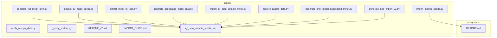
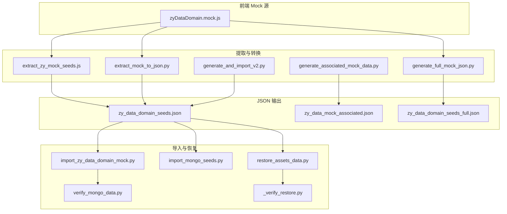
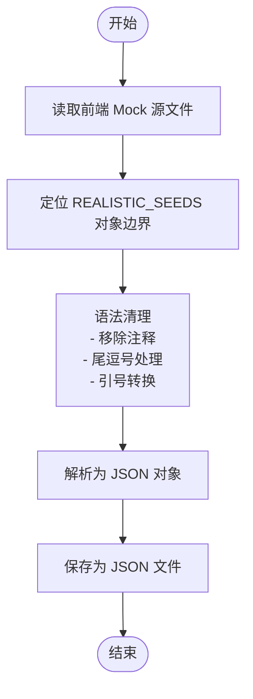
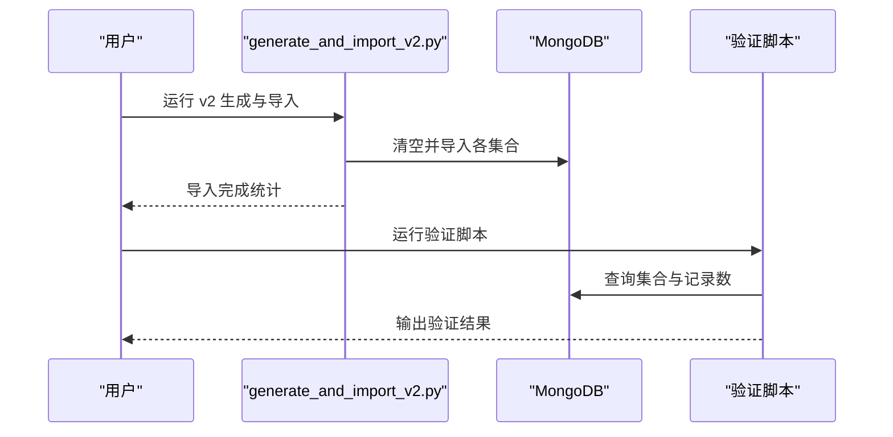
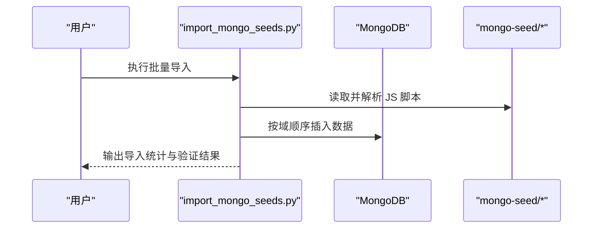
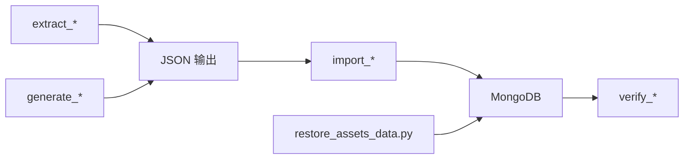

# 维护工具

<cite>
**本文引用的文件**
- [generate_full_mock_json.py](file://scripts/generate_full_mock_json.py)
- [extract_zy_mock_seeds.js](file://scripts/extract_zy_mock_seeds.js)
- [extract_mock_to_json.py](file://scripts/extract_mock_to_json.py)
- [generate_associated_mock_data.py](file://scripts/generate_associated_mock_data.py)
- [import_mongo_seeds.py](file://scripts/import_mongo_seeds.py)
- [import_zy_data_domain_mock.py](file://scripts/import_zy_data_domain_mock.py)
- [restore_assets_data.py](file://scripts/restore_assets_data.py)
- [verify_mongo_data.py](file://scripts/verify_mongo_data.py)
- [_verify_restore.py](file://scripts/_verify_restore.py)
- [generate_and_import_associated_mock.py](file://scripts/generate_and_import_associated_mock.py)
- [generate_and_import_v2.py](file://scripts/generate_and_import_v2.py)
- [README_v2.md](file://scripts/README_v2.md)
- [IMPORT_GUIDE.md](file://scripts/IMPORT_GUIDE.md)
- [mongo-seed/README.md](file://mongo-seed/README.md)
- [zy_data_domain_seeds.json](file://scripts/zy_data_domain_seeds.json)
</cite>

## 目录
1. [简介](#简介)
2. [项目结构](#项目结构)
3. [核心组件](#核心组件)
4. [架构总览](#架构总览)
5. [详细组件分析](#详细组件分析)
6. [依赖分析](#依赖分析)
7. [性能考虑](#性能考虑)
8. [故障排除指南](#故障排除指南)
9. [结论](#结论)
10. [附录](#附录)

## 简介
本文件面向投资组合管理系统的种子数据维护工具，系统性梳理并说明以下工具链：
- Mock 数据生成与提取：从前端 Mock 源文件抽取真实数据集，并转换为 JSON；生成具备复杂关联关系的 Mock 数据。
- 数据导入与恢复：支持将 JSON 或 JS 脚本导入 MongoDB，以及从本地备份 JSON 恢复资产与行情数据。
- 数据验证与完整性检查：提供导入后的数据统计与一致性验证脚本。
- 批量处理与域划分：按数据域组织的批量导入流程，支持增量与重建模式。

## 项目结构
与“维护工具”相关的脚本与种子数据主要位于 scripts 与 mongo-seed 目录：
- scripts：包含各类数据生成、提取、导入、恢复与验证脚本，以及设计文档与导入指南。
- mongo-seed：包含按域组织的 MongoDB 种子脚本，提供统一的主键池与批量导入入口。

图表来源
- [generate_full_mock_json.py:1-66](file://scripts/generate_full_mock_json.py#L1-L66)
- [extract_zy_mock_seeds.js:1-127](file://scripts/extract_zy_mock_seeds.js#L1-L127)
- [extract_mock_to_json.py:1-98](file://scripts/extract_mock_to_json.py#L1-L98)
- [generate_associated_mock_data.py:1-617](file://scripts/generate_associated_mock_data.py#L1-L617)
- [import_mongo_seeds.py:1-305](file://scripts/import_mongo_seeds.py#L1-L305)
- [import_zy_data_domain_mock.py:1-161](file://scripts/import_zy_data_domain_mock.py#L1-L161)
- [restore_assets_data.py:1-215](file://scripts/restore_assets_data.py#L1-L215)
- [verify_mongo_data.py:1-36](file://scripts/verify_mongo_data.py#L1-L36)
- [_verify_restore.py:1-36](file://scripts/_verify_restore.py#L1-L36)
- [generate_and_import_associated_mock.py:1-496](file://scripts/generate_and_import_associated_mock.py#L1-L496)
- [generate_and_import_v2.py:1-510](file://scripts/generate_and_import_v2.py#L1-L510)
- [README_v2.md:1-380](file://scripts/README_v2.md#L1-L380)
- [IMPORT_GUIDE.md:1-261](file://scripts/IMPORT_GUIDE.md#L1-L261)
- [mongo-seed/README.md:1-125](file://mongo-seed/README.md#L1-L125)

章节来源
- [mongo-seed/README.md:1-125](file://mongo-seed/README.md#L1-L125)
- [IMPORT_GUIDE.md:1-261](file://scripts/IMPORT_GUIDE.md#L1-L261)
- [README_v2.md:1-380](file://scripts/README_v2.md#L1-L380)

## 核心组件
- Mock 数据提取与转换
  - generate_full_mock_json.py：从前端 Mock 源文件中提取完整数据集，进行语法清洗与 JSON 转换，输出完整 JSON 文件。
  - extract_zy_mock_seeds.js：使用 Node.js 从前端 Mock 源文件中提取 REALISTIC_SEEDS 对象，进行语法清理并保存为 JSON。
  - extract_mock_to_json.py：Python 版本的提取与转换，定位对象边界、移除注释与尾逗号、转换引号，输出 JSON。
- 关联 Mock 数据生成
  - generate_associated_mock_data.py：生成具备复杂关联关系的 Mock 数据，涵盖直接、间接、高度、重度、轻度关联，并输出 JSON 与关联说明文档。
  - generate_and_import_associated_mock.py：一键生成并导入 10 个集合的关联 Mock 数据，内置完整性验证。
  - generate_and_import_v2.py：v2 增强版，生成 20+ 集合、300+ 条记录，覆盖更广的分析场景与域。
- 导入与恢复
  - import_mongo_seeds.py：批量执行 mongo-seed/*.js 脚本，按域顺序导入 80+ 张表，支持变量解析与重复导入处理。
  - import_zy_data_domain_mock.py：将前端 Mock JSON 导入 MongoDB，支持 upsert 避免重复，补充审计字段。
  - restore_assets_data.py：从本地 JSON 备份恢复资产与行情数据，支持去重合并与批量写入。
- 验证与清理
  - verify_mongo_data.py：验证 MongoDB 中 dwd_ 前缀集合的数量与总量。
  - _verify_restore.py：验证资产与行情集合的恢复结果与前几条记录。
- 配置与使用
  - IMPORT_GUIDE.md：导入步骤、数据结构、关联类型与常见分析场景说明。
  - README_v2.md：v2 增强版概览、数据域统计、关联关系图谱与 15+ 分析场景。

章节来源
- [generate_full_mock_json.py:1-66](file://scripts/generate_full_mock_json.py#L1-L66)
- [extract_zy_mock_seeds.js:1-127](file://scripts/extract_zy_mock_seeds.js#L1-L127)
- [extract_mock_to_json.py:1-98](file://scripts/extract_mock_to_json.py#L1-L98)
- [generate_associated_mock_data.py:1-617](file://scripts/generate_associated_mock_data.py#L1-L617)
- [generate_and_import_associated_mock.py:1-496](file://scripts/generate_and_import_associated_mock.py#L1-L496)
- [generate_and_import_v2.py:1-510](file://scripts/generate_and_import_v2.py#L1-L510)
- [import_mongo_seeds.py:1-305](file://scripts/import_mongo_seeds.py#L1-L305)
- [import_zy_data_domain_mock.py:1-161](file://scripts/import_zy_data_domain_mock.py#L1-L161)
- [restore_assets_data.py:1-215](file://scripts/restore_assets_data.py#L1-L215)
- [verify_mongo_data.py:1-36](file://scripts/verify_mongo_data.py#L1-L36)
- [_verify_restore.py:1-36](file://scripts/_verify_restore.py#L1-L36)
- [IMPORT_GUIDE.md:1-261](file://scripts/IMPORT_GUIDE.md#L1-L261)
- [README_v2.md:1-380](file://scripts/README_v2.md#L1-L380)

## 架构总览
下图展示“数据生成/提取 → JSON 输出 → 导入 MongoDB/恢复”的整体流程，以及与 mongo-seed 的批量导入衔接。

图表来源
- [extract_zy_mock_seeds.js:1-127](file://scripts/extract_zy_mock_seeds.js#L1-L127)
- [extract_mock_to_json.py:1-98](file://scripts/extract_mock_to_json.py#L1-L98)
- [generate_full_mock_json.py:1-66](file://scripts/generate_full_mock_json.py#L1-L66)
- [generate_associated_mock_data.py:1-617](file://scripts/generate_associated_mock_data.py#L1-L617)
- [generate_and_import_v2.py:1-510](file://scripts/generate_and_import_v2.py#L1-L510)
- [import_zy_data_domain_mock.py:1-161](file://scripts/import_zy_data_domain_mock.py#L1-L161)
- [import_mongo_seeds.py:1-305](file://scripts/import_mongo_seeds.py#L1-L305)
- [restore_assets_data.py:1-215](file://scripts/restore_assets_data.py#L1-L215)
- [verify_mongo_data.py:1-36](file://scripts/verify_mongo_data.py#L1-L36)
- [_verify_restore.py:1-36](file://scripts/_verify_restore.py#L1-L36)

## 详细组件分析

### 组件 A：Mock 数据生成与提取工具
- 功能概述
  - 从前端 Mock 源文件中提取 REALISTIC_SEEDS 对象，进行语法清理与 JSON 转换，输出可导入的 JSON 文件。
  - 生成具备复杂业务关联的 Mock 数据，覆盖直接、间接、高度、重度、轻度关联。
- 关键实现点
  - 语法清理：移除注释、尾逗号、单引号转双引号、属性名加引号，确保合法 JSON。
  - 对象边界识别：通过大括号计数与字符串状态机匹配，准确定位对象范围。
  - 关联生成：通过主键池与关联规则，保证跨表引用一致性。
- 使用建议
  - 优先使用 extract_zy_mock_seeds.js 或 extract_mock_to_json.py 生成 JSON，再由 import_zy_data_domain_mock.py 导入。
  - 若前端源文件结构变化，需同步调整提取逻辑（正则与边界匹配）。

图表来源
- [extract_zy_mock_seeds.js:17-126](file://scripts/extract_zy_mock_seeds.js#L17-L126)
- [extract_mock_to_json.py:12-94](file://scripts/extract_mock_to_json.py#L12-L94)
- [generate_full_mock_json.py:15-61](file://scripts/generate_full_mock_json.py#L15-L61)

章节来源
- [extract_zy_mock_seeds.js:1-127](file://scripts/extract_zy_mock_seeds.js#L1-L127)
- [extract_mock_to_json.py:1-98](file://scripts/extract_mock_to_json.py#L1-L98)
- [generate_full_mock_json.py:1-66](file://scripts/generate_full_mock_json.py#L1-L66)

### 组件 B：关联 Mock 数据生成器
- 功能概述
  - 生成具备复杂关联关系的 Mock 数据，覆盖主体、资产、产品、客户、销售、交易、风险等域。
  - 输出 JSON 文件与关联关系说明文档，便于 AI 分析与业务验证。
- 关键实现点
  - 主键池与关联规则：统一管理主键，定义产品→资产、客户→产品、资产→发行人等关联。
  - 多域生成：按域顺序生成数据，确保外键引用有效。
  - 完整性验证：导入后检查无效引用、缺失实体等。
- 使用建议
  - v2 版本覆盖更广域与场景，适合复杂分析与 AI 能力验证。
  - 生成后建议运行 verify_mongo_data.py 或 _verify_restore.py 进行验证。

图表来源
- [generate_and_import_v2.py:22-510](file://scripts/generate_and_import_v2.py#L22-L510)
- [verify_mongo_data.py:7-36](file://scripts/verify_mongo_data.py#L7-L36)
- [_verify_restore.py:6-36](file://scripts/_verify_restore.py#L6-L36)

章节来源
- [generate_and_import_associated_mock.py:21-496](file://scripts/generate_and_import_associated_mock.py#L21-L496)
- [generate_and_import_v2.py:22-510](file://scripts/generate_and_import_v2.py#L22-L510)
- [README_v2.md:1-380](file://scripts/README_v2.md#L1-L380)

### 组件 C：MongoDB 导入与恢复工具
- 功能概述
  - import_mongo_seeds.py：批量执行 mongo-seed/*.js，按域顺序导入 80+ 张表，支持变量解析与重复导入处理。
  - import_zy_data_domain_mock.py：将前端 Mock JSON 导入 MongoDB，支持 upsert 避免重复，补充审计字段。
  - restore_assets_data.py：从本地 JSON 备份恢复资产与行情数据，支持去重合并与批量写入。
- 关键实现点
  - JS 脚本解析：将 JS 变量定义转换为 Python dict，解析对象键值对与数据类型。
  - 批量写入：使用 insert_many 与 bulk_write，支持 upsert 与错误处理。
  - 索引与验证：导入后统计集合数量与记录数，验证关键索引（如唯一索引）创建情况。
- 使用建议
  - 导入前确保 MongoDB 服务可用，连接地址与数据库名正确。
  - 对于重复导入，优先使用 upsert 或先清空再导入策略。

图表来源
- [import_mongo_seeds.py:134-302](file://scripts/import_mongo_seeds.py#L134-L302)
- [mongo-seed/README.md:27-51](file://mongo-seed/README.md#L27-L51)

章节来源
- [import_mongo_seeds.py:1-305](file://scripts/import_mongo_seeds.py#L1-L305)
- [import_zy_data_domain_mock.py:1-161](file://scripts/import_zy_data_domain_mock.py#L1-L161)
- [restore_assets_data.py:1-215](file://scripts/restore_assets_data.py#L1-L215)
- [mongo-seed/README.md:1-125](file://mongo-seed/README.md#L1-L125)

### 组件 D：数据验证与清理工具
- 功能概述
  - verify_mongo_data.py：统计 dwd_ 前缀集合数量与总记录数，快速验证导入结果。
  - _verify_restore.py：验证资产与行情集合的恢复结果，输出前几条记录与每资产代码行情条数 Top 5。
- 使用建议
  - 导入完成后立即运行验证脚本，确保数据完整性与一致性。
  - 对于恢复场景，结合去重合并策略与批量写入，确保数据准确无误。

章节来源
- [verify_mongo_data.py:1-36](file://scripts/verify_mongo_data.py#L1-L36)
- [_verify_restore.py:1-36](file://scripts/_verify_restore.py#L1-L36)

## 依赖分析
- 组件耦合
  - extract_* 与 generate_* 工具相互独立，但共同输出 JSON 文件供 import_* 使用。
  - import_mongo_seeds.py 与 mongo-seed 目录紧密耦合，按域顺序执行脚本。
  - restore_assets_data.py 与 MongoDB 的索引策略（唯一索引）存在依赖关系。
- 外部依赖
  - MongoDB：pymongo 客户端用于连接与写入。
  - Node.js：extract_zy_mock_seeds.js 用于前端 Mock 源文件提取。
- 循环依赖
  - 未发现循环依赖，工具链呈单向数据流。

图表来源
- [extract_zy_mock_seeds.js:1-127](file://scripts/extract_zy_mock_seeds.js#L1-L127)
- [extract_mock_to_json.py:1-98](file://scripts/extract_mock_to_json.py#L1-L98)
- [generate_associated_mock_data.py:1-617](file://scripts/generate_associated_mock_data.py#L1-L617)
- [import_mongo_seeds.py:1-305](file://scripts/import_mongo_seeds.py#L1-L305)
- [import_zy_data_domain_mock.py:1-161](file://scripts/import_zy_data_domain_mock.py#L1-L161)
- [restore_assets_data.py:1-215](file://scripts/restore_assets_data.py#L1-L215)
- [verify_mongo_data.py:1-36](file://scripts/verify_mongo_data.py#L1-L36)
- [_verify_restore.py:1-36](file://scripts/_verify_restore.py#L1-L36)

## 性能考虑
- 批量写入
  - 使用 insert_many 与 bulk_write 提升导入效率，减少网络往返。
  - 对于大规模数据，建议分批写入并设置合适的批大小（参考 restore_assets_data.py 的批处理策略）。
- 索引策略
  - 导入后及时创建唯一索引与常用过滤字段索引，提升查询性能。
  - 注意索引创建的代价与并发写入的影响。
- 数据清洗
  - 在导入前完成语法清理与去重合并，避免重复导入导致的性能下降。
- 并发与资源
  - 控制并发写入与查询，避免 MongoDB 过载。
  - 对于大文件 JSON 导入，建议分块读取与写入。

## 故障排除指南
- MongoDB 连接失败
  - 检查 MongoDB 服务状态与端口占用，必要时修改连接地址。
  - 参考导入指南中的故障排除章节。
- 权限不足
  - 以管理员权限运行命令行或 IDE，确保对 MongoDB 的写入权限。
- 端口冲突
  - 更换 MongoDB 端口或释放占用端口。
- 数据重复与唯一索引冲突
  - 使用 upsert 或先清空再导入策略；导入后检查唯一索引创建情况。
- 前端 Mock 源文件结构变化
  - 更新提取脚本的正则与边界匹配逻辑，确保对象提取准确。

章节来源
- [IMPORT_GUIDE.md:206-234](file://scripts/IMPORT_GUIDE.md#L206-L234)
- [import_zy_data_domain_mock.py:136-140](file://scripts/import_zy_data_domain_mock.py#L136-L140)
- [import_mongo_seeds.py:194-202](file://scripts/import_mongo_seeds.py#L194-L202)

## 结论
本维护工具链覆盖了从 Mock 数据提取、生成、导入到恢复与验证的全流程，支持多域、多集合、复杂关联关系的数据维护需求。通过批量导入与验证脚本，能够高效地支撑 AI 分析与业务验证场景。建议在团队内部规范使用流程与参数配置，确保数据一致性与可追溯性。

## 附录
- 最佳实践
  - 使用 v2 增强版生成更丰富的数据域与分析场景。
  - 导入前先验证前端 Mock 源文件结构，确保提取脚本稳定。
  - 对于大规模数据，采用分批导入与索引重建策略。
  - 定期运行验证脚本，确保数据完整性与一致性。
- 常用命令
  - 一键生成并导入 v2：python scripts/generate_and_import_v2.py
  - 批量导入 mongo-seed：python scripts/import_mongo_seeds.py
  - 验证导入结果：python scripts/verify_mongo_data.py
  - 恢复资产与行情：python scripts/restore_assets_data.py